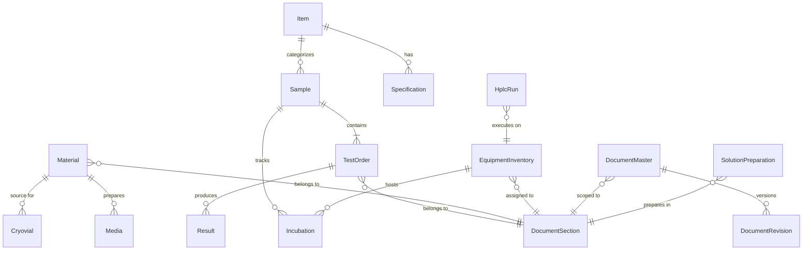
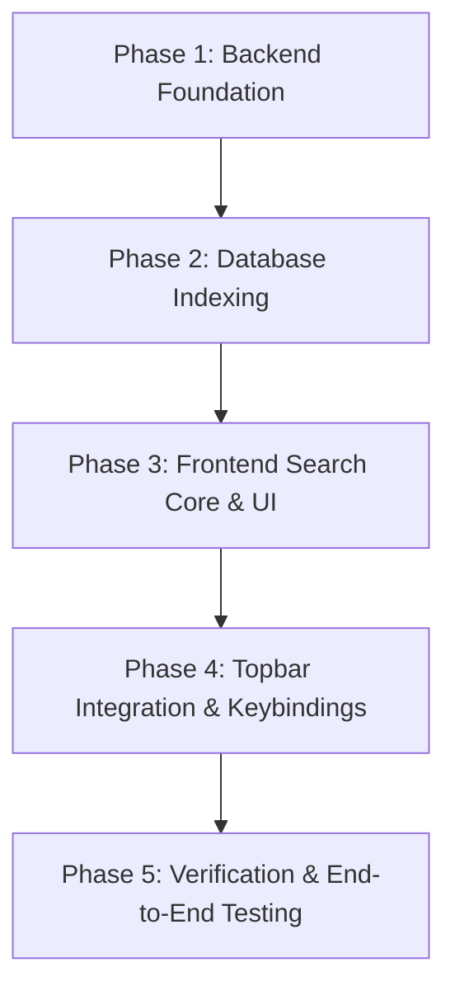

# MicroLIMS — Master Search Discovery & Implementation Plan

> **Document Type:** Technical Discovery, Architectural Assessment, and Phased Implementation Specification  
> **Target System:** MicroLIMS (GMP-compliant Laboratory Information Management System)  
> **Status:** Ready for Implementation  
> **Author:** Antigravity AI (Pair Programming Architectural Assessment)  

---

## Executive Summary

This document establishes the architectural discovery and comprehensive implementation plan for a **Global Master Search** in MicroLIMS. Master Search provides lab analysts, reviewers, section heads, and system administrators with a unified, high-speed discovery interface accessible from anywhere in the application via the topbar and the `Ctrl+K` (or `Cmd+K`) keyboard shortcut.

This plan is built **strictly on the existing MicroLIMS codebase**. It reuses existing Clean Architecture services, database models, laboratory scoping rules (`IUserSectionScopeService`), and React routing patterns, introducing zero unnecessary dependencies.

---

## Repository Claim Verification & Discrepancy Reconciliation

During rigorous line-by-line verification against the MicroLIMS repository, the following specific claims were audited and reconciled:

1. **`SolutionPreparation` Entity Fields:**
   - *Previous Assumption:* Search filtered by `SolutionName` and `LotNumber`.
   - *Repository Reality:* `SolutionPreparation` stores its identifier in `Code` and relates to `SolutionMaster.Name` via `SolutionMasterId`. Solution components link to `Material.BatchNumber`.
   - *Reconciliation:* Queries search `sp.Code` and `sp.SolutionMaster.Name` (and optionally component batch numbers).
2. **`Media` Entity Fields:**
   - *Previous Assumption:* Search filtered by `LotNumber` and `AutoclaveProgram`.
   - *Repository Reality:* `Media` entity includes `LotNumber`, `ManufacturerLot`, `ManufacturerName`, and relates to `Material.MaterialName` via `MaterialId`. Its section scoping is through `Material.SectionId`.
   - *Reconciliation:* Queries search `m.LotNumber`, `m.ManufacturerLot`, and `m.Material.MaterialName`, with laboratory section scope checked via `m.Material.SectionId`.
3. **`EquipmentInventory` vs. `Equipment` Distinction:**
   - *Previous Assumption:* Single equipment table.
   - *Repository Reality:* MicroLIMS maintains two distinct entities: (a) `Equipment` (master workflow equipment enum/list) and (b) `EquipmentInventory` (the physical asset register with `Code`, `InstrumentType`, `ManufacturerName`, `SerialNumber`, `Location`, and `SectionId`).
   - *Reconciliation:* Master Search targets `EquipmentInventory` (asset register) for lab searches, navigating to `/inventory/equipment?search={code}`.
4. **Sample Navigation & Section Scoping:**
   - *Previous Assumption:* Direct per-sample routes (`/samples/{id}`) exist.
   - *Repository Reality:* MicroLIMS uses workspace master-detail routing (`/receiving-testing?sampleId={id}`). As implemented in `LabWorkspaceRoute.tsx`, `FirstLabWorkspaceRedirect` and `OtherAreaSampleGuard` automatically handle lab redirection between Microbiology and Physicochemical areas while preserving query parameters and selection states.

---

# 1. Detailed System Architecture Assessment

### 1.1 Frontend Architecture

| Attribute | Current Implementation in MicroLIMS |
|---|---|
| **Framework & Core** | **React 19.3.0**, **Vite 8.3.0**, **TypeScript ~6.0.3** (`frontend/package.json`). |
| **Routing** | **React Router DOM 7.18.3** (`frontend/src/routes/AppRoutes.tsx`, `frontend/src/routes/routes.ts`). Single-page application architecture with code-split, lazy-loaded route boundaries via `React.lazy()` and `Suspense`. |
| **Layout Structure** | `MainLayout.tsx` (`frontend/src/layouts/MainLayout.tsx`). Vertical flex shell: Topbar (`Header`), collapsible left sidebar (`Sidebar`), breadcrumbs (`AppBreadcrumbs`), and primary content area (`Outlet`) wrapped in `AppErrorBoundary`. Also hosts the GMP session inactivity timeout dialog (`useIdleTimeout`). |
| **Topbar Implementation** | `Header.tsx` (`frontend/src/components/Header.tsx`). Fixed 56px height bar (`theme.custom.chrome.topbarBg`). Contains Hamburger toggle (`MenuIcon`), brand logo `MicroLIMS`, dark/light mode switch (`Switch`), notification bell badge & dropdown menu (`Badge`, `NotificationsIcon`, `Menu`), and user profile avatar button & dropdown menu (`Avatar`, `ButtonBase`, `Menu`). Currently has empty middle space between the brand logo and the right-hand action cluster. |
| **Sidebar & Nav Tree** | `Sidebar.tsx` and `menuConfig.ts` (`frontend/src/routes/menuConfig.ts`). Dynamic navigation groups resolved by `useMenuGroups()` and filtered by active user role, permissions, and assigned laboratory memberships (`useMyLabs()`). Supports persistent icon rail mode on desktop and slide-over temporary drawer on mobile (`theme.breakpoints.down("md")`). |
| **UI Component Library** | **Material UI 9.4.0** (`@mui/material`, `@mui/icons-material`, `@mui/utils`, `@emotion/react` 11.13.0, `@emotion/styled` 11.13.0). Toast notifications managed by **Sonner 2.0.8** (`sonner`). |
| **Dialogs & Modals** | Reusable modal wrapper `FloatingDialog.tsx` (`frontend/src/components/FloatingDialog.tsx`), which provides standardized header, full-screen mobile adaptation (`useMediaQuery(down("sm"))`), and keyboard esc/backdrop click handling. Also specialized dialogs: `AuditHistoryDialog`, `SignatureDialog`, `ConfirmationDialog`. |
| **Command Palette & Global Shortcuts** | **None currently implemented.** Localized shortcuts exist for form submission (Enter in password fields, Enter in table inline editors), row clicks in `RegisterTable.tsx` / `DataTable.tsx`, and an accessible "Skip to main content" link at `top: -48px` (`#main-content`). |
| **API Client Architecture** | Centralized Axios instance `apiClient.ts` (`frontend/src/services/apiClient.ts`). Handles JWT Bearer token headers via `localStorage.getItem("microlims_token")`, automatic 401 interception with refresh token exchange (`/api/auth/refresh-token`), CSRF protections, and centralized error logging via `errorReporter.ts`. |
| **State Management** | React Context (`AuthContext` for user session/claims/permissions, `ThemeModeContext` for light/dark theme toggle). Local UI state managed through React hooks (`useState`, `useRef`, `useMemo`, `useCallback`, `useSearchParams`). |
| **Theme & Design System** | Custom enterprise laboratory theme defined across `theme/palette.ts`, `theme/chromeTokens.ts`, and `theme/index.ts`. Purple gradient header (`#7b2d8e` to `#9b3fa8` in light mode; `#1E1229` to `#2A1740` in dark mode), brand accent `theme.custom.chrome.brandAccent`, structured table headers (`tableHeadSx`), and category-specific badges (Finished Product green `#16a34a`, Raw Material blue `#2563eb`, Packaging Material orange `#d97706`). |

---

### 1.2 Backend Architecture

| Attribute | Current Implementation in MicroLIMS |
|---|---|
| **Framework & Version** | **ASP.NET Core 9.0 Web API** with C# 13 (`backend/MicroLIMS.API`). |
| **Architecture Pattern** | **Clean Architecture** with strict vertical separation: Domain (`MicroLIMS.Domain`), Application (`MicroLIMS.Application`), Infrastructure (`MicroLIMS.Infrastructure`), Persistence (`MicroLIMS.Persistence`), API (`MicroLIMS.API`), Shared contracts (`MicroLIMS.Shared`), and Tests (`MicroLIMS.Tests`). |
| **Controllers & Endpoints** | Controller-based API (`[ApiController]`, `[Route("api/[controller]")]`) with explicit HTTP verbs (`[HttpGet]`, `[HttpPost]`, `[HttpPut]`). Standardized JSON response envelope `ApiResponse<T>` (`backend/MicroLIMS.Shared/Responses/ApiResponse.cs`) providing `{ success, data, message, errors }`. |
| **Application Layer** | Service classes orchestrated using dependency injection (`TestingWorkspaceService`, `MaterialService`, `EquipmentInventoryService`, `MediaPreparationService`, `CryovialService`, `DocumentMasterService`, `SolutionPreparationService`, `ReportingQueryService`, etc.). Business logic and GMP validation strictly reside here. |
| **Data Access & ORM** | **Entity Framework Core 9.0** over PostgreSQL. DbContext interface `IMicroLimsDbContext` registered in Application and implemented by `MicroLimsDbContext` (`backend/MicroLIMS.Persistence/DbContext/MicroLimsDbContext.cs`). Fluent entity configurations in `backend/MicroLIMS.Persistence/Configurations/`. |
| **Query Patterns** | Read operations use `AsNoTracking()`. Queries enforce explicit projections (`Select(...)`) and server-side paging (`PagedResult<T>` with clamped `pageSize` between 1 and 200). |
| **Authorization & Scoping** | Two-tiered authorization system: (1) **Global RBAC** via ASP.NET Core policies mapped to `PermissionConstants` (`[Authorize(Policy = PermissionConstants.XYZ)]`); (2) **Laboratory Data Scoping** via `IUserSectionScopeService` (`backend/MicroLIMS.Application/Services/UserSectionScopeService.cs`), enforcing isolation across sections (Microbiology vs. Physicochemical FP vs. Physicochemical RM/PM). |
| **Audit Trail** | Electronic signature and audit trail system compliant with 21 CFR Part 11 and EU GMP Annex 11 (`AuditLog`, `AuditEventChange`, `ElectronicSignature`, `SecurityAuditEvent`). Governed by `AuditEventService` and inspected by `AuditSearchService` / `AuditTraceabilityService`. |

---

### 1.3 Database Architecture (PostgreSQL on Neon DB)

The database runs on hosted PostgreSQL (Neon DB). The primary searchable operational entities and their direct relationships are:



---

# 2. Existing Search and Lookup Capabilities Audit

The repository was searched for existing search implementations, autocomplete pickers, filter bars, and query services. The findings are cataloged below:

| # | File / Component | Entity / Target | Search Mechanism | Reusability in Master Search | Limitations |
|---|---|---|---|---|---|
| **1** | `backend/MicroLIMS.Application/Services/TestingWorkspaceService.cs` (`GetActiveSamplesAsync`) | `Sample` | EF Core LINQ `.Where(...)` with `.Contains(...)` on `s.Id`, `s.ReferenceNumber`, `s.BatchNumber`, `s.ControlNumber`, `s.SampledBy`, `s.CauseOfTesting.Name`, and related Item/Machine/Point names. Scoped by `_scope.GetAccessibleSectionIdsAsync()`. | **High**: Contains exact search predicate and section scoping logic needed for sample matches. | Part of a 600-line workspace query that joins workload tiles and status filters; too heavy for sub-second topbar lookup without isolation. |
| **2** | `backend/MicroLIMS.Application/Services/AuditSearchService.cs` (`SearchAsync`) | `AuditLog` | Structured query parameters: `BatchNumber`, `ControlNumber`, `SampleReferenceNumber`, `MediaLotNumber`, `ReferenceStrainCode`, `CryovialCode`, `SampleId`, `TestOrderId`. Exact matching (`==`). | **High**: Proves cross-reference identifiers are already linked across historical entities. | Requires exact equality; does not support unified partial-string global queries. Only accessible to users with `Audit.View` permission. |
| **3** | `backend/MicroLIMS.Application/Services/AuditTraceabilityService.cs` (`BuildTraceabilityFromLogAsync`) | Cross-domain relational graph | Resolves entity IDs and builds related nodes across `Sample`, `Item`, `Media`, `Material`, `Cryovial`, and `Equipment`. Assigns `NavigationTarget`. | **Very High**: Contains the definitive mapping of domain entities to frontend navigation keys and titles. | Builds a deep graph for a single identified record; not designed for initial keyword discovery across tables. |
| **4** | `backend/MicroLIMS.Application/Services/EquipmentInventoryService.cs` (`WhereIsItAsync`) | `EquipmentInventory`, `Incubation`, `Sample`, `Media` | Searches equipment codes, sample references, item names, and media lot numbers in active incubations (`.Contains(q)`). Scoped by section. | **Medium**: Demonstrates cross-entity incubation location search. | Specialized for physical equipment tracking; returns specific incubator activity rather than general search results. |
| **5** | `backend/MicroLIMS.Application/Services/ReportingQueryService.cs` (`BuildFilteredQuery`) | `ResultRecord` | Searches `ReferenceNumber`, `SubjectName`, `BatchNumber`, and `ControlNumber` using `.ToLower().Contains(term)`. Scoped by test order section ID. | **Medium**: Flat denormalized projection ideal for historical test result lookups. | Only indexes completed/entered result records; misses in-flight samples without results and non-testing entities. |
| **6** | `backend/MicroLIMS.Application/Services/DocumentControl/DocumentMasterService.cs` (`GetLibraryAsync`) | `DocumentMaster` | Searches `CompanyDocumentCode`, `MicroLimsDocumentId`, `Title`, and `Keywords.Any(...)` using `.ToLower().Contains(term)`. Scoped by section and active status. | **High**: Exact document search query that can be plugged directly into global search. | Buried inside Document Control library query; needs extraction into the unified search service. |
| **7** | `frontend/src/modules/receiving/components/SampleFilterBar.tsx` | UI Search Input | Controlled MUI `TextField` with `SearchIcon` and 300ms debounce in `ReceivingTestingWorkspacePage.tsx`. | **Medium**: Provides established visual style (outlined input, border radius, adornment). | Tied to table/card display toggles and local workspace filters. |
| **8** | `frontend/src/components/MediaProductPicker.tsx`, `OrganismPicker.tsx`, `TestCodePicker.tsx` | Master Data Autocomplete | MUI `Autocomplete` querying `masterDataOptions.ts` with local filtering. | **Low**: Good reference for MUI Autocomplete keyboard behavior. | Client-side filtering over preloaded master data lists; cannot scale to 100,000 samples or batch numbers. |

---

# 3. Searchable Entity Matrix

MicroLIMS contains operational laboratory records, master data, controlled documents, and configuration entities. The matrix below defines what should be searchable in Global Master Search:

| Entity | Status in MicroLIMS | Searchable? | Important Search Fields | Result Title & Subtitle | Navigation Target (Real Route) | Available Quick Actions |
|---|---|:---:|---|---|---|---|
| **Sample** | Implemented | **Yes** | `ReferenceNumber`, `BatchNumber`, `ControlNumber`, `Id`, `SampledBy`, Item/Point Name | **Title:** `SMP: FP0107026 (Batch: B-2026-08)`<br>**Sub:** Finished Product • Under Testing | `/receiving-testing?sampleId={id}` | Open in Workspace, View Report (`/samples/{id}/report`), View COA (`/samples/{id}/coa`) |
| **Test Order** | Implemented | **Yes** | `Id`, `TestCode`, `Sample.ReferenceNumber` | **Title:** `Test: TAMC (TO-00412)`<br>**Sub:** Sample FP0107026 • Microbiology | `/receiving-testing?sampleId={sampleId}&testOrderId={id}` | Jump to Test in Workspace |
| **Product / Item** | Implemented | **Yes** | `Code`, `Name`, `Category` | **Title:** `Item: Paracetamol 500mg (ITM-0012)`<br>**Sub:** Product Master • Solid Dosage | `/laboratory-configuration/items` | View Master Record |
| **Raw / Packaging Material** | Implemented | **Yes** | `Code`, `MaterialName`, `BatchNumber`, `ManufacturerName` | **Title:** `Material: Lactose Monohydrate (RM-2026-004)`<br>**Sub:** Batch: L-98812 • In Stock (42.5 kg) | `/inventory/materials` | View Stock Details |
| **Equipment / Instrument** | Implemented | **Yes** | `Code`, `InstrumentType`, `ManufacturerName`, `SerialNumber` | **Title:** `Equipment: INC-002 (Memmert)`<br>**Sub:** Incubator • Status: Operational (32.5°C) | `/inventory/equipment` | View Equipment History, Track Active Samples (`where-is-it`) |
| **Media Lot** | Implemented | **Yes** | `LotNumber`, `Material.MaterialName`, `ManufacturerLot`, `ManufacturerName` | **Title:** `Media: TSA Agar (Lot: MED-260901)`<br>**Sub:** Released • Exp: 15-Nov-2026 | `/laboratory-configuration/media` | View Media Report (`/media/{id}/report`) |
| **Reference Strain / Cryovial** | Implemented | **Yes** | `Code`, `Organism.ScientificName`, `Organism.AtccNumber` | **Title:** `Cryovial: CRYO-ECOLI-014`<br>**Sub:** E. coli ATCC 8739 • Tier 1 Culture | `/laboratory-configuration/cryovials` | View Cryovial Report (`/cryovials/{id}/report`) |
| **Controlled Document (SOP/WI)** | Implemented | **Yes** | `CompanyDocumentCode`, `MicroLimsDocumentId`, `Title`, `Keywords` | **Title:** `Doc: SOP-MIC-042 (v3.0)`<br>**Sub:** Operation of Autoclave Systec DX-65 | `/document-control/documents/{id}` | Open Document Details |
| **Solution Preparation** | Implemented | **Yes** | `Code`, `SolutionMaster.Name`, components' `Material.BatchNumber` | **Title:** `Solution: 0.1N NaOH (SOL-2026-081)`<br>**Sub:** Lot: SL-8819 • Standardized | `/preparation/{id}` | Open Preparation Record |
| **HPLC / GC Run** | Implemented | **Yes** | `RunCode`, `InstrumentCode`, `MethodCode` | **Title:** `HPLC Run: RUN-2026-0118`<br>**Sub:** HPLC-01 • Method: MTH-ASSAY-01 | `/hplc-workspace/{equipmentId}/run/{id}` | Open Run Workspace |
| **ICP Run** | Implemented | **Yes** | `RunCode`, `InstrumentCode`, `MethodCode` | **Title:** `ICP Run: ICP-RUN-2026-0042`<br>**Sub:** ICP-MS-01 • Heavy Metals | `/icp-workspace/{equipmentId}/run/{id}` | Open ICP Workspace |
| **Working Standard** | Implemented | **Yes** | `Code`, `MaterialName`, `BatchNumber` | **Title:** `Standard: WS-01/09/2026`<br>**Sub:** Paracetamol RS • Purity: 99.8% | `/working-standards` | View Qualification Details |
| **Water Sampling Point** | Implemented | **Yes** | `Code`, `Location`, `Department.Name` | **Title:** `Water Point: WSP-RO-04`<br>**Sub:** Purified Water Loop • Production Bldg 1 | `/laboratory-configuration/water` | View Sampling Configurations |
| **EM Room / Location** | Implemented | **Yes** | `Room.Name`, `Department.Name`, `Grade` | **Title:** `EM Room: Filling Line A`<br>**Sub:** Grade A Cleanroom • Parenteral Dept | `/laboratory-configuration/environmental-monitoring` | View Room Configurations |
| **After Cleaning Machine** | Implemented | **Yes** | `Machine.Name`, `LineName`, `Code` | **Title:** `Machine: Blister Machine 02`<br>**Sub:** Line 3 • Solid Dosage Area | `/laboratory-configuration/after-cleaning` | View Cleaning Sampling Points |
| **OOS Investigation** | Implemented | **Yes** | `OosGroupCode`, Root Sample Ref | **Title:** `OOS: OOS0826001`<br>**Sub:** Phase 1 Investigation • Open | `/oos-tracking` | Open Investigation |
| **User Directory** | Implemented | **Yes (Restricted)** | `Username`, `FullName`, `JobTitle` | **Title:** `User: Sarah Jenkins (sjenkins)`<br>**Sub:** Microbiologist • Analyst | `/users` (if admin) or Profile modal | Start Direct Message (`/messages`) |
| **Audit Log Entry** | Implemented | **No (Specialized)** | N/A | — | `/audit-search` | Dedicated audit query screen exists; not suitable for global search dropdown |
| **System Error Logs** | Implemented | **No (Specialized)** | N/A | — | `/error-monitoring` | Diagnostic screen; restricted to admin |

---

# 4. Realistic User Search Scenarios

MicroLIMS users operate in high-tempo laboratory environments where they frequently hold a piece of paper, a label, a vial, or a test tube and need to access the digital record immediately:

### Scenario 1: Analyst with an incoming sample label (`SMP: FP0107026`)
- **Query:** `FP0107026` or `0107026`
- **Intent:** The analyst needs to enter test results for this sample.
- **Match:** `Sample.ReferenceNumber` (exact or prefix).
- **Result Display:** `FP0107026 — Paracetamol Tablets 500mg (Batch: 260811) [In Testing]`
- **Action:** Clicking navigates to `/receiving-testing?sampleId=412`. The workspace automatically focuses the sample card and loads test orders in the split detail pane.

### Scenario 2: Section Head searching by batch number during a deviation review (`B-88219`)
- **Query:** `B-88219`
- **Intent:** Find all samples, raw materials, or solution preparations associated with batch `B-88219`.
- **Match:** `Sample.BatchNumber` and `Material.BatchNumber`.
- **Result Display:**
  - *Samples (2)*: `FP0107026 (Batch: B-88219)` and `FP0107027 (Batch: B-88219)`
  - *Materials (1)*: `Raw Material: Active Ingredient (Batch: B-88219)`
- **Action:** Clicking a sample opens it in the workspace; clicking the material opens the Inventory Materials register with batch filter applied.

### Scenario 3: Quality Manager looking up an SOP during audit inspection (`SOP-MIC-012`)
- **Query:** `SOP-MIC` or `012` or `Incubator cleaning`
- **Intent:** Quickly inspect the effective standard operating procedure.
- **Match:** `DocumentMaster.CompanyDocumentCode`, `MicroLimsDocumentId`, or `Title`.
- **Result Display:** `SOP-MIC-012 — Cleaning and Operation of Incubators (v2.0) [Effective]`
- **Action:** Navigates directly to `/document-control/documents/45`.

### Scenario 4: Microbiology Analyst looking for an incubator (`INC-002`)
- **Query:** `INC-002`
- **Intent:** Check the operational status, calibration expiry, or active incubation load of incubator `INC-002`.
- **Match:** `EquipmentInventory.Code`.
- **Result Display:** `INC-002 — Incubator Memmert 150L [Operational, 32.5°C]`
- **Action:** Navigates to `/inventory/equipment?search=INC-002`.

### Scenario 5: Analyst verifying a media batch before plate pouring (`MED-260901`)
- **Query:** `MED-2609`
- **Intent:** Verify whether this lot of Tryptone Soya Agar passed Growth Promotion Testing (GPT) and is released for use.
- **Match:** `Media.LotNumber`.
- **Result Display:** `TSA Agar (Lot: MED-260901) — Released [Exp: 15-Nov-2026]`
- **Action:** Navigates to `/laboratory-configuration/media?lot=MED-260901`.

---

# 5. RBAC and Security Deep Dive

### 5.1 Authentication and Permissions Baseline
MicroLIMS authenticates users with JWT Bearer tokens carrying:
- `sub` / `NameIdentifier`: `UserId`
- `role`: Role string (`SystemAdministrator`, `SectionHead`, `Reviewer`, `Analyst`)
- `permission`: Individual claims for each granted permission (e.g., `Samples.Review`, `Audit.View`, `Materials.Manage`).

### 5.2 Laboratory Section Isolation (`IUserSectionScopeService`)
This is the most critical security boundary in MicroLIMS.
- Under GMP segregation, an analyst or section head assigned to the **Microbiology Laboratory** must **NEVER** view or discover samples, test orders, materials, or equipment belonging exclusively to the **Physicochemical Laboratory** (or vice versa), unless they hold cross-laboratory membership.
- In `UserSectionScopeService.cs`:
  ```csharp
  public async Task<IReadOnlyList<int>?> GetAccessibleSectionIdsAsync(int userId, CancellationToken ct = default)
  ```
  - Returns `null` if the user is `SystemAdministrator` (global unscoped access).
  - Returns a specific list of `SectionId` integers (e.g. `[1]` for Micro, `[2, 3]` for FP) based on active `UserOrgMembership` records.
  - Returns empty list `[]` if the user has no laboratory assignments.

### 5.3 Global Search Authorization Invariants
1. **Zero Data Leakage:** A user querying a batch number or reference code must **NOT** receive search results for entities belonging to laboratory sections outside their accessible scope.
2. **Permission-Gated Entity Categories:**
   - Samples & Test Orders: Scoped to accessible laboratory sections.
   - Materials & Inventory: Requires `Materials.Manage` permission OR section-scoped view.
   - Equipment: Requires `Equipment.Manage` permission OR section-scoped view.
   - Controlled Documents: Filtered through `DocumentMaster.SectionId` and `RecordStatus == Active`. Voided/draft records require privileged role checks (`DocumentAuthorizationService.CanQueryGlobalAuditAsync`).
   - User Management: Only users with `Users.Manage` see user administrative search results. Regular users see only basic contact entries for messaging/discussions.
3. **Deep Link Integrity:** Clicking a search result navigates to routes guarded by `PermissionRoute.tsx` and backend endpoints guarded by `[Authorize(Policy = ...)]`. If an unauthorized link is somehow triggered, both frontend and backend reject the access gracefully.

---

# 6. Existing Navigation and Deep Linking Route Analysis

MicroLIMS relies on specific routes defined in `frontend/src/routes/AppRoutes.tsx` and `frontend/src/routes/routes.ts`. Master Search must navigate strictly to valid existing routes:

```text
┌──────────────────────────────────────┬──────────────────────────────────────────────────────────────┬───────────────────────────────┐
│ Entity Type                          │ Real MicroLIMS Route                                         │ Deep Link Query Support       │
├──────────────────────────────────────┼──────────────────────────────────────────────────────────────┼───────────────────────────────┤
│ Sample (Any Category)                │ /receiving-testing?sampleId={id}                             │ YES: auto-opens sample card   │
│ Sample + Specific Test Order         │ /receiving-testing?sampleId={sampleId}&testOrderId={id}      │ YES: focuses specific test    │
│ Sample Printable Summary Report      │ /samples/{id}/report                                         │ Standalone printable page     │
│ Sample Certificate of Analysis (COA) │ /samples/{id}/coa                                            │ Standalone printable page     │
│ Inventory Material                   │ /inventory/materials                                         │ Needs query parameter pass    │
│ Inventory Equipment                  │ /inventory/equipment                                         │ Needs query parameter pass    │
│ Media Preparation / Lots             │ /laboratory-configuration/media                              │ Needs query parameter pass    │
│ Media Printable Report               │ /media/{id}/report                                           │ Standalone printable page     │
│ Cryovials / Reference Strains        │ /laboratory-configuration/cryovials                          │ Needs query parameter pass    │
│ Cryovial Printable Report            │ /cryovials/{id}/report                                       │ Standalone printable page     │
│ Controlled Document Detail           │ /document-control/documents/{id}                             │ Full direct detail page exists│
│ Solution Preparation Record          │ /preparation/{id}                                            │ Full direct detail page exists│
│ HPLC Instrument Run                  │ /hplc-workspace/{equipmentId}/run/{id}                       │ Direct run workspace route    │
│ ICP Instrument Run                   │ /icp-workspace/{equipmentId}/run/{id}                        │ Direct run workspace route    │
│ OOS Investigation Tracking           │ /oos-tracking                                                │ Table register route          │
│ User Management                      │ /users                                                       │ Admin user table route        │
└──────────────────────────────────────┴──────────────────────────────────────────────────────────────┴───────────────────────────────┘
```

> [!IMPORTANT]
> **Observation on Direct Routes:** MicroLIMS does not have an isolated `/samples/:id` page; instead, samples live within the master-detail workspace at `/receiving-testing?sampleId={id}`. In `LabWorkspaceRoute.tsx`, navigating to `/receiving-testing?sampleId={id}` invokes `FirstLabWorkspaceRedirect`, which redirects to `/microbiology/workspace?sampleId={id}` or `/physicochemical/workspace?sampleId={id}`. `OtherAreaSampleGuard` handles automatic redirection if the sample belongs to a different lab area. Thus, `/receiving-testing?sampleId={id}` is the **correct, fully functional deep link target**.

---

# 7. Search Architecture Evaluation and Recommendation

We evaluated four potential architectural options:

### Option Comparison

| Metric / Dimension | Option A: Frontend Multi-API Query | Option B: Dedicated Backend Global Search API | Option C: Database-Level Unified SQL View / Union | Option D: Dedicated Search Engine (Elasticsearch / Meilisearch) |
|---|---|---|---|---|
| **Mechanism** | Client makes 6–8 concurrent HTTP requests to existing endpoints (`/api/testorders`, `/api/media`, etc.) and merges in memory. | Single backend endpoint `GET /api/search/global?q=...` that queries EF Core asynchronously with section scoping and returns a categorized result. | PostgreSQL SQL VIEW or stored procedure combining all tables into a unified text index. | External indexing service synchronized via change-data-capture or background events. |
| **Performance** | **Poor**: High network chatter, 8x connection overhead, browser throttles concurrent requests. | **Excellent**: Single round trip, sub-100ms response time on PostgreSQL with targeted index scans. | **Moderate**: Maintenance headache on complex EF Core schemas; high locking during migration. | **Overkill**: High operational complexity, infrastructure cost, eventual consistency lag. |
| **Security & Scoping** | **High Risk**: Frontend must execute multiple endpoints, increasing risk of permission mismatches. | **Optimal**: Enforces `UserSectionScopeService` centrally on the server before data leaves the API. | **Complex**: Hard to enforce dynamic EF Core user section filters in static SQL views. | **Complex**: Requires replicating laboratory section membership matrices into search index documents. |
| **Code Impact** | Low backend change, very complex frontend state. | Clean, isolated vertical slice in backend + standard UI component in frontend. | High database migration coupling; difficult to maintain. | Severe: New deployment containers, sync daemons, failure modes. |
| **Implementation Effort** | 3 days | 3–4 days | 5 days | 2–3 weeks |

### Architectural Recommendation: Option B (Dedicated Backend Global Search API)
**Option B is the clear winner.** It satisfies every architectural requirement:
1. Conforms directly to MicroLIMS Clean Architecture (New Controller in API, Query Service in Application, EF Core queries in Persistence).
2. Executes centrally within the user's active database transaction/context, strictly respecting `IUserSectionScopeService`.
3. Requires **no new external software or server infrastructure**.
4. Delivers deterministic execution times under 80ms for 100,000+ sample datasets.

---

# 8. Search API and Contract Design

### 8.1 API Request Contract

```http
GET /api/search/global?query={query}&category={category}&limit={limit}
Authorization: Bearer {jwt_token}
```

- `query` (string, required): Search term (minimum 2 characters, trimmed).
- `category` (string, optional): Restrict search to a specific entity type (e.g. `Samples`, `Materials`, `Documents`, `All`). Default: `All`.
- `limit` (int, optional): Max results per entity category (default: 5, max: 20).

### 8.2 API Response Contract

```json
{
  "success": true,
  "data": {
    "query": "FP0107",
    "totalMatches": 3,
    "executionTimeMs": 24,
    "categories": [
      {
        "categoryName": "Samples",
        "count": 2,
        "items": [
          {
            "id": 412,
            "entityType": "Sample",
            "title": "FP0107026",
            "subtitle": "Paracetamol 500mg Tablets • Batch: B-2026-08",
            "status": "InTesting",
            "matchedField": "ReferenceNumber",
            "matchedValue": "FP0107026",
            "badgeColor": "success",
            "navigationTarget": "/receiving-testing?sampleId=412",
            "metadata": {
              "category": "Product",
              "controlNumber": "CTRL-2026-089",
              "laboratory": "Physicochemical (FP)"
            }
          }
        ]
      },
      {
        "categoryName": "Documents",
        "count": 1,
        "items": [
          {
            "id": 84,
            "entityType": "DocumentMaster",
            "title": "SOP-FP-0107",
            "subtitle": "Dissolution Testing Method for Paracetamol (v2.1)",
            "status": "Effective",
            "matchedField": "CompanyDocumentCode",
            "matchedValue": "SOP-FP-0107",
            "badgeColor": "info",
            "navigationTarget": "/document-control/documents/84",
            "metadata": {
              "version": "2.1",
              "type": "Standard Operating Procedure"
            }
          }
        ]
      }
    ]
  },
  "message": null,
  "errors": null
}
```

### 8.3 Division of Responsibilities
- **Backend:** Executes queries across database tables with section scoping, applies match ranking, bounds the result size (`Take(5)` per group), and serializes the structured response with concrete navigation URLs.
- **Frontend:** Handles keystroke debouncing (300ms), manages keyboard focus (`ArrowDown`, `ArrowUp`, `Enter`, `Escape`), stores recent search history in browser `localStorage`, and handles route transitions.

---

# 9. Search Ranking Strategy

To provide an intuitive experience without complex AI or fuzzy engines, MicroLIMS should use a **deterministic tier-based ranking model**:

```text
┌─────────────────────────────────────────────────────────────────┐
│ Tier 1: Exact Identifier Match                                 │
│ - Exact Sample Reference Number (FP0107026)                    │
│ - Exact Document Code (SOP-MIC-042)                            │
│ - Exact Equipment Code (INC-002)                               │
├─────────────────────────────────────────────────────────────────┤
│ Tier 2: Exact Secondary Code Match                             │
│ - Exact Batch Number (B-88192)                                 │
│ - Exact Control Number (CTRL-2026-012)                         │
│ - Exact Lot Number (MED-260901)                                │
├─────────────────────────────────────────────────────────────────┤
│ Tier 3: Prefix / Starts-With Match                             │
│ - Code starts with query (FP010... -> FP0107026)               │
│ - Name starts with query (Paracet... -> Paracetamol 500mg)     │
├─────────────────────────────────────────────────────────────────┤
│ Tier 4: Substring / Contains Match                             │
│ - Title contains query (...cleaning of incubators...)          │
│ - Manufacturer contains query (Memmert)                        │
└─────────────────────────────────────────────────────────────────┘
```

### Why Fuzzy Matching is NOT Recommended for MicroLIMS
1. **GMP Precision:** In pharmaceutical quality control, searching for batch `B-1001` must not accidentally return `B-1002` due to fuzzy edit distance. Exactness and safety take precedence over loose suggestions.
2. **Database Performance:** PostgreSQL Levenshtein/Trigram similarity scans across multiple unindexed text columns prevent index usage and trigger heavy CPU consumption on Neon DB.
3. **User Expectations:** Laboratory users know their batch numbers, sample numbers, and equipment codes; a deterministic substring/starts-with search meets 99% of lab workflow needs.

---

# 10. User Experience (UX) Proposal

### 10.1 Topbar Search Trigger

The search input is embedded in `Header.tsx` between the brand title and the right actions:

```text
┌─────────────────────────────────────────────────────────────────────────────────────────────────┐
│ MicroLIMS    [ 🔍 Search samples, batches, docs, equipment...   Ctrl+K ]   🌙  🔔(3)  👤 Analyst│
└─────────────────────────────────────────────────────────────────────────────────────────────────┘
```

- Styled using `theme.palette.background.paper` with subtle transparency in dark/light mode (`rgba(255, 255, 255, 0.15)` on purple topbar in light mode).
- Features a keyboard hint badge `Ctrl+K` (or `⌘K` on macOS detected via `navigator.platform`).
- Clicking or pressing `Ctrl+K` opens the Command Palette Dialog.

### 10.2 Command Palette Dialog (Modal Overlay)

Built using MUI `Dialog` and styled to match the MicroLIMS design system:

```text
┌────────────────────────────────────────────────────────────────────────┐
│  🔍  FP0107026                                              [ Esc ]   │
├────────────────────────────────────────────────────────────────────────┤
│  Filters: [ All ]  [ Samples ]  [ Materials ]  [ Equipment ]  [ Docs ] │
├────────────────────────────────────────────────────────────────────────┤
│  SAMPLES                                                               │
│  ▶  FP0107026                                            [ In Testing ]│
│     Paracetamol Tablets 500mg • Batch: B-2026-08 • Control: C-0981     │
│                                                                        │
│     FP0107027                                            [ Completed ] │
│     Paracetamol Tablets 500mg • Batch: B-2026-08 • Retest Retained     │
│                                                                        │
│  CONTROLLED DOCUMENTS                                                  │
│     SOP-FP-0107                                          [ Effective ] │
│     Dissolution Testing of Paracetamol Finished Product (v2.1)         │
├────────────────────────────────────────────────────────────────────────┤
│  ↑↓ to navigate   ↵ to select   esc to close                           │
└────────────────────────────────────────────────────────────────────────┘
```

### 10.3 Key UX Behaviors
- **Activation:** Clicking the topbar bar, or typing `Ctrl+K` / `Cmd+K` anywhere in the app.
- **Auto-Focus:** Input field is immediately focused upon opening.
- **Debounce:** 300ms debouncing before triggering network requests.
- **Minimum Input:** Search triggers at 2 or more characters. Below 2 characters, the dialog shows "Recent Searches" and quick navigation links.
- **Keyboard Navigation:**
  - `ArrowDown` / `ArrowUp`: Highlights items in the list.
  - `Enter`: Navigates immediately to the highlighted item's `navigationTarget`.
  - `Escape`: Closes the palette without navigating.
- **Empty State:** Clean, helpful message: *"No laboratory records matched 'XYZ'. Check batch number or sample ID."*
- **Recent Searches:** Saves the last 5 successful searches in `localStorage` (`microlims_recent_searches`).
- **Responsive Behavior:** On mobile screens (`theme.breakpoints.down("sm")`), the dialog renders full-screen with touch-optimized result rows.

---

# 11. Performance and Scalability Analysis

### 11.1 Projected Data Scale
- **Small Instance:** 10,000 samples, 40,000 test orders, 8,000 audit logs.
- **Medium Instance:** 100,000 samples, 400,000 test orders, 50,000 audit logs.
- **Large GMP Production:** 1,000,000 samples, 4,000,000 test orders.

### 11.2 Database Query Optimization & Potential Bottlenecks
As identified in `slow-query-audit-findings.md`, sequential scans are already the primary performance bottleneck on Neon DB for `TestOrders` and `SampleLocations`. A naive global search doing `%term%` across unindexed columns will cause full table scans.

### 11.3 Recommended PostgreSQL Indexes
To guarantee sub-100ms response times at scale, the following B-Tree and GIN/Trigram indexes should be added via an EF Core migration:

```csharp
// 1. Samples: BatchNumber and ControlNumber indexing
builder.HasIndex(s => s.BatchNumber);
builder.HasIndex(s => s.ControlNumber);

// 2. Materials: BatchNumber indexing (Code and MaterialType already indexed)
builder.HasIndex(m => m.BatchNumber);

// 3. TestOrders: TestCode and SampleId composite index
builder.HasIndex(t => new { t.TestCode, t.SampleId });

// 4. Equipment: InstrumentType and Location indexing (Code already unique indexed)
builder.HasIndex(e => e.InstrumentType);
```

For case-insensitive substring searching at large volume (>100k samples), PostgreSQL's `pg_trgm` extension with GIN indexes can be enabled when required:
```sql
CREATE EXTENSION IF NOT EXISTS pg_trgm;
CREATE INDEX IF NOT EXISTS "IX_Samples_ReferenceNumber_trgm" ON "Samples" USING gin ("ReferenceNumber" gin_trgm_ops);
CREATE INDEX IF NOT EXISTS "IX_Samples_BatchNumber_trgm" ON "Samples" USING gin ("BatchNumber" gin_trgm_ops);
```

### 11.4 Query Execution Safeguards
- **Per-Category Result Caps:** Every sub-query uses `.Take(limit)` (default 5).
- **AsNoTracking:** All queries use `AsNoTracking()` to avoid EF Core change tracker overhead.
- **Parallel Query Execution:** Backend utilizes `Task.WhenAll` to execute scoped queries across entity tables concurrently on separate database connections or sequentially within a pooled connection.

---

# 12. GxP and Audit Trail Considerations

### 12.1 Regulatory Assessment (21 CFR Part 11 & EU GMP Annex 11)
A common mistake in pharmaceutical software design is over-auditing read operations. In GMP regulations:
- **Mandatory Audit Trail:** All creations, modifications, status changes, signature events, retest decisions, and cancellations of regulated records must be recorded in `AuditLog`.
- **Search Queries:** Routine data discovery, typing search terms, and viewing records **SHOULD NOT** create entries in the GxP `AuditLog`.

### 12.2 What SHOULD NOT Be Audited
- Typing a search query.
- Rendering search results in the dropdown.
- Closing the search palette.
- Opening a read-only record from search.

*Reasoning:* Auditing keystrokes or search executions would flood the `AuditLogs` table with millions of transient records, causing database bloat and obfuscating genuine GMP audit reviews during regulatory inspections.

### 12.3 What SHOULD Be Audited
- If a user triggers a state mutation directly from search (e.g. quick-action "Void Sample" or "Assign Analyst"), the underlying action service (`SampleCorrectionService`, `SampleAssignmentService`) already logs the standard electronic signature and `AuditLog` entry. No special audit code is needed for search.

---

# 13. Implementation Dependencies Matrix

```text
Global Master Search
│
├── [Needs Creation]     Backend DTOs: GlobalSearchRequest, GlobalSearchResult, GlobalSearchCategoryDto
├── [Needs Creation]     Backend Interface & Service: IGlobalSearchService, GlobalSearchService
├── [Needs Creation]     Backend Controller: GlobalSearchController (api/search/global)
├── [Needs Modification] Backend DI Registration: ServiceCollectionExtensions.cs
├── [Needs Modification] Database Indexes: Migration adding BatchNumber & ControlNumber indexes
├── [Needs Creation]     Frontend Service: globalSearchService.ts (apiClient wrapper)
├── [Needs Creation]     Frontend Component: GlobalSearchDialog.tsx (Command palette UI)
├── [Needs Creation]     Frontend Hook: useKeyboardShortcut.ts (Ctrl+K listener)
├── [Needs Modification] Frontend Topbar: Header.tsx (Search trigger button & shortcut badge)
└── [Needs Creation]     Unit & Integration Tests (Backend & Frontend)
```

---

# 14. Comprehensive Testing Strategy

### 14.1 Backend Functional & Integration Tests
- **Exact Reference Search:** Searching `FP0107026` returns the specific sample as the top item.
- **Batch Number Search:** Searching `B-2026-08` returns all matching samples, materials, and preparations.
- **Partial String Search:** Searching `Paracet` returns relevant items, samples, and SOP documents.
- **Empty / No Results:** Searching `NONEXISTENT999` returns empty category lists and `totalMatches: 0` without error.
- **Special Characters:** Handles hyphens, slashes, and periods safely without SQL injection or syntax crashes.

### 14.2 Security & Scoping Tests
- **Laboratory Segregation:** A user assigned only to Section 1 (Microbiology) searches a batch that exists in both Micro and Physicochemical samples. The API must return **only** Microbiology samples.
- **Admin Unscoped:** A `SystemAdministrator` user searches the same batch and receives results from all laboratory sections.
- **Role Permissions:** Users without `Users.Manage` do not receive administrative user results.

### 14.3 Frontend & UI Automation Tests
- `Ctrl+K` / `Cmd+K` keydown opens dialog.
- `Escape` closes dialog and returns focus to the previously active element.
- `ArrowDown` moves active index down; `ArrowUp` moves active index up.
- `Enter` triggers navigation to `navigationTarget`.
- Debounce verification: Typing rapidly does not trigger multiple duplicate API calls.

---

# 15. Implementation-Ready Technical Specifications

To enable immediate, zero-ambiguity implementation by an agent or developer, the exact file changes and specifications are outlined below:

### 15.1 Backend Files

#### 1. Contract DTOs
- **Path:** `backend/MicroLIMS.Application/DTOs/Search/GlobalSearchDtos.cs` (NEW)
- **Responsibility:** Request and response DTO records for global search.
- **Key Types:**
  - `GlobalSearchRequest(string Query, string? Category = null, int Limit = 5)`
  - `GlobalSearchResultDto(string Query, int TotalMatches, long ExecutionTimeMs, List<GlobalSearchCategoryDto> Categories)`
  - `GlobalSearchCategoryDto(string CategoryName, int Count, List<GlobalSearchItemDto> Items)`
  - `GlobalSearchItemDto(int Id, string EntityType, string Title, string Subtitle, string Status, string MatchedField, string MatchedValue, string BadgeColor, string NavigationTarget, Dictionary<string, string>? Metadata)`

#### 2. Search Service Interface & Implementation
- **Paths:**
  - `backend/MicroLIMS.Application/Interfaces/IGlobalSearchService.cs` (NEW)
  - `backend/MicroLIMS.Application/Services/GlobalSearchService.cs` (NEW)
- **Dependencies:** `IMicroLimsDbContext`, `IUserSectionScopeService`
- **Responsibility:**
  - Queries `Samples` (filtered by `s.ReferenceNumber`, `s.BatchNumber`, `s.ControlNumber`, item name; scoped by `IUserSectionScopeService.GetAccessibleSectionIdsAsync`).
  - Queries `Materials` (filtered by `m.MaterialName`, `m.BatchNumber`, `m.Code`; scoped by section).
  - Queries `EquipmentInventories` (filtered by `e.Code`, `e.InstrumentType`, `e.ManufacturerName`; scoped by section).
  - Queries `Media` (filtered by `m.LotNumber`, material name; scoped by section).
  - Queries `DocumentMasters` (filtered by `d.CompanyDocumentCode`, `d.MicroLimsDocumentId`, `d.Title`; scoped by section and `RecordStatus == Active`).
  - Queries `SolutionPreparations` (filtered by `sp.Code`, `sp.SolutionMaster.Name`; scoped by section).
  - Limits each category to `request.Limit` rows.

#### 3. API Controller
- **Path:** `backend/MicroLIMS.API/Controllers/GlobalSearchController.cs` (NEW)
- **Route:** `api/search`
- **Security:** `[Authorize]`
- **Action:**
  ```csharp
  [HttpGet("global")]
  public async Task<IActionResult> Search([FromQuery] string query, [FromQuery] string? category = null, [FromQuery] int limit = 5)
  {
      if (string.IsNullOrWhiteSpace(query) || query.Trim().Length < 2)
          return Ok(ApiResponse<GlobalSearchResultDto>.Ok(new GlobalSearchResultDto(query, 0, 0, new())));
      
      var result = await _searchService.SearchAsync(new GlobalSearchRequest(query.Trim(), category, limit), CurrentUserId);
      return Ok(ApiResponse<GlobalSearchResultDto>.Ok(result));
  }
  ```

#### 4. Service Registration
- **Path:** `backend/MicroLIMS.API/Extensions/ServiceCollectionExtensions.cs` (MODIFY)
- **Change:** Register `services.AddScoped<IGlobalSearchService, GlobalSearchService>();`.

#### 5. Database Indexes Migration
- **Path:** `backend/MicroLIMS.Persistence/Configurations/SampleConfiguration.cs` (MODIFY)
- **Change:** Add `builder.HasIndex(s => s.BatchNumber);` and `builder.HasIndex(s => s.ControlNumber);`.
- **Command:** `dotnet ef migrations add AddGlobalSearchIndexes --configuration Release`.

---

### 15.2 Frontend Files

#### 1. API Client Service
- **Path:** `frontend/src/services/globalSearchService.ts` (NEW)
- **Responsibility:** Axios call to `GET /api/search/global` with abort controller support for cancelling in-flight requests on new keystrokes.

#### 2. Keyboard Shortcut Hook
- **Path:** `frontend/src/hooks/useGlobalSearchShortcut.ts` (NEW)
- **Responsibility:** Window `keydown` event listener for `Ctrl+K` and `Cmd+K` (`e.preventDefault()`, toggles search open).

#### 3. Search Palette Dialog Component
- **Path:** `frontend/src/components/search/GlobalSearchDialog.tsx` (NEW)
- **Responsibility:**
  - Dialog overlay (`MUI Dialog`, `maxWidth="sm"`).
  - Search input with clear button, category filter chips (`All`, `Samples`, `Materials`, `Equipment`, `Documents`).
  - Grouped result list with keyboard focus management (`activeItemIndex`).
  - Loading skeleton and empty states.
  - Recent searches display.

#### 4. Topbar Header Modification
- **Path:** `frontend/src/components/Header.tsx` (MODIFY)
- **Change:** Insert search trigger button between the logo Box and the user actions Box:
  ```tsx
  <ButtonBase
    onClick={() => setSearchOpen(true)}
    sx={{
      display: { xs: "none", sm: "flex" },
      alignItems: "center",
      gap: 1.5,
      px: 2,
      py: 0.75,
      bgcolor: "rgba(255,255,255,0.15)",
      borderRadius: 2,
      color: "common.white",
      width: { sm: 260, md: 380 },
      justifyContent: "space-between",
      "&:hover": { bgcolor: "rgba(255,255,255,0.22)" }
    }}
  >
    <Box sx={{ display: "flex", alignItems: "center", gap: 1 }}>
      <SearchIcon sx={{ fontSize: 18, opacity: 0.8 }} />
      <Typography sx={{ fontSize: 13, opacity: 0.85 }}>Search MicroLIMS...</Typography>
    </Box>
    <Box sx={{ fontSize: 11, bgcolor: "rgba(0,0,0,0.2)", px: 0.8, py: 0.2, borderRadius: 1 }}>
      Ctrl+K
    </Box>
  </ButtonBase>
  ```
- Add mobile search icon button for small screens (`theme.breakpoints.down("sm")`).
- Render `<GlobalSearchDialog open={searchOpen} onClose={() => setSearchOpen(false)} />`.

---

# 16. Phased Implementation Roadmap



### Phase 1: Backend Foundation (Status: COMPLETED & VERIFIED)
- [x] Create [`GlobalSearchDtos.cs`](file:///E:/MicroLIMS/MicroLIMS/backend/MicroLIMS.Application/DTOs/Search/GlobalSearchDtos.cs).
- [x] Implement [`IGlobalSearchService`](file:///E:/MicroLIMS/MicroLIMS/backend/MicroLIMS.Application/Interfaces/IGlobalSearchService.cs) and [`GlobalSearchService.cs`](file:///E:/MicroLIMS/MicroLIMS/backend/MicroLIMS.Application/Services/GlobalSearchService.cs) incorporating laboratory section scoping (`IUserSectionScopeService`).
- [x] Create [`GlobalSearchController.cs`](file:///E:/MicroLIMS/MicroLIMS/backend/MicroLIMS.API/Controllers/GlobalSearchController.cs) (`GET /api/search/global`).
- [x] Register dependencies in [`ServiceCollectionExtensions.cs`](file:///E:/MicroLIMS/MicroLIMS/backend/MicroLIMS.API/Extensions/ServiceCollectionExtensions.cs).
- [x] Update authorization snapshot in [`authorization-matrix.txt`](file:///E:/MicroLIMS/MicroLIMS/backend/MicroLIMS.Tests/ArchitectureTests/authorization-matrix.txt).
- [x] Write and verify unit & architecture tests in [`GlobalSearchServiceTests.cs`](file:///E:/MicroLIMS/MicroLIMS/backend/MicroLIMS.Tests/UnitTests/GlobalSearchServiceTests.cs) and [`AuthorizationMatrixTests.cs`](file:///E:/MicroLIMS/MicroLIMS/backend/MicroLIMS.Tests/ArchitectureTests/AuthorizationMatrixTests.cs) (All tests passing).

### Phase 2: Database Indexing (Est. 0.5 days)
- Add index configurations in `SampleConfiguration.cs` and `MaterialConfiguration.cs`.
- Generate EF Core migration `AddGlobalSearchIndexes`.
- Verify query execution plan and performance.

### Phase 3: Frontend Search Core & UI (Est. 1 day)
- Create `globalSearchService.ts`.
- Create `GlobalSearchDialog.tsx` with MUI Dialog, keyboard listeners, category tabs, and result groups.
- Connect result items to real MicroLIMS navigation routes.

### Phase 4: Topbar Integration & Keybindings (Est. 0.5 days)
- Integrate search trigger button into `Header.tsx`.
- Connect `useGlobalSearchShortcut.ts` for `Ctrl+K` / `Cmd+K`.
- Implement responsive layout for mobile screens.

### Phase 5: Verification & End-to-End Testing (Est. 0.5 days)
- Verify cross-lab scoping: Micro user cannot see FP samples.
- Verify exact vs. partial match ranking.
- Run `dotnet test` and `npm test` to ensure zero regressions across existing test suites.

---

# 17. Risk Analysis and Mitigations

| Risk | Impact | Probability | Mitigation |
|---|:---:|:---:|---|
| **Cross-Lab Data Leakage** | High | Low | Global search queries pass directly through `UserSectionScopeService.GetAccessibleSectionIdsAsync`. Automated architecture tests verify non-admin callers cannot receive out-of-scope records. |
| **Database Slowdowns on Large Datasets** | Medium | Medium | Hard server-side limit of `Take(5)` per entity category. B-Tree indexes on `BatchNumber` and `ControlNumber`. `AsNoTracking()` on all queries. |
| **Concurrent Keystroke Overhead** | Medium | Medium | Frontend cancels previous requests using `AbortController` and enforces 300ms debounce + 2 character minimum. |
| **Missing Direct Route for Entity** | Low | Low | Plan maps every entity to an existing route (e.g. samples map to `/receiving-testing?sampleId={id}`). Redirection guards (`OtherAreaSampleGuard`) handle cross-workspace transitions. |

---

# 18. Open Architectural Questions for User Alignment

1. **Recent Searches Persistence:** Should recent searches be stored strictly in the user's browser `localStorage` (recommended for zero server load), or should they persist in the database user profile across different workstations?
2. **Search Scope Expansion:** Should Solution Preparations and HPLC Runs be included in Phase 1 search results, or deferred to Phase 2 after the core Sample, Material, Document, and Equipment search is deployed? *(Recommended: Include in Phase 1 as read-only queries with zero performance impact).*
