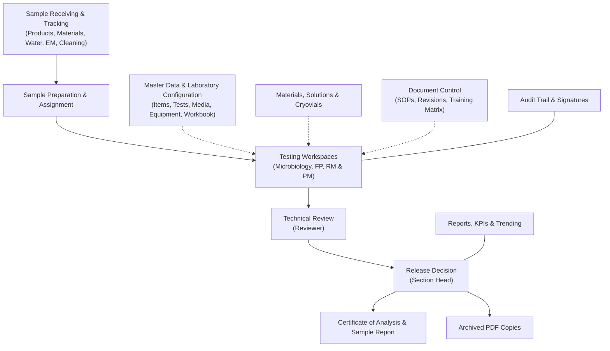

# MicroLIMS User Guide

| Document control | |
|---|---|
| Title | MicroLIMS User Guide |
| Version | DRAFT 0.1 |
| Date | 2026-10-20 |
| Repository branch | `docs/user-guide` |
| Application code described | commit `f773042c` (branch `refactor/consolidation`) |
| Author | Documentation Engineering Agent (AI-assisted draft) |
| Status | **Draft, requires human review and approval before controlled use.** |

This guide was produced from the application's source code and its specification documents. The application was not run while writing it, so screen descriptions come from the code. Boxes marked **Note for reviewers** show behaviour that could not be confirmed or that differs from a specification; open questions are tracked in `DOCUMENTATION_GAPS.md` by their GAP number.

## Contents

- [1. Introduction](#1-introduction)
- [2. Purpose and Scope](#2-purpose-and-scope)
- [3. System Overview](#3-system-overview)
- [4. User Roles and Permissions](#4-user-roles-and-permissions)
- [5. Login, Session and Password](#5-login-session-and-password)
- [6. User Interface](#6-user-interface)
- [7. Navigation](#7-navigation)
- [8. Dashboard](#8-dashboard)
- [9. Notifications, Messages and Discussions](#9-notifications-messages-and-discussions)
- [10. Search and Filters](#10-search-and-filters)
- [11. Sample Management and Tracking Board](#11-sample-management-and-tracking-board)
- [12. Sample Receiving](#12-sample-receiving)
- [13. Test Orders and Analyst Assignment](#13-test-orders-and-analyst-assignment)
- [14. Analyst Testing Workspace and Sample Preparation](#14-analyst-testing-workspace-and-sample-preparation)
- [15. Result Entry (count, observation and location-grid tests)](#15-result-entry-count-observation-and-location-grid-tests)
- [16. Pathogen Testing](#16-pathogen-testing)
- [17. Review](#17-review)
- [18. Return to Analyst, Rework and Retest](#18-return-to-analyst-rework-and-retest)
- [19. Approval](#19-approval)
- [20. OOS Tracking](#20-oos-tracking)
- [21. Sample Report, Certificate of Analysis and Archived Records](#21-sample-report-certificate-of-analysis-and-archived-records)
- [22. Growth Promotion Testing and Media](#22-growth-promotion-testing-and-media)
- [23. Environmental Monitoring](#23-environmental-monitoring)
- [24. Water Monitoring](#24-water-monitoring)
- [25. After Cleaning Monitoring](#25-after-cleaning-monitoring)
- [26. Reference Strains (Reference Cryovials)](#26-reference-strains-reference-cryovials)
- [27. Physicochemical Testing](#27-physicochemical-testing)
- [28. Solution and Standard Preparation](#28-solution-and-standard-preparation)
- [29. Material Stock](#29-material-stock)
- [30. Equipment](#30-equipment)
- [31. Item Master, Test Master and Specifications](#31-item-master-test-master-and-specifications)
- [32. Laboratory Configuration (Organisms, Receiving Configuration, Master Data Workbook)](#32-laboratory-configuration-organisms-receiving-configuration-master-data-workbook)
- [33. Laboratories, Departments and Data Segregation](#33-laboratories-departments-and-data-segregation)
- [34. Reports, KPIs and Trend Analysis](#34-reports-kpis-and-trend-analysis)
- [35. Audit Trail](#35-audit-trail)
- [36. Traceability](#36-traceability)
- [37. Electronic Signatures and Approval Controls](#37-electronic-signatures-and-approval-controls)
- [38. Document Control](#38-document-control)
- [39. Users, Roles and Administration](#39-users-roles-and-administration)
- [40. Error Monitoring (Incidents and Error Log)](#40-error-monitoring-incidents-and-error-log)
- [41. Integrations](#41-integrations)
- [42. Troubleshooting](#42-troubleshooting)
- [43. Frequently Asked Questions](#43-frequently-asked-questions)
- [44. Glossary](#44-glossary)

---

## 1. Introduction

### 1.1 About This User Guide
This document is an end-user guide for the MicroLIMS laboratory information management system. It provides instructions and operational reference information for laboratory analysts, technical reviewers, Section Heads, system administrators, Quality Assurance personnel, and Document Control users.

> **Important Notice:** This user guide is an AI-assisted draft describing the software as implemented. The application was not run to prepare it, and it has not been formally verified against a live deployment. It requires thorough human review and operational verification before regulatory or operational adoption.

MicroLIMS is designed to support laboratory workflows by recording sample information, analytical measurements, test observations, electronic signatures, and changes to records in an audit trail. This guide describes the behavior, screen controls, permissions, and validation messages of the application. No statement in this guide is a claim of regulatory compliance or formal system validation.

### 1.2 System Purpose and Core Functions
MicroLIMS is a web-based laboratory application used in two laboratories:
- The **Microbiology Laboratory**.
- The **Physicochemical Laboratory**, which has two areas: **FP** (finished product) and **RM & PM** (raw material and packaging material).

Within these laboratories, the system provides the following capabilities:
- **Receive and register samples**: finished products, raw materials, packaging materials, water, environmental monitoring, and after-cleaning samples. The system creates the test orders configured for the item automatically after the sample is received.
- **Run laboratory testing workflows**: microbiology count tests, qualitative observations, pathogen tests, environmental and water tests, and physicochemical tests (HPLC, GC, ICP-OES, titration, dissolution, disintegration, weight variation, measurement, gravimetric, and qualitative tests).
- **Review and approve results**: an analyst enters results, a reviewer performs a technical review, and a Section Head records the release decision, with checks that stop a person from reviewing or approving work they did themselves.
- **Prepare and track materials**: media lots, reference strain cryovials, reagents and materials, equipment, solutions, and working standards.
- **Maintain master data**: items, tests, specifications, organisms, media, equipment, methods, and solutions, and part of this data can be loaded from a workbook.
- **Control documents**: controlled documents, revisions, review, approval, periodic review, and reading and training records in Document Control.
- **Report and monitor**: reports and trend pages, KPIs, out-of-specification (OOS) tracking, the audit trail, and a technical Error Monitoring page.
- **Collaborate**: direct and group messages and discussions.

Many sensitive actions ask the user to type their login password again as an electronic signature. The system records the user, role, time, and meaning of the signature with the action. Not every action is signed: for example, microbiology plate-count entry and pathogen test steps are not.

> **Note for reviewers:** Whether the microbiology count entry and pathogen test steps should carry an electronic signature has not been confirmed. (GAP-010)

<!-- Review log (Sonnet): 7 corrections; invented items removed: "immutable" audit trail wording, laboratory/area code names, claim that every sensitive decision requires re-authentication; callouts added: GAP-010 -->

---

## 2. Purpose and Scope

### 2.1 Intended Audience and Scope
This guide covers the day-to-day operation of MicroLIMS. It is written for:
- **Laboratory Analysts**, who receive samples, prepare samples, run microbiological and physicochemical tests, operate instrument workspaces, prepare solutions and media, and update inventory.
- **Technical Reviewers**, who perform the secondary technical review of results and serve as technical reviewers of controlled documents.
- **Section Heads**, who assign work, record sample release decisions, release media lots and cryovial batches, manage laboratory configuration, and act as Document Controller in Document Control.
- **System Administrators**, who manage user accounts, laboratory memberships, roles and permissions, review the audit trail, and monitor technical errors.
- **Document Control and Quality personnel**, who follow the life of controlled documents (SOPs and similar), periodic review, and reading and training records.

Roles are editable by administrators. This guide names the default roles for each permission, and a laboratory may have changed them.

### 2.2 Operational Scope
MicroLIMS manages laboratory operations in two laboratories:
1. **Microbiology Laboratory**: count testing, pathogen testing, environmental monitoring, water monitoring, after-cleaning monitoring, media preparation and evaluation, growth promotion testing, and reference strain cryovials.
2. **Physicochemical Laboratory**, in two areas:
   - **FP**: finished product testing, including assay, dissolution, disintegration, and weight variation.
   - **RM & PM**: raw material and packaging material testing.

A user sees the laboratories and areas that an administrator has assigned to the account. A user with no assignment sees no laboratory data.

### 2.3 Records That Exist but Cannot Be Viewed on Screen
Some information is recorded by the system, but MicroLIMS has no screen that displays it. This guide gives no procedures for it:
- **Login history**: every sign-in attempt (success, unknown user, locked account, wrong password, disabled account) is recorded, but there is no screen to view it.
- **Security events**: events about sign-in, sessions, passwords, and role changes are recorded without a viewer. The permission *Security Audit Viewing* has no effect on access.
- **Electronic signature history**: there is no separate screen listing signatures. For samples, the signatures appear as steps in the traceability chain of the Audit Trail screen.
- **Administrative reporting backfill, analyst availability settings, KPI section settings, document escalations, and a general results list**: these exist as system functions without a screen.
- **Instrument report reading**: the system contains code to read some instrument reports, but no screen uses it. Results are entered by hand, and report files can be attached as evidence in the instrument workspaces.

> **Note for reviewers:** Auditors may expect login history, security events, and the signature trail to be viewable. Whether any of them is meant to get a screen has not been confirmed. (GAP-030)

### 2.4 Features Not Found in the Software
The following were not found in MicroLIMS. This guide gives no procedures for them.
- A separate **Final Release** step or permission. The Section Head's release decision on a sample (the *Submit Release Decision* card) is the release step in the application.
- A **sterility test** or sterility result entry. Some screen text in the media area mentions sterility.
- An **EM annual plan**, EM schedules, water sampling frequencies, or monitoring plans. Sampling is done on demand by receiving and preparing samples.
- **Reference strain passage tracking**. Cryovials have storage moves, thaw counts, destruction, approval, and an expiry date.
- **Equipment qualification records** (IQ, OQ, PQ). Equipment records show calibration due dates and calibration certificate documents.
- A **laboratory incident, deviation, or CAPA module**. The Error Monitoring screen shows technical errors only and states that it is not part of the GxP record.
- A separate **Titration Methods** master page. Titration settings are part of Test Master.
- An integration with **SAP** or any other ERP system.
- A **local AI assistant**.
- A **live data feed from instruments**. Results are entered by hand and report files are attached as evidence.
- Separate **Reception** or **QA** roles. Receiving is done by users who hold a receiving permission, and QA staff need a custom role created by an administrator.

> **Note for reviewers:** Screen text in the media area mentions sterility, but no sterility test or result entry exists. (GAP-022)

<!-- Review log (Sonnet): 9 corrections; invented items removed: module ids, endpoint paths, background worker claim for escalations, "automated sampling schedule generator" and "no reference-strain passage tracking" overstatements, laboratory code names; callouts added: GAP-030, GAP-022 -->

---

## 3. System Overview

### 3.1 How the System Fits Together
MicroLIMS connects bench-level laboratory work with supervisory review, quality metrics, and document governance:

### 3.2 Main Areas of the Application

#### 1. Sample Receiving and Tracking
- **Receive Sample**: records the receipt of finished product, raw material, packaging material, water, environmental monitoring, and after-cleaning samples. The system creates the tests configured for the item automatically.
- **Tracking Board**: shows every sample and the stage it has reached in each laboratory. It needs the *Cross-Lab Sample Tracking* permission (by default: System Administrator, Section Head).

#### 2. Testing Workspaces and Result Entry
- **Laboratory workspaces**: separate workspaces for Microbiology, FP, and RM & PM, where analysts see their assigned work and open result entry.
- **Microbiology testing**: quantitative plate counts with two-stage incubation and dilution factors, qualitative observations, environmental monitoring and water location grids, and pathogen testing sessions with confirmation steps.
- **Physicochemical testing**: HPLC, GC, and ICP workspaces, titration, dissolution, disintegration, weight variation, and other measurement tests.

#### 3. Review, Approval, and Release
- **Technical review**: the reviewer checks results and calculations. A count test can be returned to the analyst with a reason.
- **Release decision**: the Section Head records one of four decisions: *Approve*, *Not Conform*, *New Sample Required*, or *Retest Retained Sample*, under electronic signature.
- **Reports and archiving**: the sample report and Certificate of Analysis are available after the final decision. At each final decision the system also stores a PDF copy of the record together with a check value, and shows a warning when a downloaded copy no longer matches.

#### 4. Consumables, Reference Strains, and Equipment
- **Media**: preparation, evaluation (including growth promotion testing), release, and storage of media lots.
- **Reference cryovials**: batches, approval, thawing, storage moves, and destruction.
- **Materials, equipment, and columns**: stock of reagents and materials, equipment status and calibration due dates, and chromatography columns.
- **Solutions and working standards**: solution preparation, titrant standardization, and working standard qualification.

#### 5. Master Data and Laboratory Configuration
- **Items and specifications**: product catalogue, preparation settings, and limits.
- **Test Master**: test definitions, calculation settings, workflow steps, and stage requirements.
- **Master Data Workbook**: loads and verifies master data from a spreadsheet. A second person must verify what the first person loaded.

#### 6. Document Control
Controlled documents such as SOPs: drafting, technical review, approval signature, revision numbering, periodic review, and reading and training records.

#### 7. Reporting, Audit, and Administration
- **Reports**: overview, record search, media and growth promotion results, reference strain results, trending, and the KPI / Performance tab.
- **Out of Specification (OOS) Tracking**: investigation groups, retest orders, and investigation documents.
- **Audit Trail**: search of change events with field-level differences and a traceability chain.
- **Error Monitoring**: a log of technical errors for administrators. It is not a quality incident or deviation record.
- **Users, Roles, and laboratory memberships**: managed by administrators.

### 3.3 Security Basics
- **Access in a browser**: MicroLIMS is used in a web browser. Pages and menu items depend on the user's permissions and laboratory assignment.
- **Sign-in and sessions**: a user stays signed in while active. The browser signs the user out after a period of inactivity (see Section 5).
- **Electronic signatures**: for signed actions, such as sample review, release decisions, sample correction or voiding, media release, and physicochemical result recording, the user types their login password in an *Electronic Signature* dialog. The system records the user, role, time, and meaning with the action.
- **Segregation of duties**: the system refuses some combinations, for example reviewing a sample you tested or approving a sample you reviewed. System Administrators are not exempt. The checks cover the actions listed in Section 4, not every workflow.

> **Note for reviewers:** Microbiology plate-count entry and pathogen test steps carry no electronic signature. (GAP-010)

<!-- Review log (Sonnet): 10 corrections; invented items removed: module ids, "immutable" wording, token and technology details, "strict separation across all workflows" claim, "result recording" signature for microbiology, "automatic numbering" claim; callouts added: GAP-010 -->

---

## 4. User Roles and Permissions

### 4.1 How Access Is Controlled
MicroLIMS controls access in three ways:
1. **Roles**: a role is a named set of permissions assigned to a user account. Every role is built on one of four base role types: System Administrator, Section Head, Reviewer, or Analyst. The base type also decides which dashboard a user sees and a few rules that permissions do not change.
2. **Permissions**: each permission allows a specific kind of action, such as *Sample Technical Review*. The system defines 50 permissions. This section shows each permission with its internal code, because the code appears on the Roles screen.
3. **Laboratory assignment**: an administrator assigns each user to laboratory sections. Laboratory data is limited to those sections.

> **Administrative role editability:** The permissions described for the four system roles are **defaults**, not fixed assignments. An administrator who holds the *Role & Permission Management* permission (`Roles.Manage`) can create custom roles, rename roles, and change the permissions of any role, including the four system roles. System roles cannot be deleted. The permissions actually granted in a laboratory may differ from the defaults in this guide.

> **Note for reviewers:** The role permissions actually in use on the live system have not been checked against the defaults described here. (GAP-015)

#### Laboratory Assignment
- **Microbiology Laboratory**: gives access to the Microbiology workspace, media preparation, reference cryovials, and microbiology configuration.
- **Physicochemical Laboratory**: a user can be limited to one area, **FP** (the FP Workspace) or **RM & PM** (the RM & PM Workspace). The assignment dialog offers **FP**, **RM & PM**, or **Both**.
- **No assignment**: a user with no laboratory assignment sees no laboratory data. The system shows: "Your account is not assigned to any laboratory section. Ask an administrator to assign one."
- **System Administrators**: users whose base type is System Administrator are not limited by laboratory assignment and can see both laboratories and all areas.

#### When Changes Take Effect
- **Permission changes**: a change to a role's permissions reaches signed-in users when their access renews, which is normally within 15 minutes.
- **Base role type, disabled account, locked account, password change**: these are checked on every request, so an old session stops working at the next action. A role change within the same base type does not end existing sessions.
- **Own account**: users cannot change their own role, disable their own account, or delete their own account.

---

### 4.2 Default System Roles

#### System Administrator
- **Base type**: System Administrator.
- **Default permissions**: all 50.
- **Typical responsibilities**: user accounts, laboratory assignments, roles and permissions, the audit trail, error monitoring, Document Control configuration, and global laboratory configuration.
- **Limits**: System Administrators have **no exemption** from segregation-of-duties rules. They cannot review or approve work they performed or prepared. They cannot change a media product code (only the Section Head base type can), and they cannot void a Document Master.

#### Section Head
- **Base type**: Section Head.
- **Default permissions**: 43.
- **Typical responsibilities**: assigns tests to analysts, supervises testing (including incubation time overrides and pathogen session resets), performs technical reviews, records release decisions on samples, releases media lots and cryovial batches, tracks OOS investigations, manages laboratory configuration, and acts as Document Controller in Document Control.
- **Only the Section Head base type can**: change a media product code under electronic signature, void a Document Master, and override the proposed revision number of a document.
- **Limits**: by default does not manage user accounts, roles, or Document Control configuration, and does not see Error Monitoring. Cannot approve a sample they reviewed or tested.

#### Reviewer
- **Base type**: Reviewer.
- **Default permissions**: 15.
- **Typical responsibilities**: technical review of results, returning count tests to analysts, and acting as the assigned technical reviewer of document revisions.
- **Limits**: cannot record release decisions, release media lots, or approve cryovial batches. Cannot review a test or sample they performed or prepared.

#### Analyst
- **Base type**: Analyst.
- **Default permissions**: 15.
- **Typical responsibilities**: receiving samples for their own laboratory sections, sample preparation, count and observation entry, pathogen tests, HPLC, GC, and ICP work, solution preparation, working standards, and inventory updates.
- **Limits**: no review or release permissions. In the testing workspaces, an analyst sees the tests assigned to them by default. Cannot review or approve their own work.

The system has no separate Reception or QA role. Receiving is done by users with a receiving permission.

> **Note for reviewers:** Which custom roles the laboratory uses for Reception and QA staff has not been confirmed. (GAP-050)

---

### 4.3 Permission Catalogue

Of the 50 permissions, 40 are **Enforced**: the system checks them. The other 10 are marked **Legacy-only**: ticking or unticking them on the Roles screen has no effect on access.

Default roles in the table: SA = System Administrator, SH = Section Head, REV = Reviewer, ANA = Analyst.

| # | Permission code | Plain-language name | Default roles | Status | What it allows |
|---|---|---|:---:|:---:|---|
| 1 | `Users.Manage` | User Account Management | SA | Enforced | Create, edit, lock/unlock, disable, force password change, recover passwords, delete users, and manage laboratory assignments. |
| 2 | `Roles.Manage` | Role & Permission Management | SA | Enforced | Create custom roles, rename roles, edit permissions, delete unassigned custom roles. |
| 3 | `Audit.View` | Audit Trail Viewing | SA, SH | Enforced | View audit events, change differences, record history, and traceability chains. |
| 4 | `Reporting.Admin` | Administrative Reporting | SA | Enforced | Run administrative reporting maintenance (no screen is provided for it). |
| 5 | `Samples.Review` | Sample Technical Review | SA, SH, REV | Enforced | Submit technical reviews on sample sections, return count tests to analysts, and review working standards. |
| 6 | `Samples.Approve` | Sample Release Approval | SA, SH | Enforced | Record release decisions (Approve, Not Conform, New Sample Required, Retest Retained Sample), close testing, and approve working standards. |
| 7 | `Samples.Receive` | Global Sample Receiving | SA, SH | Enforced | Receive samples for any laboratory and add a laboratory to an existing sample. |
| 8 | `Samples.TrackAll` | Cross-Lab Sample Tracking | SA, SH | Enforced | View the Tracking Board across all laboratory sections. |
| 9 | `Signatures.Manage` | Signature Trail Viewing | SA, SH | Enforced | View the electronic signature history of a record (no separate screen is provided for it). |
| 10 | `TestWorkflow.Execute` | Test Workflow Execution | SA, SH, REV, ANA | Enforced | Enter microbiology counts, observations, pathogen test steps, and test results. |
| 11 | `TestWorkflow.BiochemicalDecision` | Biochemical Decision Recording | SA, SH, REV | Enforced | Record biochemical confirmation decisions in pathogen testing. |
| 12 | `Cryovials.Manage` | Cryovial Management | SA, SH, REV, ANA | Enforced | Prepare batches, thaw, move storage, and destroy reference cryovials. |
| 13 | `Cryovials.Approve` | Cryovial Batch Approval | SA, SH | Enforced | Approve or reject prepared cryovial batches. |
| 14 | `Materials.Manage` | Material Stock Management | SA, SH, ANA | Enforced | Receive material lots, update details, consume stock, and upload documents. |
| 15 | `Materials.DocumentControl` | Material Document Control | SA, SH | Enforced | Supersede or void material documents. |
| 16 | `Equipment.Manage` | Equipment Inventory Management | SA, SH, ANA | Enforced | Register equipment, update inventory details, and upload documents. |
| 17 | `Equipment.DocumentControl` | Equipment Document Control | SA, SH | Enforced | Supersede or void equipment documents. |
| 18 | `Items.Manage` | Items Master Management | SA, SH | Enforced | Manage items, specifications, and item preparation configurations. |
| 19 | `Items.DocumentUpload` | Item Document Upload | SA, SH | Enforced | Upload controlled documents to an item. |
| 20 | `MasterData.Manage` | Master Data Management | SA, SH | Enforced | Manage laboratory configuration: environmental monitoring, water, after cleaning, organisms, media, equipment, test definitions, receiving configuration, and the Master Data Workbook. |
| 21 | `Discussions.View` | Discussions Viewing | SA, SH, REV, ANA | Legacy-only | No effect: Discussions are open to all signed-in users. |
| 22 | `Discussions.Create` | Discussions Creation | SA, SH, REV, ANA | Legacy-only | No effect: all signed-in users can post. |
| 23 | `Discussions.EditAny` | Discussions Moderation | SA, SH | Enforced | Edit or delete any post or comment, and mark posts important. |
| 24 | `Messages.Use` | Messaging Use | SA, SH, REV, ANA | Legacy-only | No effect: Messages are open to all signed-in users. |
| 25 | `System.ViewErrorLog` | Error Log Monitoring | SA | Enforced | View and manage the technical error log. |
| 26 | `System.ViewSecurityAudit` | Security Audit Viewing | SA | Legacy-only | No effect: security events are recorded but cannot be viewed. |
| 27 | `Documents.Register` | Document Master Registration | SA, SH, ANA | Enforced | Register a new controlled Document Master. |
| 28 | `Documents.DraftEdit` | Document Draft Editing | SA, SH, ANA | Legacy-only | No effect: Document Control decides by fixed rules (role type and document assignment). |
| 29 | `Documents.RevisionCreate` | Document Revision Creation | SA, SH, ANA | Legacy-only | No effect: fixed Document Control rules apply. |
| 30 | `Documents.Review` | Document Technical Review | SA, REV | Legacy-only | No effect: the assigned technical reviewer is decided in Document Control. |
| 31 | `Documents.Approve` | Document Revision Approval | SA, SH, REV | Legacy-only | No effect: the assigned approver is decided in Document Control. |
| 32 | `Documents.PeriodicReview` | Document Periodic Review | SA, SH, REV | Legacy-only | No effect: the assigned periodic reviewer is decided in Document Control. |
| 33 | `Documents.TrainingAssign` | Document Training Assignment | SA, SH | Enforced | Assign reading and training, and view the full training matrix. |
| 34 | `Documents.TrainingViewMatrix` | Training Matrix Viewing | SA, SH, REV | Legacy-only | No effect: the training matrix follows *Document Training Assignment*. |
| 35 | `Documents.ConfigManage` | Document Control Configuration | SA | Enforced | Manage document types, departments, sections, numbering, and settings. The user must also have the System Administrator base type. |
| 36 | `Dashboards.LabOverview` | Lab Overview Dashboard | SA, SH | Enforced | View the Section Head dashboard. |
| 37 | `Dashboards.Review` | Reviewer Dashboard | SA, SH, REV | Enforced | View the Reviewer dashboard. |
| 38 | `Kpi.View` | KPI Dashboard Viewing | SA, SH | Enforced | View the KPI / Performance tab of Reports. |
| 39 | `Kpi.ViewTeam` | Team KPI & Workload Viewing | SA, SH | Enforced | View KPI and workload figures of other analysts; without it, only your own figures. |
| 40 | `Kpi.ConfigureProfiles` | KPI Profile Configuration | SA, SH | Enforced | Create and sign workflow profile versions. |
| 41 | `Media.Prepare` | Media Lot Preparation | SA, SH, REV, ANA | Enforced | Prepare media lots, record storage moves, and mark lots out of stock. |
| 42 | `Media.Release` | Media Lot Release | SA, SH | Enforced | Release or reject media lots under electronic signature. |
| 43 | `Oos.Manage` | OOS Tracking Management | SA, SH | Enforced | Manage OOS groups and investigation documents. |
| 44 | `TestWorkflow.Supervise` | Test Workflow Supervision | SA, SH | Enforced | Override minimum incubation times and reset pathogen sessions. |
| 45 | `Samples.ReceiveOwnLab` | Own-Lab Sample Receiving | SA, SH, REV, ANA | Enforced | Receive samples for the laboratory sections you are assigned to. |
| 46 | `Samples.Correct` | Sample Correction & Voiding | SA, SH, REV | Enforced | Correct sample details and void samples under electronic signature. |
| 47 | `Samples.AssignAnalyst` | Sample Analyst Assignment | SA, SH | Enforced | Assign analysts to sample tests. |
| 48 | `Solutions.Prepare` | Solution Preparation | SA, SH, ANA | Enforced | Prepare solutions and mobile phases, and standardize titrants. |
| 49 | `Hplc.Operate` | HPLC/GC/ICP Operation | SA, SH, ANA | Enforced | Start instrument runs, confirm system suitability, enter replicates, and submit runs. |
| 50 | `WorkingStandards.Qualify` | Working Standard Qualification | SA, SH, ANA | Enforced | Prepare working standards, attach documents, and enter qualification replicates. |

> **Note for reviewers:** Ten permissions marked "Legacy-only" have no effect in the application; do not rely on them to restrict access. (GAP-015)

A custom role behaves like its base type for the rules that depend on the role type (for example the dashboard shown and media product code changes), whatever permissions are ticked.

---

### 4.4 Segregation of Duties
The system compares the people who did the work, not their roles. **System Administrators and Section Heads are not exempt.** A user is treated as having performed a test if they were the assigned analyst, prepared the sample, or entered or submitted results or observations for it. For environmental monitoring, water, and after-cleaning samples, the user who confirms preparation counts as having performed the tests.

| Action | Rule | Message shown |
|---|---|---|
| Sample technical review | You cannot review a sample section in which you performed or prepared a test. | "You cannot review a sample you tested." |
| Sample release decision | You cannot approve a sample you reviewed. | "You cannot approve a sample you reviewed." |
| Sample release decision | You cannot approve a sample you performed or prepared a test on. | "You cannot approve a sample you tested." |
| Pathogen biochemical decision | You cannot decide on a result you performed. | "A reviewer cannot decide on a result they performed." |
| Media lot release | You cannot release a lot you prepared or evaluated. | "You cannot approve a media lot you prepared or evaluated." |
| Cryovial batch approval | You cannot approve a batch you prepared. | "You cannot approve a cryovial batch you prepared." |
| Working standard sign-off | The analyst who submitted a qualification cannot review or approve it, and the reviewer cannot also approve it. | "The analyst who submitted the qualification cannot review it." / "The analyst who submitted the qualification cannot approve it." / "The reviewer cannot also approve the qualification." |
| Master Data Workbook | The person who loaded a workbook cannot verify it. | "The person who loaded the workbook cannot verify it. Ask a second person." |
| Document Control | The author of a revision cannot review it technically, create reviewer findings, or approve it. A technical reviewer of the revision cannot approve it. | Messages start with "Segregation of Duties Violation:". |

> **Note for reviewers:** No segregation-of-duties check was found between the people who set up, confirm system suitability for, and submit an HPLC or ICP run. Whether this is required by laboratory procedures has not been confirmed. (GAP-026)

---

### 4.5 Role Management Procedures

<!-- WF-ROLES-001 -->
### 4.5.1 Create a Custom Role
#### Purpose
Define a new role with its own set of permissions, based on one of the four base role types.

#### Who can use it
Requires the *Role & Permission Management* permission (by default: System Administrator).

#### Before you start
Decide which base role type (System Administrator, Section Head, Reviewer, or Analyst) fits the role. The base type cannot be changed later and it decides the dashboard and the role-type rules described in 4.3.

#### What you see
- **ADMINISTRATION** > **Roles**: a list with columns **Role**, **Type**, **Status**, and **Users**, a search field "Search by role name...", and the button **Create Role**.
- The Create Role wizard with four steps: **Name**, **Base Type**, **Permissions**, and **Review**.

[SCREENSHOT SS-041]

#### How to use it
1. In the sidebar, open **ADMINISTRATION** > **Roles**.
2. Click **Create Role**.
3. On the **Name** step, enter the **Role Name** (required) and an optional **Description**. Click **Next**.
4. On the **Base Type** step, choose one of the options **SystemAdministrator**, **SectionHead**, **Reviewer**, or **Analyst** (default: Analyst). Click **Next**.
5. On the **Permissions** step, tick the permissions to grant. To start from an existing role, choose it in **Or clone permissions from any existing role:**. Each permission shows an **Enforced** or **Legacy-only** label. Click **Next**.
6. On the **Review** step, check the name, description, base type, and the chosen permissions, then click **Create Role**.

#### System behavior
The system creates the role and saves the ticked permissions. The new role appears in the Roles list as a **Custom** role with status **Active**.

#### Validation
- A blank name stops the wizard at the first step. The message is: "Role name is required."

#### Errors
- If the role cannot be created, the system shows: "Could not create this role."
- If the permission step fails after the role was created, the role may keep the default permissions of its base type instead of the ticked ones. Open the role and check its permissions.

> **Note for reviewers:** Creating a role is done in two separate saves, so an interruption can leave the base-type defaults in place. (GAP-107)

> **Note for reviewers:** Role and permission changes are recorded in the audit trail but are not electronically signed, need no reason, and need no second person. Nothing prevents removing the *Role & Permission Management* permission from the System Administrator or Section Head role. (GAP-009)

---

<!-- WF-ROLES-001 -->
### 4.5.2 Edit or Delete a Role
#### Purpose
Change the name, description, or permissions of a role, or delete a custom role.

#### Who can use it
Requires the *Role & Permission Management* permission (by default: System Administrator).

#### What you see
- The role page, with the role name, a **System Role** label for system roles, a **Base Type: ...** label, and the fields **Name** and **Description**.
- A **Permissions** matrix with a tick box for each permission and the labels **Enforced** or **Legacy-only**. Hover over a label to read what it means.
- A list of the users who hold the role, each marked **Active** or **Disabled**.
- The buttons **Save Changes** and, for custom roles only, **Delete Role**.

[SCREENSHOT SS-042]

#### How to use it
1. In the **Roles** list, click the role.
2. Change **Name** or **Description** if needed.
3. In **Permissions**, tick or untick permissions.
4. Click **Save Changes**.

To delete a custom role: click **Delete Role** and confirm the question `Delete role "{name}"? This cannot be undone.`

#### System behavior
The system saves the changes and records in the audit trail which permissions were granted and revoked. Users who hold the role receive the new permissions when their access next renews, normally within 15 minutes. Changing the permissions does not change the role's base type.

#### Validation
- "Role name is required."

#### Errors
- System roles cannot be deleted. The **Delete Role** button is not shown for them, and the system would answer "System roles cannot be deleted."
- A role that is assigned to users cannot be deleted: "Role '{name}' is currently assigned to {n} user(s) and cannot be deleted."

#### What happens next
Assign the role to users on the Users screen (see Section 39).

<!-- Review log (Sonnet): 24 corrections; invented items removed: role ids (ROLE-...), screen addresses, "server middleware / token claim / database" wording, "audit code ROLE_PERMISSIONS_UPDATED", unsupported "invalid code" validation as normal user path, misplaced role-change audit note (GAP-112 belongs to user role change, Section 39), "Clicking delete on a system role is prevented" (button is hidden); callouts added: GAP-015 (live grants), GAP-026, GAP-050, GAP-107, GAP-009 retained -->

---

## 5. Login, Session and Password

<!-- WF-AUTH-001 -->
### 5.1 Sign In
#### Purpose
Sign in with your username and password and open your dashboard.

#### Who can use it
Any user with an active account created by a system administrator. Laboratory assignment is not needed to sign in.

#### Before you start
You need the username and password given to you by your system administrator.

#### What you see
- The page title "Sign in · MicroLIMS" and the heading **MicroLIMS**.
- The fields **Username** (required) and **Password** (required), with a button to show or hide the password (**Show password** / **Hide password**).
- The button **Sign In**, which reads **Signing in…** while the request is processed.
- The link **Forgot password?** and the button **Admin-Assisted Password Recovery**.
- A footer line with the version number and a statement about regulatory compliance. This guide makes no compliance claim (see the note below).

[SCREENSHOT SS-051]

#### How to use it
1. Open the MicroLIMS address in your browser.
2. Enter your username in **Username**.
3. Enter your password in **Password**.
4. Click **Sign In** (or press Enter).
5. Your dashboard opens. If your account is marked to require a password change, the **Change Password** screen opens instead (see 5.4).

#### System behavior
- Every sign-in attempt (success, wrong password, unknown user, locked account, disabled account) is recorded in a login history together with the IP address. The application has no screen to view this history.
- After five failed attempts, the system locks the account for 15 minutes and ends its active sessions. An administrator can unlock the account earlier (see Section 39).
- The number of sign-in attempts from one address is limited (20 per 60 seconds). What the screen shows when the limit is exceeded is not documented.
- A successful sign-in clears the failed-attempt count, and records the time shown as **Last Login** on your profile.

> **Note for reviewers:** The sign-in page footer contains a regulatory compliance statement. It is text on the screen only; the repository holds no validation evidence for it, and this guide does not repeat it as a fact. (GAP-023)

> **Note for reviewers:** After 5 wrong passwords the account locks for 15 minutes. The failed-attempt count is not reset when the lock ends, so one further wrong password locks the account again. (GAP-012)

#### Validation
- **Username** and **Password** are both required.

#### Errors
- Wrong username or password, a disabled account, or a locked account: "Invalid username or password." (the same message in every case).
- A system problem: "Laboratory authentication service error. Please try again later."
- No connection: "Unable to reach the laboratory server. Check network connection."
- Any other failure: "Login failed. Please check credentials."

---

<!-- WF-AUTH-002 -->
### 5.2 Forgot Password
#### Purpose
Send a password reset request for your username.

#### Who can use it
Anyone with an account.

#### Before you start
You need to know your username. The request can only be delivered if your account has an e-mail address and the system is set up to send e-mail.

#### What you see
After you click **Forgot password?** on the sign-in card:
- The text "Enter your username and we'll generate a password reset request."
- The field **Username**.
- The button **Send Reset Link** (**Submitting...** while processing), and the links **Back to login** and **Have a recovery code from your admin?**.

#### How to use it
1. On the sign-in screen, click **Forgot password?**.
2. Enter your **Username**.
3. Click **Send Reset Link**.
4. The screen shows: "If that account exists, a reset link has been generated."

#### System behavior
- The screen shows the same text whether or not the username exists or has an e-mail address, so it does not reveal which usernames exist.
- If the account has an e-mail address, a message is sent that contains a one-time reset code valid for one hour. The message does not contain a link.
- If there is no e-mail address, or e-mail is not set up, nothing is delivered and the screen does not tell you.

#### Important rules
The application has no screen on which the reset code from the e-mail can be used. If you cannot sign in, ask a system administrator for an administrator-assisted recovery code and follow 5.3.

> **Note for reviewers:** The e-mail password reset cannot be completed in the application. The screen text mentions a reset link, but none is sent. (GAP-100)

---

<!-- WF-AUTH-003 -->
### 5.3 Administrator-Assisted Password Recovery
#### Purpose
Regain access to your account with a one-time recovery code generated by a system administrator.

#### Who can use it
Any user who has received a recovery code from an administrator. The administrator needs the *User Account Management* permission (`Users.Manage`) to generate the code (see Section 39).

#### Before you start
Ask a system administrator for a recovery code. The code has 12 characters, is shown to the administrator once, and is valid for 15 minutes. An administrator cannot create a recovery code for their own account or for a disabled account. Hand-over of the code to you follows your laboratory's own procedure; the application does not define it.

#### What you see
The **Password Recovery** screen, with the subtitle "Administrator-Assisted Account Access Recovery" and:
- **Username**.
- **One-Time Recovery Code** (format `XXXX-XXXX-XXXX`, helper text "Format: 12 alphanumeric characters provided by your admin").
- **New Password** (helper text "Min 8 chars (upper, lower, digit, symbol)").
- **Confirm New Password**.
- The button **Submit Password Recovery** (**Resetting Password...** while processing) and the link **Return to Login**.

[SCREENSHOT SS-052]

#### How to use it
1. On the sign-in screen, click **Admin-Assisted Password Recovery**.
2. Enter your **Username**.
3. Type or paste the code in **One-Time Recovery Code**. Dashes, spaces, and upper or lower case do not matter.
4. Enter a **New Password** that meets the password rules (see 5.4), and repeat it in **Confirm New Password**.
5. Click **Submit Password Recovery**.
6. The screen shows: "Your password has been successfully reset! You can now log in using your new password."
7. Click **Go to Login Page** and sign in with the new password.

#### System behavior
- Generating a new code makes any earlier unused code for that account expire.
- After a successful recovery, the system clears any lock and the failed-attempt count, ends all sessions of the account, marks the code as used, and removes the requirement to change the password at next sign-in.
- Five wrong code entries make the code unusable.

#### Validation
- "All fields are required."
- "New password and confirm password do not match."
- "New password must not match any of your last 5 passwords."

#### Errors
- Unknown username, disabled account, or no unused code: "Invalid or expired recovery code."
- Code older than 15 minutes: "Recovery code has expired. Please request a new recovery code."
- Wrong code (attempts 1 to 4): "Invalid recovery code."
- Fifth wrong attempt: "Maximum failed recovery attempts exceeded. Recovery code invalidated."
- Any other failure: "Could not perform password recovery. Please verify your recovery code."

---

<!-- WF-AUTH-004 -->
### 5.4 Change Password and Forced Password Change
#### Purpose
Change your password, either by choice or because you are required to.

#### Who can use it
Any signed-in user. No permission is needed.

#### Before you start
Know your current password.

#### What you see
- The heading **Change Password**, with the subtitle "Update your laboratory credentials in compliance with periodic security policy."
- The fields **Current Password**, **New Password**, and **Confirm New Password** (the helper text "Passwords do not match." appears when they differ).
- The checklist **Password must contain:** with five live rules: at least 8 characters, an uppercase letter, a lowercase letter, a number, and a special character.
- The button **Change Password** (**Updating Credentials...** while processing).

[SCREENSHOT SS-053]

#### How to use it
1. Open the account menu in the header and select **Change Password**. (If a change is required, this screen opens by itself.)
2. Enter your **Current Password**.
3. Enter the **New Password**. The checklist shows which rules are met.
4. Repeat it in **Confirm New Password**.
5. Click **Change Password**.
6. The screen shows "Password changed successfully. Returning to your profile..." and opens your profile after about 1.5 seconds.

#### System behavior
- New accounts, and accounts for which an administrator chose **Force Password Change at Next Login**, must change the password first. Every page opens this screen, and the system refuses all other actions with "Your password must be changed before you can use MicroLIMS."
- A successful change ends the sign-ins saved for the account and updates **Password Last Changed** on your profile.
- A new password cannot be one of your last 5 passwords.
- The number of password changes is limited (5 per 15 minutes).

#### Validation
- "New password does not meet the policy requirements below."
- "New password and confirmation do not match."
- "Password must be at least 8 characters long."
- "Password must contain at least one uppercase letter."
- "Password must contain at least one lowercase letter."
- "Password must contain at least one digit."
- "Password must contain at least one special (non-alphanumeric) character."
- "New password must not match any of your last 5 passwords."

#### Errors
- Wrong current password: "Current password is incorrect."
- Any other failure: "Could not change password."

> **Note for reviewers:** Passwords do not expire. The subtitle of the Change Password screen mentions a periodic security policy, but no periodic expiry exists.

> **Note for reviewers:** Whether you must sign in again after a successful password change has not been confirmed. (GAP-113)

---

### 5.5 My Profile
#### Purpose
Show your own account details.

#### Who can use it
Any signed-in user.

#### What you see
Open the account menu in the header and select **My Profile**. The screen shows, read-only: **Full Name**, **User ID** (your username), **Role**, **Last Login**, and **Password Last Changed** (each shows "Never" if there is no value). The text "Name and role changes are made by an administrator in the Users module." explains that these details cannot be edited here. If the profile cannot be shown, the system displays "Could not load profile."

---

<!-- WF-AUTH-005 -->
### 5.6 Session Timeout and Sign Out
#### Purpose
End your session after a period of inactivity, or when you choose to sign out.

#### Who can use it
All signed-in users.

#### What you see
- A **Session Timeout Warning** dialog appears over the page when you have been inactive. It shows "You will be signed out due to inactivity in {n} second(s)." with a 60-second countdown and the button **Stay signed in**. It cannot be closed with Escape or by clicking outside it.

[SCREENSHOT SS-054]

#### How to use it
- When the warning appears, click **Stay signed in**, or move the mouse or press a key. The warning closes and the inactivity timer starts again.
- If nothing happens before the countdown ends, MicroLIMS signs you out and opens the sign-in screen.
- To sign out yourself, open the account menu in the header and select **Sign Out**. There is no confirmation question.

#### System behavior
- The warning appears after 20 minutes without mouse movement, key presses, clicks, or scrolling. The inactivity check works in your browser only.
- While you work, your session is renewed in the background.
- On sign-out, the system ends your session. If that request fails, nothing is shown and you are still signed out in the browser.
- Data typed on a page and not yet saved can be lost when you are signed out.

> **Note for reviewers:** Idle sign-out happens in the browser only. The server does not time out inactive sessions. (GAP-053)

<!-- Review log (Sonnet): 26 corrections; invented items removed: page routes, "encrypted token", field/endpoint wording (LockedUntil, HTTP 403, refresh token), sign-in footer compliance quote presented as fact (now referenced via note), admin-code hand-over note with wrong gap id (GAP-012), wrong gap id on password-expiry note (GAP-023), password reset presented as a working procedure; added My Profile and exact password-policy messages; callouts added: GAP-023 (corrected wording), GAP-012, GAP-100, GAP-113, GAP-053, password-expiry note -->

---

## 6. User Interface

### 6.1 Application Header and Account Menu
After you sign in, every page shows the same frame: a header at the top, a navigation sidebar on the left, a trail of breadcrumbs above the page, and the page itself.

The header contains:
- **Skip to main content**: a link, intended for keyboard and screen-reader users, that jumps past the menus.
- **Toggle navigation menu**: the menu button. On a desktop it switches the sidebar between its full and compact forms. On a small screen it opens or closes the menu drawer.
- **Theme switch** (**Switch to dark mode** / **Switch to light mode**): changes between the light and dark appearance.
- **Notifications** bell (shown as **Notifications, {n} unread** when there are unread items): opens the list of your notifications (see Section 9).
- **Account menu** (**Account menu for {name}**), which contains:
  - **My Profile**: your account details (see 5.5).
  - **Messages** (or **Messages ({n} unread)**): direct and group messages (see Section 9).
  - **Discussions**: the discussion board (see Section 9).
  - **Change Password**: see 5.4.
  - **Sign Out**: ends your session and opens the sign-in screen, with no confirmation question.

[SCREENSHOT SS-061]

---

### 6.2 Sidebar and Appearance
- **Sidebar**: the navigation menu on the left. The button **Collapse sidebar** / **Expand sidebar** narrows it to a slim rail of group icons or widens it again. MicroLIMS remembers your choice in your browser.
- **Light and dark appearance**: use the theme switch in the header. MicroLIMS remembers your choice in your browser. If you have not chosen, it follows the dark-mode setting of your operating system.
- Because these choices are stored in the browser, they apply to that browser and computer only.

---

### 6.3 Breadcrumbs, Section Pages, and Errors
- **Breadcrumbs** above each page show where you are in the menu.
- **Section pages**: opening a group in the sidebar shows a page of cards, one for each page in that group that you are allowed to open.
  - The subtitle reads "{n} page(s) you can open here".
  - If a section has no page you may open, the screen shows "You have no pages in this section." If the section cannot be found, the title reads "Section not available".
- **Page not found**: if you follow an outdated or wrong address, the screen shows the heading **Page not found**, the text "There is no page at this address", and the explanation: `"{address}" does not match any MicroLIMS page. The link may be outdated, or the page may have moved. Use the navigation menu or return to your dashboard.` The button **Go to Dashboard** returns you to your dashboard.
- **Pages you are not allowed to open**: if you open an address for a page you have no permission for, the system takes you to your dashboard without showing a message.
- **Page problems**: each page is protected separately, so a problem on one page is contained to that page and the header and sidebar keep working.

---

<!-- SCR-SIG-001 -->
### 6.4 Electronic Signature Dialog
#### Purpose
Confirm sensitive actions by typing your login password again. The same dialog is used by the 26 actions in the application that are signed, such as sample review, release decisions, sample correction or voiding, media release, and physicochemical result recording.

#### Who can use it
Any signed-in user who carries out a signed action. The permission needed is the one of the action itself, not of the dialog.

#### What you see
The dialog titled **Electronic Signature**. It always appears in a light appearance, even when the dark appearance is on. It contains:
- Your full name (or username) and your role, read-only.
- A message, in a highlighted box, that states what your signature means, for example "I confirm the preparation steps shown above are the steps performed for this sample." Each action has its own wording.
- **Comment (optional)**: a text box that appears only for actions that allow a comment.
- **Password**: required.
- The buttons **Cancel** and **Sign** (**Signing...** while checking). **Sign** stays disabled until you type a password.

[SCREENSHOT SS-062]

#### How to use it
1. Start a signed action, for example by clicking **Sign & Save**, **Sign & Void**, **Submit Technical Review**, or **Submit Release Decision**.
2. Read your name, your role, and the meaning statement in the **Electronic Signature** dialog.
3. If the dialog offers it, enter a note in **Comment (optional)**.
4. Type your login password in **Password**.
5. Click **Sign** (or press Enter).

#### System behavior
- The signature and the action are saved together. If the password check fails, the action is not carried out.
- The system records with the signature your name, username, role, the meaning statement, the record signed, the time, your comment if any, and your IP address.
- If you enter wrong signature passwords five times within 15 minutes, further signature attempts are refused for a time. This limit applies to signatures only and does not lock your login account. Failed attempts are recorded without the password.
- Not all actions are signed. For example, microbiology plate-count entry, pathogen test steps, returning a test to the analyst, and user and role administration are not.

> **Note for reviewers:** Whether a comment or reason is required differs between signed actions, and the wording of the meaning statements differs between screens. Which of these differences are intended has not been confirmed. (GAP-027)

> **Note for reviewers:** Microbiology plate-count entry and pathogen test steps carry no electronic signature. (GAP-010)

#### Errors
- A wrong password, or a locked or disabled account: the dialog shows the message from the system (if none, "Signature failed."), clears the password, and stays open so that you can try again.

#### What happens next
After a successful signature the dialog closes and the action is completed on the page behind it.

<!-- Review log (Sonnet): 14 corrections; invented items removed: page addresses and browser storage key names, component and screen ids, example breadcrumb path, "recent attention alerts / sample review requests" list for the bell, "hover restores labels", "recovery prompt" text for page errors, "legal meaning", "tamper-evident", "immutable" log wording, "atomic transaction" wording; callouts added: GAP-027, GAP-010 -->

---

## 7. Navigation

### 7.1 Sidebar Menu
The sidebar groups the application into headings. You only see the items you are allowed to use. What you see depends on your permissions, your laboratory assignment, and (for the Physicochemical Laboratory) your assigned area. Permission names are explained in Section 4.

| Heading | Menu item | What you need to see it |
|---|---|---|
| **OVERVIEW** | Dashboard | Any signed-in user |
| **RECEIVING** | Receive Sample | *Global Sample Receiving* or *Own-Lab Sample Receiving* |
| | Tracking Board | *Cross-Lab Sample Tracking* |
| **LABORATORIES** | **Microbiology Laboratory** (group) | Assignment to the Microbiology Laboratory |
| | – Workspace | Assignment to the Microbiology Laboratory |
| | – Media Preparation & Evaluation | *Media Lot Preparation* |
| | – Reference Cryovials | *Cryovial Management* |
| | – Materials Stock | *Material Stock Management* |
| | – Equipment Inventory | *Equipment Inventory Management* |
| **LABORATORIES** | **Microbiology Configuration** (group) | Assignment to the Microbiology Laboratory and *Master Data Management* |
| | – Test Master, Organisms, Media Configurations, Water, Environmental Monitoring, After Cleaning, Equipment | Same as the group |
| **LABORATORIES** | **Physicochemical Laboratory** (group) | Assignment to the Physicochemical Laboratory |
| | – FP Workspace | Area **FP** (or no area restriction) |
| | – RM & PM Workspace | Area **RM & PM** (or no area restriction) |
| | – Solution Preparation | *Solution Preparation* |
| | – Working Standards, HPLC Workspace, GC Workspace, ICP Workspace | Assignment to the Physicochemical Laboratory |
| | – Materials Stock | *Material Stock Management* |
| | – Equipment Inventory | *Equipment Inventory Management* |
| **LABORATORIES** | **Physicochemical Configuration** (group) | Assignment to the Physicochemical Laboratory and *Master Data Management* |
| | – FP Test Master, RM & PM Test Master, Equation Types, Physicochemical Instruments, Chromatography Columns, Reagents & Standards, Solutions, HPLC Methods, ICP Methods | Same as the group |
| **GENERAL LABORATORY CONFIGURATION** | Items | *Items Master Management* |
| | Receiving Configuration | *Master Data Management* |
| | Master Data Workbook | *Master Data Management* |
| **DOCUMENT CONTROL** | Dashboard, My Reading List, Training Matrix, Compliance Dashboard, Document Library | Any signed-in user |
| | Audit Trail | Base role type Reviewer, Section Head, or System Administrator |
| | Configuration | *Document Control Configuration* |
| **ADMINISTRATION** | Users | *User Account Management* |
| | Roles | *Role & Permission Management* |
| **REPORTS** | Reports | Any signed-in user (the KPI / Performance tab needs *KPI Dashboard Viewing*) |
| **AUDIT & COMPLIANCE** | Audit Search | *Audit Trail Viewing* |
| | OOS Tracking | *OOS Tracking Management* |
| **SYSTEM** | Error Monitoring | *Error Log Monitoring* |

[SCREENSHOT SS-071]

> **Note for reviewers:** Whether the Training Matrix and Compliance Dashboard pages should be restricted is not established; they are offered to every signed-in user in the menu. (GAP-025)

> **Note for reviewers:** Two pages exist but have no menu link: a stand-alone Specifications page and a Media Evaluation page. Media evaluations are reached from the media lot screen. (GAP-034)

---

### 7.2 What Decides What You See
- The system hides every menu item whose permission you lack, and hides a group when none of its items is left.
- **Laboratory assignment**: Microbiology items need assignment to the Microbiology Laboratory, and Physicochemical items need assignment to the Physicochemical Laboratory. Users assigned to area **FP** see the **FP Workspace**, users assigned to area **RM & PM** see the **RM & PM Workspace**, and users with no area restriction see both.
- **System Administrators** are treated as assigned to both laboratories and both areas, so they see every group they have a permission for.
- **Hidden items are also protected**: if you open the address of a page you may not use, for example from a bookmark, the system takes you to your dashboard without showing a message. The system also checks your permission each time you save or open data.
- Some pages, for example Messages, Discussions, and the Document Control dashboard, have no permission check when you open them. The data they show is still checked by the system.

---

### 7.3 Pages Without a Menu Item
Some pages are reached from other places:
- **My Profile**, **Change Password**, **Messages**, and **Discussions**: from the account menu in the header.
- **Section pages**: by clicking a group heading in the sidebar (see Section 6).
- **Sample report and Certificate of Analysis**: from the sample summary dialog.
- **Media lot report and cryovial report**: from links in the media and cryovial lists.
- **Create Role and role pages**: from the Roles screen.
- **Solution preparation pages**: from the Solution Preparation list.
- **Document pages**: from the Document Library and the Document Control dashboard.

---

### 7.4 Older Links
Old bookmarks still work:
- The home address opens your dashboard.
- The old combined receiving-and-testing page opens the first laboratory workspace available to you (Microbiology first, then the Physicochemical areas).
- The old Cause of Testing page opens **Receiving Configuration**.
- The old approved media and approved cryovial links open the media and cryovial screens on their **approved** tab.
- Older "group" page links open the matching section page.

<!-- Review log (Sonnet): 12 corrections; invented items removed: route/path column, laboratory codes (MICRO/FP), permission codes outside Section 4, "token claims" wording; callouts added: GAP-025, GAP-034 -->

---

## 8. Dashboard

### 8.1 Dashboard Variants
The Dashboard is the home screen after sign-in. MicroLIMS shows one of four dashboards, chosen by the **base role type** of your role (see Section 4):
- System Administrator: the **Administrator Command Center**.
- Analyst: the **Analyst Dashboard**.
- Reviewer: the **Reviewer Command Center**.
- Section Head, and any other role type: the **Section Head Command Center**.

The data on a dashboard follows your permissions and your laboratory assignment. The Reviewer dashboard needs the *Reviewer Dashboard* permission (by default: System Administrator, Section Head, Reviewer), and the Section Head dashboard needs the *Lab Overview Dashboard* permission (by default: System Administrator, Section Head). The Analyst dashboard is available to users with the Analyst base role type only.

Dashboards cannot be exported.

> **Note for reviewers:** The dashboard variant follows the base role type, while the data follows the permissions and laboratory assignment, so a custom role can see a dashboard that does not match its permissions. (GAP-055)

#### Laboratory Tabs
If you are assigned to more than one laboratory, tabs named **Microbiology Laboratory** and **Physicochemical Laboratory** appear at the top. Each tab limits the figures to that laboratory. Users assigned to one laboratory do not see the tabs.

#### Clicking a Tile
Clicking a tile opens the laboratory workspace already filtered to the samples or tests that the tile counts (the Prep configs pending tile opens the Items configuration).

#### Empty and Error States
- "Dashboard could not be loaded" when the data cannot be retrieved.
- "No dashboard data is available yet." when there is nothing to show.

---

<!-- SCR-DASH-001 -->
### 8.2 Administrator Command Center
#### Purpose
Show system administrators the totals and queues across the laboratories in their scope.

#### Who can use it
Users with the System Administrator base role type.

#### What you see
The heading **Administrator Command Center** and the button **Refresh**. The tiles, in order:
1. **Total samples**: all samples ever registered (not only today's).
2. **Total tests**: all test orders ever created (not only today's).
3. **Pending tests**: open test orders (not yet completed).
4. **Review queue** (caption "samples"): sections waiting for technical review.
5. **Approval queue** (caption "samples"): sections waiting for the release decision.
6. **Prep configs pending**: item preparation configurations waiting for approval. This tile appears only when the count is above zero, and opens the Items configuration.
7. **Overdue (>24h)**: open test orders on samples that were received more than 24 hours ago.

[SCREENSHOT SS-081]

> **Note for reviewers:** "Total samples" and "Total tests" are all-time counts, not counts for today. (GAP-106)

> **Note for reviewers:** "Overdue" has three different meanings on the dashboards. Here it counts from sample receipt; on the Section Head dashboard it uses the 7-day analyst deadline; on the Reviewer dashboard it counts time in review. Read each tile's rule. (GAP-102)

#### System behavior
The tiles show current counts. Samples with several sections can be counted once per section in the queue tiles.

#### Errors
- "The dashboard service did not respond. Your data has not been changed."

---

<!-- SCR-DASH-002 -->
### 8.3 Analyst Dashboard
#### Purpose
Show analysts their work for the day, their recent performance, and items that need attention.

#### Who can use it
Users with the Analyst base role type.

#### What you see
- The banner **Welcome back, {name}** and the subtitle "Your prioritized work in the {lab name} for today." (or "Your prioritized work for today."), the button **Refresh**, and a link to the laboratory workspace. If part of the data cannot be loaded, an alert with a **Retry** button appears.
- **My Operational Performance**:
  - **On-Time Reading Rate** (Microbiology only): the share of your completed incubations that were read within 4 hours after the expected reading time. It shows 100 when you have no completed incubations.
  - **7-Day Completed Volume**: results and readings you entered in the last 7 days.
  - **Active Assigned Orders**: orders assigned to you that are pending, in progress, or marked for retest.
- **Completed Today**: **Tests Completed** (results and readings you entered today) and **Media Lots Prepared** (lots you prepared today).
- **Attention Required**: up to 5 media lots that expire within 5 days (Microbiology only), each shown as "{media type} · Lot {lot}" with "Expires in {n} day(s)" and the label **Expiring**, then up to 5 of your notifications (not including the review and approval waiting notices), each with its age ("just now", "{n} min ago", "{n} hr(s) ago", "{n}d ago"). When there is nothing: "No active attention alerts. All conditions normal."
- **Today's Laboratory Work**: a table with the columns **Sample / Reference**, **Category**, **Tests**, **Received At**, **Status**, and **Next Action**, a filter, and a **View all** link. When the filter finds nothing: "No work matches this filter."
- An incubation panel (Microbiology only). When none is running: "No active incubations running."

[SCREENSHOT SS-082]

> **Note for reviewers:** The "On-Time Reading Rate" shows 100 when there is no data, so it cannot be told apart from a real 100.

#### System behavior
Only users with the Analyst base role type can load the Analyst dashboard figures.

---

<!-- SCR-DASH-003 -->
### 8.4 Reviewer Command Center
#### Purpose
Show reviewers the samples waiting for technical review, reviews that have waited too long, and retests in progress.

#### Who can use it
Users with the Reviewer base role type. The figures need the *Reviewer Dashboard* permission.

#### What you see
Five tiles:
1. **Pending review** (caption "samples"): sections waiting for technical review.
2. **Overdue review** (caption "in review >24 hours"): reviews waiting for more than 24 hours.
3. **Due today** (caption "submitted today"): reviews that were submitted today.
4. **Retests in progress**: samples with a retest in progress.
5. **Completed today** (caption "by you"): reviews you completed today.

Empty states: "No samples are currently waiting for scientific review." and "No recent review history."

[SCREENSHOT SS-083]

> **Note for reviewers:** "Due today" counts the reviews submitted today. It does not show the reviews that are due today. (GAP-105)

#### System behavior
Clicking a tile opens the laboratory workspace with the matching filter.

---

<!-- SCR-DASH-004 -->
### 8.5 Section Head Command Center
#### Purpose
Show Section Heads the laboratory workload, the stages of the pipeline, overdue work, and the analysts' status.

#### Who can use it
Users with the Section Head base role type, and any other base role type that has no dashboard of its own. The figures need the *Lab Overview Dashboard* permission.

#### What you see
- Tiles:
  - **Active tests**: open tests that are not superseded.
  - **Incubating**: open incubations that are not yet ready to read.
  - **Ready to read**: open incubations whose reading time has come.
  - **Pending review** and **Pending approval**: sections waiting for the technical review or the release decision.
  - **Overdue**: samples still with the analyst after the 7-day analyst deadline.
  - **Attention items**: overdue samples, retests in progress, and review or approval waits of 24 hours or more, added together.
- A pipeline strip with the stages **Incubation**, **Ready to Read**, **Scientific Review**, and **Final Approval**.
- Lists: samples awaiting scientific review ("No results awaiting scientific review."), samples awaiting final authorization ("No samples awaiting final authorization."), and laboratory analysts ("No active laboratory analysts found.").
- Charts: **Samples Received Trend** and **Test Order Status** (a donut chart; empty: "No data yet.").

[SCREENSHOT SS-084]

> **Note for reviewers:** "Overdue" on this dashboard uses the 7-day analyst deadline and differs from the "Overdue" tiles on the other dashboards. (GAP-102)

#### Errors
- "The dashboard service did not respond. No laboratory data has been changed."

<!-- Review log (Sonnet): 20 corrections; invented items removed: JWT/endpoint/query-parameter wording, "validated grace window", Overdue tile meaning for Section Head (was 24 h from receipt; actual is 7-day analyst deadline), retest cause "out-of-specification or investigative finding", "Dashboards.Review/LabOverview" as role selectors, "Section Head authorization" for prep configs, unsupported incubation panel details; callouts added: GAP-055, GAP-102 (x2), GAP-105, GAP-106, on-time rate default -->

---

## 9. Notifications, Messages and Discussions

<!-- WF-NOTIF-001 -->
### 9.1 Notifications
#### Purpose
Tell you about conditions that need attention: media lots that are expiring, incubations that are ready, samples waiting for review or approval, and tests returned to you for revision.

#### Who can use it
Every signed-in user. You only receive the notifications that apply to you:

| Notification | Who receives it |
|---|---|
| Review waiting ("{n} sample(s) awaiting review.") | Users with the Reviewer, Section Head, or System Administrator base role type |
| Approval waiting ("{n} sample(s) awaiting approval.") | Users with the Section Head or System Administrator base role type |
| Preparation configurations waiting ("{n} preparation configuration(s) awaiting approval.") | Users with the Section Head or System Administrator base role type |
| Test returned for revision ("Test {code} for sample {ref} was returned for revision.", followed by ": {reason}" when a reason was given) | The analyst assigned to the test |
| Media expiry ("{material} (Lot {lot}) has expired." or "... expires {dd-MMM-yyyy}.") and incubation ready ("{test} ({step}) for {sample or test order} is ready.") | Users who are assigned to the laboratory section concerned |

#### What you see
- The **Notifications** bell in the header, with a number badge for unread notifications.
- Clicking the bell opens a list of your 30 newest notifications. Each item shows the message and the date and time. Unread items are in bold.
- The button **Mark all as read** at the top of the list (disabled when nothing is unread).
- When there is nothing to show: "No notifications" and "You are up to date - nothing needs your attention."
- When the list cannot be loaded: "Notifications could not be loaded". The list is then retried automatically.
- The Analyst dashboard and the laboratory dashboards show some of the same notifications (see Section 8).

[SCREENSHOT SS-091]

#### How to use it
1. Click the **Notifications** bell in the header.
2. Read the list.
3. Click a notification. It is marked as read, and if it belongs to a sample or test, the matching record opens.
4. To mark everything as read at once, click **Mark all as read**.

#### System behavior
- The system works out the notifications from the current data: media lots that expire within 7 days or are already expired, completed incubations ready to read, samples waiting for review or approval, preparation configurations waiting for approval, and tests returned to the analyst in the last 12 hours.
- A new condition can take up to 5 minutes to show up in the list.
- If the same text was already stored for you within the last 12 hours, it is not stored again. Because a waiting count is part of the text, a changed count creates a new notification.
- An expired media lot also produces an e-mail alert when the system is set up to send e-mail.
- A read notification cannot be marked unread again.

> **Note for reviewers:** Alert e-mails are sent to an address built from the username, not to the e-mail address on the user profile, and the alert is marked as sent even when no mail server is set up. (GAP-104)

> **Note for reviewers:** The review-waiting and approval-waiting notifications are based on the review and approval status of each section, which differs from the statuses described in the specification. (GAP-103)

---

<!-- WF-MSG-001 -->
### 9.2 Direct and Group Messages
#### Purpose
Exchange messages with colleagues, one to one or in groups.

#### Who can use it
Every signed-in user. The *Messaging Use* permission has no effect.

#### Before you start
Recipients must be active users. Only active users appear in the recipient list.

#### What you see
Open **Messages** from the account menu in the header (it shows **Messages ({n} unread)** when messages are unread). The screen is titled **Direct & Group Messages** and has two areas:
- **Conversation list** (left): the field **Filter conversations...**, the button **New Message**, and your conversations, each with the participant name, the last message, the time, and an unread badge. Empty: "No conversations yet. Start a new message!" or "No matching conversations found."
- **Chat window** (right): the messages and the box "Write a message... (Press Enter to send)". Before you choose a conversation: "Select a conversation" and "Choose a conversation from the list or start a new message." In an empty conversation: "No messages in this conversation yet." and "Say hello to start the conversation!"

[SCREENSHOT SS-092]

#### How to use it
To start a conversation:
1. Click **New Message**.
2. Choose **Direct Message (1-on-1)** or **Group Conversation**.
3. For a group, type a **Group Title** (for example "e.g. Microbiology Team, Water Testing Group...").
4. In **Select Recipient** (or **Select Participants** for a group), search for colleagues by name ("Search colleagues by name...").
5. Type the **Initial Message**.
6. Click **Send Message** (**Sending...** while processing).

To reply: choose the conversation, type in the message box, and press Enter.

#### System behavior
- If you start a direct message with someone you already have a direct conversation with, the existing conversation is used.
- Every other participant receives a notification: New message from {sender}: "{first 80 characters}...".
- A conversation is marked as read each time its messages are shown in the chat window. The unread count in the account menu is refreshed every 60 seconds while the browser tab is visible.
- Only the participants of a conversation can read it or write in it.
- Sending a message does not need an electronic signature. Messages are not recorded in the audit trail.

#### Validation
- "Please select at least one recipient."
- "Group conversation title is required."
- "Initial message cannot be empty." and "Initial message is required."
- "Message content cannot be empty."

#### Errors
- "Failed to send message."
- "Failed to create conversation."
- "You are not a participant in this conversation."
- "The user directory could not be loaded, so no recipients can be listed. Close and reopen this dialog to try again."

---

<!-- WF-DISC-001 -->
### 9.3 Discussions
#### Purpose
Share questions, decisions, and knowledge with colleagues in posts and comments, sorted into categories.

#### Who can use it
Every signed-in user. The *Discussions Viewing* and *Discussions Creation* permissions have no effect. Authors can always edit and delete their own posts and comments. Marking a post important, editing or deleting other people's posts, and editing other people's comments needs the *Discussions Moderation* permission (by default: System Administrator, Section Head).

#### What you see
- The screen **Discussions & Knowledge Sharing** (open **Discussions** from the account menu) with the button **New Discussion**.
- Filters: the search field "Search discussions by title or content...", the switch **Important Only**, and the category buttons **All Categories**, **Water**, **Equipment**, **Environmental Monitoring (EM)**, **Products**, **Media / Materials**, **Internal Decisions**, **Management Requirements**, **EDA Requirements**, **ISO 17025**, **GMP / Regulatory**, and **Other**.
- Each post shows the author, role, date, category, the number of comments, and the number of attachments. The labels **Important** and **v{n} Edited** can appear. The **Post actions** menu (for the author and for users with the moderation permission) offers **View / Edit**, **Mark Important** / **Unmark Important**, and **Delete Discussion**.
- When nothing is found: "No discussions found" with "Try adjusting your search query or category filters." (or "Be the first to start a conversation in this category.") and the button **Start a Discussion**.
- The post page, with **Back to Discussions**, the full text, the attachments (downloadable), **Edit Post**, and the comments section.

[SCREENSHOT SS-093]

#### How to use it
To create a post:
1. Click **New Discussion**.
2. Enter a **Title** (required).
3. Choose a **Category**.
4. Optionally tick **Mark as Important (Pinned at top)**.
5. Enter the text in **Content / Details** (required).
6. Optionally click **Choose Files** under **Attachments (Documents, Images, Worksheets)**. You can attach up to 5 files of up to 10 MB each. The allowed types are .pdf, .png, .jpg, .jpeg, .gif, .doc, .docx, .xls, .xlsx, .pptx, .txt, and .csv.
7. Click **Publish Discussion** (**Publishing...** while processing).

To comment: open a post, write in "Write a comment or response to this discussion...", and click **Post Comment**. You can **Edit comment** or **Delete comment** on your own comments.

To edit a post: open it, click **Edit Post**, change the fields, and click **Save Changes**.

To delete a post or a comment: use **Delete Discussion** or **Delete comment** and confirm with **Delete Post** or **Delete Comment**.

#### System behavior
- Each saved edit raises the version shown as **v{n} Edited**. Clicking it shows the revision history. If someone else changed the post in the meantime, your edit is refused.
- A deleted post or comment disappears from the screen but is not erased.
- The system checks the content of attached files against their file type.
- Discussions are not part of a sample or test record.

> **Note for reviewers:** Some categories (Internal Decisions, Management Requirements, GMP / Regulatory) suggest that discussions may record decisions. Whether a discussion may be cited as a quality decision has not been confirmed.

#### Validation
- "Discussion title is required." / "Title is required."
- "Discussion content is required." / "Content is required."
- "Comment content cannot be empty."
- Attachment problems (too many files, empty file, too large, wrong type, damaged file) are refused with a message that names the problem.

#### Errors
- "You are not authorized to edit this discussion post." / "You are not authorized to modify this discussion post."
- "You are not authorized to delete this discussion post."
- "You are not authorized to edit this comment."
- "Failed to create discussion." / "Failed to update discussion."
- "Failed to toggle important status." / "Failed to delete discussion post." / "Failed to post comment." / "Failed to save comment." / "Failed to delete comment."
- Confirmations: "Marked as important", "Unmarked as important", "Discussion post deleted.", "Comment added", "Comment updated", "Comment deleted".

<!-- Review log (Sonnet): 18 corrections; invented items removed: the eleven discussion categories (replaced by the real list), "read all" button label (is "Mark all as read"), severity icon and unread dot, "supported formats include", wrong GAP-009 citations (messages/discussions), "moderation authority needed to pin" claim, "real-time" claim, raw notification type names; callouts added: GAP-103, GAP-104, discussion-decision note -->

---

## 10. Search and Filters

### 10.1 Where You Can Search
MicroLIMS has no single search box that searches the whole application. Search and filters are part of individual screens:
- **Receive Sample (sample register)** and the laboratory workspaces: find samples, tests, and workloads.
- **Tracking Board**: find samples across laboratories.
- **Reports**: search results and see media, reference strain, trending, and KPI figures.
- **Audit Trail**: search change events.
- **Document Control**: library, reading list, training matrix, and Document Control audit trail.
- **Error Monitoring**: filter technical incidents.
- **Discussions** and **Messages**: search posts and conversations (see Section 9).
- **Roles**: search by role name ("Search by role name...").

---

### 10.2 Sample Register, Tracking Board, and Workspace Filters

#### Sample register (Receive Sample)
The filter bar above the register offers:
- **Search**: the box "Search by item, reference number, control number, batch number..."
- **Item Type**: **All Item Types**, **Product**, **Raw Material**, **Packaging Material**, **Water**, **Environmental Monitoring**, **After Cleaning**.
- **Sample Status**: **All Sample Statuses**, **Received**, **Under Testing**, **Pending Review**, **Under Review**, **Under Approval**, **Approved**, **Rejected**, **Cancelled / Voided**.
- **Test Status**: **All Test Statuses**, **Not Started**, **In Progress**, **Result Entered**, **Under Review**, **Reviewed**, **Approved**, **Rejected**.
- **Received From** and **Received To**: dates.
- View buttons for the table, card, and kanban views.

When you tick samples in the register, a selection bar appears. It shows "{n} sample(s) selected" and, when filters hide some of them, "{n} hidden by current filters". The button **Show selected only** shows just the ticked samples ("Showing only the selected samples; other filters are paused."), **Back to filters** returns to your filters, and **Clear selection** unticks everything.

> **Note for reviewers:** The register uses the label **Cancelled / Voided** for the status that other screens call "Retest Requested". (GAP-204)

#### Tracking Board
Needs the *Cross-Lab Sample Tracking* permission (see Section 4).
- **Laboratory**: **All Laboratories**, **Microbiology Laboratory**, **Physicochemical Laboratory**.
- **Overall Status**: **All Overall Statuses**, **In Progress**, **Approved**, **Rejected**, **Retest Requested**, **Voided**, **Cancelled**.
- **Product / Item**: choose an item. If the item list cannot be loaded, the screen shows "Product list unavailable - reload the page to retry."
- **Received From** and **Received To**, and a reset button.
- The board shows 50 samples per page.

#### Laboratory workspaces
In the Microbiology, FP, and RM & PM workspaces, clicking a summary tile (**Needs Preparation**, **Ready to Read**, **Awaiting Review**, **Overdue**, **Assigned to Me**, **Unassigned**) filters the register to that workload. Clicking the tile again removes the filter. Links from dashboards can also set a filter; the line **Active Workload Filter:** then shows a label such as **Retests in Progress**, **Overdue Review (>24h)**, or **Overdue Approval (>24h)**, and clicking it removes the filter.

---

### 10.3 Reports: Record Search and Other Report Filters

#### Record Search tab
Open to every signed-in user. It searches results in your laboratory sections.
- The **Filters** panel, with a **Reset** link, contains:
  - **Search**: "Search Sample ID, Batch No., Item, Test, Location..."
  - **Result Type**: **All**, **Quantitative**, **Qualitative**.
  - **Category**: **All** and the categories that have results.
  - **Test**: tests shown as "{code} - {name}".
  - **Result Level**: **All**, **Within Limit**, **Alert Level**, **Action Level**, **Out of Spec**.
  - **Status**: **All**, **Received**, **InTesting**, **UnderReview**, **UnderApproval**, **Approved**, **Rejected**, **RetestRequested** (these names appear in the list as written).
  - **Approval Status**: **All**, **Approved**, **Pending**, **Rejected**.
  - **Date Range**: **From date** and **To date**.
  - **Location / Point**: **All** and the locations or points that have results.
  - The button **Search Records**.
- **Quick Reports** tiles pre-set the filters: **Product**, **Raw Material**, **Water**, **Environmental Monitoring**, **After Cleaning**, **Media/GPT** and **Reference Strains** (these two open their own tabs), and **Custom Report** (clears the filters and moves to the search box).
- The results table shows "{n} Records Found" and has the buttons **Columns** (choose which columns to show), **Export PDF** (the page you are looking at), and **Export CSV**.
  - **Export CSV** asks "This will export {n} row(s) matching your current filters as a CSV file. This export will be logged." and exports at most 10,000 rows. If more rows match, narrow the filters (for example a shorter date range).
  - When you tick approved rows, the buttons **Export Selected PDF**, **Export Selected CSV**, and **Analyze Selected** (opens the Trending tab) appear.
- When nothing matches: "No results found" and "Try widening the date range or clearing some filters." with the button **Clear Filters**.

[SCREENSHOT SS-101]

#### Other Reports tabs
- **Media / GPT**: Search, Media Type, Evaluation Type (starts as GrowthPromotion), Evaluation Outcome (**Conform**, **NonConform**), Approval Status, and a date range.
- **Reference Strains**: Search, Organism, Approval Status, Active / Destroyed, a receipt date range, and a usage date range.
- **Trending & Analysis**: Parameter / Test, Product / Item (or a location selection for water, environmental monitoring, and after-cleaning), Category, Date Range (**Last 30 Days**, **Last 3 Months**, **Last 6 Months**, **Last 12 Months**, starting at 12 months), and Compare With (**None**, **Previous Period**, **Product Comparison**, **Location Comparison**), then **Apply Criteria**.
- **KPI / Performance**: needs the *KPI Dashboard Viewing* permission. **From** and **To** dates (required), **Category** (starts as "All categories"), **Location / subject** (starts as "All locations"), and **Test** (starts as "All tests").

> **Note for reviewers:** When no options can be loaded, the Trending tab offers a built-in list of tests and products instead. These may not match your laboratory's data. (GAP-002)

---

### 10.4 Audit Trail Search

#### Audit Trail (Audit Search)
Needs the *Audit Trail Viewing* permission (by default: System Administrator, Section Head).
- **From Date** and **To Date**.
- **Action**: **All Actions**, **Create**, **Update**, **Delete**.
- **Entity Category**: **All Entities** and the record types, each shown as a name with its internal key in brackets.
- **More Laboratory Identifiers (Batch, Sample, Media...)**: opens **Sample Reference**, **Batch Number**, **Control Number**, **Media Lot Number**, **Cryovial / RS Code**, and **User ID**. The same control then reads **Hide Laboratory Identifiers**.
- The buttons **Search Audit Trail** (**Searching...** while processing) and **Reset**. Pressing Enter in a field also searches.
- The result heading reads **Audit Events (N)**. When 300 or more events match, it adds ", capped at 300 latest" and only the 300 newest are shown. If nothing matches: "No audit events found". If the search fails: "Failed to fetch audit records from the server."
- **Inspect Event & Traceability Chain** on a row opens a panel with the differences, the raw data, and the traceability chain.

[SCREENSHOT SS-102]

> **Note for reviewers:** The Audit Trail screen shows at most 300 events, has no export or print function, cannot filter on user and role administration actions, and does not show login history or security events. (GAP-030, GAP-101)

> **Note for reviewers:** Some record types (for example error log entries, sign-in tokens, and notification read state) are never written to the audit trail, so they cannot be found here. (GAP-111)

---

### 10.5 Document Control Filters

#### Document Library
Open to every signed-in user.
- **Search**: "Search code, title, or keywords..."
- **Document Type**: **All Types**, then each type as "{code}: {name}".
- **Department**: **All Departments**, then each department as "{code}: {name}".
- **Status**: **All Statuses**, **Draft**, **In Review**, **Awaiting Approval**, **Future Effective**, **Effective**, **Superseded**, **Obsolete**, **Cancelled**.
- The switches **Show Voided** and **Review Overdue Only**, and the button **Reset** (disabled while no filter is set).
- When nothing matches: "No controlled documents match the selected filters". The table can show 5, 10, 25, or 50 rows per page.

[SCREENSHOT SS-103]

#### My Reading List and Training Matrix
- **My Reading List**: the search box "Search document title, code, MicroLIMS ID...", the button **Refresh List**, and the tabs **To read**, **Overdue**, **Completed**, **Superseded**, and **All**.
- **Training Matrix**: the search box "Search personnel name, username, or role...", **Department** (**All Departments**), and **Qualification Status** (**All States**, **Qualified**, **Pending**, **Overdue**, **Trained on Superseded Only**).

#### Document Control Audit Trail
Only users with the Reviewer, Section Head, or System Administrator base role type get results.
- **Search**: "Search Event UID, Action, Reason, Entity..."
- **Action Category**: **All Categories**, **Document**, **Workflow**, **Security**, **Configuration**, **System**.
- **Date From** and **Date To**, and **Reset**.
- The button **Export Audit Trail (CSV)** (**Exporting CSV...** while processing).

> **Note for reviewers:** The categories **Workflow** and **System** in this list are not categories the system uses, and some categories it does use cannot be chosen. How the system answers the two unknown values has not been tested. (GAP-813)

---

### 10.6 Error Monitoring Filters
Needs the *Error Log Monitoring* permission (by default: System Administrator).
- **Severity**: **All**, **Info**, **Warning**, **Error**, **Critical**.
- **Source**: **All**, **Backend**, **Frontend**, **Database**.
- **Status**: **All**, **Open**, **Resolved**.
- **Active from** and **Active to**: dates, applied to the time the incident was last seen.
- **Search summary or correlation id**.
- **Reset**, and **Export CSV** (**Exporting...** while processing), which exports up to 5,000 incidents for the current filters. If the export fails: "The export could not be generated."
- When nothing matches: "No incidents match these filters." If the list cannot be loaded: "Could not load incidents."

> **Note for reviewers:** Error Monitoring is a technical log, not a deviation or investigation record, and resolving an incident is not written to the audit trail. It also lists routine refusals such as business-rule and permission errors. (GAP-110)

<!-- Review log (Sonnet): 25 corrections; invented items removed: page addresses, internal component and permission-code wording (Kpi.View, Samples.TrackAll, Audit.View, System.ViewErrorLog), item-type and sample-status lists corrected (added Rejected and Cancelled / Voided, test status list added), "Reset" button label on Tracking Board, unsupported description of Review Overdue Only, Trending category list, "immutable" audit wording, example reference FP0107026, "before-and-after JSON" wording, "read all" etc.; callouts added: GAP-204, GAP-002, GAP-030/101, GAP-111, GAP-813, GAP-110 -->

---

## 11. Sample Management and Tracking Board

### 11.1 Sample Register and Lifecycle Monitoring
#### Purpose
View, search, filter, and monitor incoming and in-progress laboratory samples across table, card, and kanban views, inspect workload summary indicators, and access sample-level actions.

#### Who can use it
Requires the *Own-lab sample receiving* permission (by default: Analyst, Reviewer, Section Head, System Administrator) or *Global sample receiving* permission (by default: Section Head, System Administrator). Holders of the own-lab permission work with the laboratory sections they belong to; holders of the global permission can receive for any laboratory. Row actions have their own permissions: **Assign Analyst** (*Assign responsible analyst* permission; by default Section Head, System Administrator), **Add Laboratory** (global sample receiving permission) and the edit icon and **Void Sample** (*Sample correction & voiding* permission; by default Section Head, Reviewer, System Administrator).

#### Before you start
You must be signed in with an account that holds one of the receiving permissions above.

#### What you see
- Page header: title **Receive Sample** and subtitle "Register incoming Finished Product, Raw Material, and Packaging Material samples, and choose which laboratories they go to."
- Action buttons: **Refresh** and **Receive** (shown when you are allowed to receive samples; see Section 12).
- Key performance indicator cards:
  - **Needs Preparation** ("Preparation not yet signed off")
  - **Ready to Read** ("Incubation complete, awaiting result entry")
  - **Awaiting Review** ("All tests complete, awaiting reviewer")
  - **Overdue** ("Open more than 24 hours after receipt")
  - **Assigned to Me** ("Samples with a test assigned to you")
  - **Unassigned** ("No analyst assigned yet")
- Filter bar:
  - Search field: "Search by item, reference number, control number, batch number..."
  - **Item Type** dropdown (options include "All Item Types")
  - **Sample Status** dropdown (options include "All Sample Statuses", "Received", "Under Testing", "Pending Review", "Under Review", "Under Approval", "Approved")
  - **Test Status** dropdown
  - Date pickers: **Received From** and **Received To**
  - View toggle options: **Table view**, **Card view**, and **Kanban view**
- Table view columns (in order):
  1. **Received At**
  2. **#**
  3. **Item / Reference** (with a select-all checkbox in the column header)
  4. **Item Type**
  5. **Cause**
  6. **Sampled By**
  7. **Batch / Control No.**
  8. **Assigned To**
  9. **Sample Status**
  10. **Test Status Summary**
  11. **Actions**
- Row chips and indicators:
  - Retest indicator: **Retest** chip (tooltip "Expand retest chain" or "Collapse retest chain")
  - Assignment indicator: **Unassigned** chip, or assigned analyst chip (tooltips "Click to reassign analyst (Section Head)" and "Assign responsible analyst (Section Head)")
- Selection bar (visible when one or more samples are checked):
  - Counter: "{n} sample(s) selected"
  - Indicator: "{n} hidden by current filters"
  - Guidance text: "Select at least one more to open grouped preparation and incubation setup.", "Grouped actions are available for this selection.", or "Showing only the selected samples; other filters are paused."
  - Action buttons: **Show selected only** (or **Back to filters**) and **Clear selection**
- Row actions menu:
  - **Assign Analyst**
  - **Add Laboratory**
  - **Prepare Sample**
  - **Void Sample**
  - **View Full Report**
  - **Audit History**
  - Edit icon (tooltip "Edit Sample Details" when editable, or "Locked: the sample has been submitted for review")
- Kanban view columns: **Received**, **Under Testing**, **Under Review**, **Under Approval**, **Approved**, **Rejected**, and **Retest Requested**.

[SCREENSHOT SS-111]

#### How to use it
1. Open **RECEIVING** and select **Receive Sample** from the sidebar navigation.
2. Review the summary indicator cards at the top of the screen to identify items requiring immediate attention, such as samples requiring preparation, ready incubation readings, or pending reviews.
3. Use the filter bar to locate specific records:
   - Enter a search term (item name, reference number, control number, or batch number) in the search box.
   - Filter by item type, sample status, test status, or receipt date range.
4. Toggle between **Table view**, **Card view**, and **Kanban view** using the view buttons on the right side of the filter bar.
5. In table view, select checkboxes on sample rows to trigger the selection bar. Click **Show selected only** to isolate the selected samples from the remaining list.
6. Open the **Actions** menu on any sample row to perform sample-level operations, view audit history, or generate reports.

#### System behavior
- The overall sample status is a roll-up of each laboratory's own sign-off status. The least advanced open laboratory decides (testing, then review, then approval). If no laboratory is still open, a rejected laboratory makes the sample Rejected; otherwise a retest request makes it Retest Requested; otherwise the sample is Approved.
- The sample register displays consolidated status labels:
  - Samples in received status display as **Received**.
  - Samples undergoing testing display as **Under Testing**.
  - Samples awaiting review display as **Pending Review**.
  - Samples awaiting release approval display as **Pending Approval**.
  - Samples approved display as **Approved**.
  - Samples rejected display as **Rejected**.
  - Samples with a retest requested, a cancelled status, or a voided status all display as **Cancelled / Voided**.

> **Note for reviewers:** The sample register displays the single label "Cancelled / Voided" for three different statuses: retest requested, cancelled, and voided. (GAP-204)

> **Note for reviewers:** Receiving, correcting, voiding, adding a laboratory and assigning an analyst have no approved intended-workflow document; this section describes observed screen behavior only. Any active user of any role can be chosen as the responsible analyst, and the reason for the assignment is optional. (GAP-200, GAP-213)

#### Errors
- If the register cannot load data, the system displays the notification: "Failed to load the sample register."

### 11.2 Tracking Board
#### Purpose
Provide a read-only cross-laboratory overview of every received sample across both Microbiology and Physicochemical laboratories, showing overall sample progress and the specific workflow stage in each laboratory.

#### Who can use it
Requires the *Cross-lab sample tracking* permission (by default: Section Head, System Administrator).

#### Before you start
Samples must be registered in the system with at least one test order created.

#### What you see
- Page header: title **Tracking Board** and subtitle "Every received sample across both laboratories, with each lab's own stage."
- Filter bar:
  - **Laboratory** dropdown (options: "All Laboratories", "Microbiology Laboratory", "Physicochemical Laboratory")
  - **Overall Status** dropdown (options: "All Overall Statuses", "In Progress", "Approved", "Rejected", "Retest Requested", "Voided", "Cancelled")
  - **Product / Item** dropdown (displays helper "Product list unavailable - reload the page to retry." if loading fails)
  - Date pickers: **Received From** and **Received To**
- Table columns:
  - **Reference**
  - **Product**
  - **Batch**
  - **Received**
  - **Overall**
  - **Microbiology**
  - **Physicochemical**
- Laboratory stage chips:
  - "Testing"
  - "Under Review"
  - "Under Approval"
  - "Approved"
  - "Rejected"
  - "Retest Requested"
  - "Closed"
  - "Voided"
  - "Not requested" (displayed when the sample was not submitted to that laboratory)
- Empty state: displays "No samples found matching the filter criteria." when no records match the active filters.

[SCREENSHOT SS-112]

#### How to use it
1. Open **RECEIVING** and select **Tracking Board** from the sidebar navigation.
2. Review the cross-laboratory status of all samples.
3. Filter the board by selecting a specific laboratory, overall status, product/item, or received date range.
4. Compare progress between the **Microbiology** and **Physicochemical** columns to identify whether testing, review, or approval is pending in either department.
5. Click a sample row to open the sample summary dialog.

#### System behavior
- The tracking board displays all received samples that have at least one test order generated, including samples where initial test orders were superseded by retest orders.
- The **Product** column dynamically displays identifier information based on the sample category:
  - For After Cleaning samples: displays the machine name.
  - For Water samples: displays the sampling point code, or the water department name.
  - For Environmental Monitoring samples: displays the department name.
  - For Product, Raw Material, and Packaging Material samples: displays the item name.
- The tracking board is strictly read-only. Viewing records or changing filter criteria does not alter record states or generate audit trail entries.

> **Note for reviewers:** The Tracking Board displays only samples with at least one test order; Environmental Monitoring, Water, and After Cleaning samples do not appear until their preparation has been completed. (GAP-229)

### 11.3 Correcting Sample Details
<!-- WF-SAMPLE-004 -->
#### Purpose
Modify administrative and traceability details of a received sample under electronic signature control and audit trail recording before testing results are submitted for review.

#### Who can use it
Requires the *Sample correction & voiding* permission (by default: Section Head, Reviewer, System Administrator).

#### Before you start
- The sample must be in **Received** or **Under Testing** status. Once any test of the sample is submitted for review, the sample record is locked and cannot be edited.
- To modify the item or sampling location, no laboratory testing work (incubation, plate count, observation, media usage, or location result entry) may have started.

#### What you see
- Dialog title: **Edit Sample Details**
- Lock notification banner (when locked): "This sample has been submitted for review, so its details are locked."
- Editable fields:
  - Item or location selector (item for Product, Raw Material, or Packaging Material; "Water Department" for Water; "Department" for Environmental Monitoring; "Machine" for After Cleaning). Displays helper text "Locked: testing has started for this sample" when testing work has begun.
  - **Batch Number**
  - **Control Number**
  - **Cause of Testing**
  - **Sampled By**
  - **Sample Quantity**
  - **Production Stage** (for Finished Product)
  - **Mfg Date**
  - **Exp Date**
  - **Previous Product** (for After Cleaning)
  - **Previous Product Batch Number** (for After Cleaning)
  - **Storage Condition** (options: "Room Temperature", "Refrigerator")
  - **Storage Time (hours)** (required when storage condition is "Refrigerator")
  - **Reason for Correction** (mandatory; helper text: "Recorded with your electronic signature and in the sample's audit trail.")
- Action buttons: **Cancel** and **Sign & Save** (disabled when details are locked or a required value, including the reason, is blank).

[SCREENSHOT SS-113]

#### How to use it
1. Locate the sample in the sample register or testing workspace.
2. Click the edit icon in the register row actions, or click **Edit Details** in the testing workspace sample panel.
3. In the **Edit Sample Details** dialog, modify the necessary fields.
4. Enter a detailed justification in the **Reason for Correction** field.
5. Click **Sign & Save**.
6. In the electronic signature prompt, enter your user password to confirm the signature meaning for sample correction.
7. Confirm that the notification displays: "Sample details corrected and signed."

#### System behavior
- The system verifies that at least one field has been modified; if no data changed, the submission is rejected.
- The system records the electronic signature with the signer, role, meaning and reason.
- An audit trail record is created storing the old and new values for each modified field.
- If the batch number or control number is changed, the system automatically propagates the updated identifiers to associated result records.
- If the item or location is changed prior to the start of testing, the system removes any recorded preparation data, removes test orders that do not belong to the newly selected item, generates test orders required by the new item, and returns the sample preparation status to **Needs Preparation** (or **Ready** if the new item requires only Finished Product tests with no preparation).

#### Validation
The system enforces the following exact validation rules:
- "A reason for the correction is required."
- "No changes were made."
- "Sample details can only be corrected until the sample is submitted for review - this record is locked."
- "Testing has already started for this sample, so its item or location can no longer change. Void the sample and receive it again."
- "A retest sample must test the same item or location as its original sample, so it cannot be changed."
- "The \"Retest\" cause of testing is assigned by the system to retest samples and cannot be set or changed here."
- "The expiry date cannot be before the manufacturing date."
- "Control number is required."
- "Sampled by is required."
- "Batch number is required."
- "Production stage is required."
- "Previous product is required."
- "Previous product batch number is required."
- "Production stage '{stage}' is not a known stage."
- "The selected cause of testing does not exist."
- "The new item must belong to the same category as the sample."
- "The selected item does not exist."
- "Item '{name}' is frozen and cannot be used."
- "Item '{name}' has no assigned tests."
- "The selected water department does not exist."
- "The selected department does not exist."
- "The selected machine does not exist."
- "Storage condition is required for a prepared water sample."
- "Storage condition must be Refrigerator or RoomTemperature."
- "Storage time is required when a water sample was refrigerated."
- "Storage time cannot be negative."

> **Note for reviewers:** Correcting and voiding samples have no approved intended-workflow document, and nothing prevents the user who received or tested a sample from correcting or voiding it. (GAP-201)

### 11.4 Voiding a Sample
<!-- WF-SAMPLE-005 -->
#### Purpose
Strike an erroneously created or invalid sample and all of its open tests from active laboratory workflows under electronic signature and audit trail tracking.

#### Who can use it
Requires the *Sample correction & voiding* permission (by default: Section Head, Reviewer, System Administrator).

#### Before you start
The sample must not already be in Voided status.

#### What you see
- Dialog title: **Void Sample Confirmation**
- Subtitle: "Strikes the sample from the register - signed with your password"
- Warning banner: "The sample record and its open tests will be marked as Voided."
- Mandatory field: **Reason for Voiding \*** (helper text displays "A reason for voiding is required." when empty, and "Recorded with your electronic signature and in the sample's audit trail." when populated).
- Action buttons: **Cancel** and **Sign & Void** (disabled until a reason is entered).

[SCREENSHOT SS-114]

#### How to use it
1. Locate the sample in the sample register or laboratory workspace.
2. In the row actions menu (or workspace header panel), select **Void Sample**.
3. In the **Void Sample Confirmation** dialog, enter a complete explanation in the **Reason for Voiding \*** field.
4. Click **Sign & Void**.
5. In the electronic signature prompt, enter your user password to confirm the signature meaning for sample voiding.
6. Verify the confirmation message: "Sample voided." (in the laboratory workspace: "Sample #{id} ({name}) has been marked as Voided.").

#### System behavior
- The system records the electronic signature with the signer, role, meaning and reason.
- The sample status is set to **Voided**.
- All non-superseded test orders associated with the sample are set to **Voided**.
- All laboratory section sign-off records are set to **Voided**.
- The sample's result records are marked as **Voided**.
- The certificate remarks field on the sample is populated with "Voided: {reason}".
- An audit trail entry is created recording the previous status, the new voided status, and the list of voided test orders.
- Voided is a terminal status.
- In the sample register, the sample displays under the status label **Cancelled / Voided**. In the Tracking Board, it displays under **Voided**.

#### Validation
The system enforces the following exact validation rules:
- "A reason for voiding is required."
- "Sample is already voided."

> **Note for reviewers:** A sample can be voided at any status except already Voided, including after approval or rejection, with no warning if an archived certificate of analysis exists. (GAP-203)

<!-- Review log (Sonnet): 14 corrections; invented items removed: Sign & Save disabled-when-unchanged, signature timestamp, 'reopened/edited/reset' claim, section-membership and System Administrator unrestricted-access claim, enum names; callouts added: workflow-spec/analyst assignment note in 11.1 (GAP-200, GAP-213) -->

---

## 12. Sample Receiving

### 12.1 Receiving Product, Raw Material, and Packaging Material Samples
<!-- WF-SAMPLE-001 -->
#### Purpose
Register incoming samples of Finished Product, Raw Material, or Packaging Material, assign the destination laboratory sections, and automatically generate test orders for all configured laboratory tests.

#### Who can use it
- Users with the *Global sample receiving* permission (by default: Section Head, System Administrator) can receive samples for any laboratory section across the organization.
- Users with the *Own-lab sample receiving* permission (by default: Analyst, Reviewer, Section Head, System Administrator) can receive samples only for the laboratory sections where they hold an active membership.

#### Before you start
- The item must exist in the item master, be active, and have configured laboratory tests in the Test Master. If an item is frozen, the system displays: "Item '{name}' is frozen and cannot be used to receive new samples." If an item lacks configured tests, the system displays: "Item '{name}' has no assigned tests. Configuration must be completed by the Section Head before samples can be received."
- For Finished Product samples, a valid production stage must be configured.
- Master data lists for causes of testing and sampling personnel must be configured.
- The user must hold active membership in the selected laboratory section unless authorized for global receiving.

#### What you see
- Category selection screen (Step 1):
  - Dialog title: **New Sample**
  - Category tiles: **Product**, **Raw Material**, **Packaging Material**, **Water**, **Environmental Monitoring**, and **After Cleaning**
  - Navigation button: **Next** (disabled until a category tile is selected)
- Multi-sample entry grid (Step 2):
  - Row fields and selectors:
    - **Select Item** dropdown
    - Laboratory picker (visible when receiving globally; fixed to the current section when initiated from a laboratory workspace)
    - **Stage** selector (mandatory for Finished Product)
    - **Cause of Testing** dropdown
    - **Sampled By** dropdown
    - **Batch No.** (marked with a red asterisk in the header)
    - **Control No.** (marked with a red asterisk in the header)
    - **Quantity** (placeholder: "e.g. 50g / 100ml")
    - **Mfg Date** date picker
    - **Exp Date** date picker
  - Action buttons: **Back**, **Add Another Sample**, and **Save All Samples** (displays "Receiving..." while the request is being processed)

[SCREENSHOT SS-121]

[SCREENSHOT SS-122]

#### How to use it
1. Navigate to **RECEIVING** and click **Receive Sample** from the sidebar navigation (or click **+ New Sample** from within a laboratory workspace).
2. Click **Receive** (or **+ New Sample**).
3. In the **New Sample** dialog, click the tile for **Product**, **Raw Material**, or **Packaging Material**, then click **Next**.
4. In the multi-sample entry grid, select the **Item** from the dropdown menu.
5. In the laboratory selector, choose one or more target laboratories (for example Microbiology Laboratory or Physicochemical Laboratory).
6. If receiving a Finished Product sample, select the applicable **Stage** (Production Stage).
7. Select the **Cause of Testing** and the sampler's name in **Sampled By**.
8. Enter the **Batch No.** and **Control No.**.
9. Optionally enter the sample **Quantity**, **Mfg Date**, and **Exp Date**.
10. To register multiple samples in a single submission, click **Add Another Sample** and complete the fields for each additional row.
11. Click **Save All Samples**.
12. Confirm the success notification: "Successfully received N sample(s). Test orders generated automatically."

#### System behavior
- The system generates a category-specific reference number for each sample.
- The initial status of the sample is set to **Received**.
- Preparation status is established:
  - Samples are assigned the preparation status **Needs Preparation**.
  - A sample whose tests all belong to the FP section is assigned **Ready** instead, because FP tests have no preparation stage. A sample with a mix of tests needs preparation only for its non-FP tests.
- The system automatically generates exactly one test order for each configured test associated with the selected laboratory sections. Each generated test order is created with the status **Pending** and workflow step **Waiting**.
- Sample receiving is recorded without requiring an electronic signature.

#### Validation
The system evaluates the following client-side and server-side validation rules:
- Client validation:
  - "Item is required"
  - "Choose at least one laboratory"
  - "Production Stage is required" (Finished Product only)
  - "Cause of Testing is required"
  - "Sampled By is required"
  - "Expiry Date must be after Manufacturing Date"
- Server validation:
  - "A valid Item must be selected."
  - "Cause of testing is required."
  - "Batch number is required."
  - "Control number is required."
  - "Sampled By is required."
  - "Production stage is required for a Finished Product sample."
  - "Production stage '{stage}' is not a known stage."
  - "Item '{name}' is frozen and cannot be used to receive new samples."
  - "Item '{name}' has no assigned tests. Configuration must be completed by the Section Head before samples can be received."
  - "Choose at least one laboratory to receive the sample for."
  - "One or more selected laboratories do not exist."
  - "You can receive samples only for your own laboratory."
  - "Item '{name}' has no tests for {lab name}."

> **Note for reviewers:** Receiving, correcting, voiding, and assigning samples have no approved intended-workflow specification document; this procedure describes observed screen behavior only. (GAP-200, GAP-201, GAP-203, GAP-213)

> **Note for reviewers:** Batch Number and Control Number are marked with an asterisk as required in the grid header, but client-side row validation does not verify them; empty values are rejected only by the server upon submission. (GAP-200)

#### Status
- Sample status is initialized to **Received**.
- Preparation status is initialized to **Needs Preparation** (or **Ready** if all tests belong to the FP section).
- Test orders are initialized to **Pending** with step **Waiting**.

#### What happens next
For samples requiring preparation, preparation must be confirmed before incubation can start (see Section 13). For samples whose tests do not require preparation, testing can begin immediately.

### 12.2 Receiving Environmental Monitoring Samples
<!-- WF-SAMPLE-006 Step 1 -->
#### Purpose
Register an Environmental Monitoring sample record in the system before rooms, monitoring locations, and test configurations are selected during sample preparation.

#### Who can use it
Any authenticated laboratory user (Environmental Monitoring receive endpoints require user sign-in only).

#### Before you start
Environmental monitoring departments, rooms, and room test configurations must be configured in master data.

#### What you see
- Category selection: **Environmental Monitoring** tile in the **New Sample** dialog.
- Entry fields:
  - **Department** (placeholder: "Select Department", mandatory)
  - **Cause of Testing** (placeholder: "Cause of Testing", mandatory)
  - **Sampled By** (placeholder: "Sampled By", mandatory)
  - **Control No.** (placeholder: "Control No.")
- Action buttons: **Back**, **Add Another Sample**, and **Save All Samples**.

#### How to use it
1. Navigate to **RECEIVING** and select **Receive Sample** (or open the Microbiology Workspace and click **+ New Sample**).
2. Click **Receive** (or **+ New Sample**).
3. Select the **Environmental Monitoring** category tile and click **Next**.
4. In the entry row, select the **Department**.
5. Select the **Cause of Testing** and **Sampled By**.
6. Enter the **Control No.**.
7. Click **Save All Samples**.

#### System behavior
- Generates a sample record with status **Received** and preparation status **Needs Preparation**.
- The system generates **no test orders** at the receiving step. Test orders and room locations are created subsequently when the sample preparation step is executed.
- The receiving action is completed without an electronic signature.

#### Validation
- Client validation:
  - "Department is required"
  - "Cause of Testing is required"
  - "Sampled By is required"
- Server validation:
  - "Department {id} not found."

> **Note for reviewers:** Environmental Monitoring, Water, and After Cleaning receiving endpoints require authentication only, without enforcing specific permission codes or laboratory scoping. (GAP-227)

#### Status
- Sample status is initialized to **Received**.
- Preparation status is initialized to **Needs Preparation**.

#### What happens next
The sample appears in the register. When it is selected in the laboratory workspace, the banner **Sample Needs Preparation** is shown; an analyst opens **Prepare Sample** to select rooms, which generates the required test orders.

### 12.3 Receiving Water Samples
<!-- WF-SAMPLE-007 Step 1 -->
#### Purpose
Register a Water monitoring sample record in the system prior to sampling point selection and storage condition documentation during sample preparation.

#### Who can use it
Any authenticated laboratory user (Water receive endpoints require user sign-in only).

#### Before you start
Water departments and sampling point test configurations must be configured in master data.

#### What you see
- Category selection: **Water** tile in the **New Sample** dialog.
- Entry fields:
  - **Department** (water department, placeholder: "Select Department", mandatory)
  - **Cause of Testing** (placeholder: "Cause of Testing", mandatory)
  - **Sampled By** (placeholder: "Sampled By", mandatory)
  - **Quantity** (placeholder: "e.g. 50g / 100ml", optional)
  - **Control No.** (placeholder: "Control No.")
- Action buttons: **Back**, **Add Another Sample**, and **Save All Samples**.

#### How to use it
1. Navigate to **RECEIVING** and select **Receive Sample** (or open the Microbiology Workspace and click **+ New Sample**).
2. Click **Receive** (or **+ New Sample**).
3. Select the **Water** category tile and click **Next**.
4. In the entry row, select the water **Department**.
5. Select the **Cause of Testing** and **Sampled By**.
6. Enter the **Quantity** (optional) and **Control No.**.
7. Click **Save All Samples**.

#### System behavior
- Creates the sample record with status **Received** and preparation status **Needs Preparation**.
- The system generates **no test orders** at the receiving step. Test orders, sampling points, and storage condition parameters are created during sample preparation.
- The action requires no electronic signature.

#### Validation
- Client validation:
  - "Department is required"
  - "Cause of Testing is required"
  - "Sampled By is required"
- Server validation:
  - "Water department {id} not found."

> **Note for reviewers:** Environmental Monitoring, Water, and After Cleaning receiving endpoints require authentication only, without enforcing specific permission codes or laboratory scoping. (GAP-227)

#### Status
- Sample status is initialized to **Received**.
- Preparation status is initialized to **Needs Preparation**.

#### What happens next
The sample appears in the sample register. An analyst opens sample preparation to document storage conditions (room temperature or refrigeration hours) and select the specific sampling points to be tested.

### 12.4 Receiving After Cleaning Samples
<!-- WF-SAMPLE-008 Step 1 -->
#### Purpose
Register an After Cleaning verification sample, linking the cleaning record to the cleaned equipment, previous product, and previous batch number before selecting specific machine parts during sample preparation.

#### Who can use it
Any authenticated laboratory user (After Cleaning receive endpoints require user sign-in only).

#### Before you start
Machines and machine part test configurations must be configured in master data.

#### What you see
- Category selection: **After Cleaning** tile in the **New Sample** dialog.
- Entry fields:
  - **Machine** (placeholder: "Select Machine", mandatory)
  - **Previous Product** (placeholder: "Select Item", mandatory)
  - **Previous Batch No.** (placeholder: "Batch No.", mandatory)
  - **Cause of Testing** (placeholder: "Cause of Testing", mandatory)
  - **Sampled By** (placeholder: "Sampled By", mandatory)
  - **Control No.** (placeholder: "Control No.")
- Action buttons: **Back**, **Add Another Sample**, and **Save All Samples**.

#### How to use it
1. Navigate to **RECEIVING** and select **Receive Sample** (or open the Microbiology Workspace and click **+ New Sample**).
2. Click **Receive** (or **+ New Sample**).
3. Select the **After Cleaning** category tile and click **Next**.
4. In the entry row, select the **Machine** from the dropdown menu.
5. Select the **Previous Product** and enter the **Previous Batch No.**.
6. Select the **Cause of Testing** and **Sampled By**.
7. Enter the **Control No.**.
8. Click **Save All Samples**.

#### System behavior
- Creates the sample record with status **Received** and preparation status **Needs Preparation**.
- Automatically sets the sample batch number to the value entered in **Previous Batch No.**.
- Generates **no test orders** at the receiving step. Test orders and machine-part test locations are created when sample preparation is completed.
- The action is completed without an electronic signature.

#### Validation
- Client validation:
  - "Machine is required"
  - "Previous Product is required"
  - "Previous Product Batch No. is required"
  - "Cause of Testing is required"
  - "Sampled By is required"
- Server validation:
  - "Previous Product is required for After Cleaning receiving."
  - "Previous Product Batch Number is required for After Cleaning receiving."
  - "Machine {id} not found."

> **Note for reviewers:** Environmental Monitoring, Water, and After Cleaning receiving endpoints require authentication only, without enforcing specific permission codes or laboratory scoping. (GAP-227)

#### Status
- Sample status is initialized to **Received**.
- Preparation status is initialized to **Needs Preparation**.

> **Note for reviewers:** For After Cleaning samples the specification calls for one collective pathogen test order plus one TAMC test order per machine part; the system instead creates one test order per distinct test code. (GAP-225)

#### What happens next
The sample appears in the register. An analyst opens **Prepare Sample** to select the machine parts, which creates the associated test orders.

<!-- Review log (Sonnet): 7 corrections; invented items removed: expiry-date server message on receive, Physicochemical-section Ready rule (now FP section), register banner claim, swab/rinse wording; callouts added: After Cleaning order mismatch (GAP-225) -->

---

## 13. Test Orders and Analyst Assignment

### 13.1 Test Order Generation and Assignment Overview
#### Purpose
Understand how laboratory test orders are generated automatically from configured items, how test orders progress through laboratory workflow steps, and how analyst assignments impact workflow governance.

#### Who can use it
This section is explanatory. Test orders are created by the system; the actions that create or change them are described in Sections 12, 13.2 and 13.3 with their own permissions.

#### Before you start
A sample must be registered in the system through sample receiving or preparation.

#### What you see
- In the laboratory workspace (selected sample panel):
  - Section header: **Assigned Tests (N)** with subtitle "Test Master configured laboratory workflows" (displays "No tests assigned to this sample." when none are assigned).
  - The tests assigned to the selected sample.
  - Controlled item document links: **SOP** and **Verification Report** (for item-based samples).
- The **Test Status Summary** column in the sample register.

#### System behavior
- Test orders are created automatically, one per configured test. The system does not support manual creation of test orders.
- Generation timing by category:
  - For Product, Raw Material, and Packaging Material samples, test orders are generated at the time of sample receiving for each selected laboratory section.
  - For Environmental Monitoring, Water, and After Cleaning samples, test orders are generated during the sample preparation step once monitoring rooms, sampling points, or machine parts have been confirmed.
- Initial state:
  - Every newly created test order begins in the status **Pending** with workflow step **Waiting**.
- Workflow step progression:
  - When media is selected and incubation is started (or when selective plating begins), the test order transitions to workflow step **Incubating** and status **In Progress**.
  - When test observations, plate counts, or testing sessions are finalized, the test order transitions to workflow step **Ready** and status **Result Entered**.
- Automatic review submission:
  - When every non-superseded test order of an assigned laboratory section reaches the **Ready** step, the section automatically advances from **Under Testing** to **Pending Review** for technical verification.
- Test orders that have reached **Ready**, **Reviewed**, or **Approved** can no longer have testing results submitted against them. The system displays: "Test order {id} is already at {step} - its workflow can no longer be submitted against."

#### Status
- Test order statuses: Pending, In Progress, Result Entered, Reviewed, Approved, Rejected, Retest Requested, Voided, and Cancelled.
- Workflow steps: Waiting, Running, Incubating, Ready, Reviewed, and Approved.

> **Note for reviewers:** For Environmental Monitoring, Water and After Cleaning samples, the user who confirms preparation becomes the assigned analyst on every test order created, with no ownership check, and the preparation is not signed. These receive and prepare actions require sign-in only. (GAP-212, GAP-227)

### 13.2 Adding a Laboratory to a Sample
<!-- WF-SAMPLE-002 -->
#### Purpose
Add an additional laboratory section (such as the Physicochemical Laboratory to an existing Microbiology sample, or vice versa) to a registered Product, Raw Material, or Packaging Material sample under electronic signature control.

#### Who can use it
Requires the *Global sample receiving* permission (by default: Section Head, System Administrator).

#### Before you start
- The sample must belong to the Product, Raw Material, or Packaging Material category (a laboratory cannot be added to Environmental Monitoring, Water, or After Cleaning samples).
- The overall sample status must not be Rejected, Voided, or Cancelled.
- The target laboratory section must not already have test orders on the sample.
- The item must have configured tests in the Test Master for the target laboratory section.

#### What you see
- Dialog title: **Add Laboratory**
- Subtitle: "Creates that lab's test orders on this sample - signed with your password"
- Form controls:
  - **Laboratory** dropdown (select the additional laboratory section)
  - **Reason \*** text field (mandatory; helper text: "Recorded with your electronic signature and in the sample's audit trail.")
- Action buttons: **Cancel** and **Sign & Add**

[SCREENSHOT SS-131]

#### How to use it
1. In the sample register, locate the sample and open the row **Actions** menu.
2. Click **Add Laboratory** (the option is available unless the sample is in Rejected, Voided, or Cancelled status).
3. In the **Add Laboratory** dialog, select the additional **Laboratory** from the dropdown menu.
4. In the **Reason \*** field, enter a complete explanation for why the additional laboratory testing is required.
5. Click **Sign & Add**.
6. In the electronic signature prompt, enter your user password to confirm the electronic signature meaning for laboratory addition.
7. Verify the confirmation message: "Laboratory added to the sample."

#### System behavior
- The system verifies that the sample is item-based and that its overall status is not rejected, voided, or cancelled.
- Generates test orders for all tests configured for the newly added laboratory section in status **Pending** and workflow step **Waiting**.
- Sets the added laboratory section's sign-off status to **InTesting**.
- Recomputes overall sample status: if the sample had previously finished testing or received an approval decision in another laboratory, the sample returns to **Under Testing**, and any recorded approval decision is cleared.
- If the newly added tests require sample preparation and no preparation record exists, sets the sample preparation status to **Needs Preparation**.
- Records the electronic signature with the signer, role, meaning and reason.

#### Validation
The system enforces the following exact validation rules:
- "A reason is required to add a laboratory."
- "A laboratory cannot be added to a rejected, voided or cancelled sample."
- "This laboratory is already testing the sample."
- "A laboratory can be added only to a product, raw material or packaging material sample."
- "Item '{name}' has no tests for {lab}."
- "A reason is required." (shown in the dialog when the reason is empty)
- "Password verification failed. The signature was not applied."

> **Note for reviewers:** Adding a laboratory has no approved intended-workflow document; this procedure describes observed screen behavior only. (GAP-200)

#### Status
- Added laboratory section status is set to **InTesting**.
- If the sample had finished testing in its other laboratories, the overall sample status returns to **Under Testing**.
- Preparation status is set to **Needs Preparation** if new tests require preparation.

#### What happens next
The sample appears in the added laboratory's register. If preparation is needed it must be confirmed first (preparation status **Needs Preparation**); testing then proceeds as usual. Each laboratory is reviewed separately.

### 13.3 Assigning a Responsible Analyst
<!-- WF-SAMPLE-003 -->
#### Purpose
Assign or reassign a designated laboratory analyst to all open test orders on a sample, or clear an existing assignment so that any authorized analyst may prepare the sample.

#### Who can use it
Requires the *Sample analyst assignment* permission (by default: Section Head, System Administrator).

#### Before you start
The sample must be within the user's laboratory section scope.

#### What you see
- Dialog title: **Assign Responsible Analyst**
- Read-only sample information:
  - **Reference Number:**
  - **Batch / Control No.:**
  - **Current Assignment:**
- Form controls:
  - **Select Analyst** dropdown (includes active user accounts and the option "Unassigned (Open for any authorized analyst to prepare)")
  - **Reason for Assignment / Reassignment (recorded in Audit Trail)** text field (optional)
- Action buttons: **Cancel** and **Save Assignment** (displays "Saving..." while processing)

[SCREENSHOT SS-132]

#### How to use it
1. In the sample register, click **Assign Analyst** from the row **Actions** menu, or click the analyst chip in the register row (tooltips: "Click to reassign analyst (Section Head)" or "Assign responsible analyst (Section Head)").
2. In the **Assign Responsible Analyst** dialog, review the reference number, batch/control number, and current assignment.
3. In the **Select Analyst** dropdown, select the target analyst, or select **Unassigned (Open for any authorized analyst to prepare)** to remove the current assignment.
4. Optionally enter an explanation in the **Reason for Assignment / Reassignment (recorded in Audit Trail)** field.
5. Click **Save Assignment**.

#### System behavior
- The system updates the assigned analyst on every non-superseded test order of the sample that is not currently in Approved or Rejected status.
- Writes an audit trail log entry recording the change:
  - Action is logged as "AssignedAnalyst" when assigned initially.
  - Action is logged as "ReassignedAnalyst" when changed from one analyst to another.
  - Action is logged as "UnassignedAnalyst" when an assignment is cleared.
  - The audit trail records previous and new user names, as well as the reason if entered (formatted as "{new} | Reason: {reason}").
- Operational impact on sample preparation:
  - For Product, Raw Material, and Packaging Material samples, only the assigned analyst may confirm sample preparation. If the sample is unassigned, any authorized analyst may perform preparation.
- Operational impact on workspace filtering:
  - The **Assigned to Me** and **Unassigned** indicators in the register count samples by this assignment. When an Analyst-role user starts tests through grouped actions, tests assigned to another analyst are skipped with the message: "Test order is assigned to another analyst."
- Impact on segregation of duties:
  - The assigned analyst counts as having performed the test, whatever that user's role. As a result, that user cannot perform technical review or release approval on the sample:
    - Attempting review displays: "You cannot review a sample you tested."
    - Attempting approval displays: "You cannot approve a sample you tested."
- Analyst assignment does not require an electronic signature.

#### Validation
The system enforces the following exact validation rules:
- "User {id} not found."
- "User '{name}' is not active."

> **Note for reviewers:** Any active user can be assigned as responsible analyst regardless of their role or laboratory membership, and the reason field is optional. (GAP-213)

> **Note for reviewers:** The screen lets a Section Head or System Administrator confirm preparation even when another analyst is assigned, but the server applies the ownership rule to every role; the intended behavior is unconfirmed. Single-test actions do not check the assigned analyst. (GAP-219)

#### Status
The test orders retain their current workflow step and approval status, with the assigned analyst field updated.

<!-- Review log (Sonnet): 14 corrections; invented items removed: test-order card contents, 'Assigned to Me' default test filter, all-user access statement, signature timestamp, enum-style status names; callouts added: preparer-becomes-analyst/unsigned preparation (GAP-212, GAP-227), assigned-analyst ownership mismatch (GAP-219); note on 13.2 narrowed (GAP-200) -->

---

## 14. Analyst Testing Workspace and Sample Preparation

### 14.1 Laboratory Testing Workspaces
#### Purpose
Give each laboratory area one workspace to monitor incoming workload, track sample progress, review assigned tests, confirm sample preparation, open test workflows and run grouped actions.

#### Who can use it
Users who are members of the relevant laboratory section. The system blocks the workspace for non-members (see Validation). System Administrators are not restricted by section membership.

#### Before you start
- Your account must be assigned to the laboratory section (Microbiology, or Physicochemical with the Finished Product area or the Raw Material and Packaging Material area).
- Samples must already be received.

#### What you see
- Workspace title and subtitle:
  - **Microbiology Laboratory Workspace**, with the subtitle "Manage incoming samples, assignments, testing progress, review, and laboratory workflow execution from one workspace."
  - **FP Workspace** (Physicochemical members with the Finished Product area).
  - **RM & PM Workspace** (Physicochemical members with the Raw Material and Packaging Material area).
- Buttons:
  - **Refresh**
  - **+ New Sample** (opens the sample registration dialog)
  - **Export** (downloads a CSV file named "receiving-testing-workspace-{date}.csv" with the columns Sample ID, Reference, Item / Display Name, Category, Batch No, Control No, Cause of Testing, Sampled By, Received At, Status)
- Workload tiles (clicking a tile switches that filter on or off):
  - **Needs Preparation** ("Preparation not yet signed off")
  - **Ready to Read** ("Incubation complete, awaiting result entry")
  - **Awaiting Review** ("All tests complete, awaiting reviewer")
  - **Overdue** ("Open more than 24 hours after receipt")
  - **Assigned to Me** ("Samples with a test assigned to you")
  - **Unassigned** ("No analyst assigned yet")
- When the workspace is opened from a dashboard link, a chip **Active Workload Filter:** shows "Retests in Progress", "Overdue Review (>24h)" or "Overdue Approval (>24h)".
- View switchers: **Table view** (default), **Card view** and **Kanban view**. The Kanban view is read-only, with the columns Received, Under Testing, Under Review, Under Approval, Approved, Rejected and Retest Requested.
- The register:
  - With no sample checked: **Laboratory Register (N samples)**, page sizes 25, 50, 100, 200 (default 50).
  - With one sample selected or several checked: **Laboratory Register (N of M)**, page sizes 25, 50, 100.
  - Empty list: "No matching samples found."
- Selected-sample panel (shown when exactly one sample is selected). Header buttons in order: **Sample Summary**, **Audit History**, **Edit Details**, **Void Sample**, **Prepare Sample** (only when preparation is outstanding) and **Deselect**.
  - **Edit Details** and **Void Sample** need the *Correct samples* permission (by default: Section Head, Reviewer, System Administrator). **Edit Details** is disabled once the sample has been submitted for review. **Void Sample** is not shown once the sample is voided.
  - Information cards: **ASSIGNED TO**, **PREP STATUS**, **CAUSE OF TESTING**, **BATCH NUMBER**, **CONTROL NUMBER**, **RECEIVED AT**, **SAMPLED BY**, **SAMPLE QTY**, **STORAGE**, **EXP DATE**, **CATEGORY**, plus one category-specific card: **STAGE** (Product), **SAMPLING POINT** (Water), **PREV PRODUCT** (After Cleaning), otherwise **MFG DATE**.
  - For item-based samples, links to the item documents **SOP** and **Verification Report**.
  - When preparation is outstanding, the banner **Sample Needs Preparation** with the text "Record the sample preparation and sign for it before starting laboratory tests." (Product, Raw Material, Packaging Material) or "Test locations and configuration must be completed before starting laboratory tests." (other categories), and the button **Start Preparation**.
  - **Open Pathogen Workflow**, shown only when an assigned test uses the shared TSB broth.
  - **Assigned Tests (N)** with the subtitle "Test Master configured laboratory workflows"; empty list: "No tests assigned to this sample."
- Grouped Actions panel (shown when two or more samples are checked): header **Grouped Actions**, subtitle "{n} samples selected across workspace", button **Deselect All** and a clear-selection icon.

[SCREENSHOT SS-141]

#### How to use it
1. Open the workspace of your laboratory from the **Laboratories** area of the sidebar.
2. Check the workload tiles for work that needs action, such as **Needs Preparation** or **Ready to Read**.
3. Filter the register by clicking a tile or using the filters above the list.
4. Click one sample row to open the selected-sample panel and see its assigned tests.
5. To act on several samples together, tick two or more sample checkboxes; the Grouped Actions panel opens.
6. To save the current list, click **Export**.

#### System behavior
- If you are not a member of the laboratory, the workspace is blocked with the messages below.
- Categories shown: the Microbiology workspace shows all six categories (Product, Raw Material, Packaging Material, Water, Environmental Monitoring, After Cleaning); the FP Workspace shows Product only; the RM & PM Workspace shows Raw Material and Packaging Material only.
- **Assigned to Me** lists samples that have a test assigned to you.
- Clicking a sample opens its panel without leaving the workspace.

#### Validation
- "You are not a member of the {lab name}."
- "You do not have access to the FP workspace."
- "You do not have access to the RM & PM workspace."
- "Sample #{id} could not be opened. It may not belong to this laboratory, or the server could not be reached."

#### Status
The register shows **Received**, **Under Testing**, **Pending Review**, **Pending Approval**, **Approved**, **Rejected** and **Cancelled / Voided**. The preparation card shows **Sample Needs Preparation** until preparation is confirmed, then the preparation-complete state.

> **Note for reviewers:** The register label **Cancelled / Voided** is used for three different statuses: retest requested, cancelled and voided. (GAP-204)

> **Note for reviewers:** **Void Sample** has no status condition other than "already voided", so a sample that is already approved or rejected can still be voided. (GAP-203)

#### Errors
"Sample #{id} could not be opened. It may not belong to this laboratory, or the server could not be reached."

#### What happens next
Depending on the sample, you confirm preparation, open an individual test workflow, or start grouped incubation.

### 14.2 Confirming Sample Preparation for Product, Raw Material and Packaging Material Samples
<!-- WF-PREP-001 -->
#### Purpose
Record and electronically sign the preparation (diluent, neutralizer, technique and volumes) of a Product, Raw Material or Packaging Material sample before microbiological testing can start.

#### Who can use it
Any signed-in user with access to the sample's laboratory section; no separate permission is needed. If an analyst is assigned to the sample's tests, only that analyst can prepare it. If the sample is unassigned, any authorised analyst of the section can prepare it.

#### Before you start
- The sample's preparation status is **Sample Needs Preparation**.
- If the sample is assigned, you must be the assigned analyst.
- Tests that belong only to the Physicochemical (FP) section need no preparation; the sample is ready at receipt.

#### What you see
Dialog **Preparation**. Which form appears depends on whether the item already has a standing preparation configuration:
- **Item with a configuration** (confirm form):
  - The configured preparation steps.
  - A chip **Approved** or **Pending Approval**. A configuration that is still pending can be used; the text explains that it awaits Section Head approval and that testing is not blocked.
  - Button **Confirm & Start Testing**.
- **Item without a configuration** (manual form):
  - **Sample Amount** (not checked as required by the form).
  - **Technique**: "Pour Plate" (default) or "Filtration".
  - **Filtration Volume (ml)** and **Washing Volume (ml)**, shown only for "Filtration".
  - **Diluent** and **Neutralizer**, both required.
  - A text explaining that the entry becomes the item's standing configuration and is sent to the Section Head for approval, while testing is not held up.
  - Button **Start Testing**, enabled once Diluent and Neutralizer are filled and the sample is not assigned to another analyst.

[SCREENSHOT SS-142]

#### How to use it
1. Select the sample and click **Prepare Sample** (or **Start Preparation** in the **Sample Needs Preparation** banner).
2. In the **Preparation** dialog, review the configured steps, or fill in the manual form.
3. Click **Confirm & Start Testing** (or **Start Testing**).
4. In the signature prompt, read the meaning: "I confirm the preparation steps entered above are the steps performed for this sample, and are correct for this item."
5. Enter your password and confirm.
6. Check the message "{n} sample(s) prepared and signed."

#### System behavior
- A sample can be prepared only once.
- When the sample is assigned to an analyst, only that analyst can confirm the preparation, whatever their role.
- When you enter the manual form for an item without a configuration, the values are saved as the item's standing configuration with the status **Pending Approval**; later samples of the item can use it at once.
- Confirming from an existing configuration copies the configured values into this sample's own preparation record, so later edits of the configuration do not change it.
- The user who signs becomes the assigned analyst of every test of the sample that is still waiting to start.
- The preparation status changes from **Sample Needs Preparation** to complete.
- The system records an electronic signature with the signer, role, meaning and time.

#### Validation
- "This sample has already been prepared."
- "This sample is assigned to {name}. Only the assigned analyst may perform sample preparation, unless reassigned by an authorized Section Head."
- "Diluent is required."
- "Neutralizer is required."
- "Filtration technique requires both Filtration Volume and Washing Volume."
- "This sample has no Item and cannot use the preparation configuration flow."
- "This item has no preparation configuration to confirm."

> **Note for reviewers:** The preparation form lets Section Head and System Administrator users press the button for a sample assigned to someone else, but the system still allows only the assigned analyst to confirm; the sample must first be reassigned. (GAP-219)

> **Note for reviewers:** The Sample Amount is not checked by the system. (GAP-228)

> **Note for reviewers:** Any active user can be assigned as the responsible analyst, whatever their role or laboratory, and the reason for assignment is optional. (GAP-213)

#### Status
- Preparation status: **Sample Needs Preparation** becomes preparation complete.
- The tests stay in **Waiting** (Pending), with the signing user as analyst; the sample stays **Received**.

#### Important rules
- Testing cannot start before preparation is confirmed. Starting incubation earlier is refused: "Test Preparation must be completed and confirmed for sample {ref} before incubation can be started for step \"{step}\"." The refusal is also written to the audit trail and the workflow history.

#### Errors
"Password verification failed. The signature was not applied."

#### What happens next
The banner disappears and the tests can be opened for media selection and incubation.

### 14.3 Preparing Environmental Monitoring, Water and After Cleaning Samples
<!-- WF-PREP-001 -->
#### Purpose
Select the rooms, sampling points or machine parts that were monitored, so that the system creates the laboratory tests for Environmental Monitoring, Water and After Cleaning samples.

#### Who can use it
Any signed-in user with access to the sample's laboratory section. No separate permission is needed.

#### Before you start
- The sample's preparation status is **Sample Needs Preparation**.
- Master data must exist: rooms with room test configurations (Environmental Monitoring), sampling points with sampling configurations (Water), machine parts with test configurations (After Cleaning).

#### What you see
Dialog **Preparation**, with a form by category:
- **Environmental Monitoring**: "Loading rooms..." while rooms load; one card per room with the subtitle "Grade {x}"; rooms without a test configuration are disabled; button **Start Testing**.
- **Water**: **Storage Condition \*** ("Refrigerator" or "Room Temperature"; placeholder "Select storage condition"); **Storage Time (hours) \*** (only for "Refrigerator"); "Loading sampling points..."; a grid of sampling points (points without assigned tests are disabled); button **Start Testing**, enabled once the storage data are complete.
- **After Cleaning**: "Loading machine parts..."; one card per machine part with the subtitle "Machine Part" (parts without a test configuration are disabled); button **Start Testing**.
- In each grid: **Select All**, a chip "{n} selected", and the badges **Assigned Tests** or **No tests configured**.

[SCREENSHOT SS-143]

#### How to use it
1. Select the sample and click **Prepare Sample** (or **Start Preparation**).
2. By category:
   - Environmental Monitoring: tick each room that was monitored.
   - Water: choose **Storage Condition \***; for "Refrigerator" enter **Storage Time (hours) \***; then tick the sampling points.
   - After Cleaning: tick each machine part.
3. Click **Start Testing**.

#### System behavior
- The system creates one test per distinct test code across all selected rooms, points or parts (waiting to start, Pending), and one sample location for each selected room, machine part or sampling point test.
- The user who prepares becomes the assigned analyst of every test created.
- Because of this, that user counts as having performed the tests and cannot later review or approve the sample ("You cannot review a sample you tested." / "You cannot approve a sample you tested.").
- For Water, the storage time is kept only for "Refrigerator".
- The preparation status becomes complete.
- This preparation is not electronically signed and needs no password.

#### Validation
- Environmental Monitoring: "At least one room must be selected."; "Room test configuration(s) not found: {ids}."; "Room(s) {names} do not belong to this sample's department."
- Water: "At least one sampling point must be selected."; "Storage condition is required for water samples."; "Storage time is required when a water sample was refrigerated."; "Sampling point(s) not found: {ids}."; "Sampling point(s) {codes} do not belong to this sample's department."
- After Cleaning: "At least one machine part must be selected."; "Machine part configuration(s) not found: {ids}."; "Part(s) {names} do not belong to this sample's machine."
- All: "This sample has already been prepared."

> **Note for reviewers:** Preparation of Environmental Monitoring, Water and After Cleaning samples is not signed and has no check on who prepares; the preparer automatically becomes the assigned analyst on all created tests. The receive and prepare actions need sign-in only, with no permission or laboratory check. (GAP-212, GAP-227)

> **Note for reviewers:** For After Cleaning, the system creates one test per distinct test code across the selected machine parts, not a collective pathogen test plus one TAMC test per part as in the earlier specification. (GAP-225)

#### Status
Preparation status becomes complete. New tests are waiting to start (Pending).

#### Errors
"Could not prepare sample."

#### What happens next
The new tests appear under **Assigned Tests** and are ready for media selection and incubation.

### 14.4 Grouped Sample Preparation
<!-- WF-PREP-001 -->
#### Purpose
Confirm and sign the preparation of several Product, Raw Material or Packaging Material samples of the same item in one action.

#### Who can use it
Any signed-in user with access to the section who is the assigned analyst of the samples (or any authorised analyst when they are unassigned).

#### Before you start
- Tick two or more samples in the register.
- The samples must share the same item preparation configuration and need preparation.

#### What you see
In the Grouped Actions panel:
- Section **Test Preparation Required (N)** with the note "Must complete before incubation".
- A row "Test Preparation · {item}" with the chips "× N Sample(s)" and **Approved** or **Pending Approval**; expanded, "Samples to prepare (N):" lists the sample references; a note appears if the configuration awaits Section Head approval.
- Button **Confirm & Start Testing (N Samples)**.
- A warning "{n} test(s) excluded from grouped actions" with the reasons.

#### How to use it
1. Tick the samples of the same item in the register.
2. In the Grouped Actions panel, open **Test Preparation Required**.
3. Check the samples listed.
4. Click **Confirm & Start Testing (N Samples)**.
5. Enter your password in the signature prompt.
6. Check the message "{n} sample(s) prepared and signed."

#### System behavior
- Samples assigned to another analyst are left out with the reason "Assigned to {name} - only the assigned analyst may prepare this sample."
- One password signs all samples; the system records one signature per sample.
- A sample that fails its own rule is skipped and reported. A wrong password fails the whole run if nothing has been signed yet.
- If the item's configuration changed after the group was loaded, the action is refused.
- Each confirmed sample becomes prepared, and the signing user becomes analyst of its open tests.

#### Validation
- "No samples were selected for grouped preparation."
- "The preparation configuration for this group no longer exists."
- "This item's preparation configuration changed after the group was loaded. Reload the grouped action and review the steps before confirming."

#### Status
Preparation status of each confirmed sample becomes complete.

#### What happens next
The prepared samples unlock the **Compatible Actions** section for grouped incubation.

### 14.5 Grouped Incubation Setup
<!-- WF-TESTING-001 -->
#### Purpose
Choose one released media lot and one suitable incubator and start incubation for compatible tests of several prepared samples together.

#### Who can use it
Requires the *Execute test workflows* permission (by default: Analyst, Reviewer, Section Head, System Administrator).

#### Before you start
- Two or more samples are ticked in the register.
- The tests are at the same kind of step (setup, selective plating or stage 2 transfer).
- Preparation is confirmed for all included samples.
- A released, unexpired media lot of your laboratory section's material is available.
- An incubator with a calibrated set point in the medium's temperature range and a current calibration is available.

#### What you see
In the Grouped Actions panel:
- Section **Compatible Actions (N)** with the note "Shared operational workflow transition".
- If preparation is outstanding: the banner **Incubation Setup Locked**: "No incubation can start on a sample whose Test Preparation is still outstanding. Confirm the preparation above and the compatible setup actions appear here."
- If tests need individual result entry: **Tests Awaiting Individual Result Entry (N):** with "No grouped workflow action is available. The selected tests require individual result entry. Result entry must be completed separately for each test."
- Each group row: the chip "× N Sample(s)", the state **Ready: Setup**, **Ready: Plating** or **Ready: Transfer**; expanded, "Selected Samples (N Tests):", **Media Lot (...)** ("No released, active lots available" when none qualifies) and **Incubator** or **Transfer to Incubator** ("No eligible incubator in range" when none qualifies).
- Buttons **Cancel**, **Start Incubation (N Tests)**, **Transfer & Start Incubation (N Tests)** (selective plating) or **Transfer to Incubator (N Tests)** (stage 2); "Processing..." while submitting.

[SCREENSHOT SS-144]

#### How to use it
1. Tick two or more samples whose tests are ready for incubation.
2. Open the group under **Compatible Actions**.
3. Select the **Media Lot**.
4. Select the **Incubator**.
5. Click **Start Incubation (N Tests)** (or the transfer button shown).
6. Check the message "{n} test(s) started in incubation." (with " ({k} skipped)" when some were skipped).

#### System behavior
- Each test goes through the same checks as a single start (preparation, media, incubator range).
- For users with the Analyst role, tests assigned to another analyst are skipped.
- The lot must be released, not expired, and made from your laboratory section's material.
- An incubator is eligible if it is an incubator, has a calibrated set point inside the medium's temperature range, and its calibration is not overdue.
- If a test uses the shared TSB broth, starting it also starts the shared TSB for the sample's other pathogen tests.
- Result entry, biochemical tests and selective or confirmatory plate readings cannot be grouped.
- No electronic signature or password is needed.

#### Validation
Refusing the whole request:
- "Media lot must be selected for this workflow transition."
- "Media lot \"{lot}\" is not released for use, out of stock, or rejected."
- "Media lot \"{lot}\" is expired (expired on {date})."
- "Incubator \"{code}\" has no calibrated set point temperature."
- "Incubator \"{code}\" calibration expired on {date}."
- "The selected incubator's set point is outside this medium's temperature range."
- "Grouped actions cannot be executed against analytical result-entry operations. Result entry must be performed individually."

Skipping single tests:
- "Test order is assigned to another analyst."
- "Media lot \"{lot}\" was prepared from another laboratory section's material."
- "Test Preparation is not complete for this sample."
- "Sample preparation is not complete (locations/swabs not verified)."
- "Test order has completed all workflow steps."
- "Test order requires individual colony count entry. Result entry cannot be grouped."
- "Test order requires individual selective plate observation. Observations cannot be grouped."
- "Test order requires individual confirmatory readout. Observations cannot be grouped."
- "Biochemical test entry must be completed individually."

> **Note for reviewers:** Media release and expiry checks differ between starting one test and starting grouped tests: the grouped action checks release and expiry, the single-test selection checks release but not expiry. (GAP-220)

#### Status
Started tests change from waiting to **Incubating** (In Progress). The sample changes from **Received** to **Under Testing**.

#### Errors
- "No tests were started. {reasons}"
- "{n} of {m} started. {k} refused - {reasons}"
- "Failed to execute batch action."

#### What happens next
Plates stay in incubation until the minimum time has passed; the tests then appear under **Ready to Read**.

### 14.6 Overriding the Minimum Incubation Time (Skip Wait)
<!-- WF-TESTING-002 -->
#### Purpose
Let a supervisor bypass the minimum incubation time of one test so that results can be recorded before that time has passed.

#### Who can use it
Requires the *Supervise test workflows* permission (by default: Section Head, System Administrator).

#### Before you start
An incubation must be open on the test and its minimum time must not yet have passed.

#### What you see
In the test workflow dialog or the pathogen incubation view:
- The incubation countdown with elapsed time and expected reading time.
- Button **Skip Wait**, visible only to users with the permission.
- After the override: "Minimum wait time was skipped by a Section Head/System Administrator." and the result buttons (such as **Record Result** or **Record Observation**) become available.

#### How to use it
1. Open the workflow dialog of the incubating test.
2. Click **Skip Wait**.
3. Check that the dialog shows "Minimum wait time was skipped by a Section Head/System Administrator."
4. Record the plate counts or observations.

#### System behavior
- The system records who skipped the wait and when, on the open incubation.
- The time checks of that incubation are bypassed on every result path.
- Incubation hours, temperatures and the incubator are not changed.
- No reason, password or electronic signature is asked.

#### Validation
"No incubation window is currently open."

> **Note for reviewers:** Skip Wait bypasses the minimum incubation time without a reason, password or electronic signature. (GAP-226)

#### Status
The test stays **Incubating**, with the time check bypassed.

#### Errors
- "Could not skip the wait."
- "No incubation window is currently open."

#### What happens next
The analyst records plate counts or observations.

### 14.7 Item Preparation Configuration and Approval
<!-- WF-PREP-002 -->
#### Purpose
Hold the standing preparation (technique, diluent, neutralizer, volumes) of an item so that samples of that item are prepared consistently.

#### Who can use it
Requires the *Manage items* permission (by default: Section Head, System Administrator).

#### Before you start
The item must exist.

#### What you see
No dedicated screen for editing or approving the configuration has been located. The same values (**Sample Amount**, **Technique**, **Filtration Volume (ml)**, **Washing Volume (ml)**, **Diluent**, **Neutralizer**) and the chip **Pending Approval** or **Approved** appear in the **Preparation** dialog (see 14.2).

#### System behavior
- The first manual preparation of an item, or any saved change, sets the configuration to **Pending Approval**. Editing an existing configuration clears the earlier approval.
- Analysts can use a configuration that is not yet approved; testing is never held up for approval.
- Approval by a user with the permission records the approver and the time, and sets **Approved**. It needs no password or electronic signature.

#### Validation
- "Diluent is required."
- "Neutralizer is required."
- "Filtration technique requires both Filtration Volume and Washing Volume."
- "Item {id} not found."
- "Item {id} has no preparation configuration to approve."
- "This preparation configuration is already approved."

> **Note for reviewers:** The screen and the queue for approving item preparation configurations have not been located, and the system does not check that the person who approves differs from the analyst whose entry created the configuration. (GAP-214)

#### Status
**Pending Approval** becomes **Approved**.

#### What happens next
Later samples of the item show the configuration in the confirm form (see 14.2).

<!-- Review log (Sonnet): 62 corrections; invented items removed: route paths, section code names, class names, enum and audit codes, unsupported audit reason text, unsupported "Failed to load the sample register" and "Could not start testing" errors, "system administrators hold all roles"-type access wording, approval screen description; callouts added: GAP-203, GAP-204, GAP-213 (GAP-212, 214, 219, 220, 225, 226, 227, 228 kept) -->

---

## 15. Result Entry (count, observation and location-grid tests)

### 15.1 Single-Test Incubation and Media Selection
<!-- WF-COUNT-001 -->
#### Purpose
Choose a released media lot and a suitable incubator to start the plate incubation of one microbiological count test after preparation is confirmed.

#### Who can use it
Requires the *Execute test workflows* permission (by default: Analyst, Reviewer, Section Head, System Administrator).

#### Before you start
- The sample is prepared. Tests of the FP section need no preparation.
- The item's specification for the test has a reporting unit and (for Product, Raw Material and Packaging Material) a dilution factor; limits are needed to get a limit status.
- The incubation hours and temperatures of the step medium are configured in the Test Master.
- A released media lot of your laboratory section's material is available.
- An incubator with a calibrated set point inside the medium's temperature range and a current calibration is available.

#### What you see
Dialog **{testCode} Workflow** with the subtitle "{ref} · {sample name} · TO #{testOrderId}", at the media selection step:
- "Requires {names or 'an approved'} media."
- "Required Temperature (Stage 1): {min}-{max} °C, Incubation Period: {h}-{h} hours"
- Media dropdown, placeholder "Media Batch ({names} lots only)"; entries read "{lotNumber}, expires {date}".
- Incubator dropdown, placeholder "Stage 1 Incubator ({min}-{max} °C)"; entries read "{name} ({code}), {setPoint}°C".
- If no incubator fits: "No incubator is set to {min}-{max} °C for this step."
- Button **Start Incubation**, enabled once both are chosen.

[SCREENSHOT SS-151]

#### How to use it
1. Select the sample and find the test under **Assigned Tests**.
2. Click **Open Workflow** on the test card.
3. Choose the media lot.
4. Choose an incubator whose set point is inside the required range.
5. Click **Start Incubation**.
6. Check that the dialog shows "Incubation in progress".

#### System behavior
- The test changes from waiting to **Incubating** (In Progress). If the sample was **Received**, it becomes **Under Testing**.
- The system records the incubation: start time, expected reading time (start plus the minimum incubation hours), media lot, incubator, stage (Stage 1) and the user.
- No electronic signature is needed.

#### Validation
- "Test Preparation must be completed and confirmed for sample {ref} before incubation can be started for step \"{step}\"."
- "Media lot \"{lot}\" is not released for use, out of stock, or rejected."
- "This step requires a different medium. The selected lot is {name}."
- "Step \"{step}\" has no media configured in Test Master."
- "Media lot \"{lot}\" was prepared from another laboratory section's material and cannot be used for this test."
- "The selected incubator's set point is outside this medium's temperature range."
- "Incubator \"{code}\" has no calibrated set point temperature."
- "Incubator \"{code}\" calibration expired on {date}."
- "The incubation window for {medium} on step {step} is not configured - set its incubation hours and temperature in Test Master."
- "Workflow order violation: step \"{a}\" must be completed before \"{b}\"."
- "Media has already been selected for step \"{step}\" - awaiting its result."

> **Note for reviewers:** When one test is started, the system checks that the lot is released but not the lot's expiry date; the grouped action checks both. (GAP-220)

#### Status
The test is **Incubating** (In Progress); the sample is **Under Testing**.

#### Errors
- "Could not start incubation for this step."
- "Could not load this test's workflow."

#### What happens next
The plates stay in the incubator. The dialog shows the temperature range, duration and expected reading time.

### 15.2 Two-Stage Incubation Transfer
<!-- WF-COUNT-001 -->
#### Purpose
Move the plates of a two-stage count test from the first incubator to a second one for the Stage 2 incubation.

#### Who can use it
Requires the *Execute test workflows* permission (by default: Analyst, Reviewer, Section Head, System Administrator).

#### Before you start
- Stage 1 has reached its minimum incubation time, or a supervisor used **Skip Wait**.
- The test has a Stage 2 configuration in the Test Master (hours and temperature range).
- A suitable Stage 2 incubator is available.

#### What you see
- While incubating: "Incubation in progress" with "(Stage 1 of 2)" and the button **Transfer to Stage 2 Incubation**.
- Transfer step: "Stage 1 incubation is complete. Transfer plates to Stage 2 incubator ({min}-{max} °C) to start the second stage.", "Media Lot (inherited): {lot}", an incubator dropdown with the placeholder "Select Stage 2 Incubator ({min}-{max} °C)", and the buttons **Back** and **Start Stage 2 Incubation**.

#### How to use it
1. When Stage 1 is complete, open the **{testCode} Workflow** dialog.
2. Click **Transfer to Stage 2 Incubation**.
3. Select a Stage 2 incubator in the required temperature range.
4. Click **Start Stage 2 Incubation**.
5. Place the plates in the selected incubator.

#### System behavior
- The system checks that Stage 1 has reached its minimum time (unless Skip Wait was used).
- Stage 1 is closed with the outcome "Transferred to stage 2 incubation." Stage 2 is opened with the same media lot, the new incubator and the Stage 2 start time.
- No electronic signature is needed.

#### Validation
- "Stage 1 incubation for step \"{step}\" requires at least {h} hours of incubation - not ready until {utc} UTC."
- "Stage 2 start time ({t}) cannot precede Stage 1 start time ({t}) UTC."
- "Step \"{step}\" has no stage 2 configuration."

> **Note for reviewers:** Starting Stage 2 does not re-check the incubator set point against the medium's temperature range; the screen only lists incubators in range. (GAP-220)

#### Status
The test stays **Incubating** (In Progress), now at Stage 2 of 2.

#### Errors
"Could not start stage 2 incubation."

#### What happens next
Result entry opens when the Stage 2 incubation period has ended.

### 15.3 Plate Count Result Entry and Automatic Calculations
<!-- WF-COUNT-001 -->
#### Purpose
Record plate counts (CFU) or the observations TNTC and Uncountable, let the system calculate the result using the dilution factor and the average of the plates, and compare it with the limits.

#### Who can use it
Requires the *Execute test workflows* permission (by default: Analyst, Reviewer, Section Head, System Administrator).

#### Before you start
- Incubation is complete. For a single-stage test the screen enables **Calculate** only when it considers the incubation ready (or after **Skip Wait**). For a two-stage test the end of the Stage 2 window must have passed.
- For Product, Raw Material and Packaging Material samples, the item's specification defines the **Dilution Factor** and the reporting unit. Limits (Alert, Action, Specification) are needed for a limit status.

#### What you see
In the **{testCode} Workflow** dialog at result entry:
- **Dilution Factor** with helper text "Configured value from Specifications (N)", "Direct count: dilution factor fixed at 1" or "Enter multiplier: 10 for 1:10 dilution, 100 for 1:100".
- An override icon ("Override dilution factor") and the button **Cancel Override**.
- **Justification for override**, required whenever the entered factor differs from the configured one; helper text "Required: the entered value differs from what's configured on Specifications. This is captured in the audit trail."
- One field **Plate 1**, **Plate 2** ... with the placeholder "Colony count or TNTC", a remove icon ("Remove reading {i}") and the button **Add Plate**.
- The live text "Calculated result: {display}".
- When TNTC or Uncountable is typed: "Non-numeric result: reviewer will decide accept or retest".
- Button **Calculate**.
- After calculating: "Step recorded: {outcome}" with ": Average X, Calculated Y, Status Z". For a result that is not definitive: "{outcome} - this step must be repeated with a fresh media lot." with **Proceed to Next Step** and **Retry This Step**. For the final step: "Final result: {outcome}" and **Done / Close**.

[SCREENSHOT SS-152]

#### How to use it
1. Open the **{testCode} Workflow** dialog of the test whose incubation is complete.
2. Click **Record Result**.
3. Check the **Dilution Factor**:
   - Water, Environmental Monitoring and After Cleaning use a fixed factor of 1.
   - For Product, Raw Material and Packaging Material, the configured factor is filled in. To use a different factor, click the override icon, enter the new factor and write the **Justification for override**.
4. In **Plate 1**, enter the colony count (for example 25), or enter TNTC or Uncountable if the colonies cannot be counted.
5. If more plates were read, click **Add Plate** and enter each count.
6. Check the **Calculated result** shown.
7. Click **Calculate**.
8. Review the average, the calculated result and the status, then click **Done / Close** (or **Proceed to Next Step** / **Retry This Step**).

#### System behavior
- Dilution factor:
  - Water, Environmental Monitoring and After Cleaning: the factor is forced to 1 whatever is entered.
  - Product, Raw Material, Packaging Material: if no factor is configured on the item's specification, entry is refused.
  - If the entered factor differs from the configured one, a justification is required. The entered factor, the configured factor, the override and the justification are stored with the reading.
  - The system does not check that the factor is greater than zero.
- Reporting unit: must be configured on the specification. The unit shown starts with "CFU/"; the system adds the prefix if the configured unit does not have it.
- TNTC or Uncountable (not case-sensitive): if any plate reading is TNTC or Uncountable, no average or calculated result is produced and no limits are compared. The result is flagged **Requires Review**. The reported result is "TNTC" if the first reading that is not a number is TNTC, otherwise "Uncountable". The step still completes, the test goes to **Ready**, and the reviewer decides to accept or retest. The dilution factor, justification and unit checks run first.
- Numeric result:
  - Average = the arithmetic mean of all plate readings entered (none is left out).
  - Calculated result = Average × Dilution Factor (stored with full precision).
  - Reported result: if the calculated result is smaller than the entered dilution factor, "<{dilution factor} {unit}" (the factor rounded away from zero; factor 1 gives "<1 {unit}"). Otherwise the calculated result rounded to a whole number, half away from zero, followed by the unit.
  - Example (fake data): plates 25 and 27 with factor 10 give average 26, calculated result 260, reported "260 CFU/g". Plates 0 and 1 with factor 10 give average 0.5, calculated result 5, which is below 10, so "<10 CFU/g" is reported.
- Limit status, using the item's primary specification: the calculated result is compared in this order: Specification, then Action, then Alert.
  1. **Out of Specification** if the Specification limit is exceeded.
  2. **Action Limit Exceeded** if the Action limit is exceeded.
  3. **Alert Limit Exceeded** if the Alert limit is exceeded.
  4. **Within Limits** if none is exceeded (equal to a limit is not exceeded).
  5. **Limits Not Configured** if none of the three limits can be read as a limit.
- Limit text: a plain number or "NMT x" is an upper limit; "NLT x" is a lower limit; "a-b" is a range; "t ± d", "t +/- d" or "t ± d%" is a range around a target. Limit text that cannot be read is treated as no limit without any message, so a mistyped limit can show **Limits Not Configured**.
- The system stores the plate readings, dilution factor details, average, calculated result, reported result, limit values and status with the entering user and time, and closes the incubation.
- The test goes to **Ready** (Result Entered). When every current test of the laboratory section is **Ready**, the section moves to **Pending Review** automatically (review log "All tests completed - automatically submitted for review").
- No electronic signature is needed.

#### Validation
- "At least one plate reading is required to calculate an average."
- "Plate readings are required."
- "No Dilution Factor is configured for \"{code}\" on this item's Specifications. Configure it before recording a result."
- "The entered Dilution Factor ({x}) differs from the configured value ({y}). A justification note is required."
- "No reporting Unit is configured for \"{code}\" on this item's Specifications. Configure it before recording a result."
- "Media must be selected for step \"{step}\" before a result can be recorded."
- "EM/After Cleaning results must be submitted via the batch results endpoint."
- "Step \"{step}\" requires stage 2 incubation to be started before a count can be recorded."
- "This step's incubation period has not finished yet."

> **Note for reviewers:** For a single-stage count test the system itself does not check that the incubation time has passed; only the screen holds back **Calculate**. (GAP-202)

> **Note for reviewers:** Count results and plate readings are not electronically signed at entry. (GAP-218)

> **Note for reviewers:** Text that is neither a number, TNTC nor Uncountable has no specific validation message, and negative numbers are accepted. The system also does not check that the dilution factor is above zero. (GAP-209, GAP-228)

#### Status
- The test changes from **Incubating** to **Ready** (Result Entered).
- The result status is one of **Within Limits**, **Alert Limit Exceeded**, **Action Limit Exceeded**, **Out of Specification**, **Limits Not Configured** or **Requires Review**.
- When all tests of the section are **Ready**, the section shows **Pending Review**.

#### Important rules
- A stored count result cannot be edited in place. Before the test reaches **Ready**, a result that is not definitive can be repeated with **Retry This Step**. After **Ready**, a result changes only if the reviewer returns the test to the analyst or the sample is voided.

#### Errors
- "Could not record this result."
- "Enter at least one plate reading."
- "A justification note is required when the entered Dilution Factor differs from the configured value."

#### What happens next
The test shows its result and status in the workspace. When all tests of the section are complete, the sample goes to technical review.

### 15.4 Batch Location Count Results (Environmental Monitoring, Water, After Cleaning)
<!-- WF-COUNT-002 -->
#### Purpose
Enter plate counts for all rooms, sampling points or machine parts of a test in one grid. The system calculates the averages and statuses and a summary of the worst result.

#### Who can use it
Requires the *Execute test workflows* permission (by default: Analyst, Reviewer, Section Head, System Administrator).

#### Before you start
- Incubation is started for the test. If the template has several incubation windows, all earlier windows must be closed.
- The minimum incubation time of the final window has passed, or a supervisor used **Skip Wait**.

#### What you see
- Environmental Monitoring and After Cleaning grid: title **{testCode} Results: {displayName}**; columns **Location**, **Limits (Alert / Action / Spec)**, **Plate Readings** (with **Add Plate**), **Calculated Result**, **Status**; summary "{conform}/{total} locations within spec; worst status: {badge}"; before the minimum time, "Results cannot be submitted before {datetime}."; button **Submit Results** ("Submitting…").
- Water grid: columns **Sampling Point**, **Limits (Alert / Action / Spec)**, **Plate Readings**, **Average**, **Status**; button **Submit Results**.
- In the workflow dialog: **Advance to Next Incubation Window** (non-final window) and **Record Results**.

[SCREENSHOT SS-153]

#### How to use it
1. Open the test whose final incubation window is complete.
2. If an earlier window is still open, click **Advance to Next Incubation Window** after its minimum time, choose fresh media for the next window and let it incubate.
3. On the final window click **Record Results**.
4. Enter the plate counts for each location; use **Add Plate** for additional plates.
5. Check that every location has at least one reading.
6. Click **Submit Results**.

#### System behavior
- Results are accepted only on the final incubation window, and only after its minimum time (measured from the recorded incubation start).
- All-or-nothing: every location needs at least one reading, otherwise the whole batch is refused.
- Environmental Monitoring and After Cleaning: factor 1; calculated result = average of the readings; reported "<1" if the average is below 1, otherwise the average rounded to a whole number, half away from zero. Limits come from the room or machine part configuration. Units come from the configuration, otherwise from the test type: passive air "CFU/plate/4 hours", surface or air "CFU/25 cm2", swab "CFU/25 cm2", rinse "CFU/mL".
- Water: reported result = average rounded to a whole number, half away from zero; there is no "<1" rule. Limits come from the sampling configuration. No dilution factor is stored.
- Each location is compared in the order Specification, Action, Alert. The summary reads "{n} locations: {conform} conform, {rest} alert/action/spec (worst: {status})"; only **Within Limits** counts as conforming, and **Limits Not Configured** counts in the second figure.
- The incubation is closed, the test goes to **Ready** (Result Entered), and the section moves to **Pending Review** when all its tests are **Ready**.
- No electronic signature is needed.

#### Validation
- "No locations are assigned to this test order."
- "Results are missing for: {names}."
- "At least one plate reading is required for: {names}."
- "\"{step}\" is not the final incubation window yet - close it and start the next window first."
- "This is the final incubation window - record results instead of advancing."
- "This incubation window needs at least {h} hours - not ready until {utc} UTC."
- "Media must be selected for this test before batch results can be recorded."

> **Note for reviewers:** The Environmental Monitoring out-of-trend rule in the earlier specification (step 1 count plus step 2 count above the Action limit) is not applied by the system. (GAP-211)

#### Status
The test goes to **Ready** (Result Entered); the section to **Pending Review** when all its tests are complete.

#### Important rules
- For Water, an average below 0.5 is reported as "0".

#### Errors
- "Could not record batch results."
- "Could not record batch readings."

#### What happens next
The location results and the batch summary are stored and the test waits for technical review.

### 15.5 Batch Location Pathogen Results (Environmental Monitoring and After Cleaning)
<!-- WF-COUNT-002 -->
#### Purpose
Record, for every monitored location, whether pathogen growth was observed.

#### Who can use it
Requires the *Execute test workflows* permission (by default: Analyst, Reviewer, Section Head, System Administrator).

#### Before you start
The test is on its final incubation window and the minimum incubation time has passed (or **Skip Wait** was used).

#### What you see
Dialog **{testCode} Results: {displayName}** with the columns **Location**, **Growth Observed?** (**Yes** or **No**) and **Status** (**Detected** when Yes, **Absent** when No), the summary "{detected}/{total} locations detected; overall: {Detected|Absent}", and the button **Submit Results**.

#### How to use it
1. Open the pathogen test on its final window.
2. For each location choose **Yes** (growth observed) or **No**.
3. Check that every location has an answer.
4. Check the overall result: **Detected** if any location is Yes, otherwise **Absent**.
5. Click **Submit Results**.

#### System behavior
- Every location needs an answer.
- A location is **Detected** if growth was observed, otherwise **Absent**; the overall result is **Detected** if any location is Detected.
- The summary result reads "{n} locations: {absent} absent, {detected} detected (overall: {Detected|Absent})".
- The incubation closes and the test goes to **Ready** (Result Entered).
- No electronic signature is needed.

#### Validation
- "A growth observation is required for every location."
- "Step \"{step}\" requires a growth observation for every location."
- "Results are missing for: {names}."
- "\"{step}\" is not the final incubation window yet - close it and start the next window first."
- "This incubation window needs at least {h} hours - not ready until {utc} UTC."

> **Note for reviewers:** Pathogen results entered at location level are not electronically signed. (GAP-218)

#### Status
The test goes to **Ready** (Result Entered); the result is **Detected** or **Absent**.

#### Errors
"Could not record batch pathogen results."

#### What happens next
The test waits for technical review once the other tests of the section are complete.

### 15.6 Qualitative Observation Results (Physicochemical)
<!-- WF-OBS-001 -->
#### Purpose
Record "Complies" or "Does not comply" for each parameter of a qualitative physicochemical test, with an electronic signature.

#### Who can use it
Requires the *Execute test workflows* permission (by default: Analyst, Reviewer, Section Head, System Administrator). Details of the other physicochemical panels are in the physicochemical sections of this guide.

#### Before you start
- The sample's item has specifications of the qualitative or presence/absence kind for the test.
- The test is not yet **Ready**.
- No active qualitative entry already exists for the test.

#### What you see
- **Analysis time** (cannot be in the future).
- **Equipment (Physicochemical)**, optional; includes "None (no instrument linked)".
- **Comment (optional)**.
- For each parameter: its name and limits, the choices **Complies** and **Does not comply**, and the field **Observation (optional)**, which becomes **Observation (required) \*** with the helper "Observation is required when non-compliant" when **Does not comply** is chosen.
- Button **Sign and record result**.

[SCREENSHOT SS-154]

#### How to use it
1. In the FP or RM & PM workspace, open the qualitative test.
2. Set the **Analysis time**.
3. Optionally choose the instrument in **Equipment (Physicochemical)**.
4. For each parameter choose **Complies** or **Does not comply**.
5. For **Does not comply**, enter the explanation in **Observation (required) \*** (up to 500 characters).
6. Click **Sign and record result**.
7. Read the signature meaning: "I entered these qualitative observations and am recording this test result."
8. Enter your password and confirm.

#### System behavior
- Every specification of the test must be answered exactly once.
- An observation is mandatory if any parameter does not comply.
- The analysis time may not be more than 5 minutes ahead.
- The system records an electronic signature with the user, time and meaning, and stores one result per parameter: **Complies** counts as within limits, **Does not comply** as out of specification.
- The test goes to **Ready** (Result Entered); the section is submitted for review when all its tests are **Ready**.

#### Validation
- "Password is required to sign the result."
- "At least one parameter result is required."
- "Analysis time cannot be in the future."
- "An observation is required when result does not conform."
- "Observation cannot exceed 500 characters."
- "An active Qualitative entry already exists for this test order."
- "No specifications configured for this test and item."
- "Every specification for this test must be supplied exactly once."

> **Note for reviewers:** Qualitative physicochemical results are signed with a password at entry, whereas microbiological count, location and pathogen results are not. (GAP-218)

#### Status
The test goes to **Ready** (Result Entered); the result is **Within Limits** or **Out of Specification**.

#### Errors
- "Password verification failed. The signature was not applied."
- "Analysis time cannot be in the future."
- "An observation is required when result does not conform."

#### What happens next
The test waits for technical review.

<!-- Review log (Sonnet): 48 corrections; invented items removed: phase names, class/entity/enum names, stored-field names, code fragments, unsupported "Calculate disabled until a reading is entered", wrong "reset by supervisor" rework path, unsupported unit fallback, "result is locked" claim, BR id in a reviewer note (moved to Important rules); callouts added: none missing (GAP-202, 209, 211, 218, 220, 228 present); dilution/rounding/limit rules checked against verified rules, worked examples added -->

---

## 16. Pathogen Testing

### 16.1 Single-Test Pathogen Step Chain Overview
<!-- WF-PATH-001 -->
#### Purpose
Understand the steps of a qualitative pathogen test opened from its test card: broth enrichment, selective plating, confirmatory plating and biochemical test.

#### Who can use it
Requires the *Execute test workflows* permission (by default: Analyst, Reviewer, Section Head, System Administrator).

#### Before you start
- The sample is received and its preparation is confirmed.
- The Test Master template defines the step chain, the target organism, the permitted media with their incubation windows and the expected colony appearance.

#### What you see
In the **{testCode} Workflow** dialog (subtitle "{ref} · {sample name} · TO #{testOrderId}"):
- Step chips: **Incubating**, **Preparation · no pass/fail**, **Set up**, **Ready to read**, **Result entry**.
- A link **What happens in this step?** / **Hide step details**.
- At the end: "✓ Final result: {finalResult}" and the button **Done / Close**.

#### System behavior
- The steps follow the chain defined in the Test Master for the test: broth enrichment (or selective broth), selective plating, confirmatory plating, biochemical test. A step cannot be skipped: "Workflow order violation: step \"{a}\" must be completed before \"{b}\"."
- The first incubation start moves the test to **Incubating** (In Progress) and the sample to **Under Testing**. The final result moves the test to **Ready** (Result Entered).
- When all tests of the laboratory section are **Ready**, the section moves to **Pending Review** automatically.
- Steps and results are not electronically signed.

> **Note for reviewers:** The pathogen steps are driven by the template in the Test Master, not by the fixed pathogen sequence in the earlier specification. (GAP-205)

#### Status
Step: Waiting, then **Incubating**, then **Ready**. Status: Pending, then In Progress, then Result Entered.

#### Errors
- "No current step is available for this test order."
- "Workflow order violation: step \"{a}\" must be completed before \"{b}\"."

### 16.2 Broth Enrichment and Shared TSB Steps
<!-- WF-PATH-001 -->
#### Purpose
Start the pre-enrichment or selective broth incubation, or link the test to the shared TSB tube already running for the sample.

#### Who can use it
Requires the *Execute test workflows* permission (by default: Analyst, Reviewer, Section Head, System Administrator).

#### Before you start
- The sample is prepared.
- A released media lot of the step's broth medium is available.
- An incubator with a set point inside the required temperature range is available.

#### What you see
- Start panel:
  - A fixed row **Medium** with a lock ("Test Master").
  - **Media lot** (helper "Released and within expiry", or "No released lots of this medium are available").
  - **Incubator** (helper "Only incubators set within {min}–{max} °C are listed").
  - A timeline: **Start** (0 h), **Ready from** ({minHours} h), **Read by** ({maxHours} h).
  - "Start time, media lot and incubator are recorded in the audit trail."
  - Button **Start Incubation** ("Starting...").
- If the shared TSB already runs for the sample: the banner **Shared TSB Applied** ("This test is linked to the shared TSB for this sample. There is one shared tube per sample; no separate broth entry required.") and the button **Proceed to Next Step →**. A prompt "Apply Shared TSB to All Pathogen Tests" has the button **Confirm & Apply to All**.
- While incubating: "Incubating" and the button **Proceed to {nextStep}** (or **Proceed to Reading**), disabled until the minimum incubation time has passed.

#### How to use it
1. Open the **{testCode} Workflow** dialog at the broth step.
2. If **Shared TSB Applied** is shown, click **Proceed to Next Step →**.
3. Otherwise choose the **Media lot**.
4. Choose the **Incubator**.
5. Click **Start Incubation**.
6. When the minimum time has passed (or a supervisor used **Skip Wait**), open the dialog and click **Proceed to {nextStep}**.

#### System behavior
- Starting a test that uses the shared TSB also starts it for all other pathogen tests of the sample. The system first checks that each of them has an incubation window configured and that the incubator suits each medium.
- The broth step is refused before the minimum time: "This step requires at least {h} hours of incubation - not ready until {utc} UTC."
- Submitting the finished broth step moves the test to selective plating.

#### Validation
- "Test Preparation must be completed and confirmed for sample {ref} before incubation can be started for step \"{step}\"."
- "This step requires at least {h} hours of incubation - not ready until {utc} UTC."
- "Step \"{step}\" has no media configured in Test Master."
- "This step requires a different medium. The selected lot is {material name}."
- "Media lot \"{lot}\" was prepared from another laboratory section's material and cannot be used for this test."
- "The selected incubator's set point is outside this medium's temperature range."
- "The shared TSB can't start: the incubation window for \"{medium}\" on test {code} (step \"{step}\") is not configured - set its incubation hours and temperature in Test Master."
- "The shared TSB can't start: the selected incubator's set point is outside the {min}-{max} °C range of \"{medium}\" on test {code}."

#### Status
The test changes from waiting to **Incubating**; the sample from **Received** to **Under Testing**.

#### Errors
- "Could not start incubation for this step."

#### What happens next
The broth step is complete and the test moves to selective plating.

### 16.3 Selective Plating and Primary Observations
<!-- WF-PATH-001 -->
#### Purpose
Plate the enriched broth on selective agar, incubate, and record what is seen to decide whether the target is absent or presumptively present.

#### Who can use it
Requires the *Execute test workflows* permission (by default: Analyst, Reviewer, Section Head, System Administrator).

#### Before you start
- The broth step is complete.
- A released lot of the permitted selective medium and a suitable incubator are available.

#### What you see
- Start view: an expected-appearance note (warning "Expected appearance not configured in Test Master for {media}..." or info "Expected target-positive colony"), the **Media lot** and **Incubator** dropdowns, and **Start Incubation**.
- Waiting view: **Started**, **Ready from**, **Read by**, and a disabled **Record Observation**.
- Read view: "Incubation complete. Read the plate and record what you observe." with the choices
  - **No growth** ("Target absent")
  - **Growth, does not match expected appearance** ("Target absent")
  - **Growth matching expected appearance** ("Presumptive positive")
  - the optional field **Observed appearance note (optional)**, and **Record Observation** ("Recording...").

[SCREENSHOT SS-161]

#### How to use it
1. Open the selective plating step in the **{testCode} Workflow** dialog.
2. Choose the **Media lot** and **Incubator** and click **Start Incubation**.
3. Let the plates incubate until the minimum time has passed.
4. Compare the plate with the expected appearance shown.
5. Choose **No growth**, **Growth, does not match expected appearance** or **Growth matching expected appearance**.
6. Optionally add a note.
7. Click **Record Observation**.

#### System behavior
- The system refuses the observation before the minimum time: "Minimum incubation time not elapsed. Available from: {utc} UTC." (bypassed by **Skip Wait**).
- **No growth** or **Growth, does not match expected appearance** ends the test at once as **Not Detected**: a result is written, the test goes to **Ready** (Result Entered), the incubation closes, and the section moves to **Pending Review** if all its tests are done.
- **Growth matching expected appearance** records the observation with a copy of the expected appearance and opens confirmatory plating.
- The lot must be released, from your section's material and of the permitted medium; the incubator must be in range.
- No electronic signature is needed.

#### Validation
- "No active incubation found for step \"{step}\". Start incubation before recording observation."
- "Minimum incubation time not elapsed. Available from: {utc} UTC."
- "Media lot {lot} is not a lot of the permitted medium for this step."
- "Step \"{step}\" has no target organism configured - complete this step's template in Test Master before recording results."
- "Select an observation."

> **Note for reviewers:** The incubation start time sent by the analyst is accepted for selective plating, so the minimum time is measured from the time submitted. (GAP-224)

#### Status
- Target absent: **Ready** (Result Entered), result **Not Detected**.
- Presumptive positive: the test stays In Progress and confirmatory plating opens.

#### Errors
- "Could not record this observation."
- "Select an observation."

#### What happens next
Presumptive positive: set up confirmatory plating. Target absent: the test waits for technical review.

### 16.4 Confirmatory Plating, Agreement and Analyst Decision
<!-- WF-PATH-001 -->
#### Purpose
Plate on the permitted confirmatory media, record the plate observations, and decide whether to conclude as Detected or continue with the biochemical test.

#### Who can use it
Requires the *Execute test workflows* permission (by default: Analyst, Reviewer, Section Head, System Administrator).

#### Before you start
- Selective plating was recorded as **Growth matching expected appearance**.
- Released lots of the permitted confirmatory media and suitable incubators are available.

#### What you see
- Start view: **Target organism**; "Tick every medium you actually plated, then choose its lot and incubator. Only media the step template permits are listed."; a checkbox per permitted medium with its lot and incubator; "Each medium keeps its own window; the shared incubation runs to the longest one selected."; **Start Incubation**.
- Read view: "Incubation complete. Read each plate against its expected appearance."; for each medium the checkbox **This medium was actually plated** and the choices **No growth**, **Growth, does not match expected appearance**, **Growth matching expected appearance**; **Submit Observations**.
- Decision block, shown after submission when all media show growth matching the expected appearance: **Conclude as Detected** and **Proceed to Biochemical Confirmation**.

[SCREENSHOT SS-162]

#### How to use it
1. Tick each confirmatory medium you actually plated.
2. Choose the **Media lot** and **Incubator** for each.
3. Click **Start Incubation**.
4. When the incubation period has ended, open the read view.
5. Check **This medium was actually plated** for each plated medium.
6. Choose the observation for each medium.
7. Click **Submit Observations**.
8. If all media show **Growth matching expected appearance**, choose **Conclude as Detected** or **Proceed to Biochemical Confirmation**.

#### System behavior
- Setup: at least one medium; each medium must be on the step's permitted list and have a lot and an incubator. One shared incubation is created, starting at the start time given and running to the longest maximum time of the media chosen.
- Read-out: exactly one observation per selected medium, and only after the incubation period has ended (unless **Skip Wait** was used).
- If all media show growth matching the expected appearance, the analyst decision is offered. Any other combination is inconclusive: the system writes "Confirmatory plating inconclusive - flagged for investigation." and flags the test; no investigation record is created. The analyst decision is not offered, but the biochemical test remains available.
- **Conclude as Detected** writes "Analyst decision: submitted as Detected without biochemical confirmation.", sets the result **Detected**, flags that no biochemical confirmation was done, moves the test to **Ready** (Result Entered) and submits the section for review when all its tests are done.
- **Proceed to Biochemical Confirmation** writes "Analyst decision: proceed to biochemical confirmation." and opens the biochemical step.
- No electronic signature or password is needed.

#### Validation
- "At least one confirmatory medium must be selected."
- "Every selected medium needs a lot and an incubator."
- "That medium is not on this step's permitted list."
- "Step \"{step}\" requires at least {h} hours of incubation - the declared window is {n} hours."
- "Confirmatory media have already been selected for step \"{step}\" - awaiting their plate readings. The submitted panel and its incubation are shown on this test order's current step."
- "Confirmatory plating for step \"{step}\" has already been read out and cannot be set up again."
- "Exactly one observation is required for each selected medium."
- "This step's incubation period has not finished yet."
- "An analyst decision is only available after an all-conforming confirmatory result."
- "An analyst decision ({decision}) was already recorded for this confirmatory result."

> **Note for reviewers:** Concluding a pathogen test as Detected without biochemical confirmation needs no electronic signature or password. (GAP-216)

#### Status
- Concluded as Detected: **Ready** (Result Entered), result **Detected**.
- Proceed to biochemical: the test stays In Progress at the biochemical step.

#### Errors
- "Select an observation for: {media}."
- "Check at least one medium that was actually plated."
- "Every checked medium needs a media lot and an incubator."
- "At least one medium must be confirmed as plated."

#### What happens next
Concluded as Detected: the test waits for review. Otherwise the analyst does the biochemical test.

### 16.5 Biochemical Test Confirmation and Finalization
<!-- WF-PATH-001 -->
#### Purpose
Record the biochemical identification result, optionally attach supporting evidence, and finish the pathogen test.

#### Who can use it
Requires the *Execute test workflows* permission (by default: Analyst, Reviewer, Section Head, System Administrator).

#### Before you start
- The preceding step was conforming: a confirmatory result where all media conformed or that was inconclusive, or a selective plating with growth matching the expected appearance.
- The biochemical identification has been performed.

#### What you see
The biochemical panel has a required result text, a yes/no answer on whether the organism was detected, and an optional attachment. Its buttons are **Proceed to Biochemical Test** and **Submit as Detected (skip biochemical)**.

> **Note for reviewers:** The exact field labels of the biochemical panel were not confirmed from the verified sources; only the two button names above are confirmed. Check them against the screen when taking the screenshot.

#### How to use it
1. Open the biochemical step in the **{testCode} Workflow** dialog.
2. Enter the identification result (required), for example a profile number or identification percentage.
3. Answer whether the organism was detected.
4. Optionally attach a supporting file.
5. Click **Proceed to Biochemical Test**.
6. Review the final result and click **Done / Close**.

#### System behavior
- The step is available only after a conforming result on the preceding step: "A biochemical test is only available after a conforming result on \"{step}\"."
- Organism detected: result **Detected**. Not detected: result **Not Detected**.
- Only the last biochemical step of the chain finishes the test: the final result is written, the test goes to **Ready** (Result Entered) and the section moves to **Pending Review** when all its tests are done.
- No electronic signature is needed.

#### Validation
- "A biochemical result is required."
- "A biochemical test is only available after a conforming result on \"{step}\"."
- "Test order {id} is already at {step} - its workflow can no longer be submitted against."

> **Note for reviewers:** A reviewer can return a result that was concluded as Detected without biochemical confirmation, with a mandatory reason ("A reason is required when returning a result for biochemical confirmation."; "A reviewer cannot decide on a result they performed."). The screen that lets reviewers do this has not been found, so how reviewers reach it is not confirmed.

#### Status
**Ready** (Result Entered); result **Detected** or **Not Detected**.

#### Errors
"Could not record biochemical result."

#### What happens next
The test is complete and cannot be changed by the analyst; it waits for technical review.

### 16.6 Pathogen Testing Session Workspace
<!-- WF-PATH-002 -->
#### Purpose
Run the pathogen tests of one sample across all its locations in one workspace: shared TSB enrichment, a Location × Test grid of primary observations, confirmatory plating for flagged locations, and completion.

#### Who can use it
Requires the *Execute test workflows* permission (by default: Analyst, Reviewer, Section Head, System Administrator).

#### Before you start
- The sample is prepared and its monitoring locations exist.
- The sample has pathogen tests that use the shared TSB broth.
- An unexpired TSB media lot and an in-service incubator are available.

#### What you see
Title **Pathogen Testing Session Workspace**, subtitle "Session: {sessionId} · Sample: {ref} ({area})", and (for supervisors) **Reset Session**. Six steps:
1. **Overview**: cards **Sampling Locations**, **Assigned Tests**, **Required Results ({locations} × {tests})** and **Completed ({pending} pending)**; buttons **Open Shared TSB Setup** and **Open Test Workflows**.
2. **Shared TSB**: **TSB Media Lot (GPT Passed & Released) \***, **Incubator Equipment (In-Service) \***, read-only **Required Incubation Temperature \*** and **Required Incubation Time \***, button **Start TSB Enrichment**; while running: "LOCKED: Execution in Progress".
3. **Test Workflows**: **Assigned Test Workflows (N)** and **Go to Result Matrix**.
4. **Primary Matrix**: a grid with locations as rows and tests as columns. Count tests have CFU number fields (0 to 10000); other tests have a dropdown with "Select Observation", "No Growth (-)", "Growth Non-Conforming", "Growth Conforming (+)". Counts "Recorded: N", "Available: N", "Locked: N" (locked cells: "Locked until upstream workflow step completes"). Buttons **Fill All Unset as No Growth (-)**, **Save Observations**, and **Proceed to Confirmation** or **Review & Complete**. A confirmation message appears after saving.
5. **Confirmatory Plating**: "Confirmatory Plating (Panel B)" and the chip "N Flagged Locations". Phase 1 "Shared Media Setup": a lot and incubator per medium and **Actual Incubation Start Time \***, button **Start Confirmatory Incubation**. Phase 2 "Plate Observations": per medium **No Growth**, **Non-Conf**, **Conf (+)**; chips **Detected (+): n**, **Not Detected (-): n**, **Inconclusive (Retest): n**, **Pending Reads: n**; buttons **Modify Setup** and **Save Readings & Continue**. If nothing needs it: "Confirmatory Plating Not Required".
6. **Review & Complete** (locked until all required results exist): **Final Analytical Results Summary** with the evidence "1. Primary Plate Observation", "2. Confirmatory Plating", "3. Agreement Evaluation"; result chips **Detected (+)**, **Not Detected (-)**, **Inconclusive (Retest)** or a count in CFU; button **Complete Testing Session** (then "Session Completed & Submitted"); if results are missing, "There are N missing results. Please complete all Location × Test entries before final completion." with **Edit Matrix**.

[SCREENSHOT SS-163]
[SCREENSHOT SS-164]

#### How to use it
1. Select the sample and click **Open Pathogen Workflow**.
2. In **Overview**, check the locations and tests, then click **Open Shared TSB Setup**.
3. In **Shared TSB**, choose the lot and incubator and click **Start TSB Enrichment**.
4. Wait for the TSB incubation; the matrix stays locked meanwhile.
5. In **Primary Matrix**, for each location and test choose **No Growth (-)**, **Growth Non-Conforming** or **Growth Conforming (+)**, or enter the CFU count. **Fill All Unset as No Growth (-)** fills the empty cells.
6. Click **Save Observations**.
7. If any location shows growth, go to **Confirmatory Plating**: choose lots and incubator, enter the actual start time, click **Start Confirmatory Incubation**; afterwards record **No Growth**, **Non-Conf** or **Conf (+)** for each medium at each flagged location and click **Save Readings & Continue**.
8. In **Review & Complete**, check the summary and click **Complete Testing Session**.

#### System behavior
- Starting the TSB starts the incubation of all assigned pathogen tests that use it; the matrix is locked until the TSB incubation ends.
- **No Growth (-)** gives **Not Detected (-)**. **Growth Conforming (+)** and **Growth Non-Conforming** are pending confirmation and flag the location for confirmatory plating. Count cells are compared with the limits (Specification, Action, Alert).
- The number of confirmatory media is fixed by the Test Master (if not set: 2 for test codes containing "SALMONELLA", otherwise 1): "Pathogen {code} requires exactly {n} confirmatory media; received {m}."
- When all media of a location are read, the system evaluates agreement: all **Growth Conforming (+)** gives **Detected (+)**; all No Growth, or all Growth Non-Conforming, gives **Not Detected (-)**; any other mix gives **Inconclusive (Retest)**.
- Completion is refused while any Location × Test result is missing or a test is still incubating. On success every test of the sample goes to **Ready** (Result Entered), the sample is set directly to **Pending Review**, and the log reads "Testing session completed - submitted for review".
- No electronic signature or password is needed.

#### Validation
- Shared TSB: "Please select a valid released TSB media lot and an in-service incubator."; "Media lot #{lot} expired on {date}."; "None of the assigned tests on this sample require TSB enrichment."; "Media lot #{lot} ({name}) is not the TSB medium of any test on this sample."; "The shared TSB can't start: incubator {code}'s set point is outside the {range} range of \"{medium}\" on test {code}."
- Matrix and confirmation: "Cannot enter primary observations for {code}: TSB incubation or required workflow steps are still in progress."; "Location #{id} does not have a GrowthConforming or GrowthNonConforming primary observation and cannot proceed to confirmation."; "Pathogen {code} requires exactly {n} confirmatory media; received {m}."; "Material #{id} is not on the permitted media list of step \"{step}\"."; "Incubator {code}'s set point is outside the {range} range of \"{medium}\"."
- Completion: "Cannot complete testing session: {n} required Location × Test result(s) are missing ({first 5 as Location (Test)}{, and k more})."; "Cannot complete testing session: Assigned tests {codes} have incomplete workflow prerequisites."

> **Note for reviewers:** The screen and the system judge confirmatory agreement differently when one medium shows No Growth and another shows Non-Conforming growth: the screen shows Not Detected, the system stores Inconclusive. (GAP-223)

> **Note for reviewers:** Completing a session needs no electronic signature or password and sets the whole sample directly to Pending Review, bypassing the normal section check. (GAP-222)

> **Note for reviewers:** When results are missing, the screen shows "Cannot complete session: {n} required results are still missing.", which differs from the system's detailed message. (GAP-210)

> **Note for reviewers:** In the session, the shared TSB and confirmatory lots are checked for expiry and medium but not for release status. (GAP-220)

#### Status
Every test of the sample goes to **Ready** (Result Entered); the sample goes to **Pending Review**.

#### Errors
- "Cannot complete session: {n} required results are still missing."

#### What happens next
The sample goes to the technical reviewer.

### 16.7 Supervisor Pathogen Session Reset
<!-- WF-PATH-003 -->
#### Purpose
Let a supervisor clear all entries of a pathogen testing session so that the tests can be started again.

#### Who can use it
Requires the *Supervise test workflows* permission (by default: Section Head, System Administrator).

#### Before you start
The sample is not **Voided** or **Rejected**.

#### What you see
In the session workspace header, the button **Reset Session**. The dialog **Reset Testing Session & Steps?** has the field **Reason for Reset \*** (placeholder "e.g. Test configuration error / Wrong media lot selected / Operational error") and the buttons **Cancel** and **Confirm Reset** ("Resetting...").

#### How to use it
1. Click **Reset Session**.
2. Enter the **Reason for Reset \***.
3. Click **Confirm Reset**.
4. Check that the workspace returns to its initial state.

#### System behavior
- A voided or rejected sample cannot be reset.
- The system permanently deletes, for every test of the sample, the observations, step results, plate readings, results and incubations, including the location results.
- Every test returns to waiting (Pending). A sample that was **Under Testing** or **Pending Review** returns to **Received**; samples in other statuses keep their status.
- Preparation is kept.
- The system writes an audit entry with user, time, reference and reason, and a workflow note on each test: "Testing session and workflow steps reset. Reason: {reason}".
- No electronic signature or password is needed.

#### Validation
- "Sample #{ref} has been voided and its testing session cannot be reset."
- "Sample #{ref} has been rejected and its testing session cannot be reset. A rejection is reversed through the approval workflow by a Section Head."

> **Note for reviewers:** Resetting a session permanently deletes all entered observations, step results, readings, results and incubations for every test of the sample, and is not refused for samples under approval or approved. (GAP-221)

> **Note for reviewers:** The dialog asks for a reason, but if the reason arrives blank the system uses a default text ("Section Head requested session reset" from the screen, "Analyst requested session workflow reset" from the system). (GAP-217)

#### Status
All tests return to waiting (Pending). **Under Testing** or **Pending Review** samples return to **Received**.

#### Errors
- "Sample #{ref} has been voided and its testing session cannot be reset."
- "Sample #{ref} has been rejected and its testing session cannot be reset. A rejection is reversed through the approval workflow by a Section Head."

#### What happens next
Analysts must start incubation again and re-enter all observations and counts.

<!-- Review log (Sonnet): 44 corrections; invented items removed: class and enum names, flag/audit codes, permission code, unconfirmed biochemical field labels and button "Record Biochemical Result", ALCOA+ confirmation message, unsupported "Failed to save observations", "testing data must exist" precondition, reset "operational warning" step; callouts added: GAP-220 (session lots), biochemical reviewer-return note (no gap id), others kept (GAP-205, 210, 216, 217, 221, 222, 223, 224) -->

---

## 17. Review

### 17.1 Automatic Submission for Review
#### Purpose
Move a laboratory section from testing to review automatically as soon as all of its current tests have reached the **Ready** step.

#### Who can use it
This is an automatic system step. No user action, password or electronic signature is involved.

#### Before you start
All current (non-superseded) tests of the laboratory section must reach the **Ready** step. The sample must be in **Received** or **In Testing** status, and the section must be in **In testing** status with at least one current test.

#### System behavior
- When the last test of a laboratory section reaches the **Ready** step, the section moves from **In testing** to **Under review**.
- The system records an event in the sample Workflow History with the text "All tests completed - automatically submitted for review". No electronic signature is recorded for this automatic step.
- The dashboard counts the sample for users holding the Reviewer, Section Head or System Administrator role by default: "{n} sample(s) awaiting review".

> **Note for reviewers:** Dashboard review notifications count samples awaiting review rather than individual test orders as described in earlier specifications. (GAP-309)

#### Status
- The laboratory section changes from **In testing** to **Under review**.
- The sample status is recomputed from all sections: if no other section is still in testing, the sample shows the **Under Review** lifecycle badge.

#### Important rules
- Automatic submission happens separately for each laboratory section of a sample tested by more than one laboratory. One section can enter review while another continues testing.

### 17.2 Technical Review of a Laboratory Section
<!-- WF-REVIEW-001 -->
#### Purpose
Check the recorded test results of a laboratory section and apply an electronic signature confirming that the technical review is complete.

#### Who can use it
Requires the *Sample Technical Review* permission (by default: Reviewer, Section Head, System Administrator). You must be assigned to the laboratory section being reviewed (users with unrestricted access are not limited to assigned sections).

#### Before you start
- The laboratory section must be in **Under review** status. Otherwise the system shows: "Sample must be under review before it can be reviewed."
- Every current test in the section must be at the **Ready** step. Otherwise the system shows: "Cannot complete review: one or more tests are not in Ready step."
- Segregation of duties: you must not have performed any current test of the section. This applies if you are the assigned analyst, the person who prepared the sample, or you entered any result, count reading, analysis, pathogen observation, workflow step result or confirmatory plate observation on a current test of that section. The system then shows: "You cannot review a sample you tested." No role is exempt, including System Administrator.

> **Note for reviewers:** Review and approval are decided per laboratory section, not per test order; Quick Table review and per-test-order review described in the design specifications are not available. (GAP-017, GAP-018)

> **Note for reviewers:** Reviewer separation of duties is checked per laboratory section only; a reviewer who tested a different laboratory section of the same sample is not blocked. (GAP-312)

#### What you see
- On the testing workspace, the sample shows the **Under Review** lifecycle badge. It is clickable only for users holding the *Sample Technical Review* permission. The **Sample Summary** button opens the same dialog.
- **Sample Summary** dialog:
  - Title **Sample Summary**.
  - **Sections:** followed by one chip per laboratory section (for example "Section A: Under review", "Section B: In testing").
  - Header buttons: **Open Pathogen Workflow** (only if a test uses a shared TSB), **Printable Report**, **View COA** (only when certificate results exist and a certificate is available), **Export PDF**.
  - The **Workflow History** strip (empty text: "No lifecycle events yet.").
  - The test results of the sample.
  - Card **Approval & Electronic Signatures**, showing "Awaiting technical review by authorized reviewer." and the form **Submit Technical Review**:
    - **Laboratory Section** (shown only when more than one section is reviewable).
    - The alert "By submitting, I confirm I have reviewed all test results for {section}." (or "... for this sample.").
    - **Comment (optional)**. This internal comment is never printed on the Certificate of Analysis.
    - Button **Submit Review** (disabled while more than one section is reviewable and none is chosen).
  - Footer: "Sample Reference: {ref} · Record Status: {status} · MicroLIMS Operational View".
- **Electronic Signature** dialog: your full name (or username) and role, the confirmation sentence, the field **Password** (Enter submits), and the buttons **Cancel** and **Sign** (shows "Signing..." while working; disabled while the password is empty).

[SCREENSHOT SS-171]

[SCREENSHOT SS-172]

#### How to use it
1. On the testing workspace, click the **Under Review** badge (or **Sample Summary**) of the sample.
2. In the **Sample Summary** dialog, read the results of all tests in the section.
3. Check the **Workflow History** strip.
4. Go to the **Approval & Electronic Signatures** card.
5. If more than one section is waiting, select your section in **Laboratory Section**.
6. Optionally, type an internal note in **Comment (optional)**.
7. Click **Submit Review**. The **Electronic Signature** dialog opens.
8. Check your name, role and the confirmation sentence.
9. Type your account password in **Password**.
10. Click **Sign**. When the signature is accepted, the dialogs close and the section moves on.

#### System behavior
- The system checks, in this order: the sample exists; the laboratory section and your access to it; segregation of duties for every current test in the section; every current test is at the **Ready** step; your password.
- When all checks pass, everything is saved together:
  - An electronic signature with the meaning *Reviewed*, recording your name, username, role, time and any comment.
  - A Workflow History event for the completed review, with the section and your comment.
  - The laboratory section moves from **Under review** to **Under approval**, recording the reviewer and the time.
  - The sample records who reviewed it and when.
  - Every current test in the section is marked **Reviewed**, with the history entry "Sample review completed by {name}".
- If the signature or any check fails, nothing is saved, the password field is cleared, the message is shown in the dialog and the dialog stays open.

#### Validation
- "Sample {id} not found."
- "Sample must be under review before it can be reviewed."
- "You cannot review a sample you tested."
- "Cannot complete review: one or more tests are not in Ready step."
- "This sample has no tests in the selected laboratory section."
- "This test belongs to a laboratory section you are not assigned to."
- "Choose a laboratory section - more than one section of this sample is waiting."
- "Password verification failed. The signature was not applied."
- "Too many failed signature attempts. Wait 15 minutes, then try again. The signature was not applied." (after 5 failed attempts within 15 minutes)
- "Signature failed." (general fallback)

#### Status
- Laboratory section: **Under review** to **Under approval**.
- Tests: each current test in the section becomes **Reviewed**.
- Sample: recomputed from all sections. If no section is still in testing or under review, the sample becomes **Under approval** (badge **Under Approval**). If another section is still open, the sample shows the least advanced open status.

#### Errors
- "Failed to load sample summary."
- "Export failed."

#### What happens next
The section waits for the Section Head's release decision (see §19 Approval). If a count test needs a recount or re-entry, return it to the analyst before you sign the review (see §18 Return to Analyst, Rework and Retest).

<!-- Review log (Sonnet): 14 corrections; invented items removed: "active membership" wording, SysAdmin-only unrestricted access, raw readings/incubation/analyst-comment detail in the summary, enum/record/database/transaction wording, test order status code; callouts added: none missing (GAP-017/018, GAP-312, GAP-309 present) -->

---

## 18. Return to Analyst, Rework and Retest

### 18.1 Return a Test to the Analyst
<!-- WF-REVIEW-002 -->
#### Purpose
Send a count test back to the assigned analyst for a recount or result re-entry before the review is signed. The current count readings are set aside and the incubation step is reopened.

#### Who can use it
Requires the *Sample Technical Review* permission (by default: Reviewer, Section Head, System Administrator). You must be assigned to the laboratory section of the test.

#### Before you start
- The test must have its result entered and must not be superseded.
- The test must be a count test (it has count readings, or results without biochemical, location or pathogen data). The button is offered for count tests only.
- The test's laboratory section must be **In testing** or **Under review**, and the sample must not be **Under approval**, **Approved**, **Rejected**, **Retest requested**, **Cancelled** or **Voided**. Once the section has been reviewed the system refuses with: "Cannot return a test to the analyst after the sample has been reviewed. Use Reject or Retest at approval instead."

> **Note for reviewers:** Return to Analyst takes no password or signature, the reason is optional, and the reviewer who performed the test is not blocked. (GAP-009, GAP-301)

> **Note for reviewers:** Return to Analyst is offered on the screen for count tests only, although the system also accepts result-entry (analysis) tests. (GAP-300)

> **Note for reviewers:** A test cannot be returned after the section has been reviewed; correction then requires the Section Head's Not Conform or retest decision (see §18.2 and §19). This follows the "Cannot return a test…" message above. (GAP-018)

#### What you see
- In the **Sample Summary** dialog, an eligible count test shows the button **Return to Analyst**.
- Dialog **Return Test to Analyst**:
  - Subtitle "Return count test for recount or result re-entry".
  - Information text: "Returning this test order will soft-supersede active count readings, reopen the incubation step, and return the test to the assigned analyst. If the parent sample is Under Review, it will revert to In Testing."
  - Field **Reason for Return (optional)**, with the example text "e.g. Plate count recount requested due to bubble artifact".
  - Buttons **Cancel** and **Confirm Return** (shows "Returning..." while working).

[SCREENSHOT SS-181]

#### How to use it
1. Open the **Sample Summary** dialog (the lifecycle badge or **Sample Summary**).
2. Find the count test and expand it.
3. Click **Return to Analyst**.
4. Read the information text in the **Return Test to Analyst** dialog.
5. Optionally, type a reason in **Reason for Return (optional)**.
6. Click **Confirm Return**. No password is asked.
7. The dialog closes and the summary reloads.

#### System behavior
- The system checks, in this order: your access to the test's section; the test exists; the section and sample are in an allowed state; the test has its result entered; the test definition exists; the test type is supported.
- The active count readings are set aside (kept in the record but no longer current).
- The latest incubation is reopened: its completion time, who completed it and its outcome are cleared.
- If the section was **Under review**, it goes back to **In testing** and the sample status is recomputed.
- The test moves to the **Incubating** step with the history note "Returned to analyst: {reason}" (or "Returned to analyst by reviewer" when no reason was typed).
- A return event is stored with the reviewer, the assigned analyst, the reason and the time. The assigned analyst does not change.
- No electronic signature is recorded.

#### Validation
- "Test order {id} not found."
- "Cannot return a test to the analyst after the sample has been reviewed. Use Reject or Retest at approval instead."
- "Cannot return a test order in {status} status. Only test orders in ResultEntered status can be returned to the analyst."
- "Test definition \"{code}\" not found."
- "Return to Analyst is only supported for Count Test and result-entry (analysis) workflows. \"{code}\" is a {workflow} workflow."
- "This test belongs to a laboratory section you are not assigned to."
- "Failed to return test to analyst." (shown when the system gives no other message)

#### Status
- Section: **Under review** goes back to **In testing**.
- Test: the step returns to **Incubating**.
- Sample: recomputed from all sections.

#### What happens next
The analyst recounts or re-enters the readings in the testing workspace. When all tests of the section are at the **Ready** step again, the section is submitted for review automatically (see §17.1).

### 18.2 Retest of Retained Sample
<!-- WF-APPROVAL-002 -->
#### Purpose
Order a retest of selected tests as a Section Head decision. The selected tests are superseded on the original sample and one new retest sample, linked to the original, receives new copies of them.

#### Who can use it
Requires the *Sample Release Approval* permission (by default: Section Head, System Administrator). You must be assigned to the laboratory section.

#### Before you start
- The laboratory section must be **Under approval**.
- You must not be the section's reviewer ("You cannot approve a sample you reviewed.") and must not have performed any current test of the section ("You cannot approve a sample you tested."). No role is exempt, including System Administrator.
- A cause of testing named "Retest" must exist. Otherwise: "The 'Retest' cause of testing is not configured."
- At least one test must be selected.

> **Note for reviewers:** When a retest sample reaches a final status, its outcome is copied to the original sample's section without a new electronic signature. For Retest Retained Sample the original takes the retest's outcome. (GAP-018)

> **Note for reviewers:** The Investigation and OOS Investigation decisions in the design specifications are not available; only the four decisions in §19 exist. (GAP-017)

#### What you see
- **Sample Summary** dialog, card **Approval & Electronic Signatures**, form **Submit Release Decision**:
  - **Laboratory Section** (when more than one section is waiting).
  - The option **Retest Retained Sample: Return to testing**.
  - The block **Tests to Retest**, with the text "Non-conforming tests are pre-checked. Adjust as needed - only the checked test(s) move to the new sample(s); everything else on this sample is left untouched." and one checkbox per current test, each with a section chip and a **Non-conforming** chip where the screen judges the test non-conforming.
  - The warning "Select at least one test to retest." when no box is checked.
  - **Comment (optional)** and **Submit Decision** (disabled until the decision is valid).
- **Electronic Signature** dialog with your name, role, the text "Retest Retained Sample: Return to testing", the field **Password** and the buttons **Cancel** and **Sign**.

[SCREENSHOT SS-182]

#### How to use it
1. Click the **Under Approval** badge (or **Sample Summary**) of the sample.
2. Go to the **Approval & Electronic Signatures** card.
3. If several sections are waiting, choose yours in **Laboratory Section**.
4. Select **Retest Retained Sample: Return to testing**.
5. In **Tests to Retest**, check the pre-checked tests and adjust the boxes.
6. Optionally, type an internal note in **Comment (optional)**.
7. Click **Submit Decision**. The **Electronic Signature** dialog opens.
8. Type your password in **Password**.
9. Click **Sign**.

#### System behavior
- The system checks, in this order: the reviewer and tester rules above; at least one test is selected; the selected tests belong to the section's current tests; the "Retest" cause exists; your password.
- One electronic signature is recorded with the meaning *Retest requested*, and a Workflow History event records the decision.
- The section becomes **Retest requested**.
- If the original sample has no OOS group yet, a group number is created for it.
- The selected original tests are marked superseded, with the history note "Retest ordered by {name} - new sample pending reference number". The other tests of the original sample are not touched.
- ONE new sample is created in **Received** status with the cause "Retest". It copies the identity details of the original (item, category, batch, control number, dates, quantity, sampling point, machine, department, production stage), is linked to the original and shares its OOS group. It holds new copies of the selected tests, pending and waiting, with the same assigned analyst.
- For Water, Environmental Monitoring and After Cleaning samples only the failed locations are copied (all locations if none failed) and the preparation screen is skipped. Other samples get the normal initial preparation status.
- The sample status is recomputed.

#### Validation
- "At least one test must be selected for retest."
- "One or more selected tests do not belong to this sample's current test orders."
- "The 'Retest' cause of testing is not configured."
- "You cannot approve a sample you reviewed."
- "You cannot approve a sample you tested."
- "Select at least one test to retest." (on the screen)
- "Password verification failed. The signature was not applied."

#### Status
- Original section: **Retest requested**.
- Selected original tests: superseded.
- New sample: **Received**.

#### What happens next
The new retest sample appears in the testing workspace and goes through testing, review and approval itself. The group appears in OOS Tracking (see §20) for users with the *OOS Tracking Management* permission. When the retest sample is finally approved or rejected, its outcome is copied to the original sample's section.

### 18.3 Requesting a New Sample
<!-- WF-APPROVAL-002 -->
#### Purpose
Order two new samples, each holding copies of the selected tests, to be tested by two different analysts. This is the decision **New Sample Required: Close and request new sample**.

#### Who can use it
Requires the *Sample Release Approval* permission (by default: Section Head, System Administrator). The list of analysts is loaded only for users holding the *Sample Analyst Assignment* permission (by default: Section Head, System Administrator); otherwise the screen shows "The list of eligible analysts could not be loaded. Close and reopen this sample to try again." You must be assigned to the laboratory section.

#### Before you start
- The laboratory section must be **Under approval**.
- You must not be the section's reviewer and must not have performed any current test of the section.
- Two different active analysts must be available.
- The cause of testing "Retest" must exist.

> **Note for reviewers:** For New Sample Required, the screen says neither analyst may be anyone who tested the original sample, but the system checks only the assigned analyst of the selected tests. (GAP-302)

> **Note for reviewers:** New Sample Required and the retest decisions are signed with the meanings Rejected and Retest requested; the signature trail and the certificate show a rejection for New Sample Required. (GAP-308)

#### What you see
- On the card **Approval & Electronic Signatures**:
  - The option **New Sample Required: Close and request new sample**.
  - The block **Tests to Retest** (same as in §18.2).
  - The block **Analysts for the Two New Samples** with the text "Two different analysts are required, and neither may be whoever tested the original sample." and the selects **New Sample 1 - Analyst** and **New Sample 2 - Analyst**.
  - The warning "The two new samples must be assigned to two different analysts." when the same analyst is chosen twice.
  - **Comment (optional)** and **Submit Decision** (disabled until at least one test and two different analysts are chosen).
- **Electronic Signature** dialog with the text "New Sample Required: Close and request new sample" and the field **Password**.

[SCREENSHOT SS-183]

#### How to use it
1. Open the **Sample Summary** dialog and go to the **Approval & Electronic Signatures** card.
2. Select **New Sample Required: Close and request new sample**.
3. In **Tests to Retest**, check and adjust the boxes.
4. Choose an analyst in **New Sample 1 - Analyst**.
5. Choose a different analyst in **New Sample 2 - Analyst**.
6. Optionally, type an internal note in **Comment (optional)**.
7. Click **Submit Decision**.
8. Type your password in the **Electronic Signature** dialog and click **Sign**.

#### System behavior
- The system checks the reviewer and tester rules, the selected tests, that both analysts are given, different, active, not locked and of the Analyst role type, and that neither is the assigned analyst of a selected test.
- One electronic signature is recorded with the meaning *Rejected*, and a Workflow History event records the decision.
- The section becomes **Retest requested**, and the original sample receives an OOS group number if it has none.
- The selected original tests are marked superseded, with the history note "New sample requested by {name}".
- TWO new samples are created one after the other, each with its own reference number, the details of the original sample, a link to it, the shared OOS group, and copies of the selected tests assigned to its own chosen analyst.
- Outcome: the original section waits until both new samples have a final status. It then takes **Approved** only if both are approved, otherwise **Rejected**. No new signature is recorded for this.

#### Validation
- "Two analysts must be assigned - one per new sample - when requesting a new sample."
- "The two new samples must be assigned to two different analysts."
- "Both retest analysts must be active, eligible Analyst-role users."
- "Neither new sample's analyst may be the analyst who tested the original sample."
- "At least one test must be selected for retest."
- "The 'Retest' cause of testing is not configured."
- "The list of eligible analysts could not be loaded. Close and reopen this sample to try again."

#### Status
- Original section: **Retest requested**.
- Selected original tests: superseded.
- Two new samples: **Received**.

#### What happens next
The two new samples appear in the testing workspace for their analysts and follow the normal test, review and approval workflow. The group is followed in OOS Tracking (see §20).

<!-- Review log (Sonnet): 22 corrections; invented items removed: "active membership", enum/database/ID wording (ResultEntered code kept only inside exact message), InProgress test status, "in parallel", "sample receiving" workspace, "master data", analyst-notification claim; callouts added: GAP-017 (Investigation/OOS Investigation not available), GAP-018 on after-review return and retest mirroring -->

---

## 19. Approval

MicroLIMS does not have a separate Final Release step. The Section Head's signed release decision on a laboratory section is the last approval step; **Approved** is the final status.

The release decision is made per laboratory section. The form offers four options:

| Option on the screen | Resulting section status | Signature meaning | Described in |
|---|---|---|---|
| **Approve: Results conform to specifications** | **Approved** | Approved | §19.1 |
| **Not Conform (Final Conclusion): Close this sample** | **Rejected** | Rejected | §19.2 |
| **New Sample Required: Close and request new sample** | **Retest requested** | Rejected | §18.3 |
| **Retest Retained Sample: Return to testing** | **Retest requested** | Retest requested | §18.2 |

The sample status is then recomputed from all of its sections.

> **Note for reviewers:** Review and approval are decided per laboratory section, not per test order. The Investigation and OOS Investigation decisions in the specification and Quick Table review are not available. (GAP-017, GAP-018)

> **Note for reviewers:** There is no Final Release step; Approved is the last status, shown as a "Release Decision" on the screen. (GAP-017, GAP-018)

### 19.1 Sample Authorization (Approve)
<!-- WF-APPROVAL-001 -->
#### Purpose
Release a laboratory section whose results conform to specification, with the Section Head's electronic signature and optional certificate remarks.

#### Who can use it
Requires the *Sample Release Approval* permission (by default: Section Head, System Administrator). You must be assigned to the laboratory section.

#### Before you start
- The laboratory section must be **Under approval**, which follows a signed technical review (§17). Otherwise: "Sample must be under approval before a decision can be made."
- Segregation of duties: you must not be the section's reviewer ("You cannot approve a sample you reviewed.") and must not have performed any current test of the section ("You cannot approve a sample you tested."). Both rules apply to every role, including System Administrator.
- For **Approve** only: every test that requires system suitability must have a linked HPLC run with a passed system suitability, and every analysis-type test must have an active entry and no pending stage.

> **Note for reviewers:** Reviewer and approver separation of duties is checked per laboratory section only; an approver who reviewed or tested a different laboratory section of the same sample is not blocked. (GAP-312)

> **Note for reviewers:** Approval of out-of-specification results is allowed after a warning; it certifies them as conforming. (GAP-304)

> **Note for reviewers:** Approval, rejection and close-testing signature statements are worded differently on the certificate, the sample report and the approval card. (GAP-315)

> **Note for reviewers:** Dashboard approval notifications count samples awaiting a release decision rather than individual test orders as described in the specification. (GAP-309)

#### What you see
- On the testing workspace, a sample waiting for release shows the **Under Approval** lifecycle badge. It is clickable only for users holding the *Sample Release Approval* permission.
- **Sample Summary** dialog, card **Approval & Electronic Signatures**, form **Submit Release Decision**:
  - **Laboratory Section** (when more than one section can be decided). Choosing a section fills **Certificate Remarks (optional)** with any remarks already stored for it.
  - **Comment (optional)**: an internal comment that is never printed on the certificate.
  - The four options listed above.
  - **Certificate Remarks (optional)**, shown only when **Approve** is selected. Helper text: "Printed on the Certificate of Analysis exactly as typed. Leave blank to show "No remarks." Separate from the internal comment above, which never appears on the certificate."
  - When **Approve** is selected and a test in the section is out of specification, the warning "Out-of-specification results in {section}: {tests}. Approving will certify them as conforming - consider Not Conform or a retest."
  - **Submit Decision** (disabled until the decision is valid).
- **Electronic Signature** dialog: your name and role, the text of the selected option (for example "Approve: Results conform to specifications"), the field **Password**, and the buttons **Cancel** and **Sign**.

[SCREENSHOT SS-191]

[SCREENSHOT SS-192]

#### How to use it
1. Click the **Under Approval** badge (or **Sample Summary**) of the sample.
2. Read the test results and the earlier review signature in the **Sample Summary** dialog.
3. Go to the **Approval & Electronic Signatures** card.
4. If several sections are waiting, choose yours in **Laboratory Section**.
5. Select **Approve: Results conform to specifications**.
6. Optionally, type an internal note in **Comment (optional)**.
7. Optionally, type the remarks to print on the certificate in **Certificate Remarks (optional)**. If left blank, the certificate shows "No remarks."
8. If the out-of-specification warning appears, decide whether to continue or to choose **Not Conform** or a retest instead. The warning does not block the approval.
9. Click **Submit Decision**. The **Electronic Signature** dialog opens.
10. Type your account password in **Password**.
11. Click **Sign**.

#### System behavior
- The system checks, in this order: the sample exists; the laboratory section and your access to it; you are not the section's reviewer; you did not perform a current test of the section; the system suitability and analysis-entry requirements for **Approve**; your password.
- When all checks pass, everything is saved together:
  - An electronic signature with the meaning *Approved*, and a Workflow History event recording the decision.
  - The section becomes **Approved**, recording the approver, the time and the trimmed certificate remarks.
  - Every current test of the section is marked **Approved**, with the history entry "Sample approved by {name}".
- When no section of the sample is open any more and none is rejected, the sample becomes **Approved**.
- When the sample reaches **Approved** or **Rejected**, the summary report is saved as a frozen PDF archived copy labelled "Sample Approve" (see §21.3).

#### Validation
- "Sample must be under approval before a decision can be made."
- "You cannot approve a sample you reviewed."
- "You cannot approve a sample you tested."
- "Cannot approve section: test order {id} (\"{code}\") requires system suitability, but only HPLC workspace tests (assay, dissolution) can supply one. Clear \"Requires system suitability\" for this test in Test Master."
- "Cannot approve section: test order {id} (\"{code}\") lacks an HPLC run with a passed system suitability."
- "Cannot approve section: test order {id} (\"{code}\") lacks an active {display name} entry."
- "Cannot approve section: test order {id} (\"{code}\") has a pending stage."
- "'{decision}' is not a valid sample-level decision." (appears only if a decision other than the four options is submitted)
- "Password verification failed. The signature was not applied."
- "Too many failed signature attempts. Wait 15 minutes, then try again. The signature was not applied."

#### Status
- Section: **Under approval** to **Approved**.
- Tests: each current test of the section becomes **Approved**.
- Sample: **Approved** when no section is open and none is rejected; otherwise it follows the roll-up of the other sections.

#### What happens next
View or print the sample report and the Certificate of Analysis (see §21). If the sample is not yet final, other laboratory sections continue with their own review and approval.

### 19.2 Rejection (Not Conform)
<!-- WF-APPROVAL-001 -->
#### Purpose
Reject a laboratory section whose results do not conform to specification, using the option **Not Conform (Final Conclusion): Close this sample**.

#### Who can use it
Requires the *Sample Release Approval* permission (by default: Section Head, System Administrator). You must be assigned to the laboratory section.

#### Before you start
- The laboratory section must be **Under approval**.
- The same segregation-of-duties rules as in §19.1 apply: you must not be the section's reviewer and must not have performed any current test of the section.

> **Note for reviewers:** "Not Conform (Final Conclusion): Close this sample" rejects the deciding section only; other laboratories continue. The comments in the system's own code contradict each other on this point. (GAP-303)

#### What you see
- On the card **Approval & Electronic Signatures**, form **Submit Release Decision**: the option **Not Conform (Final Conclusion): Close this sample**, **Comment (optional)** and **Submit Decision**.
- **Electronic Signature** dialog with the text "Not Conform (Final Conclusion): Close this sample" and the field **Password**.

#### How to use it
1. In the **Sample Summary** dialog, go to the **Approval & Electronic Signatures** card.
2. If several sections are waiting, choose yours in **Laboratory Section**.
3. Select **Not Conform (Final Conclusion): Close this sample**.
4. Optionally, type an explanation in **Comment (optional)**.
5. Click **Submit Decision**.
6. Type your account password in the **Electronic Signature** dialog and click **Sign**.

#### System behavior
- One electronic signature is recorded with the meaning *Rejected*, and a Workflow History event records the decision.
- The section becomes **Rejected**, recording the approver and the time.
- Every current test of the section is marked **Rejected** (its step is unchanged), with the history entry "Sample rejected by {name}".
- Other laboratory sections of the sample are not closed. They stay open and carry on.
- When the sample reaches **Approved** or **Rejected**, the summary report is saved as a frozen PDF archived copy labelled "Sample Reject".

#### Validation
- The same messages as in §19.1 for the section state, segregation of duties and password.

#### Status
- Section: **Rejected**.
- Tests: **Rejected**.
- Sample: recomputed from all sections. While another section is open, the sample shows the least advanced open status; once no section is open, a rejected section makes the sample **Rejected**.

#### What happens next
If another laboratory still has open tests on the sample, it can continue or use Close Testing (§19.3).

### 19.3 Closing Laboratory Testing After Another Laboratory Rejected
<!-- WF-APPROVAL-003 -->
#### Purpose
Stop the remaining open tests of your laboratory section after another laboratory section has rejected the sample.

#### Who can use it
Requires the *Sample Release Approval* permission (by default: Section Head, System Administrator). You must be assigned to the laboratory section being closed.

#### Before you start
- Another section of the sample must be **Rejected**. Otherwise: "Testing can be closed only after another laboratory rejected the sample."
- Your section must be open (**In testing**, **Under review** or **Under approval**). If it is already closed: "This laboratory's testing is already closed." If it has no open tests: "This laboratory has no open tests on the sample."
- A reason is required.

#### What you see
- In the **Sample Summary** dialog, when the overall outcome is Rejected and you have a closable section, the block **Close Testing** with the warning "Another laboratory has rejected this sample. You may close your own laboratory's remaining tests instead of continuing them.", a section select (when several sections can be closed) and the button **Close Testing**.
- Dialog **Close Testing: {section}**:
  - Subtitle "Stops your laboratory's remaining tests on this sample - signed with your password".
  - Text "Every still-open test in this laboratory will be recorded as Cancelled at the stage it had reached. Approved results already on file are kept."
  - Field **Reason** (required), pre-filled with "Sample rejected by {lab}".
  - Buttons **Cancel** and **Sign & Close** (disabled while **Reason** is empty).
- **Electronic Signature** dialog with the text "I am closing this laboratory's testing; it will not be resumed on this sample." and the field **Password**.

[SCREENSHOT SS-193]

#### How to use it
1. Open the **Sample Summary** dialog of the sample.
2. Find the **Close Testing** block.
3. If several sections can be closed, choose yours.
4. Click **Close Testing**.
5. Read the text in the **Close Testing: {section}** dialog.
6. Check or edit the **Reason**.
7. Click **Sign & Close**.
8. In the **Electronic Signature** dialog, type your account password.
9. Click **Sign**.

#### System behavior
- The system checks, in this order: the reason is not blank; the sample exists; your access to the section; the section belongs to the sample; another section is rejected; the section is not already closed; the section has open tests.
- One electronic signature is recorded with the meaning *Testing closed*, and a Workflow History event records the reason.
- Every current test of the section that is not already Approved, Voided or Cancelled becomes **Cancelled**, with the step and incubation stage it had reached recorded and the history entry "Testing closed by {name}: {reason}". Approved results already on file are kept.
- The section becomes **Cancelled** (shown as **Closed**), recording who closed it, when, and the reason.
- The sample status is recomputed. If the sample is now final, the report is saved as a frozen PDF archived copy labelled "Laboratory testing closed".

#### Important rules
- The reviewer and tester checks used for Approve do not apply to Close Testing.

#### Validation
- "A reason is required to close testing."
- "Testing can be closed only after another laboratory rejected the sample."
- "This laboratory's testing is already closed."
- "This laboratory has no open tests on the sample."
- "This sample has no tests in the selected laboratory section."
- "This test belongs to a laboratory section you are not assigned to."
- "Password verification failed. The signature was not applied."

#### Status
- Section: **Cancelled** (shown as **Closed**).
- Open tests: **Cancelled**.
- Sample: recomputed from all sections.

#### What happens next
On the combined Certificate of Analysis the closed laboratory's tests are listed as "{test}: Not completed, testing closed ({step}, stage {n})." No section-only certificate exists for a closed section.

<!-- Review log (Sonnet): 20 corrections; invented items removed: "active membership", enum/database/transaction wording, "approval override", "workflow complete" claim, "recomputed to Rejected" for close testing, "immutable"/"cryptographic" claims; added decision-options table with resulting statuses and signature meanings; callouts added: none missing (GAP-017/018 incl. no Final Release, GAP-312, GAP-304, GAP-303, GAP-315, GAP-309 present) -->

---

## 20. OOS Tracking

MicroLIMS groups the retest samples of an out-of-specification chain under one OOS group number, links each retest sample back to its original sample, and lets authorized users keep laboratory investigation documents for the group.

### 20.1 Out-of-Specification Tracking
<!-- WF-OOS-001 -->
#### Purpose
See every out-of-specification chain grouped by OOS number and trace each retest sample back to the original sample.

#### Who can use it
Requires the *OOS Tracking Management* permission (by default: Section Head, System Administrator). Users limited to certain laboratory sections see the groups that have a retest sample with tests in their sections.

#### Before you start
An OOS group must exist. A group is created only when a Section Head signs the decision **Retest Retained Sample: Return to testing** or **New Sample Required: Close and request new sample** (see §18). An out-of-specification result alone does not create a group.

> **Note for reviewers:** An out-of-specification result by itself does not create an OOS record; only a signed retest decision does. (GAP-305)

> **Note for reviewers:** The Investigation and OOS Investigation decisions described in the specification are not available. (GAP-017, GAP-018)

#### What you see
- In the sidebar group **AUDIT & COMPLIANCE**, the entry **OOS Tracking**.
- Title **Out-of-Specification Tracking** and the subtitle "Every out-of-specification investigation chain grouped by OOS number, tracing all retest spin-offs back to the original sample."
- Section **OOS Investigation Groups**, with a count: "1 OOS Group" or "{n} OOS Groups ({m} retest samples)". When there are none: "No active OOS investigation chains found."
- For each group:
  - A chip: **Lab Investigation Report Attached** or **No Report Attached**.
  - A button: **Manage Investigation** (when a document exists) or **Upload Investigation**.
  - A table of retest samples with the columns **Retest Sample**, **Parent / Origin**, **Item / Point**, **Retest Type** (**Retest Retained Sample** or **New Sample Request**), **Test(s)**, **Analyst(s)** (shows "User #{id}" if the name is not found), **Retest Status**, **Opened** and **Actions**. The action icon has the tooltip "Open the retest sample's printable report".
  - When the group has no retest samples yet: "No retest samples have been spun off yet for this OOS chain."

[SCREENSHOT SS-201]

#### How to use it
1. Open **OOS Tracking** under **AUDIT & COMPLIANCE** in the sidebar.
2. Find the OOS group.
3. Read the retest table to trace each retest sample to its original sample and to see its tests, analysts and status.
4. To see a retest sample in detail, click the action icon in **Actions**; its printable report opens.
5. To view or attach investigation documents, click **Upload Investigation** or **Manage Investigation** (see §20.2).

#### System behavior
- A retest sample copies the identity details of the original sample (item, category, batch, control number, dates, quantity, sampling point, machine, department, production stage) and keeps a link to it.
- Retest samples share the OOS group number of the original sample.
- When a retest sample is finally approved or rejected, its outcome is copied to the original sample's section without a new signature (see §18.2 and §18.3).

#### Status
- **Retest Status** shows the sample status of the retest sample.
- **Retest Type** is **Retest Retained Sample** or **New Sample Request**.

#### Important rules
- An out-of-specification result alone does not open an OOS group; a Section Head's signed retest decision does.

#### Errors
- "Failed to load OOS tracking items."

#### What happens next
Analysts test the retest samples in the testing workspace. Authorized users attach the laboratory investigation report (§20.2).

---

### 20.2 Laboratory Investigation Documents
<!-- WF-OOS-001 -->
#### Purpose
Upload, replace (supersede) and download the laboratory investigation report of an OOS group.

#### Who can use it
Requires the *OOS Tracking Management* permission (by default: Section Head, System Administrator).

#### Before you start
- Open the group in **Out-of-Specification Tracking**.
- The file must be a PDF, JPG, JPEG, PNG, WEBP or TIFF file of at most 25 MB (the shipped setting).
- To replace a document you need a replacement file and a reason.

> **Note for reviewers:** OOS investigation documents are not electronically signed, have no review step, and cannot be voided from the screen. (GAP-313)

#### What you see
- Dialog **Lab Investigation Documents: {oosGroupCode}**.
- When there is no **Current** document: the heading **Upload Initial Investigation Report** with the buttons **Select File** and **Upload**.
- A table with the columns **Status**, **Filename**, **Size**, **Uploaded By**, **Date** and **Actions**. Status chips: **Current**, **Superseded**, **Voided** (shown with "Voided: {void reason}"). Empty text: "No investigation documents uploaded for this OOS group yet."
- Row icons with the tooltips "Download file" and "Supersede with replacement report" (the supersede icon appears only on the **Current** row, and only while no supersede panel is open).
- The supersede panel: "The current document will be marked Superseded. A new active version will take its place.", the field **Reason for Supersession \***, and the buttons **Choose Replacement File** and **Supersede** (disabled until a replacement file and a reason are given).

[SCREENSHOT SS-202]

#### How to use it
To upload the initial report:
1. In the group, click **Upload Investigation** (or **Manage Investigation**).
2. Under **Upload Initial Investigation Report**, click **Select File** and choose the file.
3. Click **Upload**. The document appears with status **Current**.

To replace the current report:
1. In the **Lab Investigation Documents: {oosGroupCode}** dialog, find the **Current** document.
2. Click the supersede icon ("Supersede with replacement report").
3. Type the reason in **Reason for Supersession \***.
4. Click **Choose Replacement File** and choose the new file.
5. Click **Supersede**. The old document becomes **Superseded** and the new one becomes **Current**.

To download a document:
1. Find the document in the table.
2. Click the icon "Download file".

#### System behavior
- The system checks the file in this order: size, empty file, file type, declared content type against the type, minimum length, and file content. No virus scanner is part of these checks.
- The system stores a hash of each file and checks it again on download.
- When you supersede a document, the old one records the reason, who superseded it and when; the replacement becomes **Current**.
- Upload and supersede do not ask for a password and record no electronic signature.

#### Validation
- "No file was provided."
- "A replacement file is required."
- "A reason for supersession is required."
- "A supersession reason is required."
- "The uploaded file is empty."
- "File exceeds the maximum allowed size of {n} MB."
- "File type '{ext}' is not supported. Allowed types: PDF, JPG, JPEG, PNG, WEBP, TIFF."
- "The declared content type '{type}' does not match the file extension '{ext}'."
- "The file content could not be validated because it is too short."
- "The file does not appear to be a valid WEBP image."
- "The file content does not match the expected format for '{ext}'. The file may be corrupted or misnamed."
- "A voided document cannot be superseded. Upload a new document instead."

#### Status
- **Current**: the active investigation report of the group.
- **Superseded**: replaced by a later report.
- **Voided**: shown if a document was voided; the screen has no control to void a document.

#### Important rules
- The upload option is offered only when the group has no **Current** document (including when all documents are voided).
- **Supersede** stays disabled until both a replacement file and a non-blank reason are given.

#### Errors
- "Failed to load investigation documents."
- "Failed to upload document."
- "Failed to download document content."
- "Failed to supersede document."
- "OOS group \"{code}\" not found."
- "Document {id} not found for OOS group {code}."
- "Document storage failed. The upload was not completed."
- "Replacement file storage failed. The supersession was not completed."
- "The document file could not be retrieved."
- "Document integrity check failed. The file may have been altered. Please contact your System Administrator."

#### What happens next
Nothing further happens in the system for the document: no review or approval step exists for investigation reports. The retest samples of the group are followed through their own review and approval.

<!-- Review log (Sonnet): 17 corrections; invented items removed: permission code and route, "storage details" copied, "immutable"/"permanent link", void-only messages (not reachable from screen), "administrative service endpoints", "review by Section Heads" claim, group-code header claim; callouts added: GAP-017/018 (Investigation decisions not available) -->

---

## 21. Sample Report, Certificate of Analysis and Archived Records

MicroLIMS does not have a separate Final Release step. The Section Head's approval or rejection (see §19) is the last decision; the printable sample report and the Certificate of Analysis present the result, and a frozen PDF copy is saved when the sample becomes final.

### 21.1 Sample Summary Report
<!-- WF-COA-001 -->
#### Purpose
Show the record of a sample on one printable page: identity, dates and personnel, preparation, test results, timeline, electronic signatures and archived copies.

#### Who can use it
Any signed-in user who can reach the sample. The report page has no permission check of its own; for a sample that is not yet final, the data shown is limited to the user's laboratory sections.

#### Before you start
Open the **Sample Summary** dialog of the sample and click **Printable Report** (or **Open Printable Report**).

> **Note for reviewers:** There is no separate Final Release step; Approved is the final sample status, reached through the Section Head's release decision. (GAP-017, GAP-018)

> **Note for reviewers:** Two PDFs exist (the copy archived at the final decision and the on-demand **Export PDF**); which one is the controlled record is not defined. (GAP-311)

> **Note for reviewers:** Approval, rejection and close-testing signature statements are worded differently on the certificate, the report and the approval card. (GAP-315)

> **Note for reviewers:** The Word export of the summary has no screen. (GAP-310)

#### What you see
- Browser tab title "Sample Summary - {reference}"; heading **sample summary report**.
- A status badge (**Received**, **Under testing**, **Under review**, **Under approval**, **Approved** or **Rejected**) and "Received {date time}".
- Blocks:
  - **sample identity**: Reference, Category, Item, Prev. Product and Prev. Batch (After Cleaning only), Stage, Batch (not shown for After Cleaning), Control, Cause, Quantity, Sampling point, Storage.
  - **dates & personnel**: Manufactured, Expires, Received by, Received at, Sampled by, and Reviewed by and Approved by (shown only when set).
  - **sample preparation** (only when a preparation exists): Amount, Technique (with Filtration and Washing volumes for filtration), Diluent, Neutralizer, Prepared by.
  - **test results**: a summary matrix and one card per test. When there are none: "No tests recorded."
  - **workflow timeline**: Received, In testing (earliest incubation start), Under review (when the section was submitted for review), Under approval (when the review was completed), and the final step Approved or Rejected (or Voided).
  - **electronic signatures** (only when signatures exist): for each signature the printed name, @username, role, time, "Meaning: {text}" and any comment in quotation marks. The meaning texts on this page are "I have reviewed the test data and confirm it is complete and accurate.", "I approve the release of this sample for its intended use.", "I reject this sample; the results do not conform to specification." and "I am ordering a retest of the retained sample."; a closing signature shows its meaning name instead of a sentence.
  - **archived copies** (see §21.3).
- Button **Print / Save PDF** (opens the browser's print dialog) and the footer "This is a controlled document generated by MicroLIMS. Any printed copy is uncontrolled."

[SCREENSHOT SS-211]

#### How to use it
1. In the **Sample Summary** dialog, click **Printable Report** (or **Open Printable Report**).
2. Read the identity, preparation, test results and timeline.
3. Check that the review and release signatures appear in the **electronic signatures** block.
4. To print or save a PDF, click **Print / Save PDF** and choose a printer or "Save as PDF" in the browser dialog.
5. To get a PDF built by the system instead, click **Export PDF** in the **Sample Summary** dialog (the button shows "Exporting…" while working).

#### System behavior
- The page always uses the light colour theme, whatever theme the application is set to.
- The page shows the current record of the sample, not a frozen copy.
- Printed copies are marked uncontrolled in the footer.

#### Errors
- "Loading report…" is shown while the page loads.
- "Failed to load the sample report."
- "The archived copies of this record could not be loaded. Reload the page to try again."
- "Export failed." (when **Export PDF** fails)

#### What happens next
When the sample is approved or rejected, the Certificate of Analysis can be opened (§21.2).

---

### 21.2 Certificate of Analysis
<!-- WF-COA-001 -->
#### Purpose
Show and print the Certificate of Analysis of an approved or rejected sample: results against specification, remarks, the overall conclusion and the reviewer and approver blocks.

#### Who can use it
Any signed-in user who can reach the sample. The certificate page has no permission check of its own.

#### Before you start
- For a sample tested by one laboratory, the sample must be **Approved** or **Rejected**.
- Results must have been recorded.
- Open the certificate from the **Sample Summary** dialog with **View COA** (or **View Certificate of Analysis**). These buttons appear only when certificate results exist and a certificate is available.

> **Note for reviewers:** The certificate page is available only for approved or rejected samples; the underlying system function does not enforce this. (GAP-306)

> **Note for reviewers:** Certificates for samples tested by more than one laboratory print stored names and times rather than signature records. (GAP-307)

> **Note for reviewers:** Approval of out-of-specification results is allowed after a warning, so a certificate can certify them as conforming. (GAP-304)

> **Note for reviewers:** Approval, rejection and close-testing signature statements are worded differently on the certificate, the report and the approval card. (GAP-315)

#### What you see
- Title **Certificate of Analysis** (or **Certificate of Analysis - {section}**), with category, item name and "Batch: {batch}" below, and the sample reference and "Generated {date time}" on the right.
- For a sample tested by more than one laboratory, **Certificate Variant:** with the buttons **Combined** and one button per section you can see whose status is Approved. The bar is hidden when printing. The default is **Combined** if available, otherwise the first available section.
- Results, in one of two layouts:
  - Water, environmental monitoring and After Cleaning samples: an identity strip (Reference, Category, **Batch / Control**, Received), the heading **Test Results by Location**, and a matrix with **Location** and, per test, **Alert**, **Action**, **Spec** and **Result** (qualitative tests share one "Spec: Absent / 10 mL" cell), with a footnote about units and absence.
  - Other categories: an item strip with **Qty** and a dates grid (**Batch No.**, **Mfg. Date**, **Exp. Date**, **Sampling / Arrival**, **Test Date**, **Result Date**, **QC No.**, **Certificate Date**), the heading **Test Results**, and a table with **Test**, **Specification**, **Sample Result** and **Analyst** (name and time; "via retest {reference}" for tests carried from a retest).
- Combined variant: headings "{section} Test Results", "No recorded results for this section.", and for cancelled tests "{test}: Not completed, testing closed ({step}, stage {n})."
- **Remarks** (combined variant: **Remarks ({section})**): the certificate remarks typed at approval, or "No remarks."
- **Overall Conclusion**: text built by the system, shown in red when the certificate shows non-conformance.
- Signature blocks:
  - One laboratory: **Reviewer** block and **Approver** block. They use the last matching signature when there is one (Reviewer: "I have reviewed the test data and confirm it is complete and accurate."; Approver: "I approve the release of this sample for its intended use." or "I reject the release of this sample; it does not conform to specification."). For a sample whose decision was a retest or new sample, the stored name and time are printed instead.
  - Combined variant: one block per section ("Approver: {section}", "Rejected by {section}" or "Testing closed by {section}", with "Reason: {reason}") from stored names and times.
  - Section variant: **Reviewer** (if a reviewer name exists) and **Approver** from stored names and times.
- Button **Print / Save PDF** (hidden when printing) and the footer "This Certificate of Analysis is a controlled document generated by MicroLIMS. Any printed copy is uncontrolled." with a line that points to the Sample Summary Report by Document ID.

[SCREENSHOT SS-212]

[SCREENSHOT SS-213]

#### How to use it
1. In the **Sample Summary** dialog, click **View COA** (or **View Certificate of Analysis**).
2. For a sample tested by more than one laboratory, choose **Combined** or a section button under **Certificate Variant:**.
3. Check the results against the specification.
4. Check **Remarks** and **Overall Conclusion**.
5. Check the reviewer and approver blocks.
6. Click **Print / Save PDF**.

#### System behavior
- The page always uses the light colour theme.
- Printing is set for A4 portrait; the variant bar and buttons are not printed.
- Remarks print exactly as typed at approval. The internal comment is never printed.

#### Validation
- Sample tested by one laboratory, not final: "A Certificate of Analysis is only available once this sample has been approved or rejected. Current status: {status}."
- Final sample without results: "A Certificate of Analysis is not available for this sample - none of its tests have recorded results yet."
- More than one laboratory, no certificate available: the alert **Certificate of Analysis Not Available** with "A Certificate of Analysis is not available yet. The following laboratories are not final yet:" and lines "{section}: {status}".
- No approved section visible to you: "No approved laboratory sections are currently accessible."
- Section without results: "A Certificate of Analysis is not available for this section - none of its tests have recorded results yet."

#### Status
- **Combined** needs the sample to be **Approved** or **Rejected** and every section to be visible to you.
- A section certificate needs that section to be **Approved**. A **Rejected** or **Closed** section has no section-only certificate.

#### Errors
- "Loading certificate…" is shown while the page loads.
- "Failed to load the certificate of analysis."

#### What happens next
Nothing further happens in the system. Printed copies are marked uncontrolled.

---

### 21.3 Archived Records
<!-- WF-COA-001 -->
#### Purpose
Download the PDF copies saved when a sample became final.

#### Who can use it
Any signed-in user who opens the sample report. Downloading an archived copy needs only sign-in.

#### Before you start
The sample must have reached a final decision, so that an archived copy exists, and you must open its printable sample report (§21.1).

> **Note for reviewers:** Archived-record download has no laboratory scope check; a failed integrity check shows a warning message. (GAP-108, GAP-314)

#### What you see
On the sample summary report, the block **archived copies** with the text "Immutable PDFs frozen at each final decision - what this record looked like when it was issued, not this live view." Each row shows the reason (for example "Sample Approve", "Sample Reject", "Laboratory testing closed" or "Sample {outcome} (OOS resolved)") and a download control.

[SCREENSHOT SS-214]

#### How to use it
1. Open the sample's printable report (§21.1).
2. Go to the **archived copies** block.
3. Find the row for the decision you need.
4. Click the download control.
5. If a warning appears, read it (see below).

#### System behavior
- A copy is saved when the sample becomes Approved or Rejected, when closing a laboratory's testing makes the sample final, and when a retest outcome resolves the original sample (see §18).
- Each copy is saved with a hash, which is checked again on download.
- If the check fails, the screen shows: "Warning: this archived copy failed its integrity check - the stored file no longer matches the hash recorded when it was signed. Do not treat it as authoritative; report this to a System Administrator."

#### Errors
- "The archived copies of this record could not be loaded. Reload the page to try again."
- The integrity warning above.

#### What happens next
Nothing further happens in the system.

<!-- Review log (Sonnet): 30 corrections; invented items removed: route/auth/filename/header/theme-class names, "sample tracking board", "new tab", "Header button", Investigation signature line, "title" in signature blocks, product-category list for standard layout, result-status-source claim, "generated by" archive column, "immutable"/"cryptographic" claims, archive-failure-keeps-decision claim (unconfirmed), CoA "archived/distributed" next step; callouts added: GAP-304 (OOS approval certified), GAP-017/018 kept -->

---

## 22. Growth Promotion Testing and Media

MicroLIMS manages the life of culture media lots: the media product set-up (incubation conditions and the challenges used to evaluate a lot), lot preparation, evaluation (Growth Promotion, Indication, Inhibition and Enrichment), a signed release decision, and storage tracking.

MicroLIMS does not have a separate sterility test step or record, although the word "sterility" appears in some screen text.

> **Note for reviewers:** The screen subtitle and the menu description of Media Preparation & Evaluation mention sterility checks, but no sterility record exists in the application. (GAP-022)

---

### 22.1 Media Configurations
<!-- WF-MEDIACFG-001 -->
#### Purpose
Set up each dehydrated medium as a media product: its name and unique product code (the code is the first part of every lot number), the time and temperature pairs it can be incubated at, and its evaluation configuration (Growth Promotion or Indication / Inhibition, recovery limits and challenge organisms).

#### Who can use it
Requires the *Master Data Management* permission (by default: Section Head, System Administrator). Changing a media product code is different: it is limited to users whose role type is Section Head. A System Administrator cannot change a code, even though that role holds every permission by default.

#### Before you start
- Make sure the challenge organisms you need exist in the Organisms list (§32).
- Decide the product code: 2 to 10 letters, digits, dots or hyphens.

> **Note for reviewers:** Only the Section Head role type can change a media product code (signed); a System Administrator cannot. Other media product changes (create, rename, delete, conditions, configurations) are unsigned and carry no reason. (GAP-013, GAP-406)

> **Note for reviewers:** The evaluation type Enrichment Characteristics exists in the system but cannot be set up on this screen. (GAP-407)

> **Note for reviewers:** The expected colony description for an Indication challenge is required by the dialog only; it is not checked again when the record is saved. (GAP-405)

#### What you see
- In the menu, open **LABORATORIES**, then **Microbiology Configuration**, then **Media Configurations**. The page title is **Media Configurations**.
- Left panel: **Configured Media ({n})**, a search box with a reset control, and the button **Add Media Product**.
- Product workspace (after you select a product):
  - **Overview** tab: tiles **Media code** (with the button **Change code**, shown to Section Heads only), **Lot number format** (for example 01 and 02 after the code, then the year), **Configurations** and **Stock batches**.
  - **Incubation Conditions ({n})** tab: a table with **Incubation**, **Temperature**, **Used by** and **Actions**. A condition not used anywhere shows the chip **Not used**. A condition in use has disabled edit and delete icons with the hint "In use - add a new condition instead".
  - **Configurations ({n})** tab: the evaluation configuration with expandable challenge organisms, and the button **Add Configuration** (shown only while the product has none).

[SCREENSHOT SS-221]

#### How to use it
To add a media product:
1. In the left panel, click **Add Media Product**.
2. Enter the **Product Name** and **Product Code**.
3. Click the save button. The system shows `Media product "{name}" created successfully.` and opens the **Incubation Conditions** tab.

To add an incubation condition:
1. Open the **Incubation Conditions** tab and click **Add Condition**.
2. Enter **Incubation Min (h)**, **Incubation Max (h)**, **Temp Min (°C)** and **Temp Max (°C)**. All four are required.
3. Save. The system shows "Incubation condition added."

To add the evaluation configuration:
1. Open the **Configurations** tab and click **Add Configuration**. If the product has no incubation condition yet, the dialog says "{product} has no incubation conditions yet. Add one in the Incubation Conditions tab first."
2. Select the **Evaluation Type**: **Growth Promotion** or **Indication / Inhibition**.
3. Select the **Incubation Condition**.
4. For Growth Promotion, optionally enter **Recovery Min (%)** and **Recovery Max (%)**.
5. Under **Challenge Organisms (Optional)**: choose the organism; for Indication / Inhibition choose the **Challenge Role** (**Inhibition** or **Indication**); for an Indication role enter the **Expected Colony Description \***; optionally enter the **Initial Inoculum (CFU)**; then click **Add Organism**.
6. Click **Save Configuration**.

To rename a product, use the rename icon in the list (the code is read-only there). To delete a product, a condition or a configuration, use the delete icon and confirm.

To change a media product code (Section Head only):
1. Open the **Overview** tab and click **Change code** in the **Media code** tile.
2. Enter the **New Code** and a **Reason**.
3. Click **Continue to sign**.
4. In the **Electronic Signature** dialog, read the statement: `I am changing the code of media product "{name}" from {old} to {new}. Lots prepared from now on will be numbered {new}/01/{yy} onwards. Reason: {reason}`
5. Enter your password and click **Sign**.

#### System behavior
- The product code starts every lot number. A code change applies to lots prepared afterwards, which start again at 01. Lots already prepared or received keep the code they had.
- The system records the code change as an electronic signature together with your reason, and the old and new code in the audit trail. If the password is wrong, nothing is changed.
- Each product can have only one evaluation configuration.
- An incubation condition that an evaluation configuration or a Test Master step medium uses cannot be changed or deleted. Add a new condition instead.
- A product cannot be deleted while it has configurations or stock batches, or while one of its conditions is used by a Test Master step medium.
- Deleting a configuration has no check for use.
- Renaming a product updates its name on its configurations; names already copied onto received stock batches are not changed.

#### Validation
- "Both product name and code are required."
- "Product name is required."
- "Enter the incubation hours and temperature range."
- "Incubation min hours must be greater than zero."
- "Incubation max hours cannot be less than min hours."
- "Temperature min must be below temperature max."
- `'{product}' already has an incubation condition of {min}–{max} h at {tmin}–{tmax} °C.`
- `This incubation condition is used by {n} evaluation configuration(s) and {m} Test Master step medium/media, so it can't be changed or deleted. Add a new condition instead.`
- `'{product}' already has an evaluation configuration. Edit it instead.`
- "Choose an incubation condition."
- "Recovery % min cannot exceed max."
- "This organism and role combination is already staged for this configuration."
- "Duplicate challenge organism and role combination in request."

#### Status
Media products, conditions and configurations have no status; they stay in place until deleted.

#### Important rules
- Product names and codes must each be unique (upper and lower case are treated as the same).
- Changing a product code needs a reason and your password.
- Creating and renaming a product, and all other configuration changes, need no password and no reason.

#### Errors
- "Failed to create media product."
- "Failed to rename media product."
- "Failed to save the incubation condition."
- "Could not delete this incubation condition."
- "Could not delete this media product."
- "Failed to load media configuration data."

#### What happens next
- The product can be linked to a received dehydrated-media lot in Materials Stock (§29).
- Analysts can prepare lots of the product (§22.2).

---

### 22.2 Media Preparation
<!-- WF-MEDIA-001 -->
#### Purpose
Prepare a media lot from dehydrated media stock, record the sterilisation (autoclave) details, deduct the used weight from stock, and create the lot's evaluation automatically.

#### Who can use it
Requires the *Media Lot Preparation* permission (by default: Section Head, Reviewer, Analyst, System Administrator). The stock and equipment lists in the dialog also need *Material Stock Management* (by default: Section Head, Analyst, System Administrator).

#### Before you start
- A dehydrated-media stock lot must exist in Materials Stock, in stock (not depleted or expired), linked to a media product, with a current Certificate of Analysis (COA) and enough quantity.
- The product must have exactly one evaluation configuration (§22.1).
- An autoclave must be configured in Laboratory Configuration > Equipment with at least one autoclave program.

> **Note for reviewers:** A Reviewer may be unable to load the stock and equipment lists in the preparation dialog, because by default the Reviewer role does not hold the stock and equipment inventory permissions. (GAP-514)

> **Note for reviewers:** The expiry date, pH, weight, volume and autoclave values are typed by the user. The system checks that they are filled in but does not check ranges or a shelf life. (GAP-509, GAP-515)

#### What you see
- In the menu, open **LABORATORIES**, then **Microbiology Laboratory**, then **Media Preparation & Evaluation**. The page has the tabs **Media Lots** and **Approved Media**, and the button **Prepare New Media Lot**.
- The dialog **Prepare New Media Lot** has:
  - **Dehydrated Media Stock (Inventory) \*** (only in-stock dehydrated media; items not linked to a media product are disabled);
  - **Total Weight (g) \*** and **Total Volume \***;
  - **Autoclave \*** and **Autoclave Program / Load \***;
  - read-only **Load Type (Read-Only)**, **Temperature (°C) (Read-Only)** and **Cycle Time (min) (Read-Only)**, filled in from the chosen program;
  - **Cycle Number \***, **pH (at 25°C) \*** and **Expiry Date \***;
  - the buttons **Cancel** and **Save Prepared Lot**.

[SCREENSHOT SS-222]

#### How to use it
1. Click **Prepare New Media Lot**.
2. Select the dehydrated media stock lot.
3. Enter **Total Weight (g)** and **Total Volume**.
4. Select the **Autoclave** and the **Autoclave Program / Load**, and check the read-only values.
5. Enter **Cycle Number**, **pH (at 25°C)** and **Expiry Date**.
6. Click **Save Prepared Lot**. The system shows `Media lot {lot} successfully prepared.` and selects the new lot.

#### System behavior
- The lot number is the product code, a two-digit sequence and the two-digit year, for example `ABC/01/26`. The sequence continues from the highest number already issued for that code and year.
- The used weight is deducted from the stock lot in the same save.
- The manufacturer name and manufacturer lot are copied from the stock lot.
- The system creates one evaluation for the lot, with one challenge for each organism in the product's evaluation configuration.
- The system records who prepared the lot. That person can never release or reject it (§22.4).
- If two people take the same lot number at the same moment, the system retries once, then asks you to submit again.
- The autoclave is checked only to be an autoclave. Its operational status and calibration are not checked.

#### Validation
- "Please select a Dehydrated Media Stock item from inventory."
- "The selected dehydrated media is not linked to a media product. Edit it in Inventory > Materials Stock before preparing."
- "Please enter the total weight."
- "Please enter the total volume."
- "Please select an Autoclave."
- "Please select an Autoclave Program / Load."
- "Please select an Autoclave Program with valid Load Type."
- "Autoclave temperature is required."
- "Autoclave cycle time is required."
- "Please specify the cycle number."
- "Please specify the pH."
- "Please specify the Expiry Date."
- "Selected equipment is not a valid autoclave."
- "Material {name} (batch {batch}) is expired and cannot be used."
- "A current Certificate of Analysis (COA) is required before {name} (batch {batch}) can be used. Please upload a valid COA in the Inventory module first."
- "Insufficient stock: {name} (batch {batch}) has {remaining} {unit} remaining, {requested} requested."
- "Batch {batch} of {material} isn't linked to a configured media product - edit it in Inventory > Materials Stock and choose the product before preparing."
- "No Media Configuration exists yet for \"{product}\" - configure it in Laboratory Configuration before preparing a lot."
- "Lot number {lot} was taken by another preparation at the same moment. Nothing was saved - submit the preparation again."

#### Status
A new lot shows as **Pending Evaluation**. Its approval is pending and it is not released for use.

#### Important rules
- A prepared lot cannot be used in testing until its evaluation is complete and it has been released with a signature (§22.4).
- The stock weight is deducted at once, when you save.
- The media lot itself is not checked for an expiry date in the past when it is saved.

#### Errors
- "Could not prepare media lot. Please verify all inputs."

#### What happens next
Analysts carry out the evaluation challenges (§22.3).

---

### 22.3 Media Evaluation
<!-- WF-MEDIA-002 -->
#### Purpose
Evaluate a prepared lot. Each challenge organism is given a working source (a reference cryovial batch or a lyophilized disk), incubated, read and judged. The evaluation types are Growth Promotion (recovery compared with a reference lot), Indication, Inhibition and Enrichment.

#### Who can use it
Requires the *Test Workflow Execution* permission (by default: Section Head, Reviewer, Analyst, System Administrator), within your laboratory sections. Choosing the working source also loads cryovial and stock lists, which need the *Cryovial Management* and *Material Stock Management* permissions.

#### Before you start
- The lot must have its evaluation (created automatically at preparation).
- For each challenge, an approved, not destroyed, unexpired cryovial batch of the same organism, or a lyophilized-microorganism disk of the same organism with quantity left and not expired, must be available in the same laboratory section.
- For Growth Promotion, a reference lot: a prior released lot, or a manually typed description.
- An incubator.

> **Note for reviewers:** A growth promotion challenge with no configured minimum recovery is always evaluated as Conform. (GAP-505)

> **Note for reviewers:** The disk for a media evaluation is taken from Materials Stock as soon as it is selected and is not returned if it is not used. (GAP-511)

> **Note for reviewers:** Evaluation results can be entered again after the evaluation is completed, and a lot that was made Rejected by a NonConform result is not set back automatically. The correction procedure is unconfirmed. (GAP-504)

> **Note for reviewers:** The incubator chosen in the evaluation is not checked (type, set point, calibration or status), and the dialog does not force Step 1 before Step 2. (GAP-518, GAP-501)

#### What you see
- In **Media Preparation & Evaluation**, select a lot in the **Media Lots** register, open its **Evaluations (N)** tab and click to open the evaluation (the dialog **Media Evaluation Workflow**).
- Each challenge card shows the organism, ATCC number, role and recovery criteria, then:
  - for Growth Promotion, **REFERENCE LOT (FOR RECOVERY% COMPARISON)**: a prior released lot of the same material, or **Reference Lot (manual entry)**;
  - **STEP 1: SELECT WORKING CRYOVIAL OR LYOPHILIZED DISK**: the list **Select Cryovial or Disk** and the button **Assign**;
  - **STEP 2: RECORD INCUBATION**: the list **Select Incubator** and the button **Record Incubation**. After recording, the card shows temperature, hours and **Earliest reading: {date}**, later **Ready to read**;
  - **STEP 3: RECORD OBSERVATION / RESULT** and the button **Record Result**.

[SCREENSHOT SS-223]

#### How to use it
For each challenge:
1. In Step 1 select a cryovial batch or disk and click **Assign**. The system shows "Organism source selected." Choosing a disk takes one unit from stock at once; choosing a cryovial batch does not reduce its vial count.
2. In Step 2 select an incubator and click **Record Incubation**. The temperature and hours come from the product's incubation condition; you do not type them. The system shows "Incubation recorded."
3. Wait until the card shows **Ready to read**. Before that, the dialog says "Incubation still in progress; result entry opens at {time}."
4. In Step 3 enter the result for the challenge type:
   - **Growth Promotion**: choose the reference lot (or type its description), then enter **Old Media Count** and **New Media Count**. A live recovery percentage is shown.
   - **Inhibition**: answer **Growth Observed?** with **Yes** or **No**.
   - **Indication**: enter **Observed Description** and choose the **Judgment** (**Conform** or **NonConform**).
   - **Enrichment**: answer **Turbid or Clear?** with **Turbid** or **Clear**.
5. Click **Record Result**. The system shows "Result recorded successfully." After the result is saved the dialog shows "EVALUATION RESULT RECORDED" and no further inputs.

#### System behavior
- Recovery % = (New Media Count ÷ Old Media Count) × 100, rounded to one decimal. The challenge is **Conform** when the recovery is inside the configured minimum and maximum (limits included).
- Inhibition is Conform when no growth is observed. Enrichment is Conform when the broth is turbid. Indication is Conform or NonConform exactly as you judge it; the system does not compare your text with the expected colony description.
- The system records who read each challenge and when.
- When every challenge has a result the evaluation is completed. It is Conform only if every challenge is Conform.
- If the evaluation is NonConform, the lot is set aside at once and shows **Rejected** in the register. A Conform evaluation does not release the lot; it only moves it to **Awaiting Approval**.
- A lot prepared with no challenge organisms has an evaluation that can never complete.

#### Validation
- "Organism source selected."
- "Incubation recorded."
- "Result recorded successfully."
- "No approved, unexpired cryovial batches or lyophilized disks available for {organism}."
- "Media Configuration for lot \"{lot}\" is missing an incubation condition."
- "Incubation must be recorded before a result can be entered."
- "Incubation is still in progress - earliest reading time is {yyyy-MM-dd HH:mm} UTC."
- "Old and new media counts are required."
- "Old media count cannot be zero - recovery% cannot be calculated."
- "A reference lot is required - either a linked prior lot or a free-text description, not both or neither."
- "Reference media lot {id} belongs to another laboratory section."
- "Growth observed is required."
- "Observed description and a Conform/NonConform judgment are required."
- "Turbid/clear is required."
- "Cryovial batch {code} belongs to another laboratory section and cannot challenge this media lot."
- "Cryovial batch {code} is {organism}, not {challenge organism}."
- "Cryovial batch {code} is not approved for use."
- "Cryovial batch {code} is expired and cannot be used."
- "Material {name} is not a lyophilized microorganism disk."
- "Material {name} is {organism}, not {challenge organism}."
- "Material {name} (batch {batch}) has no quantity remaining."
- "Material {name} belongs to another laboratory section and cannot challenge this media lot."

#### Status
- Evaluation: Assigned (at preparation), then In Progress (when an incubation is recorded), then Completed (when all challenges have a result). The outcome is Conform or NonConform.
- Lot: stays **Pending Evaluation** until the evaluation completes. A Conform evaluation moves it to **Awaiting Approval**. A NonConform evaluation makes it **Rejected**.

#### Important rules
- A result cannot be entered before the earliest reading time.
- One non-conforming challenge fails the whole lot.
- The lot's own expiry date is not checked during evaluation.

#### Errors
- "Could not select organism source."
- "Could not record incubation."
- "Could not record result."

#### What happens next
- Conform: a user holding the release permission decides the lot (§22.4).
- NonConform: the lot cannot be used. The application has no re-test or re-prepare action.

---

### 22.4 Media Lot Release and Rejection
<!-- WF-MEDIA-003 -->
#### Purpose
Release a conforming lot for routine testing with a signed decision, or reject it.

#### Who can use it
Requires the *Media Lot Release* permission (by default: Section Head, System Administrator). The buttons are hidden from users without it.

#### Before you start
- The lot must show **Awaiting Approval** (evaluation completed and Conform).
- You must not be the person who prepared the lot, and you must not have read any challenge of its evaluation.

> **Note for reviewers:** A Conform evaluation does not release a lot. A Section Head (or other user holding the release permission) must sign, and cannot be the preparer or an evaluator. Whether QA as well as a Section Head must approve is unconfirmed. (GAP-513)

> **Note for reviewers:** Release does not check the lot's expiry date. (GAP-506)

> **Note for reviewers:** Whether an expired or unreleased lot can start a test depends on the screen path used; the lot lists on screen show only released, unexpired lots. (GAP-500, GAP-516)

#### What you see
- In **Media Preparation & Evaluation**, select a lot that shows **Awaiting Approval**. The lot header has the buttons **View Lot Record**, **Audit History**, and, if you hold the release permission, **Release Lot** and **Reject Lot**.
- A signature dialog titled **Electronic Signature** asks for your password and shows the statement.

#### How to use it
To release a lot:
1. Click **Release Lot**.
2. Read the statement: `I am releasing media lot {lot} for use in routine testing.`
3. Enter your password and click **Sign**. The system shows `Media lot {lot} released for use.`

To reject a lot:
1. Click **Reject Lot**.
2. Read the statement: `I am rejecting media lot {lot}.`
3. Enter your password and click **Sign**. The system shows `Media lot {lot} rejected.`

#### System behavior
- The system checks, in this order: the lot has not already been decided; it has an evaluation; for a release, the evaluation is completed and Conform; you are not the preparer or an evaluator; your password.
- On success the system records the electronic signature (approved or rejected) with the decision, and saves a PDF copy of the lot record as an archived record. All of this is saved together with the change of the lot.
- Repeated wrong passwords are limited and logged.
- The decision is final. A released or rejected lot cannot be changed back.

#### Validation
- "Media lot {lot} has already been decided ({status})."
- "Media lot {lot} has no evaluation record."
- "Media lot {lot}'s evaluation is not complete yet."
- "Media lot {lot}'s evaluation did not conform - it cannot be released."
- "You cannot approve a media lot you prepared or evaluated."

#### Status
- After release: the lot shows **Released**.
- After rejection: the lot shows **Rejected**.
- A lot made **Rejected** by a NonConform evaluation shows no release buttons, because only lots in **Awaiting Approval** offer them.

#### Important rules
- The preparer and everyone who read a challenge cannot sign the decision.
- A lot's expiry is not an inventory status. The lot status never changes to expired by itself; check the expiry date shown for the lot.
- Where a lot can be used in a test depends on the entry point:

| Entry point | Lot not released, out of stock or rejected | Lot past its expiry date |
|---|---|---|
| Lot lists offered on screen | Not offered | Not offered |
| Selecting media for a single test step | Refused: "Media lot \"{lot}\" is not released for use, out of stock, or rejected." | Not checked |
| Grouped media selection for several tests | Refused with the same message | Refused: "Media lot \"{lot}\" is expired (expired on yyyy-MM-dd)." |
| Starting the shared TSB | Not checked | Refused: "Media lot #{lot} expired on yyyy-MM-dd." |
| Media for pathogen confirmation | Refused | Not checked |
| Identity confirmation when preparing a cryovial batch | Refused | Not checked by the system (the dialog offers only unexpired lots) |

Because the screens offer only released, unexpired lots, these differences are normally reached only when a lot expires after it was listed or when a request bypasses the screen. This has not been tested in the running application.

#### Errors
- "Release decision failed."

#### What happens next
A released lot can be stored (§22.5) and chosen in test screens (§14, §15).

---

### 22.5 Media Storage and Inventory Management
<!-- WF-MEDIA-004 -->
#### Purpose
Record where released media is stored, move stock between places, and mark a lot out of stock.

#### Who can use it
Requires the *Media Lot Preparation* permission (by default: Section Head, Reviewer, Analyst, System Administrator).

#### Before you start
- The lot must show **Released** and still be active.
- A storage place must be in-service cold-storage equipment of the Microbiology section from the equipment inventory, or free text.

> **Note for reviewers:** The lot status never shows Expired; check the expiry date. Out of Stock cannot be undone and is not signed. (GAP-502, GAP-512)

> **Note for reviewers:** The remaining quantity of a lot is not tracked on the lot itself, only per storage entry. (GAP-510)

#### What you see
- In the lot workspace, the **Storage** tab appears only for released lots. Without a released, active lot the panel says "Storage can be recorded once the lot is released and in stock."
- The panel has the button **Add Storage** and a list of storage entries, each with a **Move** button.
- The lot header has **Mark Out of Stock** while the lot shows **Released**.
- Dialog **Add Storage**: **Stored as \*** (Plates, Agar bottles, Broth bottles, Tubes), **Quantity \***, and **Storage equipment \*** or **Storage area \***. Button **Add**.
- Dialog **Move Storage**: **Quantity to move \***, the new place, **Reason for move \*** (at least 5 characters). Button **Move**.
- Dialog **Mark Media Lot Out of Stock**: the warning "Warning: This media lot will no longer be available for laboratory testing.", the box **Reason / Comment (Optional)**, and the buttons **Cancel** and **Confirm Out of Stock**.

[SCREENSHOT SS-224]

#### How to use it
To add a storage entry:
1. Open the **Storage** tab and click **Add Storage**.
2. Choose **Stored as**, enter the **Quantity**, and choose the **Storage equipment** or type the **Storage area**.
3. Click **Add**.

To move stock:
1. Click **Move** on the entry.
2. Enter the **Quantity to move**, the new place and the **Reason for move**.
3. Click **Move**.

To mark a lot out of stock:
1. Click **Mark Out of Stock** in the lot header.
2. Read the warning and, if you wish, enter a reason.
3. Click **Confirm Out of Stock**.

#### System behavior
- An entry with the same lot, form and place is merged by adding the quantity.
- A move checks the quantity against the entry and that the new place differs from the old one. The system saves the movement with your reason in the lot's history.
- Marking out of stock sets the lot to **Out of Stock** and removes it from test lists. The system saves your comment (or the text "Media lot manually marked Out of Stock.").
- None of these actions needs a password or signature. The record-change log keeps who changed what and when.
- The system shows the "Media Expiry" notice on the dashboard for active lots that expire within 7 days or have expired.

#### Validation
- "Quantity must be greater than zero."
- "Exactly one of EquipmentId or LocationText must be provided."
- "Media lot {lot} is not currently released for use and active."
- "Equipment {code} is not currently in service."
- "A reason is required to move media storage."
- "Reason must be at least 5 characters."
- "Cannot move {n} units; only {m} available in entry {id}."
- "Destination storage location must be different from the source storage location."
- "Media storage entry {id} not found for media lot {lot}."
- "Media lot {lot} is not currently released for use and cannot be marked Out of Stock."

#### Status
- **Released**: the lot is in stock.
- **Out of Stock**: set by **Mark Out of Stock**; it cannot be reversed.

#### Important rules
- Storage can only be added for released, active lots.
- Out of Stock is permanent.

#### Errors
- "Failed to mark media lot out of stock."

#### What happens next
The lot stays in the register and in the **Approved Media** tab until it is out of stock or expired.

---

### 22.6 Media Lot Record
#### Purpose
Review or print the history of one lot: identity, preparation, evaluation, signatures and archived copies.

#### Who can use it
Requires the *Media Lot Preparation* permission (by default: Section Head, Reviewer, Analyst, System Administrator) to load the data.

#### What you see
- Open the lot in **Media Preparation & Evaluation** and click **View Lot Record**. The record opens in a new tab.
- The record shows: lot identity (lot number, media class, source material, manufacturer, manufacturer lot, expiry), release status (inventory status, approval, released yes or no, prepared by, decided by and when), the preparation record (weight, volume, autoclave, program, cycle, pH), the media evaluation with each challenge, an event timeline, the signatures, the archived copies, and a **Print** button.

#### How to use it
1. Click **View Lot Record** for the lot.
2. Use **Print** (or the browser's print function) to print or save the page as a PDF.

<!-- Review log (Sonnet): 34 corrections; invented items removed: route paths and permission/enum/status codes, numeric status codes, "dual-person" wording, "legal signing statement", "Word export via URL", unsupported report field list, signature-throttle text as an on-screen error, rejection "regardless of state" as a screen action; callouts added: GAP-022, GAP-518/GAP-501 (evaluation incubator), GAP-500/GAP-516 (release/expiry path table), GAP-510 -->

---

## 23. Environmental Monitoring

MicroLIMS supports environmental monitoring (EM) samples. An administrator sets up departments, rooms with a cleanroom grade, and the tests (with alert, action and specification limits) run in each room. Analysts then receive an EM sample, choose the rooms that were sampled, incubate, enter plate counts for every room in one grid, and send the sample to review. The system compares each room's result with its limits.

MicroLIMS does not have an EM annual plan or automated sampling schedules.

---

### 23.1 Environmental Monitoring Configuration
<!-- WF-EM-001 -->
#### Purpose
Define EM departments, rooms with a grade (A to D) and the tests run in each room, with alert, action and specification limits and a reporting unit.

#### Who can use it
Requires the *Master Data Management* permission (by default: Section Head, System Administrator).

#### Before you start
- Make sure the test codes you need exist in the Test Master (§31).
- Have the room grades and limits from your facility procedures ready.

> **Note for reviewers:** Environmental Monitoring, Water and After Cleaning configuration changes are recorded in the audit trail but need no reason and no electronic signature. (GAP-404)

> **Note for reviewers:** Limits are free text. A mistyped limit is accepted and, if the system cannot read it, it is treated as no limit. (GAP-400)

> **Note for reviewers:** If you change a limit after a sample is prepared but before its results are entered, the changed limit applies to that sample. (GAP-402)

> **Note for reviewers:** A unit typed on a room test replaces the standard unit for the results of that test. (GAP-403)

> **Note for reviewers:** Some deletes fail with the message "An unexpected error occurred." when the record is already in use. (GAP-420)

> **Note for reviewers:** A test added through **+ Add "{code}" to Test Master** in the test picker is created at once as an Observation test with no workflow steps. (GAP-416)

Testing frequency is only a label. It does not schedule or remind anything.

#### What you see
- In the menu, open **LABORATORIES**, then **Microbiology Configuration**, then **Environmental Monitoring**.
- Title **Environmental Monitoring**; subtitle "Departments, their rooms and grades, and per-room test limits."; buttons **Add department** and **Add room**.
- Tiles: **Departments**, **Rooms**, **Tests configured**, **Rooms without tests**.
- Left: a search box **Find a department or room** and the department list. Right: "Select a department" until you pick one; then **Edit department**, a delete icon, and the room cards.
- A room card shows its grade, the count of tests (for example "2 tests"), the button **Add first test** or **Add test**, and icons to edit or delete the room and each test. A room with no tests shows **No tests configured**.

[SCREENSHOT SS-231]

#### How to use it
To add a department:
1. Click **Add department**.
2. Enter the **Name \***. Optionally enter the **Class** (for example Grade C) and a **Testing frequency** (Daily, Weekly, Fortnightly, Monthly, Quarterly, Annually).
3. Click **Add department**. The system shows `"{name}" added.`

To add a room:
1. Click **Add room**, or **Add room to {department}**.
2. Enter the **Room name \***, choose the **Department \*** and the **Grade** (**Grade A** to **Grade D**; a new room starts at Grade A).
3. Save. The system shows `Room "{name}" added.`

To add a room test:
1. On the room card, click **Add first test** or **Add test**.
2. In **1 · What is sampled**, choose the **Test type** (**Passive air sample**, **Active air sample**, **Surface sample**, **Compressed air**, **Drains**) and the **Test**. Test options are shown as "{code}: {display name}".
3. In **2 · Limits**, enter **Alert**, **Action** and **Specification** limits (leave a limit blank if it does not apply) and the **Unit**. The unit is required for Active air sample, Compressed air and Drains.
4. Click **Add test**. The system shows `Test added to {room}.`

[SCREENSHOT SS-232]

To change or remove something, use **Edit department**, the room and test icons, and confirm the deletion question (for example `Remove the {type} / {code} test from {room}?`).

#### System behavior
- Limit text that the system understands: a plain number or "NMT x" is an upper limit; "NLT x" is a lower limit; "a-b" is a range; "target ± tolerance" is a range around a target. A result equal to a limit is not over it.
- While you type, the dialog warns (without blocking the save) when numbers are out of order: "Alert limit is higher than the action limit.", "Action limit is higher than the specification.", "Alert limit is higher than the specification." followed by "Check the values before saving."
- Passive air and Surface tests may have no unit. If the unit is blank, the system uses "CFU/plate/4 hours" (passive air) or "CFU/25 cm2" (surface) at result entry. A typed unit is used instead.
- The system does not stop you from adding the same room, test type and test twice.
- Changes are recorded in the audit trail with previous and new values.

#### Validation
- "Name is required."
- "Room name and department are required."
- "Choose the test to run."
- "Unit is required for {type label}."
- `Cannot delete '{name}' - it still has {n} room(s). Delete those rooms first.`
- `Cannot delete '{name}' - it still has {n} test configuration(s). Delete those first.`
- `Cannot delete '{name}' - it has {n} monitoring record(s) in its history.`
- "This record was changed by someone else while you were working on it. Nothing was saved - reload it and make your change again."

#### Status
Departments, rooms and room tests have no status.

#### Important rules
- A department cannot be deleted while it has rooms. A room cannot be deleted while it has tests or monitoring history.
- Changes need no password or signature.

#### Errors
- "Could not load the environmental monitoring configuration."
- "Could not save this test."
- "An unexpected error occurred." when a delete is refused because the record is in use.

#### What happens next
Rooms that have at least one test can be chosen when an EM sample is prepared (§23.3).

---

### 23.2 Receiving Environmental Monitoring Samples
<!-- WF-SAMPLE-006 -->
#### Purpose
Register an incoming EM sampling event.

#### Who can use it
Users who can receive samples see the **Receive** button (by default: Section Head, Reviewer, Analyst, System Administrator).

#### Before you start
The department must exist in the Environmental Monitoring configuration (§23.1).

> **Note for reviewers:** The server does not check a permission or laboratory section when an EM sample is received or prepared. (GAP-227)

#### What you see
- Open **RECEIVING**, then **Receive Sample**, and click **Receive**. Or click **+ New Sample** in the Microbiology workspace.
- The dialog **New Sample** shows category tiles; choose **Environmental Monitoring**, then **Next**.
- The entry grid has **Department \***, **Cause of Testing \***, **Sampled By \*** and **Control No.** There is no quantity for EM.

#### How to use it
1. Click the **Environmental Monitoring** tile and **Next**.
2. Choose the **Department**, the **Cause of Testing**, and enter **Sampled By** (and **Control No.** if you have one).
3. Click **Save All Samples**.
4. The system shows "Successfully received 1 sample(s). Test orders generated automatically." For an EM sample the tests are in fact created at preparation (§23.3), not at receiving.

#### System behavior
- The system creates the sample as **Received** and waiting for preparation. It creates no tests and no room records yet.

#### Validation
- "Department is required"
- "Cause of Testing is required"
- "Sampled By is required"
- "Department {id} not found."

#### Status
The sample is **Received** and shows the banner **Sample Needs Preparation**.

#### What happens next
Prepare the sample (§23.3).

---

### 23.3 Environmental Monitoring Sample Preparation
<!-- WF-SAMPLE-006 -->
#### Purpose
Choose the rooms that were sampled. The system then creates the tests and one location per room test.

#### Who can use it
Any signed-in user working in the Microbiology workspace. Preparation of an EM sample needs no password or signature.

#### Before you start
- The sample must be **Received** and need preparation.
- The sampled rooms must have at least one test (§23.1).

#### What you see
- In the Microbiology workspace, select the EM sample. Click **Prepare Sample** or **Start Preparation** in the banner (which reads "Test locations and configuration must be completed before starting laboratory tests.").
- The dialog **Preparation** shows the department's rooms as cards with the grade, a count of assigned tests, and a checkbox. Rooms with no tests are disabled. Buttons: **Select All** and **Start Testing**.

[SCREENSHOT SS-233]

#### How to use it
1. Tick every room that was sampled (or click **Select All**).
2. Click **Start Testing**.

#### System behavior
- The system creates one test for each distinct test code across the chosen rooms. Each starts as Pending, waiting for incubation.
- The person who prepared the sample is recorded as the assigned analyst on all these tests. For review and approval, that person counts as having performed the tests.
- The system creates one location for each room test and links it to that room test, so the limits are read from it at result entry.
- Preparation is marked complete.

#### Validation
- "At least one room must be selected."
- "Room test configuration(s) not found: {ids}."
- "Room(s) {names} do not belong to this sample's department."
- "This sample has already been prepared."

#### Errors
- "Could not prepare sample."

#### What happens next
Analysts start incubation for each test (§23.4).

---

### 23.4 Environmental Monitoring Testing and Incubation
<!-- WF-SAMPLE-006 -->
#### Purpose
Choose the media lot and incubator and start the incubation of each EM test.

#### Who can use it
Requires the *Test Workflow Execution* permission (by default: Section Head, Reviewer, Analyst, System Administrator). **Skip Wait** needs the supervisor permission (by default: Section Head, System Administrator).

#### Before you start
- The sample must be prepared. **Open Workflow** is disabled until preparation is complete.
- A released media lot and an incubator whose set point is inside the medium's temperature range must exist.

> **Note for reviewers:** The incubator check reads the Laboratory Configuration equipment record (set point and calibration due date), not the Equipment Inventory status or date. The two records are linked by code only. (GAP-501, GAP-517)

> **Note for reviewers:** An incubator refused because its calibration date has passed is reported with the message "The selected incubator's set point is outside this medium's temperature range." (GAP-501)

> **Note for reviewers:** Whether a media lot can be used when it is unreleased or expired depends on the screen path; see the table in §22.4. (GAP-500, GAP-516)

#### What you see
- In the Microbiology workspace, select the EM sample and find the test under **Assigned Tests**. Click **Open Workflow**. The dialog is titled "{testCode} Workflow".
- The lists **Media batch** (options "{lotNumber}, expires {date}") and **Stage 1 Incubator** (options "{name} ({code}), {setPoint}°C"), the required temperature and incubation period, and the button **Start Incubation**.
- If no incubator is in range the dialog warns "No incubator is set to {min}-{max} °C for this step."

#### How to use it
1. Choose the **Media batch**.
2. Choose the **Stage 1 Incubator**.
3. Click **Start Incubation**.
4. Wait for the required time. The dialog shows "Incubation in progress", the temperature, duration and "Expected reading: {datetime}".
5. If the test has more than one incubation window, click **Advance to Next Incubation Window** after the minimum time, then choose media again for the next window.
6. A user with the supervisor permission can click **Skip Wait** to read earlier. The system asks for no reason or password.

#### System behavior
- The test changes from Pending to **Incubating** and the sample changes from **Received** to **Under Testing** at the first incubation start.
- Results cannot be entered before the minimum incubation time has passed, unless **Skip Wait** was used.

#### Validation
- "Test Preparation must be completed and confirmed for sample {ref} before incubation can be started for step \"{step}\"."
- "Preparation not complete - no locations assigned to this test."
- "Media lot \"{lot}\" is not released for use, out of stock, or rejected."
- "This step requires a different medium. The selected lot is {name}."
- "The selected incubator's set point is outside this medium's temperature range."
- "This incubation window needs at least {h} hours - not ready until {utc} UTC."

#### Status
Test: Pending, then **Incubating**. Sample: **Received**, then **Under Testing**.

#### What happens next
After the final window, enter the plate readings (§23.5).

---

### 23.5 Environmental Monitoring Result Entry and Limit Evaluation
<!-- WF-SAMPLE-006, WF-COUNT-002 -->
#### Purpose
Enter the colony counts (or growth observations for a pathogen test) for all rooms in one grid, see each room's status against its limits, and send the test to review.

#### Who can use it
Requires the *Test Workflow Execution* permission (by default: Section Head, Reviewer, Analyst, System Administrator).

#### Before you start
The final incubation window must be open and its minimum time elapsed (or skipped by a supervisor).

> **Note for reviewers:** The out-of-trend rule in the design document (sum of the two incubation steps compared with the action limit) is not implemented. (GAP-211)

> **Note for reviewers:** EM, Water and After Cleaning preparation is not signed, and the preparer counts as having performed the tests. (GAP-212)

#### What you see
- In the test card, click **Record Results**. For count tests the dialog "{testCode} Results: {displayName}" has the columns **Location**, **Limits (Alert / Action / Spec)**, **Plate Readings** (with **Add Plate**), **Calculated Result** and **Status**, a summary "{conform}/{total} locations within spec; worst status: {badge}", and **Submit Results**.
- For pathogen tests the dialog has **Location**, **Growth Observed?** (**Yes** / **No**) and **Status** (**Detected** / **Absent**), the summary "{detected}/{total} locations detected; overall: {Detected|Absent}", and **Submit Results**.
- Until the window is ready the dialog warns "Results cannot be submitted before {datetime}."

[SCREENSHOT SS-234]

#### How to use it
Count tests:
1. Enter the colony count for each location in **Plate Readings**. Click **Add Plate** if more than one plate was used.
2. Check the calculated result and the status of each location.
3. Make sure every location has at least one reading.
4. Click **Submit Results**.

Pathogen tests:
1. For each location choose **Yes** or **No** under **Growth Observed?**.
2. Click **Submit Results**.

#### System behavior
- For count tests the result of a location is the average of its readings. If the average is below 1 it is reported as "<1"; otherwise it is rounded to a whole number (a half rounds up).
- The status uses the average (not the rounded value), in this order: if the specification is exceeded the status is **Out of Specification**; else if the action limit is exceeded, **Action Limit Exceeded**; else if the alert limit is exceeded, **Alert Limit Exceeded**; if none of the three limits can be read, **Limits Not Configured**; otherwise **Within Limits**. A value equal to a limit is not exceeded.
- The limits and unit come from the room test linked to the location at the time you submit.
- The test result reads "{n} locations: {x} conform, {y} alert/action/spec (worst: {status})". Only **Within Limits** counts as conform.
- For pathogen tests the overall result is **Detected** if any location shows growth, otherwise **Absent**.
- The incubation is closed and the test becomes ready for review. When all tests of the laboratory are ready, the sample moves to **Pending Review**.
- No password or signature is asked.

#### Validation
- "No locations are assigned to this test order."
- "Results are missing for: {names}."
- "At least one plate reading is required for: {names}."
- "\"{step}\" is not the final incubation window yet - close it and start the next window first."
- "This incubation window needs at least {h} hours - not ready until {utc} UTC."
- "Media must be selected for this test before batch results can be recorded."
- "A growth observation is required for every location."

#### Status
- Location: **Within Limits**, **Alert Limit Exceeded**, **Action Limit Exceeded**, **Out of Specification**, **Limits Not Configured** (count); **Detected** or **Absent** (pathogen).
- Sample: **Pending Review** when all tests are ready.

#### Important rules
- All locations are submitted together. The grid is accepted or refused as a whole.
- A result over a limit is shown in the status and the summary; the system does not start anything else by itself.

#### Errors
- "Could not record batch results."
- "Could not record batch pathogen results."

#### What happens next
A reviewer checks the results (§17). Return, retest and approval follow the normal sample path (§18, §19).

<!-- Review log (Sonnet): 29 corrections; invented items removed: route paths, permission/enum/status names and numeric codes, "calibrated/in-service incubator" list claims, unreferenced Annex/compliance wording, "Dilution factor" and internal rounding names, section-assignment claim at receipt, OOS retest/investigation claim, internal test-type error message; callouts added: GAP-227, GAP-212, GAP-501/GAP-517, calibration message, GAP-500/GAP-516 -->

---

## 24. Water Monitoring

MicroLIMS supports water monitoring samples. An administrator sets up water systems, sample locations (sampling points), the tests assigned to each location, and alert, action and specification limits for the count tests. Analysts then receive a water sample, record how it was stored, choose the sampled points, incubate, enter plate counts for all points in one grid, and send the sample to review. The system compares the average of each point with its limits.

MicroLIMS does not have automated water sampling schedules or a sampling plan.

---

### 24.1 Water Configuration
<!-- WF-WATER-001 -->
#### Purpose
Define water systems, their sample locations, the tests run at each location, and the limits and unit for count tests.

#### Who can use it
Requires the *Master Data Management* permission (by default: Section Head, System Administrator).

#### Before you start
- Make sure the water tests exist in the Test Master (§31). A test gets limit rows only if its workflow type is **Count Test**.
- Add the limits before a sample is prepared from the location (see Important rules).

> **Note for reviewers:** Environmental Monitoring, Water and After Cleaning configuration changes are recorded in the audit trail but need no reason and no electronic signature. (GAP-404)

> **Note for reviewers:** Limits are free text. A mistyped limit is accepted and, if the system cannot read it, it is treated as no limit. (GAP-400)

> **Note for reviewers:** If you change a limit after a sample is prepared but before its results are entered, the changed limit applies to that sample. (GAP-402)

> **Note for reviewers:** The testing frequency is entered on the sample location, not on the water system, and it is only a label. The design document puts it on the water system. (GAP-415)

> **Note for reviewers:** Water limit rows have no duplicate check and no required unit. (GAP-401)

> **Note for reviewers:** The hint on the assigned tests says tests are ordered when a sample is "received". The tests are in fact created at preparation. (GAP-418)

> **Note for reviewers:** The two design documents for water configuration and the water batch workflow are both marked "Design — awaiting approval". (GAP-423)

> **Note for reviewers:** Some deletes fail with the message "An unexpected error occurred." when the record is in use. (GAP-420)

#### What you see
- In the menu, open **LABORATORIES**, then **Microbiology Configuration**, then **Water**.
- Title **Water**; subtitle "Water systems, their sample locations, assigned tests and per-location limits."; buttons **Add water system** and **Add sample location** (the second is disabled until a water system exists).
- Tiles: **Water systems**, **Sample locations**, **Missing limits**, **No tests assigned**.
- Left: a search box **Find a system or location** and the list of water systems. Right: "Select a water system" until you pick one; then **Rename**, a delete icon, and the filters **All ({n})** and **Needs attention ({n})**.
- Each location row has the icons **Edit location**, **Delete location** and **Show limits** / **Hide limits**. A location with no limit shows the chip **Limits not set**.

[SCREENSHOT SS-241]

#### How to use it
To add a water system:
1. Click **Add water system**.
2. Enter the **Name**.
3. Click **Add water system**. The system shows `"{name}" added.`

To add or edit a sample location:
1. Click **Add sample location**, or the edit icon of a location.
2. In **1 · Location details**, enter the **Point code \***, choose the **Water system \***, and optionally enter the **Point name** and a **Testing frequency**.
3. In **2 · Assigned tests**, choose the tests to run for this location with the **Assigned tests** picker.
4. In **3 · Limits for count tests**, enter **Alert**, **Action**, **Specification** and **Unit** (for example CFU/mL) for each assigned count test. Presence/absence tests need no limits. If no count test is assigned the panel says "Assign a count test (e.g. TAMC-Water) to set limits."
5. Click **Add sample location** or **Save changes**. The system shows `Sample location {code} added.` or `Sample location {code} updated.`

[SCREENSHOT SS-242]

To rename a water system, click **Rename**. To delete a system or location, use the delete icon and confirm the question.

#### System behavior
- The system saves the location first and then the limit rows. A row is created only if at least one of Alert, Action or Specification is filled. A row is changed only if a value changed. A limit row is never deleted from this panel, even if you remove its test from the location.
- If a limit row fails, the system reports "The location was saved, but some limits were not. {code}: {message}"
- Limit text that the system understands: a plain number or "NMT x" is an upper limit; "NLT x" is a lower limit; "a-b" is a range; "target ± tolerance" is a range around a target. A result equal to a limit is not over it.
- While you type, the dialog warns (without blocking the save) when numbers are out of order, for example "Alert limit is higher than the action limit."
- Changes are recorded in the audit trail with previous and new values.

#### Validation
- "Name is required."
- "Point code and water system are required."
- `Cannot delete '{name}' - it still has {n} sample location(s). Delete those first.`
- `Cannot delete '{code}' - it is referenced by {n} sample(s) and {m} sampling configuration(s).`
- "This record was changed by someone else while you were working on it. Nothing was saved - reload it and make your change again."

#### Status
Water systems and locations have no status. A location without any limit shows **Limits not set**, and the **Needs attention** filter shows locations that have missing limits or no assigned tests.

#### Important rules
- A water system cannot be deleted while it has sample locations.
- A sample location cannot be deleted while samples or limit rows refer to it.
- Add the limits before you prepare a sample. A location prepared before its limit row existed has no limits, and its result shows **Limits Not Configured**.
- Changes need no password or signature.

#### Errors
- "Could not load the water configuration."
- "Could not save this sample location."
- "Could not delete this water system."
- "Could not delete this sample location."
- "An unexpected error occurred." when a delete is refused because the record is in use.

#### What happens next
Water systems and locations can be chosen when a water sample is received and prepared (§24.2, §24.3).

---

### 24.2 Receiving Water Samples
<!-- WF-SAMPLE-007 -->
#### Purpose
Register an incoming water sample.

#### Who can use it
Users who can receive samples see the **Receive** button (by default: Section Head, Reviewer, Analyst, System Administrator).

#### Before you start
The water system must exist in the Water configuration (§24.1).

> **Note for reviewers:** The server does not check a permission or laboratory section when a water sample is received or prepared. (GAP-227)

#### What you see
- Open **RECEIVING**, then **Receive Sample**, and click **Receive**. Or click **+ New Sample** in the Microbiology workspace.
- The dialog **New Sample** shows category tiles; choose **Water**, then **Next**.
- The entry grid has **Department \*** (the water system), **Cause of Testing \***, **Sampled By \***, **Quantity** and **Control No.**

#### How to use it
1. Click the **Water** tile and **Next**.
2. Choose the water system under **Department**, choose the **Cause of Testing**, and enter **Sampled By**, **Quantity** and **Control No.**
3. Click **Save All Samples**.
4. The system shows "Successfully received 1 sample(s). Test orders generated automatically." For a water sample the tests are in fact created at preparation (§24.3), not at receiving.

#### System behavior
The system creates the sample as **Received** and waiting for preparation. It creates no tests and no location records yet.

#### Validation
- "Department is required"
- "Cause of Testing is required"
- "Sampled By is required"
- "Water department {id} not found."

#### Status
The sample is **Received** and shows the banner **Sample Needs Preparation**.

#### What happens next
Prepare the sample (§24.3).

---

### 24.3 Water Sample Preparation and Storage Tracking
<!-- WF-SAMPLE-007 -->
#### Purpose
Record how the sample was stored, choose the sampled points, and let the system create the tests and locations.

#### Who can use it
Any signed-in user working in the Microbiology workspace. Preparation of a water sample needs no password or signature.

#### Before you start
- The sample must be **Received** and need preparation.
- The sampling points must have at least one assigned test (§24.1).

#### What you see
- In the Microbiology workspace, select the water sample and click **Prepare Sample** (or **Start Preparation** in the banner).
- The dialog **Preparation** has:
  - **Storage Condition \***: **Refrigerator** or **Room Temperature**;
  - **Storage Time (hours) \***, shown when Refrigerator is chosen;
  - the sampling points of the water system, each with code, name and its assigned tests. Points with no assigned test are disabled;
  - the button **Start Testing**, disabled until the storage details are complete and a point is chosen.

[SCREENSHOT SS-243]

#### How to use it
1. Choose the **Storage Condition**.
2. If it is **Refrigerator**, enter the **Storage Time (hours)**.
3. Tick every sampling point that was sampled.
4. Click **Start Testing**.

#### System behavior
- The system stores the storage condition. The storage time is kept only for Refrigerator.
- It creates one test for each distinct test code across the chosen points. Each starts as Pending, waiting for incubation, with the preparer as assigned analyst.
- It creates one location for each point and assigned test. For a count test, the location is linked to that point's limit row if one exists at that moment.
- Preparation is marked complete.

#### Validation
- "Storage condition is required for water samples."
- "Storage time is required when a water sample was refrigerated."
- "At least one sampling point must be selected."
- "Sampling point(s) not found: {ids}."
- "Sampling point(s) {codes} do not belong to this sample's department."
- "This sample has already been prepared."

#### Status
The sample stays **Received**; preparation changes from needed to complete. Each new test is Pending.

#### Important rules
- A refrigerated sample must have its storage time.
- Water storage details can be corrected later with **Edit Details** while the sample is not yet submitted for review (§11.3). That correction is signed.

#### What happens next
Analysts start incubation for each test (§24.4).

---

### 24.4 Water Testing and Incubation
<!-- WF-SAMPLE-007 -->
#### Purpose
Choose the media lot and incubator and start the incubation of each water test.

#### Who can use it
Requires the *Test Workflow Execution* permission (by default: Section Head, Reviewer, Analyst, System Administrator).

#### Before you start
- The sample must be prepared. **Open Workflow** is disabled until preparation is complete.
- A released media lot and an incubator whose set point is inside the medium's temperature range must exist.

> **Note for reviewers:** The incubator check reads the Laboratory Configuration equipment record (set point and calibration due date), not the Equipment Inventory status or date. An incubator refused because its calibration date has passed shows the message "The selected incubator's set point is outside this medium's temperature range." (GAP-501, GAP-517)

> **Note for reviewers:** Whether a media lot can be used when it is unreleased or expired depends on the screen path; see the table in §22.4. (GAP-500, GAP-516)

#### What you see
- In the Microbiology workspace, select the water sample and click **Open Workflow** on the test. The dialog is titled "{testCode} Workflow".
- The lists **Media batch** (options "{lotNumber}, expires {date}") and **Stage 1 Incubator** (options "{name} ({code}), {setPoint}°C"), the required temperature and period, and the button **Start Incubation**.

#### How to use it
1. Choose the **Media batch**.
2. Choose the **Stage 1 Incubator**.
3. Click **Start Incubation**.
4. Wait for the required time. The dialog shows "Incubation in progress" and "Expected reading: {datetime}". A user with the supervisor permission (by default: Section Head, System Administrator) can click **Skip Wait**, which asks for no reason or password.

#### System behavior
- The test changes from Pending to **Incubating** and the sample changes from **Received** to **Under Testing** at the first incubation start.
- Results cannot be entered before the minimum incubation time has passed, unless **Skip Wait** was used.

#### Validation
- "Test Preparation must be completed and confirmed for sample {ref} before incubation can be started for step \"{step}\"."
- "Media lot \"{lot}\" is not released for use, out of stock, or rejected."
- "The selected incubator's set point is outside this medium's temperature range."
- "This incubation window needs at least {h} hours - not ready until {utc} UTC."

#### Status
Test: Pending, then **Incubating**. Sample: **Received**, then **Under Testing**.

#### What happens next
After incubation, enter the plate readings (§24.5).

---

### 24.5 Water Result Entry and Limit Evaluation
<!-- WF-SAMPLE-007, WF-COUNT-002 -->
#### Purpose
Enter the colony counts for all sampling points in one grid, see the average and status of each point, and send the test to review.

#### Who can use it
Requires the *Test Workflow Execution* permission (by default: Section Head, Reviewer, Analyst, System Administrator).

#### Before you start
The final incubation window must be open and its minimum time elapsed (or skipped by a supervisor).

> **Note for reviewers:** Water preparation is not signed, and the preparer counts as having performed the tests. (GAP-212)

#### What you see
- In the test card, click **Record Results**. The dialog "{testCode} Results: {displayName}" has the columns **Sampling Point**, **Limits (Alert / Action / Spec)**, **Plate Readings** (with **Add Plate**), **Average** and **Status**, a summary "{conform}/{total} locations within spec; worst status: {badge}", and **Submit Results**.

[SCREENSHOT SS-244]

#### How to use it
1. Enter the colony count for each point in **Plate Readings**. Click **Add Plate** if more than one plate was used.
2. Check the average and the status of each point.
3. Make sure every point has at least one reading.
4. Click **Submit Results**.

#### System behavior
- The result of a point is the average of its readings, rounded to a whole number (a half rounds up). Unlike EM, water has no "<1" rule: an average below 0.5 is reported as 0.
- The status is based on the average, in this order: if the specification is exceeded, **Out of Specification**; else if the action limit is exceeded, **Action Limit Exceeded**; else if the alert limit is exceeded, **Alert Limit Exceeded**; if the point has no readable limits, **Limits Not Configured**; otherwise **Within Limits**. A value equal to a limit is not exceeded.
- The limits and unit are those of the limit row linked at preparation. Edits made to that row before you submit apply.
- The test result reads "{n} locations: {x} conform, {y} alert/action/spec (worst: {status})". Only **Within Limits** counts as conform.
- The incubation is closed and the test becomes ready for review. When all tests of the laboratory are ready, the sample moves to **Pending Review**.
- No password or signature is asked.

#### Validation
- "No locations are assigned to this test order."
- "Results are missing for: {names}."
- "At least one plate reading is required for: {names}."
- "\"{step}\" is not the final incubation window yet - close it and start the next window first."
- "This incubation window needs at least {h} hours - not ready until {utc} UTC."

#### Status
- Point: **Within Limits**, **Alert Limit Exceeded**, **Action Limit Exceeded**, **Out of Specification**, **Limits Not Configured**.
- Sample: **Pending Review** when all tests are ready.

#### Important rules
All points are submitted together. The grid is accepted or refused as a whole.

#### Errors
- "Could not record batch readings."

#### What happens next
A reviewer checks the results (§17). Return, retest and approval follow the normal sample path (§18, §19).

<!-- Review log (Sonnet): 27 corrections; invented items removed: route paths, permission/enum/status names and numeric codes, "calibrated/in-service incubator" claims, "PW/WFI" system list, internal rounding and class names, dilution-factor wording, section-assignment claim at receipt, OOS retest/investigation claim, legacy-endpoint message, BR id in a reviewer note; callouts added: GAP-423, GAP-418 wording, GAP-227, GAP-212, GAP-501/GAP-517, GAP-500/GAP-516 -->

---

## 25. After Cleaning Monitoring

MicroLIMS supports after-cleaning (cleaning verification) samples. An administrator sets up machines, machine parts, the swab and rinse count tests (with limits) and the pathogen tests run on each part. Analysts then receive a sample that records the cleaned machine and the previous product and batch, choose the parts that were sampled, incubate, enter the results for all parts in one grid, and send the sample to review. The system compares each part's result with its limits.

MicroLIMS does not have a collective pathogen sample or a separate TAMC test for each part. For the selected parts it creates one test for each distinct test code.

> **Note for reviewers:** The collective pathogen / per-part TAMC design for After Cleaning is described in the design document but is not implemented. (GAP-225)

---

### 25.1 After Cleaning Configuration
<!-- WF-AC-001 -->
#### Purpose
Define machines and their parts, the swab and rinse count tests with limits and unit, and the pathogen presence/absence tests of each part.

#### Who can use it
Requires the *Master Data Management* permission (by default: Section Head, System Administrator).

#### Before you start
- Make sure the swab, rinse and pathogen test codes exist in the Test Master (§31).
- Know the machines and the parts that must be sampled.

> **Note for reviewers:** Environmental Monitoring, Water and After Cleaning configuration changes are recorded in the audit trail but need no reason and no electronic signature. (GAP-404)

> **Note for reviewers:** Limits are free text. A mistyped limit is accepted and, if the system cannot read it, it is treated as no limit. (GAP-400)

> **Note for reviewers:** If you change a limit after a sample is prepared but before its results are entered, the changed limit applies to that sample. (GAP-402)

> **Note for reviewers:** A unit typed on a swab or rinse test replaces the standard unit for the results of that test. (GAP-403)

> **Note for reviewers:** Some deletes fail with the message "An unexpected error occurred." when the record is in use. (GAP-420)

> **Note for reviewers:** A test added through **+ Add "{code}" to Test Master** in the test picker is created at once as an Observation test with no workflow steps. (GAP-416)

#### What you see
- In the menu, open **LABORATORIES**, then **Microbiology Configuration**, then **After Cleaning**.
- Title **After Cleaning**; subtitle "Machines, their parts, and the swab, rinse and pathogen tests run on each part."; buttons **Add machine** and **Add machine part** (the second is disabled until a machine exists).
- Left: a search box and the list of machines. Right: for the selected machine, **Rename**, a delete icon, a card for each part, and a dashed button **Add part to {machine}**.
- Each part card has **Count tests** (button **Add swab / rinse test**; icons **Edit test** and **Remove test**) and **Pathogen tests** (chips; button **Add pathogen tests** or **Edit pathogen tests**). A part with no tests shows **No tests configured**.

[SCREENSHOT SS-251]

#### How to use it
To add a machine:
1. Click **Add machine**.
2. Enter the **Machine name \*** (for example "Filling line 2").
3. Click **Add machine**. The system shows `"{name}" added.`

To add a part:
1. Click **Add machine part**, or **Add part to {machine}**.
2. Enter the **Part name \*** and choose the **Machine \***.
3. Click **Add part**. The system shows `Part "{name}" added.`

To add a swab or rinse test to a part:
1. On the part card, under **Count tests**, click **Add swab / rinse test**.
2. In **1 · What is sampled**, choose the **Sample type** (**Swab**, unit hint CFU/25 cm2, or **Rinse**, unit hint CFU/mL) and the **Test**.
3. In **2 · Limits**, enter **Alert**, **Action** and **Specification** limits (leave a limit blank if it does not apply) and the **Unit**.
4. Click **Add test**. The system shows `Test added to {part}.`

[SCREENSHOT SS-252]

To set the pathogen tests of a part:
1. On the part card, under **Pathogen tests**, click **Add pathogen tests** or **Edit pathogen tests**.
2. Tick the pathogen tests that apply. The list offers Observation tests from the Test Master. Each is a presence/absence test with no numeric limit.
3. Click **Save pathogen tests**. The system shows "Pathogen tests updated for {part}." The system adds each newly ticked test and removes each unticked one. If some changes fail, it reports "Some changes were not saved. {code}: {message}".

To rename or delete a machine, a part or a test, use the icons and confirm the question (for example `Remove the {Swab|Rinse} / {code} test from {part}?`).

#### System behavior
- If the unit is blank, the system uses "CFU/25 cm2" for a swab and "CFU/mL" for a rinse at result entry. A typed unit is used instead.
- Limit text that the system understands: a plain number or "NMT x" is an upper limit; "NLT x" is a lower limit; "a-b" is a range; "target ± tolerance" is a range around a target. A result equal to a limit is not over it.
- While you type, the dialog warns (without blocking the save) when numbers are out of order.
- The same test type and test code cannot be set twice on one part.
- Changes are recorded in the audit trail with previous and new values.

#### Validation
- "Name is required."
- "Part name and machine are required."
- "Choose the test to run."
- `{testCode} ({testType}) is already configured for this part.`
- `Cannot delete '{name}' - it still has {n} part(s). Delete those first.`
- `Cannot delete '{name}' - it has been used to receive {n} sample(s).`
- `Cannot delete '{name}' - it still has {n} test configuration(s). Delete those first.`
- `{testCode} has already been tested on this part ({n} sample location(s)), so it cannot be removed.`
- "This record was changed by someone else while you were working on it. Nothing was saved - reload it and make your change again."

#### Status
Machines, parts and tests have no status.

#### Important rules
- A machine cannot be deleted while it has parts or after it has been used to receive samples.
- A part cannot be deleted while it has tests.
- A test that has already been used on a part cannot be removed.
- Changes need no password or signature.

#### Errors
- "Could not load the after-cleaning configuration."
- "Could not save this test."
- "Could not delete this record."
- "An unexpected error occurred." when a delete is refused because the record is in use.

#### What happens next
Machines and parts can be chosen when an After Cleaning sample is received and prepared (§25.2, §25.3).

---

### 25.2 Receiving After Cleaning Samples
<!-- WF-SAMPLE-008 -->
#### Purpose
Register an incoming after-cleaning sample with the cleaned machine and the previous product and batch.

#### Who can use it
Users who can receive samples see the **Receive** button (by default: Section Head, Reviewer, Analyst, System Administrator).

#### Before you start
- The machine must exist in the After Cleaning configuration (§25.1).
- Know the previous product name and batch number.

> **Note for reviewers:** The server does not check a permission or laboratory section when an After Cleaning sample is received or prepared. (GAP-227)

#### What you see
- Open **RECEIVING**, then **Receive Sample**, and click **Receive**. Or click **+ New Sample** in the Microbiology workspace.
- The dialog **New Sample** shows category tiles; choose **After Cleaning**, then **Next**.
- The entry grid has **Machine \***, **Previous Product \***, **Previous Batch No. \***, **Cause of Testing \***, **Sampled By \*** and **Control No.** There is no quantity for After Cleaning.

#### How to use it
1. Click the **After Cleaning** tile and **Next**.
2. Choose the **Machine**, enter the **Previous Product** and **Previous Batch No.**, choose the **Cause of Testing**, and enter **Sampled By** (and **Control No.** if you have one).
3. Click **Save All Samples**.
4. The system shows "Successfully received 1 sample(s). Test orders generated automatically." For an After Cleaning sample the tests are in fact created at preparation (§25.3), not at receiving.

#### System behavior
- The system creates the sample as **Received** and waiting for preparation, and copies the previous product batch number to the sample's batch number. It creates no tests and no part records yet.

#### Validation
- "Machine is required"
- "Previous Product is required"
- "Previous Product Batch No. is required"
- "Cause of Testing is required"
- "Sampled By is required"
- "Previous Product is required for After Cleaning receiving."
- "Previous Product Batch Number is required for After Cleaning receiving."
- "Machine {id} not found."

#### Status
The sample is **Received** and shows the banner **Sample Needs Preparation**.

#### What happens next
Prepare the sample (§25.3).

---

### 25.3 After Cleaning Sample Preparation
<!-- WF-SAMPLE-008 -->
#### Purpose
Choose the machine parts that were swabbed or rinsed. The system then creates the tests and one location per part test.

#### Who can use it
Any signed-in user working in the Microbiology workspace. Preparation of an After Cleaning sample needs no password or signature.

#### Before you start
- The sample must be **Received** and need preparation.
- The sampled parts must have at least one test (§25.1).

#### What you see
- In the Microbiology workspace, select the sample and click **Prepare Sample** (or **Start Preparation** in the banner).
- The dialog **Preparation** shows the machine name and the subtitle "Machine Part", and the parts as cards with their test chips and a checkbox. Parts with no tests are disabled. Buttons: **Select All** and **Start Testing**.

[SCREENSHOT SS-253]

#### How to use it
1. Tick every part that was sampled (or click **Select All**).
2. Click **Start Testing**.

#### System behavior
- The system creates one test for each distinct test code across the chosen parts. If two parts have the same pathogen test, they share one test. Each test starts as Pending, waiting for incubation, with the preparer as assigned analyst. For review and approval, that person counts as having performed the tests.
- It creates one location for each part test and links it to that part test, so the limits are read from it at result entry.
- Preparation is marked complete.

#### Validation
- "At least one machine part must be selected."
- "Machine part configuration(s) not found: {ids}."
- "Part(s) {names} do not belong to this sample's machine."
- "This sample has already been prepared."

#### Errors
- "Could not prepare sample."

#### What happens next
Analysts start incubation for each test (§25.4).

---

### 25.4 After Cleaning Testing and Incubation
<!-- WF-SAMPLE-008 -->
#### Purpose
Choose the media lot and incubator and start the incubation of each swab, rinse or pathogen test.

#### Who can use it
Requires the *Test Workflow Execution* permission (by default: Section Head, Reviewer, Analyst, System Administrator). **Skip Wait** needs the supervisor permission (by default: Section Head, System Administrator).

#### Before you start
- The sample must be prepared. **Open Workflow** is disabled until preparation is complete.
- A released media lot and an incubator whose set point is inside the medium's temperature range must exist.

> **Note for reviewers:** The incubator check reads the Laboratory Configuration equipment record (set point and calibration due date), not the Equipment Inventory status or date. An incubator refused because its calibration date has passed shows the message "The selected incubator's set point is outside this medium's temperature range." (GAP-501, GAP-517)

> **Note for reviewers:** Whether a media lot can be used when it is unreleased or expired depends on the screen path; see the table in §22.4. (GAP-500, GAP-516)

#### What you see
- In the Microbiology workspace, select the sample and click **Open Workflow** on the test. The dialog is titled "{testCode} Workflow".
- The lists **Media batch** (options "{lotNumber}, expires {date}") and **Stage 1 Incubator** (options "{name} ({code}), {setPoint}°C"), the required temperature and period, and the button **Start Incubation**.

#### How to use it
1. Choose the **Media batch**.
2. Choose the **Stage 1 Incubator**.
3. Click **Start Incubation**.
4. Wait for the required time. If the test has more than one incubation window, click **Advance to Next Incubation Window** after the minimum time and choose media again. A user with the supervisor permission can click **Skip Wait**, which asks for no reason or password.

#### System behavior
- The test changes from Pending to **Incubating** and the sample changes from **Received** to **Under Testing** at the first incubation start.
- Results cannot be entered before the minimum incubation time has passed, unless **Skip Wait** was used.

#### Validation
- "Test Preparation must be completed and confirmed for sample {ref} before incubation can be started for step \"{step}\"."
- "Preparation not complete - no locations assigned to this test."
- "Media lot \"{lot}\" is not released for use, out of stock, or rejected."
- "The selected incubator's set point is outside this medium's temperature range."
- "This incubation window needs at least {h} hours - not ready until {utc} UTC."

#### Status
Test: Pending, then **Incubating**. Sample: **Received**, then **Under Testing**.

#### What happens next
After incubation, enter the counts or growth observations (§25.5).

---

### 25.5 After Cleaning Result Entry and Limit Evaluation
<!-- WF-SAMPLE-008, WF-COUNT-002 -->
#### Purpose
Enter the swab and rinse counts (or growth observations for a pathogen test) for all parts in one grid, see the status of each part, and send the test to review.

#### Who can use it
Requires the *Test Workflow Execution* permission (by default: Section Head, Reviewer, Analyst, System Administrator).

#### Before you start
The final incubation window must be open and its minimum time elapsed (or skipped by a supervisor).

> **Note for reviewers:** After Cleaning preparation is not signed, and the preparer counts as having performed the tests. (GAP-212)

#### What you see
- In the test card, click **Record Results**.
- Count tests: the dialog "{testCode} Results: {displayName}" has the columns **Location** (part and sample type), **Limits (Alert / Action / Spec)**, **Plate Readings** (with **Add Plate**), **Calculated Result** and **Status**, a summary "{conform}/{total} locations within spec; worst status: {badge}", and **Submit Results**.
- Pathogen tests: the dialog has **Location**, **Growth Observed?** (**Yes** / **No**) and **Status** (**Detected** / **Absent**), the summary "{detected}/{total} locations detected; overall: {Detected|Absent}", and **Submit Results**.
- Until the window is ready the dialog warns "Results cannot be submitted before {datetime}."

[SCREENSHOT SS-254]

#### How to use it
Count tests:
1. Enter the colony count for each part in **Plate Readings**. Click **Add Plate** if more than one plate was used.
2. Check the calculated result, unit and status of each part.
3. Make sure every part has at least one reading.
4. Click **Submit Results**.

Pathogen tests:
1. For each part choose **Yes** or **No** under **Growth Observed?**.
2. Click **Submit Results**.

#### System behavior
- The result of a part is the average of its readings. If the average is below 1 it is reported as "<1"; otherwise it is rounded to a whole number (a half rounds up).
- The status uses the average (not the rounded value), in this order: if the specification is exceeded, **Out of Specification**; else if the action limit is exceeded, **Action Limit Exceeded**; else if the alert limit is exceeded, **Alert Limit Exceeded**; if none of the three limits can be read, **Limits Not Configured**; otherwise **Within Limits**. A value equal to a limit is not exceeded.
- The limits and unit come from the part test linked to the location at the time you submit.
- The test result reads "{n} locations: {x} conform, {y} alert/action/spec (worst: {status})". Only **Within Limits** counts as conform.
- For pathogen tests the overall result is **Detected** if any part shows growth, otherwise **Absent**.
- The incubation is closed and the test becomes ready for review. When all tests of the laboratory are ready, the sample moves to **Pending Review**.
- No password or signature is asked.

#### Validation
- "No locations are assigned to this test order."
- "Results are missing for: {names}."
- "At least one plate reading is required for: {names}."
- "\"{step}\" is not the final incubation window yet - close it and start the next window first."
- "This incubation window needs at least {h} hours - not ready until {utc} UTC."
- "Media must be selected for this test before batch results can be recorded."
- "A growth observation is required for every location."

#### Status
- Part: **Within Limits**, **Alert Limit Exceeded**, **Action Limit Exceeded**, **Out of Specification**, **Limits Not Configured** (count); **Detected** or **Absent** (pathogen).
- Sample: **Pending Review** when all tests are ready.

#### Important rules
All parts are submitted together. The grid is accepted or refused as a whole.

#### Errors
- "Could not record batch results."
- "Could not record batch pathogen results."

#### What happens next
A reviewer checks the results (§17). Return, retest and approval follow the normal sample path (§18, §19).

<!-- Review log (Sonnet): 26 corrections; invented items removed: route paths, permission/enum/status names and numeric codes, "calibrated/in-service incubator" claims, class and field names, dilution-factor wording, section-assignment claim at receipt, OOS retest/investigation claim, BR id in a reviewer note, unsupported "active test configurations" wording; callouts added: GAP-227, GAP-212, GAP-501/GAP-517, GAP-500/GAP-516 -->

---

## 26. Reference Strains (Reference Cryovials)

MicroLIMS manages working reference strain cryovial batches. A batch is prepared from a lyophilized microorganism lot in Materials Stock, checked physically against the organism's reference description, confirmed against released media, approved or rejected with a signature, and then used for thawing, storage moves and media evaluation challenges.

MicroLIMS does not record a passage number or generation count for reference strains.

> **Note for reviewers:** No passage or generation number is recorded for reference strains, and the way a cryovial expiry date is set is not defined. (GAP-037)

---

### 26.1 Reference Cryovials Overview
<!-- WF-CRYO-001 -->
#### Purpose
See the working cryovial batches, their approval status, remaining vials and expiry, and start the actions on a batch.

#### Who can use it
Requires the *Cryovial Management* permission (by default: Section Head, Reviewer, Analyst, System Administrator).

#### Before you start
Make sure the reference organisms exist in the Organisms list (§32).

#### What you see
- In the menu, open **LABORATORIES**, then **Microbiology Laboratory**, then **Reference Cryovials**. The page title is **Cryovials** and the subtitle is "Prepare working cryovial batches from an approved lyophilized microorganism material."
- The button **Prepare Cryovial Batch**, summary tiles, and a filter bar (Organism, Status, Expiry).
- Tabs **Cryovials** and **Approved Cryovials**.
- The **Cryovials** table has the columns **Code** (with the storage place), **Organism & Source** (organism, ATCC number, source material and batch), **Status**, **Vials Stock** (for example "9 of 10 vials", with **Depleted** at zero), **Prepared** (date and preparer) and **Expiry** (with **Expired** or **Expiring soon**), and a row action menu.
- The status shows **Pending Review**, **Approved** or **Rejected**; a destroyed batch shows **Destroyed**.
- The **Approved Cryovials** tab lists approved, not destroyed batches with the columns **Cryovial Code**, **Organism**, **ATCC No.**, **Manufacturer**, **Storage**, **Vials Remaining**, **Expiry** and **Status**.

[SCREENSHOT SS-261]

#### How to use it
1. Open **Reference Cryovials** and use the filters to find a batch.
2. Use the row action menu for the task you need. The actions that appear depend on the batch:

| Action | Shown when |
|---|---|
| **Approve batch**, **Reject batch** | The batch is **Pending Review** and not destroyed |
| **Thaw vial** | The batch is **Approved**, not destroyed, not expired, and has vials left |
| **Change storage location** | The batch is **Approved** and not destroyed |
| **Destroy (decommission batch)** | The batch is not destroyed |
| **View laboratory report record** | Always |

#### System behavior
- Expiry is worked out from the expiry date; it is not stored as a status. On the expiry date itself the screen already hides **Thaw vial**, although the system would still accept a thaw on that day.
- **Approve batch** and **Reject batch** are shown to every user who can manage cryovials. The system refuses the signature if the user does not hold the approval permission (§26.3).

#### Status
The approval status is **Pending Review**, **Approved** or **Rejected**. A batch can also be **Destroyed**.

---

### 26.2 Preparing a Working Cryovial Batch
<!-- WF-CRYO-001 -->
#### Purpose
Prepare a working cryovial batch from a lyophilized microorganism stock lot, record the physical check, the storage freezer and the identity confirmation on released media.

#### Who can use it
Requires the *Cryovial Management* permission (by default: Section Head, Reviewer, Analyst, System Administrator). The stock and freezer lists in the dialog also need *Material Stock Management* and *Equipment Inventory Management* (by default: Section Head, Analyst, System Administrator).

#### Before you start
- A lyophilized microorganism stock lot must be in stock in Materials Stock, with an organism set, a current Certificate of Analysis (COA), no expiry in the past and enough discs.
- At least one released, active, unexpired media lot of your laboratory section must exist for the identity confirmation.
- An incubator must exist, and an in-service freezer must be registered in Equipment Inventory. Without a freezer the **Save Batch** button stays disabled.

> **Note for reviewers:** A Reviewer may be unable to load the stock and freezer lists in this dialog, because by default the Reviewer role does not hold the stock and equipment inventory permissions. (GAP-514)

> **Note for reviewers:** The freezer is saved only as text, and the system does not check at preparation that it is a freezer, in service, or in the right section. The incubator, start and end dates of the identity rows are also not checked. (GAP-503)

> **Note for reviewers:** The expiry date and the vial and disc counts are typed by the user; the system does not derive or range-check them. (GAP-509, GAP-037)

#### What you see
- Click **Prepare Cryovial Batch**. The dialog **Prepare Cryovial Batch** has two sections.
- **Section 1: Source & Batch Information**:
  - **Lyophilized Microorganism Stock (Inventory) \***, with the organism, ATCC number, manufacturer and the **Reference Description (Organism Master Data)**. If the organism has no description, the dialog warns "No reference description configured for this organism. Add one under Laboratory Configuration → Organisms before confirming the physical check."
  - **Vials Prepared \***, **Discs Used \***, **Expiry Date \***, **Storage Equipment \***;
  - the checkbox "I confirm the physical characteristics match the reference description above. \*" and **Physical Check Notes / Discrepancies (optional)**.
- **Section 2: Identity Confirmation Panel** (a table; at least one row): **Media (GPT-released) \***, **Incubator \***, **Start \***, **End \***, **Observation**, and the button **Add Media Row**.
- Buttons **Cancel** and **Save Batch**.

[SCREENSHOT SS-262]

#### How to use it
1. Click **Prepare Cryovial Batch**.
2. Select the lyophilized stock lot and read the reference description.
3. Enter **Vials Prepared**, **Discs Used** (zero is allowed) and **Expiry Date**, and choose the **Storage Equipment** freezer.
4. Do the physical check and tick the confirmation checkbox. Add notes about any discrepancy.
5. In the identity confirmation panel, choose a released media lot, an incubator, the start and end of incubation, and an observation. Click **Add Media Row** for more rows.
6. Click **Save Batch**.
7. The system shows "Cryovial batch prepared successfully. Awaiting Section Head approval."

#### System behavior
- The batch code is the material code, a sequence and the two-digit year, in the same way as media lot numbers.
- The discs used are deducted from the stock lot in the same save, with the same checks as for media (expiry, current COA, enough stock).
- The batch starts as **Pending Review** with all prepared vials remaining. It cannot be used until it is approved.
- The system records who prepared the batch. That person can never approve it.
- No password or signature is asked at preparation.

#### Validation
In the dialog:
- "Please select a Lyophilized Microorganism material."
- "Please enter a valid number of vials prepared (> 0)."
- "Please enter the number of discs used (0 or more)."
- "Please enter an expiry date."
- "Please select a Storage Equipment (Freezer / Deep Freezer)."
- "Please confirm the physical check against the reference description."
- "At least one Identity Confirmation row is required."
- "Row {n}: Please select a GPT-released media."
- "Row {n}: Please select an incubator."
- "Row {n}: Please specify the incubation start date."
- "Row {n}: Please specify the incubation end date."

From the system on saving:
- "Physical check confirmation against the organism reference description is required."
- "Material {name} is not a Lyophilized Microorganism item."
- "Set an Organism on material \"{name}\" (Inventory > Materials Stock) before preparing cryovials from it."
- "Media lot {lot} is not GPT-released, out of stock, or rejected - cannot be used for identity confirmation."
- "At least one identity confirmation row is required."
- "Cryovial code {code} was taken by another preparation at the same moment. Nothing was saved - submit the preparation again."
- The stock checks: "Material {name} (batch {batch}) is expired and cannot be used.", the COA message and the "Insufficient stock" message (as in §22.2).

#### Status
A new batch is **Pending Review**.

#### Important rules
- The identity confirmation media must be released and in your laboratory section. The system does not check whether a media lot has expired; the dialog offers only unexpired lots.
- Destroyed or rejected batches cannot be used.

#### Errors
- "Could not prepare cryovial batch."

#### What happens next
A user with the approval permission, other than the preparer, approves or rejects the batch (§26.3).

---

### 26.3 Approving or Rejecting a Cryovial Batch
<!-- WF-CRYO-002 -->
#### Purpose
Release a prepared batch for use with a signature, or reject it.

#### Who can use it
Requires the *Cryovial Batch Approval* permission (by default: Section Head, System Administrator).

#### Before you start
- The batch must be **Pending Review** and not destroyed.
- You must not be the person who prepared it.

> **Note for reviewers:** Approval does not check the batch expiry date or the identity confirmation results. Whether the approver must check them is unconfirmed. (GAP-037)

#### What you see
- On the **Cryovials** table, the row menu of a **Pending Review** batch has **Approve batch** and **Reject batch**.
- A signature dialog shows the statement, an optional comment box, a password field, and **Cancel** and **Sign**.

#### How to use it
To approve:
1. Choose **Approve batch**.
2. Read the statement: `I am approving Cryovial Batch {code} for laboratory testing and media evaluation.`
3. Optionally enter a comment. Enter your password and click **Sign**.
4. The system shows "Cryovial batch {code} has been Approved."

To reject:
1. Choose **Reject batch**.
2. Read the statement: `I am rejecting and decommissioning Cryovial Batch {code}.`
3. Enter your password and click **Sign**.
4. The system shows "Cryovial batch {code} has been Rejected."

#### System behavior
- The system checks that the batch is still pending and that you are not the preparer, checks your password, and records the electronic signature (approved or rejected) with the comment.
- It saves a PDF copy of the batch record as an archived record.
- A rejection also marks the batch as destroyed.
- The decision is final.

#### Validation
- "Cryovial batch {code} has already been decided ({status})."
- "You cannot approve a cryovial batch you prepared."

#### Status
**Pending Review** becomes **Approved**, or **Rejected** with **Destroyed**.

#### Important rules
- Any other holder of the approval permission can approve, including someone who thawed or moved the batch.
- An approved batch can be thawed, moved, destroyed, and chosen as the working source in a media evaluation (§22.3).

#### What happens next
Thaw, move or destroy as needed (§26.4).

---

### 26.4 Thawing, Moving and Destroying
<!-- WF-CRYO-003 -->
#### Purpose
Record the use of a vial, change the storage place of a batch, or decommission a batch.

#### Who can use it
Requires the *Cryovial Management* permission (by default: Section Head, Reviewer, Analyst, System Administrator).

#### Before you start
- Thaw: the batch must be **Approved**, not destroyed, not expired and have vials left.
- Move: the batch must be **Approved** and not destroyed, and the new place must be in service.

> **Note for reviewers:** Destroying a batch needs no reason and no password, writes no entry in the review trail, and cannot be undone. (GAP-507)

#### What you see
- **Thaw vial** opens **Thaw Vial: Provide Reason**, which shows the batch code, organism and vials left, a text box (hint "Enter reason for thawing this cryovial..."), and **Cancel** and **Confirm Thaw**.
- **Change storage location** opens **Change Storage Location**, which shows the batch and its current place, a choice of **Storage equipment \*** (cold storage in service, Microbiology section) or **Storage area \***, the box **Reason for move \*** (helper "Recorded in the audit trail."), and **Cancel** and **Move**.
- **Destroy (decommission batch)** opens **Confirm Batch Destruction** with the warning "Destroying this cryovial batch will decommission it permanently. It will no longer be available for thawing, Media Evaluation, or GPT testing." and the button **Confirm Destruction**.

[SCREENSHOT SS-263]

[SCREENSHOT SS-264]

#### How to use it
To thaw a vial:
1. Choose **Thaw vial**.
2. Enter the reason (5 to 500 characters). **Confirm Thaw** stays disabled until the reason is long enough.
3. Click **Confirm Thaw**. The system shows "Vial from {code} successfully thawed and logged."

To move a batch:
1. Choose **Change storage location**.
2. Choose the new place and enter the reason (5 to 500 characters).
3. Click **Move**. The system shows "Storage location of cryovial batch {code} changed."

To destroy a batch:
1. Choose **Destroy (decommission batch)**.
2. Read the warning and click **Confirm Destruction**.
3. The system shows "Batch {code} has been decommissioned and destroyed."

#### System behavior
- A thaw reduces the vials remaining by one and records who thawed it and when, with your reason as the note. No password is asked. The 5-character minimum reason is enforced by the dialog; the system itself accepts an empty note.
- One thawed vial may serve several challenges. Choosing a cryovial batch as a source in a media evaluation does not reduce the vial count.
- A move saves the old place, the new place and your reason in the review trail.
- Destruction withdraws the batch from thawing, media evaluation and the approved list.

#### Validation
- "Cryovial batch {code} is not approved - cannot thaw a vial."
- "Cryovial batch {code} has been destroyed and cannot be used."
- "Cryovial batch {code} is expired and cannot be used."
- "No vials remaining in batch {code}."
- "A reason is required to move cryovial storage."
- "Exactly one of EquipmentId or LocationText must be provided."
- "Cryovial batch {code} is not approved - cannot move storage."
- "Cryovial batch {code} has been destroyed and cannot be moved."
- "Equipment {code} is not currently in service."
- In the dialogs: "Reason must be at least 5 characters."

#### Status
Thawing and moving do not change the approval status. Destroying sets **Destroyed**. When no vials remain, thawing is refused, but the batch status does not change.

#### Errors
- "Failed to thaw cryovial."
- "Failed to change storage location."
- "Failed to destroy cryovial batch."

#### What happens next
All thaw events and moves appear in the batch record (§26.5).

---

### 26.5 Cryovial Batch Record
#### Purpose
Review or print the history of one batch.

#### Who can use it
Requires the *Cryovial Management* permission (by default: Section Head, Reviewer, Analyst, System Administrator) to load the data.

#### What you see
- Choose **View laboratory report record** in the row menu. The record opens in a new tab.
- It shows: batch identity (code, organism, source material, material batch, manufacturer, expiry), stock and approval (vials prepared and remaining, storage, approval, prepared by, decided by and when), the physical check, the identity confirmation panel, the thaw history (who and when, with the reason), an event timeline, the signatures, the archived copies, and a **Print** button.

#### How to use it
1. Choose **View laboratory report record** for the batch.
2. Use **Print** (or the browser's print function) to print or save the page as a PDF.

<!-- Review log (Sonnet): 31 corrections; invented items removed: route paths, permission/enum codes and numeric codes, "Prepare New Batch" button name, invented table columns and dialog names, invented "legal signing statement", "Save" button on the move dialog, "Please enter a reason for thawing" message, unsupported report content; callouts added: GAP-037 (approval without expiry check), GAP-503, GAP-509, GAP-514, GAP-507 -->

---

## 27. Physicochemical Testing

Physicochemical testing is done from the **Physicochemical Laboratory** group of the **Laboratories** menu. Depending on the physicochemical areas assigned to your account, you see **FP Workspace** (finished products), **RM & PM Workspace** (raw and packaging materials), or both. Results of bench tests are recorded in the test dialog opened from these workspaces. Chromatography and spectroscopy assays are recorded in the instrument workspaces: **HPLC Workspace**, **GC Workspace** and **ICP Workspace** (the ICP page itself is titled **ICP-OES Workspace**).

> **Important notice:** MicroLIMS does not import instrument reports. Measured values (peak areas, concentrations and similar) are typed in by the analyst, and the instrument report is uploaded as a PDF, PNG or JPEG evidence file. (GAP-613)

> **Note for reviewers:** Which titration types, ICP modes and GC assay mode are used at the site is a configuration matter and cannot be confirmed from the system. (GAP-609)

---

### 27.1 Physicochemical Testing Workspaces (FP and RM & PM)
#### Purpose
Find the physicochemical test orders assigned to you and open the test dialog in which the result is recorded and signed.

#### Who can use it
Recording results requires the *Execute test workflows* permission (by default: Analyst, Reviewer, Section Head, System Administrator). What you can open depends on your laboratory section and on the physicochemical areas assigned to you.

#### Before you start
- The sample has been received in the Physicochemical laboratory.
- The item has specifications for the test and for the sample's stage.
- The test is configured in the Test Master (see the master data sections of this guide).

#### What you see
- Test cards for the samples in your workspace. Each card has an **Open Workflow** link that opens the test dialog.
- In the dialog, the panel that matches the test's workflow type in the Test Master: Measurement, Gravimetric, Qualitative, Titration, Dissolution, Disintegration or Weight Variation. HPLC and ICP assays are not recorded in this dialog; they are recorded in their own workspaces (sections 27.5 to 27.7).

#### How to use it
1. Open **Laboratories** > **Physicochemical Laboratory** and choose **FP Workspace** or **RM & PM Workspace**.
2. Find the sample and click **Open Workflow** on the test card.
3. Complete the panel for that test (sections 27.2 to 27.4) and sign the result.

#### System behavior
- The system checks that you have access to the section and loads the specifications for the test.
- When a result is signed, the test is marked ready for review.
- When every test of a sample section is ready, the section moves to **Under Review** automatically ("All tests completed - automatically submitted for review"). Review and approval are described in the review and approval sections of this guide.

#### Status
The sample section moves to **Under Review** when all of its tests have a signed result.

---

### 27.2 Measurement, Gravimetric, and Qualitative Test Results
<!-- WF-PHYSRESULT-001 -->
#### Purpose
Record and sign results for direct measurements, gravimetric determinations (**Loss on Drying** or **Ash / Residue**) and qualitative observations.

#### Who can use it
Requires the *Execute test workflows* permission (by default: Analyst, Reviewer, Section Head, System Administrator).

#### Before you start
- The test order is not superseded and is not already at the ready, reviewed or approved step ("Test order N is already at X - its workflow can no longer be submitted against.").
- There is no active result entry for the test order ("An active ... entry already exists for this test order.").
- The sample is linked to an item with specifications ("Test order sample must be linked to an item with specifications.") and the item has specifications for this test and the sample's stage ("No specifications configured for this test and item.").
- The Test Master defines the test: a measurement test needs a replicate count (1 to 30) and an evaluation basis; a gravimetric test needs the loss or residue equation type, a replicate count (1 to 30) and the tare setting; a qualitative test needs specifications of the qualitative or presence/absence type.
- If you choose equipment, it must be in service and in the Finished Product (FP) section.

#### What you see
- **Analysis configuration** section with chips: for Measurement, **Basis: ...** and **Replicates: N**; for Gravimetric, **Loss on Drying** or **Ash / Residue**, **Replicates: N** and **Uses Tare**. The basis, replicate count and tare setting come from the Test Master; you do not choose them.
- **Analysis time** and **Equipment (Physicochemical)** (the option **None (no instrument linked)** is available).
- Entry grid:
  - Measurement: rows **Rep 1** to **Rep N** for each specification parameter.
  - Gravimetric: rows **Rep 1** to **Rep N** with **Initial (g)**, **Final (g)** and, only when the test uses a tare, **Container (g)**. The calculated **Loss (%)** or **Residue (%)** is previewed.
  - Qualitative: a choice between **Complies** and **Does not comply** for each parameter, and an observation field (**Observation (required) \*** when not complying, otherwise **Observation (optional)**).
- **Comment (optional)**.
- The alert "Returned for revision: {reason}" when a reviewer returned the test.
- The button **Sign and record result**, enabled only when all required entries are valid. If no specification exists the panel shows "No specifications configured for test {code}."

[SCREENSHOT SS-271]
[SCREENSHOT SS-272]

#### How to use it
1. Enter the **Analysis time**. It cannot be more than 5 minutes in the future.
2. Optionally select the **Equipment (Physicochemical)** (balance or apparatus).
3. Enter the readings:
   - Measurement: exactly N numeric readings for each parameter.
   - Gravimetric: for each replicate, the initial and final weights, and the container weight if the test uses a tare.
   - Qualitative: select **Complies** or **Does not comply** for each parameter. For **Does not comply**, enter the observation (up to 500 characters).
4. Fill in any condition fields that the Test Master defines for the test; when it defines them, all are required.
5. Click **Sign and record result**.
6. In the **Electronic Signature** dialog, check the statement:
   - Measurement: "I entered these measurement readings and am recording this test result."
   - Gravimetric: "I entered these gravimetric measurements and am recording this test result."
   - Qualitative: "I entered these qualitative observations and am recording this test result."
7. Enter your password (and an optional comment) and click **Sign**. With a wrong password the signing is refused and nothing else is saved.

#### System behavior
The result is calculated by the system, not by the screen. The system uses:
- **Gravimetric:** W1 = initial weight minus container weight (container taken as 0 when there is none); W2 = final weight minus container weight. Loss % = (W1 - W2) x 100 / W1. Residue % = W2 x 100 / W1. The reported value is the mean of the replicates, shown with at least 2 decimals (or more when the specification values are written with more).
- **Measurement:** for each parameter the mean, minimum, maximum, standard deviation (n-1, for 2 or more readings) and RSD. The value judged depends on the basis set in the Test Master: **Mean** (the mean is judged), **Min** (the smallest reading), **Max** (the largest reading) or **EachValue** (the mean is reported, but every reading is judged and any reading out of specification makes the parameter out of specification). The number of decimals shown is the largest of the readings' decimals and the decimals written on the specification, rounded half away from zero, with the specification unit.
- **Qualitative:** **Complies** gives a result within limits; **Does not comply** gives out of specification. There is no calculation.
- The signed result is stored with its calculation and the order moves to the ready step. The completion view shows a verdict banner (within limits, out of specification or requires review) and the recorded result.

#### Validation
- "Analysis time cannot be in the future."
- "Test order N is already at X - its workflow can no longer be submitted against."
- "An active ... entry already exists for this test order."
- "Test order sample must be linked to an item with specifications."
- "No specifications configured for this test and item."
- "Every specification for this test must be supplied exactly once."
- "Each parameter must have exactly N readings."
- "Initial sample weight (W1) must be greater than zero."
- "Final weight (W2) cannot be negative."
- "Final weight (W2) cannot be greater than initial weight (W1)."
- "Container weight is required when tare is used."
- "Container weight must be null when tare is not used."
- "An observation is required when result does not conform."
- "Observation cannot exceed 500 characters."
- "Equipment \"X\" is not active."
- "Equipment \"X\" is not in the Finished Product (FP) section."
- "Condition field \"label\" is required."
- "Test definition does not have a valid replicate count (1-30)."
- "Test definition does not have an evaluation basis configured."
- "Password is required to sign the result."

#### Status
The test order moves to the ready step when the result is signed. The result is judged as within limits, out of specification or requires review.

#### What happens next
The result cannot be edited. When all tests of the sample section are ready, the section moves to **Under Review**. The person who entered the result cannot review or approve the sample. If a reviewer returns the test, the panel shows "Returned for revision: {reason}" and the result can be entered again.

---

### 27.3 Titration Testing
<!-- WF-PHYSRESULT-002 -->
#### Purpose
Record titration tests (direct or residual, including Karl Fischer) using a standardized titrant, calculate the result, acknowledge a due titrant when allowed, and sign the result.

#### Who can use it
Requires the *Execute test workflows* permission (by default: Analyst, Reviewer, Section Head, System Administrator). Standardizing the titrant needs a different permission (section 28.2).

#### Before you start
- All the order-level conditions listed in section 27.2 apply.
- The test is fully configured as a titration test in the Test Master ("Test \"X\" is not fully configured as a titration test in Test Master."). The Test Master offers these types: Acid-base, Redox, Complexometric, Precipitation and Karl Fischer (volumetric); direct or residual mode; USP factor or relative calculation; visual or potentiometric endpoint. Karl Fischer tests use the USP factor calculation in direct mode only.
- A **Prepared**, unexpired preparation of the configured titrant exists and has a passed standardization (sections 28.1 and 28.2).
- For a residual titration, a Prepared preparation of the excess titrant also exists.
- For the relative calculation, a reference standard lot or an approved working standard lot with purity recorded and stock available exists.

#### What you see
- Sections **Method**, **Analysis set-up**, **Blank (one per series)** (only if the test uses a blank), **Reference standard titrations (1-3, same lot)** (relative calculation only) and **Sample titrations (N replicates)**.
- Fields: **Analysis time**, **Equipment (titrator)**, **Titrant preparation**, **Excess titrant preparation** (residual only), **Titration temperature (°C)** (only when temperature correction is on), **Loss on drying / water (%)** (dried or anhydrous result basis only), **Average unit weight (mg)** (label claim or mg per unit basis only), **Blank volume (mL)**.
- Standard titrations: **Standard lot**, **Standard weight (mg)**, **Titre (mL)**, and the button **Add standard titration** (up to 3).
- Sample titrations: rows **Rep 1** to **Rep N** with **Sample weight (mg)** and **Titrant volume (mL)**. The panel shows a preview marked "display only - the server calculates the recorded result".
- When a titrant warning applies: the checkbox "I acknowledge this titrant is due for standardization" and the field "Justification for using due titrant" (10 to 500 characters).
- **Comment (optional)** and the button **Sign and record result**.

[SCREENSHOT SS-273]

#### How to use it
1. Select the **Titrant preparation**. Titrants that cannot be used are not selectable; the reason is shown (see System behavior).
2. Enter the **Analysis time** and, optionally, the **Equipment (titrator)**.
3. For a residual titration, select the **Excess titrant preparation**.
4. If the test uses a blank, enter the single **Blank volume (mL)** for the series.
5. If temperature correction is on, enter the **Titration temperature (°C)**.
6. If the result basis is dried or anhydrous, enter **Loss on drying / water (%)** (0 to below 100). If it is label claim or mg per unit, enter **Average unit weight (mg)**.
7. For the relative calculation, select the **Standard lot** and enter one to three standard titrations (weight and titre), all on the same lot.
8. Enter the sample weight and titrant volume for each replicate; the number of replicates is set by the Test Master.
9. If a titrant warning is shown, tick the acknowledgement and type the justification.
10. Click **Sign and record result** and check the statement in the **Electronic Signature** dialog: "I entered these titration measurements and am recording this test result." or, with a due titrant, "Your signature records the result and your acknowledgement of the due titrant."
11. Enter your password and click **Sign**.

#### System behavior
- **Titrant factor gating.**
  - A titrant never standardized cannot be used: "This titrant preparation has not been standardized."
  - USP factor calculation: a titrant whose standardization is due cannot be used ("Titrant standardization is due - restandardize before use."); a titrant marked "restandardize before each use" must have been standardized on the current laboratory day ("This titrant must be restandardized before each use - it was not standardized today.").
  - Relative calculation: a due titrant (or one that is restandardized before each use and was not standardized today) is allowed with a warning ("Titrant standardization is due - factor not used in the relative calculation." / "This titrant is restandardized before each use and was not standardized today - factor not used in the relative calculation."). You must acknowledge it and give a justification of 10 to 500 characters.
  - With temperature correction on, a titrant standardized without a recorded temperature cannot be used ("Restandardize this titrant and record the temperature - temperature correction needs it").
- **Calculations** (done by the system):
  - Direct, USP factor: mg = (V - B) x N x f x F, where V is the titrant volume, B the blank, N the nominal strength, f the titrant factor and F the equivalency factor. For Karl Fischer, N is mg of water per mL and F = 1.
  - Residual with a blank: mg = (B - V) x N(back) x f(back) x F.
  - Residual without a blank: mg = (V(excess) x N(excess) x f(excess) - V x N x f) x F; the result must be positive.
  - Relative (direct mode only): for each standard titration K(s) = W(std) x P/100 x (100 - MC)/100 / net standard titre, where P is the purity and MC the moisture of the standard lot (0 if blank); K is the mean of the K(s); mg = net titre x K.
  - Temperature correction (non-aqueous acid-base only): V' = V x (1 + (T(std) - T) x k), with k = 0.0011 by default.
  - Result basis: as-is % = mg / W x 100; dried or anhydrous basis = as-is % x 100 / (100 - LOD); % of label claim = mg / W x average unit weight / label claim x 100; mg per unit = mg / W x average unit weight.
- **Reported value and RSD.** The reported value is the mean of the replicates, rounded half away from zero to the larger of 2 decimals and the decimals written on the specification, and the specification is judged on the rounded value. The RSD uses the sample standard deviation (n-1). If the RSD is above the maximum set for the test, a result that would be within limits becomes **Requires Review** with the warning "RSD exceeds the configured maximum of X % - requires review." A result out of specification stays out of specification.
- **Signatures.** The result signature is recorded; when a due titrant was acknowledged, a separate acknowledgement signature (with the justification as its comment) is recorded before it.
- **Stock.** For the relative calculation, the standard weights are deducted from the standard lot in the same save as the result.
- The result is stored with the titrant code, factor, standardization used, excess titrant, standard lots and warnings.

#### Validation
- "Test \"X\" is not fully configured as a titration test in Test Master."
- "This titrant preparation has not been standardized."
- "Titrant standardization is due - restandardize before use."
- "This titrant must be restandardized before each use - it was not standardized today."
- "Restandardize this titrant and record the temperature - temperature correction needs it"
- "The titrant has no current factor."
- "The titrant is due for standardization - acknowledge it and give a justification to continue."
- "The justification must be 10 to 500 characters."
- "No titrant warning to acknowledge."
- "Exactly N replicate(s) are required."
- "Replicate N: sample weight must be greater than zero."
- "Replicate N: titrant volume must be greater than zero."
- "A blank volume is required for this test."
- "This test does not use a blank."
- "The titrant volume must be greater than the blank volume."
- "The blank volume must be greater than the sample titrant volume."
- "The back-titrated amount exceeds the excess titrant added."
- "The titration temperature is required for temperature correction."
- "The excess titrant preparation is required for residual titration."
- "An excess titrant is only used in residual titration."
- "Loss on drying / water (0 to below 100) is required for a dried or anhydrous basis."
- "The average unit weight (mg) is required for a label claim or mg per unit basis."
- "The selected equipment is not a titrator."
- "One to three standard titrations are required for the relative calculation."
- "All standard titrations must use the same standard lot."
- "The standard lot must be a reference standard or an approved working standard."
- "Standard lot X has no purity recorded."

#### Status
The test order moves to the ready step when the result is signed. The result is within limits, out of specification, or requires review (RSD above the maximum).

#### What happens next
Review and approval of the sample follow as in section 27.2. The person who recorded the result cannot review or approve the sample.

---

### 27.4 Staged Testing: Dissolution, Disintegration, and Weight Variation
<!-- WF-PHYSRESULT-003 -->
#### Purpose
Record tests that are evaluated in stages. When the first stage does not give a final answer, the same test continues with more units in a second (and for dissolution a third) stage. Each stage is signed separately.

#### Who can use it
Requires the *Execute test workflows* permission (by default: Analyst, Reviewer, Section Head, System Administrator).

#### Before you start
- All the order-level conditions listed in section 27.2 apply.
- The item has exactly one specification of the right kind for the test (dissolution Q, disintegration time or weight variation).
- **Dissolution:** the test order is assigned to an HPLC run whose system suitability has passed (section 27.5), and the run's method has exactly one analyte with a standard dilution. Otherwise the panel refuses with "Assign this sample to an HPLC run with a passed system suitability." or "System suitability {code} has not passed." The specification must have Q and a label claim.
- **Disintegration:** the time limit (minutes) is set on the specification.
- **Weight variation:** the specification has the dosage form ("Specification dosage form is not configured.").

#### What you see
All three panels have **Analysis Time (Local)**, the apparatus or balance field (**Dissolution Apparatus**, **Disintegration Apparatus** or **Analytical Balance**), **Comment (optional)**, and the buttons **Sign & Record Stage 1 Result** and, later, **Sign & Record Stage {n} Result**. After a signed stage the panel shows "Result Recorded, Pending Review" when the test is final.
- **Dissolution:** sections **Analysis parameters & conditions**, **HPLC run standard** (values read from the system suitability of the assigned HPLC run; you do not type them), **Stage 1 vessel peak areas (6 units)**, **Previously recorded stages**, **Raw replicate readings** and **Analysis summary**; fields **Medium Volume (mL)** and **Sample Dilution Factor** (default 1).
- **Disintegration:** one time in minutes per unit, or the checkbox **Not disintegrated**; **Previously recorded Stage 1 units**; for stage 2, **Stage 2 unit entry (N additional units, Units a-b)**.
- **Weight variation:** for tablets, one weight per unit; for capsules, the gross and shell weight of each unit; for capsules, the notice "Stage 2 required" and **Stage 2 unit entry (N additional units, ...)**.
- After a stage that needs another stage the panel shows "Stage 2 needed" or "Stage 3 needed" (dissolution), or the notice "Stage 2 required: Results from Stage 1 did not meet acceptance criteria. Staged testing continues to Stage 2." (disintegration).
- Fields defined by the Test Master as test conditions are also shown and are required.

[SCREENSHOT SS-274]
[SCREENSHOT SS-275]

#### How to use it
##### Dissolution
1. Open the test order and check the **HPLC run standard** section.
2. Enter **Medium Volume (mL)**, **Sample Dilution Factor** and the 6 vessel peak areas.
3. Click **Sign & Record Stage 1 Result** and sign (statement: "I entered these stage 1 dissolution vessel results and am recording this test result.").
4. If the stage 1 result is final, the test is ready for review. If the panel shows "Stage 2 needed", enter the 6 additional vessel peak areas and click **Sign & Record Stage 2 Result** (statement: "I entered these stage 2 dissolution vessel results and am recording them.").
5. If it shows "Stage 3 needed", enter the 12 additional vessel peak areas and click **Sign & Record Stage 3 Result**.

##### Disintegration
1. Enter the time in minutes for each of the 6 units, or tick **Not disintegrated**.
2. Click **Sign & Record Stage 1 Result** and sign.
3. If 1 or 2 units failed, the panel announces Stage 2. Enter the times of the 12 additional units in **Stage 2 unit entry** and click **Sign & Record Stage 2 Result**.

##### Weight variation
1. Tablets: enter the weight of each unit (20 by default; the number is set in the Test Master). Tablets have no Stage 2.
2. Capsules: enter the gross and shell weight of each of the 20 Stage 1 units.
3. Click **Sign & Record Stage 1 Result** and sign.
4. For capsules, if Stage 2 is required, enter the 40 additional units in **Stage 2 unit entry** and click **Sign & Record Stage 2 Result**.

#### System behavior
The values below are the system defaults. The stage offsets, the unit counts and the weight-variation bands can be set per product in the Test Master, so the figures that apply to a product can differ.
- **Dissolution.** The standard concentration is calculated from the HPLC run's system suitability: Cs = W x P/100 x (100 - MC)/100 / standard dilution (W standard weight, P purity, MC moisture). Each vessel: % dissolved = Au x Cs x V x DF x 100 / (As x LC), where Au is the vessel area, As the mean standard area, V the medium volume, DF the dilution factor and LC the label claim.
  - Stage 1 (6 units): every unit at or above Q + 5 complies; otherwise the next stage is required.
  - Stage 2 (12 units in total): complies when the mean is at least Q and no unit is below Q - 15; otherwise the next stage is required.
  - Stage 3 (24 units in total): complies when the mean is at least Q, no more than 2 units are below Q - 15 and none is below Q - 25; otherwise the result is out of specification.
  - The reported value is the mean of all units, shown with no decimals. Q must be above 0 and not more than 100.
  - The HPLC run counts the dissolution sample as submitted once stage 1 is signed, even when the test continues to the next stage.
- **Disintegration.** A unit passes when its time is at or below the limit (exactly the limit passes); "Not disintegrated" counts as a failure. Stage 1 (6 units): no failure complies; 1 or 2 failures require Stage 2 ("N unit(s) failed to disintegrate within L min. Proceed to Stage 2."); more than 2 failures is out of specification. Stage 2 (18 units in total): complies when at least 16 units passed; otherwise out of specification ("N of M units disintegrated within L min, below the required 16 units.").
- **Weight variation, tablets.** The mean weight W of the units sets the band: at or below 130 mg the band is 10 %, up to 324 mg it is 7.5 %, above that it is 5 %. Deviation of a unit = |weight - mean| x 100 / mean. The test complies when no more than 2 units are outside the band and no unit is beyond twice the band; otherwise it is out of specification.
- **Weight variation, capsules.** Net content = gross - shell. For hard capsules, Step A is applied first: if every gross weight is within 10 % of the mean gross weight, the test complies. Otherwise the net contents are evaluated. Stage 1 (20 units): any unit beyond 25 % is out of specification; no more than 2 units beyond 10 % complies; 3 to 6 units beyond 10 % require Stage 2; more than 6 is out of specification. Stage 2 (60 units in total, mean recalculated): any unit beyond 25 % is out of specification; no more than 6 units beyond 10 % complies; otherwise out of specification.
- Each stage is signed separately; the test moves to the ready step only on a final outcome (complies or out of specification). A next-stage result keeps the test open and the stage is added to the same entry.

#### Validation
- Dissolution:
  - "Assign this sample to an HPLC run with a passed system suitability."
  - "System suitability {code} has not passed."
  - "Dissolution needs an HPLC method with exactly one analyte."
  - "Method X has no standard dilution for {analyte}."
  - "{analyte}: the system suitability standard values are incomplete."
  - "Medium volume must be greater than zero."
  - "Dilution factor must be greater than zero."
  - "Stage 1 dissolution requires exactly 6 vessel areas."
  - "Stage 2 dissolution requires exactly 6 vessel areas."
  - "Stage 3 dissolution requires exactly 12 vessel areas."
  - "Vessel area must be greater than zero."
  - "Active dissolution analysis does not require a next stage."
  - "Q must be greater than 0 and less than or equal to 100."
- Disintegration:
  - "Unit minutes are required."
  - "Disintegration time must be greater than zero."
  - "Stage 1 disintegration requires exactly N units."
  - "Stage 2 disintegration requires exactly M units."
  - "Disintegration time limit must be greater than zero."
- Weight variation:
  - "Units are required."
  - "Specification dosage form is not configured."
  - "Stage 1 weight variation requires exactly N units."
  - "Stage 2 weight variation requires exactly M units."
  - "Tablets do not support Stage 2 evaluation."
  - "Shell weight must be greater than zero."
  - "Unit N: Shell weight must be less than gross weight."

> **Note for reviewers:** The stage limits (for example Q + 5, Q - 15, Q - 25), the disintegration unit counts and the weight-variation bands shown here are system defaults. The values that apply to a product are set per test in the Test Master and are not confirmed in this guide. (GAP-610, GAP-611)

#### Status
A stage that needs the next stage leaves the test open. A final outcome (complies or out of specification) moves the test to the ready step.

#### What happens next
As in section 27.2: review and approval follow once all tests of the sample section are ready, and the person who entered the results cannot review or approve the sample.

---

### 27.5 Operating the HPLC Workspace
<!-- WF-HPLC-001 -->
#### Purpose
Start an HPLC run on an instrument, enter and confirm system suitability (SST), assign sample tests, enter replicate weights and peak responses, upload evidence, send each sample for review with a signature, and complete or abandon the run.

#### Who can use it
Every action that changes data requires the *Operate HPLC, GC and ICP workstations* permission (by default: Analyst, Section Head, System Administrator). The pages can be opened by any signed-in user. Instruments and methods are limited to your laboratory section.

#### Before you start
- The instrument is an HPLC instrument with no open run ("\"X\" already has an open run."), its calibration is not overdue ("Calibration overdue since yyyy-MM-dd.") and its inventory status is not Out of Service or Retired ("Equipment is X.").
- An active HPLC method of the same laboratory exists in the Chromatography Methods Master.
- An active, compatible column exists whose USP designation equals the method's column designation.
- For every mobile-phase channel the method uses, a mobile phase made for this method is currently **Prepared** and not expired (section 28.1).
- For each analyte of the method, a stock lot of the reference standard exists that is in date, has stock left and has purity and moisture recorded (section 29).

#### What you see
- **HPLC Workspace** (title "{label} Workspace", subtitle "Instrument operations, system suitability, and sample testing workflow"): tiles **Instruments**, **Available**, **In use**, tabs **All (N)**, **In use (N)**, **Available (N)**, **Unavailable (N)**, and instrument cards with **Start New Run**. The empty state reads "No instruments found".
- Run page: step rail **Run Setup**, **System Suitability**, **Sample Assignment**, **Testing & Evidence**, **Review & Complete**; tabs **Overview**, **System Suitability**, **Samples (N)**, **Evidence (N)**, **Run History**; buttons **Back to Instruments**, **Abandon Run**, **Confirm System Suitability...**, **Assign Samples...**, **Complete Run**.
- Start wizard "Start HPLC Run: {instrument}" with steps **Select Method**, **Select Column**, **Assign Mobile Phases**, **Review & Start** and buttons **Back**, **Next**, **Start HPLC Run**.
- Sample entry page: **Replicate**, **Actual Weight (mg)**, **Peak Response**, **Save Replicates**, **Send for Review**.

[SCREENSHOT SS-276]
[SCREENSHOT SS-277]

#### How to use it
##### 1. Start a run
1. In **HPLC Workspace**, click **Start New Run** on an available instrument.
2. In the wizard choose the method, the column and, for each channel, the prepared mobile phase, then click **Start HPLC Run**.
3. The run is created as **Open** and its system suitability as **Pending**. The method is copied into the run, so later changes to the method master do not change this run.

##### 2. Enter and confirm system suitability
1. Open the **System Suitability** tab.
2. For each analyte, select the standard lot, enter **Actual Std Weight (mg)**, one response for each standard injection (the number is set in the method) and the values transcribed from the chromatography data system that the method sets (for example **Resolution**, **Tailing Factor**, **Theoretical Plates**, **Retention Factor (k')**, **Signal-to-Noise (S/N)**, **Peak-to-Valley (P/V)**). Click **Save System Suitability**.
3. In **System Suitability Report Evidence**, upload the standard report (PDF, PNG or JPEG, up to 25 MB).
4. Click **Confirm System Suitability...**. The screen is saved first, then the **Electronic Signature** dialog opens with the statement "I confirm that the system suitability results meet the method acceptance criteria and the standard integration report has been verified."
5. Enter your password (and an optional comment) and click **Sign**.

The button stays disabled, with the reason as a tooltip, until the standard report is uploaded and the entries are complete.

> **Note for reviewers:** A failed system suitability cannot be repeated. The run stays open and locked; the analyst must abandon it with a reason and start a new run. The standard weight has already been deducted from the lot. (GAP-600)

##### 3. Assign samples
1. Open the **Samples** tab and click **Assign Samples...**.
2. Select the eligible tests (assay or dissolution tests of the method in your laboratory that are not finalized and not on another open run) and click **Assign Selected (N)**.
3. To remove a sample, give a reason in the **Remove Sample** dialog. This is not possible once a result was sent for review.

Working standard qualifications are assigned from the same tab with a separate button (section 28.3).

##### 4. Enter replicates and send for review
1. Open an assigned sample.
2. For each replicate enter the actual sample weight (mg) and one peak response for each method analyte. The number of replicates must match the stage configuration. Click **Save Replicates**.
3. The calculation shown is labelled "Preview, not the official result". The theoretical weights and the standard come from the method and the SST and are not typed.
4. In **Report & Chromatogram Evidence**, upload the sample report.
5. Click **Send for Review**. In the **Send Sample for Review** dialog, check the checklist (System Suitability, Replicate Count, Evidence Reports, Submission Gate) and click **Proceed to Sign**.
6. In the **Electronic Signature** dialog confirm "I confirm that chromatographic replicate data and evidence for sample {no} ({test}) are complete, accurate, and ready for review." and click **Sign** with your password.
7. The replicates are frozen, the entry shows **Submitted for Review**, the result is labelled "Official, Recorded for Review" and the test is ready for review. Dissolution samples are not entered here; they are recorded in the test dialog (section 27.4).

##### 5. Complete or abandon the run
1. When every assigned sample is sent for review or removed, click **Complete Run**.
2. To abandon the run, click **Abandon Run**, enter the reason in **Reason for Abandoning** (up to 500 characters; no password is asked) and confirm. Abandoned runs release their test orders so that they can be assigned to another run.

#### System behavior
- **System suitability evaluation (per analyte).** The number of injections must equal the number set in the method ("N injections required, M entered."), each response must be above zero, and the RSD, calculated from the injections you entered (sample standard deviation, n-1) and compared without rounding, must not exceed the method maximum ("RSD X% exceeds Y%."). The RSD transcribed from the chromatography system is stored but not used for the decision. Resolution, plates, retention factor, S/N and peak-to-valley must be at least the method minimum, and tailing not more than the method maximum; a value required by the method but missing fails. The run passes only if every analyte passes. The pass and fail limits come from the method; the system has no default limits.
- **Order of checks at confirmation:** the run is open, the SST is not already confirmed, all required entries are present, a standard report is uploaded, and every mobile phase is still Prepared. Then the evaluation is made, the stock deduction is planned and the signature is taken. Both Passed and Failed results are stored.
- **Stock deduction.** On confirmation, whether the SST passes or fails, the standard weight is deducted from the standard lot (mg / 1000 for gram lots, mg / 1,000,000 for kilogram lots). Working standard lots are deducted in the same way. Lots in other units are refused.
- **Assay calculation (done by the system).** For each replicate: Assay % = (R(test) / R(std mean)) x (W(std) / ThWt(std)) x (ThWt(test) / W(test)) x ((100 - MC) / 100) x P, where R is the response, W the weight, ThWt the theoretical weight (a method constant), MC the standard's moisture content and P its purity. All weights, purity and responses must be above zero and MC from 0 to below 100.
- **Reported value.** The mean of the replicate assays, shown with 1 decimal. For the Bulk stage role each replicate is judged individually; for other roles the mean is judged. For the Finished role, when the specification has a label claim, the amount per unit = assay % x label claim / 100 is judged and shown with 2 decimals.
- **Run limits.** One open run per instrument. A failed SST cannot return to Pending. Evidence is PDF, PNG or JPEG, up to 25 MB, cannot be deleted, and a replacement needs a reason while the old file stays visible.
- **Signatures.** Confirming the SST and sending a sample for review are signed. Starting, assigning, removing, saving, uploading and abandoning are not signed; they are recorded in the audit trail.
- **Returned samples.** If a reviewer returns a sample, the sample entry page becomes editable again, even on a completed run, until it is sent for review again.
- **Segregation of duties.** The person who sent a sample for review cannot later review or approve that sample.

> **Note for reviewers:** One person can start the run, confirm system suitability and send samples for review. The system only stops that person from reviewing or approving the same sample; there is no separation between these run steps. (GAP-602)

> **Note for reviewers:** The weighed standard is deducted from the lot when system suitability is confirmed, including working standard lots. The working standard specification says working standards should not be deducted at this point. (GAP-617)

#### Validation
- Run setup:
  - "\"X\" already has an open run."
  - "Calibration overdue since yyyy-MM-dd."
  - "Equipment is X."
  - "\"X\" is not a HPLC instrument; method Z needs one."
  - "HPLC method \"X\" is inactive."
  - "The HPLC method belongs to another laboratory."
  - "Column \"X\" is inactive."
  - "Column \"X\" is not compatible with \"Y\"."
  - "Column X has no USP designation; set it in the column master."
  - "Column X is USP Y; method Z requires W."
  - "Select a prepared mobile phase for every channel this method uses."
  - "Channel X: the selected preparation is not currently prepared."
- System suitability:
  - "X: standard weight must be greater than zero."
  - "Lot X has no purity recorded."
  - "Lot X has no moisture content recorded."
  - "Only N UNIT left."
  - "The run is closed."
  - "System suitability has already been confirmed."
  - "Complete these entries and save before confirming. ..."
  - "Upload the standard report before confirming system suitability."
  - "Channel X: the mobile phase preparation has expired since it was selected."
  - "X: N injections required, M entered."
  - "X: RSD X% exceeds Y%."
- Samples:
  - "Sample assignment is locked until system suitability passes."
  - "Select at least one test."
  - "Test order N is already assigned to run X."
  - "Test order N is not eligible for this run."
  - "Dissolution needs an HPLC method with exactly one analyte."
  - "Method X needs a standard dilution before dissolution samples can be assigned."
  - "A result has already been sent for review for this sample."
  - "System suitability has not passed."
  - "Replicate N: the sample weight must be greater than zero."
  - "Expected exactly N replicates for stage role R, but M entered."
  - "Upload the sample report before sending for review."
  - "Password is required to sign the result."
- Closing the run:
  - "N assigned sample(s) have not been sent for review. Submit or remove them first."
  - "A reason is required."
  - "Reason cannot exceed 500 characters."

#### Status
- Run: **Open**, then **Completed** or **Abandoned**.
- System suitability: **Pending**, then **Passed** or **Failed** (a failed result is final).
- Sample in the run: **Assigned** or **Removed**; after sending, **Submitted for Review**.

#### What happens next
The reviewer and approver work on the sample in the testing workspace, where the run evidence is shown.

---

### 27.6 Operating the GC Workspace and Residual Solvents Testing
<!-- WF-GC-001 -->
#### Purpose
Run gas chromatography on a GC instrument. The GC Workspace uses the same screens and steps as the HPLC Workspace (section 27.5); this section lists only the differences. Residual solvents are reported in ppm per solvent.

#### Who can use it
Requires the *Operate HPLC, GC and ICP workstations* permission (by default: Analyst, Section Head, System Administrator).

#### Before you start
- The instrument is a GC instrument with no open run, calibration not overdue and not Out of Service or Retired ("\"X\" is not a GC instrument; method Z needs one.").
- An active GC method of the same laboratory exists in the Chromatography Methods Master. GC methods have GC conditions and an oven program instead of mobile phases.
- An active column is compatible with the GC instrument and its USP designation equals the method's G-designation ("Column X is USP Y; method Z requires W.").
- For residual solvents, the method gives the standard concentration (µg/mL) for each solvent and the sample solution volume.

#### What you see
- **GC Workspace** with the same overview, tabs and run page as the HPLC Workspace (title "GC Workspace").
- Start wizard with three steps: **Select Method**, **Select Column**, **Review & Start**, and the button **Start GC Run**. There is no mobile-phase step.
- Sample entry page with replicate rows of sample weight and one response for each solvent, and the calculation view for residual solvents.

[SCREENSHOT SS-278]

#### How to use it
1. Open **Laboratories** > **Physicochemical Laboratory** > **GC Workspace** and click **Start New Run** on an available GC instrument.
2. Choose the method and the column, review, and click **Start GC Run**.
3. In the **System Suitability** tab, enter the standard responses for each solvent. For residual solvents no standard weight, purity or moisture is needed.
4. Upload the standard report and click **Confirm System Suitability...** to sign.
5. Assign the residual-solvent tests in the **Samples** tab.
6. On the sample entry page enter the sample weight and the response of each solvent for each replicate. A response of zero is accepted.
7. Upload the sample report, click **Send for Review**, and sign as in section 27.5.

#### System behavior
- **Residual solvents calculation.** ppm = (C(std) [µg/mL] x V [mL] / W [g]) x (r(u) / r(std mean)), where r(u) is the sample response and the standard mean response comes from the run's system suitability. The reported value is the mean ppm of the replicates, shown with 1 decimal and " ppm", and is judged for each solvent against its ppm specification. When every replicate response of a solvent is zero the result is shown as "Not detected".
- The other rules (system suitability, stock deduction, sending for review, completion) are as in section 27.5.

> **Note for reviewers:** Whether GC methods in assay mode are used at the site cannot be confirmed from the system. (GAP-609)

#### Validation
- "\"X\" is not a GC instrument; method Z needs one."
- "Column X is USP Y; method Z requires W."
- "Replicate N: the response for X must be zero or more."
- "Sample solution volume is required for residual solvents."
- "The standard concentration must be greater than zero."
- The messages of section 27.5 also apply.

#### Status
Run: **Open**, then **Completed** or **Abandoned**. System suitability: **Pending**, then **Passed** or **Failed**.

---

### 27.7 Operating the ICP-OES Workspace
<!-- WF-ICP-001 -->
#### Purpose
Run ICP-OES determinations: record the calibration for each element, confirm it with a signature, record continuing calibration verification (CCV) where the method requires it, assign sample tests, enter replicate concentrations, and send each sample for review with a signature.

#### Who can use it
Every action that changes data requires the *Operate HPLC, GC and ICP workstations* permission (by default: Analyst, Section Head, System Administrator). The pages can be opened by any signed-in user.

#### Before you start
- The instrument is an ICP-OES instrument with no open run ("\"X\" is not an ICP-OES instrument." / "\"X\" already has an open run."), calibration not overdue and not Out of Service or Retired.
- An active ICP method of the same laboratory exists in the ICP Methods Master, with elements, wavelengths and calibration levels ("ICP method \"X\" is inactive." / "The ICP method belongs to another laboratory.").
- Usable stock lots of the method's calibration standard exist, and of the ICV standard when the method requires ICV. Both must be reference standards (not working or primary standards), of your laboratory, in date and with stock left.

#### What you see
- **ICP-OES Workspace** (subtitle "Overview of inductively coupled plasma optical emission spectrometers, active analytical runs, and calibrations."): tiles **Instruments**, **Available**, **In use**, **Cal. pending**, **Unavailable**; tabs **All (N)**, **In use (N)**, **Available (N)**, **Unavailable (N)**; a search box; instrument cards with **Start Run**. The empty state reads "No ICP instruments found". The dialog **Start ICP Run** asks for the method.
- Run page: step rail **Run Setup**, **Calibration**, **Samples**, **Testing & Evidence**, **Review & Complete**; tabs **Overview**, **Calibration**, **CCV** (only when the method requires CCV), **Samples (N)**, **Evidence (N)**, **Run History**; the header button **Complete Run**.
- **Calibration** tab: pickers **Select Reference Standard Lot** and **Select ICV Standard Lot**, an element table (**Symbol**, **Wavelength (nm)**, **Status**, **Failure Reasons**) with chips **Pass**, **Fail** and **Pending**, per-element entries for the correlation coefficient r, the blank and the ICV result, the button **Confirm Calibration**, and **Calibration Report Document**.
- **CCV** tab: **Select Analyte / Element**, **Measured Concentration (mg/L)**, and a table (**Time**, **Element**, **Measured (mg/L)**, **Status**, **Entered By**).
- Sample entry page: **Amount Unit**, **Replicate Measurements**, **Evidence: Sample Reports**, **Sample Report Upload**, **Save Replicates**, **Send for Review**, and a result preview with the columns **Parameter**, **Quantity**, **Result**, **Unit**, **Spec Limit**, **Status**, **Problem / Warning**.

[SCREENSHOT SS-279]

#### How to use it
##### 1. Start the run
1. Click **Start Run** on an available instrument card, choose the method in **Start ICP Run** and click **Start Run**.
2. The run is **Open** and the calibration is **Pending**. The method is copied into the run.

##### 2. Enter and confirm the calibration
1. In the **Calibration** tab choose the calibration standard lot and, if the method requires ICV, the ICV standard lot.
2. For each element enter the correlation coefficient r (from 0 to 1, typed from the Syngistix display), the blank (mg/L) if the method requires a blank, and the ICV result (mg/L) if the method requires ICV. Click **Save Calibration Readings**.
3. Upload the Syngistix calibration report under **Calibration Report Document**.
4. Click **Confirm Calibration** (disabled, with the reason as a tooltip, until the requirements are met). In the **Electronic Signature** dialog the statement reads "I confirm this ICP calibration is accurate and complies with laboratory standards." Enter your password and click **Sign**.

> **Note for reviewers:** The calibration cannot be re-entered after it is confirmed. If no element is valid, sample assignment stays blocked and the system does not define the recovery; the only exit in the system is to abandon the run. (GAP-601)

##### 3. Record CCV (only if the method requires it)
1. Open the **CCV** tab. Confirm a valid calibration first.
2. Choose the element in **Select Analyte / Element**, enter **Measured Concentration (mg/L)** and click **Record Reading**.
3. The system calculates the recovery and stores the reading as pass or fail. A reading cannot be edited or deleted, and CCV is not signed.

> **Note for reviewers:** A failed CCV reading blocks that element for the rest of the run, even if a later reading passes. Samples already sent for review are not pulled back. (GAP-603)

##### 4. Assign and enter samples
1. In the **Samples** tab click **Assign Samples...**, select the ICP tests of this method and confirm. To remove a sample give a reason in the **Remove Sample** dialog ("Reason for Removal *").
2. Open the sample. Select the **Amount Unit** (elemental impurities must be reported per gram, so enter the sample amount in g). Where the specification is in mg per unit or % of label claim, enter the unit amount (average unit weight or dose).
3. For each replicate enter the sample amount, the volume, the dilution factor (at least 1) and, for each element the test needs, the solution concentration in mg/L. Click **Save Replicates** to see the server preview.
4. Upload the sample result report under **Sample Report Upload**.
5. Click **Send for Review**. The dialog checks **Instrument Calibration**, **Element Availability**, **Replicate Measurements**, **Instrument Report Evidence**, **Server Calculation Preview** and **Submission Gate**. Click **Proceed to Sign**, confirm "I confirm that ICP replicate data, element concentrations, and evidence for sample {no} ({test}) are complete, accurate, and ready for review." and sign with your password.

##### 5. Complete or abandon the run
1. When every assigned sample is sent for review or removed, click **Complete Run**.
2. To abandon the run, open **Abandon ICP Run**, enter **Reason for Abandoning \*** and click **Abandon Run**. No password is asked.

#### System behavior
- **Calibration check, per element.** r must be at least the minimum correlation set in the method (the system has no default; the specification example is 0.999). If the method requires a blank, the blank must not exceed its limit. If the method requires ICV, the recovery = measured / nominal x 100 must be within the low and high limits, ends included. Each element passes or fails on its own. Failing elements do not stop the confirmation; they cannot be used for samples ("Failed calibration: {reasons}").
- **Calibration validity.** A confirmed calibration is valid for the maximum age set in the method (1 to 168 hours; 24 by default), counted from the confirmation. After that, sending for review is refused ("Calibration expired at yyyy-MM-dd HH:mm.").
- **Order of checks at confirmation:** the run is open, the calibration is not already confirmed, the calibration lot is chosen, the ICV lot is chosen when required, and the report is uploaded; the lots are checked again at the moment of signing.
- **CCV check.** Recovery = measured / nominal x 100 must be within the low and high limits, ends included. If any CCV reading of an element failed, the element shows "CCV failed (X%)." for the rest of the run; with no passing reading it shows "Needs a passing CCV."
- **Sample assignment** needs a confirmed calibration and at least one valid element.
- **Calculations.** Content (µg/g) = C x V x DF / W, with C the solution concentration (mg/L), V the volume (mL), DF the dilution factor and W the sample amount. mg per unit = mean content x unit amount / 1000 x conversion factor. % of label claim = mg per unit / label claim x 100 (the specification must have a label claim above 0). The mean excludes replicates below the quantitation limit. Results are shown rounded half away from zero: content 2 decimals (default basis), mg per unit 3 decimals, % of label claim 1 decimal.
- **Range limits.** A concentration equal to the lowest or highest calibration level is in range. A replicate above the highest level blocks the element ("X: replicate N is above the top standard - dilute and re-measure."). A replicate below the lowest level is left out of the mean; when all replicates are below it the result is "<LOQ", which is within limits for a "not more than" limit and otherwise requires review. When only some are below, "(some replicates <LOQ)" is added and the result requires review.
- **Signatures.** Calibration confirmation and sending a sample for review are signed. CCV, removal and abandoning are not signed.
- **Segregation of duties.** The person who sent a sample for review cannot later review or approve that sample.

> **Note for reviewers:** One person can start the run, confirm the calibration, enter CCV and send samples for review. The system only stops that person from reviewing or approving the same sample. (GAP-602)

#### Validation
- "The run is closed."
- "Choose the calibration standard lot."
- "Choose the ICV standard lot."
- "The ICV standard lot is only used when the method requires ICV."
- "The calibration standard lot must be a usable lot of X." / "The ICV standard lot must be a usable lot of X."
- "Upload the Syngistix calibration report before confirming."
- "The calibration has already been confirmed."
- "r must be between 0 and 1."
- "r is required." / "r X is below the minimum Y."
- "Blank is required." / "Blank X mg/L is above the limit Y mg/L."
- "ICV result is required." / "ICV recovery X% is outside low-high%."
- "Confirm the calibration before assigning samples."
- "No element is valid on this run."
- "Confirm a valid calibration before entering CCV."
- "This method does not use CCV."
- "The measured value cannot be negative."
- "Calibration is not confirmed." / "Calibration expired at yyyy-MM-dd HH:mm."
- "X is not valid on this run: reason"
- "No specification is configured for this test on this item."
- "Elemental impurities are reported per gram; enter the sample amount in g."
- "Enter the unit amount (average unit weight or dose)."
- "Replicate N: the sample amount and volume must be greater than zero."
- "Replicate N: the dilution factor must be at least 1."
- "Replicate N: exactly one concentration for X is required."
- "X: the specification has no label claim."
- "X: replicate N is above the top standard - dilute and re-measure."
- "Upload the sample result report before sending for review."
- "N assigned sample(s) have not been sent for review. Submit or remove them first."

#### Status
- Run: **Open**, then **Completed** or **Abandoned**.
- Calibration: **Pending**, then **Confirmed**.
- Element: **Pass**, **Fail** or **Pending**; during the run also "CCV failed (X%)." or "Needs a passing CCV."

#### What happens next
Review and approval of the sample follow in the testing workspace. A returned sample becomes editable again on an open or completed run.

---

### 27.8 Instrument Report Documents and Evidence Upload
#### Purpose
Attach the instrument reports and chromatograms that support a run or a sample result, and replace a file when a corrected one is needed.

#### Who can use it
Requires the *Operate HPLC, GC and ICP workstations* permission (by default: Analyst, Section Head, System Administrator).

#### Before you start
- The file is a PDF, PNG or JPEG, not empty, and not larger than 25 MB.

#### What you see
- In the **Evidence (N)** tab of a run: filter tabs **All Files**, **SST**, **Sample** and **Run**, and a table with **File Name**, **Context**, **Kind**, **Uploaded By**, **Uploaded At**, **Status** (**Current** or **Superseded**) and **Actions**.
- The button **Upload General Run Evidence**, and on the sample entry page the section for the sample report.
- To replace a file, the **Supersede Evidence** dialog with the field **Supersede Reason** and the button **Confirm Replacement**.

#### How to use it
1. Open the **Evidence (N)** tab of the run, or the evidence section of the sample entry page.
2. Choose the file and click **Upload**.
3. To replace a file, use the replace action on its row, choose the replacement file, type the reason in **Supersede Reason** and click **Confirm Replacement**.

#### System behavior
- Files cannot be deleted. When a file is superseded, the old file stays visible in the list marked **Superseded**, with the reason.
- Upload, replacement and removal actions are recorded in the audit trail.

#### Validation
- "The uploaded file is empty."
- "File exceeds the maximum allowed size of 25 MB."
- "A file name is required."
- "File type \"X\" is not supported. Allowed types: PDF, PNG, JPEG."
- "This evidence has already been superseded."
- "A reason is required."
- "Reason cannot exceed 500 characters."

---

### 27.9 Equation Types Reference
<!-- MOD-EQTYPE-001 -->
#### Purpose
Show the list of predefined equation types and their formulas. The list is read-only.

#### Who can use it
Requires the *Manage master data* permission (by default: Section Head, System Administrator). The page is under **Physicochemical Configuration** in the **Laboratories** menu.

#### What you see
- Title **Equation Types** with the subtitle "Predefined mathematical formulas and required calculation parameters for analytical test methods and system suitability."
- A table of six entries, each with its formula text and required inputs: **None**, **System Suitability**, **Numeric Measurement**, **Gravimetric % Loss**, **Gravimetric % Residue** and **Qualitative / Identification**.
- There are no buttons to add, edit or delete an entry.

> **Note for reviewers:** The page lists only six entries. Dissolution, Disintegration, Weight Variation, Titration and the HPLC and ICP method assays are not listed, although the system performs those calculations. The page must not be read as the full list. (GAP-606)

<!-- Review log (Sonnet): 14 corrections (section rewritten sub-section by sub-section against C6); invented items removed: route paths and area codes, tab names of the sample queue, dialog title "{testCode} Workflow", raw status/enum names (InService, WithinLimits, ResultRecorded, TitrantDueAcknowledged), run-code format, component and code names (ChromatogramEvidencePanel, ResidualSolventCalculationView, IcpMethodAssay, MinCorrelation, WeightMg, GrossMg), unsupported field labels (Initial weight (g), Sample Weight (mg) etc.), "Upload Report"/"Upload Report Document" buttons, SHA-256 and secure storage claims, GC capillary/packed wording, LaTeX formulas, two internal-field validation messages; callouts added: GAP-609 (types in use), GAP-601, GAP-602 (HPLC and ICP), GAP-603, GAP-600, GAP-617, GAP-610/611, GAP-613, GAP-606 -->

---

## 28. Solution and Standard Preparation

MicroLIMS has workflows for preparing mobile phases, diluents and volumetric titrants from master recipes, for standardizing titrants, and for qualifying in-house working standards. The system deducts the stock used, calculates expiry, and takes an electronic signature at the key points.

---

### 28.1 Solution Preparation: Mobile Phases, Diluents, and Titrants
<!-- WF-SOLN-001 -->
#### Purpose
Prepare a mobile phase (code prefix MP), a diluent (DL) or a volumetric titrant (VS) from a master recipe against stock lots. The stock is deducted when the preparation is signed, and the solution expires automatically at the end of its shelf life.

#### Who can use it
Requires the *Prepare solutions* permission (by default: Analyst, Section Head, System Administrator). The page is hidden from users without it.

#### Before you start
- An active recipe exists in the Solutions Master (section 28.4).
- For a mobile phase, an active HPLC method of the same laboratory that uses this mobile phase exists.
- For each recipe component, at least one stock lot of your laboratory is linked to the component's reagent entry (section 29). A lot can be used only if it is in date, has stock left and has enough quantity.

#### What you see
- **Solution Preparation** list (subtitle "Manage and execute preparations for mobile phases, diluents, and volumetric titrants") with a search box ("Search code, recipe, method, preparer..."), a status filter (**All Statuses**, **In Progress**, **Prepared**, **Expired**, **Discarded**, **Cancelled**) and a type filter (**All Types**, **Mobile Phase**, **Diluent**, **Titrant**). Columns: **Code**, **Type**, **Solution Recipe**, **HPLC Method**, **Status**, **Prepared At**, **Expires At**, **Prepared By**. Each row has **Resume Preparation** (In Progress) or **View Record**. When the list is empty the page shows "No solution preparations found" and the button **Start Preparation**.
- The preparation wizard, with steps **Select Recipe & Method**, **Lots & Quantities** and **Review & Sign**.
  - Step 1: **Solution Type** (**Mobile Phase**, **Diluent**, **Titrant**), **Solution Recipe \*** and, for a mobile phase, **HPLC Method \***.
  - Step 2: for each component **Select Lot \*** (blocked lots are listed with the reason) and **Quantity Used** (in the lot's unit); **Final Volume \*** with the helper "Recipe target: N mL"; **Measured pH \*** when the recipe has a target pH, otherwise **Measured pH (Optional)** with the helper "Recipe does not specify a target pH".
  - Step 3: a table with **Reagent / Material**, **Recipe Target**, **Chosen Stock Lot** and **Quantity Used**, and the button **Sign & Complete Preparation**.
- The preparation record page (opened from **View Record**): **Code**, **Started By / At**, **Prepared By / At**, **Expires At**, a components table (**Reagent / Material**, **Target Quantity**, **Consumed Stock Lot**, **Quantity Used**) and a history table (**Transition**, **Changed By**, **Changed At**, **Reason / Note**).

[SCREENSHOT SS-281]
[SCREENSHOT SS-282]

#### How to use it
1. Open **Laboratories** > **Physicochemical Laboratory** > **Solution Preparation**.
2. Click **Start Preparation**.
3. In **Select Recipe & Method** choose the type, the recipe and (for a mobile phase) the HPLC method, then click **Start Preparation**. The preparation is created as **In Progress**. It has no code yet.
4. In **Lots & Quantities**, select a lot and enter the **Quantity Used** for each component, then enter **Final Volume \*** (mL) and the **Measured pH**. Click **Save Draft** to stop and resume later, or **Continue to Review**.
5. In **Review & Sign**, check the table. Use **Back to Edit** to change anything.
6. Click **Sign & Complete Preparation**. In the **Electronic Signature** dialog check the statement "I confirm that this solution was prepared according to the approved recipe and that all listed lot quantities were consumed.", enter your password (and an optional comment) and click **Sign**.
7. The record page opens and a message shows the new code.

To cancel or discard, open the record page. **Cancel Preparation** (only while **In Progress**) closes the preparation permanently and no stock is consumed. **Discard Solution** (only while **Prepared**) marks the solution as discarded; stock consumed at preparation is not restored. Both open a dialog with the mandatory field **Reason \*** (up to 500 characters). Neither is signed.

#### System behavior
- **Checks at save.** The quantity of each component must be above zero, the final volume above zero and the pH between 0 and 14. Each lot is checked: it must be linked to the reagent, in date (a lot is expired only when its expiry date is before today), with stock left and enough quantity.
- **Checks at signing.** In this order: the preparation is not closed, every component has a lot and quantity, the final volume is entered, the pH is entered when the recipe has a target, the pH is within the target ± tolerance, and every lot is checked again.
- **Code.** The code is given at signing: mobile phase MP-{method abbreviation} nn/MM/yyyy, diluent DL-nn/MM/yyyy, titrant VS-nn/MM/yyyy, where nn is the next number in the year for that series and MM the month. If two people complete at the same moment: "Another preparation took that code at the same moment - sign again." and nothing is saved.
- **Stock.** On signing, each component quantity is deducted from its lot in the same save.
- **Expiry.** Expiry = preparation time + shelf life of the recipe (hours or days). A background check every 5 minutes, and every read of the record, change **Prepared** solutions past their expiry to **Expired** ("Expired automatically"). Expired solutions cannot be selected, and a mobile phase that expired after being chosen for an HPLC run blocks the confirmation of system suitability.
- **Review.** A preparation has no review or approval step.

> **Note for reviewers:** Expiry is calculated on the server clock (UTC); the design specification says laboratory local time. The two differ only for shelf lives in days across a daylight-saving change. (GAP-605)

#### Validation
- "Solution \"X\" is inactive."
- "An HPLC method is required to start a mobile phase preparation."
- "That method does not use this mobile phase."
- "An HPLC method only applies to mobile phase preparations."
- "The HPLC method belongs to another laboratory."
- "This preparation is closed."
- "Quantity used for \"X\" must be greater than zero."
- "Final volume must be greater than zero."
- "Measured pH must be between 0 and 14."
- "Every component needs a lot and a quantity before completion."
- "Final volume is required before completion."
- "Measured pH is required before completion."
- "Measured pH X is outside T ± tol."
- "Lot is not linked to this reagent."
- "Expired on yyyy-MM-dd."
- "No stock left."
- "Only N UNIT left."
- "Another preparation took that code at the same moment - sign again."
- "A reason is required." / "Reason is required." (blank reason in the dialog)
- "Reason cannot exceed 500 characters."

#### Status
- **In Progress**, then **Prepared** (signed completion) or **Cancelled** (with reason).
- **Prepared**, then **Expired** (automatic) or **Discarded** (with reason).
- **Expired**, **Discarded** and **Cancelled** are final.

---

### 28.2 Standardization of Volumetric Titrants
<!-- WF-SOLN-002 -->
#### Purpose
Standardize a prepared volumetric titrant against a primary standard or against another titrant, calculate its factor, and record whether it passed.

#### Who can use it
Requires the *Prepare solutions* permission (by default: Analyst, Section Head, System Administrator). Reading the history needs only a login.

#### Before you start
- The titrant preparation (code VS-...) is **Prepared** and not expired or discarded ("This preparation is expired or discarded and cannot be standardized.").
- The titrant's recipe in the Solutions Master has the standardization rules: nominal strength and unit, standardization mode, replicate count, factor range, maximum RSD, and (as set) blank and validity days ("This titrant is not configured for standardization.").
- Primary standard mode: a stock lot of a **Primary Standard** linked to the titrant's primary standard entry, in date, with purity recorded and stock left.
- Against-titrant mode: a **Prepared**, unexpired preparation of the configured reference titrant of your laboratory whose standardization is **Valid** (or "restandardize before each use" and standardized today).

#### What you see
- On the record page of the titrant, the **Current Factor** card with the state **Valid**, **Due for Restandardization**, **Restandardize Before Each Use** or **Not Standardized**, and the button **Standardize** (shown only for a **Prepared** titrant and a user who can prepare solutions).
- A standardization history table: **Standard Lot**, **Weight (mg)**, **Reference Solution**, **Ref Volume (mL)**, **Ref Factor**, **Titrant Vol (mL)**, **Blank (mL)**, **Calculated Factor**, **Date & Time**, **Analyst**, **Mode**, **Mean Factor**, **Status**, **Valid Until**.
- The dialog **Standardize Titrant: {code or name}** with **Temperature (°C)** (helper "Optional. Needed later for non-aqueous temperature volume correction."), one block for each required replicate (**Standard Lot** and **Weight (mg)**, or **Reference Solution** and **Ref Vol (mL)**; then **Titrant Vol (mL)** and, if the titrant uses a blank, **Blank (mL)**), and the buttons **Cancel** and **Sign & Submit**.

[SCREENSHOT SS-283]

#### How to use it
1. Open the prepared titrant from **Solution Preparation** and click **Standardize** on the **Current Factor** card.
2. Optionally enter the **Temperature (°C)** (-20 to 60).
3. For each replicate, enter the standard lot and weighed amount (or the reference solution and its volume), the **Titrant Vol (mL)** and, if required, the **Blank (mL)**.
4. Click **Sign & Submit**. In the **Electronic Signature** dialog check "I confirm that this titrant was standardized according to SOP and that the titration values entered are accurate.", enter your password and click **Sign**.
5. The dialog shows the calculated factors. Click **Close**.

#### System behavior
- **Factor, primary standard mode:** f = (W x P/100) / ((V - B) x E), where W is the weighed standard in mg, P its purity in %, V the titrant volume, B the blank, and E the equivalence of the titrant (mg per mL) set in the recipe. **Against-titrant mode:** f = (V(ref) x f(ref) x N(ref)) / ((V - B) x N), where ref is the reference titrant. The net volume (V - B) must be positive.
- **Pass or fail.** The factor is the mean of the replicates. It passes only when every replicate factor is inside the factor range of the recipe ("Replicate N: factor x.xxxx outside min-max.") and, for two or more replicates, the RSD (sample standard deviation, not rounded) is not above the maximum ("RSD x.xx% exceeds y.yy%.").
- **Record.** A signed record is saved whether it passed or failed. A failed record never becomes the current factor; an earlier passed record, if any, stays current.
- **Validity.** For a passed record, valid until = standardization time + validity days. With validity 0 the state is **Restandardize Before Each Use**. After the valid-until time the state is **Due for Restandardization**. With no passed record the state is **Not Standardized**.
- **Stock.** In primary standard mode the weighed standard (summed per lot) is deducted from the lot in the same save, whether the standardization passes or fails. Only lots in grams or kilograms can be deducted ("Standard lot X: reason" when the stock is short).
- The titrant state decides whether titration tests can use the titrant (section 27.3).

#### Validation
- "Only titrant preparations can be standardized."
- "This preparation is expired or discarded and cannot be standardized."
- "This titrant is not configured for standardization."
- "Exactly N replicate(s) are required."
- "Replicate N: titrant volume must be greater than zero."
- "Replicate N: Titrant volume must be greater than the blank."
- "Replicate N: a blank is required."
- "Replicate N: this titrant does not use a blank."
- "Replicate N: a standard lot and weight are required."
- "This titrant has no primary standard configured."
- "Replicate N: standard lot (batch X): reason"
- "Replicate N: standard lot (batch X) is not a primary standard."
- "Replicate N: standard lot (batch X) has no purity - enter it in Materials Stock before standardizing."
- "Standard lot X: reason"
- "Replicate N: a reference preparation and volume are required."
- "Replicate N: reference preparation is expired or discarded."
- "Replicate N: reference preparation's standardization is expired, failed or missing."
- "Temperature must be between -20 and 60 C."

#### Status
The standardization record is **Passed** or **Failed**. The titrant state is **Valid**, **Due for Restandardization**, **Restandardize Before Each Use** or **Not Standardized**.

---

### 28.3 Working Standard Qualification
<!-- WF-WS-001 -->
#### Purpose
Qualify an in-house working standard against a primary reference standard by HPLC assay, have the result reviewed and approved by two other people, and create (or renew) the working standard lot in stock. An approved working standard lot is valid for 12 months.

#### Who can use it
The **Working Standards** page can be opened by any signed-in user. Actions need:
- Creating or editing a draft, and uploading documents: *Qualify working standards* (by default: Analyst, Section Head, System Administrator).
- Assigning to an HPLC run, entering replicates and submitting: *Qualify working standards* and *Operate HPLC, GC and ICP workstations* (by default: Analyst, Section Head, System Administrator).
- Review, return, or reject at review: *Review samples* (by default: Reviewer, Section Head, System Administrator).
- Approval, or reject at approval: *Approve samples* (by default: Section Head, System Administrator).

#### Before you start
- An active reference standard entry exists in Reagents & Standards (section 28.5).
- For an initial qualification: either a received raw-material sample that has an approved assay result, or a typed material name and batch (not both); the quantity in grams; and the storage location.
- For a requalification: an existing working standard lot with no open qualification.
- An open HPLC run whose system suitability passed on a primary reference standard. A run whose system suitability used a working standard cannot qualify working standards.

#### What you see
- **Working Standards** (subtitle "Working standard lots, qualifications, moisture verification and sign-off"): tiles **Active Lots**, **Valid**, **Due Soon**, **Expired / Depleted**, **Pending Quals**; tabs **Lots (N)** and **Qualifications (N)**; buttons **Refresh** and **New qualification** (disabled, with a tooltip, without the permission); **Requalify** on each lot.
- The dialog **New Working Standard Qualification** (or **Requalify Working Standard**): source **Manual** or **Received sample**, **Source Sample**, **Name**, **Batch**, **Master Entry**, **Quantity (g)**, **Location**, **Moisture %** (required for a requalification, optional for an initial one), and the buttons **Cancel** and **Save**.
- The detail drawer of a qualification with the sections **SOURCE & SPECIFICATIONS** (including **Moisture Content**, read-only), **HPLC RUN & ASSAY RESULTS**, **DOCUMENTS & EVIDENCE** (kinds **Source Report** and **Moisture Report**, button **Upload**) and **WORKFLOW & SIGN-OFF** (**Prepared by:**, **Reviewed by:**, **Approved by:**, **Rejected by:**).
- For a qualification that is **Assayed**, a user who can review sees **Review Actions** with **Review**, **Return to Draft** and **Reject**. For one that is **Reviewed**, a user who can approve sees **Approval Actions** with **Approve** and **Reject**.

[SCREENSHOT SS-284]

#### How to use it
##### 1. Create the qualification
1. Open **Laboratories** > **Physicochemical Laboratory** > **Working Standards** and click **New qualification** (or **Requalify** on a lot).
2. Enter the source, **Master Entry**, **Quantity (g)**, **Location** and **Moisture %**, and click **Save**. The record is created as **Draft** with a code of the form WSQ-nn/MM/yyyy.
3. In the drawer upload the **Source Report** (needed for a typed source) and, optionally, the **Moisture Report** (PDF, PNG or JPEG). A new file of the same kind replaces the previous one.

> **Note for reviewers:** The server accepts changes to a draft, but no control to correct the moisture value was found in the drawer, and moisture is required before the qualification can be assigned to a run. How a wrong or missing moisture value is corrected is not confirmed. (GAP-619)

##### 2. Assign to an HPLC run and enter replicates
1. Open the HPLC run (section 27.5). In the **Samples** tab click **Assign Working Standard...**, select the qualification and click **Assign Selected (N)**.
2. Open the qualification entry page and enter exactly 6 replicates: the weight and one response of the qualified analyte. Click **Save Replicates**. The preview shows the mean, RSD, potency and pass or fail.
3. Upload the sample report, click **Send for Review** (dialog **Submit Qualification for Review**), click **Proceed to Sign** and sign: "I confirm that chromatographic replicate data and evidence for working standard {code} ({material}) are complete, accurate, and ready for review."
4. The status becomes **Assayed** and the person who submitted is recorded as "prepared by".

##### 3. Review
1. A second person who is not the submitter opens the drawer and clicks **Review**. The dialog **Review Qualification {code}** shows "I confirm that I have reviewed this working standard qualification record and verified the analytical results." Enter your password and click **Sign & Review**. The status becomes **Reviewed**.
2. Alternatives: **Return to Draft** (dialog **Return Qualification {code}**, reason required, no password; it clears the results and the submitter so that the replicates can be entered again, even on a completed run), or **Reject** (reason and password; statement "I am rejecting this working standard qualification. A detailed justification is required."; the status becomes **Rejected**).

##### 4. Approval
1. A third person, who is neither the submitter nor the reviewer, opens the drawer and clicks **Approve**. The dialog **Approve Qualification {code}** shows "I approve this working standard qualification and release the standard for analytical testing use." Enter your password and click **Sign & Approve**. The status becomes **Approved**.
2. Initial qualification: the system creates a working standard lot with a code of the form WS-nn/MM/yyyy, manufacturer "In-house", unit gram, the quantity of the qualification, purity equal to the potency, the moisture, the location of the qualification, and expiry 12 months after the approval date.
3. Requalification: the same lot gets the new purity, moisture and expiry; no new code is created.
4. **Reject** is also available at this step (reason and password).

#### System behavior
- **Fixed rules (not configurable):** exactly 6 replicates, RSD at most 2.0 %, validity 12 months, "due soon" 30 days.
- **Calculation.** For each replicate the assay % (as is) is calculated with the HPLC assay formula of section 27.5, using the system suitability standard of the qualified analyte and the theoretical weights of the method. The mean of the 6 is taken. RSD = standard deviation (n-1) / mean x 100. Potency (dried basis) = mean x 100 / (100 - MC), rounded half away from zero to 3 decimals. The qualification passes when there are exactly 6 replicates and the RSD, rounded to 2 decimals, is not above 2.0 (so 2.004 passes). A failed qualification can only be rejected.
- **Signatures.** Submission, review, approval and rejection are signed. Return to Draft is not signed.
- **Segregation of duties.** The submitter, the reviewer and the approver must be three different people. A System Administrator has no exemption.
- **Stock.** Working standard lots cannot be created or changed by receiving stock; they change only through qualifications. A working standard lot is deducted by the weight used when it serves as the standard in a confirmed system suitability (section 27.5).
- **Use.** An approved lot shows **Valid**, **Due Soon** (expires within 30 days), **Expired** or **Depleted**, and can be chosen where a reference standard lot of that entry is accepted (HPLC system suitability, relative titration). An expired lot is blocked.

> **Note for reviewers:** Three different people must submit, review and approve. The 6 replicates, the RSD limit of 2.0 % and the 12-month validity are fixed in the system. (GAP-614)

> **Note for reviewers:** The RSD limit is compared after rounding to 2 decimals and the potency is stored with 3 decimals. Whether this matches the site procedure is not confirmed. (GAP-608)

> **Note for reviewers:** The stock of a working standard decreases when it is used for system suitability; the working standard specification says it should not. (GAP-617)

#### Validation
- "Choose the reference standard master entry."
- "Master entry \"X\" is not a reference standard."
- "That sample has no approved assay result."
- "Enter the quantity in grams."
- "Enter the storage location."
- "Lot X already has an open qualification (CODE)."
- "Moisture must be at least 0 and below 100 %."
- "Only a draft qualification can be edited."
- "Enter the moisture content first."
- "Attach the raw material's first test report first."
- "A working standard can only be qualified against a primary reference standard - this run's system suitability used a working standard."
- "Qualification X is already assigned to run Y." / "Qualification X is not eligible for this run."
- "Exactly 6 replicates are required (N entered)."
- "RSD X.XX % is above 2.0 %."
- "Upload the sample report before submitting."
- "X: the system suitability standard values are incomplete."
- "Only an assayed qualification can be reviewed."
- "A failed qualification can only be rejected."
- "Only a reviewed qualification can be approved."
- "The analyst who submitted the qualification cannot review it."
- "The analyst who submitted the qualification cannot approve it."
- "The reviewer cannot also approve the qualification."
- "The reviewer cannot also reject the qualification at approval."
- "The analyst who submitted the qualification cannot reject it at review."
- "The analyst who submitted the qualification cannot reject it at approval."
- "Enter a reason." / "The reason must be 500 characters or fewer."
- "The run that carried this assay was abandoned - reject the qualification."
- "Another approval took that working standard code at the same moment - sign again."
- "Working standards change only through their qualifications."

#### Status
- Qualification: **Draft**, then **Assayed** (submitted), **Reviewed**, and **Approved** or **Rejected**. **Return to Draft** takes an **Assayed** qualification back to **Draft**.
- Lot: **Valid**, **Due Soon**, **Expired**, **Depleted**.

---

### 28.4 Solutions Master Recipes
<!-- MOD-SOLNM-001 -->
#### Purpose
Define the master recipes of mobile phases, diluents and titrants: components, shelf life, pH target and tolerance, and the titrant strength and standardization rules.

#### Who can use it
Requires the *Manage master data* permission (by default: Section Head, System Administrator).

#### What you see
- The page **Solutions Master** under **Physicochemical Configuration** > **Solutions** (subtitle "Manage master recipes for mobile phases, diluents, and volumetric titrants including component stoichiometry, shelf life, pH specifications, and standardization criteria."), with the button **Add Solution**.
- The recipe dialog with the sections:
  - **General:** **Solution Name**, **Solution Type**, **Laboratory Section**, **Shelf Life Value** and **Unit** (**Hours** or **Days**), **Final Volume (mL)**, **Storage Condition**, **Preparation Instructions**.
  - **pH:** **pH Target**, **pH Tolerance (±)**, **pH Adjusting Reagent**.
  - **Titrant:** **Nominal Strength**, **Strength Unit** (**Normal (N)**, **Molar (M)** or **mg H2O/mL (Karl Fischer)**), the mode **Primary Standard (Direct Weighing)** or **Against Volumetric Solution (Secondary Titrant)** with **Primary Standard** and **Equivalence (mg/mL)** or **Reference Titrant**, **Blank Titration Required**, **Replicate Count**, **Max RSD %**, **Factor Min**, **Factor Max**, **Standardization Validity (Days)**.
  - **Components:** **Material Master Entry**, **Quantity**, **Unit**, with the actions Move Up, Move Down and Remove Component.

#### How to use it
1. Open **Laboratories** > **Physicochemical Configuration** > **Solutions**.
2. Click **Add Solution** (**Create Solution** to save), or open an existing recipe (**Save Changes** to save).
3. Fill in the sections and save. When you change an existing recipe, the dialog **Reason for Modification** asks for the field **Reason for Modification \*** and the button **Confirm & Save**.

#### System behavior
- Edits are made in place. The system records an audit event with the reason and the before and after values. No electronic signature or password is requested.
- A recipe can be deactivated and activated again; an inactive recipe cannot be used to start a preparation.

> **Note for reviewers:** Changes to recipes, methods and ICP methods require a reason and are audited, but are not electronically signed. Whether a signature is required at the site is not defined by the system. (GAP-615)

---

### 28.5 Reagents and Reference Standards Master Catalog
<!-- MOD-REAGENT-001 -->
#### Purpose
Maintain the master definitions of chemicals, indicators, reference standards and primary standards. Stock lots (section 29) are received against these entries.

#### Who can use it
Requires the *Manage master data* permission (by default: Section Head, System Administrator).

#### What you see
- The page **Reagents & Reference Standards** under **Physicochemical Configuration** > **Reagents & Standards** (subtitle "Manage master definitions for chemical reagents, indicators, and reference standards across laboratory sections."), with the button **Add Entry**.
- Fields **Code**, **Name** and **Category** (**Chemical**, **Indicator**, **Reference Standard**, **Primary Standard**). For an indicator: **Transition Range (From)** and **Transition Range (To)**.

#### How to use it
1. Click **Add Entry**, or open an entry to edit it.
2. Enter a unique **Code** and **Name** and choose the **Category**. For an indicator enter the transition range.
3. Click **Create Entry** (new) or **Save Changes** (existing).

#### System behavior
- "Material master entry code \"X\" already exists." appears when the code is taken.
- "This entry has linked stock lots; its category can't change." appears when you change the category of an entry that has stock lots.
- Indicator fields are allowed for indicators only, and the transition range "from" must not be above "to".
- Purity is required for lots of reference standards and primary standards, and moisture content is allowed for reference standards only (section 29).

#### Validation
- "Code is required." / "Name is required."
- "Material master entry code \"X\" already exists."
- "This entry has linked stock lots; its category can't change."
- "Indicator fields are only allowed for indicators."
- "Transition range 'from' must not be above 'to'."

<!-- Review log (Sonnet): 22 corrections (all five sub-sections checked against C6 and the screens); invented items removed: route paths, raw status and enum names (InStock, PrimaryStandard, AgainstVolumetricSolution, MgWaterPerMl, DueSoon, status numbers), permission codes in prose, ResultRecorded/TitrantStandardized meanings, StandardizationHistoryTable name, "milliequivalent weight" definition of E (equivalence in mg per mL), invented pH helper example, menu names "Add Recipe", "Confirm", "Save Changes" for recipe creation, "Source Information"/"Analytical Replicates & Potency" drawer names, invented columns of the master registers, LaTeX formulas, wrong validation message wording ("Titrant volume must be greater than the blank."); callouts added or separated: GAP-605, GAP-619, GAP-614, GAP-608, GAP-617, GAP-615 (callout 9 cites GAP-705 in R6, which does not exist, so not used) -->

---

## 29. Material Stock

**Materials Stock** records the lots of reagents, culture media, reference standards, strains, supplies and other consumables that each laboratory section holds. It shows the stock left and the expiry dates, deducts stock when a lot is used in a preparation or test, requires a Certificate of Analysis (COA) for some material types, and keeps the documents of each lot. Each laboratory section sees its own stock: open it from **Laboratories** > **Microbiology Laboratory** > **Materials Stock** or **Laboratories** > **Physicochemical Laboratory** > **Materials Stock**.

> **Important notice:** MicroLIMS has no separate release or quarantine step for a received lot and no second-person check at receipt. A lot is available as soon as it is added to stock, subject to the expiry, COA and quantity checks described in section 29.4.

---

### 29.1 Materials Stock Inventory Overview
#### Purpose
See the stock of your laboratory section: quantities left, expiry dates and storage locations.

#### Who can use it
Requires the *Manage materials* permission (by default: Analyst, Section Head, System Administrator). Only the lots of your own laboratory section are listed.

#### Before you start
You are assigned to the laboratory section whose stock you want to see.

#### What you see
- The title **Materials in Stock: Physicochemical Lab** or **Materials in Stock: Microbiology Lab**.
- Summary cards: **Total Items**, **In Stock**, **Low Stock**, **Out of Stock**, **Expiring Soon**. Selecting a card filters the table.
- A search box ("Search by name, lot no., code...") and filters **Type**, **Manufacturer**, **Location**, **Status** (**All Statuses**, **In Stock**, **Low Stock**, **Depleted**, **Expired**) and **Expiry**.
- A table with the columns **Type**, **Material Name**, **Manufacturer**, **Batch/Lot No.**, **Received**, **Expiry**, **Code**, **Location**, **Qty Received** and **Qty Remaining**. A chip **Not linked to a media product** marks dehydrated media without a media product.
- Row actions **Details and documents** and **Edit material**, and the button **Add to Stock**.
- When the section has no stock: "No materials in stock — Receive the first material lot."

[SCREENSHOT SS-291]

#### How to use it
1. Open **Materials Stock** from the menu of your laboratory.
2. Use the search box, the filters or the summary cards to find a lot.
3. Check the quantity left, the location and the expiry date.

#### System behavior
The status of a lot is calculated each time, not stored:
- **Expired:** the expiry date is before today's laboratory date.
- **Depleted:** the quantity remaining is zero or less.
- **In Stock:** otherwise. **Low Stock** is an In Stock lot whose quantity remaining is at or below the **Min. Stock Level** set at receipt.

> **Note for reviewers:** A lot added without an expiry date is never treated as expired by the system. (GAP-508)

---

### 29.2 Receiving Material Lots into Stock
<!-- WF-MATERIAL-001 -->
#### Purpose
Add a newly received lot to the stock of your laboratory section.

#### Who can use it
Requires the *Manage materials* permission (by default: Analyst, Section Head, System Administrator).

#### Before you start
- For chemicals, indicators, primary standards and reference standards, the entry exists in the Reagents & Reference Standards master (section 28.5). It must be active, of your laboratory, and of the matching category.
- For dehydrated media, the media product is configured in Laboratory Configuration > Media Configuration (a Section Head adds it there).
- In-house working standards cannot be received here: they are created when a qualification is approved (section 28.3).

#### What you see
The dialog **Add Material to Stock** with the buttons **Cancel** and **Add to Stock**.
- **Material Type** (helper "Pick a type or type a new one"). A new name is saved under the type **Other**.
- Depending on the type:
  - Dehydrated media: a media product picker (helper "Media not listed? A Section Head adds it in Laboratory Configuration > Media Configuration.") and **Media code**.
  - Chemical, indicator, primary standard, reference standard: a **... Master Entry** picker (helper "Required. Master entry sets the name, code, and base unit.").
  - Primary standard: **Purity (%)** (helper "Purity percentage (0 < p ≤ 100)").
  - Reference standard: **Purity (%)** and **Moisture Content (%)** (helper "Moisture percentage (0 ≤ m < 100, optional)").
  - Lyophilized microorganism: an organism picker and **ATCC No.**
- **Laboratory Section** (when you have more than one section), **Material Name \***, **Manufacturer**, **Code / Catalog No.**, **Batch / Lot No. \***, **Storage Location \***, **Quantity Received \***, **Unit**, **Min. Stock Level (optional)**, **Receiving Date \*** and **Expiry Date** (not marked as required).

[SCREENSHOT SS-292]

#### How to use it
1. On the Materials Stock page, click **Add to Stock**.
2. Choose the **Material Type** and the pickers or values that the type asks for. For a primary standard enter the purity; for a reference standard enter the purity and, if known, the moisture content.
3. Enter the material name, manufacturer and code, then the batch or lot number and the storage location.
4. Enter the quantity received, the unit and the receiving date.
5. Enter the **Expiry Date** shown on the label.
6. Click **Add to Stock**.

#### System behavior
- The quantity remaining starts equal to the quantity received.
- The status is calculated (section 29.1).
- The receipt is recorded in the audit trail with the user and time. No signature or password is asked.
- Purity and moisture are used in later calculations: a reference or primary standard needs a purity to be used for system suitability or titrant standardization, and a reference standard used for system suitability also needs a moisture content ("Lot X has no moisture content recorded."). Weighed standards are deducted in grams or kilograms only, so stock such standards in those units (section 29.4).

#### Validation
- Checks on the screen:
  - "Material name, batch/lot number, receiving date, storage location, and quantity received are required."
  - "Quantity received must be greater than zero."
  - "Laboratory section is required."
  - "Choose the configured media product for this dehydrated media."
  - "Choose the material master entry for this lot."
  - "Purity percentage is required for primary standards."
  - "Purity percentage is required for reference standards."
  - "Moisture content must be at least 0 and below 100."
- Checks by the system:
  - "Purity is required for primary standards."
  - "Purity is required for reference standards."
  - "Purity must be greater than 0 and less than or equal to 100."
  - "Purity is only allowed for reference and primary standards."
  - "Moisture content is only allowed for reference standards."
  - "Moisture content must be at least 0 and below 100."
  - "Choose the material master entry for this lot."
  - "That master entry belongs to another laboratory."
  - "Master entry \"X\" is inactive."
  - "Master entry \"X\" is a Y, not a Z."
  - "Working standards are created by approving a qualification, not received here."
  - "A custom material type can only be saved with the type Other."
  - "'X' is the name of a built-in material type - pick it from the list or use a different name."

#### Status
The lot is **In Stock** (or **Expired** if it was received past its expiry date).

#### What happens next
The lot appears in the register. For dehydrated media, lyophilized microorganisms and supplements, upload the COA before the lot is used (section 29.3).

---

### 29.3 Managing Lot Documents: COA, Specifications, and Certificates
#### Purpose
Attach, replace and void the documents of a lot: Certificate of Analysis, supplier certificate, specification, safety data sheet and others.

#### Who can use it
- Viewing and uploading documents: *Manage materials* permission (by default: Analyst, Section Head, System Administrator).
- Replacing (superseding) and voiding documents: *Control material documents* permission (by default: Section Head, System Administrator).

#### Before you start
- The file is a PDF, JPG, JPEG, PNG, WEBP or TIFF file, not empty, within the maximum size (25 MB by default), and its content matches its extension.

#### What you see
- The **Lot Details** window (opened with **Details and documents** on a row) with the lot details and a **Documents** list: type (**COA**, **Supplier Certificate**, **Specification**, **SDS**, **Other**), file name, status (**Current**, **Superseded**, **Voided**), and actions to view or download, supersede and void. A lot that needs a COA shows that it cannot be used until a current COA is available. The window also lists the preparations that consumed the lot.
- The button **Upload Document** opens the dialog **Upload Document** (field **Document Type \***, file, buttons **Cancel** and **Upload**).
- The dialog **Supersede Document** (field **Reason for Supersession \***, replacement file, button **Supersede**).
- The dialog **Void Document** (field **Reason for Voiding \***, button **Void Document**).

[SCREENSHOT SS-293]
[SCREENSHOT SS-294]

#### How to use it
##### Upload a document
1. Click **Details and documents** on the lot, then **Upload Document**.
2. Choose the **Document Type \***, select the file and click **Upload**. The document is **Current**.

##### Supersede a document
1. On a **Current** document, click the supersede action.
2. Select the replacement file and enter **Reason for Supersession \***.
3. Click **Supersede**. The old document becomes **Superseded** and stays visible with the reason; the new one is **Current**.

##### Void a document
1. On a document that is not voided, click the void action.
2. Enter **Reason for Voiding \*** and click **Void Document**. The document becomes **Voided**. A voided document cannot be superseded.

#### System behavior
- Each file is checked when it is uploaded, and its integrity is checked every time it is opened. If the file has changed, access is refused: "Document integrity check failed. The file may have been altered. Please contact your System Administrator."
- Upload, supersede and void are recorded with the user, the time and the reason, and each view or download is logged. No password or signature is asked for these actions.
- For dehydrated media, lyophilized microorganisms and supplements, a **Current** COA must exist before the lot can be consumed (section 29.4).

#### Validation
- "Please select a file."
- "File exceeds the maximum allowed size of N MB."
- "The uploaded file is empty."
- "File type 'X' is not supported. Allowed types: PDF, JPG, JPEG, PNG, WEBP, TIFF."
- "The declared content type 'X' does not match the file extension 'Y'."
- "The file content could not be validated because it is too short."
- "The file does not appear to be a valid WEBP image."
- "The file content does not match the expected format for 'X'. The file may be corrupted or misnamed."
- "A supersession reason is required."
- "A replacement file is required for supersession."
- "A voided document cannot be superseded. Upload a new document instead."
- "A void reason is required."
- "This document is already voided."
- "Document integrity check failed. The file may have been altered. Please contact your System Administrator."

#### Status
A document is **Current**, **Superseded** or **Voided**. Upload gives **Current**; superseding turns the old document **Superseded**; voiding gives **Voided**.

---

### 29.4 Stock Deduction and Inventory Consumption Rules
#### Purpose
Explain when and how stock is deducted, and which checks can refuse the use of a lot.

#### Who can use it
Deduction happens automatically when a user with the right permission completes a preparation, standardization, system suitability or test result that uses the lot.

#### System behavior
When a workflow consumes stock, the system checks, in this order:
1. **Type:** the lot is of the type the workflow needs ("Material X is not a Y item.").
2. **Expiry:** if the lot has an expiry date and it is before today, use is refused: "Material X (batch Y) is expired and cannot be used." A lot that expires today can still be used. A lot without an expiry date is never refused for expiry.
3. **COA:** for dehydrated media, lyophilized microorganisms and supplements, a **Current** COA must be attached: "A current Certificate of Analysis (COA) is required before X (batch Y) can be used. Please upload a valid COA in the Inventory module first."
4. **Quantity:** "Insufficient stock: X (batch Y) has N UNIT remaining, M requested."
5. **Deduction:** the quantity is deducted and the user and time of the change are recorded.

The physicochemical workflows that use lots (solution preparation, system suitability, titrant standardization and titration) also check that the lot is linked to the right reagent entry, in date, and has enough quantity, with the reasons shown in sections 27 and 28.

Stock is deducted by:
- **Solution preparation:** each component quantity when the preparation is signed. A discarded solution does not return the stock.
- **Titrant standardization:** the weighed primary standard, when the record is signed, whether the standardization passes or fails.
- **Titration with the relative calculation:** the standard weights, when the result is signed.
- **HPLC system suitability:** the weighed standard, when system suitability is confirmed, whether it passes or fails. The weight in mg is converted for lots in grams or kilograms; lots in other units are refused.
- **Media preparation:** the dehydrated media weight.
- **Cryovial preparation:** the lyophilized discs used.
- **Media evaluation:** one lyophilized disc when it is selected as the challenge source.

> **Note for reviewers:** The disc for a media evaluation is taken from stock when it is selected and is not returned if the challenge is changed or cancelled. (GAP-511)

> **Note for reviewers:** Users without the *Manage materials* permission, for example the default Reviewer role, may be unable to load the stock list used in the media and cryovial preparation dialogs. (GAP-514)

---

### 29.5 Editing Material Lot Records
#### Purpose
Correct the details of a lot, such as the storage location, manufacturer, code or quantity received.

#### Who can use it
Requires the *Manage materials* permission (by default: Analyst, Section Head, System Administrator).

#### What you see
The dialog **Edit Material** with the fields of the lot and the buttons **Cancel** and **Save Changes**. A note explains that changing **Quantity Received** adjusts **Qty Remaining** by the difference.

#### How to use it
1. Click **Edit material** on the row of the lot.
2. Change the fields that need correcting. If the quantity received was wrong, enter the corrected value in **Quantity Received**.
3. Click **Save Changes**.

#### System behavior
- The new quantity remaining = old quantity remaining + (new quantity received - old quantity received).
- Once lots have been prepared from a batch of dehydrated media, its media product cannot be changed: "Lots have already been prepared from batch X - its media product can't be changed."
- Working standard lots cannot be edited here: "Working standards change only through their qualifications."
- The change is recorded in the audit trail with the user and time.

<!-- Review log (Sonnet): 19 corrections; invented items removed: route and query strings, permission codes in prose, raw status names (InStock), numeric status values, field name QuantityRemaining, LaTeX formula, dialog and field names not in the screens ("Supersession Reason *", "Void Reason *", "Confirm Supersession", "Confirm Void", drawer instead of Lot Details window), claim of a receipt quarantine step, invented status badges in the table (replaced by the real cards and filters); callouts added: GAP-508 kept, GAP-511 kept, GAP-514 added; receipt without second-person check stated as fact (no gap id exists for it) -->

---

## 30. Equipment

MicroLIMS keeps equipment in two separate places, and it is important to know the difference:

- **Equipment Inventory** (sections 30.1 and 30.2) is the register of physical assets: operational status, calibration due date and calibration certificates.
- **Laboratory Configuration: Equipment** (section 30.3) is the laboratory's working record of the equipment: incubator set points and autoclave programs, with its own calibration due date.

The two records are linked only by the equipment code. Changing one does not change the other. Chromatography columns are kept in a third list (section 30.4).

MicroLIMS does not have equipment qualification records (IQ/OQ/PQ).

---

### 30.1 Equipment Inventory Overview and Asset Register
#### Purpose
View laboratory equipment assets, monitor operational availability, track calibration due dates and overdue statuses, and inspect equipment activity.

#### Who can use it
Requires the *Manage equipment* permission (by default: Analyst, Section Head, System Administrator). The equipment shown is limited to the laboratory sections the user is assigned to.

#### Before you start
- The user must be assigned to the relevant laboratory section (Microbiology or Physicochemical).

#### What you see
- Page title **Equipment**, subtitle "QC/Microbiology lab instrument register & active equipment traceability."
- Tabs:
  - **Equipment Register**: the register of assets.
  - **Active Equipment**: lists every asset in scope with its activities; the activities and history are matched to test records by equipment code.
- The Equipment Register table shows:
  - Columns: **Type**, **Manufacturer**, **Serial No.**, **Firmware**, **Code**, **Location**, **Calibration Due**, **Laboratory**, **Status**.
  - Calibration badges: **Overdue** (calibration due date before today) and **Due Soon** (calibration due within 30 days).
  - Status values: **InService**, **OutOfService**, **Retired**.
  - Row action menu: **Details and documents**, **Edit equipment**, **Audit history** (shown only to users allowed to see history).
  - Action button: **Register Equipment**.

[SCREENSHOT SS-301]

#### How to use it
1. Open **Laboratories** > **Microbiology Laboratory** > **Equipment Inventory** (or **Physicochemical Laboratory** > **Equipment Inventory**).
2. Review the register for upcoming calibration deadlines, overdue instruments and status values.
3. Open the **Active Equipment** tab to review the activity linked to test records.

#### System behavior
- Using an asset that belongs to a laboratory section the user is not assigned to is refused.
- **Overdue** is worked out each time from the calibration due date and today's date; it is not a stored status.
- The equipment print list contains assets with status **InService** only.
- **OutOfService** or **Retired** inventory equipment cannot be chosen as the storage location for media or cryovials. In the Physicochemical Laboratory, out-of-service or retired inventory equipment is refused when starting HPLC and ICP runs and physicochemical analysis.
- **Which record do test steps check?** When an incubator is chosen for a microbiology test step, the system checks the equipment record in Laboratory Configuration (section 30.3): that it is an incubator, that its set point is inside the medium's temperature range, and that its calibration due date has not passed. It does **not** look at the status or calibration date in Equipment Inventory. An incubator marked **OutOfService** in the inventory is still accepted if its configuration record is in range and in calibration. Recording incubation for a media evaluation accepts any incubator without these checks.

> **Note for reviewers:** Equipment Inventory and Laboratory Configuration Equipment are two records linked by code; update both (the intended procedure is unconfirmed). Test-time incubator checks read the configuration record rather than the inventory status or calibration date. (GAP-501, GAP-517)

> **Note for reviewers:** MicroLIMS does not record equipment qualification (IQ/OQ/PQ). (GAP-038)

---

### 30.2 Registering Equipment, Updating Status, and Calibration Documents
<!-- WF-EQUIP-001 -->
#### Purpose
Register new equipment assets, record changes to operational status with a comment, and keep calibration certificates with a check that the stored file is unchanged.

#### Who can use it
- **Registering and editing equipment, and uploading certificates**: requires the *Manage equipment* permission (by default: Analyst, Section Head, System Administrator).
- **Superseding and voiding certificates**: requires the *Control equipment documents* permission (by default: Section Head, System Administrator).

#### Before you start
- The equipment code must not already exist.
- Certificate files must be PDF, JPG, JPEG, PNG, WEBP or TIFF and must not exceed the maximum file size (25 MB by default).

#### What you see
- **Register Equipment** dialog (titled **Edit Equipment** when editing):
  - Fields: **Instrument Type**, **Manufacturer**, **Equipment Code**, **Location**, **Serial Number**, **Firmware Version**, **Laboratory**, **Calibration Due Date**, **Operational Status**, **Status Change Comment \*** (helper text "Required whenever the operational status changes.").
  - Buttons: **Cancel**, **Register Equipment** / **Save Changes**. The save button stays disabled until a Laboratory is chosen and, if the status was changed, until the comment is filled in.
- **Details and documents** drawer:
  - Document list showing calibration certificates, upload dates and statuses (**Current**, **Superseded**, **Voided**).
  - Buttons: **Upload Document**, **Supersede**, **Void**.

[SCREENSHOT SS-302]

#### How to use it
##### Registering new equipment
1. On the Equipment Inventory page, click **Register Equipment**.
2. Select the **Instrument Type** (Incubator, Autoclave, LAF Cabinet, Biological Safety Cabinet, Water Bath or Other).
3. Enter the **Equipment Code** and **Location**, and the optional **Manufacturer**, **Serial Number** and **Firmware Version**.
4. Select the **Laboratory** section.
5. If known, enter the **Calibration Due Date**.
6. Select the **Operational Status** (a new record starts as **InService** unless you choose another status).
7. Click **Register Equipment**.

##### Changing operational status
1. On the asset row, select **Edit equipment**.
2. Select the new **Operational Status** (**InService**, **OutOfService** or **Retired**).
3. Enter the reason in **Status Change Comment \***. It is required whenever the status changes.
4. Click **Save Changes**.

##### Managing calibration certificates
1. On the equipment row, click **Details and documents**.
2. To add a certificate, click **Upload Document**, select the file and confirm. The document is stored as **Current**.
3. To replace a certificate, click **Supersede**, select the replacement file, enter the reason for superseding and confirm. The earlier document becomes **Superseded**.
4. To void a certificate, click **Void**, enter the reason for voiding and confirm. The document becomes **Voided**.

#### System behavior
- Changing the operational status adds a status history entry with the previous status, new status, comment, user and time. There are no restrictions on moving between statuses.
- Calibration certificates are the only document type. Each time a certificate is opened or downloaded, the system checks that the file is unchanged since upload. If it has changed, access is refused: "Document integrity check failed. The file may have been altered. Please contact your System Administrator."
- Uploading or replacing a certificate does not change the **Calibration Due Date** on the equipment. Update that date separately on the equipment record.
- No electronic signature or password is required for registration, status changes or document actions. Changes are recorded in the audit trail.

#### Validation
- Messages shown by the dialog:
  - "Instrument type, equipment code, and location are required."
  - "Choose the laboratory this asset belongs to."
  - "A comment explaining the operational status change is required."
  - "Failed to load calibration certificates." (when the document list cannot be loaded)
- Messages returned by the system:
  - "Choose the laboratory this asset belongs to."
  - "Selected laboratory section was not found or is inactive."
  - "This equipment belongs to a laboratory section you are not assigned to."
  - "Equipment code \"{code}\" already exists."
  - "A comment explaining the reason for changing the operational status is required."
  - "Equipment {id} not found."
  - "Equipment {code} is not currently in service." (when the equipment is chosen as a storage location for media or cryovials)
  - "A replacement file is required."
  - "A reason for supersession is required."
  - "A reason for voiding is required."
  - "A void reason is required."
  - "This document is already voided."
  - "Document integrity check failed. The file may have been altered. Please contact your System Administrator."
  - "File exceeds the maximum allowed size of {n} MB."
  - "The uploaded file is empty."
  - "File type '{ext}' is not supported. Allowed types: PDF, JPG, JPEG, PNG, WEBP, TIFF."
  - "The declared content type '{type}' does not match the file extension '{ext}'."
  - "The file content could not be validated because it is too short."
  - "The file does not appear to be a valid WEBP image."
  - "The file content does not match the expected format for '{ext}'. The file may be corrupted or misnamed."

#### Status
- Equipment operational status: **InService**, **OutOfService**, **Retired**. Changed by editing the equipment with a comment.
- Calibration certificate status: **Current** (after upload), **Superseded** (replaced by a new file), **Voided** (reason required; cannot be voided twice).

---

### 30.3 Laboratory Configuration: Equipment, Set Points, and Autoclave Programs
<!-- WF-EQUIP-002 -->
#### Purpose
Configure the equipment the microbiology laboratory uses, keep incubator set points with a reason and history, define autoclave cycles (programs) and optionally pre-fill a new record from an inventory asset.

#### Who can use it
Requires the *Manage master data* permission (by default: Section Head, System Administrator).

#### Before you start
- Register the physical equipment in Equipment Inventory first if you want to pre-fill from it.
- Know the incubator operating temperature and the autoclave cycle details (load type, cycle time, temperature).

#### What you see
- Page title **Laboratory Configuration: Equipment**, subtitle "Configure equipment used by this laboratory, set points, and autoclave programs." with a **Refresh data** button.
- Tabs:
  - **Configured Equipment**: the configured equipment, with a card for the selected item (an incubator card shows the **Current Set Point Temperature** and a **Set Point Change History** table).
  - **Autoclave Programs / Loads ({n})**: the configured sterilization programs.
  - **Configuration History**: the set point changes of the selected incubator (columns **Effective On**, **Equipment Code**, **Category**, **Details / Change**, **Changed By**, **Reason / Comment**), although its caption also mentions autoclave events. Autoclave program history is opened per program with **View History**.
- Buttons: **Add Equipment**, **Select from Inventory**, **Edit Equipment**, **Edit Set Point** (incubators), **Add Program / Load** (autoclaves).

[SCREENSHOT SS-303]

#### How to use it
##### Adding equipment
1. Open **Laboratories** > **Microbiology Configuration** > **Equipment**.
2. To pre-fill from the inventory, click **Select from Inventory**, find the asset in the dialog and click **Configure for Lab**. The **Add Equipment** form opens with the asset's details filled in (assets that are already configured show **Configured** and cannot be selected again). Otherwise click **Add Equipment**.
3. Enter **Equipment Name \***, **Equipment Code \*** and select **Equipment Type \*** (Incubator, Autoclave, LAF Cabinet, Biological Safety Cabinet, Water Bath or Other).
4. If your account belongs to more than one laboratory section, select the **Laboratory Section \***. With one section it is used automatically.
5. Optionally enter **Vendor / Manufacturer**, **Location**, **Connection Settings (optional)**, **Set Point Temp (°C)** and **Calibration Due Date**.
6. Click **Create Equipment**. The message "Equipment created successfully." appears.

##### Changing an incubator set point
1. On the incubator's card, click **Edit Set Point**.
2. Enter the **New Set Point (°C) \***.
3. Enter the **Reason for Change \***.
4. Click **Save Changes**.

##### Configuring autoclave programs
1. On an autoclave's card, click **Add Program / Load**.
2. Enter **Program / Load Code \*** and **Program / Load Name \***.
3. Enter **Load Type \*** (for example Media, Glassware, Biohazard Waste).
4. Enter **Temperature (°C) \*** (starts at 121) and **Cycle Time (min) \*** (starts at 15).
5. Check the **Audit Comment / Reason \*** (it starts as "Initial program configuration" when adding; empty when editing).
6. Click **Save Program**.
7. To switch a program on or off, use **Activate** or **Deactivate** on the program row. A new program is active.

#### System behavior
- The equipment code must be unique; the name and code are trimmed when saved.
- **Select from Inventory** only pre-fills the form (name, code, location, vendor, calibration due date and an equipment type guessed from the instrument description). The records are not kept in step afterwards: later edits in Equipment Inventory do not update this record.
- **Edit Set Point** applies only to incubators, needs a reason and adds a history row with the previous value, new value, reason, user and time.
- Each autoclave program creation, update, activation or deactivation adds a history row.
- If another user has changed the record since you opened it, your save is refused (see Validation).
- Set point and autoclave program changes are recorded in the audit trail. No electronic signature or password is required.

> **Note for reviewers:** Changing the set point through **Edit Equipment** overwrites it with no reason and no history entry; always use **Edit Set Point**. (GAP-422)

> **Note for reviewers:** Set point and autoclave program changes are not electronically signed, and the autoclave **Audit Comment / Reason** is not enforced by the system. The screen's set point message says the reason is required "for audit" and names a data-integrity standard; this is screen wording only, not a statement the guide can confirm. (GAP-408, GAP-410, GAP-023)

> **Note for reviewers:** Equipment cannot be retired or deleted from this page (autoclave programs can only be deactivated), and qualification is not recorded here. The status shown for an item comes from the inventory. (GAP-038)

#### Validation
- Messages shown by the dialogs:
  - "Name, Code, and Type are required."
  - "Laboratory section is required."
  - "Please enter a valid numeric set point temperature."
  - A message that the Reason for Change is required (the screen text refers to a compliance standard; see the reviewer note above).
  - "Please fill out Program Code, Program Name, and Load Type."
  - Fallbacks: "Could not save equipment.", "Could not update set point.", "Could not save program.", "Status update failed."
- Messages returned by the system:
  - "Equipment {id} not found."
  - "Name is required."
  - "Code is required."
  - "Equipment code \"{code}\" already exists."
  - "Vendor cannot exceed 100 characters."
  - "Your account is not assigned to any laboratory section. Ask an administrator to assign one."
  - "Choose a laboratory section - you belong to more than one."
  - "A reason explaining the change to the set point temperature is required."
  - "Equipment {code} is not an incubator."
  - "Autoclave equipment {id} not found."
  - "Autoclave program {id} not found."
  - "Program code \"{code}\" already exists on autoclave {code}."
  - "This record was changed by someone else while you were working on it. Nothing was saved - reload it and make your change again."

#### Status
- Autoclave program: **Active** or **Inactive**. Changed with **Activate** / **Deactivate** or in the program dialog; each change adds a history row.

#### What happens next
- Incubators are checked against this configuration record when selected for media in individual and grouped test steps, shared TSB starts and pathogen confirmation: the set point must be inside the medium's temperature range and the calibration due date must not have passed.
- If an incubator is rejected, the message is always "The selected incubator's set point is outside this medium's temperature range.", even when the real reason is an overdue calibration.
- Autoclave programs configured here are used when preparing media lots: choosing a program fills in the load type, temperature and cycle time.

> **Note for reviewers:** An incubator rejected because its calibration is overdue shows the "set point is outside this medium's temperature range" message, which does not name the real cause. (BR-EQUIP-009)

---

### 30.4 Chromatography Columns
#### Purpose
Maintain the chromatography column list: code, name, serial number, USP designation and the instruments each column may be used on. Retired columns are deactivated.

#### Who can use it
- **Opening the page**: requires the *Manage master data* permission (by default: Section Head, System Administrator).
- **Adding, editing and deactivating columns**: requires the *Manage equipment* permission (by default: Section Head, Analyst, System Administrator).

#### Before you start
- Have the column code, name, serial number and USP designation available.
- The HPLC or GC instruments the column is compatible with must already exist in the same laboratory section.

#### What you see
- Page title **Chromatography Columns**, subtitle "Manage HPLC chromatography column master records, column parameters, and instrument compatibility."
- A search box ("Search code, name, serial, USP..."), a **Status** filter (**All Statuses**, **Active Only**, **Inactive Only**) and a **Section** filter.
- A table with the code, **Column Name**, USP designation, **Serial Number**, section, compatible instruments ("None linked" when empty) and **Active** / **Inactive** status. Row actions: **Edit** and **Deactivate**.
- Button **Add Column**. The dialog is titled **Add Chromatography Column** (or **Edit Column**) with **Column Code**, **Column Name**, **Serial Number**, **USP Designation**, **Laboratory Section**, **Compatible HPLC Instruments** and, when editing, the checkbox **Column is Active**.
- The deactivate confirmation is titled **Deactivate Chromatography Column**.

[SCREENSHOT SS-304]

#### How to use it
1. Open **Laboratories** > **Physicochemical Configuration** > **Chromatography Columns**.
2. Click **Add Column**.
3. Enter the **Column Code**, **Column Name**, **Serial Number** and **USP Designation** (for example L1, L7, L11).
4. Select the **Laboratory Section** if asked, then select the compatible instruments in **Compatible HPLC Instruments**.
5. Save the column.
6. To retire a column, choose **Deactivate** on its row and confirm. To use it again, edit the column and tick **Column is Active**.

#### System behavior
- Every HPLC and GC run records the physical column that was used.
- The column code must be unique. The USP designation is trimmed and converted to upper case.
- Compatible instruments must be HPLC or GC instruments in the same laboratory section as the column.
- Deactivating a column does not check whether a run is open.
- Column changes are recorded in the audit trail. No electronic signature or password is required.

> **Note for reviewers:** Opening the page needs the *Manage master data* permission, but saving needs the *Manage equipment* permission. By default an Analyst can save columns but cannot open the page. (GAP-607)

> **Note for reviewers:** Column usage (number of runs or injections per column) is not tracked; a run stores only which column was used. (GAP-612)

#### Validation
- "Column code is required."
- "Column name is required."
- "Column code \"{code}\" already exists."
- "Serial number cannot exceed 100 characters."
- "USP designation cannot exceed 10 characters."
- "One or more specified compatible equipment items do not exist."
- "Equipment \"{name}\" is not an HPLC or GC instrument. Only chromatography equipment can be linked to a column."
- "Equipment \"{name}\" belongs to another section. Compatible equipment must belong to the same laboratory section as the column."
- When starting an HPLC run:
  - "Column \"{name}\" is inactive."
  - "Column \"{name}\" is not compatible with \"{instrument}\"."
  - "Column {code} has no USP designation; set it in the column master."
  - "Column {code} is USP {x}; method {abbr} requires {y}."

#### Status
- Column: **Active** or **Inactive**. **Deactivate** makes it inactive; editing with **Column is Active** ticked makes it active again.

#### What happens next
A run can use only an active column that is compatible with the chosen instrument and whose USP designation matches the method.

<!-- Review log (Sonnet): 31 corrections; invented items removed: ?lab= route parameters, enum numbers (0/1/2), "database"/"hash"/SHA-256 wording, "mandatory/strictly" wording, GC and "bench" analysis refusal claim, claim that incubators gate media-evaluation workflows, ALCOA+ message quoted as fact; callouts added: GAP-038, GAP-023 (with GAP-408/410), column fields/filters from code; BR-EQUIP-014 cite replaced by GAP-038 -->

---

## 31. Item Master, Test Master and Specifications

MicroLIMS keeps three linked catalogs. The **Item Master** lists the products, raw materials and packaging materials the laboratories receive, with the tests assigned to each item, controlled documents and a microbiology sample preparation protocol. The **Test Master** defines the individual tests (microbiology tests with their steps, and physicochemical tests with their calculation settings). **Specifications** hold the acceptance limits that results are compared against.

Specifications are not maintained on a stand-alone page. If you open the old specifications address, MicroLIMS sends you to the **Items** page. Specifications are edited inside an item, on its **Specifications** tab.

---

### 31.1 Item Master and Assigned Tests
<!-- WF-ITEM-001 -->
#### Purpose
Create, edit, freeze and delete items (Product, Raw Material, Packaging Material) and choose the tests that are ordered automatically when a sample of the item is received.

#### Who can use it
Requires the *Manage items* permission (by default: Section Head, System Administrator). Items are shared by all laboratories and are not limited to one laboratory section. Any signed-in user can read the item list.

#### Before you start
- The tests to assign must already exist in the Test Master (sections 31.4 and 31.5).
- The item code must not already exist.

#### What you see
- Page title **Items**, subtitle "Configure which tests are auto-assigned when a sample is received."
- Button **Add Item**.
- Filters: a search box ("Search by item name, item code, SOP number..."), **Category** (**All Categories**, **Product**, **Raw Material**, **Packaging Material**), **Status** (**All Statuses**, **Active**, **Frozen**) and a **Reset** button that appears when a filter is in use.
- Item cards showing the item name with its code in brackets, a category badge, a status badge (**Active** / **Frozen**) and chips such as **{N} Tests**, **{N} Specs**, **{N} Docs**. Row actions: **Edit item**, **Freeze item** / **Unfreeze item**, **Delete item**.
- Selecting an item opens its workspace beside the list, with the tabs **Overview**, **Assigned Tests ({N})**, **Specifications ({N})**, **Documents & Attachments ({N})**, **Preparation Configuration** and **Audit History** (button **Open Audit History Log**).
- The **Add New Item** / **Edit Item: {name}** dialog: **Item Name**, **Item Code**, **SOP Number** (optional), **Category** and **Assigned Tests**; buttons **Cancel** and **Save Item** / **Save Changes**.

[SCREENSHOT SS-311]

#### How to use it
##### Creating an item
1. Open **General Laboratory Configuration** > **Items**.
2. Click **Add Item**.
3. Enter the **Item Name** and the **Item Code**.
4. Optionally enter the **SOP Number**.
5. Select the **Category** (**Product**, **Raw Material** or **Packaging Material**).
6. In **Assigned Tests**, choose every test the item needs.
7. Click **Save Item**. The item is created as **Active** and its workspace opens.

##### Editing an item
1. On the item card, click **Edit item**.
2. Change the details or the **Assigned Tests** list. Saving replaces the whole list of assigned tests.
3. Click **Save Changes**. The change applies to samples received afterwards; samples and test orders already created are not changed.

##### Freezing and deleting an item
1. To stop new samples being received for an item while keeping its history, click **Freeze item**. It becomes **Frozen** at once, with no confirmation. Click **Unfreeze item** to allow receipt again.
2. To delete an item, click **Delete item** and confirm: "Delete item \"{name}\" ({code})? This cannot be undone. If it has already been used to receive samples, deletion will be blocked - freeze it instead."

#### System behavior
- When a sample is received, one test order is created for each assigned test, placed in the laboratory section that owns the test.
- Item codes must be unique; the comparison is case-sensitive.
- An item that has already received a sample cannot be deleted.
- A **Frozen** item cannot receive new samples: "Item '{name}' is frozen and cannot be used to receive new samples."
- An item with no assigned tests cannot receive samples: "Item '{name}' has no assigned tests. Configuration must be completed by the Section Head before samples can be received."
- Creating, editing, freezing and deleting an item need no reason and no electronic signature. Changes are recorded in the audit trail.

> **Note for reviewers:** Items, specifications, receiving lists and most Test Master edits are saved without a reason or electronic signature; changes are recorded in the audit trail only. The draft workbook SOP says every change asks for a reason and a signature. (GAP-705)

> **Note for reviewers:** The dialog requires at least one assigned test, but the server and the Master Data Workbook accept an item with none; such an item cannot receive samples. (GAP-710)

> **Note for reviewers:** The test picker offers + Add "{text}" to Test Master for an unknown code. A test created this way becomes an Observation test with no steps, and saving an item does not check its test codes against the Test Master (the check happens at sample receipt). Create tests in the Test Master first. (GAP-416, GAP-714)

#### Validation
- Shown by the dialog:
  - "Item Name, Item Code, and at least one assigned test are required."
  - "Failed to save item." (fallback)
- Returned by the system:
  - "An item with code '{code}' already exists."
  - "Items can only be configured for Product, Raw Material, or Packaging Material categories. Water, Environmental Monitoring, After Cleaning, and GPT are managed via their dedicated configuration pages."
  - "Item {id} not found."
  - "Cannot delete '{name}' - it has been used to receive {n} sample(s). Freeze it instead to stop new samples without losing history."
  - "This record was changed by someone else while you were working on it. Nothing was saved - reload it and make your change again."

#### Status
- Item: **Active** (the Overview tab shows "Active (Sample receipt enabled)") or **Frozen** ("Frozen (Sample receipt disabled)"). Changed with **Freeze item** / **Unfreeze item**. An item created by the Master Data Workbook stays inactive until the load is verified (section 32.4).

---

### 31.2 Item Preparation Configuration and Controlled Documents
<!-- WF-ITEM-003 -->
#### Purpose
Keep the item's SOP and Verification Report with their versions, and keep the standard microbiology sample preparation protocol for the item.

#### Who can use it
- **Opening the Items page and configuring or approving the preparation protocol**: requires the *Manage items* permission (by default: Section Head, System Administrator).
- **Uploading SOPs and Verification Reports**: requires the *Upload item documents* permission (by default: Section Head, System Administrator).
- **Viewing and downloading documents**: any signed-in user who can open the item.

#### Before you start
- Document files must be PDF, Word, Excel or image files (.pdf, .doc, .docx, .xls, .xlsx, .png, .jpg, .jpeg) of up to 25 MB.
- For the preparation protocol, know the sample amount, technique, diluent, neutralizer and, for filtration, the filtration and washing volumes.

#### What you see
- Tab **Documents & Attachments ({N})**:
  - **SOP (Standard Operating Procedure)** with a current-document card (file name, version such as "Rev 01", effective date, size, uploader), the list **Historical SOP Versions ({N})** and the button **+ Upload SOP**. Without a document it shows "No current SOP uploaded for this item."
  - **Verification Report** with the same layout, **Historical Verification Reports ({N})** and **+ Upload Verification Report**.
  - Each document has View and Download actions.
- Tab **Preparation Configuration**:
  - Not set: "No preparation configuration set for {item}. One will be created automatically from the first analyst confirmation, or you can configure it now."
  - Set: a chip **Approved** or **Pending Approval**, a caption ("Approved by {name} on {date}" or "Created by {name} on {date}"), a summary, and the buttons **Approve** (only while pending), **Edit** or **Configure Preparation**.
  - While pending, a warning reads: "This configuration is in effect and is already being used for testing. Approving it records your review; editing it first replaces the protocol for future samples."

#### How to use it
##### Uploading a controlled document
1. Open the item and the **Documents & Attachments** tab.
2. Click **+ Upload SOP** or **+ Upload Verification Report**. The dialog is titled "Upload Controlled SOP" or "Upload Controlled Verification Report".
3. Check **Document Type**, enter the **Version** (starts as "Rev 01") and the **Effective Date** (starts as today).
4. Choose the file and click **Upload**.
5. The new file becomes the current document and the earlier current document of that type moves to the historical list.

##### Configuring and approving the preparation protocol
1. Open the **Preparation Configuration** tab and click **Configure Preparation** (or **Edit**).
2. Enter the **Sample Amount**.
3. Select the **Technique**: **Pour Plate** or **Filtration**.
4. For **Filtration**, enter **Filtration Volume (ml)** and **Washing Volume (ml)**.
5. Enter the **Diluent** and **Neutralizer**. **Save Configuration** stays disabled until both are filled.
6. Click **Save Configuration**. The protocol is saved as **Pending Approval**.
7. To approve it, click **Approve**. The status becomes **Approved**.

#### System behavior
- Each upload is stored with a check value; every view and download is logged.
- Uploading a new document of the same type marks the earlier current one as superseded, with the reason "Superseded by new version '{version}'".
- Item documents cannot be voided in MicroLIMS.
- If an item has no preparation protocol, the analyst's first confirmed preparation entry creates one as **Pending Approval**.
- A protocol that is **Pending Approval** is already used for testing. Each sample keeps a copy of the values it confirmed.
- Saving an approved protocol again sets it back to **Pending Approval** and clears the approver.
- **Approve** is a button click. It needs no password and no second person; the person who saved the protocol can approve it.

> **Note for reviewers:** Approval of the preparation configuration is an unsigned click, can be done by the person who saved it, and the protocol is used for testing before approval. The status Rejected is never used. (GAP-704, GAP-707)

> **Note for reviewers:** Item documents cannot be voided; a new upload supersedes the old one. The upload limit is 25 MB in the service but 30 MB at the request level, and the upload buttons are not hidden from users without the upload permission (the system then refuses the upload). (GAP-701, GAP-711, GAP-713)

#### Validation
- "Please select a document file to upload."
- "Failed to upload document." and "Failed to load documents." (fallbacks)
- "File size must be between 1 byte and 25 MB."
- "No file provided."
- "Diluent is required."
- "Neutralizer is required."
- "Filtration technique requires both Filtration Volume and Washing Volume."
- "Item {itemId} has no preparation configuration to approve."
- "This preparation configuration is already approved."

#### Status
- Document: **Current**, **Superseded** (shown under the historical lists).
- Preparation configuration: **Pending Approval** (after every save) and **Approved** (after **Approve**).

---

### 31.3 Item Specifications and Limit Evaluation
<!-- WF-ITEM-002 -->
#### Purpose
Define, edit and delete the acceptance limits for the tests assigned to an item. Results are compared against these limits.

#### Who can use it
- **Opening the Items page**: requires the *Manage items* permission.
- **Adding, editing and deleting specifications**: requires the *Manage master data* permission (by default: Section Head, System Administrator) and membership of the laboratory section that owns the test. System Administrators are not restricted by section.
- Specifications of a test that belongs to another laboratory are shown read-only with a section chip (the section name or "Other lab").

#### Before you start
- The test must already be assigned to the item.
- For HPLC, GC, ICP, dissolution, disintegration, weight variation and titration tests, the test and its method must already exist.
- Stage-specific rows are possible only on Finished Product items.

#### What you see
- Tab **Specifications ({N})** with the button **Add Specification Parameter**. Rows are grouped by assigned test and show chips such as "Stage: ...", "Analyte: ...", "Element: ...", "Basis: ...", the limit text, the unit, and edit and delete icons. Each test group has a link **+ Add parameter to {test}**. With no rows: "No specifications defined yet. Click \"Add Specification Parameter\" above to add limits."
- The **Add Specification Parameter** / **Edit Specification Parameter** dialog:
  - Common fields: **Assigned Test \*** (locked when editing), **Parameter Name \***, **Production Stage** (Finished Product items only; blank means all stages), **Limit Type \***, **Unit**, **Reference Standard**, **Dilution Factor** (Count-Tiered only).
  - Fields that depend on the **Limit Type**:

| Limit Type | Fields |
|---|---|
| Range (NLT - NMT) | Lower Limit (NLT), Upper Limit (NMT), checkboxes Lower inclusive (>=) and Upper inclusive (<=) |
| NMT (Not More Than) | Upper Limit (NMT) |
| NLT (Not Less Than) | Lower Limit (NLT) |
| Target +/- Tolerance | Target, Tolerance, Mode (Absolute / Percent) |
| Count-Tiered (Alert / Action / Spec) | Alert Limit, Action Limit, Specification Limit |
| Qualitative (descriptive text) | Expected Result Text |
| Presence / Absence | Expected State, Sample Quantity, Quantity Unit |
| Multi-Stage Criteria | for each stage: Stage Label and Acceptance Criteria Text |
| Dissolution Q | Q (% dissolved), Label Claim; unit is fixed |
| Disintegration Time | Time limit (min); unit is fixed |
| Weight Variation (USP <2091>) | Dosage Form (Tablet / Capsule); unit is fixed (mg) |

  - For HPLC method assay tests the dialog also asks for **Analyte**, **Basis** and, for amount per unit, **Label Claim** and its unit. Residual solvents (GC) have a fixed limit type.
  - Buttons: **Cancel**, **Add Parameter** / **Save Changes**.

[SCREENSHOT SS-312]

#### How to use it
1. Open the item, then the **Specifications ({N})** tab.
2. Click **Add Specification Parameter** (or **+ Add parameter to {test}**).
3. Select the **Assigned Test**. The **Limit Type** is pre-selected from the test type: Count Test gives Count-Tiered, Observation gives Presence / Absence, Dissolution gives Dissolution Q, Disintegration gives Disintegration Time, Weight Variation gives Weight Variation, and other tests give Range. You can change it.
4. Enter the **Parameter Name**.
5. For a Finished Product item, optionally choose a **Production Stage**.
6. Fill in the fields of the chosen limit type.
7. Click **Add Parameter** (or **Save Changes** when editing).
8. To remove a parameter, use the delete icon and confirm: "Delete specification parameter \"{parameter}\" for \"{item}\"? This cannot be undone."

#### System behavior
**How results are compared with the limit**

| Limit type | A result passes when |
|---|---|
| Range | It is not below the lower limit and not above the upper limit. With the inclusive box ticked, a value equal to the limit passes; with it cleared, a value equal to the limit fails. A single missing bound is not checked. |
| NMT | The result is not above the upper limit (equal passes unless the limit is set as exclusive). |
| NLT | The result is not below the lower limit (equal passes unless the limit is set as exclusive). |
| Target +/- Tolerance | It lies within the target plus or minus the tolerance. In Percent mode the tolerance is that percentage of the target. The edges pass. |
| Count-Tiered | The Specification limit is checked first (exceeded: out of specification), then the Action limit (action limit exceeded), then the Alert limit (alert limit exceeded). A count equal to a limit passes. |
| Qualitative, Presence / Absence, Multi-Stage, Dissolution Q, Disintegration Time, Weight Variation | Judged by their own rules in the test, not by a numeric comparison. |

- The system compares the exact value; the specification itself does not round it. A result is shown as within limits, out of specification, alert limit exceeded, action limit exceeded, or limits not configured (when the specification has no limit to compare with).
- When a specification is saved, the system writes the limit text itself for every type except Count-Tiered (for example "90.0-110.0", "NMT 10", "Q = 75 %", "NMT 15 min"). A typed limit text is overwritten.
- If a sample's production stage matches stage-specific rows for that test, only those rows apply. Otherwise the rows for all stages apply. They are never combined.
- Changing or deleting a specification does not change results already recorded: each result keeps the limit values copied when it was calculated.
- Specifications need no reason and no electronic signature. Changes are recorded in the audit trail only.

> **Note for reviewers:** Specifications are edited only inside an item; the stand-alone page redirects. A change does not alter results already recorded. (GAP-702)

> **Note for reviewers:** Creating, editing and deleting a specification takes no reason, signature or review. (GAP-705)

> **Note for reviewers:** Ownership is decided by the laboratory section of the test, and the physicochemical area (FP / RM & PM) of the user is not checked when editing tests or specifications. (GAP-708)

> **Note for reviewers:** Deleting a production stage unlinks it from existing samples and can change which stage-specific rows apply. (GAP-709)

> **Note for reviewers:** Whether a value is rounded before it is compared differs between test types; titration judges the rounded mean, measurement passes the unrounded value. (GAP-712)

#### Validation
- Shown by the dialog:
  - "Assigned Test is required."
  - "Please select an analyte from the HPLC method." / "Please select a solvent from the GC method." / "Please select an element from the ICP method."
  - "Basis must be ppm for residual solvents."
  - "Please select a basis (Assay % or Amount per unit)."
  - "Label claim must be greater than 0 for Amount per unit."
  - "Label claim unit is required for Amount per unit."
  - "Lower limit Q (%) must be between 0 and 100 (exclusive of 0, inclusive of 100)."
  - "Label claim must be greater than zero for Dissolution Q specifications."
  - "Time limit (min) must be greater than zero for Disintegration Time specifications."
  - "Dosage form is required for Weight Variation specifications."
  - "Failed to save specification." (fallback)
- Returned by the system:
  - "This specification belongs to {labName} - only its Section Head can change it."
  - "Test code '{testCode}' is not in the Test Master."
  - "Test '{testCode}' is not assigned to item {id}."
  - "Parameter name is required."
  - "Dilution factor is only allowed for Count-Tiered specifications."
  - "Lower limit and upper limit are required for Range specifications."
  - "Lower limit cannot be greater than upper limit."
  - "Upper limit is required for Not More Than specifications."
  - "Lower limit is required for Not Less Than specifications."
  - "Target and tolerance are required for Target With Tolerance specifications."
  - "Tolerance must be greater than zero."
  - "Expected result text is required for Qualitative specifications."
  - "Expected state is required for Presence/Absence specifications."
  - "At least one stage is required for Multi-Stage specifications."
  - "Stage-specific specifications are only available for Finished Product items."
  - "Choose Bulk, In-Process, Finished or Stability, or leave the stage as all stages."
  - "A specification for parameter '{name}' already exists for test '{code}' at {stage} on this item."
  - "A specification for this analyte and basis already exists." / "A specification for this element and basis already exists."
  - "Only one specification is allowed for Dissolution test '{code}' on this item." (similar messages exist for Disintegration and Weight Variation tests)
  - "That analyte does not belong to the method of test '{code}'." / "That element does not belong to the method of test '{code}'."
  - "Test {code} is not used for finished products - it belongs to RM & PM." / "Test {code} is not used for raw and packaging materials - it belongs to FP."

---

### 31.4 Microbiology Test Master and Workflow Steps
<!-- WF-TESTMASTER-001 (micro) -->
#### Purpose
Define microbiology tests (Count Test or Observation), their ordered workflow steps, the growth media each step uses and the incubation transfer rules.

#### Who can use it
Requires the *Manage master data* permission (by default: Section Head, System Administrator) and membership of the test's laboratory section for editing.

#### Before you start
- The media used by a step must exist as stock materials of type dehydrated media that are linked to a media product, and the product must have at least one incubation condition (Media Configurations).
- For selective or confirmatory plating steps, the target organism must exist in the Organisms list (section 32.1).

#### What you see
- Page title **Microbiology Test Master**, subtitle "Microbiology tests available to assign to Items, Sampling Points, Rooms, and Machine Parts."
- Button **Add Test**; a search box ("Search code, name, section").
- Table columns **Code**, **Display Name**, **Section**, **Status** (**Active** / **Frozen**). Row menu: **Details & Workflow Steps**, **Edit**, **Freeze** / **Unfreeze**.
- The **Details & Workflow Steps** dialog:
  - A **Workflow type** selector (Count Test / Observation) and the steps table with the icon buttons **Move up**, **Move down**, **Edit step**, **Delete step**, and the chips **2-Stage**, **Transfer** and **Needs configuration**.
  - The step form: **Step Name**, **Step type**, **Target Organism (required)**, phenotypic test types (biochemical steps), **Final Step**, **Requires incubation transfer** and the **Stage 2** temperature and hours fields.
  - The **Step Media** section: per row a **Material** and an **Incubation condition**, a **Required** checkbox, **Remove medium**, and the button **Add Medium**. A note says "Saving replaces this step's entire medium list with what's shown below."

[SCREENSHOT SS-313]

#### How to use it
##### Creating a microbiology test
1. Open **Laboratories** > **Microbiology Configuration** > **Test Master**.
2. Click **Add Test**.
3. Enter the **Code** and **Display Name**.
4. Select the **Section** and the **Workflow Type** (**Count Test** or **Observation**).
5. Click **Add Test**. The message "Test \"{code}\" added to the Test Master." appears and the test is **Active**.

##### Configuring workflow steps
1. In the row menu, choose **Details & Workflow Steps**.
2. Enter the **Step Name** and choose the **Step type**: PlateCount, BrothEnrichment, SelectiveBroth, SelectivePlating, ConfirmatoryPlating or BiochemicalTest (as listed on the screen).
3. Complete what the step type needs:
   - Selective plating and confirmatory plating: select the **Target Organism**.
   - Biochemical test: add at least one phenotypic test type.
   - Plate count with a second incubation stage: tick **Requires incubation transfer** and enter the **Stage 2** temperature and hours.
4. In **Step Media**, click **Add Medium**, choose the **Material** and then one of its **Incubation condition** entries (shown as hours at a temperature range), and tick **Required** where needed (not shown for confirmatory plating).
5. Tick **Final Step** if this step ends the chain. Only one step per test can be the final step.
6. Click **Add Step** (or **Save Changes** when editing).
7. Use **Move up** and **Move down** to reorder. To remove a step, use **Delete step**; a step already used by a test order cannot be deleted. A step marked **Needs configuration** must be edited before it can run.

##### Freezing a test
1. In the row menu, choose **Freeze**. The message "Test \"{code}\" frozen." appears. A frozen test is no longer offered when choosing tests for new assignments. Choose **Unfreeze** to reverse it.

#### System behavior
- When a step is saved, the system checks all structure rules together and reports every problem in one message, each starting "Rule {n} ({step name}):".
- Each step medium takes its temperature range and incubation hours from the chosen incubation condition when the step is saved. The step's own hours and temperatures are not typed here.
- Saving a step replaces its entire medium list.
- Step numbers stay in sequence from 1; deleting a step renumbers the later steps.
- Changes are recorded in the audit trail; no reason or electronic signature is required.

> **Note for reviewers:** Freezing a test has no check against open work, and its effect on open test orders is unconfirmed. Freezing, changing the workflow type and step changes are also not limited to the test's section. (GAP-411, GAP-419)

> **Note for reviewers:** Test Master changes (tests, steps, media) carry no reason and are not electronically signed. (GAP-412)

> **Note for reviewers:** The page cannot set the confirmatory media count; the system stores 1. (GAP-424)

> **Note for reviewers:** Step media are chosen by stock material in the current system. Whether they should be chosen by media product instead is unconfirmed. (GAP-413)

#### Validation
- Shown by the page:
  - "Both Code and Display Name are required."
  - "Laboratory section is required."
  - "Step Name is required."
  - "Could not update the workflow type."
- Returned by the system:
  - "Test code \"{code}\" already exists in the Test Master."
  - "This test belongs to a laboratory section you are not assigned to."
  - "{type} tests have no workflow steps."
  - "Cannot delete step \"{name}\" - it has already been used by a test order."
  - "This step is already at that end of the sequence."
  - "Only one step per test can be marked as the final step."
  - "The workflow type of this test is set by its test type; change it in the test settings."
- Structure rules:
  - Rule 1: "A broth step must have exactly one assigned medium, marked as required."; "A broth step must not target an organism."
  - Rule 2: "A selective plating step must have exactly one assigned medium, marked as required."; "A selective plating step must target an organism."
  - Rule 3: "Confirmatory media count must be at least 1."; "A confirmatory plating step must target an organism."
  - Rule 4: "A biochemical test step must have no assigned media."; "A biochemical test step must not target an organism."; "A biochemical test step must specify at least one phenotypic test type."
  - Rule 5: "Medium {materialId}: the minimum temperature must be below the maximum."
  - Rule 6: "Medium {materialId} is assigned to this step more than once."
  - Rule 7: "A step requiring incubation transfer must define stage 2's temperature and incubation-hours range."; "Only a PlateCount step with incubation transfer enabled may define a second incubation stage."
  - Rule 8: "At least one medium is required for this step type."; "Only a biochemical test step may specify a phenotypic test type."
  - Rule 9: "Medium {materialId}: the incubation-hours range must have a positive minimum and a maximum no less than the minimum - set it on the media configuration."

#### Status
- Test: **Active**, **Frozen**.

---

### 31.5 Physicochemical Test Master (FP and RM & PM)
<!-- WF-TESTMASTER-001 (physchem) -->
#### Purpose
Define physicochemical tests for the Finished Product (FP) and Raw Material and Packaging Material (RM & PM) areas: the test type, its calculation settings, the linked HPLC or ICP method, and the number of replicates for each production stage.

#### Who can use it
Requires the *Manage master data* permission (by default: Section Head, System Administrator) and membership of the Physicochemical laboratory section for adding and editing. System Administrators are not restricted by section.

#### Before you start
- HPLC and ICP methods must exist before you link them to an assay test.
- For titration tests, the titrants, indicators and reference standards must exist.
- Production stages (section 32.2) must exist before you set replicates per stage.

#### What you see
- Page title **FP Test Master** or **RM & PM Test Master**, subtitle "Physicochemical tests: HPLC methods, equation type and system suitability criteria."
- Table columns **Code**, **Display Name** (with chips such as HPLC Assay, ICP Assay, Dissolution, Disintegration, Weight Variation and SST), **Section**, **Status** (**Active** / **Frozen**). Row menu: **Details & Workflow Steps**, **Edit**, **Freeze** / **Unfreeze**. Button **Add Test**.
- Physicochemical tests have no workflow steps or media; the details dialog says so for each test type.
- The **Add Test** / **Edit Test** dialog:
  - **Code**, **Display Name**, **Section**, **Workflow Type** (HPLC method assay, ICP method assay, Measurement, Gravimetric, Qualitative, Dissolution, Disintegration, Weight Variation, Titration (assay)) and **Equation Type**. Choosing the workflow type pre-selects the matching equation type.
  - The area checkbox **Also used for RM & PM** (on the FP page) or **Also used for FP** (on the RM & PM page).
  - A settings box that depends on the type: HPLC method assay (**HPLC Method**, read-only **Method Abbreviation**); ICP method assay (**ICP Method**); Measurement (**Replicate Count**, **Evaluation Basis**); Gravimetric (**Replicate Count**, **Uses tare (container weight)**, condition fields); Dissolution (HPLC method and the S1, S2, S3 offsets); Disintegration (stage units and failure limits); Weight Variation (unit count and tablet and capsule bands); Titration (**Titration Settings (USP <541>)**).
  - **Reason for Change**, shown only when titration settings of an existing test are changed (5 to 500 characters).
  - The **Replicates per stage** box (not for titration tests).

[SCREENSHOT SS-314]

#### How to use it
1. Open **Laboratories** > **Physicochemical Configuration** > **FP Test Master** (or **RM & PM Test Master**).
2. Click **Add Test**.
3. Enter the **Code** and **Display Name** and choose the **Section**.
4. Choose the **Workflow Type** and check the **Equation Type**.
5. Tick the area checkbox if the test is used in both areas.
6. Complete the settings box for the test type.
7. Click **Add Test**. The message "Test \"{code}\" added to the Test Master." appears.
8. To set replicates for a production stage, reopen the test with **Edit**, go to **Replicates per stage**, click **Add Stage Replicate**, choose the **Stage Role**, enter **Sample Replicates** (a whole number of at least 1) and save. The box shows "Save this test first to configure replicates per stage." while you are still adding a new test.
9. When you change the settings of an existing titration test, enter the **Reason for Change** (5 to 500 characters) before saving.

#### System behavior
- The workflow type and equation type must match (for example a Measurement test needs the Measurement equation).
- HPLC method assay and dissolution tests must require system suitability. ICP method assay tests use the run calibration instead, and disintegration and weight variation tests must not require system suitability.
- A physicochemical test must have an area: FP, RM & PM or Both. An area cannot be narrowed while items still have specifications on the test for the area being removed.
- A production stage without a replicate row is "not configured for this test (not zero)".
- A titration change is written to the audit trail with the settings before and after and the reason. No electronic signature is needed.
- Freezing a test hides it from new selections. Anyone with the *Manage master data* permission can freeze or unfreeze it; no reason or confirmation is asked.
- The stage offsets and weight variation bands that the dialog fills in are defaults only; the values for a product are site configuration.

> **Note for reviewers:** Freezing a test is not limited to the test's own section. (GAP-706)

> **Note for reviewers:** The physicochemical area (FP / RM & PM) of a user is not enforced when editing tests or specifications. (GAP-708)

> **Note for reviewers:** Stage offsets and weight variation bands pre-filled in the dialog are system defaults; the product-specific values are not in the repository and must be confirmed by the site. (GAP-610, GAP-611)

> **Note for reviewers:** Stage deletion and the replicate count by stage: deleting a production stage can change which replicate counts apply to existing samples, and only HPLC sample entry was found to use the stage replicates. (GAP-709)

#### Validation
- "Both Code and Display Name are required."
- "Laboratory section is required."
- "Test code \"{code}\" already exists in the Test Master."
- "This test belongs to a laboratory section you are not assigned to."
- "Workflow type must be Measurement when equation type is Measurement."
- "Replicate count must be between 1 and 30 when equation type is Measurement."
- "Evaluation basis is required when equation type is Measurement."
- "Replicate count must be between 1 and 30 when equation type is {EquationType}."
- "HPLC method is required for HPLC method assay tests."
- "The HPLC method belongs to another laboratory."
- "The HPLC method is inactive."
- "HPLC method assay tests must require system suitability."
- "ICP method is required for ICP method assay tests."
- "ICP method assay tests use the run calibration, not system suitability."
- "Dissolution tests must require system suitability: the standard comes from the HPLC run the sample is assigned to."
- "Dissolution stage offsets are required for Dissolution tests."
- "Disintegration tests must not require system suitability."
- "Weight variation tests must not require system suitability."
- "Method abbreviation must be 1-20 uppercase alphanumeric characters or hyphens."
- "A reason for change is required when titration settings change."
- "Choose the area of this test (FP, RM & PM or Both)."
- "Items {items} still have specifications on this test for {lostArea} - remove them first."
- "Sample replicates must be at least 1."
- "Stage replicate configuration for role {role} already exists for this test definition."

#### Status
- Test: **Active**, **Frozen**.

---

### 31.6 Equation Types
#### Purpose
Look up the predefined calculation types shown for test definitions.

#### Who can use it
Requires the *Manage master data* permission (by default: Section Head, System Administrator).

#### What you see
- Page title **Equation Types**, subtitle "Predefined mathematical formulas and required calculation parameters for analytical test methods and system suitability."
- A read-only list of six entries:
  1. **None**
  2. **System Suitability**: relative standard deviation, resolution, tailing and plate count checked against limits.
  3. **Numeric Measurement**: mean, minimum, maximum, standard deviation and relative standard deviation over the replicate readings, evaluated against the specification.
  4. **Gravimetric % Loss**: (W1 - W2) / W1 x 100.
  5. **Gravimetric % Residue**: W2 / W1 x 100.
  6. **Qualitative / Identification**: Conforms or Does Not Conform against the expected text.

#### System behavior
- The list is fixed and cannot be changed; there is nothing to add, edit or delete.

> **Note for reviewers:** The page lists only six equation types. Dissolution, Disintegration, Weight Variation, Titration, HPLC method assay and ICP method assay are not shown; they are set through the workflow type of the Test Master. The page must not be read as the full list. (GAP-606)

<!-- Review log (Sonnet): 38 corrections; invented items removed: ItemFilterBar/class and route names, enum names (FinishedProduct etc., PendingReview), SpecificationEvaluator, Latex arrows, TestDefinition.TitrationChanged, ~22 invented validation messages (unsupported stage/one-only/range/Q/target/tolerance wording), "Document file is empty"/"File size exceeds 25 MB" wording, "Audit comment"-type claims, "existing orders are not affected" for micro freeze; callouts added: GAP-419, GAP-413, GAP-713, GAP-705 in 31.3, GAP-708, GAP-709, how-results-are-compared table -->

---

## 32. Laboratory Configuration (Organisms, Receiving Configuration, Master Data Workbook)

MicroLIMS provides shared master data configuration interfaces that support laboratory-wide operations across Microbiology and Physicochemical sections. These include the canonical **Organisms** catalog referenced across challenge testing, stock materials, and test steps; **Receiving Configuration** reference lists governing sample intake metadata; and the **Master Data Workbook** for adding many master records at once, with a check before loading, a signed load and verification by a second person.

---

### 32.1 Organisms Master
<!-- WF-ORG-001 -->
#### Purpose
Maintain the canonical microorganism repository (scientific name, ATCC catalog number, common name, and description) referenced by Media Challenge Specifications, Lyophilized Microorganism Materials, Reference Cryovials, and Test Master workflow steps.

#### Who can use it
- **Viewing organisms**: Available to any signed-in user.
- **Adding, editing, and deleting organisms**: Requires the *Manage master data* permission (by default: Section Head, System Administrator). The list is shared across all laboratory sections.

#### Before you start
- Verify the correct taxonomic scientific name and standard culture collection identifier (e.g., ATCC number).
- Ensure the scientific name is not already registered.

#### What you see
- Page title **Organisms**, subtitle "The canonical organism list referenced by Media Challenge Specs, Materials, and Cryovials."
- Inline entry form at the top:
  - Fields: **Scientific Name \*** (placeholder "e.g. Escherichia coli"), **ATCC No.** (placeholder "e.g. 25922"), **Common Name (optional)**, **Description (optional)**.
  - Buttons: **Add Organism** (or **Save Changes** and **Cancel** when editing an existing row).
- Organisms table displaying:
  - Columns: **Scientific Name** (sortable), **ATCC No.** (sortable), **Common Name** (sortable; "—" when blank), **Description** ("—" when blank).
  - Row action menu: **Edit**, **Delete** (danger).
  - Delete confirmation dialog: "Delete organism \"{name}\"? This cannot be undone."

[SCREENSHOT SS-321]

#### How to use it
##### Adding an Organism:
1. Navigate to **Laboratories** > **Microbiology Configuration** > **Organisms**.
2. In the inline form, enter the **Scientific Name \***.
3. Enter the **ATCC No.** (e.g., "25922"), optional **Common Name**, and optional **Description**.
4. Click **Add Organism**. The system confirms: "Organism \"{name}\" added."

##### Editing an Organism:
1. Locate the organism row in the table, click the row menu, and select **Edit**.
2. The form fields populate with existing metadata. Update the fields as needed.
3. Click **Save Changes**. The system confirms: "Organism \"{name}\" updated."

##### Deleting an Organism:
1. In the row menu, select **Delete**.
2. Confirm the deletion dialog: "Delete organism \"{name}\"? This cannot be undone."
3. If the organism is referenced by media configurations, cryovials, or material inventory, deletion is blocked by system safeguards.

#### System behavior
- Scientific names are unique, compared case-insensitively across the catalog.
- If another user changed the organism while you were editing it, your save is refused (see Validation).
- Deleting an organism is refused if it is referenced by Media Configuration Challenges, Media Evaluation Challenges, Reference Cryovials, or Materials Stock lots.
- Organism creation, change and deletion are recorded in the audit trail; no electronic signature or reason is required.

> **Note for reviewers:** Deleting an organism that is the target of a Test Master workflow step is refused, but the screen shows only the generic message "An unexpected error occurred." (GAP-420)

#### Validation
- Client validations:
  - "Scientific Name is required."
- Server validations:
  - "Organism \"{name}\" already exists in the Organism list."
  - "Organism {id} not found."
  - "Cannot delete '{name}' - it is referenced by {n} record(s) (Media Configuration Challenges: {a}, Media Evaluation Challenges: {b}, Cryovials: {c}, Materials: {d})."
  - "This record was changed by someone else while you were working on it. Nothing was saved - reload it and make your change again."

#### What happens next
The registered organism is immediately available in selection dropdowns for Media Configurations (challenge organisms), Cryovial preparation, Materials Stock (Lyophilized Microorganisms), and selective/confirmatory plating steps in the Test Master.

---

### 32.2 Receiving Configuration (Samplers, Cause of Testing, Production Stages)
<!-- WF-RECVCFG-001 -->
#### Purpose
Maintain shared picklists and reference data presented on sample receiving forms across all receiving categories, including sampler suggestions, mandatory causes of testing, and manufacturing production stages.

#### Who can use it
Requires the *Manage master data* permission (by default: Section Head, System Administrator). Reading reference lists is open to any authenticated user during sample receipt.

#### Before you start
- Determine required administrative reasons for sample submission (causes of testing).
- Identify production stage names and assign them to standard production stage roles.

#### What you see
- Page title **Receiving Configuration**, subtitle "Reference lists offered on the sample receiving form, shared across all six receiving categories."
- Three configuration cards:
  1. **Samplers**:
     - Caption: "Offered as suggestions in the “Sampled By” field. Analysts can still type a name that isn’t listed."
     - Input field: **Sampler name**, button **Add** (or **Save** / **Cancel** during renaming).
     - Row actions: **Rename**, **Delete**.
     - Delete confirmation: "Delete \"{name}\" from Samplers? Samples already recorded with this name keep it; only the suggestion list changes."
  2. **Cause of Testing**:
     - Caption: "Required on every sample. A cause already used by a sample cannot be deleted."
     - Input field: **Cause of testing** (placeholder "e.g. Investigation"), button **Add**.
     - Row actions: **Rename**, **Delete**.
     - Delete confirmation: "Delete \"{name}\" from Cause of Testing? If any sample already uses it, the delete will be rejected and nothing changes."
  3. **Production Stages**:
     - Caption: "The stage dropdown on Finished Product receiving. Not shown for other categories."
     - Input field: **Production stage** (placeholder "e.g. Coating"), dropdown **Role** (**Bulk**, **InProcess**, **Finished**, **Stability**, **Other**), button **Add**.
     - Row actions: **Rename**, **Delete**.
     - Delete confirmation: "Delete \"{name}\" from Production Stages? Samples already recorded with this stage keep it; only the dropdown changes."

[SCREENSHOT SS-322]

#### How to use it
##### Adding and Renaming Samplers:
1. Navigate to **General Laboratory Configuration** > **Receiving Configuration**.
2. On the **Samplers** card, type the sampler's full name and click **Add** (or press Enter). The system confirms: "\"{name}\" added."
3. To rename a sampler, click the pencil icon, modify the name, and click **Save**. Samples previously received with this text retain the original text.
4. To delete a sampler, click the bin icon and confirm the deletion.

##### Managing Causes of Testing:
1. On the **Cause of Testing** card, enter the submission justification (e.g., "Routine Release", "Investigation", "Annual Stability") and click **Add**.
2. To rename an entry, click the pencil icon, edit the text, and click **Save**. Because received samples maintain a foreign-key link to the cause record, renaming updates the cause name displayed across existing sample records.
3. To delete a cause, click the bin icon and confirm. If any sample has ever been received citing this cause, the system blocks deletion.

##### Configuring Production Stages:
1. On the **Production Stages** card, enter the stage name (e.g., "Granulation", "Blending", "Coating", "Packaging").
2. Select the functional **Role** (**Bulk**, **InProcess**, **Finished**, **Stability**, or **Other**).
3. Click **Add**.
4. To rename or adjust the assigned role, click the pencil icon, make changes, and click **Save**.
5. To delete a stage, click the bin icon and confirm.

#### System behavior
- Names within each list are unique, compared case-insensitively.
- The sampler list operates as a suggestion picklist on receiving forms; analysts can still enter unlisted sampler names manually.
- Cause of testing is mandatory on every received sample. Deleting a cause referenced by any sample is strictly blocked.
- Production stages appear exclusively when receiving Finished Product samples.
- Changes to receiving lists are recorded in the audit trail; no electronic signature or reason is required.

> **Note for reviewers:** Deleting a production stage removes the stage link from existing samples and can change which stage-specific specification rows and replicate counts apply to them. (GAP-709)

> **Note for reviewers:** Receiving configuration changes are not electronically signed and require no documented reason. (GAP-705)

#### Validation
- "Name is required."
- "Sampler \"{name}\" already exists."
- "Cause of Testing \"{name}\" already exists."
- "Production Stage \"{name}\" already exists."
- "Cannot delete '{name}' - it is referenced by {n} sample(s)."
- "Sampler {id} not found."
- "Cause of Testing {id} not found."
- "Production Stage {id} not found."

#### Status
- All active reference list entries are offered on sample intake forms.

---

### 32.3 Master Data Workbook: Template Download and Dry-Run Check
<!-- WF-WORKBOOK-001 -->
#### Purpose
Download master data onboarding templates populated with existing records and execute pre-import dry-run validation to detect formatting errors, missing columns, duplicate records, or data conflicts before committing changes.

#### Who can use it
Requires the *Manage master data* permission (by default: Section Head, System Administrator).

#### Before you start
- Prepare the source spreadsheet (`.xlsx`) using the downloaded template structure.
- Do not modify or delete column headers on existing sheets.
- Ensure new rows adhere to system data types (semicolon-separated lists, period decimal delimiters, dates formatted as `yyyy-MM-dd`).

#### What you see
- Page title **Master Data Workbook**, subtitle "Load organisms, departments, rooms, water points, material master, media products, equipment, items and specifications from one Excel workbook."
- Header button: **Download workbook**.
- Section 1: **1. Check the workbook**:
  - Button **Choose file** (accepts `.xlsx`), file status label (`{file.name}` or "No file chosen").
  - Button **Check file** / **Checking...** (executes non-committing dry run).
  - Button **Load and sign** (disabled until a clean check report exists).
- Validation report tables:
  - Table 1 (**Rows per sheet**): Columns **Sheet**, **New**, **Unchanged**, **Errors**.
  - Table 2 (**Problems to fix**): Header "{N} problem(s) to fix in the workbook", Columns **Sheet**, **Row**, **Column**, **Problem**.

[SCREENSHOT SS-323]

#### How to use it
1. Navigate to **General Laboratory Configuration** > **Master Data Workbook**.
2. Click **Download workbook**. The system generates and downloads `MicroLIMS-master-data-{yyyy-MM-dd}.xlsx` containing 12 data sheets populated with the records already in MicroLIMS, an Instructions sheet, and data validation dropdowns.
3. Open the workbook in Excel and append new records beneath existing rows on sheets 1 through 10. Do not edit existing rows. The Specifications sheets (11 and 12) are filled in a second round, after the test definitions and methods they refer to have been created in their own screens.
4. Return to MicroLIMS, click **Choose file**, and select the updated `.xlsx` file.
5. Click **Check file**.
6. Review the validation report table:
   - Verify the count of **New** and **Unchanged** rows per sheet.
   - Inspect Table 2 (**Problems to fix**) for sheet names, row numbers, and specific error descriptions.
7. Correct identified errors in the Excel file offline and re-click **Check file** until zero errors remain.

#### System behavior
- The workbook engine is strictly add-only: attempting to alter values on existing records triggers conflict errors ("Already in MicroLIMS with different values in: {columns}. The workbook only adds records - change it in its screen.").
- Maximum allowed file size is 10 MB.
- Maximum number of newly added rows across the entire workbook is 5,000.
- A check goes through every row as if loading it, then undoes everything: no records are created or changed by a check.
- The downloaded workbook filters Material Master rows to the laboratory sections accessible to the user; other sheets export global records.

#### Validation
- "The file is empty."
- "The file is larger than 10 MB. Split it into several workbooks."
- "Unknown sheet '{name}'. Use the sheets of the downloaded workbook."
- "Missing column(s): {columns}."
- "The same record appears more than once on this sheet."
- "Already in MicroLIMS with different values in: {columns}. The workbook only adds records - change it in its screen."
- "The workbook has {n} new rows; the limit is 5000. Split it into several uploads."

---

### 32.4 Master Data Workbook: Signed Load and Second-Person Verification
<!-- WF-WORKBOOK-001, WF-WORKBOOK-002 -->
#### Purpose
Load checked master data workbooks using an electronic signature, enforce mandatory second-person verification, and activate newly imported catalog items and materials.

#### Who can use it
- **Loading and signing a workbook**: Requires the *Manage master data* permission (by default: Section Head, System Administrator).
- **Verifying a loaded workbook**: Requires the *Manage master data* permission (by default: Section Head, System Administrator) held by a **different user** than the person who loaded the file. System Administrators are subject to this segregation rule and cannot verify their own loads.

#### Before you start
- A dry-run check must be completed with zero errors for the selected file.
- The second-person verifier must have access to approved source documentation to inspect uploaded records offline.

#### What you see
- Button: **Load and sign** (enabled only when the last check of the chosen file had no errors).
- Section 2: **2. Loads and verification**:
  - Register table displaying previous loads:
    - Columns: **Loaded** (timestamp), **Loaded by** (full name), **File** (button to re-download stored file), **New records** (total created count), **Status** (**Waiting for verification** or **Verified by {name}**), **Actions** (**Verify** button).
  - Empty state: "No workbook loads yet — Check a workbook above, then load and sign it."
- **Electronic Signature** dialog for loading:
  - Statement: "I am loading this master data workbook into MicroLIMS."
  - Inputs: **Comment (optional)**, **Password***, buttons **Cancel**, **Sign**.
- **Electronic Signature** dialog for verification:
  - Statement: "I verified this load against the approved source documents." (If loaded items lack specifications, the dialog appends: "Note: these items have no specifications yet and will become usable: {itemCodes}.").
  - Inputs: **Comment (optional)**, **Password***, buttons **Cancel**, **Sign**.

[SCREENSHOT SS-324]

#### How to use it
##### Loading and Signing Master Data:
1. After achieving a clean check report with zero errors, click **Load and sign**.
2. In the Electronic Signature dialog, review the statement "I am loading this master data workbook into MicroLIMS."
3. Optionally enter an audit comment (e.g., change control authorization or protocol number).
4. Enter your system password and click **Sign**.
5. The system records your electronic signature (meaning: master data changed), loads the workbook, and sets the load status to **Waiting for verification**.
6. The screen confirms: "Workbook loaded. A second person must now verify it."

##### Verifying Master Data (Second Person):
1. A second qualified user signs in to MicroLIMS and navigates to **General Laboratory Configuration** > **Master Data Workbook**.
2. In section **2. Loads and verification**, locate the load showing status **Waiting for verification**.
3. Click the file name button in the **File** column to download the exact stored `.xlsx` file.
4. Perform an offline audit comparing the imported rows against approved source documents. If errors are identified, do not verify; correct records individually in their respective screens.
5. If the load is verified, click **Verify** on the register row.
6. In the Electronic Signature dialog, review the verification statement.
7. Enter an optional comment and your system password, then click **Sign**.
8. The system records your electronic signature (meaning: reviewed), changes the status to **Verified**, and activates newly imported items and materials. The screen confirms: "Load of {fileName} verified. Its items are now active."

#### System behavior
- **Signature first**: your password is checked before any row is loaded; a wrong password stops the load.
- **All or nothing**: if any row fails during a signed load, nothing is loaded.
- **Activation states**:
  - Organisms, departments, rooms, water points, equipment, media products, and production stages become active immediately upon load completion.
  - Items and Material Master entries are created in status **Inactive** (frozen / unavailable for sample receipt or testing) until second-person verification is completed.
- **Enforced Segregation of Duties**: The system strictly prevents the loading user from verifying the same load: "The person who loaded the workbook cannot verify it. Ask a second person." System Administrators possess no exemption from this rule.
- **Verifier laboratory scope**: If the load created Material Master entries, the verifier must be assigned to those laboratory sections (or be a System Administrator).
- **No rejection action**: The application does not provide a "Reject Load" button; an erroneous load remains in status **Waiting for verification** while records are corrected or retired in individual configuration screens.

> **Note for reviewers:** Only items and material master entries wait for second-person verification; other records are active immediately after the load. Verification cannot reject a load, and the draft workbook SOP asks for a signed reason when correcting records, which the individual screens do not require. (GAP-705)

> **Note for reviewers:** Second-person verification checks section membership only for material master entries; items, equipment and specifications are not scope-checked at verification. (GAP-705)

#### Validation
- Loading validations:
  - "The file name is longer than 260 characters. Rename the file and try again."
  - "The comment is longer than 2000 characters. Shorten it and sign again."
  - "Password verification failed. The signature was not applied."
  - "Too many failed signature attempts. Wait {n} minutes, then try again. The signature was not applied."
  - "Nothing was loaded: the workbook has problems to fix."
- Verification validations:
  - "Master data import {id} not found."
  - "This load has already been verified."
  - "The person who loaded the workbook cannot verify it. Ask a second person."
  - "This load added material master entries to lab section(s) you are not a member of: {sections}. Ask a Section Head of that section to verify it."
  - "Password verification failed. The signature was not applied."

#### Status
- Workbook load: **Waiting for verification** (after the signed load) and **Verified by {name}** (after the second person signs). There is no way back from verified and no rejected status.

<!-- Review log (Sonnet): 24 corrections; invented items removed: real person name in placeholder, component/table/database/transaction wording, signature meaning codes, "Password *" label, internal transaction message, raw status names; callouts added: GAP-705 on workbook verification, second-round specification sheets -->

---

## 33. Laboratories, Departments and Data Segregation

### 33.1 Laboratory Scoping and Department Organization

#### Purpose
MicroLIMS limits the laboratory records a user can see and work on to the laboratories the user is assigned to.

#### Organization
Laboratory work is organized into departments and laboratory sections. The two laboratory sections are:
- **Microbiology Laboratory** (shown as "Microbiology Laboratory (MICRO)" in the assignment dialog): microbiological testing, media, reference cryovials, organisms, and environmental and water monitoring.
- **Physicochemical Laboratory** (shown as "Physicochemical Laboratory (FP)"): chemical testing, chromatography (HPLC, GC), ICP, solutions and titrations.

These laboratories are the same sections that Document Control uses.

#### Scoping rules
1. **Department assignment** gives access to all active laboratory sections in that department.
2. **Section assignment** gives access to that section only.
3. **No assignment**: the user sees no laboratory data. For example, creating equipment shows "Your account is not assigned to any laboratory section. Ask an administrator to assign one."
4. **System Administrator**: accounts of the System Administrator role type are not limited by laboratory and see both laboratories and all physicochemical areas.
5. Section limits apply to many screens, including review and approval, dashboards, the testing workspaces, equipment, materials, specifications and Test Master edits.
6. A user can open the dashboard of a laboratory only if assigned to it: "You are not a member of this laboratory."

#### Physicochemical areas
Inside the Physicochemical Laboratory an assignment can carry an area: **FP** (Finished Product workspace), **RM & PM** (Raw Material and Packaging Material workspace) or **Both** (no area restriction).

#### Sample receiving and tracking
- Requires the *Receive samples* permission (by default: Section Head, System Administrator) to receive samples for any laboratory.
- Requires the *Receive samples for own laboratory* permission (by default: Analyst, Reviewer, Section Head, System Administrator) to receive only for assigned laboratories. For another laboratory: "You can receive samples only for your own laboratory."
- Requires the *Track all samples* permission (by default: Section Head, System Administrator) to see the tracking board across laboratories.

> **Note for reviewers:** The physicochemical area (FP / RM & PM) is applied in the testing workspaces but not when editing tests or specifications; only section assignment is checked there. (GAP-708)

> **Note for reviewers:** Archived-record download has no laboratory scope check. (GAP-108)

---

### 33.2 Assigning Laboratory Sections and Memberships
<!-- WF-USERS-002 -->
#### Purpose
Assign laboratory sections and, for the Physicochemical Laboratory, an area to a user.

#### Who can use it
Requires the *Manage users* permission (by default: System Administrator).

#### Before you start
- The user account exists and the departments and sections are active.

#### What you see
[SCREENSHOT SS-331]
The **Laboratory Sections: {Full Name}** dialog shows:
- A checkbox per department: "{department} ({code}): All sections (entire department)".
- A checkbox per section: "{section} ({code})". Section boxes are ticked and disabled while the whole department is ticked.
- For the Physicochemical section, a select **Area** with **FP**, **RM & PM** and **Both**.
- Buttons **Cancel** and **Save Memberships** ("Saving..." while busy).
- With no sections defined: "No laboratory sections are configured in the system."

#### How to use it
1. Open **Administration** > **Users**.
2. On the user's row, choose the action **Laboratory Sections**.
3. Tick the department, or the individual sections.
4. For the Physicochemical section choose the **Area**.
5. Click **Save Memberships**. The message "Laboratory sections updated for \"{username}\"." appears.

#### System behavior
- Saving replaces all of the user's existing assignments with the ticked ones.
- The change is recorded in the audit trail under the administrator. No electronic signature or reason is asked.
- The user's dashboards, menu groups, queues and notifications follow the new sections. Whether a change reaches a user who is already signed in at once has not been confirmed.
- A user can belong to both laboratories; the dashboard then shows the tabs **Microbiology Laboratory** and **Physicochemical Laboratory**.
- **Both** is stored as no area restriction.

#### Validation
- "One or more departments were not found or are inactive."
- "Laboratory section {id} was not found or is inactive."
- "Laboratory section {id} does not belong to department {id}."
- "An area can only be set on a Physicochemical Laboratory membership."

#### Errors
- "Could not load laboratory sections or user memberships."
- "Could not update user memberships."

#### What happens next
The user's access follows the new assignment.

> **Note for reviewers:** Saving an empty list is allowed and leaves the user with no laboratory data. Whether this is intended is unconfirmed.

<!-- Review log (Sonnet): 14 corrections; invented items removed: permission codes, lab/area codes in prose, "immutable", database commit claim, immediate-access claim, wrong GAP-014 citation (Final Release gap), claim system blocks dashboards with the zero-membership message; callouts added: GAP-708 -->

---

## 34. Reports, KPIs and Trend Analysis

### 34.1 Reports Overview

#### Purpose
Provide a consolidated operational summary of laboratory testing volume, release progress, and quality signals across all laboratory sections to which the user has access.

#### Who can use it
Open to all signed-in users. Data visibility is automatically restricted to the user's assigned laboratory sections; users whose base role type is System Administrator have unrestricted access across all laboratory sections. Users without an assigned laboratory section see no data.

#### What you see
[SCREENSHOT SS-341]
The **Overview** tab of the **Reports** page presents:
- Header title **Reports** with subtitle "Search, trend, and export laboratory results."
- Quick period selector bar above the tabs (shown on every tab except **KPI / Performance**): options **30d** (default), **90d**, **1y**, and **custom** (with **From date** and **To date** inputs).
- Live data indicator text: "Operational Metrics: Aggregated directly from live laboratory ResultRecords" accompanied by a static chip labeled **Live Database Data**.
- Six top summary cards:
  - **Total Tests**: displays total tests formatted, with comparison label "live database records".
  - **Approved Results**: displays approved result count, with comparison label showing approved count of total count approved.
  - **Pending Review**: displays active count in testing and review queue.
  - **Pending Approval**: displays count awaiting section head release.
  - **Out of Spec**: displays count of out-of-specification results, with comparison label "quality signal (independent of analyst)", error styling when greater than zero, and tooltip "Laboratory Quality Metric: Evaluated independently of analyst performance".
  - **Alert / Action Level**: displays count of results exceeding alert or action thresholds, with warning styling when greater than zero.
- Middle visualizations:
  - **Results by Category**: donut chart displaying test distribution across categories, showing total test count and "TOTAL" in the center, and a category legend with percentages. If no records match, displays "No matching records found".
  - **Results by Test**: horizontal bar chart displaying the top 10 tests by volume with test count labels.
  - **Results by Location / Point**: donut chart displaying the top 7 sampling locations by volume.
- Bottom panels:
  - **Recent Results** table: lists recently recorded results with columns **Subject / Ref**, **Test**, **Date Entered**, **Entered By**, and **Status** (chips: **Approved**, **Rejected**, or warning for pending states). Includes a **View in Search** button.
  - **Quality Signals** card: displays summary counts for **Out of Spec**, **Alert / Action Level**, **Pending Review**, and **Pending Approval**.
  - **Quick Actions** card: provides navigation buttons **Search Records**, **Trending & Analysis**, and **KPI / Performance** (visible only to users holding the *View KPIs* permission).

> **Note for reviewers:** The "Live Database Data" label is fixed text and does not confirm that the figures are current. The arrows and percentages (change figures) on the six summary cards are not comparisons with a previous period. Do not rely on the label or on the change figures; read only the counts. (GAP-801)

> **Note for reviewers:** If data loading fails, the summary cards display zero with "no data" rather than displaying an error message; a zero value can represent a failed server query. (GAP-817)

> **Note for reviewers:** The Recent Results table displays "Analyst" and "Other" when a user name or location is missing from the record. (GAP-817)

---

### 34.2 Searching and Exporting Test Records

<!-- WF-REPORTS-001 -->
#### Purpose
Search, filter, inspect, and export laboratory test results across microbiology and physicochemical testing records.

#### Who can use it
Open to all signed-in users. Record visibility is scoped to the user's assigned laboratory sections; System Administrators have global visibility.

#### Before you start
- Ensure you have relevant search criteria (such as a Sample ID, Batch Number, Test Code, or Date Range) if searching for specific testing events.

#### What you see
[SCREENSHOT SS-342]
The **Record Search** tab is structured in a two-column layout:
- Left filter panel (**Filters**):
  - **Search** text box (placeholder "Search Sample ID, Batch No., Item, Test, Location...")
  - **Result Type** dropdown (**All**, **Quantitative**, **Qualitative**)
  - **Category** dropdown (**All** and available product categories)
  - **Test** dropdown (**All** and available tests formatted as `{testCode} - {testDisplayName}`)
  - **Result Level** segmented buttons (**All**, **Within Limit**, **Alert Level**, **Action Level**, **Out of Spec**)
  - **Status** dropdown (**All**, **Received**, **InTesting**, **UnderReview**, **UnderApproval**, **Approved**, **Rejected**, **RetestRequested**)
  - **Approval Status** dropdown (**All**, **Approved**, **Pending**, **Rejected**)
  - **Date Range** date inputs (**From date** and **To date**)
  - **Location / Point** dropdown (**All** and distinct subject locations)
  - Buttons: **Reset** and **Search Records**
- Left **Quick Reports** tiles:
  - Eight one-click filter tiles: **Product**, **Raw Material**, **Water**, **Environmental Monitoring**, **After Cleaning**, **Media/GPT**, **Reference Strains**, and **Custom Report**.
- Right results table (**Search Results**):
  - Results count chip: `"{totalCount} Records Found"`
  - Table action buttons: **Columns** (column toggle menu), **Export PDF**, and **Export CSV**
  - Table columns (11):
    1. **Date/Time**: date and time of record entry
    2. **Sample/Reference**: reference link opening record details
    3. **Item/Location**: item or location name and detail
    4. **Type**: category badge
    5. **Test**: test code
    6. **Result**: reported value
    7. **Unit**: measurement unit
    8. **Result Level**: within limit, alert, action, or out of spec
    9. **Status**: derived approval status
    10. **Approved By**: approving user name
    11. **Approval Date**: date of approval
  - Row action menu (three dots): **View Record Details**, **Analyze Trend**, and **Copy Reference Number**
  - Selection action bar (appears when records are selected):
    - Link **Select All {totalCount} Matching Records**
    - Selection counter (`"{selectionCount} selected"` or `"All {totalCount} selected"`) and **Clear** link
    - Buttons: **Export Selected PDF**, **Export Selected CSV**, and **Analyze Selected**

#### How to use it
1. Navigate to **Reports** and select the **Record Search** tab.
2. Enter your criteria in the **Filters** panel or click one of the **Quick Reports** tiles.
3. Click **Search Records**. The matching rows appear in the **Search Results** table.
4. To view the complete testing and approval details of a record, click the reference link in the **Sample/Reference** column or choose **View Record Details** from the row action menu. The system displays a read-only record dialog.
5. To export all matching records as a CSV spreadsheet:
   a. Click **Export CSV**.
   b. Review the confirmation dialog: "This will export {totalCount} row(s) matching your current filters as a CSV file. This export will be logged."
   c. Click **Confirm**. The browser downloads the generated file (`microlims-results-{yyyyMMdd-HHmmss}.csv`).
6. To export the current visible table page as a printable document, click **Export PDF**.
7. To export or analyze specific approved results:
   a. Select the checkboxes on the desired rows, or click **Select All {totalCount} Matching Records**. Only records with **Approved** status can be selected.
   b. Click **Export Selected CSV**, **Export Selected PDF**, or **Analyze Selected** (to transfer the test code and item to the trending workspace).

#### System behavior
- Approval status is derived directly from the underlying sample status:
  - Approved samples display as **Approved**.
  - Rejected samples display as **Rejected**.
  - Voided samples display as **Voided**.
  - Cancelled samples display as **Cancelled**.
  - Samples still in progress (Received, InTesting, UnderReview, UnderApproval, RetestRequested) display as **Pending**.
- The system writes an audit trail entry when a CSV file built by the server is exported from this tab.

#### Validation
- If the filter options cannot be retrieved from the server, the screen displays: "The filter options could not be loaded, so the filter lists are empty. Reload the page to try again."
- If no records match the filter criteria, the table displays: "No results found" with subtitle "Try widening the date range or clearing some filters." and a **Clear Filters** button.
- If a CSV export query matches more than 10,000 rows, the server refuses the export with the message: "This filter matches {n} rows, which exceeds the 10,000-row export limit. Narrow your filters (e.g. a shorter date range) and try again."
- If an export request encounters a network or server error, the system reports: "Export failed."

> **Note for reviewers:** The CSV export stops if matches exceed 10,000 rows without advance warning in the confirmation dialog. PDF and trend exports are produced in the browser and, as far as the code shows, are not recorded in the audit trail. (GAP-804)

> **Note for reviewers:** Reports read from a derived results table, and the administrative rebuild of that table has no screen. (GAP-803)

---

### 34.3 Media Preparation and Growth Promotion Reports

#### Purpose
Review, track, and export preparation histories, release decisions, and Growth Promotion Testing (GPT) challenge outcomes for culture media lots.

#### Who can use it
Open to all signed-in users. Scoped to the user's accessible laboratory sections.

#### What you see
The **Media / GPT** tab presents:
- Filter panel: text search, **Media Type** dropdown, **Evaluation Type** dropdown (defaults to "GrowthPromotion"), **Evaluation Outcome** dropdown (**Conform**, **NonConform**), **Approval Status** dropdown, and **Date Range** inputs, with **Reset** and **Search** buttons.
- Summary card: displays **Total Media Lots**, **Growth Promotion Passed**, **GPT Failed**, **Pending Evaluation**, and **Overall Pass Rate (%)**.
- Results table (**Media Preparation & GPT Records**):
  - Header displays record count: `Showing {from}–{to} of {totalCount} lots`
  - Action buttons: **Export CSV (Flattened)** and **Print / PDF View**
  - Columns:
    1. **Lot Number**: media lot identifier
    2. **Media Type**: media formulation name
    3. **Prep Date**: preparation date
    4. **Expiry Date**: expiration date
    5. **Evaluation**: chip indicating evaluation type (such as **GPT**)
    6. **Outcome**: chip (**Conform** or **NonConform**) with challenge count caption (`{conformed}/{total} Challenges`)
    7. **Approval Status**: chip (**Approved** or **Rejected**) with **Released** text when released for use
    8. **Prepared By**: preparing analyst name
    9. **Approved By**: approving user name and approval timestamp
    10. **Actions**: icon button with tooltip **View Traceability Details**

#### How to use it
1. Navigate to **Reports** and select the **Media / GPT** tab.
2. Select your filter criteria and click **Search**.
3. To inspect autoclave sterilization cycles, load type, temperature, pH, challenge organisms, ATCC references, recovery percentages, and incubation readings, click **View Traceability Details** on any row.
4. To export all challenge rows matching your criteria, click **Export CSV (Flattened)**.
5. To generate a printable summary, click **Print / PDF View**.

#### System behavior
- The system writes an audit trail entry when the CSV export is built by the server.

#### Validation
- If the export matches more than 10,000 challenge rows, the server refuses the request with: "This filter matches {n} challenge rows, which exceeds the 10,000-row export limit. Narrow your filters (e.g. a shorter date range) and try again."
- If an individual lot record cannot be found, the server returns: "Media lot {id} not found."

---

### 34.4 Reference Strains and Working Cultures Reports

#### Purpose
Track inventory, preparation, expiration, storage conditions, and qualification usage for reference microorganism cryovials and working cultures.

#### Who can use it
Open to all signed-in users. Scoped to the user's accessible laboratory sections.

#### What you see
The **Reference Strains** tab presents:
- Filter panel: text search, **Organism** dropdown, **Approval Status** dropdown, active or destroyed status selector, receipt date range, and usage date range, with **Reset** and **Search** buttons.
- Results table (**Reference Strains & Working Culture Batches**):
  - Header displays record count: `Showing {from}–{to} of {totalCount} batches`
  - Action buttons: **Export CSV** and **Print / PDF View**
  - Columns:
    1. **Strain / ATCC**: organism name and ATCC reference number
    2. **Cryovial Code**: batch code
    3. **Manufacturer**: source supplier and manufacturer lot number
    4. **Receipt Date**: date received
    5. **Prep Date**: batch preparation date
    6. **Expiry Date**: expiration date
    7. **Vials Remaining**: chip showing remaining versus prepared vials (`{vialsRemaining} / {numberOfVialsPrepared}`)
    8. **Storage**: storage condition
    9. **Approval Status**: chip (**Approved** or **Rejected**), with **Destroyed** indicator if discarded
    10. **Prepared By**: preparing analyst name
    11. **Approved By**: approving user name and approval timestamp
    12. **GPT Usage**: chip showing count of direct growth promotion tests (`{directUsageCount} GPT`)
    13. **Actions**: icon button with tooltip **View Batch Traceability**

#### How to use it
1. Navigate to **Reports** and select the **Reference Strains** tab.
2. Filter by organism, approval status, or date range, and click **Search**.
3. To inspect thaw records, purity checks, growth promotion challenges, and test order links, click **View Batch Traceability** on any row.
4. To export batch data, click **Export CSV** or **Print / PDF View**.

#### System behavior
- The system writes an audit trail entry when the CSV export is built by the server.

#### Validation
- If the export matches more than 10,000 rows, the server refuses the export with: "This filter matches {n} rows, which exceeds the 10,000-row export limit. Narrow your filters and try again."
- If a cryovial batch record cannot be found, the server returns: "Cryovial batch {id} not found."

---

### 34.5 Analytical Trending and Comparison

<!-- WF-REPORTS-001 -->
#### Purpose
Perform statistical process control and graphical trend analysis across quantitative test results, evaluate limits and specifications, and compare performance across products or sampling locations.

#### Who can use it
Open to all signed-in users. Data is scoped to the user's accessible laboratory sections.

#### What you see
[SCREENSHOT SS-343]
The **Trending & Analysis** tab is structured in a three-column layout:
- Left column (**Analysis Criteria**):
  - **Parameter / Test** dropdown
  - **Product / Item** dropdown (or location cascade selector for Water, Environmental Monitoring, or After Cleaning)
  - **Category** dropdown (**FinishedProduct**, **RawMaterial**, **Water**, **EnvironmentalMonitoring**)
  - **Date Range** dropdown (**Last 30 Days**, **Last 3 Months**, **Last 6 Months**, **Last 12 Months** [default])
  - **Compare With** dropdown (**None** [default], **Previous Period**, **Product Comparison**, **Location Comparison**)
  - Button: **Apply Criteria**
- Center column (**Trend Chart & Statistics**):
  - Chart card header showing test name, subject name, selected period, and chip (**Live Numeric Trend ({unit})** or **Qualitative Detection Event Log**)
  - For quantitative count tests:
    - Composed trend chart with chronological data points: normal results (blue/green dots), Alert Level (amber dots), Action Level (orange dots), and Out of Spec (red dots).
    - Threshold lines: Upper Limit / USL (red dashed line), Action Level (orange dashed line), Alert Level (amber dashed line), and Mean (purple dashed line).
    - Ten statistics cards: **No. of Results**, **Minimum**, **Maximum**, **Mean**, **Median**, **Std. Deviation**, **% Within Spec**, **% Alert Level**, **% Action Level**, and **Out of Spec**.
  - For qualitative tests:
    - Pathogen Detection Event table listing **Reference**, **Item/Location**, **Pathogen**, **Result**, **Date Entered**, **Entered By**, and **Status**.
    - If no detections exist, displays: "No Pathogen Detection Events — Zero detections recorded... All samples conformed (Absent / Negative)".
    - Four summary cards: **Detection Events**, **Pathogen Parameter**, **Surveillance Result** (**Conformant / Negative** or **Action Required**), and **Period Range**.
- Right column (**Analysis Actions & Compare**):
  - **Analysis Actions**: buttons **View Data Table** and **Export** (menu options: **CSV (Data Table)**, **PDF (Data Table)**, and **PDF (Data Table + Chart)**).
  - **Quick Compare**: buttons **Compare Products** and **Compare Locations**.
  - **Drill Down** guidance card: "Click on any individual data point in the chart to inspect its underlying laboratory record in read-only mode."

#### How to use it
1. Navigate to **Reports** and select the **Trending & Analysis** tab.
2. Select the **Category**, **Parameter / Test**, and **Product / Item** (or sampling location).
3. Select the desired **Date Range** and click **Apply Criteria**.
4. Inspect the trend line and control limits:
   - Click any individual data point on the chart to open its read-only record details dialog.
5. To compare the selected test across multiple products or sampling points:
   a. Click **Compare Products** or **Compare Locations** (or select **Product Comparison** / **Location Comparison** under **Compare With**).
   b. In the **Multi-Series Trend Comparison** dialog, review the evaluated counts, mean results, alert/action counts, out-of-spec counts, and percentage within specification.
6. To export the trend data:
   a. Click **Export** in the right column.
   b. Select **CSV (Data Table)**, **PDF (Data Table)**, or **PDF (Data Table + Chart)**.

#### System behavior
- **Analytical Trending Numeric Restriction**: Statistical trending charts and limit comparisons are available only for quantitative count tests.
- **Below Detection Limit Imputation**: Results reported as below the detection limit (such as "<10") are counted at half the detection limit (for example 5) in the mean, standard deviation and chart. The original calculated value and reported text remain unchanged on the record.
- **Sample Standard Deviation**: Standard deviation is calculated as sample standard deviation: the square root of the sum of squared differences from the mean divided by (number of results minus 1). When fewer than two results are evaluated, the standard deviation is reported as 0.
- **Qualitative Compliance Calculation**: When comparing qualitative results, the percentage not detected is calculated as the number of not-detected results divided by the number of tests evaluated, multiplied by 100 and rounded to 1 decimal place. Alert, action, and out-of-spec counts are reported as zero.

#### Validation
- If a user requests trend analysis for a non-numeric test, the server refuses with: "Trending is only available for numeric results. {testCode} produces qualitative results."
- If the test code is unconfigured, the server returns: "Test code \"{testCode}\" is not configured in Test Master."
- If required parameters are missing from the request, the server returns: "testCode is required." or "subjectName is required."
- If chart capture fails during PDF export, the browser displays: "No chart is currently rendered to capture." or "Could not capture the chart image for export."

> **Note for reviewers:** If backend filter lists fail or return empty, the interface displays hardcoded example test codes ("TAMC", "TYMC", "WATER_TAMC", "PATHOGEN_ECOLI") and sample product names, selecting a built-in default. Do not rely on these fallback options: before reading a chart, confirm that the selected **Parameter / Test** and **Product / Item** are really yours and exist in your laboratory master data. (GAP-800)

> **Note for reviewers:** If an individual data point's underlying record cannot be retrieved from the server during drill-down, the system builds a record dialog from the chart point itself and shows no error. Open the sample from Record Search to confirm it. (GAP-817)

---

### 34.6 Laboratory KPIs and Analyst Workload

<!-- WF-KPI-001 -->
#### Purpose
Monitor operational throughput, turnaround times, quality metrics, and capacity utilization across laboratory sections, and inspect the specific testing records contributing to each performance indicator.

#### Who can use it
Requires the *View KPIs* permission (by default: Section Head, System Administrator). The tab and the **KPI / Performance** quick action on the Overview are hidden from users lacking this permission. Seeing the workload figures of other analysts requires the *View team KPIs and workload* permission (by default: Section Head, System Administrator); users without it see only their own workload row. The headline tiles show laboratory-level figures for everyone who can open the tab.

#### What you see
[SCREENSHOT SS-344]
The **KPI / Performance** tab presents:
- Filter bar:
  - **From** and **To** date inputs
  - **Category** dropdown (defaults to "All categories")
  - **Location / subject** dropdown (defaults to "All locations")
  - **Test** dropdown (defaults to "All tests")
  - Action buttons: **Definitions** (opens drawer explaining formulas), **Workflow Profiles** (visible only to users holding the *Configure KPI profiles* permission), and **Export PDF**
- Information caption: `Calculated {timestamp} for your laboratory sections. Click any figure to see the records behind it.`
- Eight headline KPI tiles:
  1. **Sample turnaround time**: median calendar days from receipt to approval for samples approved in the period, with the 90th percentile and a comparison to the prior period. Retests created from an earlier sample are not counted.
  2. **On time, all stages**: percentage of approved samples in which every stage met its limit: the analyst stage within the longest target of the sample's tests (7 days where a test has none), then review within 24 hours and approval within 24 hours, warning chips for excluded or defaulted samples (no assignment time, incomplete timeline, default target), and monthly sparkline.
  3. **Right first time**: percentage of approved work units (weighted by work units) that were never returned for rework, warning chips for tests left out (tests without work units, observation tests), and monthly sparkline.
  4. **Retest rate**: percentage of decided samples with a retest-retained-sample decision (retests created from an earlier sample are not counted), and monthly sparkline.
  5. **OOS rate**: percentage of decided samples that carry an out-of-specification group. This is a sample-level field, so a viewer of one laboratory also sees an out-of-specification that arose in another laboratory. The retest rate is a subset of this rate. Monthly sparkline.
  6. **WIP backlog**: current snapshot count of open tests (pending or in progress) broken down by current step. The date filter does not apply and no prior period is shown; tests waiting for review or approval appear in backlog aging instead.
  7. **Incubation reads on time**: percentage of completed incubation windows finished within 4 hours of the expected read time (media-challenge incubations are not counted), a warning chip for windows left out because no expected read time exists, and monthly sparkline.
  8. **EM excursion rate**: percentage of environmental monitoring readings at alert or action levels, with separate alert and action rates, and an adverse-trend indicator if there are at least 5 results and the alert rate exceeds 2.5% or the action rate exceeds 0.15%. Results without levels (for example detected/absent) and retests created from an earlier sample are not counted.
- Category breakdown charts:
  - **Flow**: time spent in each testing stage (**Testing**, **Incubation**, **Review**, **Approval**), and backlog aging grouped into buckets (up to 50%, 50–100%, and over 100% of target; the target for review and approval is 24 hours).
  - **Quality**: charts for right first time, retest rate, out-of-spec rate, and returns by test (grouped alphabetically by test code, never by person).
  - **Micro**: environmental monitoring excursion rate and incubation reads on time.
- **Workload** table:
  - Header subtitle: "Listed alphabetically. Click a column heading to sort; the choice is not saved. Units are a planning estimate, not a performance score (1 unit = 1 standard analyst-hour)."
  - Warning banners:
    - If restricted to own figures: "Showing your own numbers only."
    - If section settings use baseline defaults: "Capacity assumes full availability and the default hours."
    - Warning chips for unassigned open tests and configuration gaps.
  - Columns:
    1. **Analyst**: analyst name (click to open tests drawer)
    2. **Capacity (units)**: total available work units
    3. **Delivered units**: completed work units and test count
    4. **Utilisation**: delivered units divided by capacity (displays chip **check profile** if over 100%)
    5. **Open units**: units currently assigned and in progress
    6. **Forward load**: ratio of open work to capacity (displays chip **Over capacity** if over 100%)
    7. **Weighted on time**: on-time delivery rate (suppressed if fewer than 5 tests)
    8. **Weighted right first time**: first-pass delivery rate (suppressed if fewer than 5 tests)
    9. **Gaps**: warning chips for unweighted tests or default targets

#### How to use it
1. Navigate to **Reports** and select the **KPI / Performance** tab.
2. Adjust the **From** and **To** dates, or filter by category, location, or test.
3. Review the headline tiles and breakdown charts.
4. To inspect the individual laboratory records contributing to any tile or chart:
   a. Click the tile or chart series.
   b. The **Records** drawer opens, displaying paginated rows marked as **Numerator**, **Denominator**, or **Excluded**, with explanatory notes.
5. In the **Workload** table, click an analyst's name to open a drawer listing all test orders assigned to that analyst.
6. To print or archive the metrics, click **Export PDF** to generate an A4 landscape report.

#### System behavior
- **Planning Estimate Standard**: Exactly 1 work unit represents 1 standard analyst-hour of hands-on work. Work units represent capacity planning metrics, not performance appraisals.
- **Individual Rate Suppression**: On the workload table, weighted on-time and weighted right-first-time percentages are left blank if an analyst has fewer than 5 evaluated tests, to avoid distorted individual figures.
- **Filtered Capacity Suppression**: When category, location, or test filters are applied, analyst utilisation and forward load are left blank with a warning, because capacity reflects overall analyst availability.
- **Own-Figures Restriction**: If a user without the *View team KPIs and workload* permission asks for another analyst's figures or tests, the system refuses the request.

#### Validation
- If dates are missing or reversed, the browser displays: "Choose both dates." or "The start date must not be after the end date."
- The server validates date ranges with: "A start date and an end date are required." and "The start date must not be after the end date." (or "The end date must not be before the start date." for the workload table).
- If a user without team permissions attempts to view other personnel: "You can only view your own analyst figures." or "You may only view your own workload figures."
- If an individual tile fails to calculate, it displays: "This figure could not be calculated. The error has been logged." The remaining tiles continue to display normally.
- If the filter lists fail to load: "The category, location and test lists could not be loaded. Reload the page to try again."

> **Note for reviewers:** The "On time, all stages" KPI excludes samples lacking a preparation record (finished-product physicochemical, environmental monitoring, retest clones) and "Right first time" excludes pathogen observation tests; tests lacking a configured target default to a 7-day constant. The design of these KPIs is not formally approved; the definitions above describe what the system calculates. (GAP-805, GAP-806, GAP-045)

> **Note for reviewers:** Workload capacity assumes a fixed default of 6 hours per day, Monday through Friday, with a 5-day forward horizon. Laboratory section capacity parameters and individual analyst leave adjustments cannot be configured in the user interface. (GAP-802)

---

### 34.7 Configuring Workflow Profiles and Stage Targets

<!-- WF-KPI-002 -->
#### Purpose
Configure work unit weights and stage completion targets for testing workflow types and specific test methods, ensuring accurate capacity planning and turnaround tracking.

#### Who can use it
Requires the *Configure KPI profiles* permission and the *View KPIs* permission (by default both: Section Head, System Administrator).

#### Before you start
- Ensure the test code exists in Test Master.
- Know the hands-on analyst hours (work units) and stage completion deadline (target days) determined by laboratory method studies.
- Have your account password ready to apply the required electronic signature.

#### What you see
Clicking **Workflow Profiles** on the KPI tab opens the **Workflow Profiles** dialog:
- Explanatory banner: "Work units: 1 unit = 1 standard analyst-hour of hands-on work. Target: analyst-stage days. A version takes effect on its effective date and is never edited; correct a mistake by adding a new version. Tests without a profile stay unweighted - they are never counted as 1.0."
- Gap alert: displays counts of workflow types and tests requiring configuration, with a **Needs configuration only** filter switch.
- Workflow types table:
  - Columns: Expand chevron, **Workflow type** ("Count Test", "Observation", "Measurement", "Gravimetric", "Qualitative", "Dissolution", "Disintegration", "Weight Variation", "Hplc Method Assay", "Titration", "Icp Method Assay"), **Work units**, **Target (days)**, **Last change**, **Status** (chips: **Configured**, **Partial**, **Needs configuration**, and draft count), and action buttons **History** and **Add version**.
- Expanded test table (under each workflow type):
  - Lists individual tests with columns **Test**, **Name**, **Work units**, **Target (days)**, **Status** (chip **Override** if test-specific version exists), and action buttons **History** and **Add version** / **Add override**.

#### How to use it
1. Click **Workflow Profiles** on the KPI filter bar.
2. Locate the target workflow type, or expand the type to locate a specific test.
3. Click **Add version** on the workflow type (to configure the default for all tests of that type) or **Add override** on an individual test.
4. In the dialog (**Add version: {scope}**):
   - Enter **Work units** (number of hands-on analyst-hours, greater than 0, up to 2 decimal places).
   - Enter **Target analyst days** (completion deadline in days, greater than 0, up to 2 decimal places).
   - Enter **Effective from** (date on which the version takes effect; cannot be in the past unless configuring the very first baseline version).
   - Enter **Reason for change** (mandatory explanation, up to 500 characters, such as "e.g. SOP time study 2026").
5. Click **Continue to sign**.
6. Review the electronic signature statement:
   `"I am adding a workflow profile version for {scope}: {u} work units (1 unit = 1 standard analyst-hour), {t} target analyst days, effective {effectiveFrom}. Reason: {reason}"`
   The system attaches the electronic signature meaning **MasterDataChanged**.
7. Enter your login password and click confirm.
8. The version is saved and becomes active on its effective date.

#### System behavior
- **Append-Only Immutability**: Workflow profile versions cannot be edited or deleted once Effective; the system refuses any change or deletion. Corrections are made by creating a new version with a future effective date.
- **Separate Field Resolution**: Work units and target days are resolved separately per test on each sample's approval date:
  1. The system checks for the newest effective test-specific override;
  2. If not defined, it checks for the newest effective workflow type default;
  3. If work units remain unset, the test is treated as unweighted (it is never assigned a default 1.0); if target days remain unset, the system applies a default 7-day target with a warning gap.
- **Baseline Back-Dating Exception**: The very first version of a workflow type or test may have an effective date in the past to establish historical baselines. All subsequent versions must be dated today or in the future.
- **Electronic Signature Security**: Applying the signature requires password authentication. If 5 failed attempts occur within 15 minutes, further signature attempts are locked for 15 minutes.

#### Validation
- If the reason is omitted: "A reason for the change is required."
- If the reason exceeds limits: "The reason must be 500 characters or fewer."
- If neither work units nor target days are entered: "Enter work units, a target, or both."
- If values are zero or negative: "{label} must be greater than 0."
- If values exceed upper bounds: "{label} must not exceed {max}." (Work units max 999999.99; Target analyst days max 9999.99).
- If decimal precision is exceeded: "{label} allows at most 2 decimal places."
- If a subsequent version is back-dated: "The effective date cannot be in the past ({effectiveFrom:yyyy-MM-dd}). Only the first version of a profile may be back-dated; add this version with an effective date of {today:yyyy-MM-dd} or later."
- If attempting to re-sign an active version: "This version is already Effective and cannot be signed again."
- If password verification fails: "Password verification failed. The signature was not applied."
- If throttled: "Too many failed signature attempts. Wait 15 minutes, then try again. The signature was not applied."
- If the test does not exist: "Test '{code}' does not exist in the test master."
- If the workflow type is retired: "Workflow type {type} is retired and cannot carry a profile."

> **Note for reviewers:** Workflow profile versions do not enforce segregation of duties; the same user who creates a version applies the electronic signature, with no secondary verification or approval required. (GAP-820)

---

### 34.8 Administrative Reporting and Capacity Features Not in UI

Two administrative functions behind Reports have no screen in the application:
- **Reporting Backfill**: MicroLIMS does not provide a screen for rebuilding the summary table that the Reports tabs read from. (GAP-803)
- **Analyst Availability and Section Settings**: MicroLIMS does not provide a user interface screen for configuring laboratory section capacity parameters (standard daily hours, working weekdays, forward load horizon) or individual analyst availability adjustments (such as leave or training). (GAP-802)

<!-- Review log (Sonnet): 46 corrections; invented items removed: route paths, permission codes, gap/flag codes, SCR id, endpoint path, database-trigger and enum/class names; callouts added: none missing (GAP-800/801/802/803/804/805/806/045/817/820 present, strengthened GAP-800/801/804) -->

---

## 35. Audit Trail

### 35.1 What the Audit Trail Records

#### Purpose
The audit trail keeps a record of changes made to laboratory data, master data, testing records and administrative settings, so that a change can be traced back to who made it and when.

#### What is recorded automatically
Whenever a tracked record is saved, the system writes an audit entry containing:
- **Action**: **Create**, **Update** or **Delete**.
- **Previous and new values** of the record (previous values are kept for updates and deletes).
- **User and time**: the user who made the change and the time of the change (UTC).
- **Laboratory identifiers** such as sample reference, batch number, control number, media lot number or cryovial code, when the record has them.

Some administrative actions write an entry under their own action name instead, for example when a user's role is changed, a user is disabled, a role's permissions are updated or an administrator-assisted password recovery code is used. A failed or refused electronic signature attempt is also recorded (without the password), and a successful signature appears as a **Create** entry.

#### Records that are not audited
Nine kinds of technical records are not written to the audit trail: the audit records themselves, document access logs for material and equipment documents, technical incidents and error log entries, sign-in refresh tokens, notification state, and security events. Resolving, reopening or changing the severity of an incident (see §40) also writes no audit entry.

> **Note for reviewers:** Some records are not audited (incidents, error log entries, refresh tokens, notification state). (GAP-111)

#### Protection of audit records
The Audit Trail screen is read-only. The system is also set up to refuse changes to and deletion of audit entries and electronic signature records at database level; whether this protection is present in the live database has not been checked.

#### Recorded but not visible on any screen
- **Login history**: every sign-in attempt (success, unknown user, locked account, wrong password, inactive account) is recorded with the IP address.
- **Security events**: sign-in, session, password and account events are recorded.
- The Audit Trail screen has no export or print function.

> **Note for reviewers:** Audit Trail shows 300 events at most, has no export, cannot filter on user/role actions, and does not show login history or security events. (GAP-030, GAP-101)

---

### 35.2 Searching the Audit Trail

<!-- WF-AUDIT-001 -->
#### Purpose
Search and review historical audit records using date ranges, action, entity category, or laboratory identifiers.

#### Who can use it
Requires the *View audit trail* permission (by default: Section Head, System Administrator).

#### Before you start
- Have the relevant record identifiers (such as a Sample Reference or Batch Number) ready if you are searching for a specific laboratory event.

#### What you see
[SCREENSHOT SS-351]
The **Audit Trail** screen presents:
- Heading: **Audit Trail**
- Subtitle: "Search and trace immutable change events, actor identities, and laboratory records across MicroLIMS."
- Filter bar:
  - **From Date** and **To Date**
  - **Action** dropdown with options: **All Actions**, **Create**, **Update**, **Delete**
  - **Entity Category** dropdown listing the tracked record types
  - Collapsible toggle: **More Laboratory Identifiers (Batch, Sample, Media...)** / **Hide Laboratory Identifiers** containing:
    - **Sample Reference**
    - **Batch Number**
    - **Control Number**
    - **Media Lot Number**
    - **Cryovial / RS Code**
    - **User ID**
  - Buttons: **Reset** and **Search Audit Trail**
- Results table:
  - Header: **Audit Events (N)** (shows ", capped at 300 latest" when 300 or more records match)
  - Columns: **Date / Time**, **User**, **Entity**, **Action**, **Changed Fields (Diff)**, **Record Ref**, and **Details**
  - Row button: **Inspect Event & Traceability Chain**

#### How to use it
1. Open the **AUDIT & COMPLIANCE** menu group and select **Audit Search**.
2. Select the search filters:
   - Enter **From Date** and **To Date** to set a time window.
   - Choose an **Action** or **Entity Category** to narrow by type of change.
   - Click **More Laboratory Identifiers (Batch, Sample, Media...)** to enter a **Sample Reference** (e.g. "SMP-0001") or **Batch Number** (e.g. "Lot L-0001").
3. Click **Search Audit Trail** (or press Enter).
4. Review the matching records in the results table.
5. Click **Reset** to clear all filters.

#### System behavior
- Matching audit events are listed with the newest first.
- Searches return up to 300 results. If 300 or more events match, the results header adds ", capped at 300 latest".

#### Status
- The audit search screen is read-only.

#### Important rules
- The **Action** filter offers only **Create**, **Update** and **Delete**. Platform actions written by the system (such as a user role change, a user being disabled, a role permission update, or use of an administrator-assisted password recovery code) cannot be selected in the **Action** filter.

#### Errors
- If retrieving audit events fails: "Failed to fetch audit records from the server."
- If no records match: "No audit events found"

#### What happens next
Inspect any event to see the modified fields or the linked records.

---

### 35.3 Inspecting Event Details and Entity History

#### Purpose
Examine field-level before-and-after differences, view the raw before and after data, and open the complete history of a record without the search cap.

#### Who can use it
Requires the *View audit trail* permission (by default: Section Head, System Administrator).

#### Before you start
- Run an audit search as described in §35.2 and find the event row.

#### What you see
[SCREENSHOT SS-352]
Clicking **Inspect Event & Traceability Chain** opens a details drawer containing:
- The action (**CREATE**, **UPDATE** or **DELETE**)
- A difference viewer showing changed field names, previous values and new values
- A raw viewer with the complete before and after data
- The traceability chain for the record (see §36)
- Button: **View Complete History for {entityName} #{entityId}**

#### How to use it
1. In the results table, click **Inspect Event & Traceability Chain** on the row.
2. Review the difference viewer to see which fields changed.
3. To see every audit entry of the record without the 300-row cap, click **View Complete History for {entityName} #{entityId}**.
4. Close the drawer with the close button.

#### System behavior
- The drawer shows the changed fields and the raw before and after data for the selected event.
- **View Complete History** lists every audit entry for that record, newest first, without the 300-row limit.

#### Important rules
- Audit entries cannot be deleted or changed from the user interface.

> **Note for reviewers:** The role-change audit entry shows the new role id as the previous value. (GAP-112)

> **Note for reviewers:** Role and user changes are audited but not signed and need no second person. (GAP-009)

<!-- Review log (Sonnet): 14 corrections; invented items removed: entity/table class names, route, JSON/endpoint/server wording, date-validation line, "immutable record" framing in prose; callouts added: GAP-009 (GAP-111/030/101/112 kept, moved) -->

---

## 36. Traceability

### 36.1 The Traceability Chain

#### Purpose
The traceability chain shows the records linked to an audited record. It is part of the audit event drawer of the Audit Trail (see §35). There is no separate traceability page or menu item.

#### Who can use it
Requires the *View audit trail* permission (by default: Section Head, System Administrator).

#### How to open it
1. Search the Audit Trail (see §35.2).
2. Click **Inspect Event & Traceability Chain** on a row.
3. The chain for the record of that row is shown in the drawer.

#### What the chain shows
The chain is built from the type of record that was audited:

| Audited record | Linked records shown |
|---|---|
| Sample | Item, sampling point and department (when present), the sample, its preparation, test orders, results, reviews and electronic signatures (shown with the status **Signed**) |
| Media lot | The dehydrated material used, the media lot and its evaluations |
| Material stock | The material and its documents |
| Reference cryovial | The organism (shown as **Master Strain**) and the cryovial |
| Equipment inventory | The equipment, its documents and its status history |
| Item | The item, its preparation configuration and the samples received for it |
| Any other record | One **General** node showing the record type and number |

Each node shows its type, a title and a status. The node types that can appear are: Item, Preparation Configuration, Sample, Sampling Point, Department, Sample Preparation, Test Order, Result, Review, Electronic Signature, Material, Media, Media Evaluation, Material Document, Organism, Cryovial, Equipment, Equipment Document and Equipment Status History.

> **Note for reviewers:** Records other than sample, media, material, cryovial, equipment and item show a single "General" node; no stand-alone traceability page exists. (GAP-108)

---

### 36.2 Tracing a Sample

<!-- WF-AUDIT-001 -->
#### What you see
[SCREENSHOT SS-361]
When you open the chain for a sample, the nodes follow the testing and review path:
1. **Sample**: the sample reference (for example "SMP-0001"), category, receiving time and status.
2. **Sample Preparation**: the confirmed preparation record.
3. **Test Order**: one node per test, with the assigned analyst (**ASSIGNED TO**), method and status.
4. **Result**: the result recorded for each test.
5. **Review**: the review of the sample, with reviewer and status.
6. **Electronic Signature**: the signature with the status **Signed**.

#### Retests and investigations
Related samples are linked in other screens, not in the chain itself: a retest sample is linked to the original sample, and all samples of the same investigation share one investigation group. Investigation documents are attached to that group and keep their replacement history (see §20).

#### How to use it
1. Open the chain from an audit row of the sample.
2. Read the nodes in order to follow who tested, reviewed and signed.
3. To see every audit entry for the sample, click **View Complete History for {entityName} #{entityId}** in the drawer (see §35.3).

---

### 36.3 Where Other Links Are Shown

The Audit Trail chain does not show reagent, solution, standard, column or instrument links of physicochemical runs, or the media lot and incubator of an incubation. These links are shown on the screens of the modules concerned:
- Test incubations show the media lot and incubator (see §15 and §16).
- Media lots show the dehydrated material, autoclave data and evaluations (see §22).
- Reference cryovials show the material, organism, identity confirmations and thaw events (see §26).
- Physicochemical runs, solutions and standards show their instruments, columns, solutions and standard lots (see §27 and §28).

<!-- Review log (Sonnet): 14 corrections; invented items removed: chains claimed for media/material/equipment/item (autoclave, reference media, stock lots, solution preparations, standard qualifications, calibration documents, specifications, assigned tests, controlled documents), class/field names (OriginSampleId, OosGroupCode), physicochemical and titrant chain claimed as part of the chain, code format examples, "cryptographic" wording; node list rewritten from the verified list; callouts added: none new (GAP-108 kept) -->

---

## 37. Electronic Signatures and Approval Controls

### 37.1 How Electronic Signatures Work

#### Purpose
For important laboratory decisions (reviews, approvals, release decisions, result recording and some master data changes) MicroLIMS asks the user to confirm the action by typing their own sign-in password again.

#### How a signature is applied
- **Password re-entry**: you re-enter your current sign-in password. If the account is inactive or locked, or the password is wrong, the signature is refused with the same message.
- **Together with the action**: the signature is saved at the same time as the action. If the password check fails, the action is not carried out and nothing changes.
- **Signature record**: each signature is stored with your user, your full name, username and role at the time of signing, the meaning of the signature, the record it applies to, the time, your comment (if any) and your IP address. Signature records cannot be changed.

#### Failed attempts
- After 5 failed signature attempts within 15 minutes, further attempts are refused until the time has passed:
  > "Too many failed signature attempts. Wait 15 minutes, then try again. The signature was not applied."
- Failed signatures do not lock your sign-in account.
- Every failed or refused signature attempt is written to the audit trail, without the password.

> **Note for reviewers:** The meaning and comment (reason) requirements differ from action to action; whether they should be uniform is not confirmed. (GAP-027)

> **Note for reviewers:** There is no screen that lists signatures; signatures of a sample appear in its traceability chain (see §36). (GAP-030)

---

### 37.2 Executing an Electronic Signature

<!-- WF-SIG-001 -->
#### Purpose
Apply an electronic signature to authorize a laboratory decision, complete a preparation, or record analytical results.

#### Who can use it
Any authorized user performing a signature-required action in accordance with their assigned role and permissions.

#### Before you start
- Complete the operational workflow steps (e.g., enter all replicate values, perform review verifications, or review preparation parameters).
- Ensure segregation-of-duties rules are met (the signer must not have performed earlier contradictory steps).

#### What you see
[SCREENSHOT SS-371]
The **Electronic Signature** dialog opens in a forced light theme, displaying:
- Title: **Electronic Signature**
- Signer identification: Read-only display of the user's **Full Name** (or username) and assigned **Role**
- Meaning Statement: A clear, contextual declaration of the signature's intent (e.g., *"I confirm the preparation steps shown above are the steps performed for this sample."*)
- Optional field: **Comment (optional)** (multiline text box, displayed when enabled by the calling action)
- Mandatory field: **Password** (masked password input with autofocus)
- Action buttons: **Cancel** and **Sign** (displays **Signing...** during processing; button remains disabled until a password is typed)

#### How to use it
1. Trigger the desired action (e.g., click **Approve**, **Sign and record result**, or **Complete Preparation**).
2. Review the displayed **Meaning Statement** to verify the scope of authorization.
3. If applicable, enter an explanatory justification in the **Comment (optional)** field.
4. Type your current sign-in password into the **Password** field.
5. Click **Sign** (or press Enter).

#### System behavior
- The system checks the password against your own account.
- When the password is correct, the signature is recorded together with the action itself; if the password is wrong, the action is not carried out.
- If verification fails, the dialog remains open, an error message appears, and the **Password** field is cleared.

#### Validation
- The **Sign** button is disabled until at least one character is entered in the **Password** field.
- If password verification fails: "Password verification failed. The signature was not applied." (if no message comes back from the system, the dialog shows "Signature failed.").
- If throttled: "Too many failed signature attempts. Wait 15 minutes, then try again. The signature was not applied."

#### Status
- A successful signature moves the record to its next status in the workflow of the screen you are using (for example from under review to under approval); the statuses are described in the section for that screen.

#### Important rules
- Signatures cannot be revoked, edited, or detached once applied.
- The dialog always signs as the user who is signed in; the password required is that user's own.

#### Errors
- Submitting an invalid password triggers an error alert inside the dialog without closing it.

#### What happens next
The dialog closes, a success notification appears, and the workspace refreshes to reflect the updated status.

---

### 37.3 Signature-Required versus Non-Signed Actions

The following lists show which laboratory actions require an electronic signature and which do not:

#### The 26 Signature-Required Actions
The system asks for password re-authentication for these 26 actions:
1. **Sample Technical Review**: Secondary verification of sample testing.
2. **Sample Approval Decisions**: Final authorization for Approve, Reject, New sample request, or Retest retained sample.
3. **Section Testing Closure**: Administrative section testing closure.
4. **Add Laboratory to Sample**: Extending testing to an additional section.
5. **Sample Detail Correction**: Modifying logged sample metadata with required reason.
6. **Sample Void**: Voiding a sample and all associated test orders.
7. **Sample Preparation Confirmation**: Confirming diluents and sample preparation.
8. **Cryovial Batch Release / Rejection**: Authorizing reference cryovials.
9. **Media Lot Release / Rejection**: Authorizing prepared media lots.
10. **Media Product Code Modification**: Modifying media master catalog codes.
11. **Solution Preparation Completion**: Completing volumetric solutions or mobile phases.
12. **Titrant Standardization**: Recording volumetric titrant standardization factors.
13. **Titrant-Due Acknowledgement**: Authorizing use of a titrant requiring restandardization.
14. **HPLC System Suitability Confirmation**: Verifying HPLC chromatographic suitability.
15. **ICP Calibration Confirmation**: Verifying spectroscopic calibration curves.
16. **Working Standard Replicate Submission**: Submitting qualification assay replicates.
17. **Working Standard Technical Review**: Verifying working standard qualification data.
18. **Working Standard Approval**: Authorizing an in-house working standard lot.
19. **Working Standard Rejection**: Rejecting a working standard qualification.
20. **KPI Workflow Profile Sign-off**: Signing workflow profile versions or drafts.
21. **Master Data Workbook Import & Verify**: Ingesting master data and second-person verification .
22. **Document Revision Approval**: Authorizing controlled document revisions.
23. **Physicochemical Result Recording**: Recording analytical measurement, qualitative, titration, HPLC, or ICP results.
24. **Dissolution Result Recording**: Recording dissolution stage vessel areas.
25. **Disintegration Result Recording**: Recording disintegration stage times.
26. **Weight Variation Result Recording**: Recording tablet or capsule weights.

#### Actions That Do Not Ask for a Signature
The following do not ask for a signature password (verified in the code for the first group; messages and discussions are not signed either):
- **Microbiology plate count entry**.
- **Pathogen testing steps**.
- **Biochemical decision**.
- **Return to analyst**.
- **Incubator changes**.
- **User administration** (create, edit, change role, disable, unlock, reset password, delete).
- **Role administration** (create, edit, change permissions, delete).
- **Messages and discussions**.

---

### 37.4 Segregation of Duties Enforcement

#### Purpose
MicroLIMS enforces segregation of duties. The person who performs or prepares a test cannot act as its reviewer or final approver.

#### Scope of "Performed a Test"
Under system segregation rules, a user is considered to have performed a test if they:
- Are the assigned analyst on the test order
- Confirmed the sample preparation record
- Entered any analytical result, plate count reading, or test analysis
- Recorded any pathogen workflow observation
- Submitted a workflow step result or confirmatory plate observation

#### Enforced Segregation Rules and Exact Refusal Messages
The system compares user accounts and refuses the action with these messages:

| Operational Area | Segregation Rule | System Refusal Message |
|---|---|---|
| **Sample Technical Review** | A user who performed any testing on a sample section cannot review it | "You cannot review a sample you tested." |
| **Sample Approval** | A user who reviewed a sample section cannot approve it | "You cannot approve a sample you reviewed." |
| **Sample Approval** | A user who performed any testing on a sample section cannot approve it | "You cannot approve a sample you tested." |
| **Pathogen Review Decision** | A reviewer cannot evaluate a pathogen result they observed or performed | "A reviewer cannot decide on a result they performed." |
| **Media Lot Release** | A user who prepared a media lot or read any challenge evaluation cannot approve it | "You cannot approve a media lot you prepared or evaluated." |
| **Cryovial Batch Approval** | A user who prepared a reference cryovial batch cannot approve it | "You cannot approve a cryovial batch you prepared." |
| **Working Standard Qualification** | Submitting analyst cannot review the qualification | "The analyst who submitted the qualification cannot review it." |
| **Working Standard Qualification** | Submitting analyst cannot approve the qualification | "The analyst who submitted the qualification cannot approve it." |
| **Working Standard Qualification** | Reviewer cannot approve the qualification | "The reviewer cannot also approve the qualification." |
| **Working Standard Qualification** | Reviewer cannot reject the qualification at approval | "The reviewer cannot also reject the qualification at approval." |
| **Master Data Workbook** | The person who loaded an import workbook cannot verify it | "The person who loaded the workbook cannot verify it. Ask a second person." |
| **Document Revision Approver Assignment** | Author or technical reviewer cannot be assigned as approver | "Segregation of Duties Violation: The author of a document revision cannot be assigned as its approver." / "Segregation of Duties Violation: A technical reviewer for this revision cannot be assigned as its approver." |
| **Document Revision Approval Decision** | Author or technical reviewer cannot execute the approval decision | "Segregation of Duties Violation: The author of a document revision cannot approve or decide upon their own revision." / "Segregation of Duties Violation: A technical reviewer for this revision cannot approve or decide upon this revision." |
| **Document Periodic Review** | Author of a document cannot conduct its periodic review | "Segregation of Duties Violation: The author cannot perform or complete the periodic review." |

#### Absolute Rule: No Administrative Exemption
The segregation-of-duties guard is role-agnostic and compares user accounts only. **System Administrators possess no administrative exemption**:
- A System Administrator who prepares a sample, enters test counts, standardizes a titrant, or prepares a media lot is strictly blocked from reviewing or approving that record.
- Every analytical review and release decision requires two distinct authorized individuals.

> **Note for reviewers:** Microbiology plate count entry and pathogen steps are not signed, and returns to analyst are not signed. (GAP-009, GAP-010, GAP-028)

> **Note for reviewers:** Role and user changes are audited but not signed and need no second person; nothing prevents removing the *Manage roles* permission from an administrative role. (GAP-009)

<!-- Review log (Sonnet): 18 corrections; invented items removed: "cryptographic" wording, enum/meaning names, class and field names, Autoclave Program Management row, transaction/hash wording, audit claims for unsigned actions; callouts added: GAP-027, GAP-030, GAP-009, GAP-010, GAP-028. Signed list (26) matches verified source; not-signed list limited to verified items. -->

---

## 38. Document Control

### 38.1 Document Control Dashboard

#### Purpose
Provide a consolidated executive and operational overview of controlled document governance, active catalog volumes, lifecycle stages, overdue review obligations, and recent audit events.

#### Who can use it
Open to all signed-in users. However, because the page queries both document masters and recent audit trail events simultaneously, and global audit queries are restricted to Reviewer, Section Head, and System Administrator role types, users with other roles may receive an error alert instead of metric figures.

#### What you see
[SCREENSHOT SS-381]
The **Document Control Dashboard** presents:
- Header title **Document Control Dashboard** with subtitle "Document governance overview, lifecycle metrics, and quality records status".
- Navigation buttons in the header: **My Reading List**, **Document Library**, and **Register Document** (visible only to users holding the *Document Master Registration* permission; by default: System Administrator, Section Head, Analyst).
- Six summary metric cards:
  1. **Total Documents**: count of all documents registered in the system catalog, including voided records, with caption "In system catalog".
  2. **Effective Records**: count of active document masters with an active, effective revision, with caption "Active & released".
  3. **Review Overdue**: count of active effective documents whose periodic review date is in the past, with caption "Action Required" when greater than zero, otherwise "All current".
  4. **Draft Revisions**: count of active documents currently in draft status, with caption "Pending publication".
  5. **File Pending**: count of active documents lacking a controlled PDF, with caption "No PDF attached".
  6. **Voided Masters**: count of retired records with record status Void, with caption "Retired records".
- **Recently Registered Documents** panel:
  - Table displaying up to 5 recently registered active documents with columns: **Company Code**, **Title**, **Type**, **Status**, **Files** (chip **PDF** or text "None"), and **Date** (creation date).
  - Empty state displays: "No documents registered yet."
  - Header button: **View Full Library** (navigates to the Document Library).
- **Recent Audit Trail Events** panel:
  - Lists up to 5 recent audit entries displaying action code, event time, actor identification ("By: {user or System}"), category chip, and reason description.
  - Empty state displays: "No recent audit events."
  - Header button: **All Events** (navigates to the Document Control Audit Trail).

> **Note for reviewers:** The six counts cover only the first 100 documents in the catalog. The page also asks for recent audit trail events in the same request, so users whose role type cannot query the audit trail (for example Analysts) may see an error message instead of the figures; this was read from the code and has not been observed in the running application. (GAP-811, GAP-812)

---

### 38.2 Document Library

#### Purpose
Serve as the authoritative catalog and search index for all controlled documents, Standard Operating Procedures (SOPs), test methods, policies, and specifications across the organization.

#### Who can use it
Open to all signed-in users. Viewing voided document masters is restricted by the server to users whose role type is System Administrator or Section Head.

#### What you see
[SCREENSHOT SS-382]
The **Document Library** page presents:
- Header title **Document Library** with subtitle "Authoritative repository of controlled documents, Standard Operating Procedures, and quality records".
- Header button: **Register New Document** (visible only to users holding the *Document Master Registration* permission).
- Filter bar:
  - **Search** box (placeholder "Search code, title, or keywords...")
  - **Document Type** dropdown ("All Types", followed by active types formatted as `{code}: {name}`)
  - **Department** dropdown ("All Departments", followed by active departments formatted as `{code}: {name}`)
  - **Status** dropdown ("All Statuses", "Draft", "In Review", "Awaiting Approval", "Future Effective", "Effective", "Superseded", "Obsolete", "Cancelled")
  - Toggle switches: **Show Voided** and **Review Overdue Only**
  - Button: **Reset** (disabled when no filters are applied)
- Document catalog table (11 columns):
  1. **Company Code**: company-assigned document identifier (displays **VOID** badge if voided)
  2. **MicroLIMS ID**: permanent system sequence identifier (such as `DOC-0000001`)
  3. **Title**: official document title
  4. **Type**: document type code
  5. **Dept / Section**: department and section assignment
  6. **Owner**: assigned document owner
  7. **Rev**: current revision number
  8. **Status**: status chip (displays **REVIEW OVERDUE** chip when periodic review is past due)
  9. **Files**: icons showing source Word attachment (tooltip "Source File Attached (.docx)") and controlled PDF attachment
  10. **Effective Date**: date revision became effective (reads "Pending" if not yet effective)
  11. **Actions**: row action icons
- Row action icons:
  - **View Controlled PDF** (opens the controlled PDF in the viewer)
  - **View Document Details** (opens the document detail workspace)
  - **Void Document Master** (red icon, visible only if user's role type is Section Head, the document is Active, and it has no current effective revision)
- Pagination controls: rows per page choices (5, 10, 25, 50).
- Empty state displays: "No controlled documents match the selected filters".

#### How to use it
1. Navigate to **Document Control** and select **Document Library**.
2. Enter search keywords, select a **Document Type** or **Department**, or filter by **Status**.
3. To view only documents requiring periodic re-evaluation, enable the **Review Overdue Only** switch.
4. Click **View Document Details** to open the governance and workflow workspace for any record.
5. Click **View Controlled PDF** to read the released version of a document.

#### Validation
- If master data lists fail to load, the page displays: "The document types and departments could not be loaded, so those filters are empty. Reload the page to try again."

> **Note for reviewers:** Whether voided document masters appear in the library list for every user when **Show Voided** is switched on has not been confirmed; opening a voided master is allowed only for System Administrators and Section Heads.

---

### 38.3 Document Detail and Governance Workspace

#### Purpose
Manage metadata, file attachments, revision lifecycles, technical reviews, approval ceremonies, periodic evaluations, and audit histories for an individual controlled document master.

#### Who can use it
Open to all signed-in users. Opening a voided document master requires the System Administrator or Section Head role type. Editing draft metadata, uploading files, creating revisions, or routing for review requires the System Administrator or Section Head role type, or being the assigned document owner or Author.

#### What you see
[SCREENSHOT SS-383]
The **Document Detail** page presents:
- Header card:
  - Navigation button: **Document Library** (returns to catalog)
  - Document identifiers: Company Document Code, document type chip, current status badge (displays "Void" for voided masters, otherwise current revision status), and chip **MIGRATED RECORD** for imported legacy records.
  - Document Title, with captions: "MicroLIMS ID", "Department: {name} ({section})", "Current Revision", and "Owner".
- Lifecycle banner:
  - For revisions in future status: "Revision {n} Scheduled for Automatic Activation (Future Effective)".
  - For voided records: "RECORD VOIDED:" accompanied by "Mandatory Justification:".
- Primary action area:
  - The page displays one prominent button representing the next lifecycle stage:
    - **Upload controlled file**: displayed when the revision is Draft and lacks an active controlled PDF.
    - **Submit for technical review**: displayed when the revision is Draft and has an active controlled PDF.
    - **Open technical review ({status})**: displayed when a technical review task exists; prominent while the revision is In Review.
    - **Assign approver**: displayed when the revision is Awaiting Approval and no approval task is assigned.
    - **Open approval workspace ({status})**: displayed when the revision is Awaiting Approval and an approval task exists.
    - **Create revision**: displayed when the master is Active, has an effective revision, no revision is in Draft, In Review or Awaiting Approval, and you are a System Administrator, Section Head, the document owner or an assigned Author.
  - Menu button **More actions** containing contextual actions:
    - **Edit metadata** (editable while in draft)
    - **Replace controlled file** (available in draft when an active PDF exists)
    - **Change items** (itemized change log)
    - **Impact assessment** (multi-category evaluation)
    - **Cancel draft revision** (red text; cancels the active draft)
    - **Void document master** (red text; Section Head only, master Active, no effective revision)
  - Contextual status messages when no action is available to the user:
    - "Waiting on the assigned approver. Only they can record the approval decision."
    - "Waiting for an approver to be assigned. The document owner, an assigned author or the Document Controller can route it for approval."
    - "Waiting on the assigned technical reviewer."
    - "No actions are available to you on this document in its current state."
- Four main workspace tabs:
  1. **Document**:
     - **Document Governance Properties**: displays Document Classification, Confidentiality Level, Department & Section, Category, Review Cycle (in months), and Record Origin.
     - **Keywords & Search Tags**: list of search tags (displays "No keywords assigned." if empty).
     - **Life-Cycle Timestamps & Traceability**: displays Created By and Last Modified By with UTC timestamps.
     - **Controlled Files on Revision {n}**: button **Upload or Replace File** (when draft editable) and files table with columns **File Role**, **File Name**, **Size**, **SHA-256 Checksum**, **Status** (chips **ACTIVE** or **SUPERSEDED**), **Uploaded By**, **Date**, and **Action** (view and download icons). If empty, displays "No files currently uploaded for this revision."
  2. **Revisions ({n})**:
     - Table **Revision History Register**: columns **Revision**, **Seq**, **Type**, **Status**, **Effective Date**, **Next Review**, **Reason for Revision**, **Files**, and **Created By**.
  3. **Workflow ({n})**:
     - **Document Workflow Role Assignments**: button **Add Assignment**, columns **Role**, **Assigned Personnel**, **Username**, **Assigned At**, **Assigned By**, and **Actions** (remove icon). Displays primary owner as "Document Owner" / "Primary System Owner".
     - **Technical Review History & Tasks**: button **Submit for Review**, columns **Task ID**, **Revision**, **Assigned Reviewer**, **Status**, **Assigned Date**, **Due Date**, **Findings** (chips `{n} Total`, `{n} Open Mandatory`), and **Actions** (buttons **Dual PDF** and **Open Review**). Displays "No technical review tasks initiated for this revision." if none exist.
     - **Independent Periodic Review History**: columns **Task ID**, **Revision**, **Due Date**, **Status**, **Outcome**, **Assigned / Completed By**, **Findings**, and **Actions** (button **Workspace**, chip **OVERDUE**). Displays "No periodic review tasks recorded for this document master." if none exist.
  4. **Audit trail ({n})**:
     - Chronological event log: columns **Timestamp (UTC)**, **Action Code**, **Category**, **Actor**, **Reason / Justification**, and **Field Changes**. Displays "No audit events recorded for this record." if empty.

---

### 38.4 Registering a Controlled Document Master

<!-- WF-DC-001 -->
#### Purpose
Register a new controlled document master record in the catalog, allocate a permanent system sequence number, establish metadata ownership, and create initial Draft Revision 01.

#### Who can use it
Requires the *Document Master Registration* permission (by default: System Administrator, Section Head, Analyst).

#### Before you start
- Verify that active Document Types, Departments, and Sections are configured in system master data.
- Ensure the proposed Company Document Code is unique among all active documents.
- Know the Document Owner's user number (the dialog asks for a number, not a name).

#### What you see
[SCREENSHOT SS-384]
Clicking **Register Document** on the dashboard or **Register New Document** in the library opens the **Register New Document Master** dialog:
- Information banner explaining that the MicroLIMS Document ID "is automatically generated by the database sequence upon registration and cannot be modified. Initial status will be Draft".
- Mandatory entry fields:
  - **Company Document Code \*** (helper text: "Must be unique among active documents")
  - **Document Title \***
  - **Document Type \*** (dropdown of active types)
  - **Confidentiality \*** (dropdown: **Public**, **Internal**, **Restricted**, **Confidential**)
  - **Department \*** (dropdown of active departments)
  - **Section \*** (dropdown of active sections belonging to the selected department)
  - **Document Owner User ID \*** (numeric user identifier field, helper text: "Assigned primary owner")
- Optional fields:
  - **Initial Revision Number** (defaults to "01")
  - **Review Cycle (Months)** (inherits default cycle from Document Type, helper text: "Inherited from Document Type")
  - **Category**
  - **Keywords** (with button **Add Keyword**)
- Action buttons: **Cancel** and **Register Document Master** (displays "Registering..." during submission).

#### How to use it
1. Open the **Register New Document Master** dialog.
2. Enter the **Company Document Code** (for example, "SOP-QC-001") and **Document Title**.
3. Select the **Document Type**, **Department**, and **Section**.
4. Enter the **Document Owner User ID** number for the responsible personnel.
5. Optionally adjust the initial revision number, review cycle, confidentiality, or add search keywords.
6. Click **Register Document Master**.
7. Upon successful registration, the dialog closes and the system opens the Document Detail workspace for the new record.

#### System behavior
- The system allocates the next permanent sequence number and builds the MicroLIMS ID from the active numbering configuration (by default the prefix "DOC-" followed by a 7-digit zero-padded number, for example "DOC-0000001"). Once assigned, this ID is permanent and never reissued, even if the master is subsequently voided.
- The system creates the initial revision in status Draft, as a Major revision, with reason "Initial Document Registration", and initial revision number "01".
- The master, its first revision, any initial personnel assignments and keywords are saved together or not at all.
- The action is recorded in the audit trail (action code DocumentMasterRegistered).

#### Validation
- If mandatory fields are omitted in the client: "Company Document Code and Title are required." or "Please complete all mandatory selection fields."
- Server validation enforces the following exact error messages:
  - "Company Document Code is required."
  - "Document Title is required."
  - "A valid Document Type is required."
  - "A valid Department is required."
  - "A valid Section is required."
  - "A valid Document Owner is required."
  - "Section '{section}' does not belong to department '{department}'."
  - "A document with Company Document Code '{code}' already exists and is active."
  - "Only the Document Controller or a System Administrator can register a Document Master."

> **Note for reviewers:** In the registration dialog, the Document Owner is entered as a raw numeric user ID rather than selected from a user lookup dropdown. (GAP-821)

> **Note for reviewers:** The server refusal message states that only Document Controllers or System Administrators can register documents, even though the Analyst role holds the registration permission code by default. (GAP-015)

---

### 38.5 Revision Drafting and File Management

<!-- WF-DC-002 -->
#### Purpose
Author a new revision from an existing effective document, upload or replace controlled PDF and editable Word source files, and calculate cryptographic integrity hashes.

#### Who can use it
Requires the System Administrator or Section Head role type, or being the assigned document owner or Author. Permitted only when the document master is Active.

#### Before you start
- To create a new revision, the document master must currently have an active Effective revision.
- Ensure no other revision of this document is currently in Draft, In Review or Awaiting Approval status.
- Prepare the source Word document (`.docx` or `.doc`) and controlled PDF file (maximum 50 MB each).

#### How to use it
1. Creating a new revision:
   a. On an effective document detail page, click the prominent **Create revision** button.
   b. In the **Create Draft Revision** dialog, select the **Revision Classification**:
      - **Major** or **Minor**. The dialog shows the revision number that the system proposes for the chosen classification.
   c. If authorized as Section Head (Document Controller), you may enable **Override Revision Number (Document Controller Only)** and enter a **Custom Revision Number** (1 to 20 alphanumeric characters, dots, hyphens, or underscores).
   d. Enter the mandatory **Reason for Revision \*** (minimum 10 characters).
   e. Optionally enter a **Summary of Changes** (minimum 10 characters if provided) and **Change Reference / Ticket #**.
   f. Click **Create Draft Revision**. The new revision is created in Draft status and recorded in the audit trail (action codes DocumentRevisionCreated, and RevisionNumberOverridden if the number was overridden).
2. Uploading or replacing draft files:
   a. In the **Document** tab under **Controlled Files on Revision {n}**, click **Upload or Replace File** (or the prominent **Upload controlled file** button).
   b. In the dialog (**Upload Draft File** or **Replace Draft File**), select the **File Role**:
      - **Controlled Document (PDF)**
      - **Editable Source (Word .docx)**
   c. Select the file from your computer and click **Upload & Compute SHA-256**.
   d. The system checks that the file really is a PDF or Word document, computes its SHA-256 checksum, and marks the file as **ACTIVE**. If a previous file of that role existed on the revision, it is kept but marked **SUPERSEDED**.
3. Completing draft prerequisites:
   a. Under **More actions**, open **Change items** to record the changes made in this revision.
   b. Open **Impact assessment** and complete the revision impact assessment. It must be complete before a revision after the first can be submitted for review.

#### System behavior
- **One revision at a time**: A document master cannot have more than one revision in Draft, In Review or Awaiting Approval at the same time.
- **Files only while Draft**: Files can only be uploaded or replaced while the revision is in Draft status. Once the revision is submitted for review, the files are locked.
- **Checksum verification**: Every file is given a SHA-256 checksum when it is stored. When a file is opened or downloaded, the system checks it against the stored checksum. If it does not match, delivery is blocked, a security event is recorded in the audit trail (action code FileIntegrityVerificationFailed) and the system reports: "Document integrity check failed. The file may have been altered or corrupted. Delivery has been blocked."
- **Controlled Copy Download Policy**: If the administrative setting `DocumentControl.ControlledCopy.DownloadPermitted` is set to "false", file download is blocked for general users ("Controlled copy download is currently disabled by administrative policy."); only System Administrators and Section Heads may download copies.

#### Validation
- "Cannot create a revision for a voided document."
- "Cannot create a new revision from an effective document because this document has no effective revision."
- "Cannot create a new revision while another revision is currently in draft or review/approval workflow."
- "Reason for Revision is mandatory and must contain at least 10 characters."
- "Change Summary, if provided, must contain at least 10 characters."
- "Revision number '{number}' already exists for this document."
- "Custom revision number must be 1-20 alphanumeric characters, dots, hyphens, or underscores."
- "Only Document Controllers are authorized to override the proposed revision number."
- "File content cannot be empty."
- "File size exceeds the maximum permitted limit of 50 MB."
- "Controlled document file must be a PDF (.pdf)."
- "Invalid file format. The uploaded file is not a valid PDF document."
- "Source document file must be a Word document (.docx or .doc)."
- "Invalid file format. The uploaded file is not a valid Word document."
- "Files can only be added or replaced on revisions in Draft state. Current status is {status}."
- "You do not have permission to upload or replace files for this revision."

> **Note for reviewers:** The controlled PDF must be uploaded by hand; MicroLIMS does not convert a Word file to PDF at approval, and a revision cannot be approved without an active controlled PDF. (GAP-815)

> **Note for reviewers:** The fields of the **Change items** and **Impact assessment** dialogs have not been documented yet. (GAP-043)

---

### 38.6 Technical Review and Finding Resolution

<!-- WF-DC-002 -->
#### Purpose
Conduct formal secondary technical review of draft document revisions, document itemized review findings across pages and sections, enforce a finding resolution ladder, and ensure technical accuracy before routing for approval.

#### Who can use it
- **Submitting for review**: System Administrator, Section Head, document owner, or assigned Author.
- **Conducting review**: The assigned technical reviewer, or a Section Head. System Administrators cannot complete or return reviews.
- **Recording review findings**: The assigned technical reviewer, Section Head, or System Administrator.
- **Responding to findings**: The author of the revision.

#### Before you start
- The revision must be in Draft status.
- An active editable Word source file (`.docx` or `.doc`) must be attached (a controlled PDF is accepted as fallback).
- The Revision Impact Assessment must be complete (required for every revision after the first).
- Any findings that originated this revision (for example from a periodic review) must be addressed.
- The designated technical reviewer cannot be the revision's author.

#### What you see
[SCREENSHOT SS-385]
Submitting opens the **Submit for Technical Review** dialog:
- **Technical Reviewer** selection dropdown (lists active users, filtering out the revision's author and the logged-in user).
- **Review Due Date** date selector.
- **Submission Notes** text input.
- Button: **Submit for Review**.

Once submitted, opening the review launches the **Technical Review** drawer:
- Revision details, assigned reviewer, due date, and cycle number.
- Button: **Add Finding** (fields: **Page #**, **Section #**, **Comment / Finding Details**, and switch **Mandatory (blocks review completion until resolved)**).
- Findings list displaying finding cards with current status chip (**Open**, **AuthorResponded**, **ReviewerVerified**, **Resolved**).
- Action buttons:
  - Author actions: button **Respond** (field: **Author Response Notes**, button **Submit Response**).
  - Reviewer actions: button **Verify** (field: **Verification Notes**), button **Resolve**.
  - Decision buttons: **Complete Review** (disabled while open mandatory findings exist) and **Return**.
  - Review comparison: button **Dual PDF** (opens side-by-side comparison of the draft PDF against the currently effective PDF).

#### How to use it
1. Submitting for technical review:
   a. On the draft document detail page, click **Submit for technical review**.
   b. Select the **Technical Reviewer**, set a **Review Due Date**, and add submission notes.
   c. Click **Submit for Review**. The revision moves from Draft to In Review and a review task is created with an incremented cycle number (audit action code RevisionSubmittedForReview).
2. Logging findings (Reviewer):
   a. In the **Workflow** tab, click **Open Review** (or prominent **Open technical review**).
   b. Click **Add Finding**.
   c. Specify the page, section, finding comments, and whether the finding is **Mandatory**. Click save.
3. Responding to findings (Author):
   a. On any finding with status Open, click **Respond**.
   b. Enter your response in **Author Response Notes** and click **Submit Response**. Finding status becomes AuthorResponded.
4. Verifying and resolving findings (Reviewer):
   a. On a finding in AuthorResponded status, click **Verify** and enter **Verification Notes**. Finding status becomes ReviewerVerified.
   b. Click **Resolve**. Finding status becomes Resolved.
5. Completing or returning the review (Reviewer):
   a. If corrections are required, click **Return**. Enter the optional **Summary Review Notes** and confirm. The review task is marked as returned for correction, the revision goes back to Draft, and the author can upload updated files (audit action code TechnicalReviewReturned). After a return, the author submits again and a new review cycle starts.
   b. If all technical aspects are verified and all mandatory findings are resolved, click **Complete Review**. Enter the optional **Summary Review Notes** and confirm. The review task is marked as completed and the revision moves to Awaiting Approval (audit action code TechnicalReviewCompleted).

#### System behavior
- **Segregation of Duties Enforcement**:
  - The author of a revision cannot be assigned as its technical reviewer.
  - The author cannot assign themselves as technical reviewer.
  - The author cannot perform technical review of their own revision.
  - The author cannot create reviewer findings, verify findings, or resolve reviewer-mandated findings without reviewer verification.
- **Finding Resolution Ladder**: Findings must follow the sequence Open, then AuthorResponded, then ReviewerVerified, then Resolved. Any other jump is refused.
- **Mandatory Finding Gate**: The review cannot be completed while mandatory findings remain unresolved.
- Technical review decisions are not electronically signed.

#### Validation
- "Cannot submit revision for technical review in status {status}. Status must be Draft."
- "Cannot submit revision for technical review without an active editable Word source file (.docx or .doc)."
- "A multi-category Revision Impact Assessment must be completed before submitting for technical review."
- "Cannot submit revision for review: {n} originating review finding(s) remain unaddressed."
- "A technical review task is already active for this revision."
- "User is not authorized to submit this document revision for technical review."
- "Segregation of Duties Violation: The author of a document revision cannot be assigned as its technical reviewer."
- "Segregation of Duties Violation: The author cannot assign themselves as technical reviewer."
- "Segregation of Duties Violation: The author cannot perform technical review of their own revision."
- "Segregation of Duties Violation: The author cannot create reviewer findings."
- "Segregation of Duties Violation: The author cannot verify reviewer findings."
- "Segregation of Duties Violation: The author cannot close or resolve a reviewer-mandated finding without reviewer verification."
- "Cannot complete technical review while {n} mandatory review finding(s) remain unresolved."
- "A review finding can only be resolved once it has been verified by the reviewer. Current status is {status}; it must be ReviewerVerified (the author responds, the reviewer verifies, then the finding is resolved)."
- "Only the assigned technical reviewer or document controller may complete this technical review."
- "Only the assigned technical reviewer or document controller may add review findings."

> **Note for reviewers:** In the dual PDF viewer, the draft and effective documents are displayed side-by-side for manual visual comparison; the system does not calculate or render automated textual difference highlighting. (GAP-808)

---

### 38.7 Approver Assignment and Electronic Signature Approval

<!-- WF-DC-002 -->
#### Purpose
Route technically verified revisions to authorized approvers, conduct final dossier inspection, enforce approval readiness criteria, and execute final approval with a password-authenticated electronic signature.

#### Who can use it
- **Assigning approver**: System Administrator, Section Head, document owner, or assigned Author.
- **Executing approval**: Designated approver, Section Head, or System Administrator. The approver must have a base role type of Reviewer, Section Head, or System Administrator, and cannot be the author or any technical reviewer of the revision.

#### Before you start
- The revision must be in Awaiting Approval status.
- Technical review must be completed.
- An active controlled PDF file must be attached.
- All mandatory findings must be resolved, the impact assessment must be complete and the change items addressed.
- Have your account password ready to sign the approval record.

#### What you see
[SCREENSHOT SS-386]
Clicking **Assign approver** opens the **Assign Approver & Route for Approval** dialog:
- **Designated Approver** dropdown (filtered to Reviewer, Section Head, and System Administrator role types, excluding the author and technical reviewers).
- **Target Effective Date (Optional)** (helper text explains that selecting a future date causes the revision to become Future Effective upon approval).
- **Approval Due Date (Optional)** date selector.
- **Submission Notes for Approver (Optional)** text input.
- Button: **Assign & Route for Approval**.

Clicking **Open approval workspace** launches the **Approval Workspace** dialog:
- Tabs: **Inspection Dossier** (the document and review material to inspect) and **Decision Controls**.
- Pre-approval readiness checklist verifying:
  - Revision is in Awaiting Approval status.
  - Active controlled PDF is attached.
  - Technical review is completed.
  - Mandatory findings are resolved.
  - Impact assessment is completed.
  - Change items are addressed.
  - Segregation of duties criteria are satisfied.
- Decision options:
  - **Approve**: enabled only when all checklist items pass. Includes fields for **Effective Date** and **Approval Notes (Optional)**.
  - **Return for Correction**: requires mandatory return notes (minimum 10 characters).
  - **Decline / Cancel**: requires mandatory decline justification (minimum 10 characters).
- Clicking **Approve** opens the **Electronic Signature** dialog:
  - The signature meaning (Approved) and the signature statement text shown on screen (see the note below)
  - Password input field: "Re-enter Your Password to Authenticate"
  - Button: **Sign & Approve**

#### How to use it
1. Assigning the approver:
   a. Click the prominent **Assign approver** button.
   b. Select the designated approver from the dropdown.
   c. Optionally set a **Target Effective Date**, approval due date, and notes.
   d. Click **Assign & Route for Approval**. An approval task is created in pending status (audit action code ApprovalTaskCreated).
2. Executing the approval decision (Approver):
   a. Click the prominent **Open approval workspace** button.
   b. In the **Inspection Dossier** tab, inspect the controlled PDF, review findings, and impact assessment.
   c. Switch to **Decision Controls** and verify that all items on the readiness checklist are satisfied.
   d. If approving:
      - Confirm or adjust the **Effective Date** (leave blank or select today for immediate activation; select a future date for scheduled activation).
      - Add optional approval notes.
      - Click **Approve**.
      - In the signature dialog, re-enter your account password and click **Sign & Approve**.
   e. If returning for corrections:
      - Select **Return for Correction**.
      - Enter a mandatory explanation (minimum 10 characters).
      - Click confirm. The revision goes back to Draft and the task is marked as returned for correction (audit action code RevisionReturnedByApprover). No password is required.
   f. If declining:
      - Select **Decline / Cancel**.
      - Enter a mandatory cancellation justification (minimum 10 characters).
      - Click confirm. The revision becomes Cancelled, which is final (audit action code RevisionDeclinedByApprover). No password is required.

#### System behavior
- **Segregation of Duties Enforcement**:
  - The author of a document revision cannot be assigned as its approver, cannot approve, and cannot decide upon their own revision.
  - A user who participated in technical review for the revision cannot be assigned as its approver, cannot approve, and cannot decide upon the revision.
  - System Administrators possess no exemption from these rules.
- **Electronic Signature Immutability**:
  - Approving applies an electronic signature with the meaning Approved. The audit trail records the signer's user name, full name, role, the signature meaning and the time.
  - Password verification is strictly enforced. Five failed signature attempts within 15 minutes throttle further attempts for 15 minutes.
- **Immediate versus Future Activation**:
  - If the effective date is today or earlier: in one save, the approval task becomes Approved, the revision becomes Effective, the document points to this revision, its next periodic review date is set to the effective date plus the review cycle (default 24 months), and any earlier Effective revision becomes Superseded.
  - If the effective date is in the future: the revision becomes Future Effective. It stays in this status until an automatic process activates it on the target date (the check runs every 60 minutes by default).
- **Auditing**: The audit trail records the action codes ElectronicSignatureApplied and DocumentRevisionApproved.

#### Validation
- "Cannot create an approval task: Revision has not completed technical review."
- "Cannot approve document revision: Prerequisites not met. Errors: ..."
- "An active Controlled PDF file is required."
- "Technical review has not been completed."
- "Segregation of Duties Violation: The author of a document revision cannot be assigned as its approver."
- "Segregation of Duties Violation: The author of a document revision cannot approve or decide upon their own revision."
- "Segregation of Duties Violation: A technical reviewer for this revision cannot be assigned as its approver."
- "Segregation of Duties Violation: A technical reviewer for this revision cannot approve or decide upon this revision."
- "Segregation of Duties Violation: You are the author of this revision and cannot approve it."
- "Segregation of Duties Violation: You participated in technical review and cannot approve this revision."
- "Only the assigned approver or Document Controller may execute an approval decision."
- "Password re-authentication is required to apply electronic signature."
- "A mandatory justification of at least 10 characters is required for return or decline."
- "An electronic signature for approval has already been applied to revision {number}."
- "User '{name}' with role '{role}' is not eligible to be assigned as an approver."
- "Password verification failed. The signature was not applied."
- "Too many failed signature attempts. Wait 15 minutes, then try again. The signature was not applied."

> **Note for reviewers:** The automated training assignment cascade is triggered only when the background worker activates a Future Effective revision; approving a revision with an immediate effective date does not automatically create training assignments. (GAP-816)

> **Note for reviewers:** The approval and signature screens contain regulatory wording (for example references to 21 CFR Part 11). This is screen text only, not a validation statement; it is the same kind of claim as on the sign-in page. (GAP-023)

---

### 38.8 Independent Periodic Review

<!-- WF-DC-003 -->
#### Purpose
Conduct scheduled periodic evaluations of released, effective controlled documents to determine whether they remain technically valid, require formal revision, or should be recommended for obsolescence.

#### Who can use it
The assigned periodic reviewer, a Section Head, or a System Administrator. The author of the revision under review cannot be assigned and cannot perform or complete the review.

#### Before you start
- The document master must be Active with an Effective revision that has reached its scheduled Next Review Date.
- No other periodic review task may be pending or in progress for that revision.

#### What you see
Opening a periodic review task from the document detail page launches the **Periodic Review Workspace** dialog:
- Header details: MicroLIMS ID, Effective Revision, Review Due Date (with chip **OVERDUE** if past due), Review Cycle (in months), Assigned Reviewer, and Status.
- Button: **Inspect Controlled PDF** (opens the released document for evaluation).
- Three workspace tabs:
  1. **Review Notes & Findings ({n})**:
     - Fields: **Page #**, **Section #**, **Review Note / Observation \***, and button **Add Note**.
     - Table of recorded observations with action **Mark Resolved**.
  2. **Independent Review History ({n})**: displays historical periodic reviews completed for the document master.
  3. **Outcome & Decision**:
     - Mandatory selection **Decision Outcome \***:
       - **Remains Valid**
       - **Revision Required**
       - **Obsolescence Recommended**
     - Mandatory text area **Review Summary & Conclusion \*** (minimum 10 characters).
     - Button: **Submit & Complete Review**.

#### How to use it
1. Periodic review tasks are generated automatically by the system when a document reaches its next review date.
2. In the **Workflow** tab under **Independent Periodic Review History**, click **Workspace** on the pending task.
3. Click **Inspect Controlled PDF** to evaluate current operational procedures against the document content.
4. If discrepancies or observations are identified, add notes under **Review Notes & Findings**.
5. Switch to **Outcome & Decision**:
   a. Select the **Decision Outcome**:
      - Choose **Remains Valid** if the procedure continues to reflect current practice without modification.
      - Choose **Revision Required** if procedural updates or technical corrections are needed.
      - Choose **Obsolescence Recommended** if the procedure is redundant or being replaced.
   b. Enter a comprehensive conclusion in **Review Summary & Conclusion \*** (minimum 10 characters).
   c. Click **Submit & Complete Review**.

#### System behavior
- **Remains Valid**: The review task is marked Completed, the document's Next Review date moves forward by the review cycle (counted from today), and the audit trail records PeriodicReviewRemainsValid.
- **Revision Required**: The review task is marked Completed, the recorded findings are kept, a new draft revision can then be created that refers to this review, and the audit trail records PeriodicReviewRevisionRequired.
- **Obsolescence Recommended**: The review task is marked Completed and an approval task (due in 14 days) is created for the assigned approver, the document owner, or another Section Head. The audit trail records PeriodicReviewObsolescenceRecommended. The document is not retired by this step (see the note below).
- A new review task is created automatically for each Active document whose Effective revision has reached its next review date, and is assigned to the Technical Reviewer assignment or else the document owner.
- **Segregation of Duties**: The author of the revision cannot perform the periodic review, cannot add review notes, and cannot be assigned as its periodic reviewer.
- The periodic review workspace does not ask for a password or signature.

#### Validation
- "This periodic review task is already completed and cannot be altered."
- "Cannot complete a cancelled periodic review task."
- "A comprehensive review summary of at least 10 characters is mandatory."
- "Only the assigned reviewer or Document Controller can complete this review."
- "Segregation of Duties Violation: The author cannot perform or complete the periodic review."
- "Segregation of Duties Violation: The author of the revision under review cannot add review notes or perform the review."
- "Segregation of Duties Violation: The author of the document revision cannot be assigned as its periodic reviewer."

> **Note for reviewers:** **Obsolescence Recommended** creates an approval task, but MicroLIMS has no step that sets a document to Obsolete, and the approval check refuses to approve that task. Effective documents cannot be retired in the application, although the screens (such as the **Obsolete** status filter) and some wording suggest it. (GAP-818)

> **Note for reviewers:** If a periodic review task has no assigned reviewer, the system applies no role check when the review is completed. (GAP-814)

---

### 38.9 My Reading List and Conscious Acknowledgement

<!-- WF-DC-004 -->
#### Purpose
Track personal controlled document reading and training assignments, access released PDF documents in the controlled viewer, and record conscious legal read-and-understand acknowledgements.

#### Who can use it
Open to all signed-in users. Each user sees their own personal training assignments. Users holding the *Document Training Assignment* permission (by default: Section Head, System Administrator) can view assignments across personnel.

#### What you see
[SCREENSHOT SS-387]
The **My Reading List** page presents:
- Header title **My Reading List** with subtitle "Active document training and standard operating procedures assigned to {your name}."
- Four summary counter cards:
  - **TOTAL ASSIGNMENTS**
  - **PENDING READING / ACKNOWLEDGEMENT**
  - **OVERDUE ASSIGNMENTS**
  - **COMPLETED & ACKNOWLEDGED**
- Search box (placeholder "Search document title, code, MicroLIMS ID...") and button **Refresh List**.
- View tabs with counts: **To read**, **Overdue**, **Completed**, **Superseded**, and **All**.
- Assignments table columns:
  1. **Company Document Code & Title**: code and title with chip `MicroLIMS: {id}`
  2. **Revision**: revision chip (e.g. `Rev 01`, with chip `Superseded Revision` if superseded)
  3. **Assignment Type**: curriculum or direct assignment
  4. **Status**: status chip (displays `Overdue by {n}d` if overdue)
  5. **Due Date (UTC)**: completion deadline
  6. **Reading Progress**: progress bar accompanied by caption "Informational Only. Formal Acknowledgement Required"
  7. **Actions**: row action buttons
- Row action buttons:
  - **Read** (tooltip "Open Controlled Revision in PDF Viewer"; opens the controlled PDF viewer)
  - **Acknowledge** (tooltip "Record Legal Read-and-Understand Acknowledgement"; displayed only when the assignment is not acknowledged, not superseded, and not cancelled)
- Empty states: displays "No Training Assignments Found" with "No assignments matched your selected filter criteria." or "You have no active or completed document reading assignments."

Clicking **Acknowledge** opens the **Controlled Document Training Acknowledgement** dialog:
- Header displaying document code, revision, assignment status, assigned user, due date, and controlled file information.
- Evidentiary acknowledgement statement:
  "I confirm that I have read, understood, and agree to adhere to the contents of this controlled document revision."
- Mandatory confirmation checkbox: **I confirm the evidentiary statement above.**
- Optional text area: **Acknowledgement Remarks (Optional)**.
- Action buttons: **Cancel** and **Submit acknowledgement**.

#### How to use it
1. Navigate to **Document Control** and select **My Reading List**.
2. Review pending assignments in the **To read** or **Overdue** tabs.
3. Click **Read** to open the controlled document in the PDF viewer. Review the full procedure and instructions.
4. When finished reading, close the viewer and click **Acknowledge**.
5. In the acknowledgement dialog, review the evidentiary statement.
6. Select the checkbox: **I confirm the evidentiary statement above.**
7. Optionally enter any remarks.
8. Click **Submit acknowledgement**.
9. The assignment status immediately changes to **Acknowledged** (audit action code ReadingAssignmentAcknowledged), and your cell in the Training Matrix counts as **Qualified**.

#### System behavior
- **Conscious Legal Acknowledgement**: Reading progress and scroll tracking are informational only. Legal acknowledgement strictly requires the explicit selection of the confirmation checkbox.
- **Acknowledgement record**: Submitting an acknowledgement stores the statement text as shown, the SHA-256 checksum of the controlled PDF, the time, the client IP address and the browser user agent.
- **Assignment Ownership**: Users can only acknowledge assignments assigned to their own account. Attempting to submit an acknowledgement for another user is blocked and records a security audit event.
- No password re-entry or electronic signature is required for reading acknowledgement.

#### Validation
- If the checkbox is not checked: "You must explicitly verify and accept the legal acknowledgement statement."
- "Explicit confirmation of the legal acknowledgement statement is required. Reading or viewing alone does not constitute legal acknowledgement."
- "You are not authorized to acknowledge an assignment assigned to another user."
- "Cannot acknowledge assignment because Document {code} is in {status} status."
- "Cannot acknowledge assignment because Revision {number} is in {status} state (must be Effective)."
- "Cannot acknowledge an assignment that has been terminally closed as SupersededIncomplete."
- "Cannot acknowledge an assignment that has been terminally closed as Cancelled due to document obsolescence."

> **Note for reviewers:** The system permits users to submit the legal acknowledgement without enforcing complete scrolling or a minimum reading duration in the PDF viewer; scroll progress is informational. (GAP-810)

> **Note for reviewers:** The acknowledgement dialog heading contains regulatory wording ("GMP / 21 CFR Part 11"). This is screen text only, not a validation statement. (GAP-023)

> **Note for reviewers:** Reading assignments are not created when a revision is approved with an effective date of today or earlier; check the Training Matrix for missing assignments. (GAP-816)

---

### 38.10 Training Matrix and Qualification Tracking

<!-- WF-DC-005 -->
#### Purpose
Track, verify, and cross-reference personnel qualifications against active controlled documents across departments, and identify training compliance gaps or superseded qualifications.

#### Who can use it
Open to all signed-in users. Users holding the *Document Training Assignment* permission (by default: Section Head, System Administrator) can view the entire matrix; the *Training Matrix Viewing* permission has no effect, so Reviewers do not see the whole matrix by default; users without this permission see only their own row.

#### What you see
[SCREENSHOT SS-388]
The **Training Matrix** page presents:
- Header title **Training Matrix** with subtitle "Multi-axis qualification matrix mapping personnel to controlled document training requirements."
- Action buttons: **Compliance Dashboard** and **Refresh Matrix**.
- Five summary metric cards:
  - **PERSONNEL TRACKED**
  - **QUALIFIED CELLS**: assignments acknowledged on current effective revision
  - **PENDING CELLS**: open assignments within due date
  - **OVERDUE CELLS**: open assignments past due date
  - **SUPERSEDED GAPS**: qualifications held only on older, superseded revisions
- Filter bar:
  - **Search** box (placeholder "Search personnel name, username, or role...")
  - **Department** dropdown ("All Departments")
  - **Qualification Status** dropdown ("All States", "Qualified", "Pending", "Overdue", "Trained on Superseded Only")
- Qualification grid:
  - First column: **Personnel / Role**
  - Document columns: one column for each active effective document, with header chip displaying `Rev {n}` and tooltip showing `{code}: {title} (Current Rev: {n})`.
  - Cell qualification chips:
    - **Qualified** (acknowledged current effective revision)
    - **Pending** (assigned and within due date)
    - **Overdue** (past due date without acknowledgement)
    - **Trained on Superseded Only** (acknowledged an earlier revision, but current revision is unacknowledged)
    - Dash symbol with tooltip "Not Assigned / Not in Curriculum" for unassigned documents.
- Loading and empty states:
  - Loading text: "Computing real-time training qualification matrix..."
  - Empty state: "No personnel records matched your filter criteria."

#### How to use it
1. Navigate to **Document Control** and select **Training Matrix**.
2. Filter by **Department** or **Qualification Status**, or search for a specific analyst by name.
3. Review qualification states across matrix cells.
4. Drill down into profiles:
   - Click any personnel name to open the **User Compliance Profile** drawer, displaying their overall **COMPLIANCE SCORE** and detailed document training breakdown.
   - Click any document column header to open the **Document Compliance Profile** drawer, displaying qualification statuses for all assigned personnel on that document.
   - Click any individual cell to see the assignment history.
5. Click **Compliance Dashboard** to view the compliance rate, departmental ranking and top overdue documents.

#### System behavior
- Reading assignments come from the automatic training process that runs when a Future Effective revision is activated, for users with a curriculum role (the curriculum's department is read but not applied), for earlier completers when retraining is on, or for the document's assigned personnel when neither exists. The due date is the effective date plus a grace period (14 days if none is configured).

> **Note for reviewers:** Role curricula, per-document training settings and training escalations have no screen, and the curriculum department is not applied. (GAP-807, GAP-809, GAP-819)

> **Note for reviewers:** Reading assignments are not created when a revision is approved with an effective date of today or earlier. (GAP-816)

---

### 38.11 Training Compliance Dashboard

#### Purpose
Provide operational and executive oversight of organizational training compliance rates, departmental performance rankings, and top overdue training exceptions.

#### Who can use it
Open to all signed-in users. The organisation-wide figures are shown to every signed-in user.

#### What you see
The **Training Compliance Dashboard** presents:
- Header title **Training Compliance Dashboard** with subtitle "Executive & operational compliance metrics, departmental ranking, and overdue exceptions."
- Header button: **View Full Matrix** (returns to the Training Matrix).
- Four summary KPI cards:
  1. **OVERALL COMPLIANCE RATE**: percentage of completed versus required training assignments (`{completed} / {total} required training assignments`), with a progress bar that is green at 90% or above and warning below 90%.
  2. **QUALIFIED & COMPLETED**: caption "Across {n} personnel & {n} effective documents".
  3. **OVERDUE EXCEPTIONS**: count of past-due assignments with caption "Action required. Click to filter matrix".
  4. **SUPERSEDED GAPS**: count of personnel qualified on a prior revision only with caption "Qualified on prior revision only".
- **Departmental Compliance Ranking** panel:
  - Subtitle: "Organizational compliance breakdown categorized by department."
  - Table columns: **Department**, **Required**, **Qualified**, **Overdue**, and **Compliance Rate**.
  - Empty state displays: "No department training data recorded."
- **Top Overdue Documents** panel:
  - Subtitle: "Controlled documents with the highest volume of overdue reading assignments."
  - Header link: **View All**
  - Table columns: **Document Code & Title** and **Overdue** (chip `{n} Overdue`).
  - Empty state displays: "Zero overdue documents! All assignments are on schedule."

#### How to use it
1. Navigate to **Document Control** and select **Compliance Dashboard**.
2. Review the organization-wide **OVERALL COMPLIANCE RATE**.
3. Inspect the **Departmental Compliance Ranking** table to identify departments requiring training follow-up.
4. Click **OVERDUE EXCEPTIONS** (caption "Action required. Click to filter matrix") to open the Training Matrix, or **View Full Matrix** to see all personnel.

---

### 38.12 Document Control Audit Trail

<!-- MOD-DC-003 -->
#### Purpose
Search, trace, and export the audit log of all document control lifecycle actions, file modifications, technical reviews, approval decisions, periodic reviews, and configuration updates.

#### Who can use it
Restricted by the server to users whose base role type is Reviewer, Section Head, or System Administrator. Users with other role types receive the refusal: "You do not have permission to query the global audit trail."

#### What you see
[SCREENSHOT SS-389]
The **Document Control Audit Trail** page presents:
- Header title **Document Control Audit Trail** with subtitle "Chronological, append-only regulatory audit log of document life-cycle actions and configuration changes".
- Header button: **Export Audit Trail (CSV)** (displays "Exporting CSV..." during file generation).
- Filter bar:
  - **Search** box (placeholder "Search Event UID, Action, Reason, Entity...")
  - **Action Category** dropdown ("All Categories", "Document", "Workflow", "Security", "Configuration", "System")
  - **Date From** and **Date To** date inputs
  - Button: **Reset**
- Audit log table:
  - Columns:
    1. **Timestamp (UTC)**: precise event timestamp
    2. **Event UID**: unique audit event identifier
    3. **Actor**: user who executed the action
    4. **Action Code**: system audit action identifier
    5. **Category**: action category
    6. **Record Type**: affected entity type
    7. **Reason / Description**: recorded justification or system note
    8. **Field Changes**: property-level change details
  - Pagination: rows per page choices (10, 20, 50, 100).
  - Loading text: "Loading audit trail records..."
  - Empty state displays: "No audit records match the selected criteria".

#### How to use it
1. Navigate to **Document Control** and select **Audit Trail**.
2. Filter by search keyword, action category, or date range.
3. Read the event rows; the **Field Changes** column shows what was modified.
4. To export audit records:
   a. Click **Export Audit Trail (CSV)**.
   b. The browser downloads a CSV file containing up to the 5,000 most recent matching audit records.
   c. The system records the export itself in the audit trail (action code AuditTrailExported, category Security).

#### System behavior
- **Domain Scoping**: The Document Control audit query returns only events associated with Document Control entities, document master IDs, and export operations.
- **Export Retention Cap**: CSV exports are capped at 5,000 records, newest first, with no warning if more records exist.

> **Note for reviewers:** The audit filter dropdown provides category choices "Workflow" and "System" which do not correspond to backend database category values, while omitting backend categories Review, Approval, and Training. (GAP-813)

---

### 38.13 Document Control Configuration

<!-- WF-DC-006 -->
#### Purpose
Configure document types, default review cycles, departments, laboratory sections, automated sequence numbering schemes, and global document control governance parameters.

#### Who can use it
Requires the *Document Control Configuration* permission (by default: System Administrator only) AND the System Administrator role type. The route is hidden and blocked for other users ("Access Denied: Only System Administrators can access and modify Document Control module configuration."). Reading configuration lists requires only sign-in.

#### What you see
The **Document Control Configuration** page presents:
- Header title **Document Control Configuration** with subtitle "System Master Data, Numbering Schemes, Governance Rules, and Module Settings".
- Four configuration tabs:
  1. **Document Types ({n})**:
     - Header: "Document Types Master" with button **Add Document Type**.
     - Table columns: **Code**, **Name**, **Default Review Cycle**, **Status** (chips **ACTIVE** or **DEACTIVATED**), and **Actions** (edit icon).
     - Dialog fields: **Type Code \*** (placeholder "e.g. SOP, POL, VAL"), **Type Name \*** (placeholder "e.g. Standard Operating Procedure"), **Default Review Cycle (Months) \***, and switch **Active Status**.
  2. **Departments & Sections ({n})**:
     - Header: "Departments and Laboratory Sections" with buttons **Add Department** and **Add Section**.
     - Department cards listing associated sections with columns: **Section Name**, **Status**, and **Action** (edit icon). If empty, displays "No sections registered under this department."
     - Dialog fields: **Department Code \***, **Department Name \***, **Section Name \***, and switch **Active Status**.
  3. **Numbering Configuration**:
     - Header: "MicroLIMS Document ID Numbering Scheme".
     - Live preview: **Sample Generated Document ID** (for example "DOC-0000001").
     - Entry fields: **Prefix \*** (helper text: "E.g. DOC-, SOP-, QA-"), **Number Format (Zero-Padded Pattern) \*** (helper text: "E.g. 0000000 (7 digits), 00000 (5 digits)"), switch **Enable Automated Sequence Numbering** (caption: "Active numbering profile").
     - Button: **Save Numbering Configuration** (displays "Updating Scheme..." while saving).
  4. **Module Settings ({n})**:
     - Header: "Document Control Module Governance Settings".
     - Table columns: **Group**, **Setting Key**, **Value**, **Data Type**, **Modified By**, and **Action** (edit icon).
     - Edit dialog: **Edit Configuration Setting** with field **Setting Value \***.

#### How to use it
1. Adding or editing a Document Type:
   a. In the **Document Types** tab, click **Add Document Type** or click the edit icon on an existing row.
   b. Enter the Type Code, Type Name, and Default Review Cycle in months (must be between 1 and 120).
   c. Set the **Active Status** switch and click **Save**. The system confirms: "Document Type saved successfully."
2. Adding a Department or Section:
   a. In the **Departments & Sections** tab, click **Add Department** to create an organizational unit.
   b. Click **Add Section** to create a laboratory section linked to that department.
   c. The system confirms: "Department saved successfully." or "Section saved successfully."
3. Updating Numbering Configuration:
   a. In the **Numbering Configuration** tab, adjust the **Prefix** or zero-padding format mask.
   b. Review the **Sample Generated Document ID** preview.
   c. Click **Save Numbering Configuration**. The system confirms: "Numbering configuration updated successfully." Future registrations use the updated format.
4. Editing Module Governance Settings:
   a. In the **Module Settings** tab, click the edit icon next to a setting (such as `DocumentControl.ControlledCopy.DownloadPermitted`).
   b. Enter the new value ("true" or "false") and click **Save Setting**. The system confirms: "Setting updated successfully."

#### Validation
- "Only System Administrators can manage module configuration."
- "Document Type Code is required." and "Document Type Name is required."
- "Default review cycle must be between 1 and 120 months."
- "Document Type Code '{code}' already exists."
- "Department Code is required.", "Department Name is required." and "Department Code '{code}' already exists."
- "Section Name is required."
- "Prefix is required." and "Number Format is required (e.g. 0000000)."

> **Note for reviewers:** Training settings, escalation days and role curricula have no configuration screen; only the four tabs above exist. (GAP-809)

---

### 38.14 Voiding Document Masters and Cancelling Draft Revisions

<!-- WF-DC-007 -->
#### Purpose
Remove errant, unreleased document masters from the active register, or cancel abandoned draft revisions while preserving complete audit traceability.

#### Who can use it
- **Voiding a Document Master**: Strictly restricted to the **Section Head** role type (Document Controller). System Administrators are refused.
- **Cancelling a Draft Revision**: System Administrator, Section Head, document owner, or assigned Author.

#### Before you start
- **To void a master**: The document master must be Active and must **never have held an Effective or Superseded revision**. Documents that have ever been released cannot be voided.
- **To cancel a draft**: The revision must currently be in Draft status.

#### How to use it
1. Voiding a document master:
   a. In the Document Library or on the Document Detail page under **More actions**, click the red action **Void Document Master** (or **Void document master**).
   b. In the dialog (**VOID DOCUMENT MASTER**), read the explanation that voiding removes the master from the active register and releases its Company Code.
   c. Enter a mandatory justification in the reason field (minimum 10 characters, placeholder "State the regulatory / administrative justification for voiding this document...").
   d. Click **Confirm Void Record** (displays "Voiding Record...").
   e. The master's record status becomes Void, the void date, user and reason are recorded, and the audit trail records the action (action code DocumentMasterVoided).
2. Cancelling a draft revision:
   a. On the Document Detail page under **More actions**, click **Cancel draft revision**.
   b. In the dialog (**CANCEL DRAFT REVISION**), enter a mandatory cancellation justification (minimum 10 characters).
   c. Click **Confirm Cancel Draft** (displays "Cancelling...").
   d. The revision status becomes Cancelled, its active files are set inactive, and the audit trail records the action (action code DraftRevisionCancelled).

#### System behavior
- **Company Code Release on Void**: Company Document Codes are enforced as unique only among *active* documents. When a document master is voided, its Company Document Code is released and may be reused for a future document. The permanent MicroLIMS ID sequence is never reused.
- Neither voiding nor cancelling deletes anything; MicroLIMS has no delete function for documents. Neither asks for a password or signature.

#### Validation
- "Only the Document Controller can void a Document Master."
- "A mandatory void reason of at least 10 characters is required."
- "Document Master is already voided."
- "A Document Master that has held an effective revision cannot be voided. It must be retired through obsolescence."
- "You do not have permission to cancel this draft revision."
- "A mandatory cancellation reason of at least 10 characters is required."
- "Only revisions in Draft state can be cancelled. Current status is {status}."

> **Note for reviewers:** The refusal message about a master that has held an effective revision says it "must be retired through obsolescence", but MicroLIMS has no step that sets a document to Obsolete. (GAP-818)

---

### 38.15 Document Escalations, Background Automation, and Not-Implemented Features

Some Document Control functions run automatically or have no screen:
- **Automatic activation and review scheduling**: An automatic process runs every 60 minutes by default:
  1. Revisions in Future Effective status whose target effective date has arrived become Effective, the previous Effective revision becomes Superseded, the audit trail records RevisionAutomaticallyActivated, and the reading assignments for the new revision are created.
  2. Active documents whose Effective revision has reached its next review date receive a periodic review task in pending status, assigned to the Technical Reviewer assignment or else the document owner (audit action code PeriodicReviewTaskCreated).
- **Training escalations**: The same process checks open reading assignments at three points: 3 days before the due date, at the due date (the assignment then shows as overdue), and 1 day after the due date. Each is recorded once as an escalation entry with an audit trail entry. MicroLIMS has no screen for viewing or resolving escalations and sends no message for them. (GAP-807)
- **Document retirement**: MicroLIMS cannot retire an Effective document; there is no Obsolete step. Periodic review allows selecting "Obsolescence Recommended", but the resulting approval task cannot be completed. (GAP-818)
- **Role Curriculum Management**: MicroLIMS does not provide a user interface screen for defining or maintaining role-to-document training curricula or per-document grace periods. (GAP-809, GAP-819)
- **Permissions that have no effect**: The permissions *Document Draft Editing*, *Document Revision Creation*, *Document Technical Review*, *Document Revision Approval*, *Document Periodic Review* and *Training Matrix Viewing* do not change what anyone can do. Authority follows the user's role type and the per-document assignments; voiding is for Section Heads only. (GAP-015)

<!-- Review log (Sonnet): ~85 corrections; invented items removed: route paths, permission codes (outside admin), enum/class/worker/database names, unverified acknowledgement messages, unsupported example revision numbers, unverified signature-record fields, Inspection Dossier contents, Return for Correction label in technical review; callouts added: GAP-043, GAP-807, GAP-809, GAP-816, GAP-818 (Obsolete filter, void message), GAP-023 (approval and acknowledgement wording), GAP-814 reworded; no Obsolete/retire procedure described -->

---

## 39. Users, Roles and Administration

### 39.1 User Account Administration

<!-- WF-USERS-001 -->
#### Purpose
Create user accounts, change profile details, change roles, disable or enable accounts, unlock accounts, start password recoveries and require a password change.

#### Who can use it
Requires the *Manage users* permission (`Users.Manage`, by default: System Administrator).

#### Before you start
- Have the user's full name, username and an initial password ready.
- Decide the role and the laboratory memberships (see §33) for the user.

#### What you see
[SCREENSHOT SS-391]
The **User Management** screen displays:
- Title: **User Management**
- Subtitle: "Manage system users, role assignments, security status, and account access."
- **Create New User** section:
  - Fields: **Full Name** (required), **Username** (required), **Email** (optional; helper text "Password reset destination"), **Password** (required; helper text "Min 8 chars")
  - Role selection with the placeholder **Select Role ***
  - Button: **Create User**
- **All System Users** table:
  - Columns: **User**, **Email**, **Role**, **Status**, **Security / Password**, **Last Login**, **Actions**
  - Chips: **You** (your own row); **Active** or **Disabled**; **Account Locked**, **Must Change Password** or **Normal**
  - Row actions: **Edit Profile**, **Laboratory Sections** (see §33), **Change Role**, **Disable Account** / **Enable Account**, **Unlock Account** (only when the account is locked), **Reset Password via Email**, **Admin-Assisted Password Recovery**, **Force Password Change at Next Login**, **Permanently Delete User**

#### How to use it

##### 1. Creating a new user account
1. Under **Create New User**, enter **Full Name**, **Username** and **Password**. The password needs at least 8 characters with an uppercase letter, a lowercase letter, a digit and a special character.
2. Optionally enter an **Email**.
3. Select the role under **Select Role ***.
4. Click **Create User**.
5. The account is created with **Must Change Password** switched on.

##### 2. Editing profile information
1. Click **Edit Profile** on the user's row.
2. Change **Full Name**, **Username** or **Email**.
3. Click **Save Profile**.

##### 3. Changing a user's role
1. Click **Change Role** on the user's row.
2. Select the **New Role**.
3. Enter the justification in **Reason for Change** (required).
4. Click **Change Role**.

##### 4. Disabling or enabling an account
1. Click **Disable Account** (or **Enable Account**) on the user's row.
2. When disabling, enter **Reason for Disabling** (required).
3. Click **Disable Account** (or **Enable Account**). Disabling an account signs the user out of all sessions and prevents sign-in.

##### 5. Unlocking a locked account
1. On a row showing **Account Locked** (an account locks after 5 wrong passwords), click **Unlock Account**.
2. Optionally enter **Reason for Unlock (Optional)**.
3. Click **Unlock Account**. The failed-attempt counter and the lock are cleared.

##### 6. Administrator-assisted password recovery
1. Click **Admin-Assisted Password Recovery** on the row of an active user other than yourself.
2. Enter **Reason for Recovery (Mandatory)**.
3. Click **Generate Recovery Code**.
4. The dialog shows a one-time 12-character code in the form XXXX-XXXX-XXXX with the chip **Expires in 15 minutes**. The code is shown once. Click **Copy Code**, then **Close & Done**.

> **Note for reviewers:** How the recovery code is handed to the user is not defined by any screen or rule in the application. (GAP-100)

##### 7. Requiring a password change
1. Click **Force Password Change at Next Login**.
2. Confirm. The user must change the password at the next sign-in. Sessions already open are not ended.

##### 8. Permanently deleting a user
1. Click **Permanently Delete User**.
2. Read the warning:
   > "This permanently removes the account and cannot be undone. It is only possible when the user has no activity history anywhere in the system. If this fails, deactivate the account instead."
3. Click **Permanently Delete**.

##### Other row actions
**Reset Password via Email** (button **Send Reset Link**) starts the e-mail reset. The confirmation is shown even when the user has no e-mail on file, and the reset cannot be completed in the application (see the reviewer notes below).

#### System behavior
- Each of these actions is recorded in the audit trail with the administrator and, where entered, the reason. None of them is signed.
- A role change to a different role type makes the user's open session refused at the next request. Other role or permission changes reach the user with their next access token (up to 15 minutes). Existing sessions are not ended.

#### Validation
- "Full Name, Username, Password, and Role are required."
- "Username '{username}' is already taken."
- "Selected Role and a Reason are required for role change."
- "A reason is required to change a user's role."
- "A reason is required to disable a user account."
- "A reason is required for admin-assisted password recovery."

#### Status
- Account status: **Active** or **Disabled**.
- Security status: **Normal**, **Account Locked** or **Must Change Password**.

#### Important rules
- **Administrators cannot do these to their own account**:
  - "System Administrators cannot modify their own role."
  - "System Administrators cannot disable their own account."
  - "You cannot permanently delete your own account."
  - "System Administrators cannot initiate admin-assisted password recovery for their own account."
- **Last administrator**: "Cannot delete the last active System Administrator account. Promote another user to System Administrator first."
- **History**: a user who has signed in or has any activity cannot be permanently deleted: "This user has activity history and cannot be permanently deleted. Deactivate instead."

#### Errors
- "User {id} not found."
- Failure messages: "Could not create user.", "Could not update profile.", "Could not change role.", "Could not update account status.", "Could not unlock account.", "Could not delete user."

#### What happens next
The user table refreshes and shows the new status and role.

> **Note for reviewers:** Role and user changes are audited but not signed and need no second person; account creation has no approval step. (GAP-009)

> **Note for reviewers:** "Forgot password?" cannot be completed in the application; ask an administrator for an admin-assisted recovery code. The on-screen text mentions a reset link, but none is sent. (GAP-100)

> **Note for reviewers:** The role-change audit entry shows the new role id as the previous value. (GAP-112)

---

### 39.2 Roles and Permissions

<!-- WF-ROLES-001 -->
#### Purpose
Create custom roles, choose which permissions each role has, and edit existing roles.

#### Who can use it
Requires the *Role & permission management* permission (`Roles.Manage`, by default: System Administrator).

#### Before you start
- Decide which of the four base role types (System Administrator, Section Head, Reviewer, Analyst) the new role should behave like.

#### What you see
[SCREENSHOT SS-392]
The **Roles** screen displays:
- Title: **Roles**
- Subtitle: "System Administrator, Section Head, Reviewer, Analyst, and any custom roles."
- Search box: **Search by role name...**
- Button: **Create Role**
- Table columns: **Role**, **Type**, **Status**, **Users**, with chips **System** / **Custom** and **Active** / **Inactive**

Clicking a role opens its detail screen:
- Subtitle: "Edit this role's name, description, and granted permissions."
- Chips: **System Role** and **Base Type: {type}**
- Fields: **Name** and **Description**
- A permission checklist with a description for each permission and a chip **Enforced** or **Legacy-only**. **Enforced** means the permission itself controls access. **Legacy-only** means access on those screens still follows the role's base type, not the checkbox.
- A list of the users who hold the role
- Buttons: **Save Changes** and **Delete Role** (not shown for system roles)

#### How to use it

##### 1. Creating a custom role
1. On the **Roles** screen, click **Create Role**.
2. **Name**: enter the **Role Name** (required) and optionally a **Description**. Click **Next**.
3. **Base Type**: choose **SystemAdministrator**, **SectionHead**, **Reviewer** or **Analyst** (default **Analyst**). Click **Next**.
4. **Permissions**: optionally select a role under **Or clone permissions from any existing role:**, then tick or untick permissions. Click **Next**.
5. **Review**: check the summary and click **Create Role**.

##### 2. Editing a role
1. Click the role name to open it.
2. Change **Name** or **Description**, and tick or untick permissions.
3. Click **Save Changes**.

##### 3. Deleting a custom role
1. Open a custom role that no user holds.
2. Click **Delete Role**.
3. Confirm: "Delete role "{name}"? This cannot be undone."

#### System behavior
- Saving permissions writes an audit entry listing the permissions granted and revoked. No reason, signature or second person is required.
- Permission changes reach signed-in users with their next access token (up to 15 minutes).

#### Validation
- "Role name is required."
- "Unknown permission code(s): {codes}."

#### Status
- Roles show **System** or **Custom**, and **Active** or **Inactive**.

#### Important rules
- The base type chosen at creation is not changed by later edits. It decides the dashboard type, laboratory scope and other checks that permissions do not change; a custom role behaves like its base type for those checks.
- System roles can be renamed and their permissions edited, but not deleted.
- Nothing prevents removing the *Role & permission management* permission from the System Administrator or Section Head role.

#### Errors
- "System roles cannot be deleted."
- "Role '{name}' is currently assigned to {n} user(s) and cannot be deleted."
- "Role {id} not found."
- "Could not create this role."

> **Note for reviewers:** Roles: 10 permissions marked "Legacy-only" have no effect; do not rely on them to restrict access. (GAP-015)

> **Note for reviewers:** Role and user changes are audited but not signed and need no second person; nothing prevents removing the *Role & permission management* permission from an administrative role. (GAP-009)

> **Note for reviewers:** Creating a role makes two separate saves; if the second fails, the role keeps the default permissions of its base type. (GAP-107)

<!-- Review log (Sonnet): 22 corrections; invented items removed: routes, aria/component names, 480-minute token claim, "takes effect immediately" claim, Delete Role visibility rule, "Users Holding This Role" label, hand-over of recovery code as a plain step, audit code names; callouts added: GAP-009, GAP-100 (recovery hand-over); server validation message and Reset by email paragraph added -->

---

## 40. Error Monitoring (Incidents and Error Log)

### 40.1 What Error Monitoring Records

#### Purpose
Error Monitoring lists technical problems captured from the application, for system administrators and IT support.

#### Technical log, not a quality record
- The screen states: "Technical incidents captured from the application, the API and the database. Operational data only - this is not part of the GxP record."
- Error Monitoring is not a deviation, non-conformance, investigation or CAPA module; MicroLIMS has no such module. Out-of-specification investigations are handled in OOS Tracking (see §20).
- Incidents and error entries are not written to the audit trail. Resolving, reopening or changing the severity of an incident writes no audit entry; the person who resolved it and the time are kept on the incident itself.

#### What is captured
Errors that reach the system's error handling are grouped into **incidents** by a shared correlation id. Each entry keeps its source, severity, error type and message, full error text, request path, method, response code, user (if known) and time.
- **Unexpected errors**: the user sees "An unexpected error occurred." The entry is recorded with severity **Critical**.
- **Business-rule refusals** (a message shown to the user because a rule was not met) and **permission refusals**: recorded with severity **Warning**.
- **Record changed by someone else**: the user sees "This record was changed by someone else while you were working on it. Nothing was saved - reload it and make your change again." Recorded with severity **Warning**.
- **Database failures**: recorded with source **Database**.
- **Browser errors**: reported automatically and recorded with source **Frontend** (**Critical** for a screen that fails to display, **Error** otherwise).

> **Note for reviewers:** Business-rule refusals and permission refusals are recorded as incidents, so the list may contain routine refusals. (GAP-110)

---

### 40.2 Reviewing and Resolving Incidents

<!-- WF-ERR-001 -->
#### Purpose
Look at captured errors, correct a severity, record resolution notes and export the list.

#### Who can use it
Requires the *View error log* permission (`System.ViewErrorLog`, by default: System Administrator).

#### Before you start
- Have the time range or correlation id of the reported problem ready.

#### What you see
[SCREENSHOT SS-401]
The **Error Monitoring** screen presents:
- Heading: **Error Monitoring** and the subtitle quoted above
- Filters:
  - **Severity** (All, Info, Warning, Error, Critical)
  - **Source** (All, Backend, Frontend, Database)
  - **Status** (All, Open, Resolved)
  - **Active from** and **Active to** (applied to the Last seen time)
  - A search box: "Search summary or correlation id"
  - Buttons **Reset** and **Export CSV** (shows **Exporting...** while preparing)
- Incident table (newest activity first, 25 per page) with columns **Severity**, **Summary**, **Sources**, **Occurrences**, **First seen**, **Last seen**, **Status**. Status chips: **Open** and **Resolved**.
- Opening a row shows each captured entry (type, message, stack, path, method, status code, user, time) and:
  - **Override** severity selection, with **Auto ({severity})** to return to the automatic value
  - A chip "overridden from {severity}" when an override is set
  - **Resolution notes**
  - Buttons **Mark resolved** and **Reopen**
  - After resolution: "Resolved {time} by {user} - {notes}"

#### How to use it
1. Open **Error Monitoring** in the **SYSTEM** menu group.
2. Set filters, for example **Severity** = Critical, or search for a correlation id.
3. Click an incident row to open its details.
4. Read the captured entries to understand the problem.
5. If the automatic severity of an entry is wrong, choose another level under **Override**; the incident severity is recalculated.
6. When the problem has been dealt with, optionally type **Resolution notes** and click **Mark resolved**.
7. To reopen an incident, click **Reopen**; the earlier resolver and notes are kept.
8. To download the list for the current filters (up to 5,000 incidents), click **Export CSV**.

#### System behavior
- The incident severity is the highest severity among its entries, including overrides.
- If a new error with the same correlation id arrives for a resolved incident, the incident returns to **Open** automatically.

#### Status
- **Open** and **Resolved**.

#### Errors
- "Could not load incidents."
- "The export could not be generated."
- "Incident not found."

#### What happens next
The table shows the new status. The page does not say who should review incidents or how often.

> **Note for reviewers:** Error Monitoring is a technical log, not a deviation or investigation record; resolving an incident is not audited. (GAP-110)

> **Note for reviewers:** Who triages incidents and how often is not defined, and whether critical errors send an alert e-mail has not been confirmed. (GAP-047)

<!-- Review log (Sonnet): 14 corrections; invented items removed: route, HTTP code numbers, "immutable audit trail" wording, "Navigate to System > ..." path, claim that error entries stay visible after resolving, Correlation ID capitalised as UI label; callouts added: GAP-047 (triage/alert e-mail); GAP-110 kept -->

---

## 41. Integrations

### 41.1 External Systems and Instrument Interfaces

#### Status of external integrations
MicroLIMS works on its own. The following are not available in the application:
- **Instrument report import**: there is no screen that reads electronic instrument reports (for example chromatography or ICP reports) into MicroLIMS. Instrument results, system suitability values and calibration values are entered by the analyst in the testing workspaces.
- **ERP / SAP**: MicroLIMS has no connection to SAP or other enterprise resource planning systems.
- **Live instrument data feed**: instruments do not send data to MicroLIMS directly.
- **AI assistant**: MicroLIMS has no AI assistant.

> **Note for reviewers:** Report-reading code exists in the system but nothing in the application uses it. (GAP-031)

> **Note for reviewers:** No SAP or ERP integration was found. (GAP-032)

<!-- Review log (Sonnet): 3 corrections; invented items removed: "item release workflows / material receiving maintained in application" claim, "text extraction/parsing" wording, "bidirectional controller interfaces"; callouts added: GAP-031, GAP-032 -->

---

## 42. Troubleshooting

This section explains messages and blocks that users meet in MicroLIMS and what to do about them. Messages are quoted as the application shows them; text in braces such as {n} is replaced by a value.

### 42.1 Sign-In, Lockout and Password Messages

#### "Invalid username or password."
- **What it means:** The username or password does not match, or the account is locked or disabled. The message is the same in all these cases and does not say which one applies.
- **What to do:** Re-type your username and password carefully. After 5 wrong attempts the account is locked for 15 minutes. If the account is locked or disabled, ask a System Administrator to unlock or enable it. If you have forgotten your password, ask an administrator for an administrator-assisted recovery code.

> **Note for reviewers:** "Forgot password?" cannot be completed in the application; ask an administrator for an admin-assisted recovery code. The on-screen text mentions a reset link, but none is sent. (GAP-100)

> **Note for reviewers:** After a lock ends the failed-attempt counter is not reset, so one further wrong password locks the account again. (GAP-012)

#### "Laboratory authentication service error. Please try again later."
- **What it means:** The sign-in could not be processed because of an unexpected problem.
- **What to do:** Wait a moment and try again. If the message stays, tell your System Administrator.

#### "Unable to reach the laboratory server. Check network connection."
- **What it means:** Your browser cannot reach the MicroLIMS server.
- **What to do:** Check your network connection and refresh the sign-in page.

#### "Login failed. Please check credentials."
- **What it means:** The sign-in was rejected without a more specific reason.
- **What to do:** Check your network connection and your credentials, then try again.

#### "Current password is incorrect."
- **What it means:** The **Current Password** you typed on the **Change Password** screen does not match your password.
- **What to do:** Type your existing password correctly.

#### "New password does not meet the policy requirements below."
- **What it means:** The new password breaks one or more password rules. The system can report:
  - "Password must be at least 8 characters long."
  - "Password must contain at least one uppercase letter."
  - "Password must contain at least one lowercase letter."
  - "Password must contain at least one digit."
  - "Password must contain at least one special (non-alphanumeric) character."
- **What to do:** Choose a password that meets all the rules.

#### "New password and confirmation do not match." / "New password and confirm password do not match."
- **What it means:** **New Password** and **Confirm New Password** are different.
- **What to do:** Type the same password in both fields.

#### "New password must not match any of your last 5 passwords."
- **What it means:** The system keeps your last 5 passwords and does not allow reuse.
- **What to do:** Choose a password you have not used among your last five.

#### "Recovery code has expired. Please request a new recovery code."
- **What it means:** The one-time recovery code is valid for 15 minutes and that time has passed.
- **What to do:** Ask a System Administrator for a new code and use it within 15 minutes.

#### "Invalid recovery code."
- **What it means:** The code does not match the active code for your account.
- **What to do:** Check the code your administrator gave you (format XXXX-XXXX-XXXX) and type it again.

#### "Maximum failed recovery attempts exceeded. Recovery code invalidated."
- **What it means:** The code was entered wrongly 5 times and is no longer valid.
- **What to do:** Ask your System Administrator for a new recovery code.

#### "Cannot initiate password recovery for a disabled user account. Please enable the account first."
- **What it means:** An administrator tried to generate a recovery code for a disabled account.
- **What to do:** Enable the account on the **Users** screen first, then generate the code.

#### "System Administrators cannot initiate admin-assisted password recovery for their own account."
- **What it means:** An administrator cannot generate a recovery code for their own account.
- **What to do:** Another administrator must do it.

---

### 42.2 Inactivity and Page Redirects

#### "You will be signed out due to inactivity in {n} second(s)."
- **What it means:** The browser saw no activity for 20 minutes and shows a 60-second countdown before signing you out.
- **What to do:** Click **Stay signed in** or use the page before the countdown ends. If it reaches zero you are signed out and unsaved entries are lost.

> **Note for reviewers:** Idle sign-out happens in the browser only; the server does not time out inactive sessions. (GAP-053)

#### Page opens the Dashboard instead of the page you asked for
- **What it means:** You opened a page (for example Users, Roles or Error Monitoring) that your role does not have permission for. The application sends you to the Dashboard without a message.
- **What to do:** Ask a System Administrator to check your role. If your permissions were just changed, they can take up to 15 minutes to reach you; signing out and in again also works.

---

### 42.3 Permission and Laboratory Scope Messages

#### "Your account is not assigned to any laboratory section. Ask an administrator to assign one."
- **What it means:** Your account has no laboratory section membership, so you see no laboratory data.
- **What to do:** Ask a System Administrator to open **Users**, choose **Laboratory Sections** on your row and assign your sections (see §33).

#### "You are not a member of this laboratory."
- **What it means:** You tried to open a laboratory dashboard or workspace for a laboratory you do not belong to.
- **What to do:** Select the laboratory you are assigned to, or ask an administrator to update your memberships.

#### "This test belongs to a laboratory section you are not assigned to."
- **What it means:** You tried to change a test definition that belongs to a laboratory section outside your memberships.
- **What to do:** Ask an administrator to update your laboratory memberships, or have someone from the owning section make the change.

#### "You can receive samples only for your own laboratory."
- **What it means:** You hold the *Own-lab sample receiving* permission rather than the global *Receive samples* permission, and you selected a laboratory where you are not a member.
- **What to do:** In the receiving dialog select only your own laboratories. Receiving for all laboratories needs the *Receive samples* permission (by default: Section Head, System Administrator).

#### "You do not have permission to query the global audit trail."
- **What it means:** This message belongs to the Document Control audit trail (see §38), not to the Audit Trail screen of §35. Your account is not allowed to search the Document Control audit trail.
- **What to do:** Ask a System Administrator to confirm whether you should have access.

---

### 42.4 Segregation-of-Duties Messages

MicroLIMS does not let the same person perform and then review or approve. System Administrators are not exempt.

#### "You cannot review a sample you tested."
- **What it means:** You performed testing on this sample (assigned analyst, sample preparer, entered a result or reading, or recorded a workflow or pathogen step), so you cannot review it.
- **What to do:** Another user with the review permission, who did not test the sample, must review it.

#### "You cannot approve a sample you reviewed."
- **What it means:** You performed the review of this sample.
- **What to do:** A different user with the approval permission must approve.

#### "You cannot approve a sample you tested."
- **What it means:** You performed testing on this sample.
- **What to do:** A different user with the approval permission, who neither tested nor reviewed it, must approve.

#### "A reviewer cannot decide on a result they performed."
- **What it means:** You performed this pathogen test and cannot make the biochemical review decision on it.
- **What to do:** Another authorised user makes the decision.

#### "You cannot approve a media lot you prepared or evaluated."
- **What it means:** You prepared the lot or read a challenge of its growth promotion evaluation.
- **What to do:** Another authorised user must approve the lot on the **Media Preparation & Evaluation** page.

#### "You cannot approve a cryovial batch you prepared."
- **What it means:** You prepared this cryovial batch.
- **What to do:** Another authorised user must approve it.

#### "The person who loaded the workbook cannot verify it. Ask a second person."
- **What it means:** The user who loaded the Master Data Workbook cannot also verify it.
- **What to do:** A second authorised user verifies the workbook (see §32).

#### "The analyst who submitted the qualification cannot review it." / "The analyst who submitted the qualification cannot approve it." / "The reviewer cannot also approve the qualification." / "The reviewer cannot also reject the qualification at approval."
- **What it means:** For a working standard qualification, the submitter, the reviewer and the approver must be different people.
- **What to do:** Let different authorised users submit, review and approve (see §28).

---

### 42.5 Electronic Signature Messages

#### "Password verification failed. The signature was not applied."
- **What it means:** The password typed in the **Electronic Signature** dialog was not accepted (wrong password, or the account is inactive or locked).
- **What to do:** Type your own sign-in password again. The action is not carried out until the signature succeeds. The failed attempt is written to the audit trail without the password.

#### "Too many failed signature attempts. Wait 15 minutes, then try again. The signature was not applied."
- **What it means:** 5 wrong passwords within 15 minutes were entered in signature dialogs.
- **What to do:** Wait 15 minutes. Failed signatures do not lock your sign-in account. If you have forgotten your password, contact your administrator.

#### "Password re-authentication is required to apply an electronic signature for approval (21 CFR Part 11)."
- **What it means:** The password was left empty when signing a document approval in Document Control.
- **What to do:** Type your password in the signature window before clicking **Sign & Approve**.

> **Note for reviewers:** This message text names a regulation. It is quoted exactly as the system shows it; it is not a statement that the system meets that regulation. (GAP-023)

> **Note for reviewers:** The wording of this message refers to a regulation; it is text shown by the application and is not evidence that the system has been validated against it. (GAP-023)

---

### 42.6 Incubation Time Gates

#### "This incubation window needs at least {h} hours - not ready until {utc} UTC." / "Stage 1 incubation for step "{step}" requires at least {h} hours of incubation - not ready until {utc} UTC." / "Stage 2 incubation for step "{step}" requires at least {h} hours of incubation - not ready until {utc} UTC."
- **What it means:** The minimum incubation time set in the Test Master or media configuration has not passed, so the result cannot be entered yet.
- **What to do:** Wait until the stated UTC time. The test then changes to **Ready to Read**. A user with the *Supervise testing workflows* permission (by default: Section Head, System Administrator) can use **Skip Wait**; the screen then records that the minimum wait was skipped.

#### "Minimum incubation time not elapsed. Available from: {utc} UTC."
- **What it means:** In a pathogen test the minimum incubation time of the step has not passed.
- **What to do:** Wait until the stated UTC time before recording observations.

#### "Incubation is still in progress - earliest reading time is {yyyy-MM-dd HH:mm} UTC."
- **What it means:** In a growth promotion evaluation the challenged media has not finished its incubation.
- **What to do:** Come back to the evaluation after the stated reading time.

---

### 42.7 Media, Material and Equipment Availability

#### "Media lot "{lot}" is not released for use, out of stock, or rejected."
- **What it means:** The selected media lot has not been released, is out of stock or was rejected.
- **What to do:** Select a released lot. If none exists, prepare, evaluate and release a new lot.

#### "Media lot #{lot} expired on {date}." / "Cryovial batch {code} is expired and cannot be used." / "Material {name} (batch {batch}) is expired and cannot be used."
- **What it means:** The media lot, cryovial batch or material lot is past its expiry date and cannot be selected.
- **What to do:** Select an in-date lot and handle the expired item according to your laboratory procedures.

#### "A current Certificate of Analysis (COA) is required before {name} (batch {batch}) can be used. Please upload a valid COA in the Inventory module first."
- **What it means:** The material lot has no current Certificate of Analysis.
- **What to do:** Open **Materials Stock** in your laboratory menu, find the lot and upload the Certificate of Analysis.

#### "Insufficient stock: {name} (batch {batch}) has {remaining} {unit} remaining, {requested} requested."
- **What it means:** The quantity you entered is more than the lot has left.
- **What to do:** Correct the quantity, select another lot, or receive more stock in **Materials Stock**.

#### "Equipment {code} is not currently in service."
- **What it means:** The storage equipment you selected is not marked **In Service** in the Equipment Inventory (it is **Out of Service** or **Retired**).
- **What to do:** Select equipment that is in service, or ask an authorised user to correct its status in **Equipment Inventory**.

---

### 42.8 Missing Master Data

#### "Item '{name}' has no assigned tests. Configuration must be completed by the Section Head before samples can be received."
- **What it means:** The item chosen on the receiving screen has no tests assigned.
- **What to do:** An authorised user (by default Section Head, System Administrator) assigns the tests to the item (see §31).

#### "Item '{name}' is frozen and cannot be used to receive new samples."
- **What it means:** The item has been frozen so that no new samples can be received for it.
- **What to do:** If samples must be received, an authorised user unfreezes the item on the **Items** page.

#### "No Dilution Factor is configured for "{code}" on this item's Specifications. Configure it before recording a result."
- **What it means:** The item's specification for this test has no dilution factor.
- **What to do:** An authorised user sets the dilution factor in the item's specifications (see §31).

#### "No reporting Unit is configured for "{code}" on this item's Specifications. Configure it before recording a result."
- **What it means:** The item's specification for this test has no reporting unit.
- **What to do:** An authorised user sets the unit in the item's specifications.

#### "The incubation window for {medium} on step {step} is not configured - set its incubation hours and temperature in Test Master."
- **What it means:** The test step has no incubation hours or temperature for the chosen medium.
- **What to do:** An authorised user sets them in the **Test Master**.

#### "No Media Configuration exists yet for "{product}" - configure it in Laboratory Configuration before preparing a lot."
- **What it means:** The media product has no media configuration.
- **What to do:** An authorised user creates it under **Media Configurations** (see §22).

---

### 42.9 Old Bookmarks and Retired Features

Old addresses are redirected automatically:

| Old address | Goes to |
|---|---|
| Home address ("/") | The Dashboard |
| Receiving and testing | The first laboratory workspace you can use (Microbiology first, then the Physicochemical areas) |
| Testing workspace | Receiving and testing, which then redirects as above |
| Cause of testing (Laboratory Configuration) | Receiving Configuration |
| Approved media (Inventory) | The Approved tab of Media Preparation & Evaluation |
| Approved cryovials (Inventory) | The Approved tab of Reference Cryovials |
| Group pages | The matching section page |

#### Retired features
- The older stand-alone HPLC System Suitability screen and the older calibration-run path for ICP and AAS are retired. System suitability and calibration are done inside the HPLC and ICP runs.
- When a retired assay type is selected in Test Master the application shows "HPLC Assay, HPLC Multi-Analyte and Standard-Comparison are retired; use HPLC method assay." or "Elemental assay tests are retired; use an ICP method assay test."

<!-- Review log (Sonnet): 31 corrections; invented items removed: hash/"cryptographic" wording, laboratory code names, routes, wrong meaning of the global audit trail message (it is the Document Control audit trail), claim that failed signatures are not audited, "Maintenance" equipment status, cryovial identity-confirmation SoD cause, Skip Wait default holders corrected (Section Head, System Administrator), invented menu paths; callouts added: GAP-100, GAP-012, GAP-053, GAP-023. All quoted messages checked with git grep -F. -->

---

## 43. Frequently Asked Questions

This section answers common questions about access, accounts, testing, review and approval, and what MicroLIMS does not do. Details are in the sections named in each answer.

### 43.1 Access, Accounts and Navigation

#### 1. Why don't I see the Microbiology Laboratory menu?
The menus you see follow your laboratory memberships. If your account is not assigned to the Microbiology section (or to its whole department), the Microbiology menus stay hidden. System Administrator accounts are not limited by laboratory and see all menus. Ask a System Administrator to open **Users**, choose **Laboratory Sections** on your row and assign the section (see §33).

#### 2. Why can't I see both the Finished Product and the Raw Material & Packaging Material workspaces?
For the Physicochemical Laboratory a membership can carry an area:
- **FP**: only the Finished Product workspace.
- **RM & PM**: only the Raw Material and Packaging Material workspace.
- **Both**: both workspaces.

If you need the other workspace, ask an administrator to change your area to **Both** (see §33).

#### 3. When does a new role or permission take effect for a signed-in user?
Permission changes reach a signed-in user within about 15 minutes, or earlier if the user signs out and signs in again. If a user's role is changed to a different role type, the open session is refused at the next request. Changing a password signs the user out of other sessions. Existing sessions are not ended by a role change itself.

#### 4. Why am I locked out of my account?
After 5 wrong passwords the account is locked for 15 minutes, and sign-in then fails with "Invalid username or password." The lock ends by itself after 15 minutes, or a System Administrator can use **Unlock Account** on the **Users** screen (see §39).

> **Note for reviewers:** After a lock ends the failed-attempt counter is not reset, so one further wrong password locks the account again. (GAP-012)

#### 5. How do I recover my password if I cannot sign in?
The e-mail reset ("Forgot password?") cannot be completed in the application. Use administrator-assisted recovery:
1. Ask a System Administrator to open **Users**, choose **Admin-Assisted Password Recovery**, enter a reason and generate the one-time code (12 characters, valid for 15 minutes).
2. On the sign-in page click **Admin-Assisted Password Recovery**.
3. Enter your **Username**, the **One-Time Recovery Code**, your **New Password** and **Confirm New Password**.
4. Click **Submit Password Recovery**, then sign in with the new password.

> **Note for reviewers:** "Forgot password?" cannot be completed in the application; ask an administrator for an admin-assisted recovery code. The on-screen text mentions a reset link, but none is sent. (GAP-100)

#### 6. Can a user account with activity be permanently deleted?
No. An account that has signed in or has any activity cannot be permanently deleted: "This user has activity history and cannot be permanently deleted. Deactivate instead." Disable the account instead; this signs the user out and prevents sign-in.

#### 7. Can an administrator change, disable or delete their own account?
No. The system refuses with "System Administrators cannot modify their own role.", "System Administrators cannot disable their own account." and "You cannot permanently delete your own account." Another System Administrator must do these.

#### 8. Why did I get a warning that I will be signed out?
The browser watches for activity. After 20 minutes without keyboard, mouse or touch input a countdown of 60 seconds appears: "You will be signed out due to inactivity in {n} second(s)." Click **Stay signed in** to continue. If it reaches zero you are signed out and unsaved entries are lost.

> **Note for reviewers:** Idle sign-out happens in the browser only; the server does not time out inactive sessions. (GAP-053)

---

### 43.2 Testing, Incubation and Workflow

#### 9. Why can't I enter results for a test that is incubating?
Each incubation has a minimum time set in the Test Master or media configuration. Until it has passed, result entry is locked and the message shows the earliest time, for example "This incubation window needs at least {h} hours - not ready until {utc} UTC." The test changes to **Ready to Read** when the time has passed. A user with the *Supervise testing workflows* permission (by default: Section Head, System Administrator) can use **Skip Wait** (see §42.6).

#### 10. Why does my electronic signature fail?
You must type your own current sign-in password in the **Electronic Signature** dialog. A wrong password gives "Password verification failed. The signature was not applied." After 5 wrong attempts within 15 minutes signing is refused for 15 minutes: "Too many failed signature attempts. Wait 15 minutes, then try again. The signature was not applied." Your sign-in account is not locked by this (see §37).

#### 11. Why was my test returned to me by the reviewer?
During review a reviewer can use **Return to Analyst** on a count test. The count readings are set aside, the incubation step is reopened and the test goes back to the assigned analyst. This is possible only before the review of the laboratory section is signed. After that the system refuses: "Cannot return a test to the analyst after the sample has been reviewed. Use Reject or Retest at approval instead." (see §18).

#### 12. What is the difference between "Retest Retained Sample" and "New Sample Required"?
Both are release-decision options chosen by the Section Head at approval (see §18 and §19):
- **Retest Retained Sample: Return to testing** creates one new sample linked to the original, holding new copies of the selected tests.
- **New Sample Required: Close and request new sample** creates two new samples holding copies of the selected tests; two different analysts must be chosen for them.

---

### 43.3 Review, Approval and Segregation of Duties

#### 13. Why can't I review a test I entered?
The person who performed the testing cannot review it: "You cannot review a sample you tested." Another user with the review permission must review it (see §42.4).

#### 14. Why can't I approve a sample I reviewed?
The reviewer cannot also give the release decision: "You cannot approve a sample you reviewed." A different user with the *Sample Release Approval* permission must approve. A person who tested the sample cannot approve it either: "You cannot approve a sample you tested."

#### 15. Can a System Administrator override these rules?
No. The rules compare user accounts only and System Administrators are not exempt. A System Administrator who prepared or tested a record cannot review or approve it.

#### 16. Why can't I verify a Master Data Workbook that I loaded?
The person who loaded the workbook cannot verify it: "The person who loaded the workbook cannot verify it. Ask a second person." A second authorised user must verify it (see §32).

---

### 43.4 What MicroLIMS Does Not Do

#### 17. Is there a separate Final Release step?
No. MicroLIMS does not have a separate Final Release step or permission. The Section Head's signed release decision on a laboratory section is the last approval step and **Approved** is the final status (see §19).

#### 18. Does MicroLIMS have separate Reception or QA roles?
No. The four system roles are System Administrator, Section Head, Reviewer and Analyst. Sample receiving is done by users who hold a receiving permission, and release decisions by users who hold the *Sample Release Approval* permission, as set by the administrator.

#### 19. Does MicroLIMS take data directly from instruments or connect to an ERP system?
No. There is no live instrument feed, no screen for importing instrument reports, no SAP or ERP connection and no AI assistant. Instrument results are entered in the testing workspaces (see §41).

#### 20. Which functions are not available?
The following are not implemented:
- Sterility testing as a separate workflow.
- Annual Environmental Monitoring plans and schedules.
- Water sampling frequencies and sampling plans.
- Reference strain passage tracking (reference cryovial lots, storage, expiry and thaw events are tracked, but not passage numbers).
- Equipment qualification records.
- Incident, deviation or CAPA modules (Error Monitoring is a technical log only, see §40).

<!-- Review log (Sonnet): 18 corrections; invented items removed: routes, "MICRO"/"FP" codes, menu paths, token wording, "imported via structured report files" and instrument-specific names, retained-sample material claims, CoA export claim, "Under Testing" state, IQ/OQ/PQ, Skip Wait default holders; answers aligned with §18, §19, §33, §37, §39, §42; callouts added: GAP-012, GAP-100, GAP-053 -->

---

## 44. Glossary

This glossary defines standard laboratory abbreviations and user-interface terms used throughout MicroLIMS.

### 44.1 Standard Laboratory Terms

| Term | Meaning |
|---|---|
| **GPT** | Growth Promotion Testing: shows a culture medium supports growth of specified organisms. |
| **EM** | Environmental Monitoring: microbial sampling of air, surfaces and personnel in controlled areas. |
| **AC** | After Cleaning: swab or contact sampling of equipment/areas after cleaning. |
| **TAMC** | Total Aerobic Microbial Count. |
| **TYMC** | Total Yeast and Mould Count. |
| **CFU** | Colony-Forming Unit: the counting unit for plate counts. |
| **TNTC** | Too Numerous To Count: plate with too many colonies to count reliably. |
| **TSB** | Tryptic Soy Broth: enrichment broth used, among others, in pathogen testing. |
| **OOS** | Out of Specification: a result outside its specification limit. |
| **COA / CoA** | Certificate of Analysis. |
| **CDS** | Chromatography Data System (instrument software, e.g. for HPLC). |
| **HPLC** | High-Performance Liquid Chromatography. |
| **ICP-OES** | Inductively Coupled Plasma Optical Emission Spectrometry. |
| **ALCOA+** | Data-integrity principles: Attributable, Legible, Contemporaneous, Original, Accurate, plus Complete, Consistent, Enduring, Available. Listed as a term only; no compliance claim is made. |
| **GxP** | Umbrella term for "good practice" regulations (GMP, GLP, GDP …). Listed as a term only; no compliance claim is made. |

---

### 44.2 Platform, Accounts, and Security Terms

| Term (UI Label) | Plain-Language Meaning |
|---|---|
| **Sign In** | The form where users enter their username and password. |
| **Forgot password?** | The option on the sign-in screen to request a password reset by e-mail. It cannot be completed in the application; use Admin-Assisted Password Recovery. |
| **Admin-Assisted Password Recovery** | An administrative recovery workflow where a System Administrator issues a temporary code to allow a user to reset their password. |
| **One-Time Recovery Code** | A 12-character alphanumeric code generated by an administrator, valid for 15 minutes to reset a forgotten password. |
| **Must Change Password** | An account flag that requires a user to establish a new password upon their next sign-in before accessing laboratory functions. |
| **Stay signed in** | The button on the session inactivity warning dialog that resets the idle timer and prevents automatic sign-out. |
| **Role** | The named security profile assigned to an account, defining its privileges and sidebar visibility. |
| **Base Type** | One of four built-in role foundations (System Administrator, Section Head, Reviewer, Analyst) that determines core application rules, dashboard layouts, and system boundaries. |
| **All sections (entire department)** | An organizational membership setting granting a user access to all laboratory sections within a selected department. |
| **Area** | A sub-division setting for Physicochemical Laboratory memberships, designated as Finished Product (**FP**), Raw Material & Packaging Material (**RM & PM**), or **Both**. |
| **Account Locked** | An automatic lock after five wrong passwords; sign-in is refused for 15 minutes. |
| **Disabled** | An account state in which the user cannot sign in and open sessions are ended. |
| **System Role** | One of the four built-in roles; it cannot be deleted. |
| **Custom Role** | A user-created role whose name, description, and permissions are configured by an administrator. |
| **Electronic Signature** | An authenticated sign-off dialog where the user re-enters their account password and an optional comment to execute an action. |
| **Segregation of Duties (SoD)** | A governance rule preventing the person who performed an action from reviewing or approving the same sample, test, or record. |
| **Command Center** | The primary dashboard page displaying workload summaries, queues, and attention items for a user's role. |
| **Ready to read** | A test status indicating that an incubation period has ended and the test is ready for colony counting or observation entry. |
| **On-Time Reading Rate** | The percentage of microbial incubations read within four hours of their scheduled completion time. |
| **Incident** | A technical system error logged in Error Monitoring with a correlation identifier; distinct from laboratory testing deviations. |
| **Traceability chain** | An interactive record chain inside the audit event drawer showing all linked upstream and downstream records. |
| **Archived copies** | Frozen PDF copies saved at a final decision (for example sample approval or rejection), shown on the sample report with a download. |

---

### 44.3 Sample Management and Testing Terms

| Term (UI Label) | Plain-Language Meaning |
|---|---|
| **Sample / Reference** | A physical sample unit registered in the laboratory, tracked by a unique reference identifier. |
| **Test Order** | An individual test instance generated for a sample based on the item's configured tests. |
| **Batch No. / Control No.** | Manufacturing batch and internal laboratory control numbers recorded during sample receipt. |
| **Cause of Testing** | The reason a sample was submitted for testing (e.g. routine release, retest, or investigation). |
| **Sampled By** | The person who collected the sample in the manufacturing or sampling area. |
| **Assigned Analyst** | The analyst designated to perform tests on a sample. Samples marked **Unassigned** may be claimed by any authorized analyst in that section. |
| **Needs Preparation** | A sample status indicating that sample preparation parameters (such as diluent, neutralizer, or room/part selection) must be confirmed before testing begins. |
| **Shared TSB** | A single tube of enrichment broth shared across all pathogen tests on the same sample that use Tryptic Soy Broth. |
| **Incubation Window** | The allowable time range defined by the minimum duration (Ready from) and maximum duration (Read by) at a set temperature range. |
| **Skip Wait** | A supervisor action that allows result recording before the minimum incubation time has passed. |
| **Stage 1 / Stage 2** | A two-stage incubation workflow where plates are incubated at one temperature before being transferred to a second incubator. |
| **Dilution Factor (DF)** | The multiplier applied to the average plate count to calculate the final concentration per gram or milliliter. |
| **Direct Count** | A count test (such as water or environmental monitoring) where the dilution factor is fixed at 1. |
| **Plate Reading** | The individual colony count recorded on an agar plate or replicate. |
| **TNTC / Uncountable** | Plates with colonies too numerous or overgrown to count reliably, flagged for reviewer evaluation. |
| **Calculated Result** | The mathematical product of the average plate count multiplied by the dilution factor. |
| **Reported Result** | The final display value shown on analytical reports and certificates. |
| **Alert / Action / Specification** | Three tiered limit thresholds evaluated in increasing order of severity. |
| **Growth Conforming** | Microbial growth displaying colonial characteristics matching the target organism. |
| **Growth Non-Conforming** | Microbial growth that does not match expected target characteristics, concluding the test as absent or not detected. |
| **Confirmatory Plating** | Subculturing suspect colonies onto selective or differential media to verify pathogen identity. |
| **Inconclusive (Retest)** | An outcome where confirmatory media yield contradictory observations, requiring retest or investigation. |
| **Biochemical Test** | A phenotypic identification test (such as Gram stain, catalase, or oxidase) used in pathogen confirmation. |
| **Grouped Actions** | Batch operations applied to two or more selected samples simultaneously. |
| **Void Sample** | The signed voiding of a sample record (action in the sample list). |

---

### 44.4 Review, Approval, and Reporting Terms

| Term (UI Label) | Plain-Language Meaning |
|---|---|
| **Technical Review** | A signed statement by a qualified reviewer confirming that testing data is complete, verified, and ready for release evaluation. |
| **Submit Release Decision** | The signed approval or rejection form submitted by a Section Head. |
| **Comment (optional)** | An internal note recorded with a review or approval decision; never printed on the external Certificate of Analysis. |
| **Certificate Remarks** | Narrative remarks entered during approval that print directly on the Certificate of Analysis. |
| **Return to Analyst** | An action during technical review that returns a count test to the analyst for re-entry without canceling the sample. |
| **Retest Retained Sample** | An approval decision creating one new sample for selected tests using retained material and keeping the original analyst assignment. |
| **New Sample Required** | An approval decision requiring fresh physical samples, generating two new samples assigned to two different analysts. |
| **Close Testing** | An action allowing a laboratory section to stop and cancel its open tests on a sample after another laboratory has rejected it. |
| **OOS Group** | A collection of related testing records linking an initial out-of-specification result with its associated retests. |
| **Lab Investigation Report** | An investigation document attached to an out-of-specification tracking group. |
| **Printable Report** | The complete internal analytical summary report for a sample. |
| **Certificate of Analysis (CoA)** | The official analytical release document issued for an approved or rejected sample. |

---

### 44.5 Configuration, Media, and Inventory Terms

| Term (UI Label) | Plain-Language Meaning |
|---|---|
| **Media Product** | A dehydrated culture medium catalog item defined by a unique code and product name. |
| **Media Lot** | A prepared batch of culture media prepared from dehydrated stock, identified by a standardized lot number. |
| **Manufacturer Lot** | The manufacturer's original batch number recorded on raw chemical or media containers. |
| **Media Configuration** | The master evaluation configuration specifying the evaluation type, incubation condition, and challenge organisms for a media product. |
| **Challenge Organism** | A reference microorganism inoculated into a media lot during Growth Promotion Testing. |
| **Recovery %** | In growth promotion, the new count divided by the old count times 100; the media configuration holds the minimum and maximum recovery limits. |
| **Cryovial Batch** | A batch of frozen reference culture vials prepared from a lyophilized reference strain. |
| **Identity Confirmation** | The panel of released media lots and incubators used to confirm the organism of a cryovial batch at preparation. |
| **Thaw** | The recorded withdrawal and use of a single frozen cryovial from a reference batch. |
| **Out of Stock** | A status set manually on a media lot that is no longer used for new storage or tests. |
| **Materials Stock** | The laboratory inventory register tracking chemical reagents, primary/reference standards, and dehydrated media. |
| **Active Equipment** | A tab of the Equipment Inventory listing in-service assets with their activities. |
| **Set Point** | The target operating temperature configured for an incubator, refrigerator, or oven. |
| **Autoclave Program / Load** | A defined sterilisation cycle specifying temperature, cycle time, and load type on an autoclave. |
| **Item** | A catalog definition for a finished product, raw material, or packaging material tested by the laboratory. |
| **Assigned Tests** | The battery of laboratory test definitions linked to an item that are automatically ordered upon sample receipt. |
| **Frozen Item** | A catalog item deactivated to prevent new sample receipts while preserving historical testing records. |
| **Master Data Workbook** | A structured spreadsheet used to bulk-load laboratory master data through a dual-control workflow. |
| **Second-Person Verification** | Verification of a loaded workbook by a user other than the one who loaded it. |

---

### 44.6 Physicochemical, KPI, and Document Control Terms

| Term (UI Label) | Plain-Language Meaning |
|---|---|
| **System Suitability (SST)** | Verification injections performed on chromatographic instruments prior to analyzing samples to verify system performance. |
| **Theoretical Weight (Th.Wt)** | A method constant, in mg, for the standard and for the test. |
| **Relative Standard Deviation (RSD)** | The standard deviation divided by the mean, in percent. |
| **Correlation Coefficient (r)** | The per-element calibration value for ICP, typed from the instrument display. |
| **Continuing Calibration Verification (CCV)** | An analytical check standard run periodically during instrumental testing to confirm ongoing calibration stability. |
| **Initial Calibration Verification (ICV)** | A secondary-source verification standard analyzed immediately after calibration to confirm accuracy. |
| **Working Standard** | A secondary laboratory standard qualified against a primary reference standard through a signed qualification protocol. |
| **Period selector** | Pre-set date range choices above the reports (30 days, 90 days, 1 year, custom). |
| **Work Unit** | A standardized measure of analyst effort representing one analyst-hour of hands-on testing, used for capacity planning. |
| **Forward Load** | The ratio of assigned open work units compared to available analyst capacity over an upcoming planning window. |
| **Document Master** | The top-level administrative record for a controlled standard operating procedure or quality document. |
| **Document Revision** | A specific versioned release of a controlled document (e.g. Rev 01). |
| **Controlled PDF** | The official released copy of a controlled document rendered in the system viewer. |
| **Source File** | The editable authoring file (Word format) accessible only during draft and technical review stages. |
| **Finding Resolution Ladder** | The structured review comment progression (Open, Author Responded, Reviewer Verified, Resolved). |
| **Periodic Review** | The scheduled recurring re-evaluation of an effective controlled document to ensure ongoing scientific validity. |

<!-- Review log (Sonnet): 16 corrections; invented items removed: "cryptographic hashes"/"immutable" archived copies, "Quick Period" component name, Correct Sample Details (not a UI label), unsupported definitions of Recovery %, Out of Stock, Th.Wt, r, RSD, Second-Person Verification; callouts added: none needed (glossary). Standard terms (GPT, EM, AC, TAMC, TYMC, CFU, TNTC, TSB, OOS, COA, CDS, HPLC, ICP-OES, the usual abbreviations) present; no code names remain. -->
