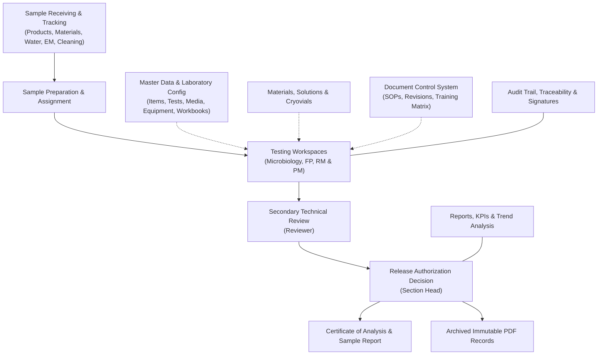

# MicroLIMS User Guide

| Document control | |
|---|---|
| Title | MicroLIMS User Guide |
| Version | DRAFT 0.1 |
| Date | 2026-10-16 |
| Repository branch | `docs/user-guide` |
| Application code described | commit `f773042c` (branch `refactor/consolidation`) |
| Author | Documentation Engineering Agent (AI-assisted draft) |
| Status | **Draft, requires human review and approval before controlled use.** |

This guide was produced from the application's source code and its specification documents. The application was not run while writing it, so screen descriptions come from the code. Boxes marked **Note for reviewers** show behaviour that could not be confirmed or that differs from a specification; open questions are tracked in `DOCUMENTATION_GAPS.md` by their GAP number.

## Contents

- [1. Introduction](#1-introduction)
- [2. Purpose and Scope](#2-purpose-and-scope)
- [3. System Overview](#3-system-overview)
- [4. User Roles and Permissions](#4-user-roles-and-permissions)
- [5. Login, Session and Password](#5-login-session-and-password)
- [6. User Interface](#6-user-interface)
- [7. Navigation](#7-navigation)
- [8. Dashboard](#8-dashboard)
- [9. Notifications, Messages and Discussions](#9-notifications-messages-and-discussions)
- [10. Search and Filters](#10-search-and-filters)
- [11. Sample Management and Tracking Board](#11-sample-management-and-tracking-board)
- [12. Sample Receiving](#12-sample-receiving)
- [13. Test Orders and Analyst Assignment](#13-test-orders-and-analyst-assignment)
- [14. Analyst Testing Workspace and Sample Preparation](#14-analyst-testing-workspace-and-sample-preparation)
- [15. Result Entry (count, observation and location-grid tests)](#15-result-entry-count-observation-and-location-grid-tests)
- [16. Pathogen Testing](#16-pathogen-testing)
- [17. Review](#17-review)
- [18. Return to Analyst, Rework and Retest](#18-return-to-analyst-rework-and-retest)
- [19. Approval](#19-approval)
- [20. OOS Tracking](#20-oos-tracking)
- [21. Sample Report, Certificate of Analysis and Archived Records](#21-sample-report-certificate-of-analysis-and-archived-records)
- [22. Growth Promotion Testing and Media](#22-growth-promotion-testing-and-media)
- [23. Environmental Monitoring](#23-environmental-monitoring)
- [24. Water Monitoring](#24-water-monitoring)
- [25. After Cleaning Monitoring](#25-after-cleaning-monitoring)
- [26. Reference Strains (Reference Cryovials)](#26-reference-strains-reference-cryovials)
- [27. Physicochemical Testing](#27-physicochemical-testing)
- [28. Solution and Standard Preparation](#28-solution-and-standard-preparation)
- [29. Material Stock](#29-material-stock)
- [30. Equipment](#30-equipment)
- [31. Item Master, Test Master and Specifications](#31-item-master-test-master-and-specifications)
- [32. Laboratory Configuration (Organisms, Receiving Configuration, Master Data Workbook)](#32-laboratory-configuration-organisms-receiving-configuration-master-data-workbook)
- [33. Laboratories, Departments and Data Segregation](#33-laboratories-departments-and-data-segregation)
- [34. Reports, KPIs and Trend Analysis](#34-reports-kpis-and-trend-analysis)
- [35. Audit Trail](#35-audit-trail)
- [36. Traceability](#36-traceability)
- [37. Electronic Signatures and Approval Controls](#37-electronic-signatures-and-approval-controls)
- [38. Document Control](#38-document-control)
- [39. Users, Roles and Administration](#39-users-roles-and-administration)
- [40. Error Monitoring (Incidents and Error Log)](#40-error-monitoring-incidents-and-error-log)
- [41. Integrations](#41-integrations)
- [42. Troubleshooting](#42-troubleshooting)
- [43. Frequently Asked Questions](#43-frequently-asked-questions)
- [44. Glossary](#44-glossary)

---

## 1. Introduction

### 1.1 About This User Guide
This document is an end-user guide for the MicroLIMS laboratory information management system. It provides instructions and operational reference information for laboratory analysts, technical reviewers, Section Heads, laboratory administrators, Quality Assurance personnel, and Document Control specialists.

> **Important Notice:** This user guide is an AI-assisted draft describing the software as implemented in the codebase. It has not been formally validated against a live production deployment and requires thorough human review and operational verification before regulatory or operational adoption.

MicroLIMS is designed to support laboratory workflows by recording sample metadata, analytical measurements, test observations, electronic signatures, and lifecycle changes directly in an immutable audit trail. This guide describes observed system behaviors, user interface controls, permissions, and validation rules as implemented in the application source code. No statement in this guide constitutes a claim of regulatory compliance or formal system validation.

### 1.2 System Purpose and Core Functions
MicroLIMS is a web-based laboratory application built to manage testing operations across two distinct laboratory environments:
- **Microbiology Laboratory** (laboratory code `MICRO`)
- **Physicochemical Laboratory** (laboratory code `FP`), comprising the **Finished Product** area (`fp`) and the **Raw Material & Packaging Material** area (`rmpm`).

Within these operational areas, the system provides capabilities to:
- **Receive and register samples** across pharmaceutical finished products, raw materials, packaging materials, purified and process water, environmental monitoring locations, and after-cleaning equipment surfaces. Test orders configured for each item in the system masters are generated automatically upon sample registration.
- **Execute laboratory testing workflows**, including quantitative plate counts, qualitative microbial observations, structured pathogen test sessions, and physicochemical analyses such as HPLC, GC, ICP-OES spectroscopy, volumetric titrations, dissolution, disintegration, and physical measurements.
- **Perform secondary technical reviews and release decisions**, ensuring segregation between testing personnel, reviewing analysts, and approving Section Heads.
- **Manage laboratory materials and inventory**, tracking prepared media lots, reference strain cryovials, chemical reagents, volumetric solutions, reference standards, and laboratory equipment.
- **Maintain laboratory master data**, including items, test methods, specifications, microbial organisms, incubation conditions, and configuration tables.
- **Govern controlled documents**, providing full revision lifecycles, automated numbering, periodic review tracking, and read-and-understand training records.
- **Search, trend, and monitor quality metrics**, including out-of-specification (OOS) investigations, historical result trending, key performance indicators (KPIs), immutable audit trails, and technical error monitoring.

Every sensitive operational decision and quality status change in MicroLIMS requires the user to re-authenticate by entering their password. The system records the user identity, role, timestamp, IP address, and specific meaning statement in the electronic signature record and audit trail.

---

## 2. Purpose and Scope

### 2.1 Intended Audience and Scope
This guide covers the day-to-day operations of laboratory personnel working within MicroLIMS. It is written for:
- **Laboratory Analysts** executing sample preparations, microbiological tests, instrument runs, volumetric titrations, solution preparations, and inventory updates.
- **Technical Reviewers** conducting secondary verification of test results, calculations, observations, and controlled document drafts.
- **Section Heads** managing laboratory workload distribution, test assignments, operational overrides, sample release authorizations, media and cryovial approvals, and controlled document governance.
- **System Administrators** configuring organizational memberships, managing user accounts, adjusting role permissions, reviewing audit trails, and monitoring system technical incidents.
- **Document Controllers and Quality Personnel** overseeing the lifecycle, periodic review, and training compliance of controlled Standard Operating Procedures and laboratory specifications.

### 2.2 Operational Scope
MicroLIMS manages laboratory operations across two distinct sections:
1. **Microbiology Laboratory (`MICRO`)**: Managing bioburden and count testing, pathogen screening sessions, environmental monitoring (EM), purified and process water sampling, after-cleaning (AC) surface monitoring, media preparation, growth promotion testing (GPT), and reference strain cryovials.
2. **Physicochemical Laboratory (`FP`)**: Managing chemical and physical quality control across two dedicated workspaces:
   - **Finished Product Workspace (`fp`)**: Managing final drug product release testing, assay calculations, dissolution, disintegration, and physical uniformity measurements.
   - **Raw Material & Packaging Material Workspace (`rmpm`)**: Managing incoming active pharmaceutical ingredients, excipients, and primary packaging materials.

### 2.3 Backend Capabilities Not Exposed in the User Interface
Certain system modules and administrative endpoints exist strictly within the application backend or database architecture and do not have dedicated frontend screens. Because these features cannot be accessed directly by end users in the browser, they are not given operational procedures in this guide:
- **Login History (`MOD-AUDIT-002`)**: The backend records every sign-in attempt, success, lockout, and failure (`GET /api/admin/audit/login-history`), but no user interface screen displays this history.
- **Security Audit Events (`MOD-SECAUDIT-001`)**: Security events tracking authentication, session lifecycle, and password modifications are captured in database tables, but the viewing permission is not enforced and no frontend viewer exists.
- **Global Signature Trail (`MOD-SIG-002`)**: An administrative endpoint exists to query electronic signatures (`GET /api/signatures`), but no separate signature query screen is provided in the web interface.
- **Historical Reporting Backfill (`MOD-REPORTS-002`)**: An administrative backfill utility (`POST /api/admin/reporting/backfill`) exists for database maintenance without a user-facing screen.
- **Analyst Availability and KPI Settings (`MOD-KPI-002`)**: Backend configuration routes exist for section availability and target parameters, but are maintained via service interfaces without independent user screens.
- **Document Escalations (`MOD-DC-005`)**: Backend background workers handle overdue training notifications without a dedicated user interface console.
- **Results Query Service (`MOD-RESULT-001`)**: A general result retrieval endpoint (`GET /api/results`) exists in the backend without a separate standalone search page.
- **Instrument Report Parsers (`MOD-INSTIMPORT-001`)**: File parsers and OCR utilities exist in the application code but are not registered to any user interface screen or live instrument feed.

### 2.4 Features Not Implemented in the Software
Based on verification of the application codebase, the following functions and modules are not implemented in MicroLIMS. No procedures are provided for them in this user guide:
- MicroLIMS does not have a separate Final Release step or permission; sample authorization by the Section Head serves as the release decision.
- MicroLIMS does not have a distinct sterility test module or result entry screen.
- MicroLIMS does not have an environmental monitoring (EM) annual plan or automated sampling schedule generator.
- MicroLIMS does not have water sampling frequencies or automated water sampling plans.
- MicroLIMS does not have reference-strain passage tracking.
- MicroLIMS does not have equipment qualification records (IQ, OQ, or PQ).
- MicroLIMS does not have a laboratory incident, deviation, or CAPA module; the Error Monitoring screen records only technical system errors.
- MicroLIMS does not have a separate standalone Titration Methods master page; titration settings are configured inside Test Master.
- MicroLIMS does not have an integration with SAP or any other enterprise resource planning (ERP) system.
- MicroLIMS does not have a local AI assistant.
- MicroLIMS does not have live automated instrument data feeds; instrument results are entered manually with supporting evidence file attachments.
- MicroLIMS does not have dedicated Reception or QA role types; receiving is performed by laboratory analysts, reviewers, or Section Heads holding receiving permissions.

---

## 3. System Overview

### 3.1 Functional Architecture
MicroLIMS is structured into functional clusters that connect routine bench-level laboratory execution with supervisory review, quality metrics, and document governance:

### 3.2 Core Laboratory Modules

#### 1. Sample Receiving and Tracking
- **Receive Sample (`MOD-SAMPLE-001`)**: Captures sample receipt across Finished Product, Raw Material, Packaging Material, Water, Environmental Monitoring, and After Cleaning categories. Based on item master setup, the system automatically generates all configured test orders upon registration.
- **Tracking Board (`MOD-TRACK-001`)**: Provides an organization-wide view of every sample, tracking multi-laboratory progress across Microbiology and Physicochemical departments simultaneously.

#### 2. Testing Workspaces and Result Entry
- **Laboratory Workspaces (`MOD-TESTING-001`)**: Specialized execution workspaces for Microbiology, Finished Product (`FP`), and Raw & Packaging Material (`RM & PM`). Analysts view assigned workloads, track incubation windows, and launch result entry dialogs.
- **Microbiology Testing (`MOD-COUNT-001`, `MOD-OBS-001`, `MOD-PATH-001`)**: Manages quantitative plate count testing (with two-stage incubation, dilution factor handling, and plate colony calculations), qualitative observation tests, environmental and water monitoring grids, and multi-day pathogen test sessions with confirmation steps.
- **Physicochemical Testing (`MOD-PHYSRESULT-001`, `MOD-HPLC-001`, `MOD-GC-001`, `MOD-ICP-001`, `MOD-TITR-001`)**: Dedicated workspaces and panels for chromatography runs (HPLC and GC), ICP-OES spectroscopy, volumetric titrations, dissolution testing, disintegration, and physical uniformity measurements.

#### 3. Review, Approval, and Release
- **Technical Review (`MOD-REVIEW-001`)**: Reviewers perform secondary scientific data verification of raw plate counts, instrument runs, and test calculations. If data is incomplete or suspect, count tests can be returned to analysts with instructions.
- **Approval Decision (`MOD-APPROVAL-001`)**: Section Heads execute sample release decisions (Approve, Reject, Retest Retained Sample, or New Sample Required) under electronic signature.
- **Reporting and Archival (`MOD-COA-001`, `MOD-ARCHIVE-001`)**: Approved or rejected samples generate Certificates of Analysis (CoA) and consolidated sample reports. Upon final decision, the system creates immutable, frozen PDF records with cryptographic checksums.

#### 4. Consumables, Reference Strains, and Equipment
- **Media Preparation and Evaluation (`MOD-MEDIA-001`, `MOD-MEDIACFG-001`)**: Tracks prepared media batches, autoclave parameters, growth promotion testing (GPT), and release sign-offs.
- **Reference Cryovials (`MOD-CRYO-001`)**: Governs reference microorganism cryovials, thaw cycles, storage relocations, and destruction records.
- **Materials and Equipment Inventory (`MOD-MATERIAL-001`, `MOD-EQUIP-001`, `MOD-COLUMN-001`)**: Tracks chemical reagents, primary packaging lots, chromatography columns, equipment operational status, calibration due dates, and certificates.
- **Solutions and Working Standards (`MOD-SOLN-001`, `MOD-WS-001`)**: Governs volumetric titrant standardizations, reagent preparation recipes, and working standard qualification assays.

#### 5. Master Data and Laboratory Configuration
- **Item Master and Specifications (`MOD-ITEM-001`, `MOD-SPEC-001`)**: Defines product catalogs, preparation parameters, storage specifications, and alert/action/specification limits.
- **Test Master (`MOD-TESTMASTER-001`, `MOD-EQTYPE-001`)**: Configures test parameters, calculation formulas, workflow steps, and stage requirements.
- **Master Data Workbook (`MOD-WORKBOOK-001`)**: Enables bulk loading and verification of laboratory master data from standardized spreadsheets with two-person segregation controls.

#### 6. Document Control System (`MOD-DC-001` through `MOD-DC-004`)
- Centralized governance for Standard Operating Procedures (SOPs), test methods, and quality documents. Manages draft authoring, technical reviews, approval signatures, automated revision numbering, periodic review schedules, user reading curricula, and training compliance matrices.

#### 7. Quality Reporting, Compliance, and Administration
- **Reports and Trend Analysis (`MOD-REPORTS-001`)**: Generates consolidated quality overviews, record searches across laboratory disciplines, media summaries, and statistical trending charts.
- **Key Performance Indicators (`MOD-KPI-001`)**: Evaluates turnaround times, right-first-time rates, retest ratios, out-of-specification rates, and analyst workload distribution.
- **Out of Specification Tracking (`MOD-OOS-001`)**: Manages OOS investigation groups, records retest orders, and tracks laboratory investigation reports.
- **Audit Trail (`MOD-AUDIT-001`)**: Provides an immutable log of change events across all laboratory records, featuring field-level difference comparisons and visual traceability chains.
- **Error Monitoring (`MOD-ERR-001`)**: Records technical system exceptions and API failures for operational diagnostics.

### 3.3 Technology Stack and Security Foundation
- **Web Application Architecture**: MicroLIMS operates as a modern Single-Page Application (SPA) built using React, TypeScript, and Material UI, communicating with an ASP.NET Core backend backed by a PostgreSQL database.
- **Authentication and Session Security**: MicroLIMS employs JSON Web Tokens (JWT). The access token has a default validity of 15 minutes (configurable from 1 to 480 minutes), and the refresh token has a 7-day validity with automatic rotation on each refresh.
- **Electronic Signatures**: Whenever a user executes a sensitive operational action (such as sample approval, correction, voiding, media release, or result recording), MicroLIMS presents a dedicated electronic signature dialog requiring the user to re-enter their login password. The system captures the user identity, role, timestamp, IP address, and meaning statement directly in the audit trail.
- **Segregation of Duties**: The system enforces strict separation of duties across all testing, reviewing, and approval workflows. Analysts cannot review or approve their own testing, and technical reviewers cannot approve samples they reviewed. System Administrators possess no administrative exemption from these segregation rules.

---

## 4. User Roles and Permissions

### 4.1 System Security and Role Architecture
MicroLIMS controls user access through two distinct layers:
1. **Roles**: Named security profiles assigned to user accounts. Every role in the system is built upon one of four underlying base role types: `SystemAdministrator`, `SectionHead`, `Reviewer`, or `Analyst`.
2. **Permission Codes**: Functional privilege codes representing specific actions (such as `Samples.Review`, `MasterData.Manage`, or `Hplc.Operate`). Exactly 50 permission codes are declared in the system.

> **Administrative Role Editability:** The permission grants described for the four system roles are **defaults**, not fixed assignments. An administrator holding the *Role & permission management* permission (`Roles.Manage`) can create custom roles, rename existing roles, and modify the permissions assigned to any role (including the default system roles). System roles cannot be deleted, but their permissions can be edited. Live deployment permissions depend on the current configuration in the database.

#### Laboratory Membership and Scoping
In addition to role permissions, access to laboratory data is governed by organizational memberships:
- **Microbiology Laboratory (`MICRO`)**: Grants access to the Microbiology workspace, media preparation, reference cryovials, and microbiology configuration.
- **Physicochemical Laboratory (`FP`)**: Governs chemical testing. Memberships can be scoped to specific physical areas:
  - **Finished Product area (`fp`)**: Access to the FP Workspace.
  - **Raw Material & Packaging Material area (`rmpm`)**: Access to the RM & PM Workspace.
  - If no area is specified, both workspaces are displayed.
- **Zero Membership**: A user with no assigned laboratory membership sees an empty scope and cannot access test data ("Your account is not assigned to any laboratory section. Ask an administrator to assign one.").
- **System Administrator Scope Bypass**: Users with the base role type `SystemAdministrator` bypass laboratory scoping by default and have global visibility across both laboratories and all areas.

#### Permission Propagation and Token Timing
- **Permission Updates**: Permissions are embedded within the user's access token claim set. Changes made to a role's permissions take effect when the user next refreshes their access token (default access token lifetime is 15 minutes, configurable from 1 to 480 minutes).
- **Immediate Revalidation**: Changes to a user's base role type, account lockout, account deactivation, or password updates are evaluated on every request by the server middleware and take effect immediately.
- **Self-Modification Restrictions**: Users cannot modify their own role, cannot disable their own account, and cannot delete their own account.

---

### 4.2 Seeded System Roles

#### System Administrator (`ROLE-SYSTEMADMINISTRATOR`)
- **Base Role Type**: `SystemAdministrator`
- **Default Permissions**: All 50 permissions granted by default.
- **Primary Responsibilities**: Oversees user account provisioning, role and permission configuration, system audit trails, technical error monitoring, and global configuration.
- **Operational Boundaries**: Possesses global visibility across all laboratories. However, System Administrators have **no administrative exemption** from segregation-of-duties rules: they cannot review or approve any sample, test, media lot, or standard they performed or prepared. System Administrators are also restricted from changing media product codes (which is reserved exclusively for the Section Head role type) and cannot void Document Masters.

#### Section Head (`ROLE-SECTIONHEAD`)
- **Base Role Type**: `SectionHead`
- **Default Permissions**: 43 permissions granted by default.
- **Primary Responsibilities**: Directs laboratory operations, assigns tests to analysts, supervises testing workflows, authorizes incubation overrides, performs secondary technical reviews, and executes final sample release authorizations (Approve, Reject, Retest, New Sample).
- **Exclusive Operational Authorities**:
  - Exclusively permitted to execute signed media product code changes.
  - Exclusively permitted to void controlled Document Masters in Document Control.
  - Exclusively authorized to override proposed document revision numbers.
- **Restrictions**: Does not manage user accounts or system roles by default. Cannot approve any sample they reviewed or tested.

#### Reviewer (`ROLE-REVIEWER`)
- **Base Role Type**: `Reviewer`
- **Default Permissions**: 15 permissions granted by default.
- **Primary Responsibilities**: Conducts secondary scientific verification of test results, raw plate counts, and calculations. Returns count tests to analysts when revision is needed. Serves as assigned technical reviewer for controlled document revisions.
- **Restrictions**: Cannot execute final sample release decisions, release media lots, or approve cryovial batches. Cannot review any test or sample they performed or prepared.

#### Analyst (`ROLE-ANALYST`)
- **Base Role Type**: `Analyst`
- **Default Permissions**: 15 permissions granted by default.
- **Primary Responsibilities**: Bench execution across microbiology and physicochemical laboratories: receiving samples for own laboratory sections, sample preparation, plate count entry, qualitative observations, pathogen test sessions, chromatography operation (HPLC, GC), ICP spectroscopy, solution preparations, and inventory updates.
- **Restrictions**: Holds no technical review or release approval permissions. Within testing workspaces, analysts default to viewing test orders assigned to them. Cannot review or approve own testing.

---

### 4.3 Permission Code Catalogue

Of the 50 permission codes declared in MicroLIMS, 40 are actively **ENFORCED** by backend policies or services. The remaining 10 codes are **Legacy-only / Not Enforced** in the software; toggling them in the permission matrix has no functional effect on access.

| # | Permission Code | Plain-Language Name | Default Roles | Status | Functional Scope |
|---|---|---|:---:|:---:|---|
| 1 | `Users.Manage` | User Account Management | SA | **ENFORCED** | Create, edit, lock/unlock, deactivate, force password change, and manage lab memberships. |
| 2 | `Roles.Manage` | Role & Permission Management | SA | **ENFORCED** | Create custom roles, rename roles, and update assigned permission sets. |
| 3 | `Audit.View` | Audit Trail Viewing | SA, SH | **ENFORCED** | View audit logs, change diffs, record history, and traceability chains. |
| 4 | `Reporting.Admin` | Administrative Reporting | SA | **ENFORCED** | Execute administrative reporting operations and result record backfills. |
| 5 | `Samples.Review` | Sample Technical Review | SA, SH, REV | **ENFORCED** | Submit technical reviews on sample sections and return tests to analysts. |
| 6 | `Samples.Approve` | Sample Release Approval | SA, SH | **ENFORCED** | Submit sample release decisions (Approve, Reject, Retest, New Sample) and close testing. |
| 7 | `Samples.Receive` | Global Sample Receiving | SA, SH | **ENFORCED** | Receive samples for any laboratory section globally and add laboratories to existing samples. |
| 8 | `Samples.TrackAll` | Cross-Lab Sample Tracking | SA, SH | **ENFORCED** | View the global Tracking Board across all laboratory sections. |
| 9 | `Signatures.Manage` | Signature Trail Viewing | SA, SH | **ENFORCED** | View electronic signature audit records. |
| 10 | `TestWorkflow.Execute` | Test Workflow Execution | SA, SH, REV, ANA | **ENFORCED** | Execute plate counts, qualitative observations, pathogen testing, and test results. |
| 11 | `TestWorkflow.BiochemicalDecision` | Biochemical Decision Recording | SA, SH, REV | **ENFORCED** | Record biochemical confirmation decisions on pathogen test steps. |
| 12 | `Cryovials.Manage` | Cryovial Management | SA, SH, REV, ANA | **ENFORCED** | Prepare batches, thaw, move storage, and destroy reference cryovials. |
| 13 | `Cryovials.Approve` | Cryovial Batch Approval | SA, SH | **ENFORCED** | Approve (release) or reject prepared reference cryovial batches. |
| 14 | `Materials.Manage` | Material Stock Management | SA, SH, ANA | **ENFORCED** | Receive inventory material lots, update details, consume stock, and upload documents. |
| 15 | `Materials.DocumentControl` | Material Document Control | SA, SH | **ENFORCED** | Supersede or void material inventory documents. |
| 16 | `Equipment.Manage` | Equipment Inventory Management | SA, SH, ANA | **ENFORCED** | Register equipment, update inventory details, and upload maintenance certificates. |
| 17 | `Equipment.DocumentControl` | Equipment Document Control | SA, SH | **ENFORCED** | Supersede or void equipment documents. |
| 18 | `Items.Manage` | Items Master Management | SA, SH | **ENFORCED** | Manage item master data, specifications, and item preparation configurations. |
| 19 | `Items.DocumentUpload` | Item Document Upload | SA, SH | **ENFORCED** | Upload controlled documents (SOPs, verification reports) to Items. |
| 20 | `MasterData.Manage` | Master Data Management | SA, SH | **ENFORCED** | Manage lab configurations across EM, Water, After Cleaning, Organisms, Media, and Workbooks. |
| 21 | `Discussions.View` | Discussions Viewing | SA, SH, REV, ANA | Legacy-only | Open to all signed-in users in code; permission code is not evaluated. |
| 22 | `Discussions.Create` | Discussions Creation | SA, SH, REV, ANA | Legacy-only | Open to all signed-in users in code; permission code is not evaluated. |
| 23 | `Discussions.EditAny` | Discussions Moderation | SA, SH | **ENFORCED** | Edit or delete any discussion post or comment, or mark posts important. |
| 24 | `Messages.Use` | Messaging Use | SA, SH, REV, ANA | Legacy-only | Open to all signed-in users in code; permission code is not evaluated. |
| 25 | `System.ViewErrorLog` | Error Log Monitoring | SA | **ENFORCED** | View technical incident logs and system health error monitoring. |
| 26 | `System.ViewSecurityAudit` | Security Audit Viewing | SA | Legacy-only | Security events are captured in the database; no viewer endpoint checks this code. |
| 27 | `Documents.Register` | Document Master Registration | SA, SH, ANA | **ENFORCED** | Register new controlled Document Masters in Document Control. |
| 28 | `Documents.DraftEdit` | Document Draft Editing | SA, SH, ANA | Legacy-only | Service checks role type and document author assignment directly. |
| 29 | `Documents.RevisionCreate` | Document Revision Creation | SA, SH, ANA | Legacy-only | Service checks role type and document author assignment directly. |
| 30 | `Documents.Review` | Document Technical Review | SA, REV | Legacy-only | Service checks assigned technical reviewer assignment and role type directly. |
| 31 | `Documents.Approve` | Document Revision Approval | SA, SH, REV | Legacy-only | Service checks assigned approver assignment and segregation of duties directly. |
| 32 | `Documents.PeriodicReview` | Document Periodic Review | SA, SH, REV | Legacy-only | Service checks assigned periodic reviewer and role type directly. |
| 33 | `Documents.TrainingAssign` | Document Training Assignment | SA, SH | **ENFORCED** | Assign reading and training curricula to personnel; view full training matrix. |
| 34 | `Documents.TrainingViewMatrix` | Training Matrix Viewing | SA, SH, REV | Legacy-only | Controller checks `Documents.TrainingAssign` to view full matrix. |
| 35 | `Documents.ConfigManage` | Document Control Configuration | SA | **ENFORCED** | Manage document types, departments, sections, numbering, and settings (requires SystemAdministrator type). |
| 36 | `Dashboards.LabOverview` | Lab Overview Dashboard | SA, SH | **ENFORCED** | View the Section Head laboratory overview dashboard. |
| 37 | `Dashboards.Review` | Reviewer Dashboard | SA, SH, REV | **ENFORCED** | View the Reviewer command center dashboard. |
| 38 | `Kpi.View` | KPI Dashboard Viewing | SA, SH | **ENFORCED** | View the KPI / Performance reporting tab. |
| 39 | `Kpi.ViewTeam` | Team KPI & Workload Viewing | SA, SH | **ENFORCED** | View KPI metrics and workload figures for other analysts across the section. |
| 40 | `Kpi.ConfigureProfiles` | KPI Profile Configuration | SA, SH | **ENFORCED** | Create and sign workflow profile versions (work units, stage targets). |
| 41 | `Media.Prepare` | Media Lot Preparation | SA, SH, REV, ANA | **ENFORCED** | Prepare media lots, record storage moves, and mark lots out of stock. |
| 42 | `Media.Release` | Media Lot Release | SA, SH | **ENFORCED** | Release or reject prepared and evaluated media lots under electronic signature. |
| 43 | `Oos.Manage` | OOS Tracking Management | SA, SH | **ENFORCED** | Manage OOS tracking groups and upload laboratory investigation documents. |
| 44 | `TestWorkflow.Supervise` | Test Workflow Supervision | SA, SH | **ENFORCED** | Supervisor overrides on minimum incubation times and pathogen session resets. |
| 45 | `Samples.ReceiveOwnLab` | Own-Lab Sample Receiving | SA, SH, REV, ANA | **ENFORCED** | Receive samples for laboratory sections where user holds active membership. |
| 46 | `Samples.Correct` | Sample Correction & Voiding | SA, SH, REV | **ENFORCED** | Correct sample metadata and void sample records under electronic signature. |
| 47 | `Samples.AssignAnalyst` | Sample Analyst Assignment | SA, SH | **ENFORCED** | Assign responsible analysts to sample test orders. |
| 48 | `Solutions.Prepare` | Solution Preparation | SA, SH, ANA | **ENFORCED** | Prepare solutions and mobile phases, and standardize volumetric titrants. |
| 49 | `Hplc.Operate` | HPLC/GC/ICP Operation | SA, SH, ANA | **ENFORCED** | Start instrument runs, confirm system suitability (SST), and submit runs. |
| 50 | `WorkingStandards.Qualify` | Working Standard Qualification | SA, SH, ANA | **ENFORCED** | Prepare working standards, upload documents, and enter qualification replicates. |

> **Note for reviewers:** Ten permissions marked "Legacy-only" have no effect in the application; do not rely on them to restrict access. (GAP-015)

---

### 4.4 Segregation of Duties (SoD) Rules
MicroLIMS enforces strict segregation of duties to safeguard data integrity and prevent self-approval. The segregation guard evaluates user IDs directly across transactions and provides **no exemption for System Administrators or Section Heads**:

1. **Sample Technical Review**:
   - A user cannot perform a technical review on a sample section if they performed or prepared any test in that section.
   - Refusal message: `"You cannot review a sample you tested."`
2. **Sample Approval**:
   - An approver cannot approve a sample if they acted as the technical reviewer for that section.
   - Refusal message: `"You cannot approve a sample you reviewed."`
   - An approver cannot approve a sample if they performed or prepared any test in that section.
   - Refusal message: `"You cannot approve a sample you tested."`
3. **Pathogen Confirmation**:
   - A reviewer cannot record a biochemical confirmation decision on a pathogen test they performed.
   - Refusal message: `"A reviewer cannot decide on a result they performed."`
4. **Media Lot Release**:
   - A user cannot approve or release a media lot they prepared or evaluated.
   - Refusal message: `"You cannot approve a media lot you prepared or evaluated."`
5. **Cryovial Batch Approval**:
   - A user cannot approve a cryovial batch they prepared.
   - Refusal message: `"You cannot approve a cryovial batch you prepared."`
6. **Master Data Workbook Verification**:
   - The user who loaded a master data workbook cannot verify it.
   - Refusal message: `"The person who loaded the workbook cannot verify it. Ask a second person."`
7. **Document Control Governance**:
   - The author of a document revision cannot act as its technical reviewer, cannot create reviewer findings, and cannot approve the revision.
   - A technical reviewer who participated in a revision review cannot approve that revision.

---

### 4.5 Role Management Procedures

<!-- WF-ROLES-001 -->
### 4.5.1 Create a Custom Role
#### Purpose
Define a new security profile with tailored permissions based on an underlying system role type.

#### Who can use it
Requires the *Role & permission management* permission (by default: System Administrator).

#### Before you start
Determine the underlying base role type (`SystemAdministrator`, `SectionHead`, `Reviewer`, or `Analyst`) that reflects the role's operational duties.

#### What you see
- Navigation: **ADMINISTRATION** > **Roles** (`/roles`).
- Roles list with columns **Role**, **Type**, **Status**, and **Users**, and button **Create Role**.
- Create Role wizard (`/roles/new`) with four stepper stages: **Name**, **Base Type**, **Permissions**, and **Review**.

[SCREENSHOT SS-041]

#### How to use it
1. Navigate to **ADMINISTRATION** > **Roles** in the sidebar.
2. Click **Create Role** to launch the wizard.
3. On the **Name** step, enter the **Role Name** (mandatory) and optional **Description**. Click **Next**.
4. On the **Base Type** step, select the underlying base role type radio button: **SystemAdministrator**, **SectionHead**, **Reviewer**, or **Analyst** (default is Analyst). Click **Next**.
5. On the **Permissions** step, check each permission code to grant. Optionally select an existing role from the **Or clone permissions from any existing role:** dropdown to copy its grants. Click **Next**.
6. On the **Review** step, verify the summary details and granted permission chips. Click **Create Role**.

#### System behavior
The system registers the role, sets its base type, and saves the permission set. The newly created role appears in the Roles list.

> **Note for reviewers:** Role and user changes are audited but not signed and need no second person; nothing prevents removing Roles.Manage from an administrative role. (GAP-009)

#### Validation
- If the role name is blank, the system blocks progression with: `"Role name is required."`
- If an invalid code is supplied, the server returns: `"Unknown permission code(s): {codes}."`

#### Errors
- If role creation fails, the system displays: `"Could not create this role."`

---

### 4.5.2 Edit Role Permissions and Details
#### Purpose
Update the description or modify granted permission codes for an existing role.

#### Who can use it
Requires the *Role & permission management* permission (by default: System Administrator).

#### What you see
- Role detail page (`/roles/:id`) displaying role name, **Base Type**, **System Role** indicator, and editable fields **Name** and **Description**.
- **Permissions** matrix with checkboxes, accompanied by **Enforced** and **Legacy-only** indicator chips.
- Users section displaying active and disabled role holders.
- Action buttons: **Save Changes** and **Delete Role** (for custom roles).

[SCREENSHOT SS-042]

#### How to use it
1. In the **Roles** list, click on the role to open its detail page.
2. Modify the **Name** or **Description** fields if needed.
3. In the **Permissions** matrix, check or uncheck individual permission codes.
4. Click **Save Changes**.

#### System behavior
The system updates the role metadata and writes a `ROLE_PERMISSIONS_UPDATED` entry to the audit trail recording all granted and revoked permission codes. Assigned users acquire new permissions upon their next access token refresh (up to 15 minutes).

> **Note for reviewers:** The role-change audit entry shows the new role id as the previous value. (GAP-112)

#### Validation
- System roles cannot be deleted. Clicking delete on a system role is prevented, and the server returns: `"System roles cannot be deleted."`
- If a custom role is assigned to active users, deletion is refused with: `"Role '{name}' is currently assigned to {n} user(s) and cannot be deleted."`

---

## 5. Login, Session and Password

<!-- WF-AUTH-001 -->
### 5.1 Sign In
#### Purpose
Authenticate a user with valid credentials, establish an encrypted session token, and route the user to their laboratory dashboard.

#### Who can use it
Any active user account provisioned by a system administrator. Laboratory membership is not required to sign in.

#### Before you start
You must have an active username and password provided by your system administrator.

#### What you see
- Page route: `/login`.
- Heading **MicroLIMS** and document title "Sign in · MicroLIMS".
- Input fields:
  - **Username** (required, with autofocus).
  - **Password** (required, with a visibility toggle button labeled **Show password** / **Hide password**).
- Action buttons:
  - **Sign In** (displays **Signing in…** while the authentication request is processing).
  - Text link: **Forgot password?**
  - Action button: **Admin-Assisted Password Recovery** (navigates to `/admin-recovery`).
- Footer text: "MicroLIMS v0.1 · FDA 21 CFR Part 11 & EU Annex 11 Compliant".

[SCREENSHOT SS-051]

#### How to use it
1. Open the MicroLIMS web application URL in your browser.
2. In the **Username** field, enter your assigned username.
3. In the **Password** field, enter your password.
4. Click **Sign In** (or press Enter).
5. If authentication succeeds, the system stores your session tokens and opens your role-based **Dashboard** (`/dashboard`).
6. If the administrator has marked your account to require a password change, the application redirects you immediately to the **Change Password** screen (see Section 5.4).

#### System behavior
- Upon successful authentication, the server generates an access token (default validity: 15 minutes) and a refresh token (validity: 7 days).
- Every sign-in attempt (successful, failed password, unknown user, locked account, or inactive user) is recorded in the internal login history with the client IP address.
- If five consecutive failed sign-in attempts occur, the system automatically locks the account for 15 minutes (`LockedUntil = now + 15 min`) and revokes all active refresh tokens.
- Request rate limiting: the sign-in endpoint permits a maximum of 20 authentication requests per 60 seconds per IP address.

> **Note for reviewers:** Sign-in page footer claims compliance; this is text only and is not a validation statement. (GAP-023)

> **Note for reviewers:** After 5 wrong passwords the account locks 15 min; the counter is not reset when the lock ends, so one further wrong password locks again. (GAP-012)

#### Validation
- Both **Username** and **Password** are required.

#### Errors
- If incorrect credentials are submitted, the system displays: `"Invalid username or password."`
- If an account is locked, the system displays the same generic message: `"Invalid username or password."`
- If the server encounters an internal error, the client displays: `"Laboratory authentication service error. Please try again later."`
- If network communication fails, the client displays: `"Unable to reach the laboratory server. Check network connection."`
- General fallback error: `"Login failed. Please check credentials."`

---

<!-- WF-AUTH-002 -->
### 5.2 Request Password Reset
#### Purpose
Request an automated password reset notification via email.

#### Who can use it
Any user holding a registered account.

#### Before you start
You must know your registered username. An email address must be configured on your account profile, and the system must have an active SMTP connection.

#### What you see
- On the sign-in card (`/login`), clicking **Forgot password?** toggles the card to the reset request view.
- Guidance text: "Enter your username and we'll generate a password reset request."
- Field: **Username**.
- Action buttons:
  - **Send Reset Link** (displays **Submitting...** while processing).
  - Links: **Back to login** and **Have a recovery code from your admin?** (links to `/admin-recovery`).

#### How to use it
1. On the `/login` screen, click **Forgot password?**.
2. Enter your **Username**.
3. Click **Send Reset Link**.
4. The system presents the confirmation message: `"If that account exists, a reset link has been generated."`

#### System behavior
- The server generates a single-use token valid for 1 hour. If an email address is associated with the account, an email is dispatched containing the token.
- To prevent username enumeration, the system returns the exact same confirmation text regardless of whether the username exists or has an email configured.

> **Note for reviewers:** "Forgot password?" cannot be completed in the application; ask an administrator for an admin-assisted recovery code. The on-screen text mentions a reset link, but none is sent. (GAP-100)

---

<!-- WF-AUTH-003 -->
### 5.3 Administrator-Assisted Password Recovery
#### Purpose
Recover access to a user account using a temporary 12-character one-time recovery code generated by a system administrator.

#### Who can use it
Any user who has received an administrator-generated one-time recovery code. The administrator must hold the *User account management* permission (`Users.Manage`) to generate the code.

#### Before you start
Contact your system administrator to request an administrator-assisted recovery code. The administrator generates a 12-character code that remains valid for exactly 15 minutes.

#### What you see
- Page route: `/admin-recovery`.
- Heading **Password Recovery** with subtitle "Administrator-Assisted Account Access Recovery".
- Input fields:
  - **Username**
  - **One-Time Recovery Code** (placeholder `XXXX-XXXX-XXXX`, helper text "Format: 12 alphanumeric characters provided by your admin").
  - **New Password** (helper text "Min 8 chars (upper, lower, digit, symbol)").
  - **Confirm New Password**
- Action buttons:
  - **Submit Password Recovery** (displays **Resetting Password...** while processing).
  - Link: **Return to Login**.

[SCREENSHOT SS-052]

#### How to use it
1. From the sign-in screen, click **Admin-Assisted Password Recovery** (or navigate directly to `/admin-recovery`).
2. Enter your **Username**.
3. In the **One-Time Recovery Code** field, type or paste the 12-character code provided by your administrator. Dashes, spaces, and character casing are ignored automatically.
4. Enter your desired new password in **New Password**, adhering to the security policy (minimum 8 characters, including uppercase, lowercase, digit, and special character).
5. Re-enter the new password in **Confirm New Password**.
6. Click **Submit Password Recovery**.
7. Upon successful reset, the screen displays: `"Your password has been successfully reset! You can now log in using your new password."`
8. Click **Go to Login Page** and sign in with your new credentials.

#### System behavior
- When the administrator generates the code from the **Users** module, an administrative justification reason is mandatory (`"A reason is required for admin-assisted password recovery."`).
- Any previous pending recovery code for that account is marked Expired.
- When the user submits the code, the server verifies that the code matches the stored hash, has not expired, and has not exceeded 5 failed attempts.
- Upon successful reset, the system clears any account lockout, resets the failed login attempt counter, revokes all existing refresh tokens, marks the recovery code as Used, and turns off the forced password change flag.

> **Note for reviewers:** The physical or out-of-band hand-over procedure for the one-time administrator recovery code requires confirmation. (GAP-012)

#### Validation
- Client checks:
  - All fields are required: `"All fields are required."`
  - Password match: `"New password and confirm password do not match."`
- Password policy and history:
  - The new password must not match any of the user's previous 5 stored passwords: `"New password must not match any of your last 5 passwords."`

#### Errors
- If an invalid username, disabled account, or expired code is supplied: `"Invalid or expired recovery code."`
- If the 15-minute validity window has lapsed: `"Recovery code has expired. Please request a new recovery code."`
- On failed attempts 1 through 4: `"Invalid recovery code."`
- On the 5th consecutive failed attempt: `"Maximum failed recovery attempts exceeded. Recovery code invalidated."`
- Fallback error: `"Could not perform password recovery. Please verify your recovery code."`

---

<!-- WF-AUTH-004 -->
### 5.4 Change Password and Forced Password Change
#### Purpose
Update your user account password, either voluntarily from your profile or mandatorily when flagged by an administrator or upon initial login.

#### Who can use it
Any authenticated user. No specific permission code is required.

#### Before you start
You must know your existing current password.

#### What you see
- Page route: `/change-password`.
- Heading **Change Password** with subtitle "Update your laboratory credentials in compliance with periodic security policy."
- Fields:
  - **Current Password** (autofocus).
  - **New Password**
  - **Confirm New Password** (helper text: "Passwords do not match." when inputs differ).
- Live requirements checklist header **Password must contain:** showing five rules:
  - At least 8 characters
  - At least one uppercase letter (A-Z)
  - At least one lowercase letter (a-z)
  - At least one number (0-9)
  - At least one special character (!@#$%^&*...)
- Action button: **Change Password** (displays **Updating Credentials...** while processing).

[SCREENSHOT SS-053]

#### How to use it
1. Open the user account menu in the top-right header and select **Change Password** (or arrive via mandatory redirect).
2. Enter your current password in **Current Password**.
3. Enter your new password in **New Password**. As you type, the checklist verifies each of the five requirements.
4. Re-enter the new password in **Confirm New Password**.
5. Click **Change Password**.
6. The system displays: `"Password changed successfully. Returning to your profile..."` and navigates to `/profile` after 1.5 seconds.

#### System behavior
- **Forced Password Change**: If an administrator created your account with the initial password flag, or triggered **Force Password Change at Next Login**, the system redirects all navigation to `/change-password`. While this flag is active, the server rejects all other authenticated API calls with HTTP 403: `"Your password must be changed before you can use MicroLIMS."`
- Successful password updates revoke all active refresh tokens across all devices, update the Password Last Changed timestamp, and clear the forced password change flag.
- Rate limiting: maximum 5 password change requests per 900 seconds (15 minutes) per user.

> **Note for reviewers:** Passwords do not expire; the Change Password subtitle mentions a periodic policy that does not exist in the code. (GAP-023)

#### Validation
- If the current password is incorrect, the server returns: `"Current password is incorrect."`
- If policy checks fail: `"New password does not meet the policy requirements below."`
- If confirmation does not match: `"New password and confirmation do not match."`
- Password history restriction: `"New password must not match any of your last 5 passwords."`

#### Errors
- Fallback error: `"Could not change password."`

---

<!-- WF-AUTH-005 -->
### 5.5 Session Timeout and Sign Out
#### Purpose
Maintain session security through automatic browser inactivity timeouts and controlled manual sign-out.

#### Who can use it
All authenticated users across all modules.

#### What you see
- **Session Timeout Warning Dialog**: Appears automatically over any page when inactivity is detected.
  - Dialog Title: **Session Timeout Warning**.
  - Message text: "You will be signed out due to inactivity in {n} second(s)." with an active 60-second countdown.
  - Single button: **Stay signed in** (autofocused).
  - The dialog cannot be dismissed by pressing Escape or clicking outside the modal backdrop.

[SCREENSHOT SS-054]

#### How to use it
- **Responding to Inactivity**:
  1. When the **Session Timeout Warning** appears, click **Stay signed in** or move your mouse / press any key.
  2. The countdown cancels immediately, the dialog closes, and the 20-minute inactivity timer resets.
  3. If no activity occurs before the 60-second countdown reaches zero, MicroLIMS automatically signs you out and redirects the browser to `/login`.
- **Manual Sign Out**:
  1. Click your user account avatar in the top-right header.
  2. Select **Sign Out**.
  3. The system immediately revokes your active refresh token, clears local storage tokens, and redirects to `/login` without a confirmation prompt.

#### System behavior
- **Inactivity Detection**: Monitored strictly in the browser. After 20 minutes with no mouse movements, keyboard presses, clicks, or scrolling, the 60-second warning modal appears.
- While the user remains actively interacting with the application, the client automatically renews the 15-minute access token in the background using the 7-day refresh token.

> **Note for reviewers:** Idle sign-out happens in the browser only; the server does not time out inactive sessions. (GAP-053)

---

## 6. User Interface

### 6.1 Application Shell and Global Header
The MicroLIMS application shell provides a consistent top header, collapsible navigation sidebar, breadcrumb hierarchy, and page container across every authenticated view:

- **Skip Navigation**: Accessible hidden link labeled "Skip to main content" allowing keyboard and screen-reader users to bypass navigation menus.
- **Navigation Toggle**: Hamburger icon button with accessibility label **Toggle navigation menu**. On desktop screens, it toggles the sidebar between expanded and compact rail modes. On mobile screens, it toggles the overlay drawer.
- **Theme Mode Toggle**: Icon button with tooltip and accessibility label **Switch to dark mode** or **Switch to light mode**. Toggles between light and dark visual themes.
- **Notifications Bell**: Icon button with accessibility label **Notifications** (or **Notifications, {n} unread**). Clicking the bell opens a popover listing recent attention alerts, sample review requests, incubation alerts, and media expiry notices.
- **Account Menu**: Profile icon button with accessibility label **Account menu for {name}**. Clicking the menu reveals:
  - **My Profile**: Opens the read-only user profile page (`/profile`).
  - **Messages** (or **Messages ({n} unread)**): Navigates directly to the messaging workspace (`/messages`).
  - **Discussions**: Navigates to the discussions and knowledge feed (`/discussions`).
  - **Change Password**: Navigates to the credential update form (`/change-password`).
  - **Sign Out**: Terminates the session, revokes refresh tokens, and returns to `/login`.

[SCREENSHOT SS-061]

---

### 6.2 Sidebar Layout and Theme Persistence
- **Collapsible Rail**: The sidebar navigation occupies the left edge of the desktop view (landmark: "Main navigation"). When collapsed, it narrows to a 68-pixel rail displaying top-level group icons. Hovering or expanding restores full text labels.
- **Sidebar Toggle Controls**: An explicit toggle button labeled **Collapse sidebar** or **Expand sidebar** allows manual layout adjustment. The collapsed state is persisted in your browser's local storage (`microlims_sidebar_collapsed`).
- **Dark Mode Support**: Users can freely switch between dark and light appearance modes. The active choice is stored in browser local storage (`microlims-theme-mode`). If no choice has been saved, the application detects and follows your operating system's dark mode preference.

---

### 6.3 Breadcrumbs, Section Pages, and Error Handling
- **Breadcrumb Navigation**: Displayed above the primary card of each screen, showing the structural path (e.g. `Home > Microbiology Laboratory > Workspace`).
- **Section Landing Pages (`SCR-NAV-001`)**: Accessible via `/sections/:slug` (with legacy alias `/groups/:slug`). When a major sidebar category is opened, this landing view presents navigation cards for all subordinate pages that the current user has permission to open:
  - Header: Section name (fallback: "Section not available").
  - Subtitle: "{n} page(s) you can open here".
  - Empty state: If you have no permissions for child screens in that section, the page displays: `"You have no pages in this section."`
- **Page Not Found (`SCR-NAV-002`)**: Navigating to an invalid or obsolete URL triggers the application-level catch-all route (`*`):
  - Heading: **Page not found**.
  - Title: "There is no page at this address".
  - Description: `"{pathname}" does not match any MicroLIMS page. The link may be outdated, or the page may have moved. Use the navigation menu or return to your dashboard.`
  - Action button: **Go to Dashboard** (redirects to `/dashboard`).
- **Per-Page Error Boundaries**: Every primary page view is encapsulated within an isolated error boundary. If a runtime rendering exception occurs on a particular screen, only that page displays a recovery prompt while the global header, sidebar navigation, and user session remain fully operational.

---

<!-- SCR-SIG-001 -->
### 6.4 Shared Electronic Signature Dialog
#### Purpose
Provide a standardized, tamper-evident re-authentication dialog for authorizing sensitive laboratory actions, release decisions, record corrections, and controlled document updates.

#### Who can use it
Any authenticated user executing an operational step that requires an electronic signature. The dialog is invoked by 26 distinct actions across the application.

#### What you see
- **Pinned Light Theme**: The signature dialog automatically renders in a high-contrast light theme (`PinnedLightTheme`), regardless of whether the user has enabled dark mode.
- Title: **Electronic Signature**.
- Signer Information:
  - User Full Name (or username).
  - User Role (read-only snapshot).
- Meaning Statement: A plain-language alert box describing the exact legal and operational meaning of the action being signed (e.g. "I confirm the preparation steps shown above are the steps performed for this sample.", "I confirm that this titrant was standardized according to SOP...", or "I entered these qualitative observations and am recording this test result.").
- Input Fields:
  - **Comment (optional)**: Multi-line text area (2 rows) displayed when the calling module permits signature comments.
  - **Password**: Mandatory password input with autofocus.
- Action Buttons:
  - **Cancel**
  - **Sign** (displays **Signing...** while verifying). The button remains disabled until a password has been typed. Pressing Enter in the password field submits the signature.

[SCREENSHOT SS-062]

#### How to use it
1. Initiate a sensitive laboratory action (e.g., clicking **Sign & Save**, **Sign & Void**, **Submit Technical Review**, or **Submit Release Decision**).
2. The **Electronic Signature** modal appears over the current screen.
3. Review your name, role, and the specific meaning statement displayed in the dialog.
4. If applicable, enter any supplementary notes in the **Comment (optional)** field.
5. In the **Password** field, enter your active login password.
6. Click **Sign** (or press Enter).
7. If verification succeeds, the system records the electronic signature and commits the underlying action in a single atomic transaction.

#### System behavior
- **Atomic Execution**: The signature record and the business action are committed together. If password re-authentication fails, the underlying record is not modified.
- **Signature Audit Attributes**: The system captures the user ID, full name, username, base role type snapshot, meaning string, entity ID, UTC timestamp, optional comment, and client IP address in the immutable electronic signature log.
- **Failure Throttling**: If a user enters five incorrect signature passwords within 15 minutes, further signature attempts are temporarily throttled for that user. This throttle applies strictly to electronic signatures and does not lock the user's primary login account.

#### Errors
- If an incorrect password is submitted, the system displays the server error message (fallback: `"Signature failed."`), clears the password input, and keeps the dialog open for re-entry.

---

## 7. Navigation

### 7.1 Sidebar Navigation Structure
The MicroLIMS navigation menu organizes the application into distinct operational groups. The items visible to any given user are dynamically determined by their granted permissions, laboratory section memberships, and assigned physicochemical areas:

| Group Heading | Menu Item (UI Label) | Route Path | Access Requirements |
|---|---|---|---|
| **OVERVIEW** | Dashboard | `/dashboard` | Any authenticated user |
| **RECEIVING** | Receive Sample | `/receiving` | Requires *Global sample receiving* (`Samples.Receive`) or *Own-lab sample receiving* (`Samples.ReceiveOwnLab`) |
| | Tracking Board | `/receiving/tracking` | Requires *Cross-lab sample tracking* (`Samples.TrackAll`) |
| **LABORATORIES** | **Microbiology Laboratory** | `/sections/microbiology-laboratory` | Requires active membership in `MICRO` |
| | – Workspace | `/microbiology/workspace` | `MICRO` membership |
| | – Media Preparation & Evaluation | `/laboratory-configuration/media` | Requires *Media lot preparation* (`Media.Prepare`) |
| | – Reference Cryovials | `/laboratory-configuration/cryovials` | Requires *Cryovial management* (`Cryovials.Manage`) |
| | – Materials Stock | `/inventory/materials?lab=MICRO` | Requires *Material stock management* (`Materials.Manage`) |
| | – Equipment Inventory | `/inventory/equipment?lab=MICRO` | Requires *Equipment inventory management* (`Equipment.Manage`) |
| **LABORATORIES** | **Microbiology Configuration** | `/sections/microbiology-configuration` | Requires `MICRO` membership AND *Master data management* (`MasterData.Manage`) |
| | – Test Master | `/laboratory-configuration/test-master` | `MICRO` membership AND `MasterData.Manage` |
| | – Organisms | `/laboratory-configuration/organisms` | `MICRO` membership AND `MasterData.Manage` |
| | – Media Configurations | `/laboratory-configuration/media-configurations` | `MICRO` membership AND `MasterData.Manage` |
| | – Water | `/laboratory-configuration/water` | `MICRO` membership AND `MasterData.Manage` |
| | – Environmental Monitoring | `/laboratory-configuration/environmental-monitoring` | `MICRO` membership AND `MasterData.Manage` |
| | – After Cleaning | `/laboratory-configuration/after-cleaning` | `MICRO` membership AND `MasterData.Manage` |
| | – Equipment | `/laboratory-configuration/equipment` | `MICRO` membership AND `MasterData.Manage` |
| **LABORATORIES** | **Physicochemical Laboratory** | `/sections/physicochemical-laboratory` | Requires active membership in `FP` |
| | – FP Workspace | `/physicochemical/workspace` | `FP` membership with assigned area `fp` |
| | – RM & PM Workspace | `/physicochemical/rm-pm-workspace` | `FP` membership with assigned area `rmpm` |
| | – Solution Preparation | `/preparation` | Requires *Solution preparation* (`Solutions.Prepare`) |
| | – Working Standards | `/working-standards` | `FP` membership |
| | – HPLC Workspace | `/hplc-workspace` | `FP` membership |
| | – GC Workspace | `/gc-workspace` | `FP` membership |
| | – ICP Workspace | `/icp-workspace` | `FP` membership |
| | – Materials Stock | `/inventory/materials?lab=FP` | Requires *Material stock management* (`Materials.Manage`) |
| | – Equipment Inventory | `/inventory/equipment?lab=FP` | Requires *Equipment inventory management* (`Equipment.Manage`) |
| **LABORATORIES** | **Physicochemical Configuration** | `/sections/physicochemical-configuration` | Requires `FP` membership AND *Master data management* (`MasterData.Manage`) |
| | – FP Test Master | `/laboratory-configuration/fp-test-master` | `FP` membership AND `MasterData.Manage` |
| | – RM & PM Test Master | `/laboratory-configuration/rm-pm-test-master` | `FP` membership AND `MasterData.Manage` |
| | – Equation Types | `/laboratory-configuration/equation-types` | `FP` membership AND `MasterData.Manage` |
| | – Physicochemical Instruments | `/laboratory-configuration/fp-instruments` | `FP` membership AND `MasterData.Manage` |
| | – Chromatography Columns | `/laboratory-configuration/columns` | `FP` membership AND `MasterData.Manage` |
| | – Reagents & Standards | `/laboratory-configuration/material-master` | `FP` membership AND `MasterData.Manage` |
| | – Solutions | `/laboratory-configuration/solution-master` | `FP` membership AND `MasterData.Manage` |
| | – HPLC Methods | `/laboratory-configuration/hplc-methods` | `FP` membership AND `MasterData.Manage` |
| | – ICP Methods | `/laboratory-configuration/icp-methods` | `FP` membership AND `MasterData.Manage` |
| **GENERAL LABORATORY CONFIGURATION** | Items | `/laboratory-configuration/items` | Requires *Items master management* (`Items.Manage`) |
| | Receiving Configuration | `/laboratory-configuration/receiving-configuration` | Requires *Master data management* (`MasterData.Manage`) |
| | Master Data Workbook | `/laboratory-configuration/master-data-workbook` | Requires *Master data management* (`MasterData.Manage`) |
| **DOCUMENT CONTROL** | Document Control (Landing) | `/sections/document-control` | Any authenticated user |
| | – Dashboard | `/document-control` | Any authenticated user |
| | – My Reading List | `/document-control/my-reading-list` | Any authenticated user |
| | – Training Matrix | `/document-control/training-matrix` | Any authenticated user (full matrix needs `Documents.TrainingAssign`) |
| | – Compliance Dashboard | `/document-control/compliance-dashboard` | Any authenticated user |
| | – Document Library | `/document-control/library` | Any authenticated user |
| | – Audit Trail | `/document-control/audit` | Role type `Reviewer`, `SectionHead`, or `SystemAdministrator` |
| | – Configuration | `/document-control/configuration` | Requires *Document Control configuration* (`Documents.ConfigManage`) |
| **ADMINISTRATION** | Users | `/users` | Requires *User account management* (`Users.Manage`) |
| | Roles | `/roles` | Requires *Role & permission management* (`Roles.Manage`) |
| **REPORTS** | Reports | `/reports` | Any authenticated user (KPI/Performance tab needs `Kpi.View`) |
| **AUDIT & COMPLIANCE** | Audit Search | `/audit-search` | Requires *Audit trail viewing* (`Audit.View`) |
| | OOS Tracking | `/oos-tracking` | Requires *OOS tracking management* (`Oos.Manage`) |
| **SYSTEM** | Error Monitoring | `/error-monitoring` | Requires *Error log monitoring* (`System.ViewErrorLog`) |

[SCREENSHOT SS-071]

---

### 7.2 Navigation Visibility Rules and Route Guards
- **Dynamic Menu Construction**: The sidebar navigation builder inspects the user's token claims. It iterates through all declared navigation items, evaluates permissions, checks laboratory section memberships, and removes any parent group that has no remaining visible children.
- **Laboratory Scoping**:
  - The Microbiology Laboratory items are visible only to users holding active membership in `MICRO`.
  - The Physicochemical Laboratory items are visible only to users holding active membership in `FP`.
  - Users with area `fp` see the **FP Workspace**; users with area `rmpm` see the **RM & PM Workspace**. If no area restriction is set, both workspaces are shown.
  - System Administrators are treated as members of both laboratories and both areas, ensuring all navigation groups are accessible.
- **Silent Route Redirection**: Navigation guards protect every underlying page route. If a user manually types a URL or follows a bookmarked link for a page they lack permission to access, MicroLIMS intercepts the request and **silently redirects the browser to `/dashboard` without displaying an error message**.

---

### 7.3 Legacy and Redirect Routes
MicroLIMS maintains automated redirects for legacy URLs and route aliases to ensure backward compatibility:

| Legacy or Alternate Path | Target Redirect Path | Redirection Mechanism |
|---|---|---|
| `/` | `/dashboard` | Default route redirect |
| `/receiving-testing` | First accessible laboratory workspace (`/microbiology/workspace`, `/physicochemical/workspace`, or `/physicochemical/rm-pm-workspace`) | Workspace resolver component (preserves URL query parameters) |
| `/testing-workspace` | `/receiving-testing` | Legacy redirect |
| `/laboratory-configuration/cause-of-testing` | `/laboratory-configuration/receiving-configuration` | Legacy redirect |
| `/inventory/approved-media` | `/laboratory-configuration/media?tab=approved` | Direct query parameter redirect |
| `/inventory/approved-cryovials` | `/laboratory-configuration/cryovials?tab=approved` | Direct query parameter redirect |
| `/groups/:slug` | `/sections/:slug` | Structural URL alias |

---

## 8. Dashboard

### 8.1 Dashboard Variants and Role Routing
The primary operational overview at `/dashboard` serves as the user's home screen. The system automatically selects which dashboard variant to render based on the user's underlying **base role type** (stored in the JWT claims token):
- Base role type `SystemAdministrator` opens the **Administrator Command Center**.
- Base role type `Analyst` opens the **Analyst Dashboard**.
- Base role type `Reviewer` opens the **Reviewer Command Center**.
- Base role type `SectionHead` (and any other role type) opens the **Section Head Command Center**.

> **Note for reviewers:** The dashboard variant follows the user's base role type, while underlying data access follows granted permissions and laboratory membership. (GAP-055)

> **Note for reviewers:** "Overdue" has three different meanings on the dashboards; read each tile's rule. (GAP-102)

#### Laboratory Tabs
If you hold active membership in more than one laboratory section (e.g. both `MICRO` and `FP`), the dashboard displays laboratory tabs at the top of the screen (labeled **Microbiology Laboratory** and **Physicochemical Laboratory**). Switching tabs appends the `?lab=` query parameter and filters all dashboard metrics to the selected laboratory. Users assigned to a single laboratory do not see these tabs.

#### Common Error and Empty States
- If dashboard data cannot be retrieved from the server, the interface presents: `"Dashboard could not be loaded"`.
- If no data has been generated yet for the laboratory, the screen displays: `"No dashboard data is available yet."`

---

<!-- SCR-DASH-001 -->
### 8.2 Administrator Command Center
#### Purpose
Provide system administrators with global operational metrics, queue volumes, pending configuration approvals, and system-level turnaround indicators.

#### Who can use it
Users whose base role type is `SystemAdministrator`.

#### What you see
- Heading: **Administrator Command Center**.
- Action button: **Refresh**.
- Operational Metric Tiles (in order):
  1. **Total samples**: All-time total count of samples registered in the database.
  2. **Total tests**: All-time total count of test orders created across all samples.
  3. **Pending tests**: Number of active test orders currently undergoing preparation or testing (clicking links to `?status=Active`).
  4. **Review queue** (caption "samples"): Number of samples currently awaiting technical review (clicking links to `?status=UnderReview`).
  5. **Approval queue** (caption "samples"): Number of samples currently awaiting release approval (clicking links to `?status=UnderApproval`).
  6. **Prep configs pending**: Number of item preparation configurations awaiting Section Head authorization. This tile appears only when the count is greater than zero, linking to `/laboratory-configuration/items`.
  7. **Overdue (>24h)**: Number of active tests open more than 24 hours after sample receipt (clicking links to `?urgency=overdue`).

[SCREENSHOT SS-081]

> **Note for reviewers:** Administrator "Total samples/tests" are all-time counts; Reviewer "Due today" counts submissions made today. (GAP-105, GAP-106)

#### System behavior
- Tiles display live database counts loaded via `/api/dashboard` and `/api/dashboard/kpi-deltas`. Clicking any tile navigates directly to the workspace filtered by that workload or status parameter.

#### Errors
- If the service fails to respond, the screen displays: `"The dashboard service did not respond. Your data has not been changed."`

---

<!-- SCR-DASH-002 -->
### 8.3 Analyst Dashboard
#### Purpose
Guide laboratory analysts through their daily work priorities, assigned tests, upcoming incubation readings, and critical attention items.

#### Who can use it
Users whose base role type is `Analyst`.

#### What you see
- Welcome banner: **Welcome back, {name}**.
- Subtitle: "Your prioritized work in the {lab name} for today." (or "Your prioritized work for today.").
- Action buttons: **Refresh** and a direct link button to open the laboratory workspace.
- **My Operational Performance** panel:
  - **On-Time Reading Rate**: Percentage of incubation readings taken within the validated grace window (Microbiology tab only; defaults to 100% when no data exists).
  - **7-Day Completed Volume**: Number of test orders completed by you in the last 7 days.
  - **Active Assigned Orders**: Number of open test orders currently assigned to you.
- **Completed Today** panel:
  - **Tests Completed**: Total tests finished by you today.
  - **Media Lots Prepared**: Total media lots prepared by you today.
- **Attention Required** panel:
  - Lists up to 5 media lots expiring within 5 days (Microbiology tab only), displayed as "{media type} · Lot {lot}", "Expires in {n} day(s)", with chip **Expiring**, linking to `/laboratory-configuration/media`.
  - Lists up to 5 personal attention notifications (excluding general review/approval queues) with relative timestamps ("just now", "{n} min ago", "{n} hr(s) ago", "{n}d ago").
  - Empty state: `"No active attention alerts. All conditions normal."`
- **Today's Laboratory Work** table:
  - Columns: **Sample / Reference**, **Category**, **Tests**, **Received At**, **Status**, and **Next Action**.
  - Includes a quick filter and a **View all** link. Empty state: `"No work matches this filter."`
- **Incubation Observation Panel** (Microbiology only):
  - Displays currently running incubations and expected completion times. Empty state: `"No active incubations running."`

[SCREENSHOT SS-082]

> **Note for reviewers:** Analyst "On-Time Reading Rate" shows 100 when there is no data. (BR-DASH-010)

#### System behavior
- The dashboard loads your specific assignments via `/api/dashboard/my-tasks` and `/api/dashboard/analyst-metrics`. Attempting to access these endpoints from a non-Analyst role type returns HTTP 403 Forbid.

---

<!-- SCR-DASH-003 -->
### 8.4 Reviewer Command Center
#### Purpose
Provide technical reviewers with queue visibility for submitted results requiring scientific review, delayed reviews, and in-progress retests.

#### Who can use it
Users whose base role type is `Reviewer` (or holding `Dashboards.Review`).

#### What you see
- Header with review queue summary metrics.
- Queue Tiles:
  1. **Pending review** (caption "samples"): Number of sample sections ready for secondary technical verification (links to `?status=UnderReview`).
  2. **Overdue review** (caption "in review >24 hours"): Samples that have remained in review status for longer than 24 hours without sign-off (links to `?status=UnderReview&workload=reviewOverdue`).
  3. **Due today** (caption "submitted today"): Samples submitted for review during the current calendar day (links to `?status=UnderReview`).
  4. **Retests in progress**: Samples where retesting was initiated following an out-of-specification or investigative finding (links to `?workload=retestInProgress`).
  5. **Completed today** (caption "by you"): Number of sample reviews completed and signed by you today.
- Empty states:
  - If no reviews are waiting: `"No samples are currently waiting for scientific review."`
  - If no recent completions exist: `"No recent review history."`

[SCREENSHOT SS-083]

#### System behavior
- Clicking any tile navigates directly to the laboratory workspace with the matching status and workload filters applied.

---

<!-- SCR-DASH-004 -->
### 8.5 Section Head Command Center
#### Purpose
Enable Section Heads to monitor full laboratory throughput, pipeline bottlenecks, overdue testing, final release authorizations, and overall team volume.

#### Who can use it
Users whose base role type is `SectionHead` (or holding `Dashboards.LabOverview`).

#### What you see
- Operational Overview Tiles (Row 1):
  - **Active tests**: Total test orders currently open (links to `?status=Active`).
  - **Incubating**: Tests currently in incubation (links to `?view=kanban`).
  - **Ready to read**: Tests that have completed incubation and await plate reading (links to `?testStatus=ReadyToRead`).
  - **Pending review**: Samples awaiting technical review (links to `?status=UnderReview`).
  - **Pending approval**: Samples awaiting final release authorization (links to `?status=UnderApproval`).
  - **Overdue**: Tests delayed beyond 24 hours from sample receipt (links to `?urgency=overdue`).
  - **Attention items**: Urgent alerts requiring supervisor intervention.
- Pipeline Progress Strip:
  - Visual stage sequence: **Incubation** > **Ready to Read** > **Scientific Review** > **Final Approval**.
- Lists and Queues:
  - Samples awaiting technical review. Empty: `"No results awaiting scientific review."`
  - Samples awaiting final release authorization. Empty: `"No samples awaiting final authorization."`
  - Analyst status list. Empty: `"No active laboratory analysts found."`
- Charts:
  - **Samples Received Trend**: Historical volume chart.
  - **Test Order Status**: Donut chart displaying proportion of tests across lifecycle stages (empty state: `"No data yet."`).

[SCREENSHOT SS-084]

#### Errors
- If the service fails to respond, the screen displays: `"The dashboard service did not respond. No laboratory data has been changed."`

---

## 9. Notifications, Messages and Discussions

<!-- WF-NOTIF-001 -->
### 9.1 In-App Notifications
#### Purpose
Alert laboratory personnel to time-sensitive operational conditions, completed incubations ready for observation, expiring media lots, samples awaiting review or release, and tests returned for revision.

#### Who can use it
Any authenticated user. The items delivered depend on your assigned base role type and laboratory section memberships:
- **ApprovalWaiting** and **PendingPreparationConfigApproval**: Delivered to users with role type `SectionHead` or `SystemAdministrator`.
- **ReviewWaiting**: Delivered to users with role type `Reviewer`, `SectionHead`, or `SystemAdministrator`.
- **TestReturnedForRevision**: Delivered directly to the analyst assigned to the returned test order.
- **MediaExpiry** and **IncubationReady**: Delivered to all users who have active membership in the relevant laboratory section.

#### What you see
- In the global header, the **Notifications** bell icon displays an unread counter badge.
- Clicking the bell opens the notifications panel:
  - Header showing unread count and an action button or link to **read all**.
  - A scrollable list of the 30 newest notifications. Each item includes a severity icon (info, warning, error), notification message, relative timestamp, and an unread indicator dot.
  - Items linked to specific sample records, test orders, or media lots display an indicator to open the underlying record directly.
  - Empty state: `"No notifications"` with subtitle `"You are up to date - nothing needs your attention."`

[SCREENSHOT SS-091]

#### How to use it
1. Click the **Notifications** bell icon in the header.
2. Review the list of notifications.
3. Click an individual notification to navigate directly to the affected record (e.g. clicking an incubation notification opens that sample's test workflow). Clicking marks the notification as read.
4. To dismiss all pending unread indicators at once, click **read all**.

#### System behavior
- **Dynamic Notification Evaluation**: The notification service computes current conditions from active database records:
  - **Media Expiry**: Identifies active media lots expiring within 7 days ("... expires {dd-MMM-yyyy}.") or already expired ("{material} (Lot {lot}) has expired." with error severity).
  - **Incubation Complete**: Identifies test orders whose incubation time window has elapsed ("{testCode} ({step}) for {sample or test order} is ready.").
  - **Review Queue**: Samples whose tests are complete and await technical verification.
  - **Approval Queue**: Samples that have passed technical review and await Section Head release authorization.
  - **Returned Tests**: Tests returned by a reviewer for revision within the past 12 hours.
- **De-Duplication**: If a notification with the exact same text was generated for that user within the preceding 12 hours, the system suppresses duplicate creation.

> **Note for reviewers:** Alert e-mails go to `{username}@microlims.local`, not the e-mail on the profile, and are marked sent even if no mail server is set up. (GAP-104)

> **Note for reviewers:** Review/approval waiting notifications use section sign-off status, not the status described in the specification. (GAP-103)

#### Errors
- If notifications fail to load from the server, the popover displays: `"Notifications could not be loaded"`.

---

<!-- WF-MSG-001 -->
### 9.2 Direct and Group Messages
#### Purpose
Enable real-time communication between laboratory colleagues, allowing analysts, reviewers, and Section Heads to coordinate testing activities and resolve bench-level questions.

#### Who can use it
Any authenticated user. The *Messaging use* permission (`Messages.Use`) is declared in the system catalog but is not enforced in code.

#### Before you start
Colleagues must have an active user account in the system directory to be selected as recipients.

#### What you see
- Page route: `/messages` (accessible from the user account menu).
- Two-pane layout:
  - **Left Pane (Conversations)**:
    - Search field: **Filter conversations...**.
    - Action button: **New Message**.
    - List of existing direct and group threads displaying participant names, last message snippet, timestamp, and unread badges.
    - Empty states: `"No conversations yet. Start a new message!"` or `"No matching conversations found."`
  - **Right Pane (Chat Window)**:
    - Thread header displaying participant names or group title.
    - Message history feed.
    - Message input box: **Write a message... (Press Enter to send)** with send action icon.
    - Empty state when no conversation is selected: `"Select a conversation"` with subtitle `"Choose a conversation from the list or start a new message."`
    - Empty state in an open conversation: `"No messages in this conversation yet."` with subtitle `"Say hello to start the conversation!"`

[SCREENSHOT SS-092]

#### How to use it
- **Starting a New Conversation**:
  1. Click **New Message** to open the dialog.
  2. Choose the conversation type: **Direct Message (1-on-1)** or **Group Conversation**.
  3. If creating a group, enter a **Group Title** (placeholder: "e.g. Microbiology Team, Water Testing Group...").
  4. In the recipient field (**Select Recipient** or **Select Participants**), type to search colleagues by name.
  5. In **Initial Message**, enter your message text.
  6. Click **Send Message** (displays **Sending...**).
- **Replying in an Existing Conversation**:
  1. Select a conversation from the left pane list.
  2. Type your reply in the text area at the bottom of the chat window.
  3. Press Enter (or click the send icon).

#### System behavior
- If you start a direct message with a user with whom you already share a 1-on-1 conversation, the system reuses the existing conversation thread.
- When a new message is posted, each other participant receives an in-app notification: `New message from {sender}: "{first 80 characters}..."`.
- Opening a conversation automatically marks all unread messages in that thread as read. The unread message count in the top header is polled every 60 seconds while the application tab remains visible.

> **Note for reviewers:** Messages are not audited and are not part of the official laboratory record. (GAP-009)

#### Validation
- If no recipient is chosen: `"Please select at least one recipient."`
- If group title is omitted: `"Group conversation title is required."`
- If initial message is blank: `"Initial message cannot be empty."` or `"Initial message is required."`
- If a message text area is submitted empty: `"Message content cannot be empty."`

#### Errors
- If sending fails: `"Failed to send message."`
- If thread creation fails: `"Failed to create conversation."`
- If an unauthorized user attempts to query a conversation: `"You are not a participant in this conversation."`
- If user directory loading fails: `"The user directory could not be loaded, so no recipients can be listed. Close and reopen this dialog to try again."`

---

<!-- WF-DISC-001 -->
### 9.3 Discussions and Knowledge Sharing
#### Purpose
Maintain an open, searchable forum for laboratory teams to discuss analytical methods, equipment issues, technical decisions, safety practices, and operational procedures.

#### Who can use it
Any authenticated user. The *Discussions viewing* (`Discussions.View`) and *Discussions creation* (`Discussions.Create`) permissions are not enforced in code. Moderation actions (marking important, editing or deleting any user's post) require the *Discussions moderation* permission (`Discussions.EditAny`), held by default by Section Head and System Administrator. Authors may always edit or delete their own posts and comments.

#### What you see
- Page route: `/discussions` (accessible from the user account menu).
- Header: **Discussions & Knowledge Sharing** and action button **New Discussion**.
- Filter Controls:
  - Search field: **Search discussions by title or content...**.
  - Toggle switch: **Important Only** (filters to pinned posts).
  - Category chips: **All Categories** plus 11 functional categories:
    - General
    - Testing Methods
    - Equipment & Instruments
    - Media & Reagents
    - Quality & Compliance
    - Safety
    - Troubleshooting
    - Training & SOPs
    - Internal Decisions
    - Management Requirements
    - GMP / Regulatory
- Post Cards:
  - Display author, post title, category chip, creation timestamp, comment count, and attachment count.
  - Indicator chips: **Important** (pinned posts) and **v{n} Edited** (showing version number).
  - Post action menu (**Post actions**): **View / Edit**, **Mark Important** / **Unmark Important**, and **Delete Discussion**.
- Discussion Detail Page (`/discussions/:id`):
  - Full post content and downloadable attachment list.
  - Revision history: clicking **v{n} Edited** displays full previous versions.
  - Comments thread with response input: **Write a comment or response to this discussion...** and button **Post Comment**.

[SCREENSHOT SS-093]

#### How to use it
- **Creating a Discussion Post**:
  1. Click **New Discussion** to open the modal.
  2. Enter a descriptive **Title** (required).
  3. Select a **Category** from the dropdown.
  4. If you have moderation authority and want to pin the topic to the top of the feed, check **Mark as Important (Pinned at top)**.
  5. In **Content / Details**, type the body of your post (required).
  6. To include reference files, click **Choose Files** under **Attachments (Documents, Images, Worksheets)**. You may attach up to 5 files (maximum 10 MB each; supported formats include `.pdf`, `.png`, `.jpg`, `.jpeg`, `.gif`, `.doc`, `.docx`, `.xls`, `.xlsx`, `.pptx`, `.txt`, `.csv`).
  7. Click **Publish Discussion** (displays **Publishing...**).
- **Commenting on a Discussion**:
  1. Click on a discussion card to open its detail page.
  2. Scroll to the comments section and enter your feedback in the text box.
  3. Click **Post Comment**.

#### System behavior
- **Version Tracking**: Whenever a post is edited, the system preserves the previous text and increments the displayed version badge (`v{n} Edited`).
- **Soft Deletion**: Deleting a post or comment marks it as deleted in the database; it is removed from the view but retained in storage.

> **Note for reviewers:** Whether discussions may be cited as official GMP decisions requires confirmation; the code does not link discussions to GxP records. (GAP-009)

#### Validation
- Title is mandatory: `"Discussion title is required."` or `"Title is required."`
- Content is mandatory: `"Discussion content is required."` or `"Content is required."`
- Comments cannot be blank: `"Comment content cannot be empty."`

#### Errors
- If editing an unauthorized post: `"You are not authorized to edit this discussion post."` or `"You are not authorized to modify this discussion post."`
- If deleting an unauthorized post: `"You are not authorized to delete this discussion post."`
- If editing an unauthorized comment: `"You are not authorized to edit this comment."`
- Toast confirmations and errors: `"Marked as important"`, `"Unmarked as important"`, `"Discussion post deleted."`, `"Failed to toggle important status."`, `"Failed to delete discussion post."`, `"Comment added"`, `"Comment updated"`, `"Comment deleted"`.

---

## 10. Search and Filters

### 10.1 Search Architecture Across MicroLIMS
MicroLIMS does not provide a single, universal global search bar in the header. Instead, search and filtering tools are embedded directly within specific operational modules:
- **Sample Register & Workspaces**: Quick-filtering incoming samples, assigned tests, and incubation statuses.
- **Tracking Board**: Multi-laboratory cross-sectional querying by laboratory section, overall status, and product.
- **Reports (Record Search)**: Historical analytical query engine with multi-parameter filtering, quick-report shortcuts, and CSV/PDF export.
- **Audit Trail (Audit Search)**: Change-event log searching across date ranges, action types, entity categories, and laboratory reference identifiers.
- **Document Library**: Lifecycle and classification filtering across controlled SOPs, training matrices, and document audit records.
- **Error Monitoring**: Technical incident filtering by severity, source tier, date range, and correlation ID.

---

### 10.2 Sample Register and Tracking Board Filters

#### Sample Register Filters (`/receiving`)
On the **Receive Sample** screen, the filter bar allows locating active and incoming records:
- **Search Field**: Text box with placeholder `"Search by item, reference number, control number, batch number..."`. Matches partial or complete strings across reference codes, lot numbers, and item names.
- **Item Type Dropdown**: Filters by product classification (options include "All Item Types", "Product", "Raw Material", "Packaging Material", "Water", "Environmental Monitoring", "After Cleaning").
- **Sample Status Dropdown**: Filters by overall lifecycle stage (options include "All Sample Statuses", "Received", "Under Testing", "Pending Review", "Under Review", "Under Approval", "Approved").
- **Test Status Dropdown**: Filters records based on the progress of their subordinate test orders.
- **Date Range Pickers**: **Received From** and **Received To** date fields to isolate samples received within a defined calendar window.
- **Selection Filtering**: When checkboxes on sample rows are ticked, the **Selection Bar** appears:
  - Displays count: `"{n} sample(s) selected"`.
  - Shows if active filters hide selected items: `"{n} hidden by current filters"`.
  - Button **Show selected only**: Temporarily hides all unselected samples, displaying guidance text: `"Showing only the selected samples; other filters are paused."`
  - Button **Back to filters**: Restores the previous filter criteria.
  - Button **Clear selection**: Unchecks all samples.
- **View Mode Toggles**: Buttons on the right edge switch between **Table view**, **Card view**, and **Kanban view**.

#### Tracking Board Filters (`/receiving/tracking`)
Requires the *Cross-lab sample tracking* permission (`Samples.TrackAll`).
- **Laboratory**: Dropdown with options "All Laboratories", "Microbiology Laboratory", and "Physicochemical Laboratory".
- **Overall Status**: Dropdown with options "All Overall Statuses", "In Progress", "Approved", "Rejected", "Retest Requested", "Voided", and "Cancelled".
- **Product / Item**: Search and selection dropdown populated with registered laboratory items. If the catalog fails to load, helper text reads: `"Product list unavailable - reload the page to retry."`
- **Received From / Received To**: Calendar date pickers (the "To" date includes the full 24-hour calendar day).
- **Reset**: Clears all filter parameters to default settings.
- Default page size is 50 records; maximum server pagination is 200 records per page.

#### Testing Workspace Workload Filters
In the **Microbiology**, **FP**, and **RM & PM** workspaces:
- Clicking any KPI tile (**Needs Preparation**, **Ready to Read**, **Awaiting Review**, **Overdue**, **Assigned to Me**, **Unassigned**) activates a dedicated workload filter.
- Deep-link workload filter chips display at the top of the register: **Active Workload Filter:** with chips such as **Retests in Progress**, **Overdue Review (>24h)**, and **Overdue Approval (>24h)**. Clicking a chip toggles the filter off.

---

### 10.3 Reports — Record Search and Specialized Reporting Filters

#### Record Search Tab (`/reports?tab=search`)
Available to any authenticated user to search historical, approved, and in-progress analytical results.
- **Left Filter Panel (`ReportFilterPanel`)**:
  - Header with **Filters** title and **Reset** link button.
  - **Search**: Free-text input with placeholder `"Search Sample ID, Batch No., Item, Test, Location..."`.
  - **Result Type**: Dropdown options "All", "Quantitative", and "Qualitative".
  - **Category**: Dropdown options "All" plus available sample categories (FinishedProduct, RawMaterial, Water, EnvironmentalMonitoring, AfterCleaning).
  - **Test**: Dropdown displaying `{testCode} - {testDisplayName}`.
  - **Result Level**: Segmented button selector: **All**, **Within Limit**, **Alert Level**, **Action Level**, and **Out of Spec**.
  - **Status**: Dropdown options "All", "Received", "InTesting", "UnderReview", "UnderApproval", "Approved", "Rejected", "RetestRequested".
  - **Approval Status**: Dropdown options "All", "Approved", "Pending", "Rejected".
  - **Date Range**: Two date inputs labeled **From date** and **To date**.
  - **Location / Point**: Dropdown filtering by specific water sampling points, cleanroom areas, or machine surfaces.
  - Action button: **Search Records** (submits the query).
- **Quick Reports Tiles**: Clickable tiles above the filter panel that pre-populate standard filters:
  - **Product**, **Raw Material**, **Water**, **Environmental Monitoring**, **After Cleaning**, **Media/GPT** (switches to Media tab), **Reference Strains** (switches to Strains tab), and **Custom Report** (resets filters and focuses the search box).
- **Results Table Controls**:
  - Displays total count chip: `"{totalCount} Records Found"`.
  - **Columns** button: Dropdown menu with checkboxes allowing users to toggle visible columns (Date/Time, Sample/Reference, Item/Location, Type, Test, Result, Unit, Result Level, Status, Approved By, Approval Date).
  - **Export CSV**: Prompts with confirmation: `"This will export {totalCount} row(s) matching your current filters as a CSV file. This export will be logged."` (enforces a hard 10,000-row maximum export limit).
  - **Export PDF**: Generates a printable A4 landscape report of the currently displayed page.
  - Multi-select actions: Selecting Approved rows displays **Export Selected PDF**, **Export Selected CSV**, and **Analyze Selected** (opens Trending tab).
  - Empty state: `"No results found"` with subtitle `"Try widening the date range or clearing some filters."` and button **Clear Filters**.

[SCREENSHOT SS-101]

#### Specialized Reporting Filters
- **Media / GPT Tab (`/reports?tab=media-gpt`)**: Filters by Search text, Media Type, Evaluation Type (default "GrowthPromotion"), Evaluation Outcome ("Conform", "NonConform"), Approval Status, and Date Range.
- **Reference Strains Tab (`/reports?tab=reference-strains`)**: Filters by Search text, Organism, Approval Status, Active / Destroyed status, Receipt date range, and Usage date range.
- **Trending & Analysis Tab (`/reports?tab=trending`)**: Filters by Parameter / Test, Product / Item (or cleanroom location cascade), Category, Date Range ("Last 30 Days", "Last 3 Months", "Last 6 Months", "Last 12 Months"), and Compare With ("None", "Previous Period", "Product Comparison", "Location Comparison").
- **KPI / Performance Tab (`/reports?tab=performance`)**: Requires `Kpi.View`. Filter bar includes mandatory **From** and **To** dates, **Category** ("All categories"), **Location / subject** ("All locations"), and **Test** ("All tests").

---

### 10.4 Audit Search and Traceability Filters

#### Audit Trail Search (`/audit-search`)
Requires the *Audit trail viewing* permission (`Audit.View`). Allows inspecting change events, user identities, and field diffs across the entire system.
- **Standard Filter Controls**:
  - **From Date** and **To Date**: Date range selection for change events.
  - **Action**: Dropdown options: **All Actions**, **Create**, **Update**, and **Delete**.
  - **Entity Category**: Dropdown displaying all auditable entities formatted as `"{label} ({key})"`.
- **Collapsible Laboratory Identifiers**:
  - Clicking the toggle **More Laboratory Identifiers (Batch, Sample, Media...)** expands specialized search fields:
    - **Sample Reference** (e.g. `FP0107026`)
    - **Batch Number**
    - **Control Number**
    - **Media Lot Number**
    - **Cryovial / RS Code**
    - **User ID**
  - Clicking **Hide Laboratory Identifiers** collapses the panel.
- **Search Execution**:
  - Buttons: **Search Audit Trail** (displays **Searching...**) and **Reset**. Pressing Enter within any filter field executes the query.
- **Results Capping and Presentation**:
  - Results header displays: **Audit Events (N)**.
  - If 300 or more matching events exist, the header indicates: `", capped at 300 latest"`.
  - Empty state: `"No audit events found"`.
  - Row action: **Inspect Event & Traceability Chain** opens a drawer displaying before-and-after JSON diffs, actor details, and upstream/downstream traceability nodes.

[SCREENSHOT SS-102]

> **Note for reviewers:** Audit Trail shows 300 events at most, has no export, cannot filter on user/role actions, and does not show login history or security events. (GAP-030, GAP-101)

---

### 10.5 Document Control Library and Audit Filters

#### Document Library Filters (`/document-control/library`)
Open to all authenticated users for locating Standard Operating Procedures and controlled specifications:
- **Search Field**: Text box with placeholder `"Search code, title, or keywords..."`.
- **Document Type**: Dropdown with options "All Types", followed by registered document types (`{code}: {name}`).
- **Department**: Dropdown with options "All Departments", followed by registered departments (`{code}: {name}`).
- **Status**: Dropdown with options "All Statuses", "Draft", "In Review", "Awaiting Approval", "Future Effective", "Effective", "Superseded", "Obsolete", and "Cancelled".
- **Switches**:
  - **Show Voided**: Toggles visibility of retired and voided document masters.
  - **Review Overdue Only**: Filters the library to active effective documents whose periodic review date is past due.
- **Reset**: Clears all active filter parameters.
- Empty state: `"No controlled documents match the selected filters"`. Pagination options: 5, 10, 25, 50 rows per page.

[SCREENSHOT SS-103]

#### Training and Compliance Filters
- **My Reading List (`/document-control/my-reading-list`)**: Search box (`"Search document title, code, MicroLIMS ID..."`), button **Refresh List**, and status tabs: **To read**, **Overdue**, **Completed**, **Superseded**, and **All**.
- **Training Matrix (`/document-control/training-matrix`)**: Search box (`"Search personnel name, username, or role..."`), **Department** dropdown ("All Departments"), and **Qualification Status** dropdown ("All States", "Qualified", "Pending", "Overdue", "Trained on Superseded Only").

#### Document Control Audit Trail Filters (`/document-control/audit`)
Requires base role type `Reviewer`, `SectionHead`, or `SystemAdministrator`.
- **Search Field**: Text input with placeholder `"Search Event UID, Action, Reason, Entity..."`.
- **Action Category**: Dropdown options: "All Categories", "Document", "Workflow", "Security", "Configuration", and "System".
- **Date Pickers**: **Date From** and **Date To**.
- **Reset**: Restores default search parameters.
- Action button: **Export Audit Trail (CSV)**.

> **Note for reviewers:** In the Document Control Audit Trail, the dropdown options "Workflow" and "System" do not match the backend enum values, and some backend categories cannot be selected. (GAP-813)

---

### 10.6 Error Monitoring Filters
#### Error Monitoring (`/error-monitoring`)
Requires the *Error log monitoring* permission (`System.ViewErrorLog`). Displays technical system incidents and application exceptions.

- **Filter Controls**:
  - **Severity**: Dropdown options: "All", "Info", "Warning", "Error", "Critical".
  - **Source**: Dropdown options: "All", "Backend", "Frontend", "Database".
  - **Status**: Dropdown options: "All", "Open", "Resolved".
  - **Active from / Active to**: Calendar date pickers applied against the incident's "Last seen" timestamp.
  - **Search summary or correlation id**: Text input filtering incident descriptions or unique error correlation identifiers.
- **Actions**:
  - Button **Reset**: Clears all filters.
  - Button **Export CSV** (displays **Exporting...**): Exports up to 5,000 incidents matching current filters to a CSV file.
- **Empty State**: `"No incidents match these filters."`

> **Note for reviewers:** Error Monitoring is a technical log, not a deviation or investigation record; resolving an incident is not audited. (GAP-110)

---

## 11. Sample Management and Tracking Board

### 11.1 Sample Register and Lifecycle Monitoring
#### Purpose
View, search, filter, and monitor incoming and in-progress laboratory samples across table, card, and kanban views, inspect workload summary indicators, and access sample-level actions.

#### Who can use it
Requires the *Own-lab sample receiving* permission (by default: Analyst, Reviewer, Section Head, System Administrator) or *Global sample receiving* permission (by default: Section Head, System Administrator). Holders of the own-lab permission work with the laboratory sections they belong to; holders of the global permission can receive for any laboratory. Row actions have their own permissions: **Assign Analyst** (*Assign responsible analyst* permission; by default Section Head, System Administrator), **Add Laboratory** (global sample receiving permission) and the edit icon and **Void Sample** (*Sample correction & voiding* permission; by default Section Head, Reviewer, System Administrator).

#### Before you start
You must be signed in with an account that holds one of the receiving permissions above.

#### What you see
- Page header: title **Receive Sample** and subtitle "Register incoming Finished Product, Raw Material, and Packaging Material samples, and choose which laboratories they go to."
- Action buttons: **Refresh** and **Receive** (shown when you are allowed to receive samples; see Section 12).
- Key performance indicator cards:
  - **Needs Preparation** ("Preparation not yet signed off")
  - **Ready to Read** ("Incubation complete, awaiting result entry")
  - **Awaiting Review** ("All tests complete, awaiting reviewer")
  - **Overdue** ("Open more than 24 hours after receipt")
  - **Assigned to Me** ("Samples with a test assigned to you")
  - **Unassigned** ("No analyst assigned yet")
- Filter bar:
  - Search field: "Search by item, reference number, control number, batch number..."
  - **Item Type** dropdown (options include "All Item Types")
  - **Sample Status** dropdown (options include "All Sample Statuses", "Received", "Under Testing", "Pending Review", "Under Review", "Under Approval", "Approved")
  - **Test Status** dropdown
  - Date pickers: **Received From** and **Received To**
  - View toggle options: **Table view**, **Card view**, and **Kanban view**
- Table view columns (in order):
  1. **Received At**
  2. **#**
  3. **Item / Reference** (with a select-all checkbox in the column header)
  4. **Item Type**
  5. **Cause**
  6. **Sampled By**
  7. **Batch / Control No.**
  8. **Assigned To**
  9. **Sample Status**
  10. **Test Status Summary**
  11. **Actions**
- Row chips and indicators:
  - Retest indicator: **Retest** chip (tooltip "Expand retest chain" or "Collapse retest chain")
  - Assignment indicator: **Unassigned** chip, or assigned analyst chip (tooltips "Click to reassign analyst (Section Head)" and "Assign responsible analyst (Section Head)")
- Selection bar (visible when one or more samples are checked):
  - Counter: "{n} sample(s) selected"
  - Indicator: "{n} hidden by current filters"
  - Guidance text: "Select at least one more to open grouped preparation and incubation setup.", "Grouped actions are available for this selection.", or "Showing only the selected samples; other filters are paused."
  - Action buttons: **Show selected only** (or **Back to filters**) and **Clear selection**
- Row actions menu:
  - **Assign Analyst**
  - **Add Laboratory**
  - **Prepare Sample**
  - **Void Sample**
  - **View Full Report**
  - **Audit History**
  - Edit icon (tooltip "Edit Sample Details" when editable, or "Locked: the sample has been submitted for review")
- Kanban view columns: **Received**, **Under Testing**, **Under Review**, **Under Approval**, **Approved**, **Rejected**, and **Retest Requested**.

[SCREENSHOT SS-111]

#### How to use it
1. Open **RECEIVING** and select **Receive Sample** from the sidebar navigation.
2. Review the summary indicator cards at the top of the screen to identify items requiring immediate attention, such as samples requiring preparation, ready incubation readings, or pending reviews.
3. Use the filter bar to locate specific records:
   - Enter a search term (item name, reference number, control number, or batch number) in the search box.
   - Filter by item type, sample status, test status, or receipt date range.
4. Toggle between **Table view**, **Card view**, and **Kanban view** using the view buttons on the right side of the filter bar.
5. In table view, select checkboxes on sample rows to trigger the selection bar. Click **Show selected only** to isolate the selected samples from the remaining list.
6. Open the **Actions** menu on any sample row to perform sample-level operations, view audit history, or generate reports.

#### System behavior
- The overall sample status is a roll-up of each laboratory's own sign-off status. The least advanced open laboratory decides (testing, then review, then approval). If no laboratory is still open, a rejected laboratory makes the sample Rejected; otherwise a retest request makes it Retest Requested; otherwise the sample is Approved.
- The sample register displays consolidated status labels:
  - Samples in received status display as **Received**.
  - Samples undergoing testing display as **Under Testing**.
  - Samples awaiting review display as **Pending Review**.
  - Samples awaiting release approval display as **Pending Approval**.
  - Samples approved display as **Approved**.
  - Samples rejected display as **Rejected**.
  - Samples with a retest requested, a cancelled status, or a voided status all display as **Cancelled / Voided**.

> **Note for reviewers:** The sample register displays the single label "Cancelled / Voided" for three different statuses: retest requested, cancelled, and voided. (GAP-204)

> **Note for reviewers:** Receiving, correcting, voiding, adding a laboratory and assigning an analyst have no approved intended-workflow document; this section describes observed screen behavior only. Any active user of any role can be chosen as the responsible analyst, and the reason for the assignment is optional. (GAP-200, GAP-213)

#### Errors
- If the register cannot load data, the system displays the notification: "Failed to load the sample register."

### 11.2 Tracking Board
#### Purpose
Provide a read-only cross-laboratory overview of every received sample across both Microbiology and Physicochemical laboratories, showing overall sample progress and the specific workflow stage in each laboratory.

#### Who can use it
Requires the *Cross-lab sample tracking* permission (by default: Section Head, System Administrator).

#### Before you start
Samples must be registered in the system with at least one test order created.

#### What you see
- Page header: title **Tracking Board** and subtitle "Every received sample across both laboratories, with each lab's own stage."
- Filter bar:
  - **Laboratory** dropdown (options: "All Laboratories", "Microbiology Laboratory", "Physicochemical Laboratory")
  - **Overall Status** dropdown (options: "All Overall Statuses", "In Progress", "Approved", "Rejected", "Retest Requested", "Voided", "Cancelled")
  - **Product / Item** dropdown (displays helper "Product list unavailable - reload the page to retry." if loading fails)
  - Date pickers: **Received From** and **Received To**
- Table columns:
  - **Reference**
  - **Product**
  - **Batch**
  - **Received**
  - **Overall**
  - **Microbiology**
  - **Physicochemical**
- Laboratory stage chips:
  - "Testing"
  - "Under Review"
  - "Under Approval"
  - "Approved"
  - "Rejected"
  - "Retest Requested"
  - "Closed"
  - "Voided"
  - "Not requested" (displayed when the sample was not submitted to that laboratory)
- Empty state: displays "No samples found matching the filter criteria." when no records match the active filters.

[SCREENSHOT SS-112]

#### How to use it
1. Open **RECEIVING** and select **Tracking Board** from the sidebar navigation.
2. Review the cross-laboratory status of all samples.
3. Filter the board by selecting a specific laboratory, overall status, product/item, or received date range.
4. Compare progress between the **Microbiology** and **Physicochemical** columns to identify whether testing, review, or approval is pending in either department.
5. Click a sample row to open the sample summary dialog.

#### System behavior
- The tracking board displays all received samples that have at least one test order generated, including samples where initial test orders were superseded by retest orders.
- The **Product** column dynamically displays identifier information based on the sample category:
  - For After Cleaning samples: displays the machine name.
  - For Water samples: displays the sampling point code, or the water department name.
  - For Environmental Monitoring samples: displays the department name.
  - For Product, Raw Material, and Packaging Material samples: displays the item name.
- The tracking board is strictly read-only. Viewing records or changing filter criteria does not alter record states or generate audit trail entries.

> **Note for reviewers:** The Tracking Board displays only samples with at least one test order; Environmental Monitoring, Water, and After Cleaning samples do not appear until their preparation has been completed. (GAP-229)

### 11.3 Correcting Sample Details
<!-- WF-SAMPLE-004 -->
#### Purpose
Modify administrative and traceability details of a received sample under electronic signature control and audit trail recording before testing results are submitted for review.

#### Who can use it
Requires the *Sample correction & voiding* permission (by default: Section Head, Reviewer, System Administrator).

#### Before you start
- The sample must be in **Received** or **Under Testing** status. Once any test of the sample is submitted for review, the sample record is locked and cannot be edited.
- To modify the item or sampling location, no laboratory testing work (incubation, plate count, observation, media usage, or location result entry) may have started.

#### What you see
- Dialog title: **Edit Sample Details**
- Lock notification banner (when locked): "This sample has been submitted for review, so its details are locked."
- Editable fields:
  - Item or location selector (item for Product, Raw Material, or Packaging Material; "Water Department" for Water; "Department" for Environmental Monitoring; "Machine" for After Cleaning). Displays helper text "Locked: testing has started for this sample" when testing work has begun.
  - **Batch Number**
  - **Control Number**
  - **Cause of Testing**
  - **Sampled By**
  - **Sample Quantity**
  - **Production Stage** (for Finished Product)
  - **Mfg Date**
  - **Exp Date**
  - **Previous Product** (for After Cleaning)
  - **Previous Product Batch Number** (for After Cleaning)
  - **Storage Condition** (options: "Room Temperature", "Refrigerator")
  - **Storage Time (hours)** (required when storage condition is "Refrigerator")
  - **Reason for Correction** (mandatory; helper text: "Recorded with your electronic signature and in the sample's audit trail.")
- Action buttons: **Cancel** and **Sign & Save** (disabled when details are locked or a required value, including the reason, is blank).

[SCREENSHOT SS-113]

#### How to use it
1. Locate the sample in the sample register or testing workspace.
2. Click the edit icon in the register row actions, or click **Edit Details** in the testing workspace sample panel.
3. In the **Edit Sample Details** dialog, modify the necessary fields.
4. Enter a detailed justification in the **Reason for Correction** field.
5. Click **Sign & Save**.
6. In the electronic signature prompt, enter your user password to confirm the signature meaning for sample correction.
7. Confirm that the notification displays: "Sample details corrected and signed."

#### System behavior
- The system verifies that at least one field has been modified; if no data changed, the submission is rejected.
- The system records the electronic signature with the signer, role, meaning and reason.
- An audit trail record is created storing the old and new values for each modified field.
- If the batch number or control number is changed, the system automatically propagates the updated identifiers to associated result records.
- If the item or location is changed prior to the start of testing, the system removes any recorded preparation data, removes test orders that do not belong to the newly selected item, generates test orders required by the new item, and returns the sample preparation status to **Needs Preparation** (or **Ready** if the new item requires only Finished Product tests with no preparation).

#### Validation
The system enforces the following exact validation rules:
- "A reason for the correction is required."
- "No changes were made."
- "Sample details can only be corrected until the sample is submitted for review - this record is locked."
- "Testing has already started for this sample, so its item or location can no longer change. Void the sample and receive it again."
- "A retest sample must test the same item or location as its original sample, so it cannot be changed."
- "The \"Retest\" cause of testing is assigned by the system to retest samples and cannot be set or changed here."
- "The expiry date cannot be before the manufacturing date."
- "Control number is required."
- "Sampled by is required."
- "Batch number is required."
- "Production stage is required."
- "Previous product is required."
- "Previous product batch number is required."
- "Production stage '{stage}' is not a known stage."
- "The selected cause of testing does not exist."
- "The new item must belong to the same category as the sample."
- "The selected item does not exist."
- "Item '{name}' is frozen and cannot be used."
- "Item '{name}' has no assigned tests."
- "The selected water department does not exist."
- "The selected department does not exist."
- "The selected machine does not exist."
- "Storage condition is required for a prepared water sample."
- "Storage condition must be Refrigerator or RoomTemperature."
- "Storage time is required when a water sample was refrigerated."
- "Storage time cannot be negative."

> **Note for reviewers:** Correcting and voiding samples have no approved intended-workflow document, and nothing prevents the user who received or tested a sample from correcting or voiding it. (GAP-201)

### 11.4 Voiding a Sample
<!-- WF-SAMPLE-005 -->
#### Purpose
Strike an erroneously created or invalid sample and all of its open tests from active laboratory workflows under electronic signature and audit trail tracking.

#### Who can use it
Requires the *Sample correction & voiding* permission (by default: Section Head, Reviewer, System Administrator).

#### Before you start
The sample must not already be in Voided status.

#### What you see
- Dialog title: **Void Sample Confirmation**
- Subtitle: "Strikes the sample from the register - signed with your password"
- Warning banner: "The sample record and its open tests will be marked as Voided."
- Mandatory field: **Reason for Voiding \*** (helper text displays "A reason for voiding is required." when empty, and "Recorded with your electronic signature and in the sample's audit trail." when populated).
- Action buttons: **Cancel** and **Sign & Void** (disabled until a reason is entered).

[SCREENSHOT SS-114]

#### How to use it
1. Locate the sample in the sample register or laboratory workspace.
2. In the row actions menu (or workspace header panel), select **Void Sample**.
3. In the **Void Sample Confirmation** dialog, enter a complete explanation in the **Reason for Voiding \*** field.
4. Click **Sign & Void**.
5. In the electronic signature prompt, enter your user password to confirm the signature meaning for sample voiding.
6. Verify the confirmation message: "Sample voided." (in the laboratory workspace: "Sample #{id} ({name}) has been marked as Voided.").

#### System behavior
- The system records the electronic signature with the signer, role, meaning and reason.
- The sample status is set to **Voided**.
- All non-superseded test orders associated with the sample are set to **Voided**.
- All laboratory section sign-off records are set to **Voided**.
- The sample's result records are marked as **Voided**.
- The certificate remarks field on the sample is populated with "Voided: {reason}".
- An audit trail entry is created recording the previous status, the new voided status, and the list of voided test orders.
- Voided is a terminal status.
- In the sample register, the sample displays under the status label **Cancelled / Voided**. In the Tracking Board, it displays under **Voided**.

#### Validation
The system enforces the following exact validation rules:
- "A reason for voiding is required."
- "Sample is already voided."

> **Note for reviewers:** A sample can be voided at any status except already Voided, including after approval or rejection, with no warning if an archived certificate of analysis exists. (GAP-203)

<!-- Review log (Sonnet): 14 corrections; invented items removed: Sign & Save disabled-when-unchanged, signature timestamp, 'reopened/edited/reset' claim, section-membership and System Administrator unrestricted-access claim, enum names; callouts added: workflow-spec/analyst assignment note in 11.1 (GAP-200, GAP-213) -->

---

## 12. Sample Receiving

### 12.1 Receiving Product, Raw Material, and Packaging Material Samples
<!-- WF-SAMPLE-001 -->
#### Purpose
Register incoming samples of Finished Product, Raw Material, or Packaging Material, assign the destination laboratory sections, and automatically generate test orders for all configured laboratory tests.

#### Who can use it
- Users with the *Global sample receiving* permission (by default: Section Head, System Administrator) can receive samples for any laboratory section across the organization.
- Users with the *Own-lab sample receiving* permission (by default: Analyst, Reviewer, Section Head, System Administrator) can receive samples only for the laboratory sections where they hold an active membership.

#### Before you start
- The item must exist in the item master, be active, and have configured laboratory tests in the Test Master. If an item is frozen, the system displays: "Item '{name}' is frozen and cannot be used to receive new samples." If an item lacks configured tests, the system displays: "Item '{name}' has no assigned tests. Configuration must be completed by the Section Head before samples can be received."
- For Finished Product samples, a valid production stage must be configured.
- Master data lists for causes of testing and sampling personnel must be configured.
- The user must hold active membership in the selected laboratory section unless authorized for global receiving.

#### What you see
- Category selection screen (Step 1):
  - Dialog title: **New Sample**
  - Category tiles: **Product**, **Raw Material**, **Packaging Material**, **Water**, **Environmental Monitoring**, and **After Cleaning**
  - Navigation button: **Next** (disabled until a category tile is selected)
- Multi-sample entry grid (Step 2):
  - Row fields and selectors:
    - **Select Item** dropdown
    - Laboratory picker (visible when receiving globally; fixed to the current section when initiated from a laboratory workspace)
    - **Stage** selector (mandatory for Finished Product)
    - **Cause of Testing** dropdown
    - **Sampled By** dropdown
    - **Batch No.** (marked with a red asterisk in the header)
    - **Control No.** (marked with a red asterisk in the header)
    - **Quantity** (placeholder: "e.g. 50g / 100ml")
    - **Mfg Date** date picker
    - **Exp Date** date picker
  - Action buttons: **Back**, **Add Another Sample**, and **Save All Samples** (displays "Receiving..." while the request is being processed)

[SCREENSHOT SS-121]

[SCREENSHOT SS-122]

#### How to use it
1. Navigate to **RECEIVING** and click **Receive Sample** from the sidebar navigation (or click **+ New Sample** from within a laboratory workspace).
2. Click **Receive** (or **+ New Sample**).
3. In the **New Sample** dialog, click the tile for **Product**, **Raw Material**, or **Packaging Material**, then click **Next**.
4. In the multi-sample entry grid, select the **Item** from the dropdown menu.
5. In the laboratory selector, choose one or more target laboratories (for example Microbiology Laboratory or Physicochemical Laboratory).
6. If receiving a Finished Product sample, select the applicable **Stage** (Production Stage).
7. Select the **Cause of Testing** and the sampler's name in **Sampled By**.
8. Enter the **Batch No.** and **Control No.**.
9. Optionally enter the sample **Quantity**, **Mfg Date**, and **Exp Date**.
10. To register multiple samples in a single submission, click **Add Another Sample** and complete the fields for each additional row.
11. Click **Save All Samples**.
12. Confirm the success notification: "Successfully received N sample(s). Test orders generated automatically."

#### System behavior
- The system generates a category-specific reference number for each sample.
- The initial status of the sample is set to **Received**.
- Preparation status is established:
  - Samples are assigned the preparation status **Needs Preparation**.
  - A sample whose tests all belong to the FP section is assigned **Ready** instead, because FP tests have no preparation stage. A sample with a mix of tests needs preparation only for its non-FP tests.
- The system automatically generates exactly one test order for each configured test associated with the selected laboratory sections. Each generated test order is created with the status **Pending** and workflow step **Waiting**.
- Sample receiving is recorded without requiring an electronic signature.

#### Validation
The system evaluates the following client-side and server-side validation rules:
- Client validation:
  - "Item is required"
  - "Choose at least one laboratory"
  - "Production Stage is required" (Finished Product only)
  - "Cause of Testing is required"
  - "Sampled By is required"
  - "Expiry Date must be after Manufacturing Date"
- Server validation:
  - "A valid Item must be selected."
  - "Cause of testing is required."
  - "Batch number is required."
  - "Control number is required."
  - "Sampled By is required."
  - "Production stage is required for a Finished Product sample."
  - "Production stage '{stage}' is not a known stage."
  - "Item '{name}' is frozen and cannot be used to receive new samples."
  - "Item '{name}' has no assigned tests. Configuration must be completed by the Section Head before samples can be received."
  - "Choose at least one laboratory to receive the sample for."
  - "One or more selected laboratories do not exist."
  - "You can receive samples only for your own laboratory."
  - "Item '{name}' has no tests for {lab name}."

> **Note for reviewers:** Receiving, correcting, voiding, and assigning samples have no approved intended-workflow specification document; this procedure describes observed screen behavior only. (GAP-200, GAP-201, GAP-203, GAP-213)

> **Note for reviewers:** Batch Number and Control Number are marked with an asterisk as required in the grid header, but client-side row validation does not verify them; empty values are rejected only by the server upon submission. (GAP-200)

#### Status
- Sample status is initialized to **Received**.
- Preparation status is initialized to **Needs Preparation** (or **Ready** if all tests belong to the FP section).
- Test orders are initialized to **Pending** with step **Waiting**.

#### What happens next
For samples requiring preparation, preparation must be confirmed before incubation can start (see Section 13). For samples whose tests do not require preparation, testing can begin immediately.

### 12.2 Receiving Environmental Monitoring Samples
<!-- WF-SAMPLE-006 Step 1 -->
#### Purpose
Register an Environmental Monitoring sample record in the system before rooms, monitoring locations, and test configurations are selected during sample preparation.

#### Who can use it
Any authenticated laboratory user (Environmental Monitoring receive endpoints require user sign-in only).

#### Before you start
Environmental monitoring departments, rooms, and room test configurations must be configured in master data.

#### What you see
- Category selection: **Environmental Monitoring** tile in the **New Sample** dialog.
- Entry fields:
  - **Department** (placeholder: "Select Department", mandatory)
  - **Cause of Testing** (placeholder: "Cause of Testing", mandatory)
  - **Sampled By** (placeholder: "Sampled By", mandatory)
  - **Control No.** (placeholder: "Control No.")
- Action buttons: **Back**, **Add Another Sample**, and **Save All Samples**.

#### How to use it
1. Navigate to **RECEIVING** and select **Receive Sample** (or open the Microbiology Workspace and click **+ New Sample**).
2. Click **Receive** (or **+ New Sample**).
3. Select the **Environmental Monitoring** category tile and click **Next**.
4. In the entry row, select the **Department**.
5. Select the **Cause of Testing** and **Sampled By**.
6. Enter the **Control No.**.
7. Click **Save All Samples**.

#### System behavior
- Generates a sample record with status **Received** and preparation status **Needs Preparation**.
- The system generates **no test orders** at the receiving step. Test orders and room locations are created subsequently when the sample preparation step is executed.
- The receiving action is completed without an electronic signature.

#### Validation
- Client validation:
  - "Department is required"
  - "Cause of Testing is required"
  - "Sampled By is required"
- Server validation:
  - "Department {id} not found."

> **Note for reviewers:** Environmental Monitoring, Water, and After Cleaning receiving endpoints require authentication only, without enforcing specific permission codes or laboratory scoping. (GAP-227)

#### Status
- Sample status is initialized to **Received**.
- Preparation status is initialized to **Needs Preparation**.

#### What happens next
The sample appears in the register. When it is selected in the laboratory workspace, the banner **Sample Needs Preparation** is shown; an analyst opens **Prepare Sample** to select rooms, which generates the required test orders.

### 12.3 Receiving Water Samples
<!-- WF-SAMPLE-007 Step 1 -->
#### Purpose
Register a Water monitoring sample record in the system prior to sampling point selection and storage condition documentation during sample preparation.

#### Who can use it
Any authenticated laboratory user (Water receive endpoints require user sign-in only).

#### Before you start
Water departments and sampling point test configurations must be configured in master data.

#### What you see
- Category selection: **Water** tile in the **New Sample** dialog.
- Entry fields:
  - **Department** (water department, placeholder: "Select Department", mandatory)
  - **Cause of Testing** (placeholder: "Cause of Testing", mandatory)
  - **Sampled By** (placeholder: "Sampled By", mandatory)
  - **Quantity** (placeholder: "e.g. 50g / 100ml", optional)
  - **Control No.** (placeholder: "Control No.")
- Action buttons: **Back**, **Add Another Sample**, and **Save All Samples**.

#### How to use it
1. Navigate to **RECEIVING** and select **Receive Sample** (or open the Microbiology Workspace and click **+ New Sample**).
2. Click **Receive** (or **+ New Sample**).
3. Select the **Water** category tile and click **Next**.
4. In the entry row, select the water **Department**.
5. Select the **Cause of Testing** and **Sampled By**.
6. Enter the **Quantity** (optional) and **Control No.**.
7. Click **Save All Samples**.

#### System behavior
- Creates the sample record with status **Received** and preparation status **Needs Preparation**.
- The system generates **no test orders** at the receiving step. Test orders, sampling points, and storage condition parameters are created during sample preparation.
- The action requires no electronic signature.

#### Validation
- Client validation:
  - "Department is required"
  - "Cause of Testing is required"
  - "Sampled By is required"
- Server validation:
  - "Water department {id} not found."

> **Note for reviewers:** Environmental Monitoring, Water, and After Cleaning receiving endpoints require authentication only, without enforcing specific permission codes or laboratory scoping. (GAP-227)

#### Status
- Sample status is initialized to **Received**.
- Preparation status is initialized to **Needs Preparation**.

#### What happens next
The sample appears in the sample register. An analyst opens sample preparation to document storage conditions (room temperature or refrigeration hours) and select the specific sampling points to be tested.

### 12.4 Receiving After Cleaning Samples
<!-- WF-SAMPLE-008 Step 1 -->
#### Purpose
Register an After Cleaning verification sample, linking the cleaning record to the cleaned equipment, previous product, and previous batch number before selecting specific machine parts during sample preparation.

#### Who can use it
Any authenticated laboratory user (After Cleaning receive endpoints require user sign-in only).

#### Before you start
Machines and machine part test configurations must be configured in master data.

#### What you see
- Category selection: **After Cleaning** tile in the **New Sample** dialog.
- Entry fields:
  - **Machine** (placeholder: "Select Machine", mandatory)
  - **Previous Product** (placeholder: "Select Item", mandatory)
  - **Previous Batch No.** (placeholder: "Batch No.", mandatory)
  - **Cause of Testing** (placeholder: "Cause of Testing", mandatory)
  - **Sampled By** (placeholder: "Sampled By", mandatory)
  - **Control No.** (placeholder: "Control No.")
- Action buttons: **Back**, **Add Another Sample**, and **Save All Samples**.

#### How to use it
1. Navigate to **RECEIVING** and select **Receive Sample** (or open the Microbiology Workspace and click **+ New Sample**).
2. Click **Receive** (or **+ New Sample**).
3. Select the **After Cleaning** category tile and click **Next**.
4. In the entry row, select the **Machine** from the dropdown menu.
5. Select the **Previous Product** and enter the **Previous Batch No.**.
6. Select the **Cause of Testing** and **Sampled By**.
7. Enter the **Control No.**.
8. Click **Save All Samples**.

#### System behavior
- Creates the sample record with status **Received** and preparation status **Needs Preparation**.
- Automatically sets the sample batch number to the value entered in **Previous Batch No.**.
- Generates **no test orders** at the receiving step. Test orders and machine-part test locations are created when sample preparation is completed.
- The action is completed without an electronic signature.

#### Validation
- Client validation:
  - "Machine is required"
  - "Previous Product is required"
  - "Previous Product Batch No. is required"
  - "Cause of Testing is required"
  - "Sampled By is required"
- Server validation:
  - "Previous Product is required for After Cleaning receiving."
  - "Previous Product Batch Number is required for After Cleaning receiving."
  - "Machine {id} not found."

> **Note for reviewers:** Environmental Monitoring, Water, and After Cleaning receiving endpoints require authentication only, without enforcing specific permission codes or laboratory scoping. (GAP-227)

#### Status
- Sample status is initialized to **Received**.
- Preparation status is initialized to **Needs Preparation**.

> **Note for reviewers:** For After Cleaning samples the specification calls for one collective pathogen test order plus one TAMC test order per machine part; the system instead creates one test order per distinct test code. (GAP-225)

#### What happens next
The sample appears in the register. An analyst opens **Prepare Sample** to select the machine parts, which creates the associated test orders.

<!-- Review log (Sonnet): 7 corrections; invented items removed: expiry-date server message on receive, Physicochemical-section Ready rule (now FP section), register banner claim, swab/rinse wording; callouts added: After Cleaning order mismatch (GAP-225) -->

---

## 13. Test Orders and Analyst Assignment

### 13.1 Test Order Generation and Assignment Overview
#### Purpose
Understand how laboratory test orders are generated automatically from configured items, how test orders progress through laboratory workflow steps, and how analyst assignments impact workflow governance.

#### Who can use it
This section is explanatory. Test orders are created by the system; the actions that create or change them are described in Sections 12, 13.2 and 13.3 with their own permissions.

#### Before you start
A sample must be registered in the system through sample receiving or preparation.

#### What you see
- In the laboratory workspace (selected sample panel):
  - Section header: **Assigned Tests (N)** with subtitle "Test Master configured laboratory workflows" (displays "No tests assigned to this sample." when none are assigned).
  - The tests assigned to the selected sample.
  - Controlled item document links: **SOP** and **Verification Report** (for item-based samples).
- The **Test Status Summary** column in the sample register.

#### System behavior
- Test orders are created automatically, one per configured test. The system does not support manual creation of test orders.
- Generation timing by category:
  - For Product, Raw Material, and Packaging Material samples, test orders are generated at the time of sample receiving for each selected laboratory section.
  - For Environmental Monitoring, Water, and After Cleaning samples, test orders are generated during the sample preparation step once monitoring rooms, sampling points, or machine parts have been confirmed.
- Initial state:
  - Every newly created test order begins in the status **Pending** with workflow step **Waiting**.
- Workflow step progression:
  - When media is selected and incubation is started (or when selective plating begins), the test order transitions to workflow step **Incubating** and status **In Progress**.
  - When test observations, plate counts, or testing sessions are finalized, the test order transitions to workflow step **Ready** and status **Result Entered**.
- Automatic review submission:
  - When every non-superseded test order of an assigned laboratory section reaches the **Ready** step, the section automatically advances from **Under Testing** to **Pending Review** for technical verification.
- Test orders that have reached **Ready**, **Reviewed**, or **Approved** can no longer have testing results submitted against them. The system displays: "Test order {id} is already at {step} - its workflow can no longer be submitted against."

#### Status
- Test order statuses: Pending, In Progress, Result Entered, Reviewed, Approved, Rejected, Retest Requested, Voided, and Cancelled.
- Workflow steps: Waiting, Running, Incubating, Ready, Reviewed, and Approved.

> **Note for reviewers:** For Environmental Monitoring, Water and After Cleaning samples, the user who confirms preparation becomes the assigned analyst on every test order created, with no ownership check, and the preparation is not signed. These receive and prepare actions require sign-in only. (GAP-212, GAP-227)

### 13.2 Adding a Laboratory to a Sample
<!-- WF-SAMPLE-002 -->
#### Purpose
Add an additional laboratory section (such as the Physicochemical Laboratory to an existing Microbiology sample, or vice versa) to a registered Product, Raw Material, or Packaging Material sample under electronic signature control.

#### Who can use it
Requires the *Global sample receiving* permission (by default: Section Head, System Administrator).

#### Before you start
- The sample must belong to the Product, Raw Material, or Packaging Material category (a laboratory cannot be added to Environmental Monitoring, Water, or After Cleaning samples).
- The overall sample status must not be Rejected, Voided, or Cancelled.
- The target laboratory section must not already have test orders on the sample.
- The item must have configured tests in the Test Master for the target laboratory section.

#### What you see
- Dialog title: **Add Laboratory**
- Subtitle: "Creates that lab's test orders on this sample - signed with your password"
- Form controls:
  - **Laboratory** dropdown (select the additional laboratory section)
  - **Reason \*** text field (mandatory; helper text: "Recorded with your electronic signature and in the sample's audit trail.")
- Action buttons: **Cancel** and **Sign & Add**

[SCREENSHOT SS-131]

#### How to use it
1. In the sample register, locate the sample and open the row **Actions** menu.
2. Click **Add Laboratory** (the option is available unless the sample is in Rejected, Voided, or Cancelled status).
3. In the **Add Laboratory** dialog, select the additional **Laboratory** from the dropdown menu.
4. In the **Reason \*** field, enter a complete explanation for why the additional laboratory testing is required.
5. Click **Sign & Add**.
6. In the electronic signature prompt, enter your user password to confirm the electronic signature meaning for laboratory addition.
7. Verify the confirmation message: "Laboratory added to the sample."

#### System behavior
- The system verifies that the sample is item-based and that its overall status is not rejected, voided, or cancelled.
- Generates test orders for all tests configured for the newly added laboratory section in status **Pending** and workflow step **Waiting**.
- Sets the added laboratory section's sign-off status to **InTesting**.
- Recomputes overall sample status: if the sample had previously finished testing or received an approval decision in another laboratory, the sample returns to **Under Testing**, and any recorded approval decision is cleared.
- If the newly added tests require sample preparation and no preparation record exists, sets the sample preparation status to **Needs Preparation**.
- Records the electronic signature with the signer, role, meaning and reason.

#### Validation
The system enforces the following exact validation rules:
- "A reason is required to add a laboratory."
- "A laboratory cannot be added to a rejected, voided or cancelled sample."
- "This laboratory is already testing the sample."
- "A laboratory can be added only to a product, raw material or packaging material sample."
- "Item '{name}' has no tests for {lab}."
- "A reason is required." (shown in the dialog when the reason is empty)
- "Password verification failed. The signature was not applied."

> **Note for reviewers:** Adding a laboratory has no approved intended-workflow document; this procedure describes observed screen behavior only. (GAP-200)

#### Status
- Added laboratory section status is set to **InTesting**.
- If the sample had finished testing in its other laboratories, the overall sample status returns to **Under Testing**.
- Preparation status is set to **Needs Preparation** if new tests require preparation.

#### What happens next
The sample appears in the added laboratory's register. If preparation is needed it must be confirmed first (preparation status **Needs Preparation**); testing then proceeds as usual. Each laboratory is reviewed separately.

### 13.3 Assigning a Responsible Analyst
<!-- WF-SAMPLE-003 -->
#### Purpose
Assign or reassign a designated laboratory analyst to all open test orders on a sample, or clear an existing assignment so that any authorized analyst may prepare the sample.

#### Who can use it
Requires the *Sample analyst assignment* permission (by default: Section Head, System Administrator).

#### Before you start
The sample must be within the user's laboratory section scope.

#### What you see
- Dialog title: **Assign Responsible Analyst**
- Read-only sample information:
  - **Reference Number:**
  - **Batch / Control No.:**
  - **Current Assignment:**
- Form controls:
  - **Select Analyst** dropdown (includes active user accounts and the option "Unassigned (Open for any authorized analyst to prepare)")
  - **Reason for Assignment / Reassignment (recorded in Audit Trail)** text field (optional)
- Action buttons: **Cancel** and **Save Assignment** (displays "Saving..." while processing)

[SCREENSHOT SS-132]

#### How to use it
1. In the sample register, click **Assign Analyst** from the row **Actions** menu, or click the analyst chip in the register row (tooltips: "Click to reassign analyst (Section Head)" or "Assign responsible analyst (Section Head)").
2. In the **Assign Responsible Analyst** dialog, review the reference number, batch/control number, and current assignment.
3. In the **Select Analyst** dropdown, select the target analyst, or select **Unassigned (Open for any authorized analyst to prepare)** to remove the current assignment.
4. Optionally enter an explanation in the **Reason for Assignment / Reassignment (recorded in Audit Trail)** field.
5. Click **Save Assignment**.

#### System behavior
- The system updates the assigned analyst on every non-superseded test order of the sample that is not currently in Approved or Rejected status.
- Writes an audit trail log entry recording the change:
  - Action is logged as "AssignedAnalyst" when assigned initially.
  - Action is logged as "ReassignedAnalyst" when changed from one analyst to another.
  - Action is logged as "UnassignedAnalyst" when an assignment is cleared.
  - The audit trail records previous and new user names, as well as the reason if entered (formatted as "{new} | Reason: {reason}").
- Operational impact on sample preparation:
  - For Product, Raw Material, and Packaging Material samples, only the assigned analyst may confirm sample preparation. If the sample is unassigned, any authorized analyst may perform preparation.
- Operational impact on workspace filtering:
  - The **Assigned to Me** and **Unassigned** indicators in the register count samples by this assignment. When an Analyst-role user starts tests through grouped actions, tests assigned to another analyst are skipped with the message: "Test order is assigned to another analyst."
- Impact on segregation of duties:
  - The assigned analyst counts as having performed the test, whatever that user's role. As a result, that user cannot perform technical review or release approval on the sample:
    - Attempting review displays: "You cannot review a sample you tested."
    - Attempting approval displays: "You cannot approve a sample you tested."
- Analyst assignment does not require an electronic signature.

#### Validation
The system enforces the following exact validation rules:
- "User {id} not found."
- "User '{name}' is not active."

> **Note for reviewers:** Any active user can be assigned as responsible analyst regardless of their role or laboratory membership, and the reason field is optional. (GAP-213)

> **Note for reviewers:** The screen lets a Section Head or System Administrator confirm preparation even when another analyst is assigned, but the server applies the ownership rule to every role; the intended behavior is unconfirmed. Single-test actions do not check the assigned analyst. (GAP-219)

#### Status
The test orders retain their current workflow step and approval status, with the assigned analyst field updated.

<!-- Review log (Sonnet): 14 corrections; invented items removed: test-order card contents, 'Assigned to Me' default test filter, all-user access statement, signature timestamp, enum-style status names; callouts added: preparer-becomes-analyst/unsigned preparation (GAP-212, GAP-227), assigned-analyst ownership mismatch (GAP-219); note on 13.2 narrowed (GAP-200) -->

---

## 14. Analyst Testing Workspace and Sample Preparation

### 14.1 Laboratory Testing Workspaces
#### Purpose
Provide a centralized operational dashboard for each laboratory area to monitor incoming workload, track sample progress, review assigned tests, confirm sample preparations, execute test workflows, and perform batch operations.

#### Who can use it
Requires active membership in the relevant laboratory section (by default: Analyst, Reviewer, Section Head, System Administrator). System Administrators possess unrestricted access across all workspaces.

#### Before you start
- The user account must be assigned to the corresponding laboratory section (`MICRO` for Microbiology, or `FP` with the designated area for Physicochemical workspaces).
- Samples must be received into the laboratory register.

#### What you see
- Workspace title and navigation:
  - Route `/microbiology/workspace`: title **Microbiology Laboratory Workspace**, subtitle "Manage incoming samples, assignments, testing progress, review, and laboratory workflow execution from one workspace."
  - Route `/physicochemical/workspace`: title **FP Workspace** (for members assigned to Finished Product testing).
  - Route `/physicochemical/rm-pm-workspace`: title **RM & PM Workspace** (for members assigned to Raw Material and Packaging Material testing).
- Action buttons:
  - **Refresh** (reloads workspace sample queues)
  - **+ New Sample** (opens the sample registration dialog)
  - **Export** (downloads a CSV file named `receiving-testing-workspace-{date}.csv` with columns: Sample ID, Reference, Item / Display Name, Category, Batch No, Control No, Cause of Testing, Sampled By, Received At, Status)
- Key Performance Indicator (KPI) workload tiles (clicking a tile toggles that filter):
  - **Needs Preparation** (hint: "Preparation not yet signed off")
  - **Ready to Read** (hint: "Incubation complete, awaiting result entry")
  - **Awaiting Review** (hint: "All tests complete, awaiting reviewer")
  - **Overdue** (hint: "Open more than 24 hours after receipt")
  - **Assigned to Me** (hint: "Samples with a test assigned to you")
  - **Unassigned** (hint: "No analyst assigned yet")
- Active workload chip filter when deep-linked: **Active Workload Filter:** displaying values such as "Retests in Progress", "Overdue Review (>24h)", or "Overdue Approval (>24h)".
- View switchers: **Table view** (default), **Card view**, and **Kanban view** (read-only Kanban columns: Received, Under Testing, Under Review, Under Approval, Approved, Rejected, Retest Requested).
- Register displays:
  - Full register when no samples are checked: title **Laboratory Register (N samples)**, page sizes [25, 50, 100, 200], default 50.
  - Compact register when a sample is selected or multiple samples are checked: title **Laboratory Register (N of M)**, page sizes [25, 50, 100].
  - Empty state displays: "No matching samples found."
- Embedded Selected Sample Testing Panel (visible when exactly one sample is selected):
  - Header buttons in order: **Sample Summary**, **Audit History**, **Edit Details** (enabled when the sample has not been submitted for review), **Void Sample**, **Prepare Sample** (visible when preparation is required), and **Deselect**.
  - Metadata cards: **ASSIGNED TO**, **PREP STATUS**, **CAUSE OF TESTING**, **BATCH NUMBER**, **CONTROL NUMBER**, **RECEIVED AT**, **SAMPLED BY**, **SAMPLE QTY**, along with category-specific fields: **STAGE** (Product), **SAMPLING POINT** (Water), **PREV PRODUCT** (After Cleaning), or **MFG DATE**; and **STORAGE**, **EXP DATE**, **CATEGORY**.
  - Controlled item documents: **SOP** and **Verification Report** links for item-based samples.
  - Outstanding preparation banner: **Sample Needs Preparation** with instruction "Record the sample preparation and sign for it before starting laboratory tests." (Product/RM/PM) or "Test locations and configuration must be completed before starting laboratory tests." (monitoring samples), accompanied by the button **Start Preparation**.
  - Pathogen session link: **Open Pathogen Workflow** (displayed only when an assigned test uses shared TSB broth).
  - Test orders section: **Assigned Tests (N)** with subtitle "Test Master configured laboratory workflows" (displays "No tests assigned to this sample." when empty).
- Embedded Grouped Actions Panel (visible when two or more samples are checked in the register):
  - Header **Grouped Actions** with subtitle "{n} samples selected across workspace", **Deselect All** button, and clear selection control.

[SCREENSHOT SS-141]

#### How to use it
1. Navigate to the laboratory workspace corresponding to your assigned department from the sidebar (**Microbiology Laboratory** or **Physicochemical Laboratory**).
2. Review the KPI workload tiles to identify tasks requiring immediate action (such as **Needs Preparation** or **Ready to Read**).
3. Filter the register by clicking a KPI tile, using the search bar, or selecting specific workload filters.
4. To view sample details and assigned tests, click a single sample row to display the embedded Selected Sample Testing Panel.
5. To perform batch operations across multiple samples, select two or more sample checkboxes to display the embedded Grouped Actions Panel.
6. To export the current workspace list, click **Export**.

#### System behavior
- Route authorization:
  - If a user attempts to access a workspace without active membership in that laboratory section, the route guard blocks access and displays: "You are not a member of the {lab name}."
  - Attempting to access unauthorized physicochemical workspaces displays: "You do not have access to the FP workspace." or "You do not have access to the RM & PM workspace."
- Category restrictions per laboratory:
  - Microbiology Laboratory displays samples from all six categories: Product, Raw Material, Packaging Material, Water, Environmental Monitoring, and After Cleaning.
  - FP Workspace displays Product samples only.
  - RM & PM Workspace displays Raw Material and Packaging Material samples only.
- Workload filtering:
  - Selecting **Assigned to Me** restricts the display to samples where at least one open test order is assigned to the current user's account identifier.
- Testing panel display:
  - Clicking a sample updates the compact register and mounts the selected sample panel without leaving the workspace.

#### Validation
The system enforces the following access validation messages:
- "You are not a member of the {lab name}."
- "You do not have access to the FP workspace."
- "You do not have access to the RM & PM workspace."
- "Sample #{id} could not be opened. It may not belong to this laboratory, or the server could not be reached."

#### Status
- Samples display register statuses: **Received**, **Under Testing**, **Pending Review**, **Pending Approval**, **Approved**, **Rejected**, and **Cancelled / Voided**.
- Preparation statuses displayed: **Sample Needs Preparation** (NeedsPreparation) and preparation complete (Ready).

#### Errors
- "Failed to load the sample register."
- "Sample #{id} could not be opened. It may not belong to this laboratory, or the server could not be reached."

#### What happens next
Depending on the sample state, the analyst proceeds to confirm sample preparation, open individual test workflows, or initiate grouped incubation setup.

### 14.2 Confirming Sample Preparation for Product, Raw Material, and Packaging Material Samples
<!-- WF-PREP-001 -->
#### Purpose
Record and electronically sign the sample preparation parameters (diluent, neutralizer, technique, and volumes) for Product, Raw Material, or Packaging Material samples before microbiological testing can begin.

#### Who can use it
Any signed-in user with section access to the sample who is assigned as the responsible analyst on the sample's test orders. If the sample is unassigned, any authorized analyst in the section may prepare it.

#### Before you start
- The sample must be in **Received** status with preparation status **Needs Preparation**.
- For assigned samples, the logged-in user must be the assigned analyst.
- Tests belonging exclusively to the Physicochemical (FP) section do not require preparation; their preparation status is set to **Ready** at receipt.

#### What you see
- Dialog title: **Preparation**
- Form layout depends on whether an approved or pending standing preparation configuration already exists for the item:
  - **Confirm Preparation Form** (item has an existing configuration):
    - Displays the configured standing preparation parameters.
    - Status chip: **Approved** or **Pending Approval** (an unapproved configuration can still be used for testing).
    - Informational text when pending: explains that the configuration is awaiting Section Head approval but testing is not blocked.
    - Action button: **Confirm & Start Testing**.
  - **Manual Test Preparation Form** (item has no prior preparation configuration):
    - **Sample Amount** numeric input field.
    - **Technique** dropdown (options: "Pour Plate", "Filtration"; default is "Pour Plate").
    - **Filtration Volume (ml)** and **Washing Volume (ml)** numeric input fields (displayed only when "Filtration" technique is selected).
    - **Diluent** text field (mandatory).
    - **Neutralizer** text field (mandatory; labeled "Neutralizer").
    - Informational text: informs the user that these parameters will seed the item's standing configuration and be submitted to the Section Head for review, while testing continues immediately.
    - Action button: **Start Testing** (disabled until Diluent and Neutralizer are entered, and disabled if the sample is assigned to another analyst).

[SCREENSHOT SS-142]

#### How to use it
1. In the workspace, select the sample and click **Prepare Sample** or **Start Preparation** from the **Sample Needs Preparation** banner.
2. In the **Preparation** dialog:
   - If an existing configuration is displayed, review the configured technique, diluent, neutralizer, and volumes.
   - If the manual form is displayed, enter the **Sample Amount**, choose the **Technique** ("Pour Plate" or "Filtration"), enter filtration and washing volumes if filtering, and enter the **Diluent** and **Neutralizer**.
3. Click **Confirm & Start Testing** (or **Start Testing**).
4. In the electronic signature prompt, review the signature meaning: "I confirm the preparation steps entered above are the steps performed for this sample, and are correct for this item."
5. Enter your user password and click the confirmation button to apply the electronic signature.
6. Verify the confirmation toast: "{n} sample(s) prepared and signed."

#### System behavior
- Single preparation check:
  - The system verifies that preparation has not already been confirmed for this sample.
- Ownership check:
  - If an analyst is already assigned to the sample's non-superseded test orders, the server verifies that the preparing user matches the assigned analyst.
- Seeding standing configuration:
  - When manual preparation parameters are entered for the first time, the system saves them as the standing preparation configuration for that item with approval status **PendingReview**.
- Test assignment:
  - The user who electronically signs preparation is automatically assigned as the responsible analyst on every test order of the sample that remains in **Waiting** step.
- Preparation status update:
  - Preparation status advances from **Needs Preparation** to **Ready**.
- Audit trail:
  - The system records an electronic signature row with meaning `PreparationConfirmed`, capturing user identity, role, timestamp, diluent, and neutralizer.

#### Validation
The system enforces the following exact validation rules:
- "This sample has already been prepared."
- "This sample is assigned to {name}. Only the assigned analyst may perform sample preparation, unless reassigned by an authorized Section Head."
- "Diluent is required."
- "Neutralizer is required."
- "Filtration technique requires both Filtration Volume and Washing Volume."
- "This sample has no Item and cannot use the preparation configuration flow."
- "This item has no preparation configuration to confirm."

> **Note for reviewers:** In the user interface preparation form, Section Head and System Administrator roles appear exempt from the assigned analyst ownership check, but the server strictly enforces that only the assigned analyst may confirm preparation, requiring reassignment first. (GAP-219)

> **Note for reviewers:** The server-side preparation parameter validator does not enforce validation of the sample amount. (GAP-228)

#### Status
- Sample preparation status transitions from **NeedsPreparation** to **Ready**.
- The test orders remain in workflow step **Waiting** and status **Pending**, with the preparing user assigned as analyst.
- Overall sample status remains **Received**.

#### Important rules
- Testing cannot begin until sample preparation is confirmed. Attempting to start incubation before preparation is refused: "Test Preparation must be completed and confirmed for sample {ref} before incubation can be started for step \"{step}\"."
- The refusal is recorded in the audit trail as `TestStartRefused` with the reason "GMP Refusal: Test preparation stage must be confirmed for sample {ref} before testing can start."

#### Errors
- "Could not start testing."
- "Password verification failed. The signature was not applied."

#### What happens next
The preparation banner disappears, and assigned test orders are unlocked for media selection and incubation setup.

### 14.3 Preparing Environmental Monitoring, Water, and After Cleaning Samples
<!-- WF-PREP-001 -->
#### Purpose
Define monitoring test locations, rooms, sampling points, machine parts, or water storage conditions to generate laboratory test orders for Environmental Monitoring, Water, and After Cleaning samples.

#### Who can use it
Any signed-in user with access to the laboratory section (by default: Analyst, Reviewer, Section Head, System Administrator).

#### Before you start
- The sample must be in **Received** status with preparation status **Needs Preparation**.
- Master data configurations must exist: rooms and room test configurations for EM departments; sampling points and sampling configurations for Water departments; machine parts and test configurations for After Cleaning machines.

#### What you see
- Dialog title: **Preparation**
- Form layout by category:
  - **Environmental Monitoring Form** (`EMPreparationForm`):
    - Status text: "Loading rooms..." while retrieving department rooms.
    - Room cards displaying room name and subtitle "Grade {x}". Rooms without configured tests are disabled.
    - Checkbox selection per room.
    - Action button: **Start Testing**.
  - **Water Preparation Form** (`WaterPreparationForm`):
    - Mandatory dropdown: **Storage Condition \*** (options: "Refrigerator", "Room Temperature"; placeholder "Select storage condition").
    - Mandatory numeric input: **Storage Time (hours) \*** (displayed only when "Refrigerator" is selected).
    - Status text: "Loading sampling points..." while retrieving sampling points.
    - Sampling point selection grid. Points with no assigned tests are disabled.
    - Action button: **Start Testing** (disabled until storage condition and required storage time are completed).
  - **After Cleaning Form** (`AfterCleaningPreparationForm`):
    - Status text: "Loading machine parts..."
    - Machine part cards with subtitle "Machine Part". Parts without configured tests are disabled.
    - Checkbox selection per machine part.
    - Action button: **Start Testing**.
- Shared selection grid controls:
  - **Select All** checkbox.
  - Status chip: "{n} selected".
  - Status badges: **Assigned Tests** or **No tests configured**.

[SCREENSHOT SS-143]

#### How to use it
1. In the workspace, select the monitoring sample and click **Prepare Sample** or **Start Preparation**.
2. Depending on the sample category:
   - For **Environmental Monitoring**: tick the checkboxes for each room monitored during sampling.
   - For **Water**: select the **Storage Condition \*** ("Refrigerator" or "Room Temperature"). If refrigerated, enter the **Storage Time (hours) \***. Then select the monitored sampling points.
   - For **After Cleaning**: tick the checkboxes for each monitored machine part.
3. Click **Start Testing**.
4. Confirm completion when the dialog closes.

#### System behavior
- Test order and location generation:
  - The system creates one test order per distinct test code across all selected rooms, sampling points, or machine parts in status **Pending** and workflow step **Waiting**.
  - Creates one sample location record per selected room configuration, machine part configuration, or sampling point test configuration.
- Analyst assignment:
  - The preparing user is automatically assigned as `AssignedAnalystId` on every test order generated during preparation.
- Impact on segregation of duties:
  - Because the preparing user becomes the assigned analyst, that user is recorded as having performed the tests and cannot subsequently perform technical review or release approval on the sample.
- Preparation status:
  - Sample preparation status transitions to **Ready**.
- Electronic signature:
  - Preparation for Environmental Monitoring, Water, and After Cleaning samples does not require an electronic signature or password.

#### Validation
The system enforces the following exact validation rules:
- Environmental Monitoring:
  - "At least one room must be selected."
  - "Room test configuration(s) not found: {ids}."
  - "Room(s) {names} do not belong to this sample's department."
- Water:
  - "At least one sampling point must be selected."
  - "Storage condition is required for water samples."
  - "Storage time is required when a water sample was refrigerated."
  - "Sampling point(s) not found: {ids}."
  - "Sampling point(s) {codes} do not belong to this sample's department."
- After Cleaning:
  - "At least one machine part must be selected."
  - "Machine part configuration(s) not found: {ids}."
  - "Part(s) {names} do not belong to this sample's machine."
- Duplicate preparation:
  - "This sample has already been prepared."

> **Note for reviewers:** Sample preparation for Environmental Monitoring, Water, and After Cleaning is not signed, has no ownership check, and the preparer automatically becomes the assigned analyst on all created test orders. The receive and prepare endpoints require sign-in only with no permission code check. (GAP-212, GAP-227)

> **Note for reviewers:** After Cleaning preparation in the code creates one test order per distinct test code across the selected machine parts, rather than a collective pathogen order and individual TAMC orders per part as described in earlier specifications. (GAP-225)

#### Status
- Sample preparation status advances to **Ready**.
- Newly generated test orders are placed in workflow step **Waiting** and status **Pending**.

#### Errors
- "Could not prepare sample."

#### What happens next
The generated test orders appear in the **Assigned Tests** section and are ready for media selection and incubation initiation.

### 14.4 Grouped Sample Preparation
<!-- WF-PREP-001 -->
#### Purpose
Confirm and electronically sign sample preparation for multiple Product, Raw Material, or Packaging Material samples sharing identical item preparation configurations in a single batch operation.

#### Who can use it
Any signed-in user with section access who is the assigned analyst on the selected samples (or any authorized analyst if samples are unassigned).

#### Before you start
- Select two or more samples in the workspace register.
- The selected samples must share identical item preparation configurations and have preparation status **Needs Preparation**.

#### What you see
- Embedded Grouped Actions Panel:
  - Section header: **Test Preparation Required (N)** with explanatory note "Must complete before incubation".
  - Grouped preparation row (`GroupedPreparationRow`):
    - Title: "Test Preparation · {item}"
    - Chips: "× N Sample(s)", **Approved** or **Pending Approval**.
    - Expanded details: "Samples to prepare (N):" listing included sample references.
    - Informational text if standing configuration is pending Section Head review.
    - Action button: **Confirm & Start Testing (N Samples)**.
  - Excluded sample warnings: "{n} test(s) excluded from grouped actions" with specific exclusion reasons.

#### How to use it
1. In the workspace register, check the checkboxes next to two or more samples sharing the same item.
2. In the Grouped Actions Panel, expand the **Test Preparation Required** section.
3. Review the grouped item preparation row and the list of included samples.
4. Click **Confirm & Start Testing (N Samples)**.
5. In the electronic signature prompt, enter your user password to apply the signature across all eligible samples.
6. Verify the confirmation message: "{n} sample(s) prepared and signed."

#### System behavior
- Ownership verification:
  - Samples assigned to another analyst are automatically excluded from the grouped action with the reason: "Assigned to {name} - only the assigned analyst may prepare this sample."
- Electronic signatures:
  - The system applies one distinct electronic signature record (`PreparationConfirmed`) per sample in the database using the single entered password.
- Configuration pinning:
  - If the standing configuration was modified after the panel was loaded, the action is refused: "This item's preparation configuration changed after the group was loaded. Reload the grouped action and review the steps before confirming."
- Status update:
  - Preparation status advances to **Ready** for each confirmed sample.
  - The signing user is assigned as analyst on all open test orders.

#### Validation
The system enforces the following exact validation rules:
- "No samples were selected for grouped preparation."
- "The preparation configuration for this group no longer exists."
- "This item's preparation configuration changed after the group was loaded. Reload the grouped action and review the steps before confirming."

#### Status
- Preparation status for all included samples advances to **Ready**.

#### Errors
- "Failed to execute batch action."

#### What happens next
The prepared samples unlock compatible incubation actions in the **Compatible Actions** section of the Grouped Actions Panel.

### 14.5 Grouped Incubation Setup
<!-- WF-TESTING-001 -->
#### Purpose
Assign a released media lot and an eligible incubator to start incubation for compatible test orders across multiple prepared samples simultaneously.

#### Who can use it
Requires the *Execute test workflows* permission (by default: Analyst, Reviewer, Section Head).

#### Before you start
- Two or more samples must be selected in the workspace register.
- Selected test orders must be at the same workflow step (e.g., initial setup, selective plating, or stage 2 transfer).
- Test preparation must be completed and confirmed for all included samples.
- An active, released, unexpired media lot matching the test step requirements must be available.
- An operational incubator with an active calibration and calibrated set point matching the medium's required temperature range must be available.

#### What you see
- In the Grouped Actions Panel:
  - Section header: **Compatible Actions (N)** with note "Shared operational workflow transition".
  - If preparation is still outstanding: alert banner **Incubation Setup Locked** with message "No incubation can start on a sample whose Test Preparation is still outstanding. Confirm the preparation above and the compatible setup actions appear here."
  - If tests require manual result entry: section **Tests Awaiting Individual Result Entry (N):** with message "No grouped workflow action is available. The selected tests require individual result entry. Result entry must be completed separately for each test."
  - Compatible group rows (`GroupedActionRow`):
    - Chip: "× N Sample(s)"
    - Transition state: **Ready: Setup**, **Ready: Plating**, or **Ready: Transfer**.
    - Expanded sample list: "Selected Samples (N Tests):"
    - Media selection dropdown: **Media Lot (...)** (displays "No released, active lots available" when none qualify).
    - Incubator selection dropdown: **Incubator** or **Transfer to Incubator** (displays "No eligible incubator in range" when none qualify).
    - Action buttons: **Cancel**, **Start Incubation (N Tests)**, **Transfer & Start Incubation (N Tests)** (selective plating), or **Transfer to Incubator (N Tests)** (stage 2 transfer). Displays "Processing..." while submitting.

[SCREENSHOT SS-144]

#### How to use it
1. In the workspace register, check the checkboxes next to two or more samples whose tests are ready for incubation.
2. In the Grouped Actions Panel, expand the relevant group under **Compatible Actions**.
3. In the **Media Lot** dropdown, select an active, released, unexpired media lot.
4. In the **Incubator** dropdown, select an eligible incubator whose set point temperature falls within the required range.
5. Click **Start Incubation (N Tests)** (or **Transfer & Start Incubation (N Tests)** / **Transfer to Incubator (N Tests)**).
6. Verify the confirmation message: "{n} test(s) started in incubation." (or "{n} test(s) started in incubation. ({k} skipped)").

#### System behavior
- Grouped incubation execution:
  - The system processes each test order individually through the standard incubation engine.
- Analyst role scoping:
  - For users holding the Analyst role, the action skips any test order assigned to a different analyst with the refusal: "Test order is assigned to another analyst."
- Media validation:
  - The system verifies that the selected media lot is released, not expired, and belongs to the active laboratory section's material stock.
- Incubator eligibility:
  - An incubator is eligible only if its equipment type is Incubator, its calibrated set point temperature falls within the step medium's required temperature range (`TempMin` to `TempMax`), and its calibration due date is not overdue.
- Shared TSB propagation:
  - If a test order uses shared TSB broth, starting incubation automatically propagates the shared TSB incubation to sibling pathogen tests on the same sample.
- Electronic signature:
  - Grouped incubation setup does not require an electronic signature or password.

#### Validation
The system enforces the following exact validation rules:
- Pre-execution validation:
  - "Media lot must be selected for this workflow transition."
  - "Media lot \"{lot}\" is not released for use, out of stock, or rejected."
  - "Media lot \"{lot}\" is expired (expired on {date})."
  - "Media lot \"{lot}\" was prepared from another laboratory section's material and cannot be used for this test."
  - "Incubator \"{code}\" has no calibrated set point temperature."
  - "Incubator \"{code}\" calibration expired on {date}."
  - "The selected incubator's set point is outside this medium's temperature range."
  - "Grouped actions cannot be executed against analytical result-entry operations. Result entry must be performed individually."
- Individual skip reasons:
  - "Test order is assigned to another analyst."
  - "Test Preparation is not complete for this sample."
  - "Sample preparation is not complete (locations/swabs not verified)."
  - "Test order has completed all workflow steps."
  - "Test order requires individual colony count entry. Result entry cannot be grouped."
  - "Test order requires individual selective plate observation. Observations cannot be grouped."
  - "Test order requires individual confirmatory readout. Observations cannot be grouped."
  - "Biochemical test entry must be completed individually."

> **Note for reviewers:** Media release and expiry checks differ between single-test and grouped workflows; grouped actions verify both release status and expiry dates on the server, whereas single-test media selection checks release status but does not check lot expiry dates. (GAP-220)

#### Status
- Started test orders transition from workflow step **Waiting** to **Incubating**, and status advances from **Pending** to **InProgress**.
- Sample status moves from **Received** to **Under Testing**.

#### Errors
- "No tests were started. {reasons}"
- "{n} of {m} started. {k} refused - {reasons}"
- "Failed to execute batch action."

#### What happens next
Test plates remain in incubation until the required minimum incubation duration elapses, after which they appear under the **Ready to Read** workspace filter.

### 14.6 Overriding Minimum Incubation Duration (Skip Wait)
<!-- WF-TESTING-002 -->
#### Purpose
Enable an authorized laboratory supervisor to override the mandatory incubation time gate when urgent operational intervention is required, allowing plate counts or observations to be recorded before the configured minimum duration has elapsed.

#### Who can use it
Requires the *Supervise test workflows* permission (by default: Section Head, System Administrator).

#### Before you start
An incubation window must be actively open on the test order, and the minimum duration must not yet have elapsed.

#### What you see
- In the test workflow dialog (`TestWorkflowDialog`) or pathogen incubation waiting view (`IncubationWaitingView`):
  - Active incubation countdown showing elapsed time and expected completion timestamp.
  - Action button: **Skip Wait** (visible only to users holding supervisory permissions).
- Once overridden:
  - Notification banner: "Minimum wait time was skipped by a Section Head/System Administrator."
  - Result entry action buttons (such as **Record Result** or **Record Observation**) become immediately active.

#### How to use it
1. Open the test workflow dialog for the incubating test order.
2. In the incubation status section, click **Skip Wait**.
3. Verify that the incubation status updates to show: "Minimum wait time was skipped by a Section Head/System Administrator."
4. Proceed to record test observations or plate counts.

#### System behavior
- Time gate bypass:
  - The system records the overriding user identifier and timestamp on the open incubation record (`MinimumDurationOverriddenAt`).
  - Bypasses subsequent elapsed-time checks for that specific incubation window across broth, selective plating, confirmatory plating, stage 1, stage 2, and batch result paths.
- Parameters unchanged:
  - Configured incubation hours, target temperatures, and incubator set points remain unaltered in the audit history.
- Authorization and accountability:
  - The action requires supervisory permissions (`TestWorkflow.Supervise`). It does not prompt for an electronic signature, password, or explanatory reason.

#### Validation
The system enforces the following exact validation rule:
- "No incubation window is currently open."

> **Note for reviewers:** The Skip Wait supervisory override bypasses the minimum incubation duration without requiring an explanatory reason, password, or electronic signature. (GAP-226)

#### Status
The test order remains in workflow step **Incubating** with the minimum duration gate bypassed, enabling immediate transition to result entry.

#### Errors
- "Could not skip the wait."
- "No incubation window is currently open."

#### What happens next
The analyst opens the test workflow dialog to record plate counts or qualitative observations.

### 14.7 Item Preparation Configuration and Approval
<!-- WF-PREP-002 -->
#### Purpose
Establish and formally approve standard standing preparation parameters (technique, diluent, neutralizer, and volumes) for an item, ensuring consistent sample preparation across routine testing.

#### Who can use it
Requires the *Manage items* permission (by default: Section Head, System Administrator).

#### Before you start
The item must exist and be active in the Item Master.

#### What you see
- Configuration parameters for the item:
  - **Sample Amount**
  - **Technique** ("Pour Plate" or "Filtration")
  - **Filtration Volume (ml)** and **Washing Volume (ml)** (for Filtration)
  - **Diluent**
  - **Neutralizer**
- Approval status chip: **Pending Approval** or **Approved**.

#### System behavior
- Seeding and editing:
  - When an analyst confirms manual preparation on a new item, or when a user saves preparation configuration parameters, the system creates or updates the configuration with approval status **PendingReview**.
  - Any edit to an existing configuration automatically clears previous approval details and resets the status to **PendingReview**.
- Standing availability:
  - Analysts can immediately use an unapproved configuration to prepare samples; testing is not held up awaiting Section Head approval.
- Approval action:
  - A Section Head or System Administrator approves the configuration. The system records the approver's user identifier and timestamp, setting the status to **Approved**.
  - Approval does not require a password or electronic signature.

#### Validation
The system enforces the following exact validation rules:
- "Diluent is required."
- "Neutralizer is required."
- "Filtration technique requires both Filtration Volume and Washing Volume."
- "Item {id} not found."
- "Item {id} has no preparation configuration to approve."
- "This preparation configuration is already approved."

> **Note for reviewers:** The dedicated screen and pending queue for item preparation configuration approval have not been located in the user interface, and the system does not enforce segregation of duties between the analyst who seeds a configuration and the Section Head who approves it. (GAP-214, BR-PREP-010)

#### Status
- Configuration approval status transitions from **PendingReview** to **Approved**.

#### What happens next
Subsequent samples received for this item automatically load the approved configuration in the **Confirm Preparation Form**.

---

## 15. Result Entry (count, observation and location-grid tests)

### 15.1 Single-Test Incubation and Media Selection
<!-- WF-COUNT-001 -->
#### Purpose
Select an approved media lot and an eligible incubator to initiate plate incubation for a single microbiological count test after sample preparation has been confirmed.

#### Who can use it
Requires the *Execute test workflows* permission (by default: Analyst, Reviewer, Section Head).

#### Before you start
- The sample must be prepared (preparation status **Ready**). FP-section tests are exempt from preparation.
- An item specification for the test must exist, defining reporting units and limits.
- Step medium incubation hours and temperatures must be configured in the Test Master.
- A released media lot belonging to the active laboratory section's material stock must be available.
- An operational incubator with an active calibration and set point temperature matching the medium's temperature range must be available.

#### What you see
- Dialog title: **{testCode} Workflow** (subtitle: "{ref} · {sample name} · TO #{testOrderId}").
- Step phase: **select-media**
  - Informational requirement: "Requires {names or 'an approved'} media."
  - Incubation specification: "Required Temperature (Stage 1): {min}-{max} °C, Incubation Period: {h}-{h} hours"
  - Media selection dropdown: aria "Media batch" (placeholder: "Media Batch ({names} lots only)"; options formatted as "{lotNumber}, expires {date}").
  - Incubator selection dropdown: aria "Stage 1 Incubator" (placeholder: "Stage 1 Incubator ({min}-{max} °C)"; options formatted as "{name} ({code}), {setPoint}°C").
  - Warning banner (if no incubator matches): "No incubator is set to {min}-{max} °C for this step."
  - Action button: **Start Incubation** (disabled until both media batch and incubator are selected).

[SCREENSHOT SS-151]

#### How to use it
1. In the workspace, select the sample and locate the test order in the **Assigned Tests** section.
2. Click **Open Workflow** on the test order card to open the **{testCode} Workflow** dialog.
3. In the **Media batch** dropdown, select an approved, released media lot.
4. In the **Stage 1 Incubator** dropdown, select an incubator whose calibrated set point falls within the required temperature range.
5. Click **Start Incubation**.
6. Verify that the dialog transitions to the **awaiting-result** phase displaying: "Incubation in progress".

#### System behavior
- Workflow state progression:
  - Test order workflow step advances from **Waiting** to **Incubating**, and test order status changes from **Pending** to **InProgress**.
  - If the sample was in **Received** status, its overall status advances to **Under Testing**.
- Incubation record creation:
  - The system creates an incubation audit record logging the start time, expected reading time (`StartedAt + MinHours`), media lot identifier, incubator equipment code, stage number (Stage 1), and operating user.
- Electronic signature:
  - Selecting media and starting incubation does not require an electronic signature.

#### Validation
The system enforces the following exact validation rules:
- Preparation gate:
  - "Test Preparation must be completed and confirmed for sample {ref} before incubation can be started for step \"{step}\"."
- Media checks:
  - "Media lot \"{lot}\" is not released for use, out of stock, or rejected."
  - "This step requires a different medium. The selected lot is {name}."
  - "Step \"{step}\" has no media configured in Test Master."
  - "Media lot \"{lot}\" was prepared from another laboratory section's material and cannot be used for this test."
- Incubator checks:
  - "The selected incubator's set point is outside this medium's temperature range."
  - "Incubator \"{code}\" has no calibrated set point temperature."
  - "Incubator \"{code}\" calibration expired on {date}."
- Window configuration:
  - "The incubation window for {medium} on step {step} is not configured - set its incubation hours and temperature in Test Master."
- Workflow sequence:
  - "Workflow order violation: step \"{a}\" must be completed before \"{b}\"."
  - "Media has already been selected for step \"{step}\" - awaiting its result."

> **Note for reviewers:** The single-test media selection path verifies that the lot is released for use, not out of stock, and not rejected, but does not enforce a server-side check of the media lot expiry date. (GAP-220)

#### Status
- Test order workflow step transitions to **Incubating**.
- Test order status updates to **InProgress**.
- Sample status moves from **Received** to **Under Testing**.

#### Errors
- "Could not start incubation for this step."
- "Could not load this test's workflow."

#### What happens next
Plates remain in the incubator. The test dialog enters the awaiting-result phase, displaying the temperature range, duration, and expected reading date and time.

### 15.2 Two-Stage Incubation Transfer
<!-- WF-COUNT-001 -->
#### Purpose
Transfer incubating plates from Stage 1 incubation to a second incubator for Stage 2 incubation when performing two-stage count test workflows.

#### Who can use it
Requires the *Execute test workflows* permission (by default: Analyst, Reviewer, Section Head).

#### Before you start
- Stage 1 incubation must have elapsed its configured minimum incubation duration (or a supervisor must have executed **Skip Wait**).
- The test template in the Test Master must have an active Stage 2 configuration specifying Stage 2 incubation hours and temperature range.
- An eligible Stage 2 incubator must be available.

#### What you see
- In the **{testCode} Workflow** dialog (awaiting-result phase):
  - Status display: "Incubation in progress (Stage 1 of 2)"
  - Action button: **Transfer to Stage 2 Incubation** (enabled once Stage 1 minimum duration has elapsed, or after supervisor override).
- Step phase: **transfer-stage-2**
  - Instructional text: "Stage 1 incubation is complete. Transfer plates to Stage 2 incubator ({min}-{max} °C) to start the second stage."
  - Inherited media label: "Media Lot (inherited): {lot}"
  - Incubator dropdown: aria "Stage 2 incubator" (placeholder: "Select Stage 2 Incubator ({min}-{max} °C)").
  - Action buttons: **Back** and **Start Stage 2 Incubation**.

#### How to use it
1. When Stage 1 incubation is complete, open the **{testCode} Workflow** dialog.
2. Click **Transfer to Stage 2 Incubation**.
3. In the **Select Stage 2 Incubator** dropdown, select an available incubator matching the Stage 2 temperature range.
4. Click **Start Stage 2 Incubation**.
5. Physically transfer the test plates to the selected Stage 2 incubator.

#### System behavior
- Minimum duration validation:
  - The system verifies that Stage 1 incubation has reached its minimum duration before permitting the transfer.
- Incubation record lifecycle:
  - Stage 1 incubation record is closed with outcome text: "Transferred to stage 2 incubation."
  - Stage 2 incubation record is opened, inheriting the media lot from Stage 1 and recording the Stage 2 start time, incubator, and stage number (Stage 2).
- Electronic signature:
  - Two-stage transfer does not require an electronic signature.

#### Validation
The system enforces the following exact validation rules:
- "Stage 1 incubation for step \"{step}\" requires at least {h} hours of incubation - not ready until {utc} UTC."
- "Stage 2 start time ({t}) cannot precede Stage 1 start time ({t}) UTC."
- "Step \"{step}\" has no stage 2 configuration."

> **Note for reviewers:** The server-side stage-2 transfer implementation does not re-validate the incubator set point against the medium temperature range during transfer; it relies on client filtering of in-range incubators. (GAP-220)

#### Status
- The test order remains in workflow step **Incubating** and status **InProgress** with the incubation stage updated to Stage 2 of 2.

#### Errors
- "Could not start stage 2 incubation."

#### What happens next
Plates remain in Stage 2 incubation until the Stage 2 incubation period completes, after which result entry becomes available.

### 15.3 Plate Count Result Entry and Automatic Calculations
<!-- WF-COUNT-001 -->
#### Purpose
Record raw plate counts (CFU) or non-numeric uncountable observations for an incubated test, calculate colony concentration based on dilution factors and plate averages, and evaluate compliance against configured specification limits.

#### Who can use it
Requires the *Execute test workflows* permission (by default: Analyst, Reviewer, Section Head).

#### Before you start
- Incubation must be complete:
  - For single-stage count tests, the incubation window must be elapsed on the client (or skipped by supervisor).
  - For two-stage count tests, the Stage 2 incubation window end must have elapsed on the server.
- The item specification must define a Dilution Factor, a reporting Unit, and Alert, Action, or Specification limits.

#### What you see
- In the **{testCode} Workflow** dialog, phase **enter-result**:
  - **Dilution Factor** numeric input field (helper text: "Configured value from Specifications (N)", or "Direct count: dilution factor fixed at 1", or "Enter multiplier: 10 for 1:10 dilution, 100 for 1:100").
  - Dilution factor override controls: icon button aria "Override dilution factor" and button **Cancel Override**.
  - **Justification for override** text input field (displayed and mandatory whenever the entered dilution factor differs from the configured specification value; helper text: "Required: the entered value differs from what's configured on Specifications. This is captured in the audit trail.").
  - Plate reading rows:
    - Input fields labeled **Plate {i}** (placeholder: "Colony count or TNTC").
    - Individual plate removal button: aria "Remove reading {i}".
  - Button: **Add Plate** (adds an additional plate reading input).
  - Dynamic result calculation display: "Calculated result: {display}".
  - Non-numeric informational note (when TNTC or Uncountable is typed): "Non-numeric result: reviewer will decide accept or retest".
  - Action button: **Calculate** (disabled until at least one plate reading is entered; no electronic signature required).
- Phase **step-complete**:
  - Outcome banner: "Step recorded: {outcome}" with details: ": Average X, Calculated Y, Status Z".
  - For non-definitive steps: "{outcome} - this step must be repeated with a fresh media lot." with buttons **Proceed to Next Step** and **Retry This Step**.
  - For final steps: "Final result: {outcome}" and button **Done / Close**.

[SCREENSHOT SS-152]

#### How to use it
1. In the workspace, open the **{testCode} Workflow** dialog for the test order whose incubation is complete.
2. Click **Record Result**.
3. In the **Dilution Factor** field:
   - For direct-count categories (Water, Environmental Monitoring, After Cleaning), the dilution factor is fixed at 1.
   - For Product, Raw Material, and Packaging Material samples, verify the pre-populated configured dilution factor.
   - If an override is required, click the override icon, enter the new dilution factor, and enter a mandatory explanation in the **Justification for override** field.
4. In the **Plate 1** field, enter the colony count (e.g. `25`), or enter `TNTC` or `Uncountable` if colonies are too numerous to count.
5. If replicate plates were incubated, click **Add Plate** and enter the colony count for each additional plate (e.g. **Plate 2**).
6. Verify the live calculated result displayed on screen.
7. Click **Calculate**.
8. In the step completion view, review the recorded average, calculated result, and compliance status. Click **Done / Close**.

#### System behavior
- Dilution factor governance:
  - For direct-count sample categories (Water, Environmental Monitoring, After Cleaning), the dilution factor is forced to `1` regardless of user input.
  - For item-based samples, if no dilution factor is configured on the item specification, the server refuses result entry: "No Dilution Factor is configured for \"{code}\" on this item's Specifications. Configure it before recording a result."
  - If the entered dilution factor differs from the configured value without an explanation, the server refuses entry: "The entered Dilution Factor ({x}) differs from the configured value ({y}). A justification note is required."
  - The system stores the entered dilution factor, the configured dilution factor, an override flag, and the justification note in the database.
- Reporting unit:
  - The reporting unit must be configured on the item specification, else the server refuses entry: "No reporting Unit is configured for \"{code}\" on this item's Specifications. Configure it before recording a result."
  - The unit displayed is prefixed with "CFU/" if it does not already start with it. Fallback unit is "CFU/unit".
- Non-numeric calculations (TNTC / Uncountable):
  - If any plate reading equals `TNTC` or `Uncountable` (case-insensitive):
    - No average or calculated result is computed.
    - No limit comparison is performed.
    - Status is set to **RequiresReview**, with `HasNonNumericReading = true` and `RequiresReview = true`.
    - If the first non-numeric reading is `TNTC`, the reported result is set to `"TNTC"`. Otherwise, it is set to `"Uncountable"`.
    - The step completes, the test order moves to **Ready**, and the decision to accept or retest is escalated to the technical reviewer.
- Numeric calculations:
  - **Average**: arithmetic mean of all entered plate readings (no readings are excluded).
  - **CalculatedResult**: `Average × DilutionFactor` (stored with full precision).
  - **ReportedResult**:
    - If `CalculatedResult < DilutionFactor`, reports `"<{DF} {unit}"` (with DF rounded away from zero; a dilution factor of 1 reports `"<1 {unit}"`).
    - If `CalculatedResult >= DilutionFactor`, reports `Math.Round(CalculatedResult, MidpointRounding.AwayFromZero) + " " + unit` (rounded to a whole number).
- Specification limit comparison:
  - Evaluates `CalculatedResult` against configured limits in hierarchical priority order:
    1. **OutOfSpecification**: if the value exceeds the Spec limit.
    2. **ActionLimitExceeded**: if the value exceeds the Action limit.
    3. **AlertLimitExceeded**: if the value exceeds the Alert limit.
    4. **WithinLimits**: if none of the configured limits are exceeded (equal to a limit is not considered exceeded).
    5. **LimitsNotConfigured**: if none of the three limits parse to a valid numeric threshold.
  - Limit text conventions: plain numbers or `"NMT x"` represent upper bounds; `"NLT x"` represents lower bounds; `"a-b"` represents a range; `"t ± d"`, `"t +/- d"`, or `"t ± d%"` represents a tolerance range around a target. Unparseable text is treated as no limit without raising an error.
- Record creation and closure:
  - Writes a `CountTestReading` entity and a `Result` record with `RawValue` (comma-joined readings) and `InterpretedValue` ("{reported} ({status})").
  - Closes the active incubation record with outcome details.
  - Advances the test order step to **Ready** and status to **ResultEntered**.
  - Automatic review submission: when all non-superseded test orders of the laboratory section reach **Ready**, the section automatically advances to **Pending Review** with review event log: "All tests completed - automatically submitted for review".
- Electronic signature:
  - Microbiological count test result entry does not require an electronic signature.

#### Validation
The system enforces the following exact validation rules:
- "At least one plate reading is required to calculate an average."
- "Plate readings are required."
- "No Dilution Factor is configured for \"{code}\" on this item's Specifications. Configure it before recording a result."
- "The entered Dilution Factor ({x}) differs from the configured value ({y}). A justification note is required."
- "No reporting Unit is configured for \"{code}\" on this item's Specifications. Configure it before recording a result."
- "Media must be selected for step \"{step}\" before a result can be recorded."
- "EM/After Cleaning results must be submitted via the batch results endpoint."
- "Step \"{step}\" requires stage 2 incubation to be started before a count can be recorded."
- "This step's incubation period has not finished yet."

> **Note for reviewers:** The single-stage count result endpoint has no server-side elapsed-time check; the screen gates the calculation button only on the client. (GAP-202)

> **Note for reviewers:** Count test results and plate readings are not electronically signed at entry. (GAP-218)

> **Note for reviewers:** Non-numeric text other than TNTC or Uncountable is parsed on the server using standard decimal conversion with no custom validation message, and the server does not enforce that the entered dilution factor is greater than zero. (GAP-209, GAP-228)

#### Status
- Test order workflow step transitions from **Incubating** to **Ready**.
- Test order status updates from **InProgress** to **ResultEntered**.
- Result status is assigned one of: **WithinLimits**, **AlertLimitExceeded**, **ActionLimitExceeded**, **OutOfSpecification**, **LimitsNotConfigured**, or **RequiresReview**.
- When all tests of the section reach **Ready**, the laboratory section advances to **UnderReview** (displayed in the register as **Pending Review**).

#### Important rules
- Once a test order reaches **Ready**, its workflow cannot be resubmitted. There is no endpoint to modify or overwrite stored count results in place. Adjustments require the test to be returned by a reviewer or reset by a supervisor.

#### Errors
- "Could not record this result."
- "Enter at least one plate reading."
- "A justification note is required when the entered Dilution Factor differs from the configured value."

#### What happens next
The completed test order displays its calculated result and status badge in the workspace, and the sample advances to technical review once all companion tests are completed.

### 15.4 Batch Location Count Results (Environmental Monitoring, Water, and After Cleaning)
<!-- WF-COUNT-002 -->
#### Purpose
Enter raw colony plate counts across all monitored rooms, sampling points, or machine parts in a single batch grid, automatically calculating averages, compliance statuses, and worst-case batch summaries.

#### Who can use it
Requires the *Execute test workflows* permission (by default: Analyst, Reviewer, Section Head).

#### Before you start
- Incubation must be complete for the test order. For templates with multiple incubation windows, all intermediate windows must have been completed.
- Incubation elapsed time must reach the configured minimum duration (or have been overridden via **Skip Wait**).

#### What you see
- For Environmental Monitoring and After Cleaning count batches (`LocationResultGridDialog`):
  - Dialog title: **{testCode} Results: {displayName}**
  - Table columns:
    - **Location** (room name or machine part)
    - **Limits (Alert / Action / Spec)**
    - **Plate Readings** (numeric inputs labeled with location name and plate index, with **Add Plate** button)
    - **Calculated Result**
    - **Status** (compliance badge per location)
  - Batch summary text: "{conform}/{total} locations within spec; worst status: {badge}"
  - Timing warning (before minimum duration elapses): "Results cannot be submitted before {datetime}."
  - Action button: **Submit Results** (displays "Submitting…" while processing).
- For Water count batches (`WaterLocationResultGridDialog`):
  - Table columns: **Sampling Point**, **Limits (Alert / Action / Spec)**, **Plate Readings**, **Average**, and **Status**.
  - Action button: **Submit Results**.

[SCREENSHOT SS-153]

#### How to use it
1. In the workspace, open the test order whose final incubation window has completed.
2. If intermediate incubation windows remain open, click **Advance to Next Incubation Window** after the minimum duration, select fresh media for the subsequent window, and allow it to incubate.
3. On the final incubation window, click **Record Results** to open the batch result grid.
4. For each location row, enter the plate counts in the plate reading fields.
5. If replicate plates were incubated for a location, click **Add Plate** and enter the additional count.
6. Verify that every location has at least one plate reading entered.
7. Click **Submit Results**.

#### System behavior
- Window progression and final window gate:
  - Batch submission is accepted only during the final incubation window (`IsFinalStep`).
  - Attempting to submit results on an intermediate window is refused: "\"{step}\" is not the final incubation window yet - close it and start the next window first."
  - Attempting to advance when on the final window displays: "This is the final incubation window - record results instead of advancing."
- Minimum duration check:
  - The server verifies that the elapsed time from incubation start exceeds the medium's minimum incubation hours: "This incubation window needs at least {h} hours - not ready until {utc} UTC."
- Completeness check:
  - The batch is all-or-nothing: every configured sample location must have at least one plate count reading, else the entire batch is rejected.
- Calculations for Environmental Monitoring and After Cleaning:
  - Dilution factor is fixed at `1`.
  - Calculated result equals the arithmetic average of plate readings for that location.
  - Reported result: if average `< 1`, reports `"<1"`. Otherwise reports the whole number rounded away from zero (`Math.Round(average, AwayFromZero)`).
  - Units derived from configuration or test type: passive air ("CFU/plate/4 hours"), surface/air ("CFU/25 cm2"), swab ("CFU/25 cm2"), rinse ("CFU/mL").
- Calculations for Water:
  - Reported result: `Math.Round(average, AwayFromZero)` rounded to a whole number. Water does not apply a `"<1"` rule; an average below 0.5 reports `"0"`.
  - Dilution factor is not stored.
- Batch summary roll-up:
  - Evaluates each location against Alert, Action, and Spec limits (Spec > Action > Alert).
  - Produces a collective batch summary: "{n} locations: {conform} conform, {rest} alert/action/spec (worst: {status})", where only WithinLimits is considered conforming.
- Workflow progression:
  - Closes the active incubation record.
  - Sets the test order workflow step to **Ready** and status to **ResultEntered**.
  - Automatically advances the laboratory section to **UnderReview** when all section tests are Ready.
- Electronic signature:
  - Batch location count submission does not require an electronic signature.

#### Validation
The system enforces the following exact validation rules:
- "No locations are assigned to this test order."
- "Results are missing for: {names}."
- "At least one plate reading is required for: {names}."
- "\"{step}\" is not the final incubation window yet - close it and start the next window first."
- "This incubation window needs at least {h} hours - not ready until {utc} UTC."
- "Media must be selected for this test before batch results can be recorded."

> **Note for reviewers:** The Environmental Monitoring out-of-trend rule from earlier design specifications ((Step 1 Count + Step 2 Count) > Action Limit) is not implemented in the application code. (GAP-211)

> **Note for reviewers:** Water batch results do not apply a less-than-one rule; an average count below 0.5 reports "0". (BR-COUNT-013)

#### Status
- Test order workflow step advances to **Ready**.
- Test order status advances to **ResultEntered**.
- Laboratory section advances to **UnderReview** (register label **Pending Review**) upon completion of all tests.

#### Errors
- "Could not record batch results."
- "Could not record batch readings."

#### What happens next
Individual location results and the overall batch summary are stored, and the test order is queued for technical review.

### 15.5 Batch Location Pathogen Results (Environmental Monitoring and After Cleaning)
<!-- WF-COUNT-002 -->
#### Purpose
Record qualitative presence/absence pathogen observations ("Growth Observed?" Yes or No) across all monitored locations for Environmental Monitoring and After Cleaning pathogen test orders.

#### Who can use it
Requires the *Execute test workflows* permission (by default: Analyst, Reviewer, Section Head).

#### Before you start
The test order must be on its final incubation window with the minimum incubation duration satisfied.

#### What you see
- Dialog title: **{testCode} Results: {displayName}** (`PathogenLocationResultGridDialog`)
- Table columns:
  - **Location**
  - **Growth Observed?** (radio buttons: **Yes** and **No**)
  - **Status** (live badge: **Detected** when Yes; **Absent** when No)
- Summary display: "{detected}/{total} locations detected; overall: {Detected|Absent}"
- Action button: **Submit Results** (no electronic signature required).

#### How to use it
1. In the workspace, open the batch pathogen test order on its final incubation window.
2. For each location row, select **Yes** if characteristic pathogen growth was observed, or **No** if no growth was observed.
3. Verify that every location has a selection made.
4. Review the overall summary: if any location is marked Yes, the overall result is **Detected**; if all are No, the overall result is **Absent**.
5. Click **Submit Results**.

#### System behavior
- Mandatory completeness:
  - A selection (Yes or No) is required for every location. If any location is unselected, the server rejects submission: "A growth observation is required for every location."
- Result determination:
  - Location status is set to **Detected** if growth was observed, or **Absent** if no growth was observed.
  - Overall test result is set to **Detected** if at least one location has growth observed, else **Absent**.
  - Creates a summary record: "{n} locations: {absent} absent, {detected} detected (overall: {Detected|Absent})".
- Workflow progression:
  - Closes the incubation, sets test order workflow step to **Ready**, and updates status to **ResultEntered**.
- Electronic signature:
  - Batch pathogen observation submission does not require an electronic signature.

#### Validation
The system enforces the following exact validation rules:
- "A growth observation is required for every location."
- "Step \"{step}\" requires a growth observation for every location."
- "Results are missing for: {names}."
- "\"{step}\" is not the final incubation window yet - close it and start the next window first."
- "This incubation window needs at least {h} hours - not ready until {utc} UTC."

#### Status
- Test order workflow step advances to **Ready**.
- Test order status advances to **ResultEntered**.
- Overall result status is set to **Detected** or **Absent**.

#### Errors
- "Could not record batch pathogen results."

#### What happens next
The test order is finalized and moves to **Ready**, enabling sample technical review once companion tests conclude.

### 15.6 Qualitative Observation Results (Physicochemical)
<!-- WF-OBS-001 -->
#### Purpose
Record qualitative compliance observations ("Complies" or "Does not comply") for physicochemical test orders under mandatory electronic signature control.

#### Who can use it
Requires the *Execute test workflows* permission (by default: Analyst, Reviewer, Section Head).

#### Before you start
- The sample must have configured qualitative or presence/absence specifications for the test in the Physicochemical Test Master.
- The test order must not be in **Ready** step.
- No active qualitative entry may already exist for the test order.

#### What you see
- Panel fields (`QualitativePanel`):
  - **Analysis time** datetime picker (cannot be in the future).
  - **Equipment (Physicochemical)** dropdown (optional; includes option "None (no instrument linked)").
  - **Comment (optional)** text field.
  - Parameter evaluation rows:
    - Parameter name and specification limits.
    - Radio choices: **Complies** and **Does not comply**.
    - Observation field: **Observation (optional)** when compliant; dynamically changes to **Observation (required) \*** with helper text "Observation is required when non-compliant" when non-compliant is selected.
  - Action button: **Sign and record result**.

[SCREENSHOT SS-154]

#### How to use it
1. In the FP or RM & PM workspace, open the assigned qualitative test order.
2. Select the **Analysis time**.
3. Optionally select the instrument from the **Equipment (Physicochemical)** dropdown.
4. For each parameter row, select **Complies** or **Does not comply**.
5. If **Does not comply** is selected, enter an explanation in the **Observation (required) \*** field (up to 500 characters).
6. Click **Sign and record result**.
7. In the electronic signature prompt, review the signature meaning: "I entered these qualitative observations and am recording this test result."
8. Enter your user password and confirm the signature.

#### System behavior
- Validation and compliance:
  - Every parameter specification configured for the test must be evaluated exactly once.
  - If any parameter does not comply, an observation description is strictly mandatory.
  - Analysis time cannot be set in the future (server checks not later than 5 minutes ahead).
- Test analysis and electronic signature:
  - The system applies an electronic signature record (`ResultRecorded`) capturing the user identity, timestamp, meaning, and password verification.
  - Stores a `TestAnalysis` record with parameter results: **Complies** is stored as `WithinLimits`; **Does not comply** is stored as `OutOfSpecification`.
- Workflow progression:
  - Test order workflow step advances to **Ready**, status advances to **ResultEntered**, and the laboratory section is automatically submitted for technical review when all tests reach **Ready**.

#### Validation
The system enforces the following exact validation rules:
- "Password is required to sign the result."
- "At least one parameter result is required."
- "Analysis time cannot be in the future."
- "An observation is required when result does not conform."
- "Observation cannot exceed 500 characters."
- "An active Qualitative entry already exists for this test order."
- "No specifications configured for this test and item."
- "Every specification for this test must be supplied exactly once."

> **Note for reviewers:** Qualitative physicochemical test results require an electronic signature with password verification at entry, whereas microbiological plate count and pathogen results do not require an electronic signature. (GAP-218)

#### Status
- Test order workflow step advances to **Ready**.
- Test order status updates to **ResultEntered**.
- Result compliance status is set to **WithinLimits** or **OutOfSpecification**.

#### Errors
- "Password verification failed. The signature was not applied."
- "Analysis time cannot be in the future."
- "An observation is required when result does not conform."

#### What happens next
The qualitative result is locked and committed to the audit trail, and the test order is ready for technical review.

---

## 16. Pathogen Testing

### 16.1 Single-Test Pathogen Step Chain Overview
<!-- WF-PATH-001 -->
#### Purpose
Understand the multi-step analytical progression for qualitative pathogen detection tests, spanning broth enrichment, selective plating, confirmatory plating, and biochemical confirmation.

#### Who can use it
Requires the *Execute test workflows* permission (by default: Analyst, Reviewer, Section Head).

#### Before you start
- The sample must be received and sample preparation confirmed (preparation status **Ready**).
- The test template in the Test Master must define the step chain sequence, target organism, permitted media lots, incubation windows, and expected colony appearances.

#### What you see
- In the test workflow dialog (`PathogenStepDialog`):
  - Dialog title: **{testCode} Workflow** (subtitle: "{ref} · {sample name} · TO #{testOrderId}").
  - Step progress chips: **Incubating**, **Preparation · no pass/fail**, **Set up**, **Ready to read**, and **Result entry**.
  - Informational toggle: **What happens in this step?** / **Hide step details**.
  - Final step view: "✓ Final result: {finalResult}" with action button **Done / Close**.

#### System behavior
- Template-driven execution:
  - Pathogen testing follows a sequential step chain defined in the Test Master: `BrothEnrichment` or `SelectiveBroth`, `SelectivePlating`, `ConfirmatoryPlating`, and `BiochemicalTest`.
- Sequential order enforcement:
  - Steps must be executed in order. Attempting to skip or perform steps out of order is refused: "Workflow order violation: step \"{a}\" must be completed before \"{b}\"."
- Lifecycle and review trigger:
  - The first incubation start moves the test order to step **Incubating** and status **InProgress**, and the overall sample status moves to **Under Testing**.
  - Final analytical completion moves the test order to step **Ready** and status **ResultEntered**.
  - When all test orders of the laboratory section reach **Ready**, the section automatically advances to **UnderReview** (displayed in the register as **Pending Review**).
- Electronic signature:
  - Pathogen step entries and results do not require an electronic signature.

> **Note for reviewers:** The pathogen test step chain is driven by templates in the Test Master rather than a dedicated hardcoded pathogen engine as described in earlier specifications. (GAP-205)

#### Status
- Test order progresses through workflow steps: **Waiting** → **Incubating** → **Ready**.
- Test order status progresses: **Pending** → **InProgress** → **ResultEntered**.

#### Errors
- "No current step is available for this test order."
- "Workflow order violation: step \"{a}\" must be completed before \"{b}\"."

### 16.2 Broth Enrichment and Shared TSB Steps
<!-- WF-PATH-001 -->
#### Purpose
Initiate pre-enrichment or selective broth incubation, or link the test order to a shared Tryptic Soy Broth (TSB) tube already running for the sample.

#### Who can use it
Requires the *Execute test workflows* permission (by default: Analyst, Reviewer, Section Head).

#### Before you start
- The sample must be prepared.
- An approved, released media lot matching the step's configured broth medium must be available.
- An operational incubator set within the required temperature range must be available.

#### What you see
- Setup panel (`BrothStepPanel`):
  - Medium display: fixed row **Medium** with lock icon ("Test Master").
  - Media lot dropdown: **Media lot** (helper text: "Released and within expiry", or "No released lots of this medium are available").
  - Incubator dropdown: **Incubator** (helper text: "Only incubators set within {min}–{max} °C are listed").
  - Incubation timeline: **Start** (0 h), **Ready from** ({minHours} h), **Read by** ({maxHours} h).
  - Audit note: "Start time, media lot and incubator are recorded in the audit trail."
  - Action button: **Start Incubation** (displays "Starting..." while processing).
- Shared TSB branch (when shared TSB is already active on the sample):
  - Banner: **Shared TSB Applied** with text "This test is linked to the shared TSB for this sample. There is one shared tube per sample; no separate broth entry required."
  - Action button: **Proceed to Next Step →**.
  - Multi-test prompt: dialog "Apply Shared TSB to All Pathogen Tests" with button **Confirm & Apply to All**.
- Waiting panel (`BrothWaitingPanel`):
  - Status display: "Incubating"
  - Action button: **Proceed to {nextStep}** (or **Proceed to Reading**), disabled until minimum incubation duration has elapsed.

#### How to use it
1. Open the **{testCode} Workflow** dialog for the test order at the broth step.
2. If the sample already has an active shared TSB incubation, review the **Shared TSB Applied** banner and click **Proceed to Next Step →**.
3. Otherwise, select the **Media lot** from the dropdown.
4. Select the **Incubator** whose calibrated set point falls within the required range.
5. Click **Start Incubation**.
6. When incubation completes (minimum incubation duration has elapsed, or supervisor has used **Skip Wait**), open the dialog and click **Proceed to {nextStep}**.

#### System behavior
- Shared TSB linkage:
  - If started from a single test order that uses shared TSB, the system checks that all sibling pathogen tests on the sample have configured incubation windows and compatible incubator set points. Starting incubation automatically propagates the shared TSB incubation across all sibling pathogen test orders.
- Incubation timing:
  - The server refuses broth submission before the medium's minimum incubation duration has elapsed: "This step requires at least {h} hours of incubation - not ready until {utc} UTC."
- Step transition:
  - Submitting the completed broth step advances the test order to the subsequent selective plating step.

#### Validation
The system enforces the following exact validation rules:
- "Test Preparation must be completed and confirmed for sample {ref} before incubation can be started for step \"{step}\"."
- "This step requires at least {h} hours of incubation - not ready until {utc} UTC."
- "Step \"{step}\" has no media configured in Test Master."
- "This step requires a different medium. The selected lot is {material name}."
- "Media lot \"{lot}\" was prepared from another laboratory section's material and cannot be used for this test."
- "The selected incubator's set point is outside this medium's temperature range."
- "The shared TSB can't start: the incubation window for \"{medium}\" on test {code} (step \"{step}\") is not configured - set its incubation hours and temperature in Test Master."
- "The shared TSB can't start: the selected incubator's set point is outside the {min}-{max} °C range of \"{medium}\" on test {code}."

#### Status
- Test order workflow step advances from **Waiting** to **Incubating**.
- Sample status moves from **Received** to **Under Testing**.

#### Errors
- "Could not start incubation for this step."
- "This step requires at least {h} hours of incubation - not ready until {utc} UTC."

#### What happens next
The broth step completes, and the test order advances to selective plating.

### 16.3 Selective Plating and Primary Observations
<!-- WF-PATH-001 -->
#### Purpose
Inoculate selective agar plates from enriched broth, incubate under controlled conditions, and record primary colony appearance observations to determine presumptive positive growth or conclude the test as absent.

#### Who can use it
Requires the *Execute test workflows* permission (by default: Analyst, Reviewer, Section Head).

#### Before you start
- The preceding broth enrichment step must be completed.
- A released lot of the permitted selective agar medium and an eligible incubator must be available.

#### What you see
- Setup view (`SelectivePlatingPanel`):
  - Expected appearance guidance: warning "Expected appearance not configured in Test Master for {media}..." or info "Expected target-positive colony".
  - Dropdown controls for **Media lot** and **Incubator**.
  - Action button: **Start Incubation**.
- Waiting view:
  - Incubation countdown showing **Started**, **Ready from**, and **Read by** timestamps.
  - Disabled action button: **Record Observation**.
- Readout view (enabled once minimum incubation duration elapses):
  - Instruction: "Incubation complete. Read the plate and record what you observe."
  - Observation radio choices:
    - **No growth** (detail: "Target absent")
    - **Growth, does not match expected appearance** (detail: "Target absent")
    - **Growth matching expected appearance** (detail: "Presumptive positive")
  - Optional field: **Observed appearance note (optional)**
  - Action button: **Record Observation** (displays "Recording..." while submitting).

[SCREENSHOT SS-161]

#### How to use it
1. In the **{testCode} Workflow** dialog, open the selective plating step.
2. Select the selective **Media lot** and **Incubator**, and click **Start Incubation**.
3. Allow the plates to incubate until the minimum duration has elapsed.
4. When the plates are ready, examine colony morphology against the displayed expected appearance.
5. In the readout view, select one observation:
   - Select **No growth** if no colonies developed.
   - Select **Growth, does not match expected appearance** if colonies developed but do not match the target pathogen morphology.
   - Select **Growth matching expected appearance** if presumptive positive colonies developed.
6. Optionally enter descriptive notes in the **Observed appearance note (optional)** field.
7. Click **Record Observation**.

#### System behavior
- Incubation timing gate:
  - The server verifies that the minimum incubation duration has elapsed: "Minimum incubation time not elapsed. Available from: {utc} UTC." (Bypassed if supervisor executed Skip Wait).
- Early negative termination:
  - If the analyst selects **No growth** or **Growth, does not match expected appearance**:
    - The test is finalized immediately as **NotDetected** without requiring confirmatory plating.
    - A `Result` entity is recorded, the test order moves to step **Ready** and status **ResultEntered**, and the incubation is closed.
    - If all tests for the section are now complete, the section automatically advances to **Pending Review**.
- Presumptive positive progression:
  - If the analyst selects **Growth matching expected appearance**:
    - The observation is recorded with a snapshot of the expected appearance.
    - The step completes and unlocks the subsequent confirmatory plating step.
- Electronic signature:
  - Recording selective plate observations does not require an electronic signature.

#### Validation
The system enforces the following exact validation rules:
- "No active incubation found for step \"{step}\". Start incubation before recording observation."
- "Minimum incubation time not elapsed. Available from: {utc} UTC."
- "Media lot {lot} is not a lot of the permitted medium for this step."
- "Step \"{step}\" has no target organism configured - complete this step's template in Test Master before recording results."
- Client check: "Select an observation."

> **Note for reviewers:** Analyst-supplied incubation start times are accepted for selective plating, allowing the minimum duration calculation to be measured from the submitted start time. (GAP-224)

#### Status
- If target is absent: test order workflow step moves to **Ready**, status moves to **ResultEntered**, and result status is set to **NotDetected**.
- If presumptive positive: test order advances to the confirmatory plating step in status **InProgress**.

#### Errors
- "Could not record this observation."
- "Select an observation."

#### What happens next
If presumptive positive, the analyst proceeds to set up confirmatory plating. If target is absent, the test order is finalized and queued for technical review.

### 16.4 Confirmatory Plating, Agreement, and Analyst Decision
<!-- WF-PATH-001 -->
#### Purpose
Perform confirmatory plating on permitted differential media, record plate observations, evaluate confirmatory agreement, and record the analyst decision to conclude testing as Detected or proceed to biochemical confirmation.

#### Who can use it
Requires the *Execute test workflows* permission (by default: Analyst, Reviewer, Section Head).

#### Before you start
- The preceding selective plating step must have been recorded with **Growth matching expected appearance**.
- Released lots of permitted confirmatory media and eligible incubators must be available.

#### What you see
- Setup phase (`ConfirmatoryPlatingPanel`):
  - Target organism label: **Target organism**.
  - Instruction: "Tick every medium you actually plated, then choose its lot and incubator. Only media the step template permits are listed."
  - Checkboxes for each permitted differential medium.
  - Per-medium dropdowns for media lot and incubator.
  - Informational note: "Each medium keeps its own window; the shared incubation runs to the longest one selected."
  - Action button: **Start Incubation**.
- Readout phase (enabled once the declared window end has elapsed):
  - Instruction: "Incubation complete. Read each plate against its expected appearance."
  - Checkbox: **This medium was actually plated** (confirmed for each plated medium).
  - Observation radio choices per medium: **No growth**, **Growth, does not match expected appearance**, or **Growth matching expected appearance**.
  - Action button: **Submit Observations**.
- Analyst decision block (visible after all observations are submitted and evaluate to AllConforming):
  - Action button: **Conclude as Detected** (flagged as submitted without biochemical confirmation).
  - Action button: **Proceed to Biochemical Confirmation**.

[SCREENSHOT SS-162]

#### How to use it
1. In the confirmatory plating step, tick the checkbox for each permitted confirmatory medium actually inoculated.
2. For each selected medium, choose the **Media lot** and **Incubator**.
3. Click **Start Incubation**.
4. When the incubation period elapses (the shared incubation window runs to the longest maximum duration among selected media), open the readout view.
5. Confirm that **This medium was actually plated** is checked for each medium.
6. Select the observed colony appearance for each medium.
7. Click **Submit Observations**.
8. In the decision block:
   - If all media show conforming growth (AllConforming), choose either **Conclude as Detected** to finalize the test immediately, or click **Proceed to Biochemical Confirmation** to perform biochemical identification.
   - If observations are mixed or non-conforming (Inconclusive), the system flags the result for investigation, and only the biochemical confirmation path remains available.

#### System behavior
- Confirmatory setup validation:
  - At least one confirmatory medium must be selected.
  - Every selected medium must belong to the step's permitted media list and have a designated media lot and incubator.
  - The system creates a single shared incubation record whose start time is set to the analyst-supplied start time and whose end time runs to the largest maximum duration among the selected media.
- Confirmatory readout validation:
  - Exactly one observation must be submitted for each selected medium.
  - Readout is refused until the declared incubation window end has elapsed: "This step's incubation period has not finished yet." (Bypassed if supervisor executed Skip Wait).
- Agreement outcome:
  - If all media observations are **Growth matching expected appearance**, the outcome is evaluated as **AllConforming**.
  - Any other combination is evaluated as **Inconclusive**. The system records a workflow history note: "Confirmatory plating inconclusive - flagged for investigation." and flags the test order as `InconclusiveResult`. Inconclusive results do not offer the option to conclude as Detected; testing must proceed to biochemical confirmation.
- Analyst decision:
  - An analyst decision is available only after an **AllConforming** outcome.
  - Clicking **Conclude as Detected** records the history note: "Analyst decision: submitted as Detected without biochemical confirmation.", sets final test result to **Detected**, attaches the flag `BiochemicalNotPerformed`, advances the test order to **Ready**, and auto-submits the section for review when all tests are Ready.
  - Clicking **Proceed to Biochemical Confirmation** records the history note: "Analyst decision: proceed to biochemical confirmation." and unlocks the biochemical test step.
- Electronic signature:
  - Confirmatory plate submissions and analyst decisions do not require an electronic signature or password.

#### Validation
The system enforces the following exact validation rules:
- "At least one confirmatory medium must be selected."
- "Every selected medium needs a lot and an incubator."
- "That medium is not on this step's permitted list."
- "Step \"{step}\" requires at least {h} hours of incubation - the declared window is {n} hours."
- "Confirmatory media have already been selected for step \"{step}\" - awaiting their plate readings. The submitted panel and its incubation are shown on this test order's current step."
- "Confirmatory plating for step \"{step}\" has already been read out and cannot be set up again."
- "Exactly one observation is required for each selected medium."
- "This step's incubation period has not finished yet."
- "An analyst decision is only available after an all-conforming confirmatory result."
- "An analyst decision ({decision}) was already recorded for this confirmatory result."

> **Note for reviewers:** Concluding a pathogen test as Detected without biochemical confirmation does not require an electronic signature or password. (GAP-216)

#### Status
- If concluded as Detected: test order workflow step moves to **Ready**, status moves to **ResultEntered**, result status is **Detected**, with flag `BiochemicalNotPerformed`.
- If proceeding to biochemical confirmation: test order moves to the biochemical step in status **InProgress**.

#### Errors
- "Select an observation for: {media}."
- "Check at least one medium that was actually plated."
- "Every checked medium needs a media lot and an incubator."

#### What happens next
If concluded as Detected, the test is submitted for review. If proceeding to biochemical confirmation, the analyst performs biochemical testing.

### 16.5 Biochemical Test Confirmation and Finalization
<!-- WF-PATH-001 -->
#### Purpose
Record biochemical test results (identification gallery or kit), attach supporting analytical documentation, and formally finalize the qualitative pathogen test order.

#### Who can use it
Requires the *Execute test workflows* permission (by default: Analyst, Reviewer, Section Head).

#### Before you start
- The preceding confirmatory plating step must be completed with either an **AllConforming** or **Inconclusive** outcome (or following a conforming selective plating step).
- Biochemical identification kit or reagents must be completed.

#### What you see
- Biochemical test panel (`BiochemicalTestPanel`):
  - Result description text input field: **Biochemical Result \*** (mandatory).
  - Organism detected toggle / radio: **Organism Detected?** (**Yes** or **No**).
  - Optional file upload: **Supporting Attachment (optional)**.
  - Action buttons: **Proceed to Biochemical Test** and **Submit as Detected (skip biochemical)** (visible when conforming).

#### How to use it
1. In the **{testCode} Workflow** dialog, open the biochemical test step.
2. In the **Biochemical Result \*** field, enter the identification findings (such as analytical gallery profile number or identification percentage).
3. Under **Organism Detected?**, select **Yes** if the biochemical profile confirms the target pathogen, or **No** if the profile excludes the target pathogen.
4. Optionally attach supporting analytical files or instrument printouts.
5. Click **Record Biochemical Result**.
6. Review the finalized analytical result and click **Done / Close**.

#### System behavior
- Step prerequisites:
  - The server verifies that preceding steps were completed and conforming: "A biochemical test is only available after a conforming result on \"{step}\"."
- Final result assignment:
  - If **Organism Detected?** is **Yes**, the final result is set to **Detected**.
  - If **Organism Detected?** is **No**, the final result is set to **NotDetected**.
- Test finalization:
  - If this is the final biochemical step in the template, the system writes the final `Result` entity, updates test order workflow step to **Ready**, and updates status to **ResultEntered**.
  - Auto-submits the laboratory section to **UnderReview** when all section tests are Ready.
- Reviewer return mechanism:
  - A technical reviewer holding supervisory permissions (`TestWorkflow.BiochemicalDecision`) may return a test that was concluded as Detected without biochemical confirmation back to **Incubating** for mandatory biochemical testing, logging a review event with a mandatory explanation reason.
- Electronic signature:
  - Recording biochemical results does not require an electronic signature.

#### Validation
The system enforces the following exact validation rules:
- "A biochemical result is required."
- "A biochemical test is only available after a conforming result on \"{step}\"."
- "Test order {id} is already at {step} - its workflow can no longer be submitted against."
- Reviewer return:
  - "A reviewer cannot decide on a result they performed."
  - "A reason is required when returning a result for biochemical confirmation."

#### Status
- Test order workflow step advances to **Ready**.
- Test order status updates to **ResultEntered**.
- Result status is set to **Detected** or **NotDetected**.

#### Errors
- "Could not record biochemical result."

#### What happens next
The pathogen test order is complete, locked against further changes, and queued for technical review.

### 16.6 Pathogen Testing Session Workspace
<!-- WF-PATH-002 -->
#### Purpose
Execute multi-sample, multi-location pathogen testing campaigns through an integrated six-step session workspace, covering shared TSB pre-enrichment, a primary Location × Test observation matrix, batch confirmatory plating, and final analytical completion.

#### Who can use it
Requires the *Execute test workflows* permission (by default: Analyst, Reviewer, Section Head).

#### Before you start
- The sample must be prepared with configured monitoring locations (rooms, machine parts, or sampling points).
- The sample must have assigned pathogen test orders utilizing shared TSB broth.
- A released, unexpired TSB media lot and operational incubator must be available.

#### What you see
- Workspace title: **Pathogen Testing Session Workspace**
  - Subtitle: "Session: {sessionId} · Sample: {ref} ({area})"
  - Header actions: **Reset Session** (supervisor only).
- Six-step workflow stepper:
  1. **Overview**
  2. **Shared TSB**
  3. **Test Workflows**
  4. **Primary Matrix**
  5. **Confirmatory Plating**
  6. **Review & Complete** (locked until all required matrix and confirmatory results are recorded).
- Step details:
  - **Overview panel** (`SessionOverviewPanel`): summary cards for **Sampling Locations**, **Assigned Tests**, **Required Results ({locations} × {tests})**, and **Completed ({pending} pending)**; buttons **Open Shared TSB Setup** and **Open Test Workflows**.
  - **Shared TSB panel** (`SharedTsbEnrichmentPanel`): **TSB Media Lot (GPT Passed & Released) \***, **Incubator Equipment (In-Service) \***, read-only **Required Incubation Temperature \*** and **Required Incubation Time \***; button **Start TSB Enrichment**; locked state "LOCKED: Execution in Progress".
  - **Primary Matrix panel** (`PrimaryObservationMatrixPanel`):
    - Two-dimensional grid: rows represent sampling locations; columns represent assigned pathogen and count tests.
    - Cell inputs: quantitative tests display CFU number inputs (min 0, max 10000, step 1); qualitative tests display observation dropdowns with options: "Select Observation", "No Growth (-)", "Growth Non-Conforming", and "Growth Conforming (+)".
    - Summary counts: "Recorded: N", "Available: N", "Locked: N" (locked cells show tooltip: "Locked until upstream workflow step completes").
    - Action buttons: **Fill All Unset as No Growth (-)**, **Save Observations**, and **Proceed to Confirmation** / **Review & Complete**.
    - System confirmation: "Primary plate observations saved successfully with ALCOA+ contemporaneous tracking!".
  - **Confirmatory Plating panel** (`BatchConfirmatoryPlatingPanel`):
    - Subtitle: "Confirmatory Plating (Panel B)" with chip "N Flagged Locations" (locations exhibiting conforming or non-conforming growth).
    - Phase 1 (Shared Media Setup): media lot and incubator pickers per required confirmatory medium, and **Actual Incubation Start Time \***. Button: **Start Confirmatory Incubation**.
    - Phase 2 (Plate Observations): radio options per medium (**No Growth**, **Non-Conf**, **Conf (+)**). Chips: **Detected (+): n**, **Not Detected (-): n**, **Inconclusive (Retest): n**, **Pending Reads: n**. Button: **Save Readings & Continue**.
  - **Review & Complete panel** (`SessionReviewPanel`):
    - Table: **Final Analytical Results Summary** displaying analytical evidence chain (1. Primary Plate Observation, 2. Confirmatory Plating, 3. Agreement Evaluation).
    - Result chips: **Detected (+)**, **Not Detected (-)**, **Inconclusive (Retest)**, or quantitative **N CFU**.
    - Action button: **Complete Testing Session** (displays "Session Completed & Submitted" on success).
    - Warning banner when incomplete: "There are N missing results. Please complete all Location × Test entries before final completion." with button **Edit Matrix**.

[SCREENSHOT SS-163]
[SCREENSHOT SS-164]

#### How to use it
1. In the workspace, select the sample and click **Open Pathogen Workflow**.
2. In the **Overview** step, review assigned sampling locations and required test orders, then click **Open Shared TSB Setup**.
3. In the **Shared TSB** step, select the **TSB Media Lot** and **Incubator Equipment**, and click **Start TSB Enrichment**.
4. Allow TSB broth to incubate. During incubation, downstream matrix cells remain locked ("LOCKED: Execution in Progress").
5. When TSB incubation concludes, navigate to the **Primary Matrix** step.
6. For each location row and test column:
   - For qualitative pathogen tests, select **No Growth (-)**, **Growth Non-Conforming**, or **Growth Conforming (+)**. You may use **Fill All Unset as No Growth (-)** to quickly populate negative rows.
   - For quantitative count tests, enter the observed colony count (CFU).
7. Click **Save Observations**.
8. If any location exhibited conforming or non-conforming growth, proceed to **Confirmatory Plating (Panel B)**:
   - Set up the required differential media lots and incubator, enter the actual incubation start time, and click **Start Confirmatory Incubation**.
   - After incubation, record the plate observation (**No Growth**, **Non-Conf**, or **Conf (+)**) for each medium at each flagged location.
   - Click **Save Readings & Continue**.
9. In the **Review & Complete** step, review the analytical summary and agreement evaluations for each location and test.
10. Click **Complete Testing Session**.

#### System behavior
- Shared TSB execution:
  - Starting TSB enrichment synchronizes and starts incubation across all assigned pathogen tests on the sample. Downstream matrix entries are locked until TSB incubation is complete.
- Primary matrix evaluation:
  - Observations of **No Growth (-)** evaluate directly to **Not Detected (-)** (status Absent).
  - Observations of **Growth Conforming (+)** or **Growth Non-Conforming** are marked **PendingConfirmation** and flag the location for confirmatory plating.
- Confirmatory media count:
  - Enforces the exact number of confirmatory media configured in the Test Master (defaults to 2 for test codes containing "SALMONELLA", otherwise 1): "Pathogen {code} requires exactly {n} confirmatory media; received {m}."
- Confirmatory agreement evaluation:
  - Once all confirmatory media are read for a location, the server evaluates agreement:
    - If all confirmatory media show **Growth Conforming (+)**: evaluates to **Detected (+)**.
    - If all media show **No Growth** or all show **Growth Non-Conforming**: evaluates to **Not Detected (-)**.
    - Any other combination: evaluates to **Inconclusive (Retest)**.
- Session completion gate:
  - Completion is refused if any Location × Test result is missing, or if any test order is still incubating: "Cannot complete testing session: {n} required Location × Test result(s) are missing (...)"
  - On successful completion:
    - Every test order of the sample is advanced to workflow step **Ready** and status **ResultEntered**.
    - The overall sample status is set directly to **UnderReview** (bypassing section roll-up checks).
    - Writes a review event log: "Testing session completed - submitted for review".
- Electronic signature:
  - Completing a pathogen testing session does not require an electronic signature or password.

#### Validation
The system enforces the following exact validation rules:
- Shared TSB:
  - "Please select a valid released TSB media lot and an in-service incubator."
  - "Media lot #{lot} expired on {date}."
  - "None of the assigned tests on this sample require TSB enrichment."
  - "Media lot #{lot} ({name}) is not the TSB medium of any test on this sample."
  - "The shared TSB can't start: incubator {code}'s set point is outside the {range} range of \"{medium}\" on test {code}."
- Matrix and confirmatory setup:
  - "Cannot enter primary observations for {code}: TSB incubation or required workflow steps are still in progress."
  - "Location #{id} does not have a GrowthConforming or GrowthNonConforming primary observation and cannot proceed to confirmation."
  - "Pathogen {code} requires exactly {n} confirmatory media; received {m}."
  - "Material #{id} is not on the permitted media list of step \"{step}\"."
  - "Incubator {code}'s set point is outside the {range} range of \"{medium}\"."
- Completion:
  - "Cannot complete testing session: {n} required Location × Test result(s) are missing ({first 5 as Location (Test)}{, and k more})."
  - "Cannot complete testing session: Assigned tests {codes} have incomplete workflow prerequisites."

> **Note for reviewers:** The client interface and server evaluate confirmatory agreement differently when one medium shows No Growth and another shows Non-Conforming growth; the client screen displays Not Detected while the server stores Inconclusive. (GAP-223)

> **Note for reviewers:** Pathogen session completion requires no electronic signature or password and sets the overall sample status directly to Under Review, bypassing section roll-up rules. (GAP-222)

> **Note for reviewers:** When results are missing at session completion, the client displays "Cannot complete session: {n} required results are still missing.", which differs from the server's detailed validation message. (GAP-210)

#### Status
- Every test order on the sample transitions to workflow step **Ready** and status **ResultEntered**.
- Overall sample status advances directly to **UnderReview** (displayed in the register as **Pending Review**).

#### Errors
- "Cannot complete session: {n} required results are still missing."
- "Failed to save observations."

#### What happens next
The entire testing campaign is submitted to the technical reviewer for verification.

### 16.7 Supervisor Pathogen Session Reset
<!-- WF-PATH-003 -->
#### Purpose
Enable a laboratory Section Head or System Administrator to completely reset an erroneous or compromised pathogen testing session, clearing all entered data and returning the sample to its initial received state for complete re-testing.

#### Who can use it
Requires the *Supervise test workflows* permission (by default: Section Head, System Administrator).

#### Before you start
- The sample must not be in **Voided** or **Rejected** status.
- Testing data must exist on the pathogen session that requires operational reset.

#### What you see
- In the Pathogen Testing Session Workspace header:
  - Action button: **Reset Session** (visible to supervisors).
- Confirmation dialog:
  - Title: **Reset Testing Session & Steps?**
  - Text input field: **Reason for Reset \*** (placeholder: "e.g. Test configuration error / Wrong media lot selected / Operational error").
  - Action buttons: **Cancel** and **Confirm Reset** (displays "Resetting..." while submitting).

#### How to use it
1. In the Pathogen Testing Session Workspace header, click **Reset Session**.
2. In the confirmation dialog, review the operational warning.
3. In the **Reason for Reset \*** field, enter a detailed explanation for why the testing session must be reset.
4. Click **Confirm Reset**.
5. Verify that the session workspace resets to its initial state.

#### System behavior
- Rejection and void blocks:
  - If the sample is Voided, reset is blocked: "Sample #{ref} has been voided and its testing session cannot be reset."
  - If the sample is Rejected, reset is blocked: "Sample #{ref} has been rejected and its testing session cannot be reset. A rejection is reversed through the approval workflow by a Section Head."
- Permanent data deletion:
  - The system permanently deletes all recorded observations, step results, plate count readings, analytical results, and incubation records across all test orders on the sample.
  - Clears all location CFU results and matrix entries.
- Workflow and status reversal:
  - Resets every test order on the sample to workflow step **Waiting** and status **Pending**.
  - If the sample was in **Under Testing** or **Pending Review** status, resets the sample status back to **Received**. Other statuses (such as Under Approval or Retest Requested) retain their status.
  - Sample preparation records are retained and not reset.
- Audit trail:
  - Writes an audit log entry with action `ResetWorkflowSteps` on entity `Sample`, capturing user identity, timestamp, reference number, and reason.
  - Writes a workflow history entry on each test order: "Testing session and workflow steps reset. Reason: {reason}".
- Electronic signature:
  - Session reset does not require an electronic signature or password.

#### Validation
The system enforces the following exact validation rules:
- "Sample #{ref} has been voided and its testing session cannot be reset."
- "Sample #{ref} has been rejected and its testing session cannot be reset. A rejection is reversed through the approval workflow by a Section Head."

> **Note for reviewers:** Resetting a pathogen testing session permanently deletes all entered observations, step results, readings, results, and incubations for all test orders on the sample. (GAP-221)

> **Note for reviewers:** The reset confirmation dialog requires an explanation reason, but if a blank reason is received the server applies default text ("Section Head requested session reset" from client, or "Analyst requested session workflow reset" on server). (GAP-217)

#### Status
- All test orders revert to workflow step **Waiting** and status **Pending**.
- If the sample was **InTesting** or **UnderReview**, sample status reverts to **Received**.

#### Errors
- "Sample #{ref} has been voided and its testing session cannot be reset."
- "Sample #{ref} has been rejected and its testing session cannot be reset. A rejection is reversed through the approval workflow by a Section Head."

#### What happens next
Analysts must re-initiate incubation setup and re-enter all plate observations and test counts from the beginning.

---

## 17. Review

### 17.1 Automatic Submission for Review
#### Purpose
Automatically transition a laboratory section from active testing to review status as soon as all of its test orders have completed analytical execution and reached the ready step.

#### Who can use it
This is an automated system process. No direct user action, password, or electronic signature is involved.

#### Before you start
All current (non-superseded) test orders assigned to the laboratory section must reach the **Ready** step. The parent sample must be in **Received** or **In Testing** status, and the laboratory section must currently be in **In testing** status with at least one active test order.

#### System behavior
- When the final test order in a laboratory section reaches the **Ready** step, the system automatically advances the section sign-off status from **In testing** to **Under review**.
- An entry is recorded in the sample Workflow History with the event description: "All tests completed - automatically submitted for review". No electronic signature is captured for this automated transition.
- The system updates user dashboard indicators to alert qualified personnel. Users holding the Reviewer, Section Head, or System Administrator role see the sample reflected in their workload indicator: "{n} sample(s) awaiting review".

> **Note for reviewers:** Dashboard review notifications count samples awaiting review rather than individual test orders as described in earlier specifications. (GAP-309)

#### Status
- Laboratory section sign-off status changes from **In testing** to **Under review**.
- Overall sample status updates according to the multi-section roll-up rule: if no other section remains in active testing, the sample displays the **Under Review** lifecycle badge.

#### Important rules
- Automatic submission occurs independently for each laboratory section on multi-section samples (such as samples split between Microbiology and Physicochemical laboratories). One section can enter review while the other continues testing.

### 17.2 Technical Review of a Laboratory Section
<!-- WF-REVIEW-001 -->
#### Purpose
Examine recorded test results, raw readings, observations, and workflow history for a laboratory section, verify completeness and accuracy, and apply an electronic signature certifying that technical review is complete.

#### Who can use it
Requires the *Review samples* permission (by default: Reviewer, Section Head, System Administrator). Users must hold an active membership in the laboratory section being reviewed (System Administrator accounts have unrestricted organizational access by default).

#### Before you start
- The laboratory section must be in **Under review** status. If attempting to review a section in another state, the system displays: "Sample must be under review before it can be reviewed."
- Every current test order in the section must be at the **Ready** step. If any test order is incomplete, the system displays: "Cannot complete review: one or more tests are not in Ready step."
- Segregation of duties: The reviewer must not have performed any current test within the laboratory section. If the reviewer is the assigned analyst, the sample preparer, or recorded any result, count reading, analysis entry, pathogen observation, workflow step result, or confirmatory plate observation for any active test order in that section, the system blocks review with: "You cannot review a sample you tested." This rule applies to all user roles, including System Administrator.

> **Note for reviewers:** Review and approval are decided per laboratory section, not per test order; Quick Table review and per-test-order review described in design specifications are not implemented. (GAP-017, GAP-018)

> **Note for reviewers:** Reviewer separation of duties is evaluated per laboratory section only; a reviewer who performed testing in a different laboratory section of the same multi-laboratory sample is not blocked. (GAP-312)

#### What you see
- Access controls:
  - On the laboratory workspace, the sample displays the **Under Review** lifecycle badge (interactive for users holding the *Review samples* permission).
  - Alternatively, the **Sample Summary** button opens the review interface.
- **Sample Summary** dialog:
  - Dialog title: **Sample Summary**.
  - Section indicators: **Sections:** followed by section status chips (e.g., "Microbiology: Under review", "Physicochemical: In testing").
  - Header actions: **Open Pathogen Workflow** (visible if a test uses a shared TSB broth), **Printable Report**, **View COA** (visible when certificate results exist and the sample or section is eligible), and **Export PDF**.
  - **Workflow History** strip: chronological list of sample lifecycle events (displays "No lifecycle events yet." if empty).
  - Test results section: detailed results, raw readings, incubation parameters, and analyst comments for each test order.
  - Card: **Approval & Electronic Signatures**:
    - Status message: "Awaiting technical review by authorized reviewer."
    - Form: **Submit Technical Review**
      - Dropdown: **Laboratory Section** (visible and mandatory only when more than one section on the sample is awaiting review).
      - Guidance alert: "By submitting, I confirm I have reviewed all test results for {section}." (or "... for this sample.").
      - Text field: **Comment (optional)** (internal comment, not printed on the Certificate of Analysis).
      - Action button: **Submit Review** (disabled if multiple sections are awaiting review and none has been selected).
  - Dialog footer: "Sample Reference: {ref} · Record Status: {status} · MicroLIMS Operational View".
- **Electronic Signature** dialog:
  - Title: **Electronic Signature**.
  - Displays user's full name (or username) and assigned role.
  - Confirmation statement: "By submitting, I confirm I have reviewed all test results for {section}." (or "... for this sample.").
  - Input field: **Password** (mandatory; pressing Enter submits).
  - Action buttons: **Cancel** and **Sign** (displays "Signing..." during processing; disabled while the password field is empty).

[SCREENSHOT SS-171]

[SCREENSHOT SS-172]

#### How to use it
1. In the laboratory workspace, locate the sample and click the **Under Review** badge (or click **Sample Summary**).
2. In the **Sample Summary** dialog, inspect the recorded results, readings, incubation history, and raw data for all test orders in the section.
3. Review the **Workflow History** strip to verify prior lifecycle steps.
4. Scroll to the **Approval & Electronic Signatures** card.
5. If the sample contains tests in multiple laboratories and more than one section is awaiting review, select your section from the **Laboratory Section** dropdown.
6. Optionally, enter internal review notes in the **Comment (optional)** field.
7. Click **Submit Review**. The **Electronic Signature** dialog opens.
8. Verify your name, role, and the displayed confirmation statement.
9. Enter your account password in the **Password** field.
10. Click **Sign**. Upon successful signature verification, the dialogs close and the section status advances.

#### System behavior
- The system executes verification checks in this exact sequence:
  1. Verifies that the sample exists.
  2. Resolves the laboratory section and confirms user section access.
  3. Verifies segregation of duties across all current test orders in the section.
  4. Verifies that every current test order in the section is in the **Ready** step.
  5. Verifies the entered password.
- All database updates are committed in a single atomic transaction:
  - An electronic signature record is created with meaning `Reviewed`, capturing user ID, full name, username, role snapshot, timestamp, IP address, and any optional comment.
  - A Workflow History event of type `ReviewCompleted` is recorded with the section name and comment.
  - The laboratory section sign-off status advances from **Under review** to **Under approval**, recording the reviewer name, timestamp, and signature reference.
  - The parent sample records `ReviewedBy` and `ReviewedAt`.
  - Every current test order in the section is updated to status `Reviewed` and workflow step `Reviewed`, with a history entry: "Sample review completed by {name}".
- If the signature or any validation check fails, no changes are committed to the database, the password field is cleared, and an error message is displayed.

#### Validation
- If the sample record cannot be found: "Sample {id} not found."
- If the section is not in the review stage: "Sample must be under review before it can be reviewed."
- If the user performed any testing on the section: "You cannot review a sample you tested."
- If any test order in the section is incomplete: "Cannot complete review: one or more tests are not in Ready step."
- If the selected section has no tests on the sample: "This sample has no tests in the selected laboratory section."
- If the user is not assigned to the section: "This test belongs to a laboratory section you are not assigned to."
- If multiple sections are waiting and none is selected: "Choose a laboratory section - more than one section of this sample is waiting."
- If password authentication fails: "Password verification failed. The signature was not applied."
- If 5 incorrect signature passwords are submitted within 15 minutes: "Too many failed signature attempts. Wait 15 minutes, then try again. The signature was not applied."
- Generic signature failure fallback: "Signature failed."

#### Status
- Section sign-off status: advances from **Under review** to **Under approval**.
- Test order status: advances to `Reviewed` (workflow step `Reviewed`).
- Sample status: recomputed across all sections. If no section remains in testing or under review, the sample status becomes **Under approval** (displaying the **Under Approval** badge). If another section remains in testing or review, the overall sample reflects the least advanced section status.

#### Errors
- If the sample summary fails to load: "Failed to load sample summary."
- If exporting the summary PDF fails: "Export failed."

#### What happens next
The laboratory section moves to the approval queue for Section Head release authorization (see §19 Approval). If an issue is identified during review that requires recount or re-entry by the analyst, the reviewer can return count tests before completing the review (see §18 Return to Analyst, Rework and Retest).

---

## 18. Return to Analyst, Rework and Retest

### 18.1 Return a Test to the Analyst
<!-- WF-REVIEW-002 -->
#### Purpose
Return a count test order to the assigned analyst for recount or result re-entry before completing technical review, soft-superseding recorded readings and reopening the incubation step.

#### Who can use it
Requires the *Review samples* permission (by default: Reviewer, Section Head, System Administrator). Users must hold an active membership in the laboratory section governing the test order.

#### Before you start
- The test order must be in status `ResultEntered` and must not be marked as superseded.
- The test must be configured as a count test (containing count readings, or results without biochemical, location-grid, or pathogen data).
- The laboratory section must be in **In testing** or **Under review** status. If the section has already advanced to approval or later, returning a test is blocked with: "Cannot return a test to the analyst after the sample has been reviewed. Use Reject or Retest at approval instead."
- The overall sample status must not be **Under approval**, **Approved**, **Rejected**, **Retest requested**, **Cancelled**, or **Voided**.

> **Note for reviewers:** Return to Analyst takes no password or signature, the reason is optional, and the reviewer who performed the test is not blocked by a segregation-of-duties check. (GAP-009, GAP-301)

> **Note for reviewers:** Return to Analyst is offered in the user interface for count tests only, although the backend service also supports analysis workflows. (GAP-300)

> **Note for reviewers:** A reviewer cannot return a test to the analyst after the section has been reviewed; once the section reaches approval or later, modifications require the Section Head's rejection or retest decision. (BR-REVIEW-007)

#### What you see
- In the **Sample Summary** dialog, under the test results section, eligible count test orders display the **Return to Analyst** button.
- **Return Test to Analyst** dialog:
  - Dialog title: **Return Test to Analyst**.
  - Subtitle: "Return count test for recount or result re-entry".
  - Informational notice: "Returning this test order will soft-supersede active count readings, reopen the incubation step, and return the test to the assigned analyst. If the parent sample is Under Review, it will revert to In Testing."
  - Input field: **Reason for Return (optional)** with placeholder text "e.g. Plate count recount requested due to bubble artifact".
  - Action buttons: **Cancel** and **Confirm Return** (displays "Returning..." while processing).

[SCREENSHOT SS-181]

#### How to use it
1. Open the **Sample Summary** dialog by clicking the **Under Review** badge on the laboratory workspace or by clicking **Sample Summary**.
2. Locate the count test order requiring revision and expand its results card.
3. Click **Return to Analyst**.
4. In the **Return Test to Analyst** dialog, read the informational notice.
5. Optionally, type an explanation in the **Reason for Return (optional)** field.
6. Click **Confirm Return**.
7. The dialog closes, the sample summary reloads, and the test order returns to the analyst's workspace.

#### System behavior
- The system executes server checks in this sequence: confirms user access to the test order's section; verifies that the test order exists; validates that the section and sample are in an eligible state; confirms that the test order is in `ResultEntered` status; confirms the test definition exists; and verifies the workflow type.
- Active count test readings are set to inactive (`IsActive = false`). They remain preserved in the database for audit traceability.
- The latest incubation record is reopened: its completion timestamp, completing user, and incubation outcome are cleared.
- If the laboratory section was in **Under review**, it reverts to **In testing**, and the overall sample status rolls back to **Under Testing**.
- The test order workflow step moves to **Incubating** (for count tests), and its history records: "Returned to analyst: {reason}" (or "Returned to analyst by reviewer" if no reason was entered).
- A `TestReturnEvent` audit entry is recorded with the test order ID, reviewer ID, assigned analyst ID, return reason, and UTC timestamp.
- The assigned analyst remains unchanged.
- No electronic signature or password is required.

#### Validation
- If the test order cannot be found: "Test order {id} not found."
- If the sample has already been reviewed: "Cannot return a test to the analyst after the sample has been reviewed. Use Reject or Retest at approval instead."
- If the test is not in `ResultEntered` status: "Cannot return a test order in {status} status. Only test orders in ResultEntered status can be returned to the analyst."
- If the test definition cannot be found: "Test definition \"{code}\" not found."
- If the workflow type is unsupported: "Return to Analyst is only supported for Count Test and result-entry (analysis) workflows. \"{code}\" is a {workflow} workflow."
- If the user is not assigned to the section: "This test belongs to a laboratory section you are not assigned to."
- Client fallback error: "Failed to return test to analyst."

#### Status
- Laboratory section: if previously **Under review**, reverts to **In testing**.
- Test order: step reverts to **Incubating** (status `InProgress`).
- Sample status: if previously **Under review**, reverts to **Under Testing**.

#### What happens next
The assigned analyst sees the test order reopened in their testing workspace, performs the required recount or result re-entry, and re-submits results. Once all tests in the section reach the **Ready** step again, the section is automatically re-submitted for technical review (see §17 Review).

### 18.2 Retest of Retained Sample
<!-- WF-APPROVAL-002 -->
#### Purpose
Order a retest using retained physical sample material for selected non-conforming or questionable tests, superseding the original test orders and creating a single new retest sample linked to the original.

#### Who can use it
Requires the *Approve samples* permission (by default: Section Head, System Administrator). Users must hold an active membership in the laboratory section being authorized.

#### Before you start
- The laboratory section must be in **Under approval** status.
- The user must not be the section's reviewer ("You cannot approve a sample you reviewed.") and must not have performed any current test in the section ("You cannot approve a sample you tested.").
- A cause of testing named "Retest" must be configured in master data. If missing, the system blocks retest creation with: "The 'Retest' cause of testing is not configured."
- At least one test order must be selected for retesting.

> **Note for reviewers:** When a retest sample reaches a final status, its outcome is mirrored back to the origin sample section automatically without requiring a new electronic signature. (BR-APPROVAL-021)

#### What you see
- In the **Sample Summary** dialog, on the **Approval & Electronic Signatures** card:
  - Form: **Submit Release Decision**.
  - Dropdown: **Laboratory Section** (visible if multiple sections are awaiting decision).
  - Radio option: **Retest Retained Sample: Return to testing**.
  - Retest selection panel:
    - Heading: **Tests to Retest**.
    - Guidance text: "Non-conforming tests are pre-checked. Adjust as needed - only the checked test(s) move to the new sample(s); everything else on this sample is left untouched."
    - Checkbox list of all current, non-superseded test orders in the section, each showing its section chip and a **Non-conforming** indicator chip if out-of-specification.
    - Warning message (shown if all checkboxes are cleared): "Select at least one test to retest."
  - Text field: **Comment (optional)**.
  - Action button: **Submit Decision** (disabled if no tests are selected).
- **Electronic Signature** dialog:
  - Displays user's name, role, and the decision label "Retest Retained Sample: Return to testing".
  - Field: **Password**.
  - Action buttons: **Cancel** and **Sign**.

[SCREENSHOT SS-182]

#### How to use it
1. In the laboratory workspace, locate the sample and click the **Under Approval** badge (or click **Sample Summary**).
2. Scroll to the **Approval & Electronic Signatures** card.
3. If multiple sections are pending, select the appropriate section from the **Laboratory Section** dropdown.
4. Select the radio option **Retest Retained Sample: Return to testing**.
5. In the **Tests to Retest** panel, verify the pre-checked non-conforming tests and adjust test order checkboxes as needed.
6. Optionally, enter internal notes in the **Comment (optional)** field.
7. Click **Submit Decision**. The **Electronic Signature** dialog opens.
8. Enter your account password in the **Password** field.
9. Click **Sign**.

#### System behavior
- The system validates approver segregation of duties, verifies that at least one test is selected, checks that all selected tests belong to the section's current test orders, and confirms that the "Retest" cause of testing exists.
- An electronic signature is recorded with meaning `RetestRequested`.
- An `ApprovalDecisionMade` event is logged in the Workflow History with the decision `RetestRetainedSample`.
- The origin laboratory section sign-off status advances to **Retest requested**.
- If the origin sample does not already have an OOS tracking group code, the system generates a new unique `OosGroupCode`.
- The selected original test orders are marked as superseded (`IsSuperseded = true`) with the history note: "Retest ordered by {name} - new sample pending reference number". Unchecked test orders on the original sample remain untouched.
- Exactly ONE new sample is created:
  - Assigned status **Received** and cause of testing "Retest".
  - Inherits identity attributes from the original sample (item, category, batch, control number, dates, quantity, sampling point, machine, department, and production stage).
  - Linked to the original sample through `OriginSampleId` and shares the same `OosGroupCode`.
  - New test orders are created for the selected tests with status `Pending` and step `Waiting`, assigned to the original analysts.
  - For Water, Environmental Monitoring, and After Cleaning samples, only failed locations are carried over to the new test orders (or all locations if none failed), and sample preparation is set to **Ready**. For other categories, normal preparation status applies.
- The parent sample status is recomputed.

#### Validation
- If no test is selected: "At least one test must be selected for retest."
- If an invalid test is selected: "One or more selected tests do not belong to this sample's current test orders."
- If the "Retest" cause of testing is not configured: "The 'Retest' cause of testing is not configured."
- If the approver reviewed the section: "You cannot approve a sample you reviewed."
- If the approver performed any testing on the section: "You cannot approve a sample you tested."
- If password verification fails: "Password verification failed. The signature was not applied."

#### Status
- Origin section sign-off status: becomes **Retest requested**.
- Selected origin test orders: marked superseded (`IsSuperseded = true`).
- New sample status: created in **Received** status.

#### What happens next
The new retest sample appears in the testing workspace for the assigned analyst to execute. The retest chain is tracked in OOS Tracking (see §20 OOS Tracking). When the retest sample completes review and approval, its final outcome (Approved or Rejected) is automatically mirrored back to the origin sample section.

### 18.3 Requesting a New Sample
<!-- WF-APPROVAL-002 -->
#### Purpose
Reject testing on non-conforming or compromised tests and order two entirely new physical samples to be drawn and tested in parallel by two distinct analysts.

#### Who can use it
Requires the *Approve samples* permission (by default: Section Head, System Administrator). Loading the analyst list in the user interface requires the *Assign responsible analyst* permission (by default: Section Head, System Administrator). Users must hold an active membership in the laboratory section.

#### Before you start
- The laboratory section must be in **Under approval** status.
- Segregation of duties: The user must not have reviewed or tested the section.
- Two distinct active analysts with the Analyst role type must be available.
- The "Retest" cause of testing must be configured in master data.

> **Note for reviewers:** For New Sample Required, the screen states that neither analyst may be anyone who tested the original sample, but the server check verifies only the assigned analyst of the selected test orders. (GAP-302)

> **Note for reviewers:** New Sample Required and the retest decisions are signed with meanings Rejected and RetestRequested; the audit trail and certificate show a rejection for New Sample Required. (GAP-308)

#### What you see
- On the **Approval & Electronic Signatures** card:
  - Radio option: **New Sample Required: Close and request new sample**.
  - Panel: **Tests to Retest** (same checkbox selection as Retest Retained Sample).
  - Panel: **Analysts for the Two New Samples**:
    - Heading: **Analysts for the Two New Samples**.
    - Guidance note: "Two different analysts are required, and neither may be whoever tested the original sample."
    - Dropdowns: **New Sample 1 - Analyst** and **New Sample 2 - Analyst**.
    - Warning message (shown if the same analyst is chosen for both): "The two new samples must be assigned to two different analysts."
  - Text field: **Comment (optional)**.
  - Action button: **Submit Decision** (disabled if the analyst selection is invalid or incomplete).
- **Electronic Signature** dialog:
  - Confirmation statement: "New Sample Required: Close and request new sample".
  - Field: **Password**.

[SCREENSHOT SS-183]

#### How to use it
1. In the **Sample Summary** dialog, scroll to the **Approval & Electronic Signatures** card.
2. Select the radio option **New Sample Required: Close and request new sample**.
3. In the **Tests to Retest** panel, verify and adjust the test order checkboxes.
4. In the **Analysts for the Two New Samples** panel, select the first analyst in **New Sample 1 - Analyst**.
5. Select a different analyst in **New Sample 2 - Analyst**.
6. Optionally, enter internal notes in the **Comment (optional)** field.
7. Click **Submit Decision**.
8. Enter your password in the **Electronic Signature** dialog and click **Sign**.

#### System behavior
- The system validates approver segregation of duties, confirms test selections, validates that both selected analysts are active Analyst-role users, verifies that the two analysts are different, and verifies that neither analyst was the assigned analyst on any selected original test.
- An electronic signature is recorded with meaning `Rejected`.
- An `ApprovalDecisionMade` event is logged in the Workflow History with decision `NewSampleRequest`.
- The origin section sign-off status becomes **Retest requested**.
- The origin sample is assigned an `OosGroupCode` (if not already assigned).
- Selected original test orders are marked superseded (`IsSuperseded = true`) with the history note: "New sample requested by {name}".
- TWO new sample records are created sequentially with distinct reference numbers:
  - Both samples inherit sample metadata from the origin and link to `OriginSampleId` and `OosGroupCode`.
  - Sample 1 test orders are assigned to the first selected analyst.
  - Sample 2 test orders are assigned to the second selected analyst.
- Outcome propagation: The origin sample section waits for both new samples to complete authorization. The origin section receives `Approved` only if both new samples are approved; if either new sample is rejected, the origin section receives `Rejected`.

#### Validation
- If analysts are not assigned: "Two analysts must be assigned - one per new sample - when requesting a new sample."
- If the same analyst is selected twice: "The two new samples must be assigned to two different analysts."
- If an assigned user is inactive, locked, or lacks the Analyst role type: "Both retest analysts must be active, eligible Analyst-role users."
- If a chosen analyst tested the original sample: "Neither new sample's analyst may be the analyst who tested the original sample."
- If the eligible analyst list fails to load: "The list of eligible analysts could not be loaded. Close and reopen this sample to try again."

#### Status
- Origin section sign-off status: becomes **Retest requested**.
- Origin test orders: marked superseded (`IsSuperseded = true`).
- New sample records: two new samples created in **Received** status.

#### What happens next
Both new samples appear on the sample receiving and testing workspaces for their respective analysts. The entire investigation group is managed in OOS Tracking (see §20 OOS Tracking).

---

## 19. Approval

MicroLIMS does not have a separate Final Release step. Release is completed upon Section Head approval, after which the sample reaches approved status and Certificates of Analysis can be generated.

### 19.1 Sample Authorization (Approve)
<!-- WF-APPROVAL-001 -->
#### Purpose
Authorize and release a laboratory section's test results when they conform to specifications, providing Section Head electronic sign-off, recording optional certificate remarks, and advancing the sample toward final release.

#### Who can use it
Requires the *Approve samples* permission (by default: Section Head, System Administrator). Users must hold an active membership in the laboratory section being authorized.

#### Before you start
- The laboratory section must be in **Under approval** status following completion of technical review. If attempting to approve a section in another state, the system displays: "Sample must be under approval before a decision can be made."
- Segregation of duties: The approver cannot be the section's reviewer ("You cannot approve a sample you reviewed.") and cannot have performed any current test within the laboratory section ("You cannot approve a sample you tested."). Both segregation rules apply to all user roles, including System Administrator.
- Analytical prerequisites:
  - If any test order in the section is configured in Test Master to require system suitability (HPLC assay or dissolution), it must have a linked HPLC run that achieved a passed system suitability result.
  - Every analysis-type test order must have an active result entry and cannot be in a pending stage.

> **Note for reviewers:** Review and approval are decided per laboratory section, not per test order; Quick Table review and Investigation / OOS Investigation decisions in the specification are not available. (GAP-017, GAP-018)

> **Note for reviewers:** There is no separate Final Release step; Approved is the last status, shown as a "Release Decision" on the screen. (GAP-017, GAP-018)

> **Note for reviewers:** Reviewer and approver separation of duties is evaluated per laboratory section only; an approver who tested or reviewed a different laboratory section of the same multi-laboratory sample is not blocked. (GAP-312)

> **Note for reviewers:** Approval of out-of-specification results is allowed after a warning; it certifies them as conforming. (GAP-304)

> **Note for reviewers:** Approval, rejection, and close-testing signature statements are worded differently between the Certificate of Analysis, the sample report page, and the approval card. (GAP-315)

> **Note for reviewers:** Dashboard approval notifications count samples awaiting release decision rather than individual test orders as described in earlier specifications. (GAP-309)

#### What you see
- On the laboratory workspace, samples awaiting release display the **Under Approval** lifecycle badge (interactive for users holding the *Approve samples* permission).
- **Sample Summary** dialog -> **Approval & Electronic Signatures** card:
  - Form: **Submit Release Decision**.
  - Dropdown: **Laboratory Section** (visible and mandatory if more than one section is awaiting approval; selecting a section pre-fills any saved certificate remarks).
  - Text field: **Comment (optional)** (internal comment; never printed on the Certificate of Analysis).
  - Radio options:
    - **Approve: Results conform to specifications**
    - **Not Conform (Final Conclusion): Close this sample**
    - **New Sample Required: Close and request new sample** (see §18)
    - **Retest Retained Sample: Return to testing** (see §18)
  - Text field: **Certificate Remarks (optional)** (visible only when **Approve** is selected). Helper text: "Printed on the Certificate of Analysis exactly as typed. Leave blank to show "No remarks." Separate from the internal comment above, which never appears on the certificate."
  - Warning banner (shown if any test order in the section has out-of-specification results): "Out-of-specification results in {section}: {tests}. Approving will certify them as conforming - consider Not Conform or a retest."
  - Action button: **Submit Decision** (disabled if required section selection is missing).
- **Electronic Signature** dialog:
  - Displays user's name, assigned role, and confirmation text: "Approve: Results conform to specifications".
  - Field: **Password** (mandatory).
  - Action buttons: **Cancel** and **Sign**.

[SCREENSHOT SS-191]

[SCREENSHOT SS-192]

#### How to use it
1. In the laboratory workspace, locate the sample and click the **Under Approval** badge (or click **Sample Summary**).
2. In the **Sample Summary** dialog, review the test results, raw readings, and prior technical review signatures.
3. Scroll to the **Approval & Electronic Signatures** card.
4. If multiple sections are pending, select your section in the **Laboratory Section** dropdown.
5. Select the radio option **Approve: Results conform to specifications**.
6. Optionally, type internal notes in the **Comment (optional)** field.
7. Optionally, enter formal remarks in the **Certificate Remarks (optional)** field. If left blank, the Certificate of Analysis will display "No remarks."
8. If an out-of-specification warning banner appears, verify whether an approval override is intended.
9. Click **Submit Decision**. The **Electronic Signature** dialog opens.
10. Enter your account password in the **Password** field.
11. Click **Sign**.

#### System behavior
- The system executes server checks in this sequence: verifies sample existence; resolves section scope; verifies approver segregation of duties against reviewer and performers; verifies system suitability requirements; validates analysis entry stages; and validates password authentication.
- All updates commit in a single database transaction:
  - An electronic signature is recorded with meaning `Approved`.
  - A Workflow History event of type `ApprovalDecisionMade` is recorded with decision `Approve`.
  - The laboratory section sign-off status advances to **Approved**, recording approver name, timestamp, and trimmed certificate remarks.
  - Every current test order in the section is updated to status `Approved` and step `Approved`, with a history entry: "Sample approved by {name}".
- Multi-section sample roll-up:
  - If this approval completes the last open laboratory section on the sample (and no section was rejected), the parent sample status becomes **Approved**.
  - When the sample reaches final approved status, an immutable summary report PDF is frozen and stored in the record archive with the label "Sample Approve" and a SHA-256 cryptographic hash.

#### Validation
- If the section is not in the approval stage: "Sample must be under approval before a decision can be made."
- If the approver reviewed the section: "You cannot approve a sample you reviewed."
- If the approver tested any current test in the section: "You cannot approve a sample you tested."
- If system suitability is required but unsupported by the test workflow: "Cannot approve section: test order {id} (\"{code}\") requires system suitability, but only HPLC workspace tests (assay, dissolution) can supply one. Clear \"Requires system suitability\" for this test in Test Master."
- If a required HPLC system suitability run is missing or not passed: "Cannot approve section: test order {id} (\"{code}\") lacks an HPLC run with a passed system suitability."
- If an analysis-type test lacks an active entry: "Cannot approve section: test order {id} (\"{code}\") lacks an active {display name} entry."
- If an analysis-type test has an incomplete stage: "Cannot approve section: test order {id} (\"{code}\") has a pending stage."
- If an unrecognized decision code is sent: "'{decision}' is not a valid sample-level decision."
- Password errors: "Password verification failed. The signature was not applied." / "Too many failed signature attempts. Wait 15 minutes, then try again. The signature was not applied."

#### Status
- Laboratory section sign-off status: advances to **Approved**.
- Test orders: advance to status `Approved` (workflow step `Approved`).
- Sample status: advances to **Approved** when all laboratory sections are approved.

#### What happens next
The sample testing workflow is complete. Users can open the printable sample summary report or view and print the official Certificate of Analysis (see §21 Sample Report, Certificate of Analysis and Archived Records).

### 19.2 Rejection (Not Conform)
<!-- WF-APPROVAL-001 -->
#### Purpose
Reject a laboratory section when test results fail to conform to specifications and no further retesting is warranted, closing the section as non-conforming.

#### Who can use it
Requires the *Approve samples* permission (by default: Section Head, System Administrator). Users must hold an active membership in the laboratory section.

#### Before you start
- The laboratory section must be in **Under approval** status.
- Segregation of duties: The user must not have reviewed or tested the section.

> **Note for reviewers:** "Not Conform (Final Conclusion): Close this sample" rejects the deciding section only; other laboratories continue; the code comments contradict each other. (GAP-303)

#### What you see
- On the **Approval & Electronic Signatures** card:
  - Form: **Submit Release Decision**.
  - Radio option: **Not Conform (Final Conclusion): Close this sample**.
  - Text field: **Comment (optional)** (internal rejection notes).
  - Action button: **Submit Decision**.
- **Electronic Signature** dialog:
  - Confirmation statement: "Not Conform (Final Conclusion): Close this sample".
  - Field: **Password**.

#### How to use it
1. In the **Sample Summary** dialog, locate the **Approval & Electronic Signatures** card.
2. If multiple sections are pending, select your section from the **Laboratory Section** dropdown.
3. Select the radio option **Not Conform (Final Conclusion): Close this sample**.
4. Optionally, enter an explanation in the **Comment (optional)** field.
5. Click **Submit Decision**.
6. Enter your account password in the **Electronic Signature** dialog and click **Sign**.

#### System behavior
- An electronic signature is recorded with meaning `Rejected`.
- A Workflow History event of type `ApprovalDecisionMade` is recorded with decision `Reject`.
- The laboratory section sign-off status advances to **Rejected**, recording approver name and timestamp.
- Each current test order in the section is set to status `Rejected` (workflow step remains unchanged), with a history note: "Sample rejected by {name}".
- Other laboratory sections on multi-section samples are NOT automatically closed; they remain open and continue testing.
- When the sample reaches a final state across all sections, an immutable summary report PDF is frozen and archived with the label "Sample Reject" and a SHA-256 hash.

#### Validation
- Same segregation-of-duties and password validation rules as §19.1.

#### Status
- Laboratory section sign-off status: becomes **Rejected**.
- Test orders: become status `Rejected`.
- Sample status: recomputed according to the section roll-up rule. If other laboratory sections are still open, the overall sample status remains at the least advanced open state; once all sections are finalized, the overall sample reflects **Rejected**.

#### What happens next
The rejected section is closed. If another laboratory section has open tests on the same sample, that section can choose to continue testing or execute the Close Testing procedure (see §19.3).

### 19.3 Closing Laboratory Testing After Another Laboratory Rejected
<!-- WF-APPROVAL-003 -->
#### Purpose
Discontinue and cancel open tests in a laboratory section when another laboratory section has already rejected the sample, avoiding unnecessary testing on an already non-conforming batch.

#### Who can use it
Requires the *Approve samples* permission (by default: Section Head, System Administrator). Users must hold an active membership in the laboratory section being closed.

#### Before you start
- Another laboratory section on the sample must already be in **Rejected** status. If no section is rejected, the system displays: "Testing can be closed only after another laboratory rejected the sample."
- The user's laboratory section must have open tests in **In testing**, **Under review**, or **Under approval**. If already closed, the system displays: "This laboratory's testing is already closed." If no open tests remain, it displays: "This laboratory has no open tests on the sample."
- A non-blank justification reason is mandatory.

#### What you see
- In the **Sample Summary** dialog, when the overall sample outcome is Rejected and the user's section has open tests:
  - Panel: **Close Testing**.
  - Warning banner: "Another laboratory has rejected this sample. You may close your own laboratory's remaining tests instead of continuing them."
  - Dropdown: Section selector (visible if multiple sections can be closed).
  - Action button: **Close Testing**.
- **Close Testing** dialog:
  - Dialog title: **Close Testing: {section}**.
  - Subtitle: "Stops your laboratory's remaining tests on this sample - signed with your password".
  - Informational notice: "Every still-open test in this laboratory will be recorded as Cancelled at the stage it had reached. Approved results already on file are kept."
  - Text area: **Reason** (mandatory; pre-filled with "Sample rejected by {lab}").
  - Action buttons: **Cancel** and **Sign & Close** (disabled while the Reason field is empty).
- **Electronic Signature** dialog:
  - Confirmation statement: "I am closing this laboratory's testing; it will not be resumed on this sample."
  - Field: **Password**.

[SCREENSHOT SS-193]

#### How to use it
1. Open the **Sample Summary** dialog for the rejected sample.
2. Locate the **Close Testing** panel.
3. If multiple sections are closable, select your section from the dropdown.
4. Click **Close Testing**.
5. In the **Close Testing: {section}** dialog, review the informational text.
6. Review or edit the justification in the **Reason** field (mandatory).
7. Click **Sign & Close**.
8. In the **Electronic Signature** dialog, enter your account password.
9. Click **Sign**.

#### System behavior
- Checks that another laboratory rejected the sample, that the user is assigned to the section, that the section has open tests, and that a reason is provided.
- An electronic signature is recorded with meaning `TestingClosed`.
- A Workflow History event of type `SectionTestingClosed` is recorded with the closure reason.
- Every current test order in the section that is not already Approved, Voided, or Cancelled is set to status `Cancelled`, recording the workflow step and incubation stage it had reached, with a history note: "Testing closed by {name}: {reason}".
- Previously approved test orders on file remain untouched.
- The laboratory section sign-off status advances to **Cancelled** (displayed in the user interface as **Closed**), recording the user, timestamp, reason, and signature.
- If this closure leaves no remaining open sections on the sample, an immutable summary report PDF is frozen and archived with the label "Laboratory testing closed".

#### Validation
- If the reason is empty: "A reason is required to close testing."
- If no other section has rejected the sample: "Testing can be closed only after another laboratory rejected the sample."
- If the section is already closed: "This laboratory's testing is already closed."
- If the section has no open tests: "This laboratory has no open tests on the sample."
- If the user is not assigned to the section: "This test belongs to a laboratory section you are not assigned to."

#### Status
- Section sign-off status: becomes **Cancelled** (displayed as **Closed**).
- Open test orders: become status `Cancelled`.
- Overall sample status: recomputed to **Rejected**.

#### What happens next
Testing in the closed laboratory is terminated. On the multi-section Certificate of Analysis, the closed laboratory's tests are reported as: "{test}: Not completed, testing closed ({step}, stage {n})."

---

## 20. OOS Tracking

MicroLIMS groups out-of-specification investigations and retest chains under an out-of-specification group code, linking retest samples back to their parent origin sample and providing document management for laboratory investigation reports.

### 20.1 Out-of-Specification Tracking
<!-- WF-OOS-001 -->
#### Purpose
Track out-of-specification investigation chains grouped by OOS number, tracing retest spin-off samples back to the original sample and reviewing retest progression.

#### Who can use it
Requires the *Track out-of-specification groups and manage their investigation documents* permission (`Oos.Manage`, by default: Section Head, System Administrator). Users with section-scoped access see OOS groups containing retest samples with tests in their assigned sections.

#### Before you start
- An out-of-specification investigation group must exist in the system. An OOS group is not created automatically when an out-of-specification test result is recorded; it is created only when a Section Head signs a release decision of **Retest Retained Sample: Return to testing** or **New Sample Required: Close and request new sample** during sample approval.

> **Note for reviewers:** An out-of-specification result by itself does not create an OOS record; only a signed retest decision does. (GAP-305)

> **Note for reviewers:** Investigation and OOS Investigation decisions described in earlier specifications are not available; OOS groups are created only through sample retest decisions. (GAP-017, GAP-018)

#### What you see
- On the navigation sidebar, under **AUDIT & COMPLIANCE**, click **OOS Tracking** (`/oos-tracking`).
- Page header:
  - Title: **Out-of-Specification Tracking**
  - Subtitle: "Every out-of-specification investigation chain grouped by OOS number, tracing all retest spin-offs back to the original sample."
- Section: **OOS Investigation Groups**
  - Summary count: "1 OOS Group" or "{n} OOS Groups ({m} retest samples)". If no chains exist, the page displays: "No active OOS investigation chains found."
- Per OOS group card:
  - Header showing the group code with report status chip: **Lab Investigation Report Attached** (when a non-voided document exists) or **No Report Attached**.
  - Action button: **Manage Investigation** (when a document exists) or **Upload Investigation** (when no document exists).
  - Retest table columns:
    - **Retest Sample**: Reference number of the retest sample.
    - **Parent / Origin**: Reference number of the original sample from which the retest was spawned.
    - **Item / Point**: Material item name or sampling point.
    - **Retest Type**: Retest category (**Retest Retained Sample** or **New Sample Request**).
    - **Test(s)**: Tests ordered for retesting.
    - **Analyst(s)**: Assigned analysts (or "User #{id}").
    - **Retest Status**: Current lifecycle status of the retest sample.
    - **Opened**: Date and time when the retest was ordered.
    - **Actions**: Action icon with tooltip "Open the retest sample's printable report".
  - Empty table text: "No retest samples have been spun off yet for this OOS chain."

[SCREENSHOT SS-201]

#### How to use it
1. In the sidebar, select **AUDIT & COMPLIANCE** -> **OOS Tracking**.
2. Locate the OOS investigation group code to inspect.
3. Review the retest table to trace each retest sample back to its parent origin sample, and check assigned analysts, ordered tests, and current retest status.
4. To inspect the full analytical details of a retest sample, click the action button under **Actions** to open its printable sample report.
5. To view or attach laboratory investigation documentation, click **Upload Investigation** or **Manage Investigation**.

#### System behavior
- Retest samples inherit product identity, batch, sampling points, and storage details from the origin sample, while establishing a permanent link via their origin sample identifier.
- Retest samples carry the shared OOS group code of the parent sample.
- When all retest samples reach final approval or rejection, the resulting outcome is automatically mirrored to the parent sample section without requiring an additional signature.

#### Status
- Retest samples display standard sample lifecycle statuses: **Received**, **In testing** (displayed as **Under Testing** in lifecycle badges), **Under review** (displayed as **Under Review**), **Under approval** (displayed as **Under Approval**), **Approved**, or **Rejected**.
- Retest types appear as **Retest Retained Sample** or **New Sample Request**.

#### Important rules
- Out-of-specification analytical results alone do not open an OOS group. Opening a group requires a formal Section Head retest decision.
- Clicking the retest report icon navigates directly to the printable sample summary report for that specific retest.

#### Errors
- If the system cannot load tracking items from the server, it displays: "Failed to load OOS tracking items."

#### What happens next
- Analysts complete the ordered retest procedures in the laboratory testing workspaces.
- Authorized users upload and manage formal laboratory investigation reports (§20.2).

---

### 20.2 Laboratory Investigation Documents
<!-- WF-OOS-001 -->
#### Purpose
Upload, supersede, and download formal laboratory investigation reports and root-cause files attached to an OOS investigation group.

#### Who can use it
Requires the *Track out-of-specification groups and manage their investigation documents* permission (`Oos.Manage`, by default: Section Head, System Administrator).

#### Before you start
- Open the target investigation group in **Out-of-Specification Tracking**.
- Ensure the investigation report file is in PDF, JPG, JPEG, PNG, WEBP, or TIFF format.
- The file size must not exceed 25 MB.
- When superseding an active report, a non-empty administrative justification is required.

> **Note for reviewers:** OOS investigation documents are not electronically signed, have no technical review step, and cannot be voided from the screen. (GAP-313)

#### What you see
- Dialog: **Lab Investigation Documents: {oosGroupCode}**
- Upload panel (visible only when no **Current** document exists):
  - Heading: **Upload Initial Investigation Report**
  - Buttons: **Select File** and **Upload**
- Investigation documents table:
  - Columns: **Status**, **Filename**, **Size**, **Uploaded By**, **Date**, **Actions**
  - Status chips: **Current**, **Superseded**, **Voided** (displays "Voided: {voidReason}")
  - Empty text: "No investigation documents uploaded for this OOS group yet."
  - Row action tooltips: "Download file", "Supersede with replacement report" (supersede icon appears only on the **Current** document row)
- Supersede panel (opens when clicking the supersede icon on the current row):
  - Informational notice: "The current document will be marked Superseded. A new active version will take its place."
  - Text area: **Reason for Supersession \*** (mandatory)
  - Action buttons: **Choose Replacement File** and **Supersede** (disabled until both a file is selected and a reason is typed)

[SCREENSHOT SS-202]

#### How to use it
To upload an initial investigation report:
1. In the OOS group card, click **Upload Investigation** (or **Manage Investigation**).
2. Under **Upload Initial Investigation Report**, click **Select File**.
3. In your file browser, select the document file (.pdf, .jpg, .jpeg, .png, .webp, or .tiff).
4. Click **Upload**. Upon upload, the document appears in the table with status **Current**.

To supersede an existing investigation report:
1. In the **Lab Investigation Documents: {oosGroupCode}** dialog, locate the document with status **Current**.
2. Click the supersede icon ("Supersede with replacement report").
3. In the **Reason for Supersession \*** field, type the justification for replacing the report.
4. Click **Choose Replacement File** and select the revised report file.
5. Click **Supersede**. The previous document changes to **Superseded**, and the new file becomes **Current**.

To download an investigation document:
1. In the document table, locate the document to view.
2. Click the download icon ("Download file"). The file is downloaded to your browser.

#### System behavior
- Uploaded files undergo validation for file size (maximum 25 MB), empty content, extension matching, declared content type, minimum content length, and file format headers.
- Files are saved with an immutable SHA-256 hash. The hash is verified upon download.
- When superseding, the system records the supersession reason, the user identity, and timestamp on the prior record and designates the replacement as **Current**.
- Uploading and superseding investigation documents do not request a password re-entry or electronic signature.

#### Validation
The system validates file characteristics and form inputs, returning exact messages upon failure:
- "No file was provided."
- "A replacement file is required."
- "A reason for supersession is required."
- "A supersession reason is required."
- "The uploaded file is empty."
- "File exceeds the maximum allowed size of {n} MB."
- "File type '{ext}' is not supported. Allowed types: PDF, JPG, JPEG, PNG, WEBP, TIFF."
- "The declared content type '{type}' does not match the file extension '{ext}'."
- "The file content could not be validated because it is too short."
- "The file does not appear to be a valid WEBP image."
- "The file content does not match the expected format for '{ext}'. The file may be corrupted or misnamed."
- "A voided document cannot be superseded. Upload a new document instead."
- "This document is already voided."
- "A void reason is required."

#### Status
- Document status labels:
  - **Current**: The active laboratory investigation report for the OOS chain.
  - **Superseded**: A previous report replaced by a subsequent version.
  - **Voided**: An invalidated document (voided through administrative service endpoints).

#### Important rules
- Only one document may hold **Current** status for an OOS group at any time.
- A new document upload can only be initiated when no **Current** document exists.
- The **Supersede** button remains disabled until both a valid replacement file and a non-blank supersession reason are provided.
- A voided document cannot be superseded; a new report must be uploaded.

#### Errors
- "Failed to load investigation documents."
- "Failed to upload document."
- "Failed to download document content."
- "Failed to supersede document."
- "OOS group \"{code}\" not found."
- "Document {id} not found for OOS group {code}."
- "Document storage failed. The upload was not completed."
- "Replacement file storage failed. The supersession was not completed."
- "The document file could not be retrieved."
- "Document integrity check failed. The file may have been altered. Please contact your System Administrator."

#### What happens next
- The uploaded investigation document remains permanently linked to the OOS group for review by Section Heads and System Administrators.

---

## 21. Sample Report, Certificate of Analysis and Archived Records

MicroLIMS does not have a separate Final Release step. Release is completed upon Section Head approval, after which the sample reaches approved status, frozen archived records are generated, and Certificates of Analysis can be viewed and printed.

### 21.1 Sample Summary Report
<!-- WF-COA-001 -->
#### Purpose
Display the complete operational and analytical record of a sample, including sample identity, preparation details, test results, workflow history timeline, electronic signatures, and immutable archived copies.

#### Who can use it
Any signed-in user who can access the sample record. The report route (`/samples/:id/report`) has no route-level permission guard; data access for samples that are not yet final is scoped to the user's assigned laboratory sections.

#### Before you start
- A sample must exist in the system.
- Open the sample from the testing workspace or sample tracking board, or navigate from the **Sample Summary** dialog using the **Printable Report** (or **Open Printable Report**) button.

> **Note for reviewers:** There is no separate Final Release step; Approved is the final sample status in the system, reached upon Section Head approval decision. (GAP-017, GAP-018)

> **Note for reviewers:** Two PDFs exist (archived at final decision, on-demand export); which one is the controlled record is not defined. (GAP-311)

> **Note for reviewers:** Approval, rejection and close-testing signature statements are worded differently on the certificate, the report and the approval card. (GAP-315)

> **Note for reviewers:** The Word export of the summary has no screen. (GAP-310)

#### What you see
- Page title in browser tab: "Sample Summary - {reference}"
- Document heading: **sample summary report**
- Status header:
  - Lifecycle badge with status label: **Received**, **Under testing**, **Under review**, **Under approval**, **Approved**, or **Rejected**.
  - Timestamp caption: "Received {date time}".
- Section blocks:
  - **sample identity**: Reference, Category, Item, Prev. Product and Prev. Batch (After Cleaning samples only), Stage, Batch (omitted for After Cleaning), Control, Cause, Quantity, Sampling point, Storage.
  - **dates & personnel**: Manufactured, Expires, Received by, Received at, Sampled by, Reviewed by (shown only when review is signed), Approved by (shown only when approval is signed).
  - **sample preparation** (rendered only when preparation data was recorded): Amount, Technique (including Filtration and Washing volumes for membrane filtration), Diluent, Neutralizer, Prepared by.
  - **test results**: Summary matrix and individual test result cards displaying parameters, specifications, observed values, and status badges. If no tests exist, the page displays: "No tests recorded."
  - **workflow timeline**: Chronological lifecycle steps showing:
    - **Received**: Date and time sample was received.
    - **In testing**: Time when the earliest incubation or testing step began.
    - **Under review**: Time when results were submitted for technical review.
    - **Under approval**: Time when technical review was completed.
    - Final step: **Approved**, **Rejected**, or **Voided** with completion timestamp.
  - **electronic signatures** (displayed only when formal signatures exist): Cards showing signer full name, @username, assigned role, signing timestamp, and signature statement:
    - Review: "Meaning: I have reviewed the test data and confirm it is complete and accurate."
    - Approval: "Meaning: I approve the release of this sample for its intended use."
    - Rejection: "Meaning: I reject this sample; the results do not conform to specification."
    - Retest: "Meaning: I am ordering a retest of the retained sample."
    - Investigation: "Meaning: I am ordering an investigation into these results."
    - Testing closed: Displays the humanized closure label.
    - Displays any optional internal signing comments in quotation marks.
  - **archived copies**: List of frozen PDF records (§21.3).
- Action buttons and footer:
  - Header button: **Print / Save PDF** (triggers the browser print dialog).
  - Document footer: "This is a controlled document generated by MicroLIMS. Any printed copy is uncontrolled."

[SCREENSHOT SS-211]

#### How to use it
1. In the **Sample Summary** dialog, click **Printable Report** (or **Open Printable Report**). The report opens in a new browser tab.
2. Review the identity, preparation parameters, analytical test results, and timeline milestones.
3. Verify that the required technical review and Section Head release signatures appear in the **electronic signatures** block.
4. To print or create a local PDF document, click **Print / Save PDF**.
5. Use your browser's print interface to select your destination printer or save as PDF.

#### System behavior
- The report page enforces a light theme regardless of the user's active interface theme setting.
- The workflow timeline reconstructs lifecycle progression from recorded system events.
- Test result statuses reflect current data from count readings, location grids, pathogen confirmations, and physicochemical entries.

#### Important rules
- The sample summary report displays the live operational view of the sample record.
- Any printed copy of the summary report is marked as uncontrolled in the document footer.

#### Errors
- "Failed to load the sample report."
- "The archived copies of this record could not be loaded. Reload the page to try again."

#### What happens next
- Once a sample has been approved or rejected by the Section Head, the Certificate of Analysis can be accessed and printed (§21.2).

---

### 21.2 Certificate of Analysis
<!-- WF-COA-001 -->
#### Purpose
Generate, review, and print the official Certificate of Analysis (CoA) for an approved or rejected sample, including finished product specifications, analytical results, Section Head remarks, overall conformity conclusions, and formal authorization blocks.

#### Who can use it
Any signed-in user who can access the sample. Viewing the certificate route (`/samples/:id/coa`) has no route-level permission guard; non-final sample access is governed by laboratory section scoping.

#### Before you start
- The sample must have completed the approval workflow and reached **Approved** or **Rejected** status.
- Test results must be recorded for the sample's test orders.
- Open the certificate from the **Sample Summary** dialog by clicking **View COA** (or **View Certificate of Analysis**), or by navigating directly to `/samples/:id/coa`.

> **Note for reviewers:** The certificate page is available only for approved or rejected samples; the underlying API does not enforce this. (GAP-306)

> **Note for reviewers:** Multi-laboratory certificates print stored names and times rather than signature records. (GAP-307)

> **Note for reviewers:** Approval, rejection and close-testing signature statements are worded differently on the certificate, the report and the approval card. (GAP-315)

#### What you see
- Page title: **Certificate of Analysis** (or **Certificate of Analysis - {section}**)
- Variant selector (visible only for multi-section samples):
  - Toggle buttons: **Combined** and individual section buttons (e.g. **Microbiology**, **Physicochemical**).
  - The selector bar is hidden automatically during printing.
- Certificate header:
  - Document title: **Certificate of Analysis**
  - Subtitle: Material category, item name, and "Batch: {batch}"
  - Right-hand block: Sample Reference number and "Generated {date time}"
- Results presentation:
  - Standard format (Finished Products, Raw Materials, Packaging Materials):
    - Identity strip showing Quantity, and a dates grid with labels: **Batch No.**, **Mfg. Date**, **Exp. Date**, **Sampling / Arrival**, **Test Date**, **Result Date**, **QC No.**, and **Certificate Date**.
    - Section heading: **Test Results** (in combined variant: **{section} Test Results**).
    - Table columns: **Test**, **Specification**, **Sample Result**, **Analyst** (displays analyst name and timestamp; tests carried from an origin sample display "via retest {reference}").
    - If a section's testing was closed after rejection by another laboratory: "{test}: Not completed, testing closed ({step}, stage {n})."
  - Location Matrix format (Water, Environmental Monitoring, After Cleaning):
    - Header strip: Reference, Category, **Batch / Control**, Received date.
    - Section heading: **Test Results by Location**.
    - Matrix table: Column **Location**, followed by per-test columns for **Alert**, **Action**, **Spec**, and **Result** (qualitative pathogen tests share "Spec: Absent / 10 mL").
    - Footnote explaining analytical units and absence criteria.
- Remarks section:
  - Heading: **Remarks** (in combined variant: **Remarks ({section})**).
  - Displays the certificate remarks entered by the Section Head during the approval step. If no remarks were entered, displays: "No remarks."
- Overall conclusion:
  - Callout box: **Overall Conclusion** with server-evaluated conclusion text (highlighted in red styling if the sample does not comply with specifications).
- Signatory authorization blocks:
  - Single-section certificates:
    - **Reviewer** block: Signer name, title, date, and statement "I have reviewed the test data and confirm it is complete and accurate."
    - **Approver** block: Approver name, title, date, and statement:
      - Approved: "I approve the release of this sample for its intended use."
      - Rejected: "I reject the release of this sample; it does not conform to specification."
  - Multi-section certificates:
    - Combined variant: One block per laboratory section showing **Approver: {section}**, **Rejected by {section}**, or **Testing closed by {section}** (with "Reason: {reason}") using stored user names and timestamps.
    - Section variant: Displays **Reviewer** (if recorded) and **Approver** using stored section sign-off names.
- Action buttons and footer:
  - Top action button: **Print / Save PDF** (hidden when printing).
  - Document footer: "This Certificate of Analysis is a controlled document generated by MicroLIMS. Any printed copy is uncontrolled." along with a cross-reference line citing the Sample Summary Report document identifier.

[SCREENSHOT SS-212]

[SCREENSHOT SS-213]

#### How to use it
1. In the **Sample Summary** dialog, click **View COA** (or **View Certificate of Analysis**).
2. For multi-laboratory samples, choose the desired certificate variant:
   - Click **Combined** to generate an integrated certificate covering all laboratory sections.
   - Click a section name (e.g., **Microbiology**) to generate a certificate limited to that section.
3. Review the test results table, specifications, and observed values.
4. Verify the **Remarks** text and the **Overall Conclusion** determination.
5. Inspect the signatory blocks to ensure reviewer and approver authorizations are present.
6. Click **Print / Save PDF** to print the certificate or save an electronic PDF copy.

#### System behavior
- The Certificate of Analysis enforces a light theme (`PinnedLightTheme`) regardless of user profile preferences.
- Page formatting is configured for A4 portrait layout with print margins adjusted to zero and inner padding applied (18 mm top, 16 mm right, 22 mm bottom, 16 mm left). Interactive buttons and variant selectors are automatically excluded from the printed output.
- For single-section samples, the signatory blocks look up electronic signature rows matching the sample release decision. For multi-section combined and section certificates, signatory details are rendered from stored section sign-off names and timestamps.
- Certificate remarks entered during approval appear exactly as typed. The Section Head's internal approval comment is never printed on the certificate.

#### Validation
If a user attempts to access the Certificate of Analysis before prerequisites are met, the screen presents explicit availability messages:
- Single-section sample not final: "A Certificate of Analysis is only available once this sample has been approved or rejected. Current status: {status}."
- Final sample without results: "A Certificate of Analysis is not available for this sample - none of its tests have recorded results yet."
- Multi-section sample with pending laboratories: Alert **Certificate of Analysis Not Available** with text: "A Certificate of Analysis is not available yet. The following laboratories are not final yet:" followed by "{section}: {status}" lines.
- No accessible approved sections: "No approved laboratory sections are currently accessible."
- Section variant without results: "A Certificate of Analysis is not available for this section - none of its tests have recorded results yet."

#### Status
- Certificates become available when the sample reaches **Approved** or **Rejected** status.
- For multi-section samples:
  - The **Combined** certificate requires the overall sample status to be **Approved** or **Rejected**, and every laboratory section must be accessible to the user.
  - An individual section certificate requires that specific section status to be **Approved**. A section with **Rejected** or **Cancelled** status does not produce a section-only certificate.

#### Important rules
- Any printed copy of a Certificate of Analysis is uncontrolled.
- Multi-section combined certificates include all completed tests and record closed laboratory tests as not completed.
- Approval of out-of-specification results generates an approved certificate with the non-conforming values certified by the approver.

#### Errors
- "Failed to load the certificate of analysis."

#### What happens next
- The Certificate of Analysis can be archived, printed for batch disposition records, or distributed to authorized stakeholders.

---

### 21.3 Archived Records
<!-- WF-COA-001 -->
#### Purpose
Inspect and download immutable PDF copies of sample records frozen automatically at final release decisions, preserving the exact state of the document at the time authorization was granted.

#### Who can use it
Any signed-in user viewing the **Sample Summary Report** page (`/samples/:id/report`). Downloading an archived copy requires sign-in authentication (`[Authorize]`) with no laboratory section scope restrictions.

#### Before you start
- The sample must have reached a final release decision (**Approved**, **Rejected**, or testing closed) where an archived record was created by the system.
- Open the sample's printable summary report page.

> **Note for reviewers:** Archived-record download has no laboratory scope check; a failed integrity check sets a response header and displays a warning toast. (GAP-108, GAP-314)

#### What you see
- On the **sample summary report** page, locate the **archived copies** section near the bottom of the document:
  - Header: **archived copies**
  - Descriptive text: "Immutable PDFs frozen at each final decision - what this record looked like when it was issued, not this live view."
  - Table or list of archived records:
    - Reason / Decision label: Displays the decision event that triggered the snapshot (e.g., "Sample Approve", "Sample Reject", "Laboratory testing closed", or "Sample Approve (OOS resolved)").
    - Generation timestamp.
    - Generated by: Name snapshot of the authorizing user.
    - Action control: Download link or button to retrieve the stored PDF file.

[SCREENSHOT SS-214]

#### How to use it
1. Navigate to the sample summary report (`/samples/:id/report`).
2. Scroll to the **archived copies** section.
3. Locate the archived record entry corresponding to the desired release decision or OOS resolution event.
4. Click the download action. The browser downloads the frozen PDF document.
5. If the system detects a file hash mismatch during retrieval, review the on-screen alert.

#### System behavior
- The system automatically creates a frozen PDF copy whenever:
  - A sample reaches final **Approved** status upon Section Head approval.
  - A sample reaches final **Rejected** status upon Section Head rejection.
  - A multi-laboratory sample's testing is closed after rejection by another laboratory, leaving no sections open.
  - An original sample's OOS investigation is resolved following completion of retest samples.
- The archived copy is generated with a standardized filename: `{entityType}_{documentId}_{timestamp}.pdf`.
- Each archived record is stored with a cryptographic SHA-256 hash.
- Upon download, the server recalculates the hash of the stored file and compares it to the original hash recorded at signature time.
- If the recalculated hash matches, the server returns the document with the response header `X-Archive-Integrity: verified`.
- If a hash mismatch is detected, the server returns `X-Archive-Integrity: FAILED`, and the user interface displays a warning notification: "Warning: this archived copy failed its integrity check - the stored file no longer matches the hash recorded when it was signed. Do not treat it as authoritative; report this to a System Administrator."

#### Status
- Archived records are immutable. Once written to storage at a final decision, records cannot be modified, overwritten, or deleted through the user interface.

#### Important rules
- Archived copies reflect the exact state of the record at the time the release decision was signed, unlike the printable summary report which displays live operational data.
- If an archive generation failure occurs during the approval transaction, the failure is logged and the Section Head's release decision remains valid.

#### Errors
- "The archived copies of this record could not be loaded. Reload the page to try again."
- "Archived record {id} not found."
- "Warning: this archived copy failed its integrity check - the stored file no longer matches the hash recorded when it was signed. Do not treat it as authoritative; report this to a System Administrator."

#### What happens next
- Authorized personnel retain downloaded archived PDFs for batch records, regulatory submissions, or historical investigations.

---

## 22. Growth Promotion Testing and Media

MicroLIMS manages the lifecycle of microbiological culture media, from configuring media product master data, incubation parameters, and challenge specifications, through lot preparation, multi-challenge evaluation (Growth Promotion, Indication, Inhibition, Enrichment), dual-person release authorization, and active storage tracking.

MicroLIMS does not have a separate sterility test step or record, although the term appears in some user interface text.

---

### 22.1 Media Configurations
<!-- WF-MEDIACFG-001 -->
#### Purpose
Configure dehydrated media products, set their unique lot number prefix codes, define authorized incubation temperature and duration ranges, and specify evaluation challenge criteria (recovery percentage ranges, challenge organisms, and colony descriptions).

#### Who can use it
Requires the *Manage laboratory master data* permission (`MasterData.Manage`, by default: Section Head, System Administrator). Changing a media product code is restricted exclusively to the `SectionHead` role type.

#### Before you start
- Ensure challenge organisms exist in the canonical Organisms master list (§32).
- Prepare the media product code (2 to 10 alphanumeric characters, dots, or hyphens).

> **Note for reviewers:** Only the Section Head role type can change a media product code (signed); a System Administrator cannot. Other media product changes are unsigned. (GAP-013, GAP-406)

> **Note for reviewers:** The evaluation type Enrichment Characteristics is supported by the server and audit trail, but cannot be configured from the user interface. (GAP-407)

> **Note for reviewers:** The expected colony description for Indication challenges is enforced only in the dialog and is not validated on the server. (GAP-405)

#### What you see
- On the navigation sidebar, under **LABORATORIES — Microbiology Configuration**, click **Media Configurations** (`/laboratory-configuration/media-configurations`).
- Left panel: **Configured Media ({n})** list with search box, reset control, and button **Add Media Product**.
- Product workspace (when a product is selected):
  - **Overview** tab: summary tiles for **Media code** (with button **Change code** for Section Heads), **Lot number format** (`{code}/01/{yy}, {code}/02/{yy} ...`), **Configurations** count, and **Stock batches** count.
  - **Incubation Conditions ({n})** tab: table of defined time and temperature pairs showing **Incubation**, **Temperature**, **Used by**, and **Actions**. Unused conditions show a **Not used** chip; conditions in use show disabled edit/delete icons with tooltip "In use - add a new condition instead".
  - **Configurations ({n})** tab: shows the evaluation configuration and expandable challenge organism cards, with button **Add Configuration** (visible when none exists).

[SCREENSHOT SS-221]

#### How to use it
To add a media product:
1. In the left panel, click **Add Media Product**.
2. In the dialog, enter the **Product Name** and **Product Code** (2 to 10 letters, digits, dot, or hyphen).
3. Click **Save**. Upon creation, the system displays `Media product "{name}" created successfully.` and navigates to the **Incubation Conditions** tab.

To define an incubation condition:
1. In the product workspace, select the **Incubation Conditions** tab and click **Add Condition**.
2. Enter **Incubation Min (h)**, **Incubation Max (h)**, **Temp Min (°C)**, and **Temp Max (°C)**.
3. Click **Save**. The system displays `Incubation condition added.`

To configure evaluation parameters and challenge organisms:
1. In the product workspace, select the **Configurations** tab and click **Add Configuration**.
2. Select the **Evaluation Type** (**Growth Promotion** or **Indication / Inhibition**).
3. Select an **Incubation Condition** from the dropdown.
4. If configuring **Growth Promotion**, enter **Recovery Min (%)** and **Recovery Max (%)**.
5. Under **Challenge Organisms (Optional)**:
   - Select an organism from the canonical list.
   - For Indication/Inhibition, select the **Challenge Role** (**Inhibition** or **Indication**).
   - If the role is **Indication**, enter the **Expected Colony Description \***.
   - Enter the **Initial Inoculum (CFU)** if applicable.
   - Click **Add Organism** to stage the challenge.
6. Click **Save Configuration**.

To change a media product code (Section Head only):
1. In the product workspace, open the **Overview** tab.
2. In the **Media code** tile, click **Change code**.
3. In the dialog, enter the **New Code** and a mandatory **Reason**.
4. Click **Continue to sign**.
5. In the **Electronic Signature** dialog, review the statement: `I am changing the code of media product "{name}" from {old} to {new}. Lots prepared from now on will be numbered {new}/01/{yy} onwards. Reason: {reason}`.
6. Enter your password and click **Sign**.

#### System behavior
- Media product codes prefix all prepared lot numbers (`{code}/{seq:D2}/{yy}`).
- Changing a media product code records an electronic signature with meaning `MasterDataChanged`, logs audit action `MediaProductCodeChanged`, and applies to all newly prepared lots. Existing prepared or received lots retain their historical code.
- Each media product can have at most one evaluation configuration.
- Incubation conditions in use by an evaluation configuration or Test Master step medium cannot be edited or deleted.
- Deleting a media product is prevented if it has configurations, received stock batches, or incubation conditions in use.

#### Validation
The system enforces exact rules on configuration entries:
- "Both product name and code are required."
- "Product name is required."
- "Enter the incubation hours and temperature range."
- "Incubation min hours must be greater than zero."
- "Incubation max hours cannot be less than min hours."
- "Temperature min must be below temperature max."
- `'{product}' already has an incubation condition of {min}–{max} h at {tmin}–{tmax} °C.`
- `This incubation condition is used by {n} evaluation configuration(s) and {m} Test Master step medium/media, so it can't be changed or deleted. Add a new condition instead.`
- `'{product}' already has an evaluation configuration. Edit it instead.`
- "Choose an incubation condition."
- "Recovery % min cannot exceed max."
- "This organism and role combination is already staged for this configuration."
- "Duplicate challenge organism and role combination in request."

#### Status
- Master records have no operational lifecycle status; they remain active until deleted.
- Unused incubation conditions display the chip **Not used**.

#### Important rules
- A media product cannot have more than one evaluation configuration.
- Changing a product code requires password re-entry and is restricted strictly to the Section Head role type.
- Free-text product rename and creation do not require a password or electronic signature.

#### Errors
- `Media product with ID {id} not found.`
- "Failed to create media product."
- "Failed to rename media product."
- "Failed to save the incubation condition."
- "Could not delete this incubation condition."
- "Could not delete this media product."
- "Failed to load media configuration data."

#### What happens next
- The configured media product becomes available in Materials Stock for linking to received dehydrated media batches (§29).
- Analysts prepare media lots using the configured product code and parameters (§22.2).

---

### 22.2 Media Preparation
<!-- WF-MEDIA-001 -->
#### Purpose
Prepare a laboratory media lot from dehydrated media stock in inventory, record autoclave sterilisation parameters, consume stock weight, and automatically assign the lot's evaluation challenge suite.

#### Who can use it
Requires the *Prepare media lots* permission (`Media.Prepare`, by default: Section Head, Reviewer, Analyst, System Administrator). Populating stock and equipment pickers requires *Manage materials stock* (`Materials.Manage`) and *Manage equipment inventory* (`Equipment.Manage`).

#### Before you start
- A dehydrated media stock batch must exist in Materials Stock with status **InStock**, linked to a configured media product, with a verified current Certificate of Analysis (COA), unexpired, and having sufficient quantity.
- An Autoclave must be configured in master-data equipment with at least one active autoclave program.
- Exactly one evaluation configuration must exist for the target media product.

> **Note for reviewers:** Reviewers may be unable to load stock and equipment lists in the preparation dialog because the pickers require inventory permissions not granted to Reviewers by default. (GAP-514)

> **Note for reviewers:** Media preparation values such as pH, weight, volume, and expiry date are typed by the user and are not range-checked by the server. (GAP-509, GAP-515)

#### What you see
- On the navigation sidebar, under **LABORATORIES — Microbiology Laboratory**, click **Media Preparation & Evaluation** (`/laboratory-configuration/media`).
- Header: **Media Preparation & Evaluation**, with button **Prepare New Media Lot**.
- Dialog: **Prepare New Media Lot**:
  - **Dehydrated Media Stock (Inventory) \*** dropdown (lists in-stock dehydrated media linked to products).
  - **Total Weight (g) \*** and **Total Volume \***.
  - **Autoclave \*** and **Autoclave Program / Load \*** dropdowns.
  - Read-only sterilisation fields populated from the chosen program: **Load Type (Read-Only)**, **Temperature (°C) (Read-Only)**, and **Cycle Time (min) (Read-Only)**.
  - **Cycle Number \***, **pH (at 25°C) \***, and **Expiry Date \***.
  - Buttons: **Cancel** and **Save Prepared Lot**.

[SCREENSHOT SS-222]

#### How to use it
1. In **Media Preparation & Evaluation**, click **Prepare New Media Lot**.
2. In the **Dehydrated Media Stock (Inventory) \*** dropdown, select the source dehydrated media batch.
3. Enter the **Total Weight (g) \*** consumed and the **Total Volume \*** prepared.
4. Select the **Autoclave \*** and the specific **Autoclave Program / Load \***. Confirm the read-only sterilisation parameters.
5. Enter the steriliser **Cycle Number \***, measured **pH (at 25°C) \***, and target **Expiry Date \***.
6. Click **Save Prepared Lot**.
7. The system prepares the lot, deducts the consumed weight from stock, generates the lot number, creates the evaluation record, and displays: `Media lot {lot} successfully prepared.`

#### System behavior
- Generates a unique lot identifier formatted as `{Product.Code}/{seq:D2}/{yy}`.
- Deducts the specified total weight from the dehydrated media inventory lot in the same transaction.
- Copies manufacturer lot number and manufacturer name from the inventory material to the media lot record.
- Automatically creates an evaluation record with status **Assigned** and instantiates one challenge per organism configured in the product's evaluation configuration.
- Assigns the lot initial status **Prepared**, approval status **PendingReview**, and client lifecycle label **Pending Evaluation**.
- Records the preparing user identity. The preparing user is permanently barred by segregation of duties from later releasing or rejecting the lot.

#### Validation
The system validates required entries and prerequisites:
- "Please select a Dehydrated Media Stock item from inventory."
- "The selected dehydrated media is not linked to a media product. Edit it in Inventory > Materials Stock before preparing."
- "Please enter the total weight."
- "Please enter the total volume."
- "Please select an Autoclave."
- "Please select an Autoclave Program / Load."
- "Please select an Autoclave Program with valid Load Type."
- "Autoclave temperature is required."
- "Autoclave cycle time is required."
- "Please specify the cycle number."
- "Please specify the pH."
- "Please specify the Expiry Date."
- "Selected equipment is not a valid autoclave."
- "Material {name} (batch {batch}) is expired and cannot be used."
- "A current Certificate of Analysis (COA) is required before {name} (batch {batch}) can be used. Please upload a valid COA in the Inventory module first."
- "Insufficient stock: {name} (batch {batch}) has {remaining} {unit} remaining, {requested} requested."
- "Batch {batch} of {material} isn't linked to a configured media product - edit it in Inventory > Materials Stock and choose the product before preparing."
- "No Media Configuration exists yet for \"{product}\" - configure it in Laboratory Configuration before preparing a lot."
- "Lot number {lot} was taken by another preparation at the same moment. Nothing was saved - submit the preparation again."

#### Status
- Lot Status starts as **Prepared** (0), approval status **PendingReview**.
- Displayed lifecycle badge: **Pending Evaluation**.

#### Important rules
- A prepared lot cannot be used in testing until its evaluation is completed and authorized for release by an independent Section Head.
- Stock deduction occurs immediately upon preparation.
- If two users prepare lots with the same product code simultaneously, the system retries sequence allocation or prompts for re-submission.

#### Errors
- "Could not prepare media lot. Please verify all inputs."

#### What happens next
- Analysts execute evaluation challenges (inoculation, incubation, and reading) in the lot workspace (§22.3).

---

### 22.3 Media Evaluation
<!-- WF-MEDIA-002 -->
#### Purpose
Perform testing challenges on prepared media lots—Growth Promotion Testing (recovery comparison against a reference lot), Indication, Inhibition, or Enrichment—by selecting organism challenge sources, logging incubation, and recording observation results.

#### Who can use it
Requires the *Execute test workflows* permission (`TestWorkflow.Execute`, by default: Section Head, Reviewer, Analyst, System Administrator) within assigned laboratory sections. Selecting challenge sources requires *Manage cryovials* (`Cryovials.Manage`) and *Manage materials stock* (`Materials.Manage`).

#### Before you start
- The media lot must have an auto-assigned evaluation.
- For each challenge, an approved, non-destroyed, unexpired reference cryovial batch or unexpired lyophilized microorganism disk of the matching organism must be available.
- For Growth Promotion challenges, an approved prior released lot of the same medium or manual reference details must be identified.
- An incubator must be available.

> **Note for reviewers:** A growth promotion challenge with no configured minimum recovery is always evaluated as Conform. (GAP-505)

> **Note for reviewers:** The disc for a media evaluation is deducted from Materials Stock immediately upon selection and is not returned if discarded. (GAP-511)

> **Note for reviewers:** Evaluation results can be re-entered after completion; the correction procedure is unconfirmed. (GAP-504)

#### What you see
- In **Media Preparation & Evaluation**, select a media lot from the register table.
- In the lot workspace, click the **Evaluations (N)** tab.
- Click **Open Evaluation** to launch the **Media Evaluation Workflow** dialog.
- Per challenge card:
  - Header: organism name, ATCC number, challenge role/type, and recovery criteria.
  - **REFERENCE LOT (FOR RECOVERY% COMPARISON)** (for Growth Promotion): dropdown of prior released lots or **Reference Lot (manual entry)**.
  - **STEP 1: SELECT WORKING CRYOVIAL OR LYOPHILIZED DISK**: select **Select Cryovial or Disk**, button **Assign**.
  - **STEP 2: RECORD INCUBATION**: select **Select Incubator**, button **Record Incubation**. Displays temperature, hours, and status chip (**Earliest reading: {date}** or **Ready to read**).
  - **STEP 3: RECORD OBSERVATION / RESULT**: result entry fields and button **Record Result**.

[SCREENSHOT SS-223]

#### How to use it
For each challenge organism:
1. Under **STEP 1: SELECT WORKING CRYOVIAL OR LYOPHILIZED DISK**, select an eligible cryovial batch or lyophilized disk and click **Assign**.
   - If a lyophilized disk is selected, 1 unit is immediately consumed from inventory.
2. Under **STEP 2: RECORD INCUBATION**, select an incubator and click **Record Incubation**.
   - Incubation parameters are populated automatically from the media configuration.
3. Wait until the incubation time window elapses and the chip changes to **Ready to read**.
4. Under **STEP 3: RECORD OBSERVATION / RESULT**, enter results according to the challenge type:
   - **Growth Promotion**: Select a prior released reference lot (or enter reference lot text), enter **Old Media Count** and **New Media Count**. The system displays a live recovery percentage preview.
   - **Inhibition**: Under **Growth Observed?**, select **Yes** or **No**.
   - **Indication**: Enter **Observed Description** and select **Judgment** (**Conform** or **NonConform**).
   - **Enrichment**: Under **Turbid or Clear?**, select **Turbid** or **Clear**.
5. Click **Record Result**.
6. Repeat for all staged challenges. When all challenges have recorded results, the evaluation status advances to **Completed**.

#### System behavior
- Growth promotion recovery calculation: `Recovery % = round((New Media Count / Old Media Count) * 100, 1)`. The challenge is marked **Conform** if recovery falls within the configured range.
- Inhibition challenges evaluate to **Conform** when no growth is observed.
- Enrichment challenges evaluate to **Conform** when turbid.
- Indication challenges evaluate according to the analyst's manual judgment.
- An evaluation is **Completed** with outcome **Conform** only when every challenge conforms.
- If any challenge evaluates to **NonConform**, the evaluation outcome is **NonConform**, and the media lot status immediately transitions to **QuarantineFailed** (displayed as **Rejected**).
- A conforming evaluation transitions the lot's screen lifecycle label to **Awaiting Approval**.

#### Validation
The system validates timing, source matching, and result inputs:
- "Organism source selected."
- "Incubation recorded."
- "Result recorded successfully."
- "No approved, unexpired cryovial batches or lyophilized disks available for {organism}."
- "Media Configuration for lot \"{lot}\" is missing an incubation condition."
- "Incubation must be recorded before a result can be entered."
- "Incubation is still in progress - earliest reading time is {yyyy-MM-dd HH:mm} UTC."
- "Old and new media counts are required."
- "Old media count cannot be zero - recovery% cannot be calculated."
- "A reference lot is required - either a linked prior lot or a free-text description, not both or neither."
- "Reference media lot {id} belongs to another laboratory section."
- "Growth observed is required."
- "Observed description and a Conform/NonConform judgment are required."
- "Turbid/clear is required."
- "Cryovial batch {code} belongs to another laboratory section and cannot challenge this media lot."
- "Cryovial batch {code} is {organism}, not {challenge organism}."
- "Cryovial batch {code} is not approved for use."
- "Cryovial batch {code} is expired and cannot be used."

#### Status
- Evaluation lifecycle: **Assigned** (0) -> **InProgress** (1) when incubation is logged -> **Completed** (2) when all challenges are read.
- Evaluation outcome: **Conform** (0) or **NonConform** (1).
- Lot status: remains **Prepared** on Conform (screen badge **Awaiting Approval**); transitions to **QuarantineFailed** (3) on NonConform (screen badge **Rejected**).

#### Important rules
- Results cannot be recorded before the minimum incubation duration has elapsed.
- Cryovial selection does not decrement remaining vial counts; lyophilized disk selection consumes 1 unit immediately.
- Any non-conforming challenge fails the entire media lot immediately.

#### Errors
- "Could not select organism source."
- "Could not record incubation."
- "Could not record result."

#### What happens next
- If the evaluation outcome is **Conform**, an authorized Section Head reviews the evaluation and executes the release decision (§22.4).
- If the evaluation outcome is **NonConform**, the lot is quarantined and cannot be used in laboratory testing.

---

### 22.4 Media Lot Release and Rejection
<!-- WF-MEDIA-003 -->
#### Purpose
Authorize a conforming media lot for routine laboratory testing through a signed electronic release decision, or reject a non-conforming lot.

#### Who can use it
Requires the *Release media lots* permission (`Media.Release`, by default: Section Head, System Administrator).

#### Before you start
- The lot must be in lifecycle state **Awaiting Approval** (evaluation **Completed** and **Conform**, approval **PendingReview**).
- The deciding user must satisfy segregation of duties: they cannot be the user who prepared the lot, nor any analyst who read an evaluation challenge on that lot.

> **Note for reviewers:** A Conform evaluation does not release a lot; a Section Head (or other user holding the *Release media lots* permission) must sign, and cannot be the preparer or evaluator. (BR-MEDIA-019, GAP-513)

> **Note for reviewers:** Release does not check the lot expiry date. (GAP-506)

#### What you see
- In **Media Preparation & Evaluation**, select a media lot whose status is **Awaiting Approval**.
- In the workspace header, action buttons appear: **Release Lot** and **Reject Lot**.
- Dialog: **Electronic Signature** prompting for user password, displaying the legal signing statement.

#### How to use it
To release a media lot:
1. In the selected lot workspace, click **Release Lot**.
2. Review the displayed electronic signature statement: `I am releasing media lot {lot} for use in routine testing.`
3. Enter your password and click **Sign**.
4. The system validates credentials and segregation of duties, updates the lot to **Active**, generates an archived immutable PDF record, and displays: `Media lot {lot} released for use.`

To reject a media lot:
1. In the selected lot workspace, click **Reject Lot**.
2. Review the signature statement: `I am rejecting media lot {lot}.`
3. Enter your password and click **Sign**.
4. The system transitions the lot to **QuarantineFailed** and displays: `Media lot {lot} rejected.`

#### System behavior
- Checks validation rules in strict order:
  1. Verifies the lot has not already been decided.
  2. Verifies the evaluation record exists.
  3. If releasing, verifies evaluation is **Completed** and outcome is **Conform**.
  4. Verifies segregation of duties.
  5. Verifies password.
- Records an electronic signature entry with meaning **Approved** or **Rejected**, logs the decision event in the review audit trail, and archives an immutable PDF copy of the lot summary.
- The release decision is permanent and final; released or rejected media lots cannot be reverted.

#### Validation
The system returns exact refusal messages when release criteria are unmet:
- "Media lot {lot} has already been decided ({status})."
- "Media lot {lot} has no evaluation record."
- "Media lot {lot}'s evaluation is not complete yet."
- "Media lot {lot}'s evaluation did not conform - it cannot be released."
- "You cannot approve a media lot you prepared or evaluated."

#### Status
- On release: Lot status changes to **Active** (1), approval status **Approved**, and screen badge **Released**.
- On rejection: Lot status changes to **QuarantineFailed** (3), approval status **Rejected**, and screen badge **Rejected**.

#### Important rules
- The preparer and all challenge readers are strictly barred from signing the release decision.
- Rejection is permitted regardless of the evaluation state.
- Once released, the lot becomes visible in routine testing workspace pickers.

#### Errors
- "Release decision failed."
- "Signature attempt (...) refused: {n} failed attempts in the last {m} minutes."

#### What happens next
- The released media lot is placed into active inventory and can be assigned to routine test incubations (§14, §15) or logged into storage locations (§22.5).

---

### 22.5 Media Storage and Inventory Management
<!-- WF-MEDIA-004 -->
#### Purpose
Record physical storage forms and locations for released media lots, track inventory movements between storage equipment, and decommission depleted or compromised lots by marking them out of stock.

#### Who can use it
Requires the *Prepare media lots* permission (`Media.Prepare`, by default: Section Head, Reviewer, Analyst, System Administrator).

#### Before you start
- Storage records can only be created for media lots that are **Active** (released) and in stock.
- Target storage equipment must be in-service cold storage inventory equipment in the Microbiology section.

> **Note for reviewers:** The lot status never displays Expired; users must check the expiry date directly. Out of Stock cannot be undone and is unsigned. (GAP-502, GAP-512)

#### What you see
- In the selected lot workspace, click the **Storage** tab (available only for released lots).
- Storage panel:
  - Button **Add Storage** (visible when the lot is active and in stock).
  - List of active storage entries showing storage form, quantity, location, and action buttons.
- Header action: **Mark Out of Stock** button (visible when the lot lifecycle is **Released**).
- Dialog: **Add Storage**:
  - **Stored as \*** (options: Plates, Agar bottles, Broth bottles, Tubes).
  - **Quantity \***.
  - Destination: either **Storage equipment \*** (dropdown of in-service cold storage) or **Storage area \*** (free text).
- Dialog: **Move Storage**:
  - **Quantity to move \***, **New storage location \***, and **Reason for move \*** (minimum 5 characters).
- Dialog: **Mark Media Lot Out of Stock**:
  - Warning: "Warning: This media lot will no longer be available for laboratory testing."
  - Text area: **Reason / Comment (Optional)**.
  - Buttons: **Cancel** and **Confirm Out of Stock**.

[SCREENSHOT SS-224]

#### How to use it
To add a storage entry:
1. In the lot workspace, open the **Storage** tab and click **Add Storage**.
2. Select the storage form (**Plates**, **Agar bottles**, **Broth bottles**, or **Tubes**).
3. Enter the **Quantity \***.
4. Select the target **Storage equipment \*** from the dropdown or enter a **Storage area \***.
5. Click **Add**.

To move media storage:
1. Locate the storage entry in the **Storage** tab and click **Move**.
2. Enter the **Quantity to move \***.
3. Select the new destination location.
4. Enter the mandatory **Reason for move \*** (minimum 5 characters).
5. Click **Move**.

To mark a media lot out of stock:
1. In the workspace header, click **Mark Out of Stock**.
2. In the confirmation dialog, review the warning and optionally enter a reason.
3. Click **Confirm Out of Stock**.
4. The system sets the lot status to **OutOfStock**, displaying the screen badge **Out of Stock**.

#### System behavior
- Adding storage to an existing identical form and location merges the quantity.
- Moving storage validates that available quantities are not exceeded, updates quantities, and records a review-trail event with user and reason.
- Marking out of stock sets status to **OutOfStock** (5), immediately withdrawing the lot from routine testing pickers. This action cannot be reversed.
- Storage operations and marking out of stock do not require an electronic signature or password re-entry.

#### Validation
The system validates storage parameters:
- "Request payload is required."
- "Quantity must be greater than zero."
- "Exactly one of EquipmentId or LocationText must be provided."
- "Media lot {lot} is not currently released for use and active."
- "Equipment {code} is not currently in service."
- "A reason is required to move media storage."
- "Reason must be at least 5 characters."
- "Cannot move {n} units; only {m} available in entry {id}."
- "Destination storage location must be different from the source storage location."
- "Media storage entry {id} not found for media lot {lot}."
- "Media lot {lot} is not currently released for use and cannot be marked Out of Stock."

#### Status
- Stored media lot status: remains **Active** (1, **Released**) while in stock.
- Decommissioned lot status: **OutOfStock** (5), screen badge **Out of Stock**.

#### Important rules
- Storage entries can only be created for released, active media lots.
- Marking a lot out of stock is permanent and cannot be undone.

#### Errors
- "Failed to mark media lot out of stock."

#### What happens next
- The media lot remains tracked in inventory records until depleted or marked out of stock.

---

### 22.6 Media Lot Summary Report
#### Purpose
Review and export the comprehensive historical analytical summary of a prepared media lot, including preparation parameters, sterilisation cycle data, evaluation challenge results, and electronic release signatures.

#### Who can use it
Requires the *Prepare media lots* permission (`Media.Prepare`, by default: Section Head, Reviewer, Analyst, System Administrator) to load report data.

#### What you see
- Navigated via direct URL (`/media/:id/report`) or clicking report links in the media register.
- Printable summary report displaying:
  - Header: Lot number, media product name, product code, preparation date, and preparer name.
  - Material details: Manufacturer name, manufacturer lot number, consumed weight, total volume, pH, and expiry date.
  - Sterilisation records: Autoclave equipment code, program name, cycle number, temperature, and duration.
  - Evaluation results table: Challenge organisms, ATCC numbers, reference lots, observed counts/appearances, recovery percentages, and challenge outcomes.
  - Authorization section: Electronic signature timestamp, signer name, role, and release decision.

#### How to use it
1. In the **Media Preparation & Evaluation** register, locate the media lot.
2. Click the report action icon to open the summary report page.
3. Use your browser's print function to generate a physical copy or export to PDF/Word.

---

## 23. Environmental Monitoring

MicroLIMS manages environmental monitoring (EM) across cleanroom facilities, supporting the hierarchical configuration of departments, rooms, cleanroom grades, test types, and alert, action, and specification limits. It governs end-to-end operational sample flows from sample receiving and multi-room preparation to incubation, plate reading entry in location grids, automated limit evaluation, and technical review submission.

MicroLIMS does not have an EM annual plan or automated sampling schedules.

---

### 23.1 Environmental Monitoring Configuration
<!-- WF-EM-001 -->
#### Purpose
Define manufacturing departments, cleanroom rooms with air grades (Grade A through D), and specific room test configurations, specifying sample types, test codes, alert limits, action limits, specification limits, and reporting units.

#### Who can use it
Requires the *Manage laboratory master data* permission (`MasterData.Manage`, by default: Section Head, System Administrator).

#### Before you start
- Verify that required microbiological test codes exist in the Test Master (§31).
- Prepare room classifications and limit specifications according to facility environmental monitoring procedures.

> **Note for reviewers:** Water, EM and After Cleaning configuration changes are recorded in the audit trail but need no reason and no signature. (GAP-404)

> **Note for reviewers:** Limits are free text; a mistyped limit is accepted and, if unreadable, is treated as no limit. (GAP-400)

> **Note for reviewers:** Limit edits made after a sample is prepared but before results are entered apply to that sample. (GAP-402)

> **Note for reviewers:** A typed unit replaces the standard unit for passive air and surface sample results. (GAP-403)

> **Note for reviewers:** Testing frequency is a label only; it schedules nothing. (SCR-EM-001)

> **Note for reviewers:** Some deletes fail with "An unexpected error occurred." when the record is in use. (GAP-420)

> **Note for reviewers:** A test added through "+ Add to Test Master" in a test picker becomes an Observation test with no workflow steps. (GAP-416)

#### What you see
- On the navigation sidebar, under **LABORATORIES — Microbiology Configuration**, click **Environmental Monitoring** (`/laboratory-configuration/environmental-monitoring`).
- Page header:
  - Title: **Environmental Monitoring**
  - Subtitle: "Departments, their rooms and grades, and per-room test limits."
  - Action buttons: **Add department** and **Add room**.
- Summary KPI tiles: **Departments**, **Rooms**, **Tests configured**, and **Rooms without tests**.
- Left panel: Search field **Find a department or room** and the department list.
- Right workspace (when a department is selected):
  - Department header: Name, Class, and actions **Edit department** and delete icon ("Delete department").
  - Room cards listing configured room tests, count of configured tests, button **Add room to {department}**, and per-room actions (**Edit room**, **Delete room**, **Add test**).
  - Room test rows: test type, test code, alert/action/spec limits, unit, and actions (**Edit test**, **Delete test**).

[SCREENSHOT SS-231]

#### How to use it
To add an environmental monitoring department:
1. Click **Add department**.
2. In the dialog, enter the department **Name \***.
3. Optionally enter the cleanroom **Class** (e.g., "Grade C") and select a **Testing frequency** (Daily, Weekly, Fortnightly, Monthly, Quarterly, Annually).
4. Click **Add department**. The system displays: `"{name}" added.`

To add a cleanroom room:
1. Click **Add room** (or **Add room to {department}**).
2. Enter the **Room name \***.
3. Select the parent **Department \***.
4. Select the cleanroom **Grade \*** (**Grade A**, **Grade B**, **Grade C**, or **Grade D**; defaults to Grade A).
5. Click **Add room**. The system displays: `Room "{name}" added.`

To configure a room test:
1. On the target room card, click **Add test** (or **Add first test**).
2. Under section **1 · What is sampled**:
   - Select the **Test type \***: **Passive air sample**, **Active air sample**, **Surface sample**, **Compressed air**, or **Drains**.
   - Select the **Test \*** code from the Test Master dropdown.
3. Under section **2 · Limits**:
   - Enter numeric or threshold strings for **Alert**, **Action**, and **Specification** limits. Leave any non-applicable limit blank.
   - Enter the reporting **Unit** (mandatory for Active air sample, Compressed air, and Drains; optional for Passive air and Surface samples).
4. Click **Add test**. The system displays: `Test added to {room}.`

[SCREENSHOT SS-232]

#### System behavior
- Configuration writes (departments, rooms, and test configurations) are recorded in the generic system audit trail with before and after property values.
- Testing frequency is stored purely as informational metadata and does not trigger automated scheduling or reminders.
- Limit values are stored as free text. The system parses them at result entry time (supporting plain numbers, upper bounds like `NMT 10`, lower bounds like `NLT 5`, and ranges).
- For Passive air and Surface samples, if the unit field is left blank, the system automatically assigns `"CFU/plate/4 hours"` (passive air) or `"CFU/25 cm2"` (surface) at result entry. If a unit is explicitly typed, that typed string overrides the standard default.
- If a room test configuration is edited after a sample is prepared but before results are submitted, the updated limits apply to that sample.

#### Validation
The system validates required entries and structural constraints:
- "Name is required."
- "Room name and department are required."
- "Choose the test to run."
- "Unit is required for {type label}."
- `Unknown test type '{t}'. Allowed: PassiveAirSample, SurfaceAirSample, ActiveAirSample, CompressedAir, Drains.`
- `Unit is required for {testType} test configurations.`
- `Cannot delete '{name}' - it still has {n} room(s). Delete those rooms first.`
- `Cannot delete '{name}' - it still has {n} test configuration(s). Delete those first.`
- `Cannot delete '{name}' - it has {n} monitoring record(s) in its history.`
- Concurrency conflict: "This record was changed by someone else while you were working on it. Nothing was saved - reload it and make your change again."
- Advisory limit order warnings (displayed when plain numbers are entered):
  - "Alert limit is higher than the action limit."
  - "Action limit is higher than the specification."
  - "Alert limit is higher than the specification."
  - "Check the values before saving."

#### Status
- Departments, rooms, and test configurations have no active/inactive status field.
- Rooms without tests display the chip **No tests configured**.

#### Important rules
- A department cannot be deleted while rooms exist within it.
- A room cannot be deleted while room test configurations or historical monitoring records exist.
- Configuration changes do not require an electronic signature or password.

#### Errors
- "Could not load the environmental monitoring configuration."
- "Could not save this test."
- If attempting to delete a department or test configuration referenced by active samples, the database rejects the operation with: "An unexpected error occurred."

#### What happens next
- Configured rooms and tests become available for sample receiving and preparation in the laboratory workspaces (§23.2, §23.3).

---

### 23.2 Receiving Environmental Monitoring Samples
<!-- WF-SAMPLE-006 -->
#### Purpose
Register an incoming environmental monitoring sampling event in the sample register, identifying the sampled department, sampling personnel, and collection metadata.

#### Who can use it
Any signed-in user with access to sample receiving (by default: Section Head, Reviewer, Analyst, System Administrator).

#### Before you start
- The target manufacturing department must be configured in Environmental Monitoring configuration (§23.1).

#### What you see
- On the navigation sidebar, under **RECEIVING**, click **Receive Sample** (`/receiving`) and click **Receive** (or click **+ New Sample** from the Microbiology Workspace).
- Dialog: **New Sample**:
  - Category selection tiles: click **Environmental Monitoring**.
  - Multi-sample entry grid columns: **Department \***, **Cause of Testing \***, **Sampled By \***, and **Control No.** (Quantity is hidden for EM samples).

#### How to use it
1. In the **New Sample** dialog, click the **Environmental Monitoring** tile and click **Next**.
2. In the entry grid row:
   - Select the **Department \***.
   - Select the **Cause of Testing \*** (e.g., "Routine Monitoring").
   - Enter **Sampled By \***.
   - Enter the **Control No.**
3. Click **Save All Samples**.
4. The system registers the sample and displays: `Successfully received 1 sample(s). Test orders generated automatically.`

#### System behavior
- Generates a sample record with initial status **Received** and preparation status **NeedsPreparation**.
- Does not create test orders or location records at receiving time; all test orders and sampling locations are generated during sample preparation.
- Assigns the sample to the Microbiology Laboratory section.

#### Validation
The system validates mandatory receiving metadata:
- "Department is required"
- "Cause of Testing is required"
- "Sampled By is required"
- `Department {id} not found.`

#### Status
- Sample Status: **Received** (0).
- Preparation Status: **NeedsPreparation** (0).

#### What happens next
- The sample appears in the Microbiology Workspace register with banner **Sample Needs Preparation** for room selection and preparation (§23.3).

---

### 23.3 Environmental Monitoring Sample Preparation
<!-- WF-SAMPLE-006 -->
#### Purpose
Select the specific cleanroom rooms sampled during the monitoring session, generating distinct laboratory test orders and per-room sampling locations.

#### Who can use it
Any authorized user assigned to the Microbiology Laboratory section (by default: Section Head, Reviewer, Analyst, System Administrator).

#### Before you start
- The sample must be in **Received** status with preparation status **NeedsPreparation**.
- Cleanroom rooms must have active test configurations in the sampled department.

#### What you see
- In the **Microbiology Workspace** (`/microbiology/workspace`), select the EM sample.
- Click **Prepare Sample** (or **Start Preparation** in the workspace banner).
- Dialog: **Preparation** (EM room selection grid):
  - Header: Department name and sampling point grid.
  - Room cards displaying room name, cleanroom grade (**Grade {x}**), and configured test count.
  - Checkboxes for selecting sampled rooms (rooms with no configured tests are disabled).
  - Button **Start Testing** (or **Select All**).

#### How to use it
1. In the **Preparation** dialog, review the available rooms in the department.
2. Select the checkbox for each room sampled during the monitoring session.
3. Click **Start Testing**.
4. The system creates test orders and sampling locations, updates preparation status to **Ready**, and closes the dialog.

#### System behavior
- Creates exactly one laboratory test order per distinct test code across all selected rooms.
- Sets test order status to **Pending** and workflow step to **Waiting**.
- Assigns the preparing user as the assigned analyst on all created test orders.
- Generates one sample location record per room test configuration in the selected rooms, permanently linking it to the room test configuration.
- Sets sample preparation status to **Ready** (1).
- EM sample preparation is unsigned and does not require an electronic signature or password.

#### Validation
- "At least one room must be selected."
- `Room test configuration(s) not found: {ids}.`
- `Room(s) {names} do not belong to this sample's department.`
- "This sample has already been prepared."

#### Status
- Sample Status: remains **Received** (0).
- Preparation Status: transitions to **Ready** (1).
- Test Order Status: **Pending** (0), step **Waiting**.

#### What happens next
- Analysts start incubation workflows for each generated test order (§23.4).

---

### 23.4 Environmental Monitoring Testing and Incubation
<!-- WF-SAMPLE-006 -->
#### Purpose
Assign released culture media lots, select calibrated incubators, and initiate incubation for EM plate count or pathogen test orders.

#### Who can use it
Requires the *Execute test workflows* permission (`TestWorkflow.Execute`, by default: Section Head, Reviewer, Analyst, System Administrator) within the Microbiology section.

#### Before you start
- Sample preparation must be completed (**Ready**).
- Released, unexpired culture media lots matching the test definition must be available.
- Calibrated incubators with set points matching the media temperature range must be operational.

#### What you see
- In the **Microbiology Workspace**, select the EM sample and locate the assigned test in the **Assigned Tests** list.
- Click **Open Workflow** (launches `{testCode} Workflow` dialog):
  - **Media batch** dropdown (lists released, unexpired media lots).
  - **Stage 1 Incubator** dropdown (lists in-service incubators within temperature range).
  - Incubation parameter summary (required temperature range and duration).
  - Button **Start Incubation**.

#### How to use it
1. In the `{testCode} Workflow` dialog, select the **Media batch** lot.
2. Select the **Stage 1 Incubator**.
3. Click **Start Incubation**.
4. The system logs the incubation start time, transitions the test order to **Incubating**, and updates the sample status to **Under Testing**.
5. Wait for the required incubation duration. The dialog displays the remaining time countdown and expected reading time.
   - For multi-window tests: once the minimum incubation duration elapses, click **Advance to Next Incubation Window**, close the window, and select media for the subsequent window.
   - Authorized supervisors holding `TestWorkflow.Supervise` can click **Skip Wait** if early reading is justified.

#### System behavior
- Test order transitions from step **Waiting** to **Incubating** (status **InProgress**).
- Sample status moves from **Received** to **InTesting** (displayed as **Under Testing**) upon the first incubation start.
- Enforces incubation duration time gates: results cannot be entered before the minimum incubation duration elapses.

#### Validation
- "Test Preparation must be completed and confirmed for sample {ref} before incubation can be started for step \"{step}\"."
- "Preparation not complete - no locations assigned to this test."
- "Media lot \"{lot}\" is not released for use, out of stock, or rejected."
- "This step requires a different medium. The selected lot is {name}."
- "The selected incubator's set point is outside this medium's temperature range."
- "This incubation window needs at least {h} hours - not ready until {utc} UTC."

#### Status
- Test Order Status: **InProgress** (1), step **Incubating**.
- Sample Status: **InTesting** (1, **Under Testing**).

#### What happens next
- Once the final incubation window elapses, the analyst enters plate readings across all cleanroom locations (§23.5).

---

### 23.5 Environmental Monitoring Result Entry and Limit Evaluation
<!-- WF-SAMPLE-006, WF-COUNT-002 -->
#### Purpose
Record colony counts or pathogen observations across all cleanroom locations in a location result grid, execute automated multi-tier limit evaluation (Alert, Action, Specification), and submit completed tests for review.

#### Who can use it
Requires the *Execute test workflows* permission (`TestWorkflow.Execute`, by default: Section Head, Reviewer, Analyst, System Administrator) within the Microbiology section.

#### Before you start
- The test order must be in its final incubation window with the minimum incubation duration elapsed.

> **Note for reviewers:** The out-of-trend rule combining multiple incubation steps is not implemented in application code. (GAP-211)

#### What you see
- In the workspace test card, click **Record Results** (or **Record Result**).
- For count tests: dialog **{testCode} Results: {displayName}** (`LocationResultGridDialog`):
  - Table columns:
    - **Location**: cleanroom room and test type.
    - **Limits (Alert / Action / Spec)**: configured threshold values.
    - **Plate Readings**: numeric input fields per location, with button **Add Plate**.
    - **Calculated Result**: live average and unit display.
    - **Status**: live compliance status badge (**Within Limits**, **Alert Limit Exceeded**, **Action Limit Exceeded**, **Out of Specification**, or **Limits Not Configured**).
  - Summary footer: "{conform}/{total} locations within spec; worst status: {badge}".
  - Button **Submit Results**.
- For pathogen tests: dialog **{testCode} Results: {displayName}** (`PathogenLocationResultGridDialog`):
  - Table columns: **Location**, **Growth Observed?** (radio buttons **Yes** / **No**), and **Status** (**Detected** / **Absent**).
  - Summary footer: "{detected}/{total} locations detected; overall: {Detected|Absent}".
  - Button **Submit Results**.

[SCREENSHOT SS-234]

#### How to use it
To record count results:
1. In the **{testCode} Results** dialog, enter the colony count for each room location in the **Plate Readings** field.
2. If multiple plates were inoculated for a location, click **Add Plate** and enter the additional count readings.
3. Verify that the calculated average, reporting unit, and status badge reflect the entered counts.
4. Confirm that all locations have at least one plate reading.
5. Click **Submit Results**.

To record pathogen results:
1. In the pathogen results dialog, select **Yes** or **No** under **Growth Observed?** for each cleanroom location.
2. Confirm the overall detection summary.
3. Click **Submit Results**.

#### System behavior
- For count tests:
  - Dilution factor is fixed at 1 for environmental monitoring.
  - Calculates the arithmetic mean of all entered plate readings per location.
  - Formats reported result: displays `"<1"` if average is less than 1; otherwise rounds to the nearest whole number (`AwayFromZero`).
  - Reads alert, action, and specification limits from the linked room test configuration.
  - Compares average in strict hierarchy:
    1. Checks **Specification**: if exceeded, assigns **OutOfSpecification**.
    2. Checks **Action**: if exceeded, assigns **ActionLimitExceeded**.
    3. Checks **Alert**: if exceeded, assigns **AlertLimitExceeded**.
    4. If no limits parse, assigns **LimitsNotConfigured**.
    5. If all limits are satisfied, assigns **WithinLimits**.
  - Derives overall test result summary: `"{n} locations: {conform} conform, {rest} alert/action/spec (worst: {status})"`.
- For pathogen tests: assigns **Detected** if growth is observed on any location; otherwise assigns **Absent**.
- Closes the open incubation, sets test order workflow step to **Ready**, and sets status to **ResultEntered**.
- When all test orders for the laboratory section reach step **Ready**, the section automatically transitions to **UnderReview** (displayed as **Pending Review**).
- Microbiology result entry does not prompt for an electronic signature or password.

#### Validation
The system validates complete entry across all locations:
- "No locations are assigned to this test order."
- "Results are missing for: {names}."
- "At least one plate reading is required for: {names}."
- "\"{step}\" is not the final incubation window yet - close it and start the next window first."
- "This incubation window needs at least {h} hours - not ready until {utc} UTC."
- "A growth observation is required for every location."
- Warning banner before window end: "Results cannot be submitted before {datetime}."

#### Status
- Location Status: **WithinLimits**, **AlertLimitExceeded**, **ActionLimitExceeded**, **OutOfSpecification**, or **LimitsNotConfigured** (count); **Detected** or **Absent** (pathogen).
- Test Order Status: transitions to **ResultEntered** (2), step **Ready**.
- Sample Status: automatically advances to **UnderReview** (2, **Pending Review**) once all tests in the section reach **Ready**.

#### Important rules
- All locations must be submitted together; partial location saves are not permitted.
- If a reading exceeds specification, the overall test status reflects Out of Specification, alerting reviewers and Section Heads during review.
- Result entry does not require an electronic signature.

#### Errors
- "Could not record batch results."
- "Could not record batch pathogen results."

#### What happens next
- An independent Reviewer conducts secondary technical verification in the review queue (§17).
- If results exceed specifications, the Section Head initiates an out-of-specification retest and investigation chain (§19, §20).

---

## 24. Water Monitoring

MicroLIMS manages quality control monitoring for pharmaceutical purified water (PW), water for injection (WFI), and utility water systems. It supports configuring water systems, sample points, test assignments, and per-point count test limits, while tracking routine operational workflows including sample receipt, cold storage tracking during preparation, incubation, plate count result entry in location grids, and multi-tier limit evaluation.

MicroLIMS does not have automated water sampling schedules or a sampling plan engine.

---

### 24.1 Water Configuration
<!-- WF-WATER-001 -->
#### Purpose
Configure pharmaceutical water systems, sample locations (sampling points), assign routine test codes, and establish alert, action, and specification limits with reporting units for count tests.

#### Who can use it
Requires the *Manage laboratory master data* permission (`MasterData.Manage`, by default: Section Head, System Administrator).

#### Before you start
- Ensure water count tests (such as TAMC-Water) and presence/absence tests are defined in the Test Master (§31). Count tests must have workflow type **Count Test** to support limit configurations.

> **Note for reviewers:** Water, EM and After Cleaning configuration changes are recorded in the audit trail but need no reason and no signature. (GAP-404)

> **Note for reviewers:** Limits are free text; a mistyped limit is accepted and, if unreadable, is treated as no limit. (GAP-400)

> **Note for reviewers:** Limit edits made after a sample is prepared but before results are entered apply to that sample. (GAP-402)

> **Note for reviewers:** Water department testing frequency is not stored on the water system in code, but is entered on the sample location. (GAP-415, BR-WATER-007)

> **Note for reviewers:** The water configuration panel does not enforce duplicate checks or mandatory reporting units on count test limits on the server. (GAP-401)

> **Note for reviewers:** Some deletes fail with "An unexpected error occurred." when the record is in use. (GAP-420)

#### What you see
- On the navigation sidebar, under **LABORATORIES — Microbiology Configuration**, click **Water** (`/laboratory-configuration/water`).
- Page header:
  - Title: **Water**
  - Subtitle: "Water systems, their sample locations, assigned tests and per-location limits."
  - Action buttons: **Add water system** and **Add sample location** (disabled until at least one system exists).
- Summary KPI tiles: **Water systems**, **Sample locations**, **Missing limits**, and **No tests assigned**.
- Filter controls: **All ({n})** and **Needs attention ({n})** (highlights points with missing limits or no assigned tests).
- Left panel: Search field **Find a system or location** and list of water systems.
- Right workspace (when a system is selected):
  - System header: System name, button **Rename**, and delete icon ("Delete water system").
  - Table of sample locations: Point Code, Point Name, Testing Frequency, Assigned Tests, limits summary, status chips (**Limits not set**), and row actions (**Edit location**, **Delete location**, **Show limits** / **Hide limits**).

[SCREENSHOT SS-241]

#### How to use it
To add a water system:
1. Click **Add water system**.
2. In the dialog, enter the system **Name \*** (e.g., "Purified Water Loop 1").
3. Click **Add water system**. The system displays: `"{name}" added.`

To configure a sample location:
1. Click **Add sample location** (or click the edit icon on an existing location row).
2. Under section **1 · Location details**:
   - Enter the **Point code \*** (e.g., "PW-01").
   - Select the parent **Water system \***.
   - Enter the **Point name** (e.g., "Production Loop Return Tap").
   - Select the informational **Testing frequency** (Daily, Weekly, Fortnightly, Monthly, Quarterly, Annually).
   - In the **Assigned tests** multi-select picker, choose all tests to be performed when this location is sampled.
3. Under section **3 · Limits for count tests**:
   - The dialog automatically generates one limit row per assigned test having workflow type **Count Test**.
   - For each count test, enter values for **Alert**, **Action**, and **Specification** limits.
   - Enter the reporting **Unit** (defaults to placeholder `e.g. CFU/mL`).
4. Click **Save changes** (or **Add sample location**).
5. The system saves the location, saves the individual limit rows, and displays: `Sample location {code} updated.`

[SCREENSHOT SS-242]

#### System behavior
- Changes to water systems, locations, and limit rows are recorded in the generic audit trail with previous and new values. No electronic signature or password is required.
- The UI helper notes that assigned tests are ordered when a sample is received; however, in application code, test orders and locations are instantiated upon sample preparation.
- Limit rows are created only for assigned tests configured as Count Test in the Test Master. Presence/absence tests carry no numeric limit rows.
- When saving a location, if a limit row fails validation, the system reports: `"The location was saved, but some limits were not. {code}: {message}"`.
- Limits are read and linked to sample locations during preparation; edits made to limits before result entry apply to that sample.

#### Validation
The system validates required entries and deletion rules:
- "Name is required."
- "Point code and water system are required."
- `Cannot delete '{name}' - it still has {n} sample location(s). Delete those first.`
- `Cannot delete '{code}' - it is referenced by {n} sample(s) and {m} sampling configuration(s).`
- Concurrency conflict: "This record was changed by someone else while you were working on it. Nothing was saved - reload it and make your change again."

#### Status
- Water systems and sampling locations do not carry operational active/inactive status fields.
- Locations lacking configured limit rows display the chip **Limits not set**.

#### Important rules
- A water system cannot be deleted while sample locations exist within it.
- A sample location cannot be deleted while referenced by samples or sampling configuration limit rows.
- Always configure limits before preparing samples from that location; a sample prepared from a location without limit rows will record status `LimitsNotConfigured` at result entry.

#### Errors
- "Could not load the water configuration."
- "Could not save this sample location."
- "Could not delete this water system."
- "Could not delete this sample location."
- Deleting a location actively referenced by batch sample records is refused by database constraints with: "An unexpected error occurred."

#### What happens next
- Configured water systems and sampling points become available for sample receiving and preparation (§24.2, §24.3).

---

### 24.2 Receiving Water Samples
<!-- WF-SAMPLE-007 -->
#### Purpose
Register a water sampling event in the laboratory sample register, recording the sampled water system, sampling personnel, collection volume, and collection timestamp.

#### Who can use it
Any signed-in user with sample receiving privileges (by default: Section Head, Reviewer, Analyst, System Administrator).

#### Before you start
- The target water system must exist in the Water configuration (§24.1).

#### What you see
- On the navigation sidebar, under **RECEIVING**, click **Receive Sample** (`/receiving`) and click **Receive** (or click **+ New Sample** from the Microbiology Workspace).
- Dialog: **New Sample**:
  - Category selection: click **Water**.
  - Multi-sample entry grid columns: **Department \*** (water system), **Cause of Testing \***, **Sampled By \***, **Quantity**, and **Control No.**

#### How to use it
1. In the **New Sample** dialog, click the **Water** tile and click **Next**.
2. In the entry grid row:
   - Select the water system under **Department \***.
   - Select the **Cause of Testing \***.
   - Enter **Sampled By \***.
   - Enter the sample **Quantity** (e.g., "500 mL").
   - Enter the **Control No.**
3. Click **Save All Samples**.
4. The system registers the sample and displays: `Successfully received 1 sample(s). Test orders generated automatically.`

#### System behavior
- Creates the water sample with status **Received** and preparation status **NeedsPreparation**.
- Does not create test orders or location records at receiving time.
- Assigns the sample to the Microbiology Laboratory section.

#### Validation
- "Department is required"
- "Cause of Testing is required"
- "Sampled By is required"
- `Water department {id} not found.`

#### Status
- Sample Status: **Received** (0).
- Preparation Status: **NeedsPreparation** (0).

#### What happens next
- The sample appears in the Microbiology Workspace register with banner **Sample Needs Preparation** for storage tracking and point selection (§24.3).

---

### 24.3 Water Sample Preparation and Storage Tracking
<!-- WF-SAMPLE-007 -->
#### Purpose
Record sample storage conditions (refrigeration duration or room temperature), select the sampled water sampling points, instantiate laboratory test orders, and link count test limits.

#### Who can use it
Any authorized user assigned to the Microbiology Laboratory section (by default: Section Head, Reviewer, Analyst, System Administrator).

#### Before you start
- The sample must be in **Received** status with preparation status **NeedsPreparation**.
- Sampling points with assigned tests must exist in the sample's water department.

#### What you see
- In the **Microbiology Workspace** (`/microbiology/workspace`), select the water sample and click **Prepare Sample**.
- Dialog: **Preparation** (Water preparation form):
  - **Storage Condition \*** dropdown: **Refrigerator** or **Room Temperature**.
  - **Storage Time (hours) \*** numeric field (displayed and mandatory when Refrigerator is selected).
  - Sampling point grid: list of sampling points in the water system showing point code, point name, and assigned test chips. Checkboxes to select points (points with no assigned tests are disabled).
  - Button **Start Testing** (disabled until storage details and at least one point are selected).

[SCREENSHOT SS-243]

#### How to use it
1. In the **Preparation** dialog, select the **Storage Condition \*** (**Refrigerator** or **Room Temperature**).
2. If **Refrigerator** was selected, enter the **Storage Time (hours) \***.
3. In the sampling point grid, select the checkbox for each sampling point sampled.
4. Click **Start Testing**.
5. The system records storage metadata, generates test orders and sampling locations, links configured limits, updates preparation status to **Ready**, and closes the dialog.

#### System behavior
- Validates that refrigerated samples record storage hours.
- Creates exactly one laboratory test order per distinct test code across all selected sampling points.
- Sets test order status to **Pending** and workflow step to **Waiting**, assigned to the preparing user.
- Creates one sample location record per sampling point and assigned test code combination.
- For each location belonging to a count test, links the location to the point's `SamplingConfiguration` limit row. If no limit row exists, the location is created with no limit link.
- Sets sample preparation status to **Ready** (1).
- Water sample preparation is unsigned and does not require an electronic signature or password.

#### Validation
The system validates storage parameters and point selections:
- "Storage condition is required for water samples."
- "Storage time is required when a water sample was refrigerated."
- "At least one sampling point must be selected."
- `Sampling point(s) not found: {ids}.`
- `Sampling point(s) {codes} do not belong to this sample's department.`
- "This sample has already been prepared."

#### Status
- Sample Status: remains **Received** (0).
- Preparation Status: transitions to **Ready** (1).
- Test Order Status: **Pending** (0), step **Waiting**.

#### Important rules
- If a sample is refrigerated, storage hours must be recorded.
- Water storage condition and time can be corrected later prior to review submission via **Edit Details** (§12, signed).

#### What happens next
- Analysts start incubation workflows for each generated water test order (§24.4).

---

### 24.4 Water Testing and Incubation
<!-- WF-SAMPLE-007 -->
#### Purpose
Assign released media lots, select calibrated incubators, and initiate incubation for water plate count tests.

#### Who can use it
Requires the *Execute test workflows* permission (`TestWorkflow.Execute`, by default: Section Head, Reviewer, Analyst, System Administrator) within the Microbiology section.

#### Before you start
- Water sample preparation must be **Ready**.
- Released, unexpired culture media lots and calibrated incubators must be available.

#### What you see
- In the **Microbiology Workspace**, select the water sample and click **Open Workflow** on the assigned test.
- Dialog: `{testCode} Workflow`:
  - **Media batch** dropdown (lists released, unexpired media lots).
  - **Stage 1 Incubator** dropdown (lists in-service incubators within temperature range).
  - Button **Start Incubation**.

#### How to use it
1. In the `{testCode} Workflow` dialog, select the **Media batch** lot.
2. Select the **Stage 1 Incubator**.
3. Click **Start Incubation**.
4. The system logs the incubation start time, transitions the test order to **Incubating**, and updates the sample status to **Under Testing**.
5. Wait for the required incubation duration.

#### System behavior
- Test order transitions to step **Incubating** (status **InProgress**).
- Sample status moves from **Received** to **InTesting** (displayed as **Under Testing**).
- Enforces incubation duration time gates: results cannot be entered before the minimum incubation duration elapses.

#### Validation
- "Test Preparation must be completed and confirmed for sample {ref} before incubation can be started for step \"{step}\"."
- "Media lot \"{lot}\" is not released for use, out of stock, or rejected."
- "The selected incubator's set point is outside this medium's temperature range."
- "This incubation window needs at least {h} hours - not ready until {utc} UTC."

#### Status
- Test Order Status: **InProgress** (1), step **Incubating**.
- Sample Status: **InTesting** (1, **Under Testing**).

#### What happens next
- Once incubation finishes, the analyst enters plate readings across all sampled water points (§24.5).

---

### 24.5 Water Result Entry and Limit Evaluation
<!-- WF-SAMPLE-007, WF-COUNT-002 -->
#### Purpose
Record colony counts across all water sampling points in a location result grid, calculate rounded averages, evaluate results against alert, action, and specification limits, and complete the test.

#### Who can use it
Requires the *Execute test workflows* permission (`TestWorkflow.Execute`, by default: Section Head, Reviewer, Analyst, System Administrator) within the Microbiology section.

#### Before you start
- The water test order must be in its final incubation window with the minimum incubation duration elapsed.

#### What you see
- In the workspace test card, click **Record Results**.
- Dialog: **{testCode} Results: {displayName}** (`WaterLocationResultGridDialog`):
  - Table columns:
    - **Sampling Point**: point code and name.
    - **Limits (Alert / Action / Spec)**: configured threshold values.
    - **Plate Readings**: numeric colony count inputs per sampling point, with button **Add Plate**.
    - **Average**: live calculated average and unit.
    - **Status**: live compliance status badge (**Within Limits**, **Alert Limit Exceeded**, **Action Limit Exceeded**, **Out of Specification**, or **Limits Not Configured**).
  - Summary footer: "{conform}/{total} locations within spec; worst status: {badge}".
  - Button **Submit Results**.

[SCREENSHOT SS-244]

#### How to use it
1. In the **{testCode} Results** dialog, enter the colony count for each sampling point in the **Plate Readings** field.
2. If multiple plates were poured for a point, click **Add Plate** and enter the additional count.
3. Verify that the calculated average and compliance badge accurately reflect the entered counts.
4. Confirm that all sampling points have at least one plate reading.
5. Click **Submit Results**.

#### System behavior
- Calculates the arithmetic mean of all entered plate readings for each sampling point.
- Dilution factor is not applied to water samples (direct count, dilution factor = 1).
- Reported result formatting: rounds the average to the nearest whole number using midpoint rounding away from zero (`Math.Round(average, AwayFromZero)`). Unlike environmental monitoring, water has no `"<1"` threshold rule; an average below 0.5 reports `"0"`.
- Compares the point average against linked alert, action, and specification limits in strict hierarchy:
  1. Checks **Specification**: if exceeded, assigns **OutOfSpecification**.
  2. Checks **Action**: if exceeded, assigns **ActionLimitExceeded**.
  3. Checks **Alert**: if exceeded, assigns **AlertLimitExceeded**.
  4. If no limits were linked or parsed, assigns **LimitsNotConfigured**.
  5. If all limits are met, assigns **WithinLimits**.
- Derives overall test summary: `"{n} locations: {conform} conform, {rest} alert/action/spec (worst: {status})"`.
- Closes the incubation, sets test order workflow step to **Ready**, and sets status to **ResultEntered**.
- When all test orders for the laboratory section reach **Ready**, the section automatically advances to **UnderReview** (displayed as **Pending Review**).
- Result entry does not prompt for an electronic signature or password.

#### Validation
The system validates complete entry across all sampling points:
- "No locations are assigned to this test order."
- "Results are missing for: {names}."
- "At least one plate reading is required for: {names}."
- "\"{step}\" is not the final incubation window yet - close it and start the next window first."
- "This incubation window needs at least {h} hours - not ready until {utc} UTC."
- Attempting to submit batch-prepared water samples via legacy single-result endpoints returns: "This water test was prepared across multiple sampling points; per-location result entry is not available yet."

#### Status
- Location Status: **WithinLimits**, **AlertLimitExceeded**, **ActionLimitExceeded**, **OutOfSpecification**, or **LimitsNotConfigured**.
- Test Order Status: **ResultEntered** (2), step **Ready**.
- Sample Status: automatically moves to **UnderReview** (2, **Pending Review**) once all tests in the section reach **Ready**.

#### Important rules
- All sampling points must be submitted together; partial saves are rejected.
- If a sampling point exceeds specification, the overall test status displays Out of Specification, signaling Section Heads during sample review.
- Result entry does not require an electronic signature.

#### Errors
- "Could not record batch readings."

#### What happens next
- An independent Reviewer conducts secondary technical verification in the review queue (§17).
- If results exceed specifications, the Section Head initiates an out-of-specification retest and investigation chain (§19, §20).

---

## 25. After Cleaning Monitoring

MicroLIMS manages cleaning verification and hygiene monitoring across manufacturing process equipment. It supports configuring processing machines, machine parts, swab and rinse count test limits, and specific pathogen detection tests. It governs the entire operational lifecycle from sample receiving with previous product batch traceability and machine part preparation to incubation, location grid result entry, and automated limit evaluation.

MicroLIMS does not implement the collective pathogen sampling or per-part TAMC workflow described in earlier specifications; instead, each distinct test code generates one standard test order across all selected machine parts.

---

### 25.1 After Cleaning Configuration
<!-- WF-AC-001 -->
#### Purpose
Configure manufacturing processing machines, identify critical machine parts, establish swab and rinse count test limits with reporting units, and assign required pathogen presence/absence tests per part.

#### Who can use it
Requires the *Manage laboratory master data* permission (`MasterData.Manage`, by default: Section Head, System Administrator).

#### Before you start
- Ensure test codes for swab, rinse, and pathogen testing are configured in the Test Master (§31).
- Identify cleanroom processing machines and their specific product-contact or non-contact parts.

> **Note for reviewers:** Water, EM and After Cleaning configuration changes are recorded in the audit trail but need no reason and no signature. (GAP-404)

> **Note for reviewers:** Limits are free text; a mistyped limit is accepted and, if unreadable, is treated as no limit. (GAP-400)

> **Note for reviewers:** Limit edits made after a sample is prepared but before results are entered apply to that sample. (GAP-402)

> **Note for reviewers:** A typed unit replaces the standard unit for swab and rinse results. (GAP-403)

> **Note for reviewers:** The collective pathogen / per-part TAMC design for After Cleaning is not implemented in the application code. (GAP-225, BR-AC-007)

> **Note for reviewers:** Some deletes fail with "An unexpected error occurred." when the record is in use. (GAP-420)

> **Note for reviewers:** A test added through "+ Add to Test Master" in a test picker becomes an Observation test with no workflow steps. (GAP-416)

#### What you see
- On the navigation sidebar, under **LABORATORIES — Microbiology Configuration**, click **After Cleaning** (`/laboratory-configuration/after-cleaning`).
- Page header:
  - Title: **After Cleaning**
  - Subtitle: "Machines, their parts, and the swab, rinse and pathogen tests run on each part."
  - Action buttons: **Add machine** and **Add machine part** (disabled until at least one machine exists).
- Left panel: Search field for machines and list of configured machines.
- Right workspace (when a machine is selected):
  - Machine header: Machine name, button **Rename**, and delete icon ("Delete machine").
  - Cards per machine part:
    - Part header: Part name, actions (**Rename part**, **Delete part**).
    - **Count tests** section: displays configured swab and rinse tests with alert, action, and specification limits; action buttons **Add swab / rinse test**, and row icons **Edit test** and **Remove test**.
    - **Pathogen tests** section: displays assigned pathogen chips; action button **Add pathogen tests** or **Edit pathogen tests**.

[SCREENSHOT SS-251]

#### How to use it
To add a machine:
1. Click **Add machine**.
2. In the dialog, enter the **Machine name \*** (e.g., "Filling Line 2").
3. Click **Add machine**. The system displays: `"{name}" added.`

To add a machine part:
1. Click **Add machine part** (or **Add part to {machine}**).
2. Enter the **Part name \*** (e.g., "Filling Needles").
3. Select the parent **Machine \***.
4. Click **Add part**. The system displays: `Part "{name}" added.`

To configure a swab or rinse count test on a part:
1. On the target part card, under **Count tests**, click **Add swab / rinse test**.
2. Under section **1 · What is sampled**:
   - Select the **Sample type \***: **Swab** (standard unit hint: `CFU/25 cm2`) or **Rinse** (standard unit hint: `CFU/mL`).
   - Select the **Test \*** code from the Test Master dropdown.
3. Under section **2 · Limits**:
   - Enter numeric or threshold strings for **Alert**, **Action**, and **Specification** limits. Leave non-applicable limits blank.
   - Enter the reporting **Unit** (defaults to placeholder `CFU/25 cm2` or `CFU/mL`).
4. Click **Add test**. The system displays: `Test added to {part}.`

To assign pathogen tests to a part:
1. On the target part card, under **Pathogen tests**, click **Add pathogen tests** (or **Edit pathogen tests**).
2. In the multi-select dropdown, check all required pathogen tests (e.g., *E. coli*, *Salmonella*).
3. Click **Save pathogen tests**. The system updates the assigned pathogen tests and displays: `Pathogen tests updated for {part}.`

[SCREENSHOT SS-252]

#### System behavior
- Configuration writes (machines, parts, and part test configurations) are recorded in the generic audit trail with previous and new values. No electronic signature or password is required.
- The same test type and test code cannot be configured twice on the same machine part.
- Pathogen tests are saved with sample type `"Pathogen"`, flag `IsPathogenTest = true`, and blank limits and units.
- At result entry time, if the unit was left blank, the system automatically assigns `"CFU/25 cm2"` for Swab and `"CFU/mL"` for Rinse. If a unit is explicitly typed in configuration, that typed string overrides the default.
- If a machine part test configuration is edited after a sample is prepared but before results are submitted, the updated limits apply to that sample.

#### Validation
The system validates required entries and structural constraints:
- "Name is required."
- "Part name and machine are required."
- "Choose the test to run."
- `{testCode} ({testType}) is already configured for this part.`
- `Cannot delete '{name}' - it still has {n} part(s). Delete those first.`
- `Cannot delete '{name}' - it has been used to receive {n} sample(s).`
- `Cannot delete '{name}' - it still has {n} test configuration(s). Delete those first.`
- `{testCode} has already been tested on this part ({n} sample location(s)), so it cannot be removed.`
- Concurrency conflict: "This record was changed by someone else while you were working on it. Nothing was saved - reload it and make your change again."

#### Status
- Machines, parts, and test configurations carry no operational active/inactive status fields.
- Part cards without tests display the chip **No tests configured**.

#### Important rules
- A machine cannot be deleted while parts exist or if it has been used to receive samples.
- A machine part cannot be deleted while it has test configurations.
- A test configuration that has already been tested on a part cannot be removed.

#### Errors
- "Could not load the after-cleaning configuration."
- "Could not save this test."
- "Could not delete this record."
- If removing a test that has active sample locations, the system refuses: `"{testCode} has already been tested on this part ({n} sample location(s)), so it cannot be removed."`

#### What happens next
- Configured machines, parts, and test suites become available for sample receiving and preparation in laboratory workspaces (§25.2, §25.3).

---

### 25.2 Receiving After Cleaning Samples
<!-- WF-SAMPLE-008 -->
#### Purpose
Register an after-cleaning sampling event in the sample register, capturing the cleaned machine, previous manufactured product, previous product batch number, sampling personnel, and collection metadata.

#### Who can use it
Any signed-in user with sample receiving privileges (by default: Section Head, Reviewer, Analyst, System Administrator).

#### Before you start
- The cleaned processing machine must be configured in After Cleaning configuration (§25.1).
- The previous manufactured product name and batch number must be available.

#### What you see
- On the navigation sidebar, under **RECEIVING**, click **Receive Sample** (`/receiving`) and click **Receive** (or click **+ New Sample** from the Microbiology Workspace).
- Dialog: **New Sample**:
  - Category selection: click **After Cleaning**.
  - Multi-sample entry grid columns: **Machine \***, **Previous Product \***, **Previous Batch No. \***, **Cause of Testing \***, **Sampled By \***, and **Control No.** (Quantity is hidden for After Cleaning samples).

#### How to use it
1. In the **New Sample** dialog, click the **After Cleaning** tile and click **Next**.
2. In the entry grid row:
   - Select the cleaned **Machine \*** from the dropdown.
   - Enter the **Previous Product \*** name.
   - Enter the **Previous Batch No. \*** (mandatory; recorded as the sample's primary batch number).
   - Select the **Cause of Testing \***.
   - Enter **Sampled By \***.
   - Enter the **Control No.**
3. Click **Save All Samples**.
4. The system registers the sample and displays: `Successfully received 1 sample(s). Test orders generated automatically.`

#### System behavior
- Creates an after-cleaning sample record with status **Received** and preparation status **NeedsPreparation**.
- Automatically copies the entered **Previous Batch No.** to the sample's primary `BatchNumber` field for traceability.
- Does not create test orders or location records at receiving time; all test orders and sampling locations are generated during sample preparation.
- Assigns the sample to the Microbiology Laboratory section.

#### Validation
The system validates required receiving metadata:
- "Machine is required"
- "Previous Product is required"
- "Previous Product Batch No. is required"
- "Cause of Testing is required"
- "Sampled By is required"
- `Machine {id} not found.`

#### Status
- Sample Status: **Received** (0).
- Preparation Status: **NeedsPreparation** (0).

#### What happens next
- The sample appears in the Microbiology Workspace register with banner **Sample Needs Preparation** for machine part selection (§25.3).

---

### 25.3 After Cleaning Sample Preparation
<!-- WF-SAMPLE-008 -->
#### Purpose
Select the specific machine parts swabbed or rinsed during the cleaning verification session, generating distinct laboratory test orders and per-part sampling locations.

#### Who can use it
Any authorized user assigned to the Microbiology Laboratory section (by default: Section Head, Reviewer, Analyst, System Administrator).

#### Before you start
- The sample must be in **Received** status with preparation status **NeedsPreparation**.
- Machine parts must have active test configurations on the sampled machine.

#### What you see
- In the **Microbiology Workspace** (`/microbiology/workspace`), select the After Cleaning sample and click **Prepare Sample**.
- Dialog: **Preparation** (Machine part selection grid):
  - Header: Machine name and subtitle "Machine Part".
  - Cards per machine part showing part name and configured test chips.
  - Checkboxes to select sampled machine parts.
  - Button **Start Testing**.

[SCREENSHOT SS-253]

#### How to use it
1. In the **Preparation** dialog, review the available parts for the machine.
2. Select the checkbox for each machine part swabbed or rinsed.
3. Click **Start Testing**.
4. The system creates test orders and sampling locations, updates preparation status to **Ready**, and closes the dialog.

#### System behavior
- Creates exactly one laboratory test order per distinct test code across all selected machine parts.
- Sets test order status to **Pending** and workflow step to **Waiting**, assigned to the preparing user.
- Creates one sample location record per machine-part test configuration in the selected parts, permanently linking it to the `MachinePartConfiguration`.
- Sets sample preparation status to **Ready** (1).
- After Cleaning sample preparation is unsigned and does not require an electronic signature or password.

#### Validation
- "At least one machine part must be selected."
- `Machine part configuration(s) not found: {ids}.`
- `Part(s) {names} do not belong to this sample's machine.`
- "This sample has already been prepared."

#### Status
- Sample Status: remains **Received** (0).
- Preparation Status: transitions to **Ready** (1).
- Test Order Status: **Pending** (0), step **Waiting**.

#### What happens next
- Analysts start incubation workflows for each generated After Cleaning test order (§25.4).

---

### 25.4 After Cleaning Testing and Incubation
<!-- WF-SAMPLE-008 -->
#### Purpose
Assign released media lots, select calibrated incubators, and initiate incubation for swab, rinse, or pathogen test orders.

#### Who can use it
Requires the *Execute test workflows* permission (`TestWorkflow.Execute`, by default: Section Head, Reviewer, Analyst, System Administrator) within the Microbiology section.

#### Before you start
- After Cleaning sample preparation must be **Ready**.
- Released, unexpired culture media lots and calibrated incubators must be available.

#### What you see
- In the **Microbiology Workspace**, select the sample and click **Open Workflow** on the assigned test.
- Dialog: `{testCode} Workflow`:
  - **Media batch** dropdown (lists released, unexpired media lots).
  - **Stage 1 Incubator** dropdown (lists in-service incubators within temperature range).
  - Button **Start Incubation**.

#### How to use it
1. In the `{testCode} Workflow` dialog, select the **Media batch** lot.
2. Select the **Stage 1 Incubator**.
3. Click **Start Incubation**.
4. The system logs the incubation start time, transitions the test order to **Incubating**, and updates the sample status to **Under Testing**.
5. Wait for the required incubation duration.

#### System behavior
- Test order transitions to step **Incubating** (status **InProgress**).
- Sample status moves from **Received** to **InTesting** (displayed as **Under Testing**).
- Enforces incubation duration time gates: results cannot be entered before the minimum incubation duration elapses.

#### Validation
- "Test Preparation must be completed and confirmed for sample {ref} before incubation can be started for step \"{step}\"."
- "Preparation not complete - no locations assigned to this test."
- "Media lot \"{lot}\" is not released for use, out of stock, or rejected."
- "The selected incubator's set point is outside this medium's temperature range."
- "This incubation window needs at least {h} hours - not ready until {utc} UTC."

#### Status
- Test Order Status: **InProgress** (1), step **Incubating**.
- Sample Status: **InTesting** (1, **Under Testing**).

#### What happens next
- Once incubation finishes, the analyst enters swab/rinse plate counts or pathogen growth observations (§25.5).

---

### 25.5 After Cleaning Result Entry and Limit Evaluation
<!-- WF-SAMPLE-008, WF-COUNT-002 -->
#### Purpose
Record colony counts for swab and rinse tests or growth observations for pathogen tests across all machine parts in a location result grid, evaluate results against alert, action, and specification limits, and complete the test.

#### Who can use it
Requires the *Execute test workflows* permission (`TestWorkflow.Execute`, by default: Section Head, Reviewer, Analyst, System Administrator) within the Microbiology section.

#### Before you start
- The test order must be in its final incubation window with the minimum incubation duration elapsed.

#### What you see
- In the workspace test card, click **Record Results**.
- For count tests: dialog **{testCode} Results: {displayName}** (`LocationResultGridDialog`):
  - Table columns:
    - **Location**: machine part name and sample type (Swab or Rinse).
    - **Limits (Alert / Action / Spec)**: configured threshold values.
    - **Plate Readings**: numeric colony count inputs per machine part, with button **Add Plate**.
    - **Calculated Result**: live average and reporting unit (`CFU/25 cm2` for Swab, `CFU/mL` for Rinse).
    - **Status**: live compliance status badge (**Within Limits**, **Alert Limit Exceeded**, **Action Limit Exceeded**, **Out of Specification**, or **Limits Not Configured**).
  - Summary footer: "{conform}/{total} locations within spec; worst status: {badge}".
  - Button **Submit Results**.
- For pathogen tests: dialog **{testCode} Results: {displayName}** (`PathogenLocationResultGridDialog`):
  - Table columns: **Location**, **Growth Observed?** (radio buttons **Yes** / **No**), and **Status** (**Detected** / **Absent**).
  - Summary footer: "{detected}/{total} locations detected; overall: {Detected|Absent}".
  - Button **Submit Results**.

[SCREENSHOT SS-254]

#### How to use it
To record swab or rinse count results:
1. In the **{testCode} Results** dialog, enter the colony count for each machine part in the **Plate Readings** field.
2. If multiple plates were inoculated for a part, click **Add Plate** and enter the additional count.
3. Verify that the calculated average, reporting unit, and status badge accurately reflect the entered counts.
4. Confirm that all machine parts have at least one plate reading.
5. Click **Submit Results**.

To record pathogen results:
1. In the pathogen results dialog, select **Yes** or **No** under **Growth Observed?** for each machine part.
2. Confirm the overall detection summary.
3. Click **Submit Results**.

#### System behavior
- For count tests:
  - Dilution factor is fixed at 1 for After Cleaning samples.
  - Calculates the arithmetic mean of all entered plate readings for each machine part.
  - Formats reported result: displays `"<1"` if average is less than 1; otherwise rounds to the nearest whole number (`AwayFromZero`).
  - Reads alert, action, and specification limits from the linked machine part configuration.
  - Compares average in strict hierarchy:
    1. Checks **Specification**: if exceeded, assigns **OutOfSpecification**.
    2. Checks **Action**: if exceeded, assigns **ActionLimitExceeded**.
    3. Checks **Alert**: if exceeded, assigns **AlertLimitExceeded**.
    4. If no limits were configured, assigns **LimitsNotConfigured**.
    5. If all limits are satisfied, assigns **WithinLimits**.
  - Derives overall test summary: `"{n} locations: {conform} conform, {rest} alert/action/spec (worst: {status})"`.
- For pathogen tests: assigns **Detected** if growth is observed on any machine part; otherwise assigns **Absent**.
- Closes the incubation, sets test order workflow step to **Ready**, and sets status to **ResultEntered**.
- When all test orders for the laboratory section reach **Ready**, the section automatically advances to **UnderReview** (displayed as **Pending Review**).
- Result entry does not prompt for an electronic signature or password.

#### Validation
The system validates complete entry across all machine parts:
- "No locations are assigned to this test order."
- "Results are missing for: {names}."
- "At least one plate reading is required for: {names}."
- "\"{step}\" is not the final incubation window yet - close it and start the next window first."
- "This incubation window needs at least {h} hours - not ready until {utc} UTC."
- "A growth observation is required for every location."

#### Status
- Location Status: **WithinLimits**, **AlertLimitExceeded**, **ActionLimitExceeded**, **OutOfSpecification**, or **LimitsNotConfigured** (count); **Detected** or **Absent** (pathogen).
- Test Order Status: **ResultEntered** (2), step **Ready**.
- Sample Status: automatically advances to **UnderReview** (2, **Pending Review**) once all tests in the section reach **Ready**.

#### Important rules
- All machine parts must be submitted together; partial saves are rejected.
- If a machine part exceeds specification, the overall test status reflects Out of Specification, alerting reviewers and Section Heads during review.
- Result entry does not require an electronic signature.

#### Errors
- "Could not record batch results."
- "Could not record batch pathogen results."

#### What happens next
- An independent Reviewer conducts secondary technical verification in the review queue (§17).
- If results exceed specifications, the Section Head initiates an out-of-specification retest and investigation chain (§19, §20).

---

## 26. Reference Strains (Reference Cryovials)

MicroLIMS manages laboratory reference strains and working cryovial collections, governing the preparation of working cryovial batches from lyophilized stock materials, physical reference verification, purity and identity confirmation against released culture media, electronic signature authorization, vial thawing tracking, storage relocation, and decommissioning.

MicroLIMS does not track reference-strain passage numbers or generation counts.

---

### 26.1 Reference Cryovials Overview and Inventory
<!-- WF-CRYO-001 -->
#### Purpose
Track working reference strain cryovials in the microbiology laboratory, monitor remaining vial counts, review identity confirmation results, and inspect batch lifecycles.

#### Who can use it
Requires the *Manage cryovials* permission (`Cryovials.Manage`, by default: Section Head, Reviewer, Analyst, System Administrator).

#### Before you start
- Verify that reference organisms are defined in the canonical Organisms master list (§32).

> **Note for reviewers:** No passage or generation number is recorded for reference strains in the application. (GAP-037)

> **Note for reviewers:** Cryovial approval does not check batch expiry or identity-confirmation results. (BR-CRYO-015)

#### What you see
- On the navigation sidebar, under **LABORATORIES — Microbiology Laboratory**, click **Reference Cryovials** (`/laboratory-configuration/cryovials`).
- Page header:
  - Title: **Cryovials**
  - Subtitle: "Prepare working cryovial batches from an approved lyophilized microorganism material."
  - Action button: **Prepare New Batch**.
- Tabs:
  - **Cryovials**: operational management table of active, pending, and decommissioned batches.
  - **Approved Cryovials**: dedicated inventory register of approved, non-destroyed reference strain batches.
- Table columns:
  - **Batch Code**: unique reference strain batch identifier.
  - **Organism**: scientific name and ATCC number.
  - **Source Material**: source lyophilized stock lot and manufacturer.
  - **Prepared On**: preparation timestamp and preparer.
  - **Vials Remaining**: current vial balance versus initial prepared count.
  - **Storage Location**: cold storage equipment or storage condition text.
  - **Expiry Date**: lot expiration date.
  - **Status**: approval status badge (**Pending Review**, **Approved**, or **Rejected**) and destroyed indicator.
  - **Actions**: row actions (**Approve batch**, **Reject batch**, **Thaw vial**, **Change storage location**, **Destroy (decommission batch)**, and **View laboratory report record**).

[SCREENSHOT SS-261]

#### How to use it
1. In **Reference Cryovials**, review the list of working strain batches across the **Cryovials** and **Approved Cryovials** tabs.
2. Use the search and filter controls to locate specific organisms or batch codes.
3. To view comprehensive analytical details, click the report icon to open the **Cryovial Report** (§26.4).
4. Perform operational lifecycle tasks using row actions: prepare new batches (§26.2), approve/reject (§26.3), thaw vials, move storage, or decommission (§26.4).

#### System behavior
- Displays active and historical cryovial batches for the Microbiology Laboratory section.
- Batches whose expiry date has passed are computed as expired dynamically in the user interface.
- Action availability rules:
  - **Approve batch** and **Reject batch** appear while approval status is **Pending Review** and the batch is not destroyed.
  - **Thaw vial** is available only when the batch is **Approved**, not destroyed, unexpired, and has remaining vials (`> 0`).
  - **Change storage location** is available when the batch is **Approved** and not destroyed.
  - **Destroy (decommission batch)** is available for any non-destroyed batch.

#### Status
- Approval status: **PendingReview**, **Approved**, or **Rejected**.
- Decommissioned flag: **Destroyed** (sets `IsDestroyed = true`).

---

### 26.2 Preparing Working Cryovial Batches
<!-- WF-CRYO-001 -->
#### Purpose
Prepare a working cryovial batch from an approved lyophilized microorganism inventory material, log physical identity checks, select storage freezers, and record purity/identity confirmation against released media.

#### Who can use it
Requires the *Manage cryovials* permission (`Cryovials.Manage`, by default: Section Head, Reviewer, Analyst, System Administrator). Populating inventory stock and equipment pickers requires *Manage materials stock* (`Materials.Manage`) and *Manage equipment inventory* (`Equipment.Manage`).

#### Before you start
- A lyophilized microorganism stock lot must exist in Materials Stock with status **InStock**, linked to a canonical organism, with an active Certificate of Analysis (COA).
- Released, unexpired culture media lots must be available for identity confirmation.
- Microbiology cold storage equipment (freezers or deep freezers) with status **InService** must be operational.

> **Note for reviewers:** Reviewers may be unable to load stock and freezer equipment in the preparation dialog because the pickers require inventory permissions not held by Reviewers by default. (GAP-514)

> **Note for reviewers:** At cryovial preparation, storage equipment is stored as free text and is not validated by the server. (GAP-503)

> **Note for reviewers:** Cryovial expiry dates and preparation counts are typed by the user and are not range-checked. (GAP-509)

#### What you see
- In **Reference Cryovials**, click **Prepare New Batch**.
- Dialog: **Prepare Cryovial Batch**:
  - **Lyophilized Microorganism Stock (Inventory) \*** dropdown (lists in-stock lyophilized organism lots).
  - **Vials Prepared \*** (number greater than zero).
  - **Discs Used \*** (number zero or greater).
  - **Expiry Date \***.
  - **Storage Equipment \*** (dropdown of in-service cold storage freezers).
  - **Physical Check Notes / Discrepancies (optional)**.
  - Checkbox: **Physical check confirmation against the organism reference description is required. \***
  - Section: **Identity Confirmation (Released Media)** (table requiring at least one row):
    - **GPT-released media \*** dropdown.
    - **Incubator \*** dropdown.
    - **Incubation start date \*** and **Incubation end date \***.
    - **Observation notes / description**.
    - Button **Add Media Row**.
  - Buttons: **Cancel** and **Save Batch**.

[SCREENSHOT SS-262]

#### How to use it
1. Click **Prepare New Batch**.
2. Select the **Lyophilized Microorganism Stock (Inventory) \***.
3. Enter the number of **Vials Prepared \*** and **Discs Used \***.
4. Enter the batch **Expiry Date \***.
5. Select the **Storage Equipment \*** freezer.
6. Perform the physical check against the reference morphological description and select the confirmation checkbox.
7. Under **Identity Confirmation (Released Media)**:
   - Select a released media lot (**GPT-released media \***).
   - Select the **Incubator \***.
   - Enter the **Incubation start date \*** and **Incubation end date \***.
   - Enter morphological observation notes.
   - Click **Add Media Row** if confirming across multiple media formulations.
8. Click **Save Batch**.
9. The system validates all inputs, consumes the used discs from inventory stock, creates the batch, and displays: `Cryovial batch prepared successfully ({code}).`

#### System behavior
- Generates a batch code based on the source material code.
- Instantiates the batch with approval status **PendingReview** and sets `VialsRemaining` equal to `VialsPrepared`.
- Deducts the specified `DiscsUsed` from the inventory stock lot.
- Records the preparing user identity. The preparing user is permanently barred by segregation of duties from later approving the batch.
- Stores storage equipment as formatted text (`"{instrument type}, {manufacturer} ({code})"`) in the batch record.
- Cryovial preparation does not prompt for an electronic signature or password.

#### Validation
The system validates required entries and biological prerequisites:
- "Please select a Lyophilized Microorganism material."
- "Please enter a valid number of vials prepared (> 0)."
- "Please enter the number of discs used (0 or more)."
- "Please enter an expiry date."
- "Please select a Storage Equipment (Freezer / Deep Freezer)."
- "Please confirm the physical check against the reference description."
- "At least one Identity Confirmation row is required."
- "Row {n}: Please select a GPT-released media."
- "Row {n}: Please select an incubator."
- "Row {n}: Please specify the incubation start date."
- "Row {n}: Please specify the incubation end date."
- "Physical check confirmation against the organism reference description is required."
- `Material {id} not found.`
- `Material {name} is not a Lyophilized Microorganism item.`
- `Set an Organism on material \"{name}\" (Inventory > Materials Stock) before preparing cryovials from it.`
- `Media {id} not found.`
- `Media lot {lot} is not GPT-released, out of stock, or rejected - cannot be used for identity confirmation.`
- `At least one identity confirmation row is required.`
- "Cryovial code {code} was taken by another preparation at the same moment. Nothing was saved - submit the preparation again."

#### Status
- Approval Status: **PendingReview** (0).
- Destruction flag: `IsDestroyed = false`.

#### Important rules
- At least one identity confirmation row on released media is mandatory.
- The source lyophilized microorganism must have an organism assigned in Materials Stock.
- Prepared batches remain unusable for testing or thawing until formally approved by an independent Section Head.

#### Errors
- "Could not prepare cryovial batch."

#### What happens next
- An authorized Section Head reviews the preparation and identity confirmation data to approve or reject the batch (§26.3).

---

### 26.3 Cryovial Batch Approval and Rejection
<!-- WF-CRYO-002 -->
#### Purpose
Authorize a prepared working cryovial batch for laboratory use through a signed electronic decision, or reject and permanently decommission an unacceptable batch.

#### Who can use it
Requires the *Approve cryovial batches* permission (`Cryovials.Approve`, by default: Section Head, System Administrator).

#### Before you start
- The batch must have approval status **PendingReview** and must not be destroyed.
- The signing user must satisfy segregation of duties: they cannot be the user who prepared the batch.

> **Note for reviewers:** Cryovial approval does not verify batch expiry dates or identity-confirmation results on the server. (BR-CRYO-015)

#### What you see
- In **Reference Cryovials**, locate the batch with status **Pending Review**.
- In the **Actions** column, click **Approve batch** or **Reject batch**.
- Dialog: **Electronic Signature**:
  - Displays signer identity, role, and legal signing statement.
  - Text area: **Comment (optional)**.
  - Password field and buttons: **Cancel** and **Sign**.

#### How to use it
To approve a batch:
1. On the pending batch row, click **Approve batch**.
2. Review the signature statement: `I am approving Cryovial Batch {code} for laboratory testing and media evaluation.`
3. Optionally enter a comment.
4. Enter your password and click **Sign**.
5. The system validates credentials, marks the batch **Approved**, archives an immutable PDF record, and updates the status badge to **Approved**.

To reject a batch:
1. On the pending batch row, click **Reject batch**.
2. Review the signature statement: `I am rejecting and decommissioning Cryovial Batch {code}.`
3. Enter your password and click **Sign**.
4. The system marks the batch **Rejected**, sets `IsDestroyed = true`, and archives an immutable PDF record.

#### System behavior
- Verifies that the batch has not already been decided.
- Enforces segregation of duties: the user who prepared the batch is rejected with: `"You cannot approve a cryovial batch you prepared."`
- On approval: sets approval status to **Approved** (1).
- On rejection: sets approval status to **Rejected** (2) and sets `IsDestroyed = true`. Rejection permanently decommissions the batch.
- Archives an immutable PDF copy of the batch summary in the audit records.
- Records an electronic signature entry with meaning **Approved** or **Rejected**.

#### Validation
- `Cryovial batch {code} has already been decided ({status}).`
- "You cannot approve a cryovial batch you prepared."

#### Status
- On approval: Approval status changes to **Approved** (1).
- On rejection: Approval status changes to **Rejected** (2), and `IsDestroyed` becomes true.

#### Important rules
- The preparing user can never approve their own cryovial batch.
- Approved batches become immediately available for thawing and media evaluation challenges.
- Rejection is final and permanently decommissions the batch.

#### What happens next
- Approved batches are ready for routine laboratory use, thawing, and storage management (§26.4).

---

### 26.4 Vial Thawing, Storage Movements, and Decommissioning
<!-- WF-CRYO-003 -->
#### Purpose
Log the controlled thawing of individual reference strain cryovials with an audit reason, relocate batches to different cold storage equipment, or permanently decommission batches.

#### Who can use it
Requires the *Manage cryovials* permission (`Cryovials.Manage`, by default: Section Head, Reviewer, Analyst, System Administrator).

#### Before you start
- To thaw: the batch must be **Approved**, unexpired, not destroyed, and have remaining vials (`> 0`).
- To move storage: the batch must be **Approved** and not destroyed; destination storage must be in-service cold storage.
- To destroy: the batch must not already be destroyed.

> **Note for reviewers:** The reason for a vial thaw is enforced on the screen only (5 to 500 characters) and the server accepts an empty note. (BR-CRYO-009)

> **Note for reviewers:** Cryovial destruction requires no reason or password and cannot be undone. (GAP-507)

#### What you see
- In **Reference Cryovials**, locate the approved batch.
- Row action icons:
  - **Thaw vial**: opens `ThawVialReasonDialog`. Displays batch code, organism name, remaining vial count, text area **Reason for thawing this cryovial... \***, and button **Confirm Thaw** (disabled until reason is 5 to 500 characters).
  - **Change storage location**: opens `MoveCryovialStorageDialog`. Displays destination storage picker, text area **Reason for move \*** (minimum 5 characters), and button **Save**.
  - **Destroy (decommission batch)**: opens `DestroyCryovialDialog`. Displays warning: "Destroying this cryovial batch will decommission it permanently. It will no longer be available for thawing, Media Evaluation, or GPT testing.", and button **Confirm Destruction**.

[SCREENSHOT SS-263]
[SCREENSHOT SS-264]

#### How to use it
To thaw an individual vial:
1. In the batch row, click **Thaw vial**.
2. In the dialog, review the current vial balance.
3. In the text area, enter the mandatory reason for thawing (e.g., "Inoculation of Media Evaluation SDA Lot SDA/01/26", 5 to 500 characters).
4. Click **Confirm Thaw**.
5. The system decrements the remaining vial count by 1, logs the thaw event, and displays: `Vial from {code} successfully thawed and logged.`

To change storage location:
1. In the batch row, click **Change storage location**.
2. Select the new destination freezer from the in-service cold storage list.
3. Enter the mandatory **Reason for move \*** (minimum 5 characters).
4. Click **Save**.
5. The system updates the location, writes a review-trail event with previous and new locations, and displays: `Storage location of cryovial batch {code} changed.`

To destroy/decommission a batch:
1. In the batch row, click **Destroy (decommission batch)**.
2. Review the decommissioning warning.
3. Click **Confirm Destruction**.
4. The system decommissions the batch and displays: `Batch {code} has been decommissioned and destroyed.`

#### System behavior
- Thawing:
  - Decrements `VialsRemaining` by exactly 1.
  - Records a `ThawEvent` entry capturing user identity, timestamp, and the reason text.
  - Does not change the approval status of the batch.
  - When remaining vials reach zero, further thawing is blocked, but historical traceability remains.
- Storage relocation:
  - Verifies the destination equipment is in service.
  - Records a `StorageLocationChanged` review-trail event documenting acting user, old location, new location, and reason.
- Destruction:
  - Sets `IsDestroyed = true`.
  - Immediately withdraws the batch from thawing, Media Evaluation challenge selection, and active lists.
  - Destruction requires no password or electronic signature, and cannot be reversed.

#### Validation
The system validates operational conditions:
- "Please enter a reason for thawing (at least 5 characters)."
- "Reason must be at least 5 characters."
- `Cryovial batch {code} is not approved - cannot thaw a vial.`
- `Cryovial batch {code} has been destroyed and cannot be used.`
- `Cryovial batch {code} is expired and cannot be used.`
- `No vials remaining in batch {code}.`
- `A reason is required to move cryovial storage.`
- `Exactly one of EquipmentId or LocationText must be provided.`
- `Cryovial batch {code} is not approved - cannot move storage.`
- `Cryovial batch {code} has been destroyed and cannot be moved.`
- `Equipment {code} is not currently in service.`

#### Status
- Thawing and storage moves do not alter approval status.
- Decommissioned batches display as **Destroyed**.

#### Important rules
- Selecting a cryovial as an organism source in Media Evaluation challenges does not decrement the remaining vials count; only the explicit **Thaw vial** procedure logs a vial consumption.
- Decommissioning a batch is irreversible.

#### Errors
- "Failed to thaw cryovial."
- "Failed to change storage location."
- "Failed to destroy cryovial batch."

#### What happens next
- The cryovial summary report records all historical thaw events, storage relocations, and lifecycle events for audit inspection (§26.5).

---

### 26.5 Cryovial Summary Report
#### Purpose
Inspect and print the complete historical dossier of a working reference strain batch, including source lyophilized material details, preparation parameters, purity and identity confirmation results, thaw logs, and electronic signature authorizations.

#### Who can use it
Requires the *Manage cryovials* permission (`Cryovials.Manage`, by default: Section Head, Reviewer, Analyst, System Administrator) to view data.

#### What you see
- Navigated via direct URL (`/cryovials/:id/report`) or clicking **View laboratory report record** in the batch table.
- Printable summary record displaying:
  - Batch header: Cryovial code, organism scientific name, ATCC number, preparation date, and preparer name.
  - Source inventory: Lyophilized material name, stock batch number, manufacturer, and initial disc consumption count.
  - Vials summary: Total vials prepared, current vials remaining, expiry date, and current storage equipment.
  - Identity confirmation table: Culture media lots tested, incubators, incubation intervals, and observed morphological characteristics.
  - Thaw event history: Log of each thawed vial with timestamp, user name, and recorded thaw reason.
  - Authorization section: Electronic signature details (Approved or Rejected), signer name, role, timestamp, and comments.

#### How to use it
1. In the **Reference Cryovials** table, click the action icon **View laboratory report record**.
2. Review the historical record, identity confirmation results, and thaw logs.
3. Use the browser print dialog to print a physical copy or export to PDF/Word.

---

## 27. Physicochemical Testing

MicroLIMS provides dedicated workspaces for physicochemical testing across Finished Products (**FP Workspace**, `/physicochemical/workspace` for organizational area `fp`) and Raw & Packaging Materials (**RM & PM Workspace**, `/physicochemical/rm-pm-workspace` for organizational area `rmpm`). Laboratory analysts assigned to the Physicochemical section (`FP`) access the workspace matching their assigned organizational area, or both workspaces if unassigned to a specific area.

In addition to standard bench testing panels within the test workflow dialog, MicroLIMS provides dedicated instrument workstations for high-performance liquid chromatography (**HPLC Workspace**), gas chromatography (**GC Workspace**), and inductively coupled plasma optical emission spectrometry (**ICP-OES Workspace**).

> **Important notice:** MicroLIMS does not have an automated instrument report import feature. Analytical measurements, peak areas, retention times, and instrument suitability parameters are transcribed manually by the analyst, and instrument report files (PDF, PNG, or JPEG) are uploaded as electronic evidence documents. (GAP-613)

---

### 27.1 Physicochemical Testing Workspaces (FP and RM & PM)
#### Purpose
Review assigned sample test orders, launch specialized test recording panels, verify specification limits, and track testing progress for finished products and raw/packaging materials.

#### Who can use it
Requires the *Execute test workflows* permission (by default: Analyst, Reviewer, Section Head). Viewing workspaces is bounded by user organizational membership in the Physicochemical laboratory (`FP`) and assigned area (`fp` or `rmpm`).

#### Before you start
- The sample must be logged and received in the Physicochemical laboratory.
- Active item specifications must be established for the test on the sample's product and stage.
- For raw materials and packaging materials, sample preparation must be confirmed (preparation status **Ready**). Finished product tests are exempt from sample preparation.

#### What you see
- Navigation header showing active section (**FP**) and area (**Finished Product Workspace** or **RM & PM Workspace**).
- Tabbed sample queue: **Assigned to Me**, **All Active Samples**, **Under Testing**, and **Pending Review**.
- Test Order cards displaying: Sample reference (`{ref}`), item name, batch number, test code, stage role, analyst assignment, and action button **Open Workflow**.

#### How to use it
1. Navigate to **Laboratories** > **Physicochemical Laboratory** and select **FP Workspace** or **RM & PM Workspace**.
2. Locate the sample in the queue or search by sample code.
3. On the relevant test order card, click **Open Workflow** to open the specialized test dialog.
4. The system automatically loads the test recording panel configured for the test in the Test Master: **Measurement**, **Gravimetric**, **Qualitative**, **Titration**, **Dissolution**, **Disintegration**, or **Weight Variation**.
5. Complete testing according to the specific test procedure and submit the signed result.

#### System behavior
- Loading a test verifies section access and retrieves current item specifications, parameter limits, and target values.
- When an analyst enters and signs a result, the test order transitions to workflow step **Ready**.
- When every assigned test order for a sample section reaches **Ready**, the section automatically transitions to **Under Review** ("All tests completed - automatically submitted for review").

#### Status
- Test Order workflow step moves from **Assigned** / **InProgress** to **Ready**.
- Sample section status moves to **Under Review** once all section tests are **Ready**.

---

### 27.2 Measurement, Gravimetric, and Qualitative Test Results
<!-- WF-PHYSRESULT-001 -->
#### Purpose
Record and electronically sign analytical results for direct physical measurements, gravimetric determinations (Loss on Drying or Ash / Residue), and qualitative compliance observations.

#### Who can use it
Requires the *Execute test workflows* permission (by default: Analyst, Reviewer, Section Head).

#### Before you start
- Test order exists, is not superseded, and is not already finalized at **Ready**, **Reviewed**, or **Approved**.
- No active result entry already exists for the test order ("An active ... entry already exists for this test order.").
- Item specifications must be configured for the test ("No specifications configured for this test and item.").
- Selected equipment must be active and registered in the Finished Product (`FP`) section.

#### What you see
- Dialog title: **{testCode} Workflow** (subtitle: "{ref} · {sample name} · TO #{testOrderId}").
- **Analysis configuration** header displaying chips for configured settings:
  - Measurement: chips **Basis: {Mean|Min|Max|EachValue}** and **Replicates: {N}**.
  - Gravimetric: chips **Loss on Drying** or **Ash / Residue**, **Replicates: {N}**, and **Uses Tare**.
- Entry form controls:
  - **Analysis time**: date and time picker (must not be in the future).
  - **Equipment (Physicochemical)**: dropdown listing active FP instruments or "None (no instrument linked)".
  - Parameter entry grid:
    - Measurement: numeric input fields labeled **Rep 1** through **Rep N** for each specification parameter.
    - Gravimetric: per replicate, fields for **Initial weight (g)**, **Final weight (g)**, and **Container weight (g)** (visible and required only when tare is used).
    - Qualitative: radio toggle between **Complies** and **Does not comply**, with field **Observation (required) \*** (mandatory if non-compliant) or **Observation (optional)**.
  - **Comment (optional)**: free-text field.
  - Returned revision alert (if previously returned): "Returned for revision: {reason}".
  - Action button: **Sign and record result** (disabled until all required inputs are complete and valid).

[SCREENSHOT SS-271]
[SCREENSHOT SS-272]

#### How to use it
1. In the test dialog, select the **Analysis time** (local date and time).
2. Select the analytical balance or apparatus in **Equipment (Physicochemical)**.
3. Enter replicate readings according to the panel type:
   - **Measurement**: Enter exactly N numeric readings for each parameter.
   - **Gravimetric**: Enter initial weight, final weight, and (if tare is enabled) container weight for each replicate.
   - **Qualitative**: Select **Complies** or **Does not comply**. If selecting **Does not comply**, enter a detailed description in **Observation (required) \*** (up to 500 characters).
4. Click **Sign and record result**.
5. In the **Electronic Signature** dialog, verify the signing statement:
   - Measurement: "I entered these measurement readings and am recording this test result."
   - Gravimetric: "I entered these gravimetric measurements and am recording this test result."
   - Qualitative: "I entered these qualitative observations and am recording this test result."
6. Enter your password and optional comment, then click **Sign**.

#### System behavior
- The server validates all readings and executes official calculations:
  - **Gravimetric Loss %**: `Loss % = (W1 - W2) * 100 / W1` (where `W1 = Initial - Container`, `W2 = Final - Container`).
  - **Gravimetric Residue %**: `Residue % = W2 * 100 / W1`.
  - **Measurement**: Computes Mean, Min, Max, sample standard deviation ($n-1$ for $n \ge 2$), and RSD. Evaluates compliance against specification limits based on the configured basis (**Mean**, **Min**, **Max**, or **EachValue** where every individual replicate must comply).
  - **Qualitative**: **Complies** evaluates to **WithinLimits**; **Does not comply** evaluates to **OutOfSpecification**.
- Stores the signed record with calculation JSON and audit trail meaning `ResultRecorded`.
- Displays the completion view with a verdict banner: **WithinLimits**, **OutOfSpecification**, or **RequiresReview**.

#### Validation
- Time gate:
  - "Analysis time cannot be in the future."
- Order state:
  - "Test order {id} is already at {status} - its workflow can no longer be submitted against."
  - "An active {type} entry already exists for this test order."
  - "Test order sample must be linked to an item with specifications."
  - "No specifications configured for test {code}."
  - "No specifications configured for this test and item."
- Measurement inputs:
  - "Each parameter must have exactly {N} readings."
- Gravimetric inputs:
  - "Initial sample weight (W1) must be greater than zero."
  - "Final weight (W2) cannot be negative."
  - "Final weight (W2) cannot be greater than initial weight (W1)."
  - "Container weight is required when tare is used."
  - "Container weight must be null when tare is not used."
- Qualitative inputs:
  - "An observation is required when result does not conform."
  - "Observation cannot exceed 500 characters."
- Equipment and conditions:
  - "Equipment \"{code}\" is not active."
  - "Equipment \"{code}\" is not in the Finished Product (FP) section."
  - "Condition field \"{label}\" is required."

#### Status
- Test Order workflow step transitions to **Ready**.
- Test Order result status transitions to **WithinLimits**, **OutOfSpecification**, or **RequiresReview**.

#### What happens next
The result is locked. When all tests for the sample section are **Ready**, the section automatically submits for technical review. The user who recorded the result cannot review or approve the sample.

---

### 27.3 Titration Testing
<!-- WF-PHYSRESULT-002 -->
#### Purpose
Record volumetric and Karl Fischer titrations using standardized titrants, calculate sample content or assay percentage, acknowledge any standardization warnings, and electronically sign results.

#### Who can use it
Requires the *Execute test workflows* permission (by default: Analyst, Reviewer, Section Head).

#### Before you start
- The test must be configured as a titration test in the Test Master (Titration type: AcidBase, Redox, Complexometric, Precipitation, or KarlFischer; Mode: Direct or Residual; Calculation: UspFactor or Relative; Endpoint: Visual or Potentiometric).
- A **Prepared**, unexpired volumetric titrant preparation (`VS-...`) must be available in the laboratory with an active standardization factor.
- For residual titrations, a Prepared excess titrant preparation must be available.
- For relative titrations, a reference standard or approved working standard lot with recorded purity and available stock must be available.

#### What you see
- Sections: **Method**, **Analysis set-up**, **Blank (one per series)**, and (for relative mode) **Reference standard titrations (1-3, same lot)**.
- Method details: Titration type, calculation mode, endpoint, and required replicate count (1 to 10).
- Fields:
  - **Titrant preparation**: dropdown of available standardized titrants.
  - **Excess titrant preparation**: visible only for residual titrations.
  - **Blank volume (mL)**: visible only if the method uses a blank.
  - **Titration temperature (°C)**: visible only when temperature correction is enabled.
  - **Loss on drying / water (%)**: required for dried or anhydrous result bases (0 to $< 100\%$).
  - **Average unit weight (mg)**: required for label claim or mg/unit result bases.
  - Replicate rows: **Sample Weight (mg)** and **Titrant Volume (mL)**.
  - Due titrant warning panel (if applicable): checkbox **Acknowledge due titrant** and justification text box (10 to 500 characters).
  - Action button: **Sign and record result**.

[SCREENSHOT SS-273]

#### How to use it
1. Select the **Titrant preparation** from the dropdown. If standardization is due in Relative mode, review the warning.
2. Select the **Analysis time** and optional **Equipment (titrator)**.
3. If the test uses a blank, enter the single **Blank volume (mL)** for the analysis series.
4. If temperature correction is active, enter the **Titration temperature (°C)**.
5. If testing on a dried or anhydrous basis, enter **Loss on drying / water (%)**. If testing for label claim or mg/unit, enter **Average unit weight (mg)**.
6. Enter sample weight and consumed titrant volume for each required replicate.
7. For relative titrations, select the standard lot and enter 1 to 3 standard titrations (standard weight and titre).
8. If a titrant warning is displayed, check the acknowledgement box and enter a justification (10 to 500 characters).
9. Click **Sign and record result**.
10. In the **Electronic Signature** dialog, review the signing statement:
    - Standard: "I entered these titration measurements and am recording this test result."
    - With due titrant: "Your signature records the result and your acknowledgement of the due titrant."
11. Enter your password and click **Sign**.

#### System behavior
- **Gating on titrant factor**:
  - Unstandardized titrant is blocked: "This titrant preparation has not been standardized."
  - **UspFactor** calculation: Due titrant is blocked: "Titrant standardization is due - restandardize before use." Titrants standardized "before each use" must have been standardized on the current laboratory day: "This titrant must be restandardized before each use - it was not standardized today."
  - **Relative** calculation: Due titrant is permitted with a warning: "Titrant standardization is due - factor not used in the relative calculation." Requires acknowledgement and a 10–500 character justification.
- **Calculations**:
  - *Direct UspFactor*: `mg = (V - B) * N * f * F` (for Karl Fischer: `N` is mg water/mL, `F = 1`).
  - *Residual with blank*: `mg = (B - V) * N_back * f_back * F`.
  - *Residual without blank*: `mg = (V_ex * N_ex * f_ex - V * N * f) * F`.
  - *Relative*: `K_s = W_std * (P / 100) * ((100 - MC) / 100) / net_std`; `K = mean(K_s)`; `mg = net * K`.
  - *Temperature correction* (non-aqueous acid-base): `V' = V * (1 + (T_std - T_t) * 0.0011)`.
  - *Result bases*: Percent As Is (`mg/W * 100`), Dried/Anhydrous (`PercentAsIs * 100 / (100 - LOD)`), Percent Label Claim (`mg/W * AvgUnitWt / LC * 100`), or Mg Per Unit (`mg/W * AvgUnitWt`).
- **Reporting & Evaluation**:
  - Reported value is the mean rounded half away from zero to the maximum of 2 or the specification limit decimals.
  - If replicate RSD exceeds the configured maximum, status changes from **WithinLimits** to **RequiresReview** with warning: "RSD exceeds the configured maximum of X % - requires review."
- **Stock deduction**: For relative titrations, consumed standard weights are deducted from the standard stock lot in the same save.
- **Signatures recorded**: `ResultRecorded`, preceded by `TitrantDueAcknowledged` if a due titrant was acknowledged.

#### Validation
- "Test \"{name}\" is not fully configured as a titration test in Test Master."
- "The titrant has no current factor."
- "The titrant is due for standardization - acknowledge it and give a justification to continue."
- "The justification must be 10 to 500 characters."
- "No titrant warning to acknowledge."
- "Exactly {N} replicate(s) are required."
- "Replicate {N}: sample weight must be greater than zero."
- "Replicate {N}: titrant volume must be greater than zero."
- "The titrant volume must be greater than the blank volume."
- "The blank volume must be greater than the sample titrant volume."
- "The back-titrated amount exceeds the excess titrant added."
- "A blank volume is required for this test."
- "This test does not use a blank."
- "The titration temperature is required for temperature correction."
- "The excess titrant preparation is required for residual titration."
- "An excess titrant is only used in residual titration."
- "Loss on drying / water (0 to below 100) is required for a dried or anhydrous basis."
- "The average unit weight (mg) is required for a label claim or mg per unit basis."
- "One to three standard titrations are required for the relative calculation."
- "All standard titrations must use the same standard lot."
- "The standard lot must be a reference standard or an approved working standard."
- "Standard lot {lot} has no purity recorded."

> **Note for reviewers:** The site configuration dictates which specific titration types, calculation modes, and endpoint methods are active in production. (GAP-609)

#### Status
- Test Order workflow step transitions to **Ready**.
- Result status evaluates to **WithinLimits**, **OutOfSpecification**, or **RequiresReview**.

---

### 27.4 Staged Testing: Dissolution, Disintegration, and Weight Variation
<!-- WF-PHYSRESULT-003 -->
#### Purpose
Record multi-stage physical and performance tests where failure to meet Stage 1 criteria triggers immediate progression to Stage 2 (or Stage 3) testing.

#### Who can use it
Requires the *Execute test workflows* permission (by default: Analyst, Reviewer, Section Head).

#### Before you start
- **Dissolution**: The test order must be assigned to an active HPLC run with a passed system suitability test (SST), and the HPLC method must have exactly one analyte with a standard dilution configured.
- **Disintegration**: Disintegration time limit (minutes) must be configured on the specification.
- **Weight Variation**: Dosage form (Tablets or Capsules) must be configured on the item specification.

#### What you see
- **Dissolution Panel**:
  - Sections: **Analysis parameters & conditions**, **HPLC run standard** (standard concentration $C_s$ and mean standard area $A_s$ loaded from the assigned HPLC run), **Stage 1 vessel peak areas (6 units)**, **Previously recorded stages**, and **Analysis summary**.
  - Fields: **Medium Volume (mL)**, **Sample Dilution Factor** (default 1), and 6 vessel peak area inputs.
  - Action button: **Sign & Record Stage 1 Result**.
- **Disintegration Panel**:
  - 6 unit inputs for Stage 1: unit time in minutes, or checkbox **Not disintegrated**.
  - Action button: **Sign & Record Stage 1 Result**.
- **Weight Variation Panel**:
  - Tablets: 20 unit weight inputs (mg).
  - Capsules: per unit, **Gross weight (mg)** and **Shell weight (mg)**.
  - Action button: **Sign & Record Stage 1 Result**.

[SCREENSHOT SS-274]
[SCREENSHOT SS-275]

#### How to use it
##### Dissolution:
1. Open the test order. Confirm that the **HPLC run standard** displays the standard values from the assigned run.
2. Enter the **Medium Volume (mL)** and **Sample Dilution Factor**.
3. Enter the 6 vessel peak areas.
4. Click **Sign & Record Stage 1 Result** and sign with your password (statement: "I entered these stage 1 dissolution vessel results and am recording this test result.").
5. If Stage 1 complies, the test order moves to **Ready**.
6. If Stage 1 requires Stage 2 ("Stage 2 needed"), enter the additional 6 vessel peak areas in the Stage 2 section and click **Sign & Record Stage 2 Result**.
7. If Stage 2 requires Stage 3 ("Stage 3 needed"), enter the additional 12 vessel peak areas and click **Sign & Record Stage 3 Result**.

##### Disintegration:
1. Enter the disintegration time (minutes) for each of the 6 units in Stage 1, or check **Not disintegrated**.
2. Click **Sign & Record Stage 1 Result** and sign with your password.
3. If 1 or 2 units fail, the panel displays: "N unit(s) failed to disintegrate within L min. Proceed to Stage 2."
4. In the **Stage 2 unit entry (12 additional units)** section, enter times for units 7 through 18.
5. Click **Sign & Record Stage 2 Result** and sign with your password.

##### Weight Variation:
1. For tablets, enter the individual weights for all 20 units. Tablets do not have a Stage 2.
2. For capsules, enter gross and shell weights for the 20 Stage 1 units.
3. Click **Sign & Record Stage 1 Result** and sign.
4. If capsule Step A passes (all gross weights within inner limit), Stage 1 complies immediately.
5. If net weight variation requires Stage 2 (3 to 6 units exceed inner limit), enter the additional 40 units in **Stage 2 unit entry (40 additional units)** and click **Sign & Record Stage 2 Result**.

#### System behavior
- **Dissolution calculation**:
  - Standard concentration: $C_s = W_{std} \times \frac{P}{100} \times \frac{100 - MC}{100} / \text{Dilution}_{std}$.
  - Vessel % dissolved: $\text{Vessel } \% = \frac{A_u \times C_s \times V \times DF \times 100}{A_s \times LC}$.
  - Stage 1 ($n=6$): Each unit $\ge Q + 5\%$ evaluates to **Complies**; otherwise **NextStageRequired**.
  - Stage 2 ($n=12$): Mean $\ge Q$ and no unit $< Q - 15\%$ evaluates to **Complies**; otherwise **NextStageRequired**.
  - Stage 3 ($n=24$): Mean $\ge Q$, at most 2 units $< Q - 15\%$, and no unit $< Q - 25\%$ evaluates to **Complies**; otherwise **DoesNotComply**.
  - Reported value is the mean of all tested units rounded to 0 decimals.
- **Disintegration evaluation**:
  - Stage 1 ($n=6$): 0 units fail = **Complies**; 1 or 2 fail = **NextStageRequired**; $> 2$ fail = **DoesNotComply**.
  - Stage 2 ($n=18$ total): $\ge 16$ units pass = **Complies**; otherwise **DoesNotComply**.
- **Weight variation evaluation**:
  - Tablets ($n=20$): Deviation $= |W - \text{mean}| \times 100 / \text{mean}$. Bands based on mean weight: $\le 130\text{ mg}$ (10%), $\le 324\text{ mg}$ (7.5%), $> 324\text{ mg}$ (5%). Complies if $\le 2$ units exceed the band and 0 units exceed twice the band.
  - Capsules: Net weight $= \text{Gross} - \text{Shell}$. Stage 1 ($n=20$): 0 outer breaches ($> 25\%$) and $\le 2$ inner breaches ($> 10\%$) = **Complies**; 3 to 6 inner breaches = **NextStageRequired**; $> 6$ inner breaches or any outer breach = **DoesNotComply**. Stage 2 ($n=60$ total): 0 outer breaches and $\le 6$ inner breaches = **Complies**.
- Each stage entry is individually electronically signed with meaning `ResultRecorded`.

#### Validation
- Dissolution:
  - "Assign this sample to an HPLC run with a passed system suitability."
  - "System suitability {code} has not passed."
  - "Dissolution needs an HPLC method with exactly one analyte."
  - "Method {code} has no standard dilution for {analyte}."
  - "Medium volume must be greater than zero."
  - "Dilution factor must be greater than zero."
  - "Stage 1 dissolution requires exactly 6 vessel areas."
  - "Stage 2 dissolution requires exactly 6 vessel areas."
  - "Stage 3 dissolution requires exactly 12 vessel areas."
  - "Vessel area must be greater than zero."
  - "Active dissolution analysis does not require a next stage."
  - "Q must be greater than 0 and less than or equal to 100."
- Disintegration:
  - "Unit minutes are required."
  - "Disintegration time must be greater than zero."
  - "Stage 1 disintegration requires exactly 6 units."
  - "Stage 2 disintegration requires exactly 12 units."
  - "Disintegration time limit must be greater than zero."
- Weight Variation:
  - "Units are required."
  - "Specification dosage form is not configured."
  - "Stage 1 weight variation requires exactly {N} units."
  - "Tablets do not support Stage 2 evaluation."
  - "Tablet units must only contain WeightMg."
  - "Tablet unit weight must be greater than zero."
  - "Capsule units must contain both GrossMg and ShellMg."
  - "Shell weight must be greater than zero."
  - "Unit {N}: Shell weight must be less than gross weight."
  - "Stage 2 weight variation requires exactly 40 units."

> **Note for reviewers:** Stage acceptance criteria, offsets (e.g. dissolution $Q+5$, $Q-15$, $Q-25$), and weight-variation band limits are configured per product in the Test Master; system defaults serve as baselines. (GAP-610, GAP-611)

#### Status
- Intermediate stages leave the order active with panel notification **Stage 2 needed** or **Stage 3 needed**.
- Final stage completion transitions Test Order workflow step to **Ready**.

---

### 27.5 Operating the HPLC Workspace
<!-- WF-HPLC-001 -->
#### Purpose
Initialize analytical chromatography runs, record and evaluate system suitability tests (SST), assign sample test orders, enter replicate peak responses, upload chromatogram evidence, submit official results for technical review, and complete or abandon runs.

#### Who can use it
Requires the *Operate HPLC* permission (by default: Analyst, Section Head, System Administrator).

#### Before you start
- The HPLC instrument must have no active open run, must not have an overdue calibration, and its inventory status must be **InService**.
- An active HPLC method matching the instrument technique must exist in the Chromatography Methods Master.
- A compatible chromatography column with a matching USP designation must be available.
- For every mobile phase channel defined in the method, an unexpired, **Prepared** mobile phase preparation created for that method must exist.
- A usable stock lot of reference standard for each analyte with recorded purity and moisture content must be available.

#### What you see
- Overview page (`/hplc-workspace`): KPI summary tiles (**Instruments**, **Available**, **In use**, **Unavailable**), filter tabs (**All**, **In use**, **Available**, **Unavailable**), and instrument cards.
- Instrument workspace (`/hplc-workspace/:instrumentId`):
  - Step rail: **Run Setup**, **System Suitability**, **Sample Assignment**, **Testing & Evidence**, **Review & Complete**.
  - Tabs: **Overview**, **System Suitability**, **Samples (N)**, **Evidence (N)**, **Run History**.
  - Action buttons: **Abandon Run**, **Confirm System Suitability...**, **Assign Samples...**, **Complete Run**.

[SCREENSHOT SS-276]
[SCREENSHOT SS-277]

#### How to use it
##### 1. Start a New Run:
1. In the **HPLC Workspace**, locate an available instrument and click **Start New Run**.
2. In the **Start HPLC Run** wizard:
   - **Select Method**: Choose the active HPLC method.
   - **Select Column**: Choose an active, compatible column matching the method's USP designation.
   - **Assign Mobile Phases**: Select an unexpired, prepared mobile phase preparation for each required channel.
   - **Review & Start**: Verify selections and click **Start HPLC Run**.
3. The run is created with code format `{ABBR}-RUN-{seq}` in status **Open**, and an SST record in status **Pending**.

##### 2. Enter and Confirm System Suitability:
1. Open the **System Suitability** tab.
2. For each method analyte, select the standard lot, enter the **Actual Std Weight (mg)**, and transcribe the CDS integration results: peak response for each required standard injection, reported RSD, resolution, tailing factor, theoretical plates, retention factor ($k'$), signal-to-noise ($S/N$), and peak-to-valley ($P/V$) as required by the method.
3. Click **Save System Suitability**.
4. In **System Suitability Report Evidence**, click **Upload Report** to upload the CDS standard integration report (PDF, PNG, or JPEG, up to 25 MB).
5. Click **Confirm System Suitability...**.
6. In the **Electronic Signature** dialog, verify the statement: "I confirm that the system suitability results meet the method acceptance criteria and the standard integration report has been verified."
7. Enter your password and click **Sign**.

> **Note for reviewers:** If system suitability fails, the run cannot be re-tested; the analyst must abandon the run with a documented reason and start a new run. The standard weight has already been deducted from inventory stock upon confirmation. (GAP-600, BR-HPLC-010)

##### 3. Assign Samples:
1. Click the **Samples** tab and click **Assign Samples...**.
2. Select eligible test orders (assay or dissolution tests linked to the method) and click **Assign Selected (N)**.

##### 4. Enter Replicates and Submit for Review:
1. Open an assigned sample to display the sample entry page.
2. Enter the actual sample weight (mg) and peak response for each replicate.
3. Click **Save Replicates** to view the live calculation preview (labeled **Preview, not the official result**).
4. In **Report & Chromatogram Evidence**, upload the sample CDS chromatogram report.
5. Click **Send for Review**, review the submission checklist in the dialog, and click **Proceed to Sign**.
6. In the **Electronic Signature** dialog, confirm the statement: "I confirm that chromatographic replicate data and evidence for sample {no} ({test}) are complete, accurate, and ready for review."
7. Enter your password and click **Sign**.
8. Replicate data is frozen, the badge updates to **Submitted for Review**, the official result displays **Official, Recorded for Review**, and the test order moves to **Ready**.

##### 5. Complete or Abandon Run:
1. When all assigned samples have been submitted for review (or removed with a reason), return to the run header and click **Complete Run**.
2. If an instrument or suitability issue occurs, click **Abandon Run**, enter a detailed justification in **Reason for Abandoning** (up to 500 characters), and confirm. Abandoned runs release their unsubmitted test orders so they can be reassigned.

#### System behavior
- **Run concurrency**: Exactly one open run per instrument is permitted ("\"{instrument}\" already has an open run.").
- **Suitability evaluation**: Evaluates injection count, peak response $> 0$, unrounded RSD $\le$ method maximum, and chromatographic parameters. Run SST passes only if all analytes pass.
- **Stock deduction**: Standard weights are deducted from inventory lots upon SST confirmation ($mg/1000$ for Gram lots, $mg/1,000,000$ for Kilogram lots), whether SST passes or fails.
- **Assay calculation**:
  $$A\% = \frac{R_{\text{test}}}{R_{\text{std\_mean}}} \times \frac{W_{\text{std}}}{\text{ThWt}_{\text{std}}} \times \frac{\text{ThWt}_{\text{test}}}{W_{\text{test}}} \times \frac{100 - MC}{100} \times P$$
- **Reporting**: Bulk stage roles report individual replicate values; Finished stage roles report the mean assay % (1 decimal) and amount per unit (`Assay% * LabelClaim / 100`, 2 decimals).
- **Segregation of duties**: One user may start the run, confirm suitability, and submit samples; the system prevents that user from reviewing or approving the sample.

#### Validation
- Run setup:
  - "\"{instrument}\" already has an open run."
  - "Calibration overdue since {date}."
  - "Equipment is {status}."
  - "HPLC method \"{name}\" is inactive."
  - "The HPLC method belongs to another laboratory."
  - "Column \"{name}\" is inactive."
  - "Column \"{name}\" is not compatible with \"{instrument}\"."
  - "Column {code} has no USP designation; set it in the column master."
  - "Column {code} is USP {x}; method {abbr} requires {y}."
  - "Select a prepared mobile phase for every channel this method uses."
  - "Channel {c}: the selected preparation is not currently prepared."
- System suitability:
  - "{analyte}: standard weight must be greater than zero."
  - "Lot {lot} has no purity recorded."
  - "Lot {lot} has no moisture content recorded."
  - "Upload the standard report before confirming system suitability."
  - "Channel {c}: the mobile phase preparation has expired since it was selected."
  - "{analyte}: {N} injections required, {M} entered."
  - "{analyte}: RSD {X}% exceeds {Y}%."
- Sample assignment & entry:
  - "Sample assignment is locked until system suitability passes."
  - "Test order {N} is already assigned to run {X}."
  - "Replicate {N}: the sample weight must be greater than zero."
  - "Replicate {N}: the response for {analyte} must be greater than zero."
  - "Expected exactly {N} replicates for stage role {R}, but {M} entered."
  - "Upload the sample report before sending for review."
- Run completion:
  - "{N} assigned sample(s) have not been sent for review. Submit or remove them first."
  - "A reason is required."
  - "Reason cannot exceed 500 characters."

#### Status
- Run status: **Open** $\rightarrow$ **Completed** (or **Abandoned**).
- SST status: **Pending** $\rightarrow$ **Passed** or **Failed**.
- Sample status: **Assigned** $\rightarrow$ **Submitted for Review** (test order at **Ready**).

---

### 27.6 Operating the GC Workspace and Residual Solvents Testing
<!-- WF-GC-001 -->
#### Purpose
Operate gas chromatography runs for assay and residual solvents determinations (USP $\langle 467 \rangle$, ppm) using specialized GC conditions, carrier gas, and oven temperature ramps.

#### Who can use it
Requires the *Operate HPLC* permission (by default: Analyst, Section Head, System Administrator).

#### Before you start
- An operational GC instrument without an active run and in calibration.
- An active GC method configured in the Chromatography Methods Master with carrier gas, inlet/detector temperatures, and oven program steps.
- Compatible GC capillary or packed column matching the method's G-designation.
- For residual solvents, standard concentrations ($\mu\text{g/mL}$) configured in the method.

#### What you see
- GC Workspace overview (`/gc-workspace`): Displays GC instruments and runs.
- **Start GC Run** wizard: 3-step wizard (**Select Method**, **Select Column**, **Review & Start**; mobile phase assignment is omitted).
- Sample entry page: Displays replicate rows for sample weight (g) and solvent peak responses, along with the **ResidualSolventCalculationView**.

[SCREENSHOT SS-278]

#### How to use it
1. Navigate to **Laboratories** > **Physicochemical Laboratory** > **GC Workspace**.
2. Click **Start New Run** on an available GC instrument.
3. Select the GC method and compatible column, review settings, and click **Start GC Run**.
4. In the **System Suitability** tab, enter the CDS standard injection responses for each solvent. For residual solvents, standard weights, purity, and moisture are not required.
5. Upload the standard integration report and click **Confirm System Suitability...** to sign.
6. Assign residual solvent sample test orders.
7. In the sample entry page, enter sample weight (g) and peak responses for each solvent replicate. Replicate responses of zero are permitted.
8. Upload the sample chromatogram report and click **Send for Review** to electronically sign and submit results.

#### System behavior
- **Residual Solvents Calculation**:
  $$\text{ppm} = \frac{C_{\text{std}} \ [\mu\text{g/mL}] \times V \ [\text{mL}]}{W \ [\text{g}]} \times \frac{r_u}{r_{\text{std\_mean}}}$$
- **Evaluation**: The mean ppm of replicates is judged against the specification limit for each solvent.
- If all replicate peak responses for a solvent are zero, the reported result displays **Not detected** (value 0). Otherwise, results are displayed with 1 decimal plus " ppm".

#### Validation
- "“{instrument}” is not a GC instrument; method {abbr} needs one."
- "Column {code} is USP {x}; method {abbr} requires {y}."
- "Replicate {N}: the response for {analyte} must be zero or more."
- "Sample solution volume is required for residual solvents."
- "The standard concentration must be greater than zero."

#### Status
- Follows the same run lifecycle (**Open**, **Completed**, **Abandoned**) and test order transition to **Ready**.

---

### 27.7 Operating the ICP-OES Workspace
<!-- WF-ICP-001 -->
#### Purpose
Perform multi-element determinations, mineral assays, and heavy metals / elemental impurities testing using inductively coupled plasma optical emission spectrometry, including calibration curve confirmation, continuing calibration verification (CCV), sample analysis, and signed submission.

#### Who can use it
Requires the *Operate HPLC* permission (by default: Analyst, Section Head, System Administrator).

#### Before you start
- ICP-OES instrument active, in calibration, and free of open runs.
- Active ICP-OES method in the ICP Methods Master with configured elements, emission wavelengths, and calibration standard levels.
- Usable ReferenceStandard stock lots for calibration and (if configured) Initial Calibration Verification (ICV).

#### What you see
- ICP-OES Workspace overview (`/icp-workspace`): Title **ICP-OES Workspace**, KPI tiles (**Instruments**, **Available**, **In use**, **Cal. pending**, **Unavailable**), and instrument cards.
- ICP Run Workspace (`/icp-workspace/:instrumentId`):
  - Step rail: **Run Setup**, **Calibration**, **Samples**, **Testing & Evidence**, **Review & Complete**.
  - Tabs: **Overview**, **Calibration**, **CCV** (displayed if the method uses CCV), **Samples (N)**, **Evidence (N)**, **Run History**.
  - Element status table: Columns for **Symbol**, **Wavelength (nm)**, **Status** (chips **Pass**, **Fail**, **Pending**), and **Failure Reasons**.
  - Action buttons: **Confirm Calibration**, **Record Reading** (CCV), **Assign Samples...**, **Complete Run**, **Abandon ICP Run**.

[SCREENSHOT SS-279]

#### How to use it
##### 1. Start ICP Run:
1. Click **Start Run** on an available instrument card, select the active ICP method, and click **Start Run**.
2. The run is initialized in status **Open** with calibration status **Pending**.

##### 2. Enter and Confirm Calibration:
1. In the **Calibration** tab, select the **Calibration Standard Lot** and (if required) **ICV Standard Lot**.
2. For each element, enter the correlation coefficient $r$ (transcribed from Syngistix, between 0 and 1), blank concentration (mg/L, if required), and measured ICV concentration (mg/L, if required).
3. Click **Save Calibration Readings**.
4. In **Calibration Report Document**, upload the Syngistix calibration report.
5. Click **Confirm Calibration** and sign the electronic signature dialog: "I confirm this ICP calibration is accurate and complies with laboratory standards."

> **Note for reviewers:** Calibration values cannot be re-entered after confirmation. If no element achieves a passing calibration, sample assignment remains blocked, and the run must be abandoned. (GAP-601)

##### 3. Record Continuing Calibration Verification (CCV):
1. If the method requires CCV, open the **CCV** tab during the analytical run.
2. Select the element in **Select Analyte / Element** and enter **Measured Concentration (mg/L)**.
3. Click **Record Reading**. The system calculates recovery percentage and stores the reading.

> **Note for reviewers:** A failed CCV reading permanently locks that element for all pending and future sample entries in the run; samples previously submitted for review are not automatically recalled. (GAP-603)

##### 4. Assign and Test Samples:
1. Open the **Samples** tab and click **Assign Samples...** to assign eligible `IcpMethodAssay` test orders.
2. In the sample entry page, select the **Amount Unit** (grams required for elemental impurities).
3. If the specification evaluates mg/unit or % label claim, enter the unit amount (average tablet weight or dose).
4. Enter replicate sample amounts, preparation volumes, dilution factors ($\ge 1$), and measured solution concentrations (mg/L) for each required element.
5. Click **Save Replicates** to view the calculation preview.
6. In **Sample Report Upload**, attach the Syngistix sample report.
7. Click **Send for Review**, complete the six verification checklist steps, and sign with your password ("I confirm that ICP replicate data, element concentrations, and evidence for sample {no} ({test}) are complete, accurate, and ready for review.").

##### 5. Complete or Abandon Run:
1. Return to the run header and click **Complete Run** once all samples are submitted.
2. If plasma extinguishes, argon runs out, or nebulizer clogs occur, click **Abandon Run**, enter a justification in **Reason for Abandoning \***, and confirm.

#### System behavior
- **Calibration validity**:
  - $r$ must meet or exceed method `MinCorrelation`.
  - Blank must not exceed the configured limit.
  - ICV recovery must fall within the configured recovery window inclusive.
  - Confirmed calibrations remain valid for the method's configured maximum age (1 to 168 hours, default 24 hours). Once expired, sample submission is refused: "Calibration expired at yyyy-MM-dd HH:mm."
- **Calculations**:
  - Content ($\mu\text{g/g}$): $\text{Content} = \frac{C \times V \times DF}{W}$.
  - Amount per unit: $\text{mg/unit} = \frac{\text{Mean Content} \times \text{Unit Amount}}{1000} \times \text{Conversion Factor}$ (displayed with 3 decimals).
  - Percent Label Claim: $\% \ LC = \frac{\text{mg/unit}}{\text{Label Claim}} \times 100$ (displayed with 1 decimal).
- **Limit checks**:
  - Replicates above the highest calibration level block submission: "{symbol}: replicate {N} is above the top standard - dilute and re-measure."
  - Replicates below the lowest standard are excluded from the mean. If all replicates are below the lowest standard, the result is reported as `<LOQ`.

#### Validation
- "Choose the calibration standard lot."
- "Choose the ICV standard lot."
- "Upload the Syngistix calibration report before confirming."
- "The calibration has already been confirmed."
- "r must be between 0 and 1."
- "r {X} is below the minimum {Y}."
- "Blank {X} mg/L is above the limit {Y} mg/L."
- "ICV recovery {X}% is outside {low}-{high}%."
- "Confirm the calibration before assigning samples."
- "No element is valid on this run."
- "Confirm a valid calibration before entering CCV."
- "The measured value cannot be negative."
- "Calibration expired at {date} {time}."
- "{symbol} is not valid on this run: {reason}"
- "Elemental impurities are reported per gram; enter the sample amount in g."
- "Enter the unit amount (average unit weight or dose)."
- "Replicate {N}: the sample amount and volume must be greater than zero."
- "Replicate {N}: the dilution factor must be at least 1."
- "Replicate {N}: exactly one concentration for {symbol} is required."
- "{symbol}: replicate {N} is above the top standard - dilute and re-measure."
- "Upload the sample result report before sending for review."
- "{N} assigned sample(s) have not been sent for review. Submit or remove them first."

#### Status
- ICP Run: **Open** $\rightarrow$ **Completed** or **Abandoned**.
- Calibration: **Pending** $\rightarrow$ **Confirmed**.
- Element availability: **Pass**, **Fail**, **Pending**, **CCV failed (X%)**, **Needs a passing CCV**.

---

### 27.8 Instrument Report Documents and Evidence Upload
#### Purpose
Attach, inspect, and supersede raw instrument data files, chromatograms, integration reports, and calibration printouts associated with analytical runs and sample results.

#### Who can use it
Requires the *Operate HPLC* permission (by default: Analyst, Section Head, System Administrator).

#### Before you start
- Report files must be formatted as PDF, PNG, or JPEG.
- File size must not exceed 25 MB.
- The file must contain valid, non-empty binary content.

#### What you see
- Workspace tabs: **ChromatogramEvidencePanel** with filter tabs **All Files**, **SST**, **Sample**, and **Run**.
- File list displaying: File name, file size, upload category, uploaded by, and upload timestamp.
- Row action: **Supersede Evidence** (icon or button).
- Dialog: **Supersede Reason** text field and replacement file picker.

#### How to use it
1. Navigate to the **Evidence** tab of the run or the evidence section of the sample entry page.
2. Drag and drop the file or click **Upload Report Document**.
3. Select the file and click **Upload**.
4. To replace an existing document, click **Supersede Evidence**.
5. Select the replacement file, type a mandatory justification in **Supersede Reason**, and click **Confirm Replacement**.

#### System behavior
- Documents are stored in secure document storage with a computed SHA-256 integrity hash.
- Files cannot be deleted. When an evidence document is superseded, the original file remains permanently visible in the audit trail alongside the replacement file, timestamp, user, and supersession reason.

#### Validation
- "The uploaded file is empty."
- "File exceeds the maximum allowed size of 25 MB."
- "A file name is required."
- "File type \"{t}\" is not supported. Allowed types: PDF, PNG, JPEG."
- "This evidence has already been superseded."
- "A reason is required."
- "Reason cannot exceed 500 characters."

---

### 27.9 Equation Types Reference
<!-- MOD-EQTYPE-001 -->
#### Purpose
Provide a read-only catalog of predefined mathematical formulas and calculation inputs used by legacy analytical test definitions.

#### Who can use it
Requires the *Manage master data* permission (by default: Section Head, System Administrator) to access the menu route (`/laboratory-configuration/equation-types`).

#### What you see
- Title: **Equation Types**.
- Subtitle: "Predefined mathematical formulas and required calculation parameters for analytical test methods and system suitability."
- Table displaying 6 predefined equation types:
  1. **None**
  2. **System Suitability**
  3. **Numeric Measurement**
  4. **Gravimetric % Loss**
  5. **Gravimetric % Residue**
  6. **Qualitative / Identification**

> **Note for reviewers:** The Equation Types page displays a hard-coded read-only list of six baseline formulas; modern physicochemical workflows (Dissolution, Disintegration, Weight Variation, Titration, HPLC Method Assay, and ICP Method Assay) execute through dedicated workflow engines and are not listed on this page. (GAP-606)

---

## 28. Solution and Standard Preparation

MicroLIMS provides dedicated laboratory workflows for preparing and standardizing chemical solutions, mobile phases, diluents, volumetric titrants, and in-house secondary working standards. These workflows manage recipes, track stock consumption against received inventory lots, enforce expiry clocks, and require electronic signatures.

---

### 28.1 Solution Preparation: Mobile Phases, Diluents, and Titrants
<!-- WF-SOLN-001 -->
#### Purpose
Prepare mobile phases (MP), diluents (DL), and volumetric titrants (VS) from approved master recipes against received raw material lots, deduct stock quantities upon signed completion, track pH tolerances, and monitor automated shelf-life expiration.

#### Who can use it
Requires the *Prepare solutions* permission (by default: Analyst, Section Head, System Administrator).

#### Before you start
- An active solution recipe must exist in the Solutions Master (`/laboratory-configuration/solution-master`).
- For mobile phase preparations, an active HPLC method belonging to the same laboratory section that defines the mobile phase must exist.
- For each recipe component, an active stock lot in the same laboratory linked to the component's reagent master entry must be available in Materials Stock (`InStock` status, not expired, and sufficient quantity).

#### What you see
- Solution Preparation list (`/preparation`):
  - Filters: Status (**All Statuses**, **In Progress**, **Prepared**, **Expired**, **Discarded**, **Cancelled**) and Type (**All Types**, **Mobile Phase**, **Diluent**, **Titrant**).
  - Columns: **Code**, **Type**, **Solution Recipe**, **HPLC Method**, **Status**, **Prepared At**, **Expires At**, **Prepared By**.
  - Row actions: **Resume Preparation** (for In Progress items) or **View Record**.
  - Action button: **Start Preparation**.
- Preparation Wizard (`/preparation/new`):
  - Step rail: **Select Recipe & Method**, **Lots & Quantities**, **Review & Sign**.
  - Step 1: **Solution Type** toggle, **Solution Recipe \*** dropdown, and **HPLC Method \*** (for mobile phases).
  - Step 2: Component lot pickers displaying **Select Lot \*** (with remaining stock and expiry) and **Quantity Used** (in the lot's stocking unit); **Final Volume \*** (mL); and **Measured pH \*** (with helper showing recipe target and tolerance, e.g., "Recipe target: 4.50 ± 0.05").
  - Step 3: Review summary table (**Reagent / Material**, **Recipe Target**, **Chosen Stock Lot**, **Quantity Used**) and action button **Sign & Complete Preparation**.

[SCREENSHOT SS-281]
[SCREENSHOT SS-282]

#### How to use it
1. Navigate to **Laboratories** > **Physicochemical Laboratory** > **Solution Preparation**.
2. Click **Start Preparation**.
3. In **Select Recipe & Method**, select the **Solution Type**, **Solution Recipe**, and (if preparing a mobile phase) the target **HPLC Method**. Click **Start Preparation**. The preparation is created in status **In Progress**.
4. In **Lots & Quantities**:
   - For each recipe component, select an active, in-date stock lot from the dropdown. Blocked lots show the reason (e.g., "No stock left.", "Expired on {date}.").
   - Enter the **Quantity Used** in the component's stocking unit.
   - Enter the **Final Volume \*** in mL.
   - If the recipe specifies a target pH, measure the solution pH and enter it in **Measured pH \***. If no target pH is configured, the field displays **Measured pH (Optional)**.
   - Click **Save Draft** to store work in progress, or click **Continue to Review**.
5. In **Review & Sign**, verify the recipe targets against selected lots and quantities.
6. Click **Sign & Complete Preparation**.
7. In the **Electronic Signature** dialog, verify the statement: "I confirm that this solution was prepared according to the approved recipe and that all listed lot quantities were consumed."
8. Enter your password and optional comment, then click **Sign**.
9. The system validates all inputs, consumes component stock quantities, allocates an official preparation code, calculates the expiration timestamp, transitions status to **Prepared**, and opens the record page.

#### System behavior
- **Official code assignment**: Codes are allocated at signed completion using annual numbering sequences:
  - Mobile Phase: `MP-{ABBR} nn/MM/yyyy` (where `{ABBR}` is the HPLC method abbreviation).
  - Diluent: `DL-nn/MM/yyyy`.
  - Volumetric Titrant: `VS-nn/MM/yyyy`.
  - If two preparations complete at the exact same moment: "Another preparation took that code at the same moment - sign again."
- **Stock consumption**: Component quantities are immediately deducted from inventory stock in the same database transaction.
- **Expiry calculation**: Expiry is calculated as `ExpiresAt = PreparedAt + ShelfLife` (configured in hours or days).
- **Automated expiry worker**: A background service executes every 5 minutes; any **Prepared** solution whose expiry timestamp has passed is automatically updated to **Expired** ("Expired automatically"). Expired solutions cannot be selected in run wizards or titration workflows.
- **Cancellation and discarding**:
  - While **In Progress**, clicking **Cancel Preparation** moves status to **Cancelled** with a mandatory reason (up to 500 characters). No stock is consumed.
  - While **Prepared**, clicking **Discard Solution** moves status to **Discarded** with a mandatory reason. Consumed stock is not restored. Closed preparations cannot be edited.

> **Note for reviewers:** Solution shelf-life expiration is evaluated against UTC server timestamps; confirm whether site procedures require local wall-clock midnight expiration for days-based shelf lives. (GAP-605)

#### Validation
- "Solution \"{name}\" is inactive."
- "An HPLC method is required to start a mobile phase preparation."
- "That method does not use this mobile phase."
- "An HPLC method only applies to mobile phase preparations."
- "The HPLC method belongs to another laboratory."
- "This preparation is closed."
- "Quantity used for \"{x}\" must be greater than zero."
- "Final volume must be greater than zero."
- "Measured pH must be between 0 and 14."
- "Every component needs a lot and a quantity before completion."
- "Final volume is required before completion."
- "Measured pH is required before completion."
- "Measured pH {X} is outside {T} ± {tol}."
- "Lot is not linked to this reagent."
- "Expired on {date}."
- "No stock left."
- "Only {N} {UNIT} left."
- "Another preparation took that code at the same moment - sign again."
- "A reason is required."
- "Reason cannot exceed 500 characters."

#### Status
- Preparation status lifecycle: **In Progress** $\rightarrow$ **Prepared** (on signed completion) $\rightarrow$ **Expired** (automatic) or **Discarded** (manual with reason).
- An In Progress preparation can transition to **Cancelled** (manual with reason).

---

### 28.2 Standardization of Volumetric Titrants
<!-- WF-SOLN-002 -->
#### Purpose
Standardize prepared volumetric titrants against primary reference standards or secondary volumetric reference solutions, determine the molarity/normality factor ($f$), evaluate replicate RSD, and update factor validity.

#### Who can use it
Requires the *Prepare solutions* permission (by default: Analyst, Section Head, System Administrator).

#### Before you start
- The titrant preparation must have status **Prepared** (code `VS-...`) and must not be expired or discarded.
- The titrant recipe in the Solutions Master must have standardization rules configured: nominal strength and unit, standardization mode (**PrimaryStandard** or **AgainstVolumetricSolution**), required replicate count, factor acceptance range, and maximum RSD.
- For **PrimaryStandard** mode: A usable stock lot of material type `PrimaryStandard` linked to the titrant's primary standard entry must exist in the laboratory with recorded purity and available stock.
- For **AgainstVolumetricSolution** mode: A **Prepared**, unexpired preparation of the configured reference solution must exist and be currently **Valid** (or standardized today for "before each use" titrants).

#### What you see
- Titrant Record Page (`/preparation/:id`):
  - **Current Factor** card showing factor status (**Valid**, **Due for Restandardization**, **Restandardize Before Each Use**, or **Not Standardized**), mean factor value, and validity date.
  - Action button: **Standardize** (visible only for Prepared titrants).
  - **StandardizationHistoryTable**: Columns for **Standard Lot**, **Weight (mg)**, **Reference Solution**, **Ref Volume (mL)**, **Ref Factor**, **Titrant Vol (mL)**, **Blank (mL)**, **Calculated Factor**, **Date & Time**, **Analyst**, **Mean Factor**, **Status**, **Valid Until**.
- Standardization Dialog (**Standardize Titrant: {code or name}**):
  - Optional field: **Temperature (°C)** (-20 to 60 °C, helper: "Optional. Needed later for non-aqueous temperature volume correction.").
  - Replicate entry rows:
    - Primary Standard mode: **Standard Lot**, **Weight (mg)**, **Titrant Vol (mL)**, and **Blank (mL)** (if configured).
    - Reference Solution mode: **Reference Solution**, **Ref Vol (mL)**, **Titrant Vol (mL)**, and **Blank (mL)**.
  - Action buttons: **Cancel**, **Sign & Submit**.

[SCREENSHOT SS-283]

#### How to use it
1. Navigate to **Solution Preparation** and open the prepared volumetric titrant (`VS-...`).
2. On the **Current Factor** card, click **Standardize**.
3. If non-aqueous temperature volume correction will be used, enter the **Temperature (°C)**.
4. For each required replicate:
   - Primary standard: Select the primary standard lot and enter the weighed amount in **Weight (mg)**.
   - Reference solution: Select the reference solution preparation and enter the volume in **Ref Vol (mL)**.
   - Enter the consumed titrant volume in **Titrant Vol (mL)**.
   - If the titrant recipe requires a blank, enter the **Blank (mL)**.
5. Click **Sign & Submit**.
6. In the **Electronic Signature** dialog, review the statement: "I confirm that this titrant was standardized according to SOP and that the titration values entered are accurate."
7. Enter your password and click **Sign**.
8. The system calculates replicate factors, evaluates the mean factor against acceptance limits and RSD, signs the record (`TitrantStandardized`), deducts standard weights from inventory stock (primary standard mode), and updates the **Current Factor** card. Click **Close** to exit the dialog.

#### System behavior
- **Titrant factor calculation**:
  - *Primary Standard Mode*:
    $$f = \frac{W \times (P / 100)}{(V - B) \times E}$$
    where $W$ is standard weight in mg, $P$ is purity %, $V$ is titrant volume in mL, $B$ is blank volume in mL, and $E$ is milliequivalent weight.
  - *Against Volumetric Solution Mode*:
    $$f = \frac{V_{\text{ref}} \times f_{\text{ref}} \times N_{\text{ref}}}{(V - B) \times N}$$
- **Pass/Fail criteria**: Every replicate factor must fall within the configured `[min, max]` range ("Replicate {N}: factor {x.xxxx} outside {min}-{max}."), and replicate RSD ($n \ge 2$) must not exceed maximum RSD ("RSD {x.xx}% exceeds {y.yy}%.").
- **Stock deduction**: Consumed primary standard weights are deducted from the standard lot in the same save, whether the standardization passes or fails.
- **Factor validity**:
  - A **Passed** standardization updates the current factor. Validity is set as `ValidUntil = StandardizationTime + ValidityDays`. If validity days is 0, the titrant status is **Restandardize Before Each Use**.
  - A **Failed** standardization is saved and permanently retained in the history table, but it never becomes the current factor. Any prior valid factor remains in effect until expired.

#### Validation
- "Only titrant preparations can be standardized."
- "This preparation is expired or discarded and cannot be standardized."
- "This titrant is not configured for standardization."
- "Exactly {N} replicate(s) are required."
- "Replicate {N}: titrant volume must be greater than zero."
- "Titrant volume must be greater than the blank."
- "Replicate {N}: a blank is required."
- "Replicate {N}: this titrant does not use a blank."
- "Replicate {N}: a standard lot and weight are required."
- "This titrant has no primary standard configured."
- "Replicate {N}: standard lot (batch {X}) is not a primary standard."
- "Replicate {N}: standard lot (batch {X}) has no purity - enter it in Materials Stock before standardizing."
- "Replicate {N}: a reference preparation and volume are required."
- "Replicate {N}: reference preparation is expired or discarded."
- "Replicate {N}: reference preparation's standardization is expired, failed or missing."
- "Temperature must be between -20 and 60 C."

#### Status
- Standardization record outcome: **Passed** or **Failed**.
- Titrant factor state: **Valid**, **Due for Restandardization**, **Restandardize Before Each Use**, or **Not Standardized**.

---

### 28.3 Working Standard Qualification
<!-- WF-WS-001 -->
#### Purpose
Qualify, review, approve, and maintain in-house secondary working standard lots against primary reference standards using chromatographic assay (HPLC), enforce dried-basis potency determinations, and record three-person segregation of duties.

#### Who can use it
- **Draft creation, editing, and document upload**: Requires the *Qualify working standards* permission (`WorkingStandards.Qualify`) (by default: Analyst, Section Head, System Administrator).
- **HPLC run assignment and replicate submission**: Requires `Hplc.Operate` and `WorkingStandards.Qualify` (by default: Analyst, Section Head, System Administrator).
- **Secondary technical review**: Requires the *Review samples* permission (`Samples.Review`) (by default: Reviewer, Section Head, System Administrator).
- **Final approval and lot creation**: Requires the *Approve samples* permission (`Samples.Approve`) (by default: Section Head, System Administrator).

#### Before you start
- An active reference standard master entry must exist in Reagents & Reference Standards (`/laboratory-configuration/material-master`).
- For initial qualification: Either a received raw material sample with an approved assay result or a manual source (material name and batch number), quantity in grams, and storage location.
- An open HPLC run whose system suitability test (SST) has **Passed** on a **Primary Reference Standard** (a run that used a working standard for SST cannot qualify working standards).
- The moisture content (%) of the working standard material must be known and entered before run assignment.

#### What you see
- Working Standards page (`/working-standards`):
  - KPI summary tiles: **Active Lots**, **Valid**, **Due Soon**, **Expired / Depleted**, **Pending Quals**.
  - Tabs: **Lots (N)** and **Qualifications (N)**.
  - Action buttons: **Refresh**, **New qualification**, and (per lot) **Requalify**.
- Detail Drawer:
  - Sections: **Source Information**, **Documents** (**Source Report** and **Moisture Report**), **Analytical Replicates & Potency**, and **WORKFLOW & SIGN-OFF**.
  - Sign-off section: Displays **Prepared by:**, **Reviewed by:**, **Approved by:**, and **Rejected by:**.
  - Review actions (visible to `Samples.Review` holders when status is **Assayed**): **Review**, **Return to Draft**, **Reject**.
  - Approval actions (visible to `Samples.Approve` holders when status is **Reviewed**): **Approve**, **Reject**.

[SCREENSHOT SS-284]

#### How to use it
##### 1. Initiate Qualification:
1. Navigate to **Laboratories** > **Physicochemical Laboratory** > **Working Standards**.
2. Click **New qualification** (or click **Requalify** on an existing working standard lot).
3. In the dialog, select the source (**Manual** with Name and Batch, or **Received sample** with approved assay result), **Master Entry**, **Quantity (g)**, **Location**, and **Moisture %** (0 to $<100\%$). Click **Save**.
4. The system creates the record with code format `WSQ-nn/MM/yyyy` in status **Draft**.
5. In the drawer, upload the mandatory **Source Report** (PDF, PNG, or JPEG) and optional **Moisture Report**.

> **Note for reviewers:** The server supports draft edits before run assignment, but no moisture edit control is exposed in the drawer once created; verify whether moisture corrections require recreating the draft. (GAP-619)

##### 2. Assign to HPLC Run and Enter Replicates:
1. Open the open HPLC run where system suitability passed on a primary reference standard.
2. In the **Samples** tab, click **Assign Working Standard...** and select the qualification record.
3. Click the assigned qualification sample to open the qualification entry page (`/hplc-workspace/:instrumentId/run/:runId/qualification/:runSampleId`).
4. Enter exactly 6 replicates (sample weight in mg and peak area response for the qualified analyte).
5. Click **Save Replicates** to view the live calculation preview (mean assay %, RSD %, dried-basis potency %, and pass/fail indicator).
6. Upload the chromatographic sample integration report.
7. Click **Send for Review**, review the dialog, and sign with your password ("I confirm that chromatographic replicate data and evidence for working standard {code} ({material}) are complete, accurate, and ready for review.").
8. The qualification status transitions to **Assayed**, and the submitter is recorded as `Prepared by`.

##### 3. Technical Review:
1. A second user holding `Samples.Review` (who is not the submitter) opens the qualification drawer on the Working Standards page.
2. Under **Review Actions**, click **Review**.
3. In the dialog, confirm the statement: "I confirm that I have reviewed this working standard qualification record and verified the analytical results." Enter your password and click **Sign & Review**.
4. Status moves to **Reviewed**.
5. *Alternative Review Actions*:
   - Click **Return to Draft**: Enter a mandatory reason and click **Return to Draft** (no password). Clears the analytical results and submitter; replicates become editable again in the run.
   - Click **Reject**: Enter a mandatory reason and sign with your password ("I am rejecting this working standard qualification. A detailed justification is required."). Status moves to **Rejected**.

##### 4. Final Approval:
1. A third user holding `Samples.Approve` (who is neither the submitter nor the reviewer) opens the drawer.
2. Under **Approval Actions**, click **Approve**.
3. In the dialog, confirm the statement: "I approve this working standard qualification and release the standard for analytical testing use." Enter your password and click **Sign & Approve**.
4. Status moves to **Approved**.
5. *Initial qualification*: The system creates a new working standard lot in Materials Stock with code `WS-nn/MM/yyyy`, manufacturer "In-house", unit Gram, purity equal to dried-basis potency, moisture content, and expiration date set to exactly 12 months from the approval date.
6. *Requalification*: The system updates the existing working standard lot with the new potency, moisture, and extended 12-month expiration date.

#### System behavior
- **Fixed validation rules**: Exactly 6 replicates are required, RSD must not exceed 2.0%, and validity is fixed at 12 months.
- **Potency calculation**:
  $$\text{Potency (dried basis)} = \frac{\text{Mean Assay } \% \times 100}{100 - MC}$$
  Potency is stored rounded half away from zero to 3 decimals. Replicate RSD is evaluated after rounding to 2 decimals ($\le 2.0\%$).
- **Segregation of duties**: Submitter, reviewer, and approver must be three distinct individuals:
  - "The analyst who submitted the qualification cannot review it."
  - "The analyst who submitted the qualification cannot approve it."
  - "The reviewer cannot also approve the qualification."
  - "The reviewer cannot also reject the qualification at approval."
- **Stock deduction**: When an approved working standard lot is used as an SST standard in routine HPLC testing, the consumed standard weight is deducted from inventory stock upon SST confirmation.

> **Note for reviewers:** In-house working standard qualification strictly requires three distinct individuals across submission, review, and approval. Fixed rules mandate 6 replicates, RSD $\le 2.0\%$, and 12-month validity. (GAP-619, GAP-608)

> **Note for reviewers:** Inventory stock of a working standard decreases when it is used for system suitability testing. (GAP-617)

#### Validation
- "Choose the reference standard master entry."
- "Master entry \"{name}\" is not a reference standard."
- "That sample has no approved assay result."
- "Enter the quantity in grams."
- "Enter the storage location."
- "Lot {lot} already has an open qualification ({code})."
- "Moisture must be at least 0 and below 100 %."
- "Enter the moisture content first."
- "Attach the raw material's first test report first."
- "A working standard can only be qualified against a primary reference standard - this run's system suitability used a working standard."
- "Exactly 6 replicates are required ({N} entered)."
- "RSD {X} % is above 2.0 %."
- "Upload the sample report before submitting."
- "Only an assayed qualification can be reviewed."
- "A failed qualification can only be rejected."
- "The run that carried this assay was abandoned - reject the qualification."
- "Only a reviewed qualification can be approved."
- "Another approval took that working standard code at the same moment - sign again."

#### Status
- Qualification lifecycle: **Draft** (0) $\rightarrow$ **Assayed** (1) $\rightarrow$ **Reviewed** (2) $\rightarrow$ **Approved** (3) or **Rejected** (4).
- Return to Draft resets status from **Assayed** to **Draft**.
- Approved Working Standard lot status: **Valid**, **DueSoon** (expires within 30 days), **Expired**, or **Depleted** (quantity zero).

---

### 28.4 Solutions Master Recipes
<!-- MOD-SOLNM-001 -->
#### Purpose
Define and manage master formulation recipes for mobile phases, diluents, and volumetric titrants, including stoichiometric component quantities, shelf-life limits, pH targets and tolerances, and titrant standardization criteria.

#### Who can use it
Requires the *Manage master data* permission (by default: Section Head, System Administrator) to view and edit recipes (`/laboratory-configuration/solution-master`).

#### What you see
- Solutions Master register displaying recipe code, name, solution type, shelf life, and active status.
- Recipe editing dialog with sections: **General**, **pH**, **Titrant**, and **Components**.
- **Reason for Modification** dialog: Mandatory text field when saving changes.

#### How to use it
1. Navigate to **Laboratories** > **Physicochemical Configuration** > **Solutions**.
2. Click **Add Recipe** or select an existing recipe and click **Edit**.
3. Configure the recipe parameters:
   - Solution type: **Mobile Phase**, **Diluent**, or **Titrant**.
   - Shelf life value and unit (**Hours** or **Days**).
   - Component stoichiometry: select material master entries and enter target quantities.
   - For titrants: nominal strength and unit (**Normal**, **Molar**, or **MgWaterPerMl** for Karl Fischer), standardization mode, factor range `[min, max]`, maximum RSD, and validity days.
4. Click **Save Changes**.
5. In the **Reason for Modification** dialog, enter a detailed explanation and click **Confirm**.

#### System behavior
- Edits are saved in place and write a detailed event to the audit trail recording the before and after configuration values alongside the user's documented reason. No electronic signature password is required.

---

### 28.5 Reagents and Reference Standards Master Catalog
<!-- MOD-REAGENT-001 -->
#### Purpose
Maintain the master catalog of chemical reagents, volumetric indicators, primary standards, and reference standards across laboratory sections.

#### Who can use it
Requires the *Manage master data* permission (by default: Section Head, System Administrator) to view and manage entries (`/laboratory-configuration/material-master`).

#### What you see
- Reagents & Reference Standards register displaying code, name, category, and active status.
- Categories: **Chemical**, **Indicator**, **Reference Standard**, and **Primary Standard**.
- Indicator-specific fields: transition range (**From pH** and **To pH**) and color change descriptions.

#### How to use it
1. Navigate to **Laboratories** > **Physicochemical Configuration** > **Reagents & Standards**.
2. Click **Add Entry** or select an entry to edit.
3. Enter a unique **Code** and **Name**.
4. Select the **Category**. For indicators, configure the pH transition range.
5. Click **Save**.

#### System behavior
- Codes must be unique across the laboratory section ("Material master entry code \"{code}\" already exists.").
- An entry that has linked inventory stock lots cannot have its category altered ("This entry has linked stock lots; its category can't change.").
- Master definitions serve as the catalog baseline for receiving physical stock in Materials Stock.

---

## 29. Material Stock

MicroLIMS provides centralized inventory tracking for laboratory reagents, culture media, reference standards, microbiological strains, chemical supplies, and consumables within the **Materials Stock** module (`/inventory/materials`). Inventory records are scoped to laboratory sections (**Microbiology** or **Physicochemical**), support automated stock deductions across testing and preparation workflows, enforce mandatory Certificate of Analysis (COA) verification gates, and maintain controlled document lifecycles.

> **Important notice:** MicroLIMS does not have a separate receipt quarantine or release inspection step; newly received material lots are registered directly into inventory stock in status InStock.

---

### 29.1 Materials Stock Inventory Overview
#### Purpose
View current stock levels, track expiration dates, locate storage assignments, and filter laboratory materials across chemical and biological categories.

#### Who can use it
Requires the *Manage materials* permission (by default: Analyst, Section Head, System Administrator). Visibility is strictly scoped to the user's assigned laboratory section (`?lab=MICRO` or `?lab=FP`).

#### Before you start
- The user must hold active membership in the relevant laboratory section (Microbiology or Physicochemical).

#### What you see
- Materials Stock table displaying:
  - Columns: **Type**, **Material Name**, **Manufacturer**, **Batch/Lot No.**, **Received**, **Expiry**, **Code**, **Location**, **Qty Received**.
  - Status badges: **In Stock**, **Depleted** (remaining quantity zero or less), and **Expired** (expiration date earlier than the current laboratory date).
  - Informational chip: **Not linked to a media product** (for dehydrated media lacking a product link).
  - Row actions: **Details and documents**, **Edit material**.
  - Empty state (if no inventory exists): "No materials in stock — Receive the first material lot."
  - Action button: **Add to Stock**.

[SCREENSHOT SS-291]

#### How to use it
1. Navigate to **Laboratories** > **Microbiology Laboratory** > **Materials Stock** (or **Physicochemical Laboratory** > **Materials Stock**).
2. Filter the inventory register by material type or search by material name, batch/lot number, or catalog code.
3. Review available quantities remaining, storage locations, and upcoming expiration dates.

#### System behavior
- Stock status is evaluated dynamically and is not stored as a static database status:
  - **InStock**: Remaining quantity $> 0$ and expiration date on or after the current date (or no expiration date configured).
  - **Depleted**: Remaining quantity $\le 0$.
  - **Expired**: Expiration date earlier than the current laboratory date.

> **Note for reviewers:** Material lots registered without an expiration date are never treated as expired by the system. (GAP-508)

---

### 29.2 Receiving Material Lots into Stock
<!-- WF-MATERIAL-001 -->
#### Purpose
Register newly received physical lots of chemical reagents, reference standards, culture media, and biological materials into section inventory.

#### Who can use it
Requires the *Manage materials* permission (by default: Analyst, Section Head, System Administrator).

#### Before you start
- For chemical reagents, indicators, primary standards, and reference standards, the master entry must exist in the Reagents & Reference Standards catalog.
- For dehydrated media, the corresponding media product must be configured in Laboratory Configuration.
- In-house working standards cannot be received here; they are created exclusively through approved qualification workflows.

#### What you see
- Dialog title: **Add Material to Stock** (buttons: **Cancel**, **Add to Stock**).
- Entry fields:
  - **Material Type**: Dropdown of built-in types or custom text (saved under category `Other`).
  - Type-specific configuration pickers:
    - Dehydrated Media: Media product selector (helper: "Media not listed? A Section Head adds it in Laboratory Configuration > Media Configuration.").
    - Chemical, Indicator, Primary Standard, Reference Standard: Master entry selector (helper: "Required. Master entry sets the name, code, and base unit.").
    - Primary Standard: **Purity (%)** (helper: "Purity percentage (0 < p ≤ 100)").
    - Reference Standard: **Purity (%)** and optional **Moisture Content (%)** (helper: "Moisture percentage (0 ≤ m < 100, optional)").
    - Lyophilized Microorganism: Organism selector and **ATCC No.**
  - Common receiving fields:
    - **Laboratory Section**: Dropdown (visible if the user has multiple section assignments).
    - **Material Name \***: Catalog or commercial name.
    - **Manufacturer**: Supplier or manufacturer name.
    - **Code / Catalog No.**: Manufacturer catalog or reference code.
    - **Batch / Lot No. \***: Manufacturer batch or lot identifier.
    - **Storage Location \***: Designated shelf, cabinet, refrigerator, or freezer location.
    - **Quantity Received \***: Numerical received quantity (must be $> 0$).
    - **Unit**: Stock measurement unit (e.g., Gram, Kilogram, Milliliter, Liter, Unit).
    - **Min. Stock Level (optional)**: Reorder threshold.
    - **Receiving Date \***: Date of physical receipt.
    - **Expiry Date**: Expiration date indicated on the manufacturer label.

[SCREENSHOT SS-292]

#### How to use it
1. On the Materials Stock page, click **Add to Stock**.
2. Select the **Material Type** from the dropdown.
3. If receiving:
   - *Dehydrated Media*: Select the configured media product.
   - *Chemical, Indicator, or Standards*: Select the master entry. For primary standards, enter **Purity (%)**. For reference standards, enter **Purity (%)** and optional **Moisture Content (%)**.
   - *Lyophilized Microorganism*: Select the organism and enter the ATCC number.
4. Enter the **Material Name \***, **Manufacturer**, and **Code / Catalog No.**.
5. Enter the **Batch / Lot No. \*** and assigned **Storage Location \***.
6. Enter the **Quantity Received \***, select the **Unit**, and set the **Receiving Date \***.
7. Enter the manufacturer **Expiry Date** (if specified on the container).
8. Click **Add to Stock**.

#### System behavior
- Initializes `QuantityRemaining = QuantityReceived`.
- Evaluates stock status (**InStock**, or **Expired** if received past expiration).
- Records an entry in the system record-change log capturing the user, timestamp, and initial inventory quantities.
- No electronic signature password is required for material receiving.

#### Validation
- Client presence checks:
  - "Material name, batch/lot number, receiving date, storage location, and quantity received are required."
  - "Quantity received must be greater than zero."
  - "Laboratory section is required."
  - "Choose the configured media product for this dehydrated media."
  - "Choose the material master entry for this lot."
  - "Purity percentage is required for primary standards."
  - "Purity percentage is required for reference standards."
  - "Moisture content must be at least 0 and below 100."
- Server validations:
  - "Purity is required for primary standards."
  - "Purity is required for reference standards."
  - "Purity must be greater than 0 and less than or equal to 100."
  - "Purity is only allowed for reference and primary standards."
  - "Moisture content is only allowed for reference standards."
  - "Moisture content must be at least 0 and below 100."
  - "Choose the material master entry for this lot."
  - "That master entry belongs to another laboratory."
  - "Master entry \"{code}\" is inactive."
  - "Master entry \"{code}\" is a {category}, not a {category}."
  - "Choose the configured media product for this dehydrated media."
  - "Working standards are created by approving a qualification, not received here."
  - "A custom material type can only be saved with the type Other."
  - "'{name}' is the name of a built-in material type - pick it from the list or use a different name."

#### Status
- Dynamic stock status evaluates to **InStock** (or **Expired**).

#### What happens next
The lot appears in the Materials Stock register. If the material type requires a Certificate of Analysis (Dehydrated Media, Lyophilized Microorganisms, or Supplements), upload the COA before consuming the lot.

---

### 29.3 Managing Lot Documents: COA, Specifications, and Certificates
#### Purpose
Upload, verify, supersede, and void controlled documents associated with received material lots, including Certificates of Analysis, supplier certificates, material specifications, and safety data sheets.

#### Who can use it
- **Viewing and uploading documents**: Requires the *Manage materials* permission (by default: Analyst, Section Head, System Administrator).
- **Superseding and voiding documents**: Requires the *Control material documents* permission (by default: Section Head, System Administrator).

#### Before you start
- Document files must be formatted as PDF, JPG, JPEG, PNG, WEBP, or TIFF.
- File size must not exceed the maximum allowed size (default 25 MB).
- The file must contain valid binary content matching the declared extension.

#### What you see
- Material Lot Details drawer:
  - Tab: **Lot details and documents**.
  - Document list displaying: Document type badge (**COA**, **Supplier Certificate**, **Specification**, **SDS**, **Other**), file name, upload date, status (**Current**, **Superseded**, **Voided**), and action buttons.
  - Action buttons: **Upload Document**, **Supersede**, **Void**.
- Upload Dialog: Document type dropdown and file selector.
- Supersede Dialog: Replacement file picker, mandatory **A supersession reason is required** field, and confirm button.
- Void Dialog: Mandatory **A void reason is required** field and confirm button.

[SCREENSHOT SS-293]
[SCREENSHOT SS-294]

#### How to use it
##### Uploading a Document:
1. In the Materials Stock table, click **Details and documents** on the material row.
2. Under the documents tab, click **Upload Document**.
3. Select the **Document Type \*** (**COA**, **Supplier Certificate**, **Specification**, **SDS**, or **Other**).
4. Select the file and click **Upload**. The document is saved in status **Current**.

##### Superseding a Document:
1. On an existing **Current** document row, click **Supersede**.
2. Select the replacement file.
3. In the **Supersession Reason \*** field, enter a detailed explanation of why the document is being replaced.
4. Click **Confirm Supersession**. The old document transitions to **Superseded** and remains visible in the history; the new document becomes **Current**.

##### Voiding a Document:
1. On an active document row, click **Void**.
2. In the **Void Reason \*** field, enter a mandatory explanation for voiding the document.
3. Click **Confirm Void**. The document transitions to **Voided**. A voided document cannot be superseded.

#### System behavior
- **File integrity verification**: The system computes a SHA-256 cryptographic hash upon upload. Every subsequent download or view verifies the hash against stored bytes. If a mismatch occurs, access is refused: "Document integrity check failed. The file may have been altered. Please contact your System Administrator."
- **Audit tracking**: Uploading, superseding, and voiding record the user, timestamp, documented reason, and access events in the document audit log. No password signature is required.
- **COA gating**: For Dehydrated Media, Lyophilized Microorganisms, and Supplements, having at least one document of type **COA** in status **Current** satisfies the COA requirement for preparation workflows.

#### Validation
- "File exceeds the maximum allowed size of {n} MB."
- "The uploaded file is empty."
- "File type '{ext}' is not supported. Allowed types: PDF, JPG, JPEG, PNG, WEBP, TIFF."
- "The declared content type '{type}' does not match the file extension '{ext}'."
- "The file content could not be validated because it is too short."
- "The file does not appear to be a valid WEBP image."
- "The file content does not match the expected format for '{ext}'. The file may be corrupted or misnamed."
- "A supersession reason is required."
- "A replacement file is required for supersession."
- "A voided document cannot be superseded. Upload a new document instead."
- "A void reason is required."
- "This document is already voided."
- "Document integrity check failed. The file may have been altered. Please contact your System Administrator."

#### Status
- Document status transitions: **Current** (0) $\rightarrow$ **Superseded** (1) or **Voided** (2).

---

### 29.4 Stock Deduction and Inventory Consumption Rules
#### Purpose
Automatically verify eligibility, enforce quality gates, and deduct material quantities during laboratory testing, solution preparation, media preparation, and strain maintenance.

#### Who can use it
Triggered automatically during testing and preparation actions by authorized users (`Solutions.Prepare`, `Media.Prepare`, `Hplc.Operate`, `TestWorkflow.Execute`).

#### System behavior
When any laboratory workflow attempts to consume material stock, the system enforces the following verification sequence:
1. **Material Type Check**: Confirms that the material lot matches the required category (e.g., DehydratedMedia for media preparation, PrimaryStandard for titrant standardization).
2. **Expiration Gate**: Confirms that the material is not expired. If the expiration date is earlier than the current date, consumption is refused: "Material {name} (batch {batch}) is expired and cannot be used."
3. **Mandatory COA Check**: For Dehydrated Media, Lyophilized Microorganisms, and Supplements, the system verifies that a **Current** COA document is attached: "A current Certificate of Analysis (COA) is required before {name} (batch {batch}) can be used. Please upload a valid COA in the Inventory module first."
4. **Stock Quantity Check**: Confirms that the remaining quantity covers the requested amount. If stock is insufficient, the action is refused: "Insufficient stock: {name} (batch {batch}) has {remaining} {unit} remaining, {requested} requested."
5. **Consumption Deduction**: Decrements `QuantityRemaining` by the consumed amount and updates last-modified user and timestamp metadata.

#### Workflows consuming stock:
- **Solution Preparation**: Deducts component quantities upon signed completion.
- **Titrant Standardization**: Deducts primary standard weight upon signed submission (whether standardization passes or fails).
- **Relative Titration**: Deducts standard weight upon signed result recording.
- **HPLC System Suitability**: Deducts standard weight upon SST confirmation (whether suitability passes or fails).
- **Media Preparation**: Deducts dehydrated media weight upon saving a prepared lot.
- **Cryovial Preparation**: Deducts lyophilized discs upon batch preparation.
- **Media Evaluation**: Deducts one lyophilized disc from inventory stock immediately when assigned as a challenge organism source.

> **Note for reviewers:** Selecting a lyophilized microorganism disc as a challenge source during media evaluation deducts one unit from inventory stock immediately upon selection; the disc is not returned if the challenge is cancelled. (GAP-511)

---

### 29.5 Editing Material Lot Records
#### Purpose
Update non-critical receipt metadata, storage location, or corrected received quantities.

#### Who can use it
Requires the *Manage materials* permission (by default: Analyst, Section Head, System Administrator).

#### What you see
- Dialog: **Edit Material** (fields populated with existing lot metadata).

#### How to use it
1. Locate the lot in the Materials Stock register and click **Edit material**.
2. Update the storage location, manufacturer details, or catalog number.
3. If correcting the quantity received, enter the new value in **Quantity Received**.
4. Click **Save Changes**.

#### System behavior
- **Quantity adjustments**: Correcting **Quantity Received** automatically recalculates **Quantity Remaining** by applying the difference:
  $$\text{QuantityRemaining}_{\text{new}} = \text{QuantityRemaining}_{\text{old}} + (\text{QuantityReceived}_{\text{new}} - \text{QuantityReceived}_{\text{old}})$$
- **Media product lock**: Once media lots have been prepared from a dehydrated media batch, its linked media product cannot be changed: "Lots have already been prepared from batch {batch} - its media product can't be changed."
- Working standard lots cannot be edited through this interface: "Working standards change only through their qualifications."

---

## 30. Equipment

MicroLIMS manages laboratory instrumentation across physical inventory registration, laboratory configuration parameters, calibration certificates, and chromatography column masters. The system tracks equipment operational status, calibration due dates, incubator set point history, autoclave sterilization programs, and instrument compatibility for chromatography runs.

MicroLIMS does not have equipment qualification records (IQ/OQ/PQ).

---

### 30.1 Equipment Inventory Overview and Asset Register
#### Purpose
View laboratory equipment assets, monitor operational availability, track calibration due dates and overdue statuses, and inspect active instrument usage history.

#### Who can use it
Requires the *Manage equipment* permission (by default: Analyst, Section Head, System Administrator). Visibility and access are strictly scoped to the user's assigned laboratory section (`?lab=MICRO` or `?lab=FP`).

#### Before you start
- The user must hold active membership in the relevant laboratory section (Microbiology or Physicochemical).

#### What you see
- Page title **Equipment**, subtitle "QC/Microbiology lab instrument register & active equipment traceability."
- Tabs:
  - **Equipment Register**: Comprehensive register of assets.
  - **Active Equipment**: Lists every asset in scope with its recent test activity and history matched by equipment code.
- Equipment Register table displaying:
  - Columns: **Type**, **Manufacturer**, **Serial No.**, **Firmware**, **Code**, **Location**, **Calibration Due**, **Laboratory**, **Status**.
  - Calibration badges: **Overdue** (calibration due date prior to the current date) and **Due Soon** (calibration due within 30 days).
  - Operational status values: **InService**, **OutOfService**, **Retired**.
  - Row action menu: **Details and documents**, **Edit equipment**, **Audit history** (visible to users authorized to inspect history).
  - Action button: **Register Equipment**.

[SCREENSHOT SS-301]

#### How to use it
1. Navigate to **Laboratories** > **Microbiology Laboratory** > **Equipment Inventory** (or **Physicochemical Laboratory** > **Equipment Inventory**).
2. Review the register for upcoming calibration deadlines, flagged overdue instruments, and operational status values.
3. Switch to the **Active Equipment** tab to review instrument utilization and activity linked to test records.

#### System behavior
- Equipment assets are filtered to the user's laboratory section. Attempting to access an asset belonging to another section is refused.
- Overdue calibration is computed dynamically by comparing the stored calibration due date to the current date.
- The equipment print list contains assets in status **InService** only.
- In Inventory, status **OutOfService** or **Retired** blocks an asset from being selected as a destination for media storage or cryovial storage moves. In Physicochemical workflows, out-of-service or retired inventory equipment is refused for HPLC, GC, ICP, and bench analysis runs.

> **Note for reviewers:** Equipment Inventory and Laboratory Configuration Equipment are two records linked by code; update both. Test-time incubator checks read the configuration record rather than the inventory status or calibration date. (GAP-501, GAP-517)

---

### 30.2 Registering Equipment, Updating Status, and Calibration Documents
<!-- WF-EQUIP-001 -->
#### Purpose
Register new equipment assets, record changes to operational status with mandatory justification comments, and maintain controlled calibration certificates with integrity verification.

#### Who can use it
- **Registering and editing equipment**: Requires the *Manage equipment* permission (by default: Analyst, Section Head, System Administrator).
- **Managing calibration certificates**: Uploading requires the *Manage equipment* permission (by default: Analyst, Section Head, System Administrator). Superseding and voiding certificates requires the *Control equipment documents* permission (by default: Section Head, System Administrator).

#### Before you start
- Ensure the equipment code is unique across the facility.
- Certificate files must be formatted as PDF, JPG, JPEG, PNG, WEBP, or TIFF and must not exceed the maximum allowed file size (default 25 MB).

#### What you see
- **Register Equipment** dialog:
  - Fields: **Instrument Type**, **Manufacturer**, **Equipment Code**, **Location**, **Serial Number**, **Firmware Version**, **Laboratory**, **Calibration Due Date**, **Operational Status**, **Status Change Comment \***.
  - Action buttons: **Cancel**, **Register Equipment** / **Save Changes**.
- **Details and documents** drawer:
  - Document list displaying attached calibration certificates, upload dates, statuses (**Current**, **Superseded**, **Voided**), and action buttons.
  - Buttons: **Upload Document**, **Supersede**, **Void**.

[SCREENSHOT SS-302]

#### How to use it
##### Registering New Equipment:
1. On the Equipment Inventory page, click **Register Equipment**.
2. Select the **Instrument Type** (e.g., Incubator, Autoclave, LafCabinet, BiologicalSafetyCabinet, WaterBath, Other).
3. Enter the unique **Equipment Code**, **Location**, and manufacturer details (**Manufacturer**, **Serial Number**, **Firmware Version**).
4. Select the **Laboratory** section.
5. If known, enter the **Calibration Due Date**.
6. Select the initial **Operational Status** (defaults to **InService**).
7. Click **Register Equipment**.

##### Changing Operational Status:
1. Locate the asset row on the Equipment Register and select **Edit equipment**.
2. Select the new **Operational Status** (**InService**, **OutOfService**, or **Retired**).
3. In the mandatory **Status Change Comment \*** field, enter a detailed explanation for the status change.
4. Click **Save Changes**.

##### Managing Calibration Certificates:
1. On the equipment row, click **Details and documents**.
2. To upload a new certificate, click **Upload Document**, select the certificate file, and confirm upload. The document is stored in status **Current**.
3. To supersede an existing certificate, click **Supersede**, select the replacement file, enter the required supersession reason, and confirm. The prior document transitions to **Superseded**.
4. To void an invalid certificate, click **Void**, enter the required void reason, and confirm. The document transitions to **Voided**.

#### System behavior
- New equipment records default to **InService** unless an alternative status is selected.
- Modifying the operational status requires a comment and creates a status history entry recording the previous status, new status, justification comment, user ID, and timestamp.
- Uploaded calibration certificates are hashed using SHA-256. Every view or download verifies the file hash against the stored hash. If the hash does not match, file access is refused: "Document integrity check failed. The file may have been altered. Please contact your System Administrator."
- Updating or replacing a calibration certificate document does not update the typed **Calibration Due Date** field on the equipment asset; the date must be updated separately on the equipment record.
- No electronic signature password is required for equipment registration, status updates, or document operations.

#### Validation
- Client validations:
  - "Instrument type, equipment code, and location are required."
  - "Choose the laboratory this asset belongs to."
  - "A comment explaining the operational status change is required."
  - "Failed to load calibration certificates."
- Server validations:
  - "Choose the laboratory this asset belongs to."
  - "Selected laboratory section was not found or is inactive."
  - "This equipment belongs to a laboratory section you are not assigned to."
  - "Equipment code \"{code}\" already exists."
  - "A comment explaining the reason for changing the operational status is required."
  - "Equipment {id} not found."
  - "Equipment {code} is not currently in service."
  - "A reason for supersession is required."
  - "A replacement file is required."
  - "A reason for voiding is required."
  - "A void reason is required."
  - "This document is already voided."
  - "Document integrity check failed. The file may have been altered. Please contact your System Administrator."
  - "File exceeds the maximum allowed size of {n} MB."
  - "The uploaded file is empty."
  - "File type '{ext}' is not supported. Allowed types: PDF, JPG, JPEG, PNG, WEBP, TIFF."
  - "The declared content type '{type}' does not match the file extension '{ext}'."
  - "The file content could not be validated because it is too short."
  - "The file does not appear to be a valid WEBP image."
  - "The file content does not match the expected format for '{ext}'. The file may be corrupted or misnamed."

#### Status
- Equipment operational status: **InService** (0), **OutOfService** (1), **Retired** (2).
- Equipment document status: **Current** (0), **Superseded** (1), **Voided** (2).

---

### 30.3 Laboratory Configuration: Equipment, Set Points, and Autoclave Programs
<!-- WF-EQUIP-002 -->
#### Purpose
Configure laboratory equipment records, maintain incubator operating set points with change reasons and audit history, configure autoclave cycles and load recipes, and pre-fill master equipment assets from inventory.

#### Who can use it
Requires the *Manage master data* permission (by default: Section Head, System Administrator).

#### Before you start
- Physical equipment should be registered in Equipment Inventory before pre-filling configuration records.
- Incubator operating temperatures and autoclave cycle parameters (load type, cycle time, temperature) must be determined.

#### What you see
- Page title **Laboratory Configuration: Equipment**, subtitle "Configure equipment used by this laboratory, set points, and autoclave programs."
- Tabs:
  - **Configured Equipment**: Table of configured equipment with set point indicators and inventory status chips.
  - **Autoclave Programs / Loads ({n})**: Configured sterilization cycles across all autoclaves.
  - **Configuration History**: Audit trail of set point changes for the selected incubator.
- Action buttons: **Add Equipment**, **Select from Inventory**, **Refresh data**.
- Card action buttons: **Edit Equipment**, **Edit Set Point** (incubators), **Add Program / Load** (autoclaves).

[SCREENSHOT SS-303]

#### How to use it
##### Adding Equipment Manually or from Inventory:
1. Navigate to **Laboratories** > **Microbiology Configuration** > **Equipment**.
2. To pre-fill from inventory, click **Select from Inventory**, locate the asset in the dialog, and click **Configure for Lab**. The system opens the **Add Equipment** dialog pre-populated with inventory metadata.
3. Alternatively, click **Add Equipment**.
4. Enter **Equipment Name \***, **Equipment Code \***, and select the **Equipment Type \*** (Incubator, Autoclave, LAF Cabinet, Biological Safety Cabinet, Water Bath, Other).
5. If your user account belongs to multiple sections, select the **Laboratory Section \***.
6. Enter optional details (**Vendor / Manufacturer**, **Location**, **Connection Settings (optional)**, **Set Point Temp (°C)**, **Calibration Due Date**).
7. Click **Create Equipment**.

##### Updating Incubator Set Points:
1. On the incubator card under **Configured Equipment**, click **Edit Set Point**.
2. In the dialog, enter the **New Set Point (°C) \***.
3. In the **Reason for Change \*** field, enter the operational reason for adjusting the operating temperature.
4. Click **Save Changes**.

##### Configuring Autoclave Programs:
1. On an autoclave card, click **Add Program / Load**.
2. Enter the **Program / Load Code \*** and **Program / Load Name \***.
3. Enter the **Load Type \*** (e.g., Media, Glassware, Biohazard Waste).
4. Enter the **Temperature (°C) \*** (defaults to 121) and **Cycle Time (min) \*** (defaults to 15).
5. Enter the **Audit Comment / Reason \*** (defaults to "Initial program configuration" when creating).
6. Click **Save Program**.
7. To activate or deactivate a program, click **Activate** or **Deactivate** on the program row.

#### System behavior
- Equipment codes are unique across the master data catalog.
- "Select from Inventory" pre-fills the configuration form with asset details and infers the equipment type from the inventory instrument description; it does not automatically synchronize subsequent edits made in Equipment Inventory.
- Updating an incubator set point through the **Edit Set Point** dialog requires a reason and appends a row to the incubator's set point history capturing the previous value, new value, reason, user, and UTC timestamp.
- Autoclave programs write a history row upon creation, update, activation, or deactivation.
- Set point and autoclave program updates are audited in the database but do not require an electronic signature password.

> **Note for reviewers:** Updating an incubator's set point via "Edit Equipment" overwrites the set point field directly without requiring a reason and without creating a history entry; always use "Edit Set Point". (GAP-422)

> **Note for reviewers:** Set point and autoclave program updates are not electronically signed, and the autoclave program audit comment field is not enforced by server validation. (GAP-408, GAP-410)

> **Note for reviewers:** Equipment cannot be retired or deleted from the Laboratory Configuration page, and qualification records are not maintained here. (BR-EQUIP-014)

#### Validation
- Client validations:
  - "Name, Code, and Type are required."
  - "Laboratory section is required."
  - "Please enter a valid numeric set point temperature."
  - "Reason for Change is required for audit and ALCOA+ compliance."
  - "Please fill out Program Code, Program Name, and Load Type."
  - Fallbacks: "Could not save equipment.", "Could not update set point.", "Could not save program.", "Status update failed."
- Server validations:
  - "Equipment {id} not found."
  - "Name is required."
  - "Code is required."
  - "Equipment code \"{code}\" already exists."
  - "Vendor cannot exceed 100 characters."
  - "The Microbiology laboratory section (code MICRO) is missing."
  - "A reason explaining the change to the set point temperature is required."
  - "Equipment {code} is not an incubator."
  - "Autoclave equipment {id} not found."
  - "Autoclave program {id} not found."
  - "Program code \"{code}\" already exists on autoclave {code}."
  - "This record was changed by someone else while you were working on it. Nothing was saved - reload it and make your change again."

#### What happens next
Configured incubators with active calibration dates and valid set points become eligible for selection during microbiology sample incubation, pathogen confirmation, and media evaluation workflows. Configured autoclave programs become selectable when preparing media lots in Media Preparation.

> **Note for reviewers:** When an incubator is rejected during test media selection because its calibration is overdue, the system displays the generic message "The selected incubator's set point is outside this medium's temperature range." (BR-EQUIP-009)

---

### 30.4 Chromatography Columns
#### Purpose
Maintain chromatography column master records, track physical column parameters (USP designation, dimensions, packing), define instrument compatibility, and deactivate retired columns.

#### Who can use it
- **Viewing the column master**: Requires the *Manage master data* permission (by default: Section Head, System Administrator).
- **Creating, updating, and deactivating columns**: Requires the *Manage equipment* permission (by default: Section Head, Analyst, System Administrator).

#### Before you start
- The column code and manufacturer serial number must be verified.
- Compatible HPLC or GC instrument assets must already exist in the Physicochemical laboratory section.

#### What you see
- Page title **Chromatography Columns**, subtitle "Manage HPLC chromatography column master records, column parameters, and instrument compatibility."
- Table of chromatography columns displaying designation, dimensions, serial number, compatible instruments, and active status.
- Deactivate dialog title **Deactivate Chromatography Column**.

[SCREENSHOT SS-304]

#### How to use it
1. Navigate to **Laboratories** > **Physicochemical Configuration** > **Chromatography Columns**.
2. To register a column, click **Add Column**.
3. Enter the **Column Code**, **Column Name**, **Serial Number**, and **USP Designation** (e.g., L1, L7, L11).
4. Select the compatible chromatography instruments located in the same laboratory section.
5. Save the column record.
6. To retire a column, open the column row and select **Deactivate**. Deactivated columns can be reactivated by editing the record.

#### System behavior
- Every HPLC and GC analytical run records the specific physical chromatography column used.
- Column codes must be unique.
- The USP designation is automatically trimmed and converted to uppercase.
- Linked compatible instruments must be chromatography instruments (HPLC or GC) belonging to the same laboratory section as the column.
- Column changes are recorded in the system audit trail; no electronic signature password is required.

> **Note for reviewers:** Page access requires MasterData.Manage while API write operations require Equipment.Manage; users holding only the Analyst role can perform writes but cannot access the interface under default permissions. (GAP-607)

> **Note for reviewers:** Column usage tracking (cycle or injection counts) is not implemented; analytical runs store only the linked column identifier. (GAP-612)

#### Validation
- "Column code is required."
- "Column name is required."
- "Column code \"{code}\" already exists."
- "Serial number cannot exceed 100 characters."
- "USP designation cannot exceed 10 characters."
- "One or more specified compatible equipment items do not exist."
- "Equipment \"{name}\" is not an HPLC or GC instrument. Only chromatography equipment can be linked to a column."
- "Equipment \"{name}\" belongs to another section. Compatible equipment must belong to the same laboratory section as the column."
- "Column \"{name}\" is inactive."
- "Column \"{name}\" is not compatible with \"{instrument}\"."
- "Column {code} has no USP designation; set it in the column master."
- "Column {code} is USP {x}; method {abbr} requires {y}."

#### What happens next
Active columns become selectable in the Start HPLC Run and Start GC Run wizards for compatible instruments and matching method USP designations.

---

## 31. Item Master, Test Master and Specifications

MicroLIMS maintains laboratory testing catalogs through the Item Master, Test Master definitions, and acceptance specifications. The Item Master defines tested products, raw materials, and packaging materials, along with their auto-assigned test batteries, controlled standard operating procedures (SOPs), and microbiology sample preparation configurations. The Test Master defines individual analytical tests, incubation chains, calculation parameters, and method links across Microbiology, Finished Product (FP), and Raw & Packaging Material (RM & PM) areas. Specifications establish numeric, count-tiered, qualitative, and staged acceptance criteria evaluated during testing.

MicroLIMS does not maintain specifications on a stand-alone page; accessing the stand-alone specifications route (`/laboratory-configuration/specifications`) redirects automatically to the Items page (`/laboratory-configuration/items`), where specifications are configured within the item workspace under the **Specifications** tab.

---

### 31.1 Item Master and Assigned Tests
<!-- WF-ITEM-001 -->
#### Purpose
Create, configure, edit, freeze, and delete catalog items across Product, Raw Material, and Packaging Material categories, and assign the test battery automatically ordered upon sample receipt.

#### Who can use it
Requires the *Manage items* permission (by default: Section Head, System Administrator). Item records are shared across all laboratories and are not scoped to a specific laboratory section.

#### Before you start
- Tests to be assigned must already exist in the Microbiology or Physicochemical Test Master.
- The item code must be unique across the system.

#### What you see
- Page title **Items**, subtitle "Configure which tests are auto-assigned when a sample is received."
- Action button: **Add Item**.
- Filter bar (**ItemFilterBar**):
  - Search field: placeholder "Search by item name, item code, SOP number...".
  - **Category** dropdown: **All Categories**, **Product**, **Raw Material**, **Packaging Material**.
  - **Status** dropdown: **All Statuses**, **Active**, **Frozen**.
  - Button **Reset** (visible when filters are active).
- Item Register: Split workspace layout when an item is selected (compact register on the left, workspace on the right) or full-width register when no item is selected.
  - Card displays: Item Name, Code in parentheses, Category badge, Status badge (**Active** / **Frozen**), and summary chips (**{N} Tests**, **{N} Specs**, **{N} Docs**).
  - Row actions: **Edit item**, **Freeze item** / **Unfreeze item**, **Delete item**.
- **Add New Item** / **Edit Item** dialog:
  - Fields: **Item Name** (required), **Item Code** (required), **SOP Number** (optional), **Category** (select: Product, Raw Material, Packaging Material), **Assigned Tests** (multi-select picker).
  - Action buttons: **Cancel**, **Save Item** / **Save Changes**.

[SCREENSHOT SS-311]

#### How to use it
##### Creating an Item:
1. Navigate to **General Laboratory Configuration** > **Items**.
2. Click **Add Item**.
3. Enter the **Item Name \*** and unique **Item Code \***.
4. Optionally enter the governing **SOP Number**.
5. Select the **Category** (**Product**, **Raw Material**, or **Packaging Material**).
6. In the **Assigned Tests** field, select all tests required for this catalog item.
7. Click **Save Item**. The system creates the item in status **Active** and opens its workspace.

##### Editing an Item:
1. On the item card, click **Edit item**.
2. Modify metadata or update the **Assigned Tests** list.
3. Click **Save Changes**. Replacing assigned tests updates future sample receiving; past received samples and existing test orders are not modified.

##### Freezing and Deleting an Item:
1. To prevent new sample receipts while preserving history, click **Freeze item**. The status changes immediately to **Frozen**. Click **Unfreeze item** to re-enable sample receiving.
2. To permanently delete an item, click **Delete item** and confirm the dialog: "Delete item \"{name}\" ({code})? This cannot be undone. If it has already been used to receive samples, deletion will be blocked - freeze it instead."

#### System behavior
- Category selection is restricted to Product (`FinishedProduct`), Raw Material (`RawMaterial`), and Packaging Material (`PackagingMaterial`).
- Item codes are compared case-sensitively and must be unique.
- When a sample is received, the system instantiates one test order for each assigned test, routed to the section that owns the test.
- Deleting an item is refused by the server if any sample has ever been received for it.
- Item creation, modification, freezing, and deletion are recorded in the general audit log; no electronic signature password or reason for change is required.

> **Note for reviewers:** The dialog requires at least one assigned test, but the server and workbook accept an item with zero assigned tests; such an item cannot receive samples. (GAP-710)

> **Note for reviewers:** Items, specifications, and receiving lists are saved without a reason or electronic signature; changes are recorded in the generic audit trail only. (GAP-705)

> **Note for reviewers:** Creating tests inline via "+ Add to Test Master" inside the item picker creates an Observation test without workflow steps; configure tests in the Test Master first. (GAP-416, GAP-714)

#### Validation
- Client validations:
  - "Item Name, Item Code, and at least one assigned test are required."
- Server validations:
  - "An item with code '{code}' already exists."
  - "Items can only be configured for Product, Raw Material, or Packaging Material categories. Other categories are configured in their dedicated modules."
  - "Item {id} not found."
  - "Cannot delete '{name}' because it has been used to receive {n} sample(s). Freeze the item instead to disable receipt of new samples."
  - "This record was changed by someone else while you were working on it. Nothing was saved - reload it and make your change again."

#### Status
- Item status: **Active** (sample receipt enabled) or **Frozen** (sample receipt disabled).

---

### 31.2 Item Preparation Configuration and Controlled Documents
<!-- WF-ITEM-003 -->
#### Purpose
Manage controlled item documentation (SOPs and Verification Reports) with revision tracking and download logging, and configure standardized microbiology sample preparation protocols.

#### Who can use it
- **Viewing documents and protocols**: Available to any signed-in user.
- **Configuring and approving preparation protocols**: Requires the *Manage items* permission (by default: Section Head, System Administrator).
- **Uploading controlled documents**: Requires the *Upload item documents* permission (by default: Section Head, System Administrator).

#### Before you start
- Document files must be PDF, Word, Excel, or image files up to 25 MB.
- Preparation parameters (sample amount, technique, diluent, neutralizer, wash volumes) must be established.

#### What you see
- Item Workspace tabs:
  - **Documents & Attachments ({N})**:
    - **SOP (Standard Operating Procedure)**: Current card (filename, version e.g. `Rev 01`, effective date, size, uploader), historical accordion (**Historical SOP Versions ({N})**), and button **+ Upload SOP**.
    - **Verification Report**: Current card, historical accordion (**Historical Verification Reports ({N})**), and button **+ Upload Verification Report**.
  - **Preparation Configuration**:
    - Unconfigured state: Info alert "No preparation configuration set for {item}. One will be created automatically from the first analyst confirmation, or you can configure it now."
    - Configured state: Status badge (**Approved** or **Pending Approval**), caption showing approver and timestamp, summary block, and action buttons (**Approve**, **Edit**, **Configure Preparation**).

#### How to use it
##### Uploading Controlled Documents:
1. In the Item Workspace, open the **Documents & Attachments** tab.
2. Click **+ Upload SOP** or **+ Upload Verification Report**.
3. Select the **Document Type** (SOP or Verification Report).
4. Enter the **Version** (defaults to "Rev 01") and select the **Effective Date**.
5. Select the document file and click **Upload**.
6. The uploaded file becomes status **Current**; any prior current document transitions to **Superseded**.

##### Configuring and Approving Preparation Protocols:
1. Open the **Preparation Configuration** tab.
2. Click **Configure Preparation** (or **Edit**).
3. Enter the **Sample Amount** (numeric).
4. Select the **Technique** (**Pour Plate** or **Filtration**).
5. If **Filtration** is selected, enter **Filtration Volume (ml)** and **Washing Volume (ml)**.
6. Enter the mandatory **Diluent** and **Neutralizer** names.
7. Click **Save Configuration**. The protocol is saved in status **Pending Approval**.
8. A Section Head reviews the protocol and clicks **Approve**. The status changes to **Approved**.

#### System behavior
- Document uploads compute and store a SHA-256 hash. Every view and download event is recorded in the document access log.
- Uploading a new document automatically supersedes the existing current version with the audit reason "Superseded by new version '{version}'".
- Item documents cannot be voided from the user interface.
- If an item lacks a preparation protocol, the analyst's first confirmed preparation entry seeds a protocol in status **Pending Approval**.
- A preparation configuration in status **Pending Approval** is immediately active and used for routine testing; approval records administrative review.
- Editing an approved preparation protocol resets its status to **Pending Approval** and clears previous approver metadata.
- Approving a preparation configuration is a button click and does not require an electronic signature password.

> **Note for reviewers:** Approval of an item preparation configuration is an unsigned click and can be completed by the user who authored or edited it; the protocol is used for testing even while Pending Approval. (GAP-704, GAP-707)

> **Note for reviewers:** Controlled documents on items cannot be voided; uploading a replacement supersedes the existing document. The upload size limit is 25 MB. (GAP-701, GAP-711)

#### Validation
- Document upload validations:
  - "Please select a document file to upload."
  - "File size exceeds the 25 MB limit."
  - "Document file is empty."
- Preparation configuration validations:
  - "Diluent is required."
  - "Neutralizer is required."
  - "Filtration technique requires both Filtration Volume and Washing Volume."
  - "This preparation configuration is already approved."

#### Status
- Item document status: **Current**, **Superseded**.
- Preparation configuration status: **Pending Approval** (`PendingReview`), **Approved**.

---

### 31.3 Item Specifications and Limit Evaluation
<!-- WF-ITEM-002 -->
#### Purpose
Define, edit, and delete quantitative, qualitative, and staged acceptance criteria for test parameters assigned to catalog items, establishing the limits evaluated during analytical testing.

#### Who can use it
Requires the *Manage master data* permission (by default: Section Head, System Administrator) AND active membership in the laboratory section that owns the assigned test. System Administrators are unrestricted. Items workspace navigation itself requires *Manage items*.

#### Before you start
- The test must be assigned to the item.
- For physicochemical tests (HPLC, GC, ICP, Dissolution, Disintegration, Weight Variation, Titration), the test and its analytical method must exist in the Test Master.

#### What you see
- Item Workspace tab: **Specifications ({N})**.
  - Button: **Add Specification Parameter**.
  - Specifications table grouped by assigned test, showing parameter name, stage role chip, limit text, unit, and action buttons (**Edit**, **Delete**). Rows owned by another laboratory section are displayed read-only with a section badge.
- **Add Specification Parameter** / **Edit Specification Parameter** dialog:
  - Common fields: **Assigned Test \***, **Parameter Name \***, **Production Stage** (Bulk, InProcess, Finished, Stability; Finished Product items only), **Limit Type \***, **Unit**, **Reference Standard**, **Dilution Factor** (Count-Tiered only).
  - Dynamic limit fields based on selected Limit Type:
    - **Range (NLT - NMT)**: Lower Limit (NLT) \*, Upper Limit (NMT) \*, Lower inclusive (>=), Upper inclusive (<=).
    - **NMT (Not More Than)**: Upper Limit (NMT) \*.
    - **NLT (Not Less Than)**: Lower Limit (NLT) \*.
    - **Target +/- Tolerance**: Target \*, Tolerance \*, Mode \* (Absolute / Percent).
    - **Count-Tiered (Alert / Action / Spec)**: Alert Limit, Action Limit, Specification Limit \*.
    - **Qualitative (descriptive text)**: Expected Result Text \*.
    - **Presence / Absence**: Expected State \*, Sample Quantity, Quantity Unit.
    - **Multi-Stage Criteria**: Stage #, Stage Label \*, Acceptance Criteria Text \*.
    - **Dissolution Q**: Q (% dissolved) \*, Label Claim \*, Unit (fixed %).
    - **Disintegration Time**: Time limit (min) \*, Unit (fixed min).
    - **Weight Variation (USP <2091>)**: Dosage Form \* (Tablet / Capsule), Unit (fixed mg).
    - **HPLC Method Assay**: Analyte \*, Basis \*, Label Claim \*, Label Claim Unit \*.
  - Action buttons: **Cancel**, **Add Parameter** / **Save Changes**.

[SCREENSHOT SS-312]

#### How to use it
1. In the Item Workspace, open the **Specifications ({N})** tab.
2. Click **Add Specification Parameter** (or click **+ Add parameter to {test}** under a specific test group).
3. Select the **Assigned Test \***. The **Limit Type** automatically defaults based on the test's workflow type.
4. Enter the **Parameter Name \***.
5. If configuring for a Finished Product item, optionally select a **Production Stage** (leave blank for all stages).
6. Fill in the required threshold inputs for the chosen limit type.
7. Click **Add Parameter** (or **Save Changes** when editing).
8. To remove a parameter, click **Delete** on the specification row and confirm: "Delete specification parameter \"{parameter}\" for \"{item}\"? This cannot be undone."

#### System behavior
- Canonical formatting: On save, the server automatically formats and overwrites the canonical limit text for all types except Count-Tiered (e.g., `90.0-110.0`, `NMT 10`, `Q = 75 %`, `NMT 15 min`).
- Stage precedence: If a sample's production stage role matches stage-specific specification rows, only those stage-specific rows apply. If no stage-specific rows match, general (every-stage) rows apply. General and stage-specific rows are never combined.
- Result comparison: `SpecificationEvaluator` performs exact decimal comparisons without rounding. Range, NMT, NLT, and Target boundaries are inclusive by default (a reading equal to the boundary passes).
- Count-tiered limits: Evaluated in order: Specification limit (exceeded $\rightarrow$ OutOfSpecification), Action limit ($\rightarrow$ ActionLimitExceeded), Alert limit ($\rightarrow$ AlertLimitExceeded). A count equal to the limit passes.
- Changes to specifications apply to future result calculations; results already recorded retain the limits copied at calculation time.
- No electronic signature password or change reason is required to create, edit, or delete specifications.

> **Note for reviewers:** The stand-alone route `/laboratory-configuration/specifications` redirects to the Items workspace; specifications are edited only within an item. (GAP-702)

> **Note for reviewers:** Specification ownership is checked against the laboratory section of the test definition; a user belonging to another section cannot edit the specification. (BR-SPEC-005)

> **Note for reviewers:** Rounding behavior before specification comparison varies across test types; titration evaluates the rounded mean whereas measurement passes unrounded values. (GAP-712)

#### Validation
- "This specification belongs to {labName} - only its Section Head can change it."
- "Test code '{testCode}' is not in the Test Master."
- "Test '{testCode}' is not assigned to item {id}."
- "Item {id} not found."
- "Specification parameter '{name}' already exists for test '{code}' on item {id}."
- "Dilution factor is only allowed for Count-Tiered specifications."
- "Dilution factor must be greater than zero."
- "Lower limit must be less than upper limit."
- "Target must be greater than zero."
- "Tolerance must be greater than zero."
- "Tolerance percent must be between 0 and 100."
- "Production stage is only allowed for Finished Product items."
- "Choose Bulk, In-Process, Finished or Stability, or leave the stage as all stages."
- "A specification with stage role '{role}' already exists for test '{code}' on item {id}."
- "At least one specification limit is required."
- "Dissolution tests only accept Dissolution Q specifications."
- "Disintegration tests only accept Disintegration Time specifications."
- "Weight variation tests only accept Weight Variation specifications."
- "Only one Dissolution Q specification is allowed per test and stage role."
- "Only one Disintegration Time specification is allowed per test and stage role."
- "Only one Weight Variation specification is allowed per test and stage role."
- "Analyte '{name}' does not belong to HPLC method '{method}'."
- "Elemental impurity '{symbol}' does not belong to ICP method '{method}'."
- "Residual solvent '{name}' does not belong to GC method '{method}'."
- "Q (% dissolved) must be greater than 0 and less than or equal to 100."
- "Time limit (min) must be greater than zero."
- "Weight variation dosage form must be Tablet or Capsule."

#### Status
- Evaluated result verdicts: **WithinLimits**, **OutOfSpecification**, **AlertLimitExceeded**, **ActionLimitExceeded**, **LimitsNotConfigured**.

---

### 31.4 Microbiology Test Master and Workflow Steps
<!-- WF-TESTMASTER-001 (micro) -->
#### Purpose
Define microbiology tests, workflow types (Count Test, Observation), ordered workflow steps, required growth media and incubation conditions, and incubation transfer rules.

#### Who can use it
Requires the *Manage master data* permission (by default: Section Head, System Administrator).

#### Before you start
- Media products and incubation conditions must be configured in Media Configurations.
- Target microorganisms must exist in the Organisms master catalog.

#### What you see
- Page title **Microbiology Test Master**, subtitle "Microbiology tests available to assign to Items, Sampling Points, Rooms, and Machine Parts."
- Action button: **Add Test**.
- Table columns: **Code**, **Display Name**, **Section**, **Status** (**Active** / **Frozen**).
- Row menu: **Details & Workflow Steps**, **Edit**, **Freeze** / **Unfreeze**.
- **Details & Workflow Steps** dialog:
  - Workflow steps table with step ordering buttons (**Move up**, **Move down**), chips (**2-Stage**, **Transfer**, **Needs configuration**), and action buttons (**Edit step**, **Delete step**).
  - Step configuration form: **Step Name**, **Step type** (PlateCount, BrothEnrichment, SelectiveBroth, SelectivePlating, ConfirmatoryPlating, BiochemicalTest), **Target Organism (required)**, phenotypic test selector, **Final Step** checkbox, **Requires incubation transfer** checkbox, and **Stage 2** parameters.
  - **Step Media** section: Assigned stock media, incubation condition picker, **Required** checkbox, and **Add Medium** button.

[SCREENSHOT SS-313]

#### How to use it
##### Creating a Microbiology Test:
1. Navigate to **Laboratories** > **Microbiology Configuration** > **Test Master**.
2. Click **Add Test**.
3. Enter the unique **Code \*** and **Display Name \***.
4. Select the **Section \*** (Microbiology) and **Workflow Type \*** (**Count Test** or **Observation**).
5. Click **Add Test**.

##### Configuring Workflow Steps:
1. Locate the test in the register and select **Details & Workflow Steps**.
2. Click **Add Step**.
3. Enter the **Step Name \*** and select the **Step type**.
4. Configure step-specific requirements:
   - For *SelectivePlating* or *ConfirmatoryPlating*: Select the mandatory **Target Organism**.
   - For *BiochemicalTest*: Add one or more phenotypic test types.
   - For *PlateCount*: If two-stage incubation is required, check **Requires incubation transfer** and enter Stage 2 temperature and duration ranges.
5. In the **Step Media** section, click **Add Medium**, select the dehydrated media stock item and its configured incubation condition, and indicate whether the medium is required.
6. Check **Final Step** if this step completes the testing workflow (only one final step allowed per test).
7. Click **Add Step** / **Save Changes**.
8. To remove an unused step, click **Delete step**. Steps already used by test orders cannot be deleted.

##### Freezing a Test:
1. In the row menu, select **Freeze**. The test transitions to **Frozen** and is hidden from selection pickers for new orders. Existing orders are not affected.

#### System behavior
- Template validation checks all structural rules simultaneously and returns all violations in a consolidated message (`Rule {n} ({step name}): {text}`).
- Step media temperature ranges and incubation hours are copied directly from the linked incubation condition.
- A step used by an active or completed test order cannot be deleted.
- Test Master changes, workflow step edits, and freezing/unfreezing are recorded in the general audit log; no electronic signature password or change reason is required.

> **Note for reviewers:** Freezing a test definition does not check for open test orders, and its effect on open testing is unconfirmed. (GAP-411)

> **Note for reviewers:** Test Master changes carry no reason and are not electronically signed. (GAP-412)

> **Note for reviewers:** The interface cannot configure the confirmatory media count; the server stores a default of 1. (GAP-424)

#### Validation
- "Test code \"{code}\" already exists in the Test Master."
- "Both Code and Display Name are required."
- "Laboratory section is required."
- "This test belongs to a laboratory section you are not assigned to."
- "{WorkflowType} tests have no workflow steps."
- "Cannot delete step \"{name}\" - it has already been used by a test order."
- "This step is already at that end of the sequence."
- "Only one step per test can be marked as the final step."
- "Workflow steps must have contiguous step numbers starting from 1."
- Template validation rules:
  - Rule 1: "A broth step must have exactly one assigned medium, marked as required."; "A broth step must not target an organism."
  - Rule 2: "A selective plating step must have exactly one assigned medium, marked as required."; "A selective plating step must target an organism."
  - Rule 3: "Confirmatory media count must be at least 1."; "A confirmatory plating step requires at least {n} permitted media, all analyst-selectable."; "A confirmatory plating step must have at least one permitted medium, all analyst-selectable."; "A confirmatory plating step must target an organism."
  - Rule 4: "A biochemical test step must have no assigned media."; "A biochemical test step must not target an organism."; "A biochemical test step must specify at least one phenotypic test type."; "Phenotypic test type {type} is assigned to this step more than once."
  - Rule 5: "Medium {materialId}: the minimum temperature must be below the maximum."
  - Rule 6: "Medium {materialId} is assigned to this step more than once."
  - Rule 7: "A step requiring incubation transfer must define stage 2's temperature and incubation-hours range."; "Stage 2's minimum temperature must be below its maximum."; "Stage 2's incubation-hours range must have a positive minimum and a maximum no less than the minimum."; "Only a PlateCount step with incubation transfer enabled may define a second incubation stage."
  - Rule 8: "At least one medium is required for this step type."; "Only a biochemical test step may specify a phenotypic test type."
  - Rule 9: "Medium {materialId}: the incubation-hours range must have a positive minimum and a maximum no less than the minimum - set it on the media configuration."

#### Status
- Test status: **Active**, **Frozen**.

---

### 31.5 Physicochemical Test Master (FP and RM & PM)
<!-- WF-TESTMASTER-001 (physchem) -->
#### Purpose
Define physicochemical test methods across Finished Product (FP) and Raw Material & Packaging Material (RM & PM) areas, establish calculation models and equation types, link chromatography and spectrometry methods, and configure stage-specific replicate requirements.

#### Who can use it
Requires the *Manage master data* permission (by default: Section Head, System Administrator) AND active membership in the Physicochemical laboratory section (`FP`). System Administrators are unrestricted.

#### Before you start
- HPLC, GC, and ICP methods must be created in their respective method masters before linking to method assay tests.
- Master solutions, titrants, and primary standards must exist before configuring titration tests.

#### What you see
- Page title **FP Test Master** (route `/laboratory-configuration/fp-test-master`, area `fp`) or **RM & PM Test Master** (route `/laboratory-configuration/rm-pm-test-master`, area `rmpm`).
- Subtitle: "Physicochemical tests: HPLC methods, equation type and system suitability criteria."
- Columns: **Code**, **Display Name** (with method chips e.g. HPLC Assay, ICP Assay, Dissolution, SST requirements), **Section**, **Status** (**Active** / **Frozen**).
- Action button: **Add Test**.
- **Add Test** / **Edit Test** dialog:
  - Fields: **Code \***, **Display Name \***, **Section \***, **Workflow Type \***, **Equation Type \***.
  - Area checkbox: **Also used for RM & PM** (on FP page) or **Also used for FP** (on RM & PM page).
  - Type-specific configuration sections:
    - *HPLC Method Assay*: Method selector, read-only abbreviation, mandatory system suitability toggle.
    - *ICP Method Assay*: Method selector, read-only abbreviation.
    - *Measurement*: Replicate count (1-30), Evaluation basis (Mean, Min, Max, EachValue).
    - *Gravimetric*: Replicate count (1-30), Tare switch, Condition fields.
    - *Dissolution*: Linked HPLC method, S1/S2/S3 stage offsets.
    - *Disintegration*: Stage 1 and Stage 2 units, failure thresholds.
    - *Weight Variation*: Tablet and capsule weight bands, deviation limits, outer tolerances.
    - *Titration*: Titration type, mode, calculation method, titrant, excess titrant, equivalency factor, indicator, temperature correction.
    - *Titration Change Reason*: Mandatory reason field (5-500 characters) when modifying titration settings.
- **Replicates per stage** box (for non-titration tests): Allows configuring replicate counts per production stage role (Bulk, InProcess, Finished, Stability).

[SCREENSHOT SS-314]

#### How to use it
1. Navigate to **Laboratories** > **Physicochemical Configuration** > **FP Test Master** (or **RM & PM Test Master**).
2. Click **Add Test**.
3. Enter the unique **Code \*** and **Display Name \***.
4. Select the **Workflow Type \*** and matching **Equation Type \***.
5. If the test applies to both finished products and raw materials, check the **Also used for...** area checkbox.
6. Configure the parameters in the type-specific settings box.
7. Click **Add Test**.
8. To set stage-specific replicate numbers, reopen the test with **Edit**, navigate to **Replicates per stage**, click **Add Stage Replicate**, select the **Stage Role**, enter the replicate count, and save.
9. To modify titration settings on an existing test, enter the required justification in **Reason for Change** (5-500 characters) before saving.

#### System behavior
- Workflow types and equation types are strictly coupled (e.g., Workflow `Measurement` requires Equation `Measurement`).
- HPLC method assay and dissolution tests mandate system suitability; ICP method assays use run calibration and forbid system suitability toggles.
- Modifying titration parameters requires a typed reason and writes a `TestDefinition.TitrationChanged` audit event with before and after settings. No electronic signature is required.
- Freezing a test definition can be performed by any user holding *Manage master data*; freezing does not enforce section scoping.

> **Note for reviewers:** Freezing a test is not restricted to the test's owning section. (GAP-706)

> **Note for reviewers:** User-level physchem area assignments (FP vs. RM & PM) are not enforced when editing test definitions or specifications. (GAP-708)

> **Note for reviewers:** Dissolution stage offsets and weight variation bands pre-filled in the dialog are baseline system defaults; specific product monographs must configure appropriate values. (GAP-610, GAP-611)

#### Validation
- "Test code \"{code}\" already exists in the Test Master."
- "Both Code and Display Name are required."
- "Laboratory section is required."
- "This test belongs to a laboratory section you are not assigned to."
- "Workflow type must be Measurement when equation type is Measurement."
- "Replicate count must be between 1 and 30 when equation type is Measurement."
- "Evaluation basis is required when equation type is Measurement."
- "Replicate count must be between 1 and 30 when equation type is {EquationType}."
- "HPLC method is required for HPLC method assay tests."
- "The HPLC method belongs to another laboratory."
- "The HPLC method is inactive."
- "HPLC method assay tests must require system suitability."
- "ICP method is required for ICP method assay tests."
- "ICP method assay tests use the run calibration, not system suitability."
- "Dissolution tests must require system suitability: the standard comes from the HPLC run the sample is assigned to."
- "Dissolution stage offsets are required for Dissolution tests."
- "Disintegration tests must not require system suitability."
- "Weight variation tests must not require system suitability."
- "A reason for change is required when titration settings change."
- "Choose the area of this test (FP, RM & PM or Both)."
- "Items {items} still have specifications on this test for {lostArea} - remove them first."
- "Sample replicates must be at least 1."
- "Stage replicate configuration for role {role} already exists for this test definition."

#### Status
- Test status: **Active**, **Frozen**.

---

### 31.6 Equation Types
#### Purpose
Review system calculation formulas, required mathematical parameters, and input variables available for test definitions.

#### Who can use it
Requires the *Manage master data* permission (by default: Section Head, System Administrator).

#### What you see
- Page title **Equation Types**, subtitle "Predefined mathematical formulas and required calculation parameters for analytical test methods and system suitability."
- Read-only catalog displaying six predefined calculation formulas:
  1. **None**: Descriptive or manual calculation.
  2. **System Suitability**: SST parameters (retention time, peak area, resolution, tailing, plates).
  3. **Numeric Measurement**: Direct reading, replicates, mean, min, max, standard deviation, relative standard deviation.
  4. **Gravimetric % Loss**: Formula `(W1 - W2) * 100 / W1`.
  5. **Gravimetric % Residue**: Formula `W2 * 100 / W1`.
  6. **Qualitative / Identification**: Descriptive comparison and conformance judgment.

#### System behavior
- The Equation Types register is hardcoded and read-only by design. There are no create, update, or delete operations.

> **Note for reviewers:** The Equation Types page displays only six legacy equation types and is read-only; newer test types (Dissolution, Disintegration, Weight Variation, Titration, HPLC method assay, ICP method assay) are configured directly through their specialized Test Master workflow types. (GAP-606)

---

## 32. Laboratory Configuration (Organisms, Receiving Configuration, Master Data Workbook)

MicroLIMS provides shared master data configuration interfaces that support laboratory-wide operations across Microbiology and Physicochemical sections. These include the canonical **Organisms** catalog referenced across challenge testing, stock materials, and test steps; **Receiving Configuration** reference lists governing sample intake metadata; and the **Master Data Workbook** onboarding engine for bulk data import, dry-run checking, electronically signed loading, and independent second-person verification.

---

### 32.1 Organisms Master
<!-- WF-ORG-001 -->
#### Purpose
Maintain the canonical microorganism repository (scientific name, ATCC catalog number, common name, and description) referenced by Media Challenge Specifications, Lyophilized Microorganism Materials, Reference Cryovials, and Test Master workflow steps.

#### Who can use it
- **Viewing organisms**: Available to any signed-in user.
- **Adding, editing, and deleting organisms**: Requires the *Manage master data* permission (by default: Section Head, System Administrator). The list is shared across all laboratory sections.

#### Before you start
- Verify the correct taxonomic scientific name and standard culture collection identifier (e.g., ATCC number).
- Ensure the scientific name is not already registered.

#### What you see
- Page title **Organisms**, subtitle "The canonical organism list referenced by Media Challenge Specs, Materials, and Cryovials."
- Inline entry form at the top:
  - Fields: **Scientific Name \*** (placeholder "e.g. Escherichia coli"), **ATCC No.** (placeholder "e.g. 25922"), **Common Name (optional)**, **Description (optional)**.
  - Buttons: **Add Organism** (or **Save Changes** and **Cancel** when editing an existing row).
- Organisms table displaying:
  - Columns: **Scientific Name** (sortable), **ATCC No.** (sortable), **Common Name** (sortable; "—" when blank), **Description** ("—" when blank).
  - Row action menu: **Edit**, **Delete** (danger).
  - Delete confirmation dialog: "Delete organism \"{name}\"? This cannot be undone."

[SCREENSHOT SS-321]

#### How to use it
##### Adding an Organism:
1. Navigate to **Laboratories** > **Microbiology Configuration** > **Organisms**.
2. In the inline form, enter the **Scientific Name \***.
3. Enter the **ATCC No.** (e.g., "25922"), optional **Common Name**, and optional **Description**.
4. Click **Add Organism**. The system confirms: "Organism \"{name}\" added."

##### Editing an Organism:
1. Locate the organism row in the table, click the row menu, and select **Edit**.
2. The form fields populate with existing metadata. Update the fields as needed.
3. Click **Save Changes**. The system confirms: "Organism \"{name}\" updated."

##### Deleting an Organism:
1. In the row menu, select **Delete**.
2. Confirm the deletion dialog: "Delete organism \"{name}\"? This cannot be undone."
3. If the organism is referenced by media configurations, cryovials, or material inventory, deletion is blocked by system safeguards.

#### System behavior
- Scientific names are unique, compared case-insensitively across the catalog.
- Updating an organism checks the record version to prevent concurrent overwrite collisions.
- Deleting an organism is refused if it is referenced by Media Configuration Challenges, Media Evaluation Challenges, Reference Cryovials, or Materials Stock lots.
- Organism creation, update, and deletion are audited in the general record-change log; no electronic signature password or change reason is required.

> **Note for reviewers:** Deleting an organism that is targeted by a Test Master workflow step is refused by a database constraint with the generic error message "An unexpected error occurred." (GAP-420)

#### Validation
- Client validations:
  - "Scientific Name is required."
- Server validations:
  - "Organism \"{name}\" already exists in the Organism list."
  - "Organism {id} not found."
  - "Cannot delete '{name}' - it is referenced by {n} record(s) (Media Configuration Challenges: {a}, Media Evaluation Challenges: {b}, Cryovials: {c}, Materials: {d})."
  - "This record was changed by someone else while you were working on it. Nothing was saved - reload it and make your change again."

#### What happens next
The registered organism is immediately available in selection dropdowns for Media Configurations (challenge organisms), Cryovial preparation, Materials Stock (Lyophilized Microorganisms), and selective/confirmatory plating steps in the Test Master.

---

### 32.2 Receiving Configuration (Samplers, Cause of Testing, Production Stages)
<!-- WF-RECVCFG-001 -->
#### Purpose
Maintain shared picklists and reference data presented on sample receiving forms across all receiving categories, including sampler suggestions, mandatory causes of testing, and manufacturing production stages.

#### Who can use it
Requires the *Manage master data* permission (by default: Section Head, System Administrator). Reading reference lists is open to any authenticated user during sample receipt.

#### Before you start
- Determine required administrative reasons for sample submission (causes of testing).
- Identify production stage names and assign them to standard production stage roles.

#### What you see
- Page title **Receiving Configuration**, subtitle "Reference lists offered on the sample receiving form, shared across all six receiving categories."
- Three configuration cards:
  1. **Samplers**:
     - Caption: "Offered as suggestions in the “Sampled By” field. Analysts can still type a name that isn’t listed."
     - Input field: **Sampler name** (placeholder "e.g. Ahmed Reda"), button **Add** (or **Save** / **Cancel** during renaming).
     - Row actions: **Rename**, **Delete**.
     - Delete confirmation: "Delete \"{name}\" from Samplers? Samples already recorded with this name keep it; only the suggestion list changes."
  2. **Cause of Testing**:
     - Caption: "Required on every sample. A cause already used by a sample cannot be deleted."
     - Input field: **Cause of testing** (placeholder "e.g. Investigation"), button **Add**.
     - Row actions: **Rename**, **Delete**.
     - Delete confirmation: "Delete \"{name}\" from Cause of Testing? If any sample already uses it, the delete will be rejected and nothing changes."
  3. **Production Stages**:
     - Caption: "The stage dropdown on Finished Product receiving. Not shown for other categories."
     - Input field: **Production stage** (placeholder "e.g. Coating"), dropdown **Role** (**Bulk**, **InProcess**, **Finished**, **Stability**, **Other**), button **Add**.
     - Row actions: **Rename**, **Delete**.
     - Delete confirmation: "Delete \"{name}\" from Production Stages? Samples already recorded with this stage keep it; only the dropdown changes."

[SCREENSHOT SS-322]

#### How to use it
##### Adding and Renaming Samplers:
1. Navigate to **General Laboratory Configuration** > **Receiving Configuration**.
2. On the **Samplers** card, type the sampler's full name and click **Add** (or press Enter). The system confirms: "\"{name}\" added."
3. To rename a sampler, click the pencil icon, modify the name, and click **Save**. Samples previously received with this text retain the original text.
4. To delete a sampler, click the bin icon and confirm the deletion.

##### Managing Causes of Testing:
1. On the **Cause of Testing** card, enter the submission justification (e.g., "Routine Release", "Investigation", "Annual Stability") and click **Add**.
2. To rename an entry, click the pencil icon, edit the text, and click **Save**. Because received samples maintain a foreign-key link to the cause record, renaming updates the cause name displayed across existing sample records.
3. To delete a cause, click the bin icon and confirm. If any sample has ever been received citing this cause, the system blocks deletion.

##### Configuring Production Stages:
1. On the **Production Stages** card, enter the stage name (e.g., "Granulation", "Blending", "Coating", "Packaging").
2. Select the functional **Role** (**Bulk**, **InProcess**, **Finished**, **Stability**, or **Other**).
3. Click **Add**.
4. To rename or adjust the assigned role, click the pencil icon, make changes, and click **Save**.
5. To delete a stage, click the bin icon and confirm.

#### System behavior
- Names within each list are unique, compared case-insensitively.
- The sampler list operates as a suggestion picklist on receiving forms; analysts can still enter unlisted sampler names manually.
- Cause of testing is mandatory on every received sample. Deleting a cause referenced by any sample is strictly blocked.
- Production stages appear exclusively when receiving Finished Product samples.
- Changes to receiving lists are recorded in the general audit log; no electronic signature password or change reason is required.

> **Note for reviewers:** Deleting a production stage removes the stage link from existing samples and can change which stage-specific specification rows and replicate counts apply to them. (GAP-709)

> **Note for reviewers:** Receiving configuration changes are not electronically signed and require no documented reason. (GAP-705)

#### Validation
- "Name is required."
- "Sampler \"{name}\" already exists."
- "Cause of Testing \"{name}\" already exists."
- "Production Stage \"{name}\" already exists."
- "Cannot delete '{name}' - it is referenced by {n} sample(s)."
- "Sampler {id} not found."
- "Cause of testing {id} not found."
- "Production stage {id} not found."

#### Status
- All active reference list entries are offered on sample intake forms.

---

### 32.3 Master Data Workbook: Template Download and Dry-Run Check
<!-- WF-WORKBOOK-001 -->
#### Purpose
Download master data onboarding templates populated with existing records and execute pre-import dry-run validation to detect formatting errors, missing columns, duplicate records, or data conflicts before committing changes.

#### Who can use it
Requires the *Manage master data* permission (by default: Section Head, System Administrator).

#### Before you start
- Prepare the source spreadsheet (`.xlsx`) using the downloaded template structure.
- Do not modify or delete column headers on existing sheets.
- Ensure new rows adhere to system data types (semicolon-separated lists, period decimal delimiters, dates formatted as `yyyy-MM-dd`).

#### What you see
- Page title **Master Data Workbook**, subtitle "Load organisms, departments, rooms, water points, material master, media products, equipment, items and specifications from one Excel workbook."
- Header button: **Download workbook**.
- Section 1: **1. Check the workbook**:
  - Button **Choose file** (accepts `.xlsx`), file status label (`{file.name}` or "No file chosen").
  - Button **Check file** / **Checking...** (executes non-committing dry run).
  - Button **Load and sign** (disabled until a clean check report exists).
- Validation Report tables (**WorkbookReportTable**):
  - Table 1 (**Rows per sheet**): Columns **Sheet**, **New**, **Unchanged**, **Errors**.
  - Table 2 (**Problems to fix**): Header "{N} problem(s) to fix in the workbook", Columns **Sheet**, **Row**, **Column**, **Problem**.

[SCREENSHOT SS-323]

#### How to use it
1. Navigate to **General Laboratory Configuration** > **Master Data Workbook**.
2. Click **Download workbook**. The system generates and downloads `MicroLIMS-master-data-{yyyy-MM-dd}.xlsx` containing 12 data sheets populated with existing active master data, an Instructions sheet, and data validation dropdowns.
3. Open the workbook in Excel and append new records beneath existing rows on sheets 1 through 10. Do not edit existing rows.
4. Return to MicroLIMS, click **Choose file**, and select the updated `.xlsx` file.
5. Click **Check file**.
6. Review the validation report table:
   - Verify the count of **New** and **Unchanged** rows per sheet.
   - Inspect Table 2 (**Problems to fix**) for sheet names, row numbers, and specific error descriptions.
7. Correct identified errors in the Excel file offline and re-click **Check file** until zero errors remain.

#### System behavior
- The workbook engine is strictly add-only: attempting to alter values on existing records triggers conflict errors ("Already in MicroLIMS with different values in: {columns}. The workbook only adds records - change it in its screen.").
- Maximum allowed file size is 10 MB.
- Maximum number of newly added rows across the entire workbook is 5,000.
- The dry-run validation executes inside a database transaction with per-row savepoints and rolls back completely; no records are altered or saved during a check.
- The downloaded workbook filters Material Master rows to the laboratory sections accessible to the user; other sheets export global records.

#### Validation
- "The file is empty."
- "The file is larger than 10 MB. Split it into several workbooks."
- "Unknown sheet '{name}'. Use the sheets of the downloaded workbook."
- "Missing column(s): {columns}."
- "The same record appears more than once on this sheet."
- "Already in MicroLIMS with different values in: {columns}. The workbook only adds records - change it in its screen."
- "The workbook has {n} new rows; the limit is 5000. Split it into several uploads."

---

### 32.4 Master Data Workbook: Signed Load and Second-Person Verification
<!-- WF-WORKBOOK-001, WF-WORKBOOK-002 -->
#### Purpose
Commit validated master data workbooks into the database using an electronic signature, enforce mandatory second-person verification, and activate newly imported catalog items and materials.

#### Who can use it
- **Loading and signing a workbook**: Requires the *Manage master data* permission (by default: Section Head, System Administrator).
- **Verifying a loaded workbook**: Requires the *Manage master data* permission (by default: Section Head, System Administrator) held by a **different user** than the person who loaded the file. System Administrators are subject to this segregation rule and cannot verify their own loads.

#### Before you start
- A dry-run check must be completed with zero errors for the selected file.
- The second-person verifier must have access to approved source documentation to inspect uploaded records offline.

#### What you see
- Button: **Load and sign** (color "success"; enabled when check report has zero errors).
- Section 2: **2. Loads and verification**:
  - Register table displaying previous loads:
    - Columns: **Loaded** (timestamp), **Loaded by** (full name), **File** (button to re-download stored file), **New records** (total created count), **Status** (**Waiting for verification** or **Verified by {name}**), **Actions** (**Verify** button).
  - Empty state: "No workbook loads yet — Check a workbook above, then load and sign it."
- **Electronic Signature** dialog for Loading:
  - Statement: "I am loading this master data workbook into MicroLIMS."
  - Inputs: **Comment (optional)**, **Password \***, buttons **Cancel**, **Sign**.
- **Electronic Signature** dialog for Verification:
  - Statement: "I verified this load against the approved source documents." (If loaded items lack specifications, the dialog appends: "Note: these items have no specifications yet and will become usable: {itemCodes}.").
  - Inputs: **Comment (optional)**, **Password \***, buttons **Cancel**, **Sign**.

[SCREENSHOT SS-324]

#### How to use it
##### Loading and Signing Master Data:
1. After achieving a clean check report with zero errors, click **Load and sign**.
2. In the Electronic Signature dialog, review the statement "I am loading this master data workbook into MicroLIMS."
3. Optionally enter an audit comment (e.g., change control authorization or protocol number).
4. Enter your system password and click **Sign**.
5. The system records the signature `MasterDataChanged`, executes the import, and sets the load status to **Waiting for verification**.
6. The screen confirms: "Workbook loaded. A second person must now verify it."

##### Verifying Master Data (Second Person):
1. A second qualified user signs in to MicroLIMS and navigates to **General Laboratory Configuration** > **Master Data Workbook**.
2. In section **2. Loads and verification**, locate the load showing status **Waiting for verification**.
3. Click the file name button in the **File** column to download the exact stored `.xlsx` file.
4. Perform an offline audit comparing the imported rows against approved source documents. If errors are identified, do not verify; correct records individually in their respective screens.
5. If the load is verified, click **Verify** on the register row.
6. In the Electronic Signature dialog, review the verification statement.
7. Enter an optional comment and your system password, then click **Sign**.
8. The system records the signature `Reviewed`, changes the status to **Verified**, and activates newly imported items and materials. The screen confirms: "Load of {fileName} verified. Its items are now active."

#### System behavior
- **Pre-execution signature**: The electronic signature (`MasterDataChanged`) is verified and captured before row processing begins; an incorrect password stops execution immediately.
- **Atomic rollback**: If any error occurs while committing rows during a signed load, the entire transaction rolls back completely; no partial master data is saved.
- **Activation states**:
  - Organisms, departments, rooms, water points, equipment, media products, and production stages become active immediately upon load completion.
  - Items and Material Master entries are created in status **Inactive** (frozen / unavailable for sample receipt or testing) until second-person verification is completed.
- **Enforced Segregation of Duties**: The system strictly prevents the loading user from verifying the same load: "The person who loaded the workbook cannot verify it. Ask a second person." System Administrators possess no exemption from this rule.
- **Verifier laboratory scope**: If the load created Material Master entries, the verifier must be assigned to those laboratory sections (or be a System Administrator).
- **No rejection action**: The application does not provide a "Reject Load" button; an erroneous load remains in status **Waiting for verification** while records are corrected or retired in individual configuration screens.

> **Note for reviewers:** Only items and material master entries wait for second-person verification; organisms, equipment, production stages, and media products are active immediately after the initial load. (BR-WORKBOOK-005)

> **Note for reviewers:** Second-person verification checks section membership only for material master entries; items, equipment, and specifications are not scope-checked at verification. (BR-WORKBOOK-006)

#### Validation
- Loading validations:
  - "The file name is longer than 260 characters. Rename the file and try again."
  - "The comment is longer than 2000 characters. Shorten it and sign again."
  - "Password verification failed. The signature was not applied."
  - "Too many failed signature attempts. Wait {n} minutes, then try again. The signature was not applied."
  - "Nothing was loaded: the workbook has problems to fix."
  - "The workbook load must run inside a transaction."
- Verification validations:
  - "Master data import {id} not found."
  - "This load has already been verified."
  - "The person who loaded the workbook cannot verify it. Ask a second person."
  - "This load added material master entries to lab section(s) you are not a member of: {sections}. Ask a Section Head of that section to verify it."
  - "Password verification failed. The signature was not applied."

#### Status
- Master data import status: **Waiting for verification** (`Loaded`), **Verified** (`Verified by {name}`).

---

## 33. Laboratories, Departments and Data Segregation

### 33.1 Laboratory Scoping and Department Organization

#### Purpose
MicroLIMS enforces multi-tier organizational data segregation to ensure laboratory personnel only access records, test orders, instrument workspaces, and inventories relevant to their operational domain.

#### Organizational Architecture
The system organizes laboratory operations into departments and laboratory sections:
- **Microbiology Laboratory (`MICRO`)**: Covers microbiological testing, media preparation and evaluation, reference cryovials, organism catalogs, and microbiological environmental/water monitoring.
- **Physicochemical Laboratory (`FP`)**: Covers analytical chemistry, chromatography (HPLC, GC), spectroscopy (ICP-OES), volumetric solutions, titrations, and chemical test workflows.

#### Scoping Rules and Boundaries
Access to laboratory test data is controlled by user organization memberships:
1. **Department-Level Membership**: Assigning a user to a department grants access across all active laboratory sections within that department.
2. **Section-Level Membership**: Restricts the user's data visibility strictly to the assigned laboratory section.
3. **Zero Membership**: A user account created without laboratory memberships has an empty data scope. When navigating to testing workspaces or dashboards, the system blocks access and reports:
   > "Your account is not assigned to any laboratory section. Ask an administrator to assign one."
4. **System Administrator Scope Bypass**: User accounts configured with the base role type `SystemAdministrator` bypass laboratory scoping by default. They possess global visibility across both laboratory sections, all departments, and all testing workspaces.

#### Physicochemical Operational Areas
Within the Physicochemical Laboratory (`FP`), testing activities are further divided by physical work area:
- **Finished Product Area (`fp`)**: Grants access to the Finished Product Workspace.
- **Raw Material & Packaging Material Area (`rmpm`)**: Grants access to the RM & PM Workspace.
- **Both Areas**: When no specific area restriction is selected ("Both"), the user has access to both workspaces.

#### Sample Receiving and Tracking Boundaries
- **Global Sample Receiving**: Requires the *Receive samples* permission (`Samples.Receive`, by default: Section Head, System Administrator). This allows receiving samples into any laboratory section across the organization.
- **Section-Restricted Receiving**: Requires the *Receive samples for own laboratory* permission (`Samples.ReceiveOwnLab`, by default: Analyst, Reviewer, Section Head). Receiving is permitted only for sections where the user holds active membership. Attempting to receive for another section is blocked with:
   > "You can receive samples only for your own laboratory."
- **Cross-Laboratory Tracking**: The global sample tracking board requires the *Track all samples* permission (`Samples.TrackAll`, by default: Section Head, System Administrator).

#### Document Control Sections
In the Document Control module, controlled documents, templates, and reading lists are categorized by document departments and sections to ensure controlled distribution.

---

### 33.2 Assigning Laboratory Sections and Memberships

<!-- WF-USERS-002 -->
#### Purpose
Assign one or more laboratory sections and operational areas to a user account to establish their data access boundaries.

#### Who can use it
Requires the *Manage users* permission (`Users.Manage`, by default: System Administrator).

#### Before you start
- The user account must already be created in the system.
- Active departments and laboratory sections must be configured.

#### What you see
[SCREENSHOT SS-331]
The **Laboratory Sections** dialog displays:
- Title: **Laboratory Sections: {fullName}**
- Department checkboxes: **{department}: All sections (entire department)**
- Individual section checkboxes: **{section} ({code})**
- For the Physicochemical section: **Area** dropdown with options **FP**, **RM & PM**, and **Both**
- Action buttons: **Cancel** and **Save Memberships**

#### How to use it
1. Navigate to **Administration** > **Users**.
2. Locate the user in the table and click the row action icon **Laboratory Sections**.
3. In the dialog, select the appropriate department or section checkboxes:
   - To grant access to all sections in a department, select the department checkbox.
   - To grant individual sections, check specific section boxes.
4. If assigning the Physicochemical Laboratory (`FP`), select the desired **Area**:
   - Select **FP** for Finished Products only.
   - Select **RM & PM** for Raw Materials and Packaging Materials only.
   - Select **Both** for unrestricted physicochemical access.
5. Click **Save Memberships**.

#### System behavior
- The system replaces all existing memberships for the user with the newly selected configuration.
- Membership updates are captured in the immutable audit trail under the acting administrator.
- Upon saving, the user's sidebar navigation, dashboards, and test assignment pickers update to reflect the assigned sections.

#### Validation
The server validates the submitted configuration:
- If a department is invalid: `"One or more departments were not found or are inactive."`
- If a section is invalid: `"Laboratory section {id} was not found or is inactive."`
- If section and department mismatch: `"Laboratory section {id} does not belong to department {id}."`
- If an area is assigned to a non-FP section: `"An area can only be set on a Physicochemical Laboratory membership."`

#### Status
- Changes take effect immediately upon database commit.

#### Important rules
- A user account can be assigned to both `MICRO` and `FP` simultaneously. Users with multi-lab memberships see laboratory switcher tabs on their dashboard (**Microbiology Laboratory** and **Physicochemical Laboratory**).
- Requesting a laboratory dashboard for an unassigned section returns: `"You are not a member of this laboratory."`

#### Errors
- If loading sections fails: `"Could not load laboratory sections or user memberships."`
- If saving fails: `"Could not update user memberships."`
- If no sections exist: `"No laboratory sections are configured in the system."`

#### What happens next
The user gains immediate access to the assigned workspaces, inventory catalogs, and test queues upon their next navigation.

> **Note for reviewers:** Empty membership list is a valid save, leaving the user with an empty scope where they cannot see any laboratory test data. Confirmation is required whether this behavior is intended. (GAP-014)

> **Note for reviewers:** Archived-record download has no laboratory scope check; a failed integrity check shows a warning toast. (GAP-108)

---

## 34. Reports, KPIs and Trend Analysis

### 34.1 Reports Overview

#### Purpose
Provide a consolidated operational summary of laboratory testing volume, release progress, and quality signals across all laboratory sections to which the user has access.

#### Who can use it
Open to all signed-in users. Data visibility is automatically restricted to the user's assigned laboratory sections; users whose base role type is System Administrator have unrestricted access across all laboratory sections. Users without an assigned laboratory section see no data.

#### What you see
[SCREENSHOT SS-341]
The **Overview** tab of the **Reports** page (`/reports` or `/reports?tab=overview`) presents:
- Header title **Reports** with subtitle "Search, trend, and export laboratory results."
- Quick period selector bar above the tabs: options **30d** (default), **90d**, **1y**, and **custom** (with **From date** and **To date** inputs).
- Live data indicator text: "Operational Metrics: Aggregated directly from live laboratory ResultRecords" accompanied by a static chip labeled **Live Database Data**.
- Six top summary cards:
  - **Total Tests**: displays total tests formatted, with comparison label "live database records".
  - **Approved Results**: displays approved result count, with comparison label showing approved count of total count approved.
  - **Pending Review**: displays active count in testing and review queue.
  - **Pending Approval**: displays count awaiting section head release.
  - **Out of Spec**: displays count of out-of-specification results, with comparison label "quality signal (independent of analyst)", error styling when greater than zero, and tooltip "Laboratory Quality Metric: Evaluated independently of analyst performance".
  - **Alert / Action Level**: displays count of results exceeding alert or action thresholds, with warning styling when greater than zero.
- Middle visualizations:
  - **Results by Category**: donut chart displaying test distribution across categories, showing total test count and "TOTAL" in the center, and a category legend with percentages. If no records match, displays "No matching records found".
  - **Results by Test**: horizontal bar chart displaying the top 10 tests by volume with test count labels.
  - **Results by Location / Point**: donut chart displaying the top 7 sampling locations by volume.
- Bottom panels:
  - **Recent Results** table: lists recently recorded results with columns **Subject / Ref**, **Test**, **Date Entered**, **Entered By**, and **Status** (chips: **Approved**, **Rejected**, or warning for pending states). Includes a **View in Search** button.
  - **Quality Signals** card: displays summary counts for **Out of Spec**, **Alert / Action Level**, **Pending Review**, and **Pending Approval**.
  - **Quick Actions** card: provides navigation buttons **Search Records**, **Trending & Analysis**, and **KPI / Performance** (visible only to users holding the *View KPIs* permission).

> **Note for reviewers:** The "Live Database Data" label is static text, and the arrows and percentages on the summary cards do not represent period-over-period trend comparisons. Do not rely on them as trends. (GAP-801)

> **Note for reviewers:** If data loading fails, the summary cards display zero with "no data" rather than displaying an error message; a zero value can represent a failed server query. (GAP-817)

> **Note for reviewers:** The Recent Results table displays "Analyst" and "Other" when a user name or location is missing from the record. (GAP-817)

---

### 34.2 Searching and Exporting Test Records

<!-- WF-REPORTS-001 -->
#### Purpose
Search, filter, inspect, and export laboratory test results across microbiology and physicochemical testing records.

#### Who can use it
Open to all signed-in users. Record visibility is scoped to the user's assigned laboratory sections; System Administrators have global visibility.

#### Before you start
- Ensure you have relevant search criteria (such as a Sample ID, Batch Number, Test Code, or Date Range) if searching for specific testing events.

#### What you see
[SCREENSHOT SS-342]
The **Record Search** tab (`/reports?tab=search`) is structured in a two-column layout:
- Left filter panel (**Filters**):
  - **Search** text box (placeholder "Search Sample ID, Batch No., Item, Test, Location...")
  - **Result Type** dropdown (**All**, **Quantitative**, **Qualitative**)
  - **Category** dropdown (**All** and available product categories)
  - **Test** dropdown (**All** and available tests formatted as `{testCode} - {testDisplayName}`)
  - **Result Level** segmented buttons (**All**, **Within Limit**, **Alert Level**, **Action Level**, **Out of Spec**)
  - **Status** dropdown (**All**, **Received**, **InTesting**, **UnderReview**, **UnderApproval**, **Approved**, **Rejected**, **RetestRequested**)
  - **Approval Status** dropdown (**All**, **Approved**, **Pending**, **Rejected**)
  - **Date Range** date inputs (**From date** and **To date**)
  - **Location / Point** dropdown (**All** and distinct subject locations)
  - Buttons: **Reset** and **Search Records**
- Left **Quick Reports** tiles:
  - Eight one-click filter tiles: **Product**, **Raw Material**, **Water**, **Environmental Monitoring**, **After Cleaning**, **Media/GPT**, **Reference Strains**, and **Custom Report**.
- Right results table (**Search Results**):
  - Results count chip: `"{totalCount} Records Found"`
  - Table action buttons: **Columns** (column toggle menu), **Export PDF**, and **Export CSV**
  - Table columns (11):
    1. **Date/Time**: date and time of record entry
    2. **Sample/Reference**: reference link opening record details
    3. **Item/Location**: item or location name and detail
    4. **Type**: category badge
    5. **Test**: test code
    6. **Result**: reported value
    7. **Unit**: measurement unit
    8. **Result Level**: within limit, alert, action, or out of spec
    9. **Status**: derived approval status
    10. **Approved By**: approving user name
    11. **Approval Date**: date of approval
  - Row action menu (three dots): **View Record Details**, **Analyze Trend**, and **Copy Reference Number**
  - Selection action bar (appears when records are selected):
    - Link **Select All {totalCount} Matching Records**
    - Selection counter (`"{selectionCount} selected"` or `"All {totalCount} selected"`) and **Clear** link
    - Buttons: **Export Selected PDF**, **Export Selected CSV**, and **Analyze Selected**

#### How to use it
1. Navigate to **Reports** and select the **Record Search** tab.
2. Enter your criteria in the **Filters** panel or click one of the **Quick Reports** tiles.
3. Click **Search Records**. The matching rows appear in the **Search Results** table.
4. To view the complete testing and approval details of a record, click the reference link in the **Sample/Reference** column or choose **View Record Details** from the row action menu. The system displays a read-only record dialog.
5. To export all matching records as a CSV spreadsheet:
   a. Click **Export CSV**.
   b. Review the confirmation dialog: "This will export {totalCount} row(s) matching your current filters as a CSV file. This export will be logged."
   c. Click **Confirm**. The browser downloads the generated file (`microlims-results-{yyyyMMdd-HHmmss}.csv`).
6. To export the current visible table page as a printable document, click **Export PDF**.
7. To export or analyze specific approved results:
   a. Select the checkboxes on the desired rows, or click **Select All {totalCount} Matching Records**. Only records with **Approved** status can be selected.
   b. Click **Export Selected CSV**, **Export Selected PDF**, or **Analyze Selected** (to transfer the test code and item to the trending workspace).

#### System behavior
- Approval status is derived directly from the underlying sample status:
  - Samples with status `Approved` display as **Approved**.
  - Samples with status `Rejected` display as **Rejected**.
  - Samples with status `Voided` display as **Voided**.
  - Samples with status `Cancelled` display as **Cancelled**.
  - Samples in progress (`Received`, `InTesting`, `UnderReview`, `UnderApproval`, `RetestRequested`) display as **Pending**.
- The system writes an audit trail entry whenever a server-generated CSV export is completed, recording the user ID, filter criteria, exported row count, and export type.

#### Validation
- If the filter options cannot be retrieved from the server, the screen displays: "The filter options could not be loaded, so the filter lists are empty. Reload the page to try again."
- If no records match the filter criteria, the table displays: "No results found" with subtitle "Try widening the date range or clearing some filters." and a **Clear Filters** button.
- If a CSV export query matches more than 10,000 rows, the server refuses the export with the message: "This filter matches {result.TotalCount} rows, which exceeds the 10,000-row export limit. Narrow your filters (e.g. a shorter date range) and try again."
- If an export request encounters a network or server error, the system reports: "Export failed."

> **Note for reviewers:** The CSV export stops if matches exceed 10,000 rows without advance warning in the confirmation dialog. Client-side PDF and selection exports are rendered in the browser and are not recorded in the audit trail. (GAP-804)

> **Note for reviewers:** Reports query a flattened ResultRecord read-model table rather than operational transaction tables directly; the administrative backfill endpoint to rebuild this table is not exposed in the user interface. (GAP-803)

---

### 34.3 Media Preparation and Growth Promotion Reports

#### Purpose
Review, track, and export preparation histories, release decisions, and Growth Promotion Testing (GPT) challenge outcomes for culture media lots.

#### Who can use it
Open to all signed-in users. Scoped to the user's accessible laboratory sections.

#### What you see
The **Media / GPT** tab (`/reports?tab=media-gpt`) presents:
- Filter panel: text search, **Media Type** dropdown, **Evaluation Type** dropdown (defaults to "GrowthPromotion"), **Evaluation Outcome** dropdown (**Conform**, **NonConform**), **Approval Status** dropdown, and **Date Range** inputs, with **Reset** and **Search** buttons.
- Summary card: displays **Total Media Lots**, **Growth Promotion Passed**, **GPT Failed**, **Pending Evaluation**, and **Overall Pass Rate (%)**.
- Results table (**Media Preparation & GPT Records**):
  - Header displays record count: `Showing {from}–{to} of {totalCount} lots`
  - Action buttons: **Export CSV (Flattened)** and **Print / PDF View**
  - Columns:
    1. **Lot Number**: media lot identifier
    2. **Media Type**: media formulation name
    3. **Prep Date**: preparation date
    4. **Expiry Date**: expiration date
    5. **Evaluation**: chip indicating evaluation type (such as **GPT**)
    6. **Outcome**: chip (**Conform** or **NonConform**) with challenge count caption (`{conformed}/{total} Challenges`)
    7. **Approval Status**: chip (**Approved** or **Rejected**) with **Released** text when released for use
    8. **Prepared By**: preparing analyst name
    9. **Approved By**: approving user name and approval timestamp
    10. **Actions**: icon button with tooltip **View Traceability Details**

#### How to use it
1. Navigate to **Reports** and select the **Media / GPT** tab.
2. Select your filter criteria and click **Search**.
3. To inspect autoclave sterilization cycles, load type, temperature, pH, challenge organisms, ATCC references, recovery percentages, and incubation readings, click **View Traceability Details** on any row.
4. To export all challenge rows matching your criteria, click **Export CSV (Flattened)**.
5. To generate a printable summary, click **Print / PDF View**.

#### Validation
- If the export matches more than 10,000 challenge rows, the server refuses the request with: "This filter matches {result.TotalCount} challenge rows, which exceeds the 10,000-row export limit. Narrow your filters (e.g. a shorter date range) and try again."
- If an individual lot record cannot be found, the server returns: "Media lot {id} not found."

---

### 34.4 Reference Strains and Working Cultures Reports

#### Purpose
Track inventory, preparation, expiration, storage conditions, and qualification usage for reference microorganism cryovials and working cultures.

#### Who can use it
Open to all signed-in users. Scoped to the user's accessible laboratory sections.

#### What you see
The **Reference Strains** tab (`/reports?tab=reference-strains`) presents:
- Filter panel: text search, **Organism** dropdown, **Approval Status** dropdown, active or destroyed status selector, receipt date range, and usage date range, with **Reset** and **Search** buttons.
- Results table (**Reference Strains & Working Culture Batches**):
  - Header displays record count: `Showing {from}–{to} of {totalCount} batches`
  - Action buttons: **Export CSV** and **Print / PDF View**
  - Columns:
    1. **Strain / ATCC**: organism name and ATCC reference number
    2. **Cryovial Code**: batch code
    3. **Manufacturer**: source supplier and manufacturer lot number
    4. **Receipt Date**: date received
    5. **Prep Date**: batch preparation date
    6. **Expiry Date**: expiration date
    7. **Vials Remaining**: chip showing remaining versus prepared vials (`{vialsRemaining} / {numberOfVialsPrepared}`)
    8. **Storage**: storage condition
    9. **Approval Status**: chip (**Approved** or **Rejected**), with **Destroyed** indicator if discarded
    10. **Prepared By**: preparing analyst name
    11. **Approved By**: approving user name and approval timestamp
    12. **GPT Usage**: chip showing count of direct growth promotion tests (`{directUsageCount} GPT`)
    13. **Actions**: icon button with tooltip **View Batch Traceability**

#### How to use it
1. Navigate to **Reports** and select the **Reference Strains** tab.
2. Filter by organism, approval status, or date range, and click **Search**.
3. To inspect thaw records, purity checks, growth promotion challenges, and test order links, click **View Batch Traceability** on any row.
4. To export batch data, click **Export CSV** or **Print / PDF View**.

#### Validation
- If the export matches more than 10,000 rows, the server refuses the export with: "This filter matches {result.TotalCount} rows, which exceeds the 10,000-row export limit. Narrow your filters and try again."
- If a cryovial batch record cannot be found, the server returns: "Cryovial batch {id} not found."

---

### 34.5 Analytical Trending and Comparison

<!-- WF-REPORTS-001 -->
#### Purpose
Perform statistical process control and graphical trend analysis across quantitative test results, evaluate limits and specifications, and compare performance across products or sampling locations.

#### Who can use it
Open to all signed-in users. Data is scoped to the user's accessible laboratory sections.

#### What you see
[SCREENSHOT SS-343]
The **Trending & Analysis** tab (`/reports?tab=trending`) is structured in a three-column layout:
- Left column (**Analysis Criteria**):
  - **Parameter / Test** dropdown
  - **Product / Item** dropdown (or location cascade selector for Water, Environmental Monitoring, or After Cleaning)
  - **Category** dropdown (**FinishedProduct**, **RawMaterial**, **Water**, **EnvironmentalMonitoring**)
  - **Date Range** dropdown (**Last 30 Days**, **Last 3 Months**, **Last 6 Months**, **Last 12 Months** [default])
  - **Compare With** dropdown (**None** [default], **Previous Period**, **Product Comparison**, **Location Comparison**)
  - Button: **Apply Criteria**
- Center column (**Trend Chart & Statistics**):
  - Chart card header showing test name, subject name, selected period, and chip (**Live Numeric Trend ({unit})** or **Qualitative Detection Event Log**)
  - For quantitative count tests:
    - Composed trend chart with chronological data points: normal results (blue/green dots), Alert Level (amber dots), Action Level (orange dots), and Out of Spec (red dots).
    - Threshold lines: Upper Limit / USL (red dashed line), Action Level (orange dashed line), Alert Level (amber dashed line), and Mean (purple dashed line).
    - Ten statistics cards: **No. of Results**, **Minimum**, **Maximum**, **Mean**, **Median**, **Std. Deviation**, **% Within Spec**, **% Alert Level**, **% Action Level**, and **Out of Spec**.
  - For qualitative tests:
    - Pathogen Detection Event table listing **Reference**, **Item/Location**, **Pathogen**, **Result**, **Date Entered**, **Entered By**, and **Status**.
    - If no detections exist, displays: "No Pathogen Detection Events — Zero detections recorded... All samples conformed (Absent / Negative)".
    - Four summary cards: **Detection Events**, **Pathogen Parameter**, **Surveillance Result** (**Conformant / Negative** or **Action Required**), and **Period Range**.
- Right column (**Analysis Actions & Compare**):
  - **Analysis Actions**: buttons **View Data Table** and **Export** (menu options: **CSV (Data Table)**, **PDF (Data Table)**, and **PDF (Data Table + Chart)**).
  - **Quick Compare**: buttons **Compare Products** and **Compare Locations**.
  - **Drill Down** guidance card: "Click on any individual data point in the chart to inspect its underlying laboratory record in read-only mode."

#### How to use it
1. Navigate to **Reports** and select the **Trending & Analysis** tab.
2. Select the **Category**, **Parameter / Test**, and **Product / Item** (or sampling location).
3. Select the desired **Date Range** and click **Apply Criteria**.
4. Inspect the trend line and control limits:
   - Click any individual data point on the chart to open its read-only record details dialog.
5. To compare the selected test across multiple products or sampling points:
   a. Click **Compare Products** or **Compare Locations** (or select **Product Comparison** / **Location Comparison** under **Compare With**).
   b. In the **Multi-Series Trend Comparison** dialog, review the evaluated counts, mean results, alert/action counts, out-of-spec counts, and percentage within specification.
6. To export the trend data:
   a. Click **Export** in the right column.
   b. Select **CSV (Data Table)**, **PDF (Data Table)**, or **PDF (Data Table + Chart)**.

#### System behavior
- **Analytical Trending Numeric Restriction**: Statistical trending charts and limit comparisons are restricted to quantitative count tests (`WorkflowType.CountTest`).
- **Below Detection Limit Imputation**: Test results flagged as below detection limit (such as `<10`) are imputed at half the detection limit (`DetectionLimit / 2`) for statistical calculations (mean, standard deviation, and plotting). The original calculated value and reported text remain unaltered on the underlying record.
- **Sample Standard Deviation**: Standard deviation is calculated as sample standard deviation: `sqrt(sum((x - mean)^2) / (n - 1))`. When fewer than two results are evaluated (`n < 2`), the standard deviation is reported as `0`.
- **Qualitative Compliance Calculation**: When comparing qualitative results, compliance percentage is calculated as `(notDetectedCount / testsEvaluated) * 100`, rounded to 1 decimal place. Alert, action, and out-of-spec counts are reported as zero.

#### Validation
- If a user requests trend analysis for a non-numeric test, the server refuses with: "Trending is only available for numeric results. {testCode} produces qualitative results."
- If the test code is unconfigured, the server returns: "Test code \"{testCode}\" is not configured in Test Master."
- If required parameters are missing from the request, the server returns: "testCode is required." or "subjectName is required."
- If chart capture fails during PDF export, the browser displays: "No chart is currently rendered to capture." or "Could not capture the chart image for export."

> **Note for reviewers:** If backend filter lists fail or return empty, the interface displays hardcoded example test codes ("TAMC", "TYMC", "WATER_TAMC", "PATHOGEN_ECOLI") and sample product names, selecting a built-in default. Users must not rely on these fallback options and must confirm that the selected test and product exist in their laboratory master data before analyzing trends. (GAP-800)

> **Note for reviewers:** If an individual data point's underlying record cannot be retrieved from the server during drill-down, the system reconstructs a synthetic record dialog from the chart point itself without displaying an error message. (GAP-817)

---

### 34.6 Laboratory KPIs and Analyst Workload

<!-- WF-KPI-001 -->
#### Purpose
Monitor operational throughput, turnaround times, quality metrics, and capacity utilization across laboratory sections, and inspect the specific testing records contributing to each performance indicator.

#### Who can use it
Requires the *View KPIs* permission (`Kpi.View`, held by default by Section Head and System Administrator). The tab is hidden from users lacking this permission. Viewing workload figures for all analysts requires the *View team KPIs and workload* permission (`Kpi.ViewTeam`, held by default by Section Head and System Administrator); users without it see only their own individual workload row.

#### What you see
[SCREENSHOT SS-344]
The **KPI / Performance** tab (`/reports?tab=performance`) presents:
- Filter bar:
  - **From** and **To** date inputs
  - **Category** dropdown (defaults to "All categories")
  - **Location / subject** dropdown (defaults to "All locations")
  - **Test** dropdown (defaults to "All tests")
  - Action buttons: **Definitions** (opens drawer explaining formulas), **Workflow Profiles** (visible only to users holding `Kpi.ConfigureProfiles`), and **Export PDF**
- Information caption: `Calculated {timestamp} for your laboratory sections. Click any figure to see the records behind it.`
- Eight headline KPI tiles:
  1. **Sample turnaround time**: median calendar days from receipt to approval, 90th percentile, and comparison to prior period.
  2. **On time, all stages**: percentage of samples meeting section submission and review deadlines, gap chips (`NO_ASSIGNMENT_TIME`, `INCOMPLETE_TIMELINE`, `DEFAULT_TARGET`), and monthly sparkline.
  3. **Right first time**: percentage of test work units never returned for rework, gap chips (`UNWEIGHTED_TESTS`, `OBSERVATION_NOT_TRACKED`), and monthly sparkline.
  4. **Retest rate**: percentage of samples requiring retained-sample retesting, and monthly sparkline.
  5. **OOS rate**: percentage of samples with an out-of-specification group code, and monthly sparkline.
  6. **WIP backlog**: current snapshot count of open test orders (`Pending` and `InProgress`) broken down by operational step.
  7. **Incubation reads on time**: percentage of incubation reads completed within 4 hours of expected read time, gap chip (`NO_EXPECTED_READING`), and monthly sparkline.
  8. **EM excursion rate**: percentage of environmental monitoring readings at alert or action levels, with separate alert and action rates, and an **AdverseTrend** indicator if total results are at least 5 and alert rate exceeds 2.5% or action rate exceeds 0.15%.
- Category breakdown charts:
  - **Flow**: time spent in each testing stage (**Testing**, **Incubation**, **Review**, **Approval**), and backlog aging grouped into buckets (<=50%, 50–100%, and >100% of target).
  - **Quality**: charts for right first time, retest rate, out-of-spec rate, and returns by test (grouped alphabetically by test code).
  - **Micro**: environmental monitoring excursion rate and incubation reads on time.
- **Workload** table:
  - Header subtitle: "Listed alphabetically. Click a column heading to sort; the choice is not saved. Units are a planning estimate, not a performance score (1 unit = 1 standard analyst-hour)."
  - Warning banners:
    - If restricted to own figures: "Showing your own numbers only."
    - If section settings use baseline defaults: "Capacity assumes full availability and the default hours."
    - Warning chips for unassigned open tests and configuration gaps.
  - Columns:
    1. **Analyst**: analyst name (click to open tests drawer)
    2. **Capacity (units)**: total available work units
    3. **Delivered units**: completed work units and test count
    4. **Utilisation**: delivered units divided by capacity (displays chip **check profile** if over 100%)
    5. **Open units**: units currently assigned and in progress
    6. **Forward load**: ratio of open work to capacity (displays chip **Over capacity** if over 100%)
    7. **Weighted on time**: on-time delivery rate (suppressed if fewer than 5 tests)
    8. **Weighted right first time**: first-pass delivery rate (suppressed if fewer than 5 tests)
    9. **Gaps**: warning chips for unweighted tests or default targets

#### How to use it
1. Navigate to **Reports** and select the **KPI / Performance** tab.
2. Adjust the **From** and **To** dates, or filter by category, location, or test.
3. Review the headline tiles and breakdown charts.
4. To inspect the individual laboratory records contributing to any tile or chart:
   a. Click the tile or chart series.
   b. The **Records** drawer opens, displaying paginated rows marked as **Numerator**, **Denominator**, or **Excluded**, with explanatory notes.
5. In the **Workload** table, click an analyst's name to open a drawer listing all test orders assigned to that analyst.
6. To print or archive the metrics, click **Export PDF** to generate an A4 landscape report.

#### System behavior
- **Planning Estimate Standard**: Exactly 1 work unit represents 1 standard analyst-hour of hands-on work. Work units represent capacity planning metrics, not performance appraisals.
- **Individual Rate Suppression**: On the workload table, weighted on-time and weighted right-first-time percentages are suppressed (shown as null) if an analyst has fewer than 5 evaluated tests, preventing distorted individual metrics (`RATES_TOO_FEW_RECORDS`).
- **Filtered Capacity Suppression**: When category, location, or test filters are applied, analyst utilisation and forward load are suppressed with the gap indicator `CAPACITY_NOT_FILTERED`, because capacity reflects overall analyst availability.
- **Own-Figures Restriction**: If a user without `Kpi.ViewTeam` attempts to query another analyst's workload or test records, the system refuses the request.

#### Validation
- If dates are missing or reversed, the browser displays: "Choose both dates." or "The start date must not be after the end date."
- The server validates date ranges with: "A start date and an end date are required." and "The start date must not be after the end date." (or "The end date must not be before the start date." on workload endpoints).
- If a user without team permissions attempts to view other personnel: "You can only view your own analyst figures." or "You may only view your own workload figures."
- If an individual tile fails to calculate, it displays: "This figure could not be calculated. The error has been logged." The remaining tiles continue to display normally.
- If the filter lists fail to load: "The category, location and test lists could not be loaded. Reload the page to try again."

> **Note for reviewers:** The "On time, all stages" KPI excludes samples lacking a preparation record (finished-product physicochemical, environmental monitoring, retest clones) and "Right first time" excludes pathogen observation tests; tests lacking a configured target default to a 7-day constant. These KPI definitions are based on system implementation rather than formally approved project specifications. (GAP-805, GAP-806, GAP-045)

> **Note for reviewers:** Workload capacity calculations assume a fixed default of 6 hours per day, Monday through Friday, with a 5-day forward horizon. Laboratory section capacity parameters and individual analyst leave adjustments cannot be configured in the user interface. (GAP-802)

---

### 34.7 Configuring Workflow Profiles and Stage Targets

<!-- WF-KPI-002 -->
#### Purpose
Configure work unit weights and stage completion targets for testing workflow types and specific test methods, ensuring accurate capacity planning and turnaround tracking.

#### Who can use it
Requires the *Configure KPI profiles* permission (`Kpi.ConfigureProfiles`, held by default by Section Head and System Administrator) and the *View KPIs* permission (`Kpi.View`).

#### Before you start
- Ensure the test code exists in Test Master.
- Know the hands-on analyst hours (work units) and stage completion deadline (target days) determined by laboratory method studies.
- Have your account password ready to apply the required electronic signature.

#### What you see
Clicking **Workflow Profiles** on the KPI tab opens the **Workflow Profiles** dialog (`SCR-KPI-002`):
- Explanatory banner: "Work units: 1 unit = 1 standard analyst-hour of hands-on work. Target: analyst-stage days. A version takes effect on its effective date and is never edited; correct a mistake by adding a new version. Tests without a profile stay unweighted - they are never counted as 1.0."
- Gap alert: displays counts of workflow types and tests requiring configuration, with a **Needs configuration only** filter switch.
- Workflow types table:
  - Columns: Expand chevron, **Workflow type** ("Count Test", "Observation", "Measurement", "Gravimetric", "Qualitative", "Dissolution", "Disintegration", "Weight Variation", "Hplc Method Assay", "Titration", "Icp Method Assay"), **Work units**, **Target (days)**, **Last change**, **Status** (chips: **Configured**, **Partial**, **Needs configuration**, and draft count), and action buttons **History** and **Add version**.
- Expanded test table (under each workflow type):
  - Lists individual tests with columns **Test**, **Name**, **Work units**, **Target (days)**, **Status** (chip **Override** if test-specific version exists), and action buttons **History** and **Add version** / **Add override**.

#### How to use it
1. Click **Workflow Profiles** on the KPI filter bar.
2. Locate the target workflow type, or expand the type to locate a specific test.
3. Click **Add version** on the workflow type (to configure the default for all tests of that type) or **Add override** on an individual test.
4. In the dialog (**Add version: {scope}**):
   - Enter **Work units** (number of hands-on analyst-hours, greater than 0, up to 2 decimal places).
   - Enter **Target analyst days** (completion deadline in days, greater than 0, up to 2 decimal places).
   - Enter **Effective from** (date on which the version takes effect; cannot be in the past unless configuring the very first baseline version).
   - Enter **Reason for change** (mandatory explanation, up to 500 characters, such as "e.g. SOP time study 2026").
5. Click **Continue to sign**.
6. Review the electronic signature statement:
   `"I am adding a workflow profile version for {scope}: {u} work units (1 unit = 1 standard analyst-hour), {t} target analyst days, effective {effectiveFrom}. Reason: {reason}"`
   The system attaches the electronic signature meaning **MasterDataChanged**.
7. Enter your login password and click confirm.
8. The version is saved and becomes active on its effective date.

#### System behavior
- **Append-Only Immutability**: Workflow profile versions cannot be edited or deleted once Effective; this is enforced by a database trigger. Corrections are made by creating a new version with a future effective date.
- **Separate Field Resolution**: Work units and target days are resolved separately per test on each sample's approval date:
  1. The system checks for the newest effective test-specific override;
  2. If not defined, it checks for the newest effective workflow type default;
  3. If work units remain unset, the test is treated as unweighted (it is never assigned a default 1.0); if target days remain unset, the system applies a default 7-day target with a warning gap.
- **Baseline Back-Dating Exception**: The very first version of a workflow type or test may have an effective date in the past to establish historical baselines. All subsequent versions must be dated today or in the future.
- **Electronic Signature Security**: Applying the signature requires password authentication. If 5 failed attempts occur within 15 minutes, further signature attempts are locked for 15 minutes.

#### Validation
- If the reason is omitted: "A reason for the change is required."
- If the reason exceeds limits: "The reason must be 500 characters or fewer."
- If neither work units nor target days are entered: "Enter work units, a target, or both."
- If values are zero or negative: "{label} must be greater than 0."
- If values exceed upper bounds: "{label} must not exceed {max}." (Work units max 999999.99; Target analyst days max 9999.99).
- If decimal precision is exceeded: "{label} allows at most 2 decimal places."
- If a subsequent version is back-dated: "The effective date cannot be in the past ({effectiveFrom:yyyy-MM-dd}). Only the first version of a profile may be back-dated; add this version with an effective date of {today:yyyy-MM-dd} or later."
- If attempting to re-sign an active version: "This version is already Effective and cannot be signed again."
- If password verification fails: "Password verification failed. The signature was not applied."
- If throttled: "Too many failed signature attempts. Wait 15 minutes, then try again. The signature was not applied."
- If the test does not exist: "Test '{code}' does not exist in the test master."
- If the workflow type is retired: "Workflow type {type} is retired and cannot carry a profile."

> **Note for reviewers:** Workflow profile versions do not enforce segregation of duties; the same user who creates a version applies the electronic signature, with no secondary verification or approval required. (GAP-820)

---

### 34.8 Administrative Reporting and Capacity Features Not in UI

MicroLIMS includes backend services for reporting data synchronization and capacity modeling that do not have dedicated user interface screens:
- **Reporting Backfill**: MicroLIMS does not provide a user interface screen for executing the administrative reporting table backfill (`POST /api/admin/reporting/backfill`), which synchronizes operational test results into the flattened reporting table. (GAP-803)
- **Analyst Availability and Section Settings**: MicroLIMS does not provide a user interface screen for configuring laboratory section capacity parameters (standard daily hours, working weekdays, forward load horizon) or individual analyst availability adjustments (such as leave or training). (GAP-802)

---

## 35. Audit Trail

### 35.1 Audit Trail Architecture and Immutability

#### Purpose
MicroLIMS maintains an immutable, comprehensive record of all critical database transactions, master data adjustments, testing modifications, and administrative events across the laboratory.

#### Scope of Automatic Audit Capture
The system automatically captures every database addition, modification, and deletion at the moment changes are saved:
- **Action Type**: Records whether an entity was created (**Create**), modified (**Update**), or deleted (**Delete**).
- **Previous and New Values**: Stores complete JSON serialized representations of property values before and after each change.
- **Actor and Time**: Records the acting user's identifier and the precise UTC timestamp of the transaction.
- **Laboratory Identifiers**: Automatically indexes associated sample references, batch numbers, control numbers, media lot numbers, sample identifiers, and test order identifiers whenever present on the record.

#### Excluded Entity Types
To prevent circular logging and preserve system performance, nine technical entity types are excluded from the primary audit trail:
- Audit log tables (`AuditLog`, `AuditEventChange`)
- Document access logs (`MaterialDocumentAccessLog`, `EquipmentDocumentAccessLog`)
- Technical telemetry (`Incident`, `ErrorLog`)
- Session management artifacts (`RefreshToken`, `NotificationLog`, `SecurityAuditEvent`)

#### Immutability Controls
Audit records are protected against tampering or alteration. Database triggers enforce immutability by refusing all database `UPDATE` and `DELETE` operations on audit log and electronic signature tables.

#### Backend-Only Audit Logs
- **Login History**: Records all user authentication attempts (successful sign-in, unknown username, locked account, wrong password, inactive account) with client IP addresses. This endpoint is not exposed in the user interface.
- **Security Audit Events**: Captures 19 distinct security event codes covering session management, token lifecycles, and account modifications. This log is not exposed in the user interface.
- **Export Control**: The Audit Trail user interface does not provide an export or print function.

---

### 35.2 Searching the Audit Trail

<!-- WF-AUDIT-001 -->
#### Purpose
Search and review historical audit records using date ranges, action categories, entity types, or laboratory identifiers.

#### Who can use it
Requires the *View audit trail* permission (`Audit.View`, by default: Section Head, System Administrator).

#### Before you start
- Ensure you have the relevant record identifiers (such as a Sample Reference or Batch Number) if searching for specific laboratory events.

#### What you see
[SCREENSHOT SS-351]
The **Audit Trail** screen (`/audit-search`) presents:
- Heading: **Audit Trail**
- Subtitle: "Search and trace immutable change events, actor identities, and laboratory records across MicroLIMS."
- Filter bar:
  - **From Date** and **To Date**
  - **Action** dropdown with options: **All Actions**, **Create**, **Update**, **Delete**
  - **Entity Category** dropdown listing all tracked domain entities
  - Collapsible toggle: **More Laboratory Identifiers (Batch, Sample, Media...)** / **Hide Laboratory Identifiers** containing:
    - **Sample Reference**
    - **Batch Number**
    - **Control Number**
    - **Media Lot Number**
    - **Cryovial / RS Code**
    - **User ID**
  - Action buttons: **Reset** and **Search Audit Trail**
- Results table:
  - Header: **Audit Events (N)** (displays `", capped at 300 latest"` when 300 or more records match)
  - Columns: **Date / Time**, **User**, **Entity**, **Action**, **Changed Fields (Diff)**, **Record Ref**, and **Details**
  - Row action button: **Inspect Event & Traceability Chain**

#### How to use it
1. Navigate to **Audit & Compliance** > **Audit Search**.
2. Select desired search filters:
   - Enter **From Date** and **To Date** to specify a time window.
   - Choose an **Action** or **Entity Category** to narrow by transaction type.
   - Click **More Laboratory Identifiers (Batch, Sample, Media...)** to enter specific tracking numbers such as **Sample Reference** (e.g., "SMP-0001") or **Batch Number** (e.g., "Lot L-0001").
3. Click **Search Audit Trail** (or press Enter).
4. Review matching records in the results table.
5. Click **Reset** to clear all filter criteria.

#### System behavior
- The server retrieves matching audit events ordered with the newest records first.
- Search queries return up to 300 results. If more than 300 events match, the results header displays `", capped at 300 latest"`.

#### Validation
- Date filters validate that the entered dates represent valid calendar values.

#### Status
- The audit search interface is strictly read-only.

#### Important rules
- The **Action** filter offers only **Create**, **Update**, and **Delete**. Platform action codes written by system services (such as `USER_ROLE_CHANGED`, `USER_DISABLED`, `ROLE_PERMISSIONS_UPDATED`, or `ADMIN_PASSWORD_RECOVERY_USED`) cannot be selected directly in the Action filter dropdown.

#### Errors
- If retrieving audit events fails: `"Failed to fetch audit records from the server."`
- If no records match: `"No audit events found"`

#### What happens next
Users can inspect any event in detail to examine modified fields or trace linked records.

---

### 35.3 Inspecting Event Details and Entity History

#### Purpose
Examine property-level before-and-after differences, view raw event payloads, and access complete un-capped lifecycles for a selected entity.

#### Who can use it
Requires the *View audit trail* permission (`Audit.View`, by default: Section Head, System Administrator).

#### Before you start
- Perform an audit search as described in §35.2 and locate the target event row.

#### What you see
[SCREENSHOT SS-352]
Clicking **Inspect Event & Traceability Chain** opens the audit event details drawer containing:
- Event action chip (**CREATE**, **UPDATE**, or **DELETE**)
- Formatted diff viewer highlighting changed field names, previous values, and new values
- Raw JSON viewer displaying complete before-and-after payloads
- The traceability chain associated with the record (see §36)
- Action button: **View Complete History for {entityName} #{entityId}**

#### How to use it
1. In the audit results table, click **Inspect Event & Traceability Chain** on the desired row.
2. Review the diff viewer to verify which specific fields were modified during the transaction.
3. To inspect the entity across its entire lifecycle without the 300-row search cap, click **View Complete History for {entityName} #{entityId}**.
4. Close the drawer using the close button.

#### System behavior
- The drawer loads property diffs and raw event payloads for the selected event.
- Clicking **View Complete History** initiates a dedicated entity history query that retrieves all audit rows for that specific entity identifier without search limits.

#### Important rules
- Audit records cannot be deleted, cleared, or archived from the user interface.

> **Note for reviewers:** Audit Trail shows 300 events at most, has no export, cannot filter on user/role actions, and does not show login history or security events. (GAP-030, GAP-101)

> **Note for reviewers:** Some records are not audited (incidents, error log entries, refresh tokens, notification state). (GAP-111)

> **Note for reviewers:** The role-change audit entry shows the new role id as the previous value. (GAP-112)

---

## 36. Traceability

### 36.1 End-to-End Traceability Architecture

#### Purpose
MicroLIMS establishes comprehensive, multi-directional traceability across all laboratory operations, linking sample records, preparation parameters, reagent lots, equipment configurations, test executions, secondary reviews, and final electronic authorizations.

#### Traceability Chain Viewer
Traceability relationships are visualized through the interactive **Traceability Chain** embedded within the Audit Event Details drawer (accessible via the **Inspect Event & Traceability Chain** action in the Audit Trail):
- **Dynamic Chain Resolution**: When inspecting an event, the system identifies the target entity and constructs a contextual relationship graph:
  - **Sample Records**: Resolves the complete testing and review chain: Sample -> Sample Preparation -> Test Orders -> Results -> Reviews -> Electronic Signatures ("Signed").
  - **Media Records**: Resolves the media lifecycle: Media Lot -> Material Stock -> Autoclave Equipment -> Media Evaluation Challenges -> Reference Media.
  - **Material Stock Records**: Resolves inventory usage: Material -> Stock Lots -> Consumed Solution Preparations -> Standard Qualifications.
  - **Reference Cryovials**: Resolves microbiological origin: Cryovial Batch -> Organism Master -> Identity Confirmations -> Storage Location.
  - **Equipment Records**: Resolves instrument qualification: Equipment Inventory -> Calibration Documents -> Operational Status History.
  - **Item Records**: Resolves product configuration: Item -> Specifications -> Assigned Tests -> Item Preparation Configurations -> Controlled Documents.
  - **Other Entities**: Any entity outside these primary categories displays a single **General** node indicating the entity type and record identifier.

#### Visualized Node Types
The chain visualizes nineteen distinct operational node types, including: **Item**, **PreparationConfiguration**, **Sample**, **SamplingPoint**, **Department**, **SamplePreparation**, **TestOrder**, **Result**, **Review**, **ElectronicSignature** (displayed with status **Signed**), **Material**, **Media**, **MediaEvaluation**, **MaterialDocument**, **Organism** (**Master Strain**), **Cryovial**, **Equipment**, **EquipmentDocument**, and **EquipmentStatusHistory**.

---

### 36.2 Sample and Testing Workflow Traceability

#### What you see
[SCREENSHOT SS-361]
When tracing a sample record, the traceability chain displays a structured sequential pipeline:
1. **Sample Node**: Displays the unique Sample Reference (e.g., "SMP-0001"), product category, receiving timestamp, and overall sample lifecycle status.
2. **Sample Preparation Node**: Links the sample to its confirmed preparation record, documenting diluents, neutralizers, preparation technique, preparer identity, and confirmation timestamp.
3. **Test Order Nodes**: Displays individual test orders instantiated for each assigned test code, detailing the assigned analyst (**ASSIGNED TO**), test method, and test execution status.
4. **Result and Reading Nodes**: Links test orders to raw plate counts, qualitative observation logs, or instrumental chromatographic and spectroscopic readings.
5. **Review Nodes**: Displays secondary technical verification events, recording reviewer identity, sign-off status, and scientific comments.
6. **Electronic Signature Nodes**: Confirms cryptographic authentication with signer name, role, timestamp, IP address, and signed meaning.

#### Out-of-Specification and Retest Traceability
When analytical results initiate an investigation or retest:
- **Origin Sample Linkage**: Retest samples record the original sample identifier (`OriginSampleId`), establishing bidirectional navigation between original non-conforming testing and investigation retests.
- **Investigation Grouping**: All related samples, retests, and new sampling events share a common Investigation Group Code (`OosGroupCode`).
- **Controlled Investigation Documents**: Investigation reports, root-cause analyses, and CAPA references attach directly to the investigation group, tracking version supersession and document history.

---

### 36.3 Reagent, Instrument and Standard Traceability

#### Physicochemical Analytical Chain
In analytical chemistry workspaces (HPLC, GC, ICP-OES), each test result links to an unbroken chain of physical inputs:
- **Instrument Qualification**: Results record the specific instrument asset identifier, verifying active operational status and calibration validity.
- **Chromatography Columns**: HPLC and GC runs store the unique chromatography column identifier, matching the USP column designation specified in the method master.
- **Volumetric Solutions**: Instrumental runs record mobile phase and diluent solution preparation codes (e.g., `MP-METH 01/10/2026`). Each solution preparation links back to its master recipe, measured pH, preparer, and specific chemical stock lots consumed.
- **Reference and Working Standards**: System suitability tests and sample calculations link to primary reference standard lots or in-house working standard qualification records (`WSQ-nn/MM/yyyy`).

#### Volumetric Titrant Traceability
- Titration results record the specific volumetric titrant preparation code (e.g., `VS-01/10/2026`), standardization factor, standardization timestamp, and standardization temperature.
- Titrant standardization records capture primary standard lot deductions, standardization replicates, and relative standard deviation calculations.

#### Microbiological Media and Reference Strain Chain
- Test incubations record the specific media lot number, incubator equipment identifier, incubation start time, and reading time.
- Prepared media lots link to the dehydrated media manufacturer batch, autoclave cycle parameters (load, temperature, cycle duration), and growth promotion test evaluation results.
- Growth promotion challenges record the reference cryovial batch, source lyophilized microorganism lot, and master organism catalog entry.

> **Note for reviewers:** Non-sample/media/material/cryovial/equipment/item entities display a single "General" node; no stand-alone traceability page exists. (GAP-108)

---

## 37. Electronic Signatures and Approval Controls

### 37.1 Electronic Signature Authentication and Mechanics

#### Purpose
MicroLIMS requires cryptographic electronic re-authentication for critical laboratory authorizations, analytical result recordings, master data modifications, and release decisions to ensure individual accountability.

#### Authentication Mechanism
- **Re-Authentication by Password**: Applying an electronic signature requires the user to re-enter their current account sign-in password. The system verifies the submitted password against the stored secure cryptographic hash.
- **Atomic Execution**: Electronic signatures are executed within the exact same database transaction as the underlying business action. If password verification fails, the business record is not altered, no status transitions occur, and nothing is persisted.
- **Append-Only Signature Record**: Each successful signature writes an immutable record capturing:
  - User identifier
  - Snapshot of the signer's full name, username, and role type at the moment of signing
  - Signed meaning statement (`MeaningOfSignature`)
  - Target entity type and entity record identifier
  - UTC timestamp of signature application
  - User-entered comment (when provided)
  - Client IP address

#### Throttling and Security Safeguards
- **Failure Throttle**: If a user enters five incorrect signature passwords within a 15-minute window, the system automatically throttles subsequent signature attempts for 15 minutes:
  > "Too many failed signature attempts. Wait 15 minutes, then try again. The signature was not applied."
- **Account Lock Independence**: Signature throttling is completely independent of login authentication. Exceeding failed signature attempts **does not lock** the user's primary login account.
- **Audit Logging of Failures**: Every failed or throttled signature attempt is recorded in the audit trail (under entity `ElectronicSignature` with action `SignatureFailed` or `SignatureThrottled`), logging the attempted meaning, entity type, and entity identifier without storing the entered password.

---

### 37.2 Executing an Electronic Signature

<!-- WF-SIG-001 -->
#### Purpose
Apply an electronic signature to authorize a laboratory decision, complete a preparation, or record analytical results.

#### Who can use it
Any authorized user performing a signature-required action in accordance with their assigned role and permissions.

#### Before you start
- Complete the operational workflow steps (e.g., enter all replicate values, perform review verifications, or review preparation parameters).
- Ensure segregation-of-duties rules are met (the signer must not have performed earlier contradictory steps).

#### What you see
[SCREENSHOT SS-371]
The **Electronic Signature** dialog (`SCR-SIG-001`) opens in a forced light theme, displaying:
- Title: **Electronic Signature**
- Signer identification: Read-only display of the user's **Full Name** (or username) and assigned **Role**
- Meaning Statement: A clear, contextual declaration of the signature's intent (e.g., *"I confirm the preparation steps shown above are the steps performed for this sample."*)
- Optional field: **Comment (optional)** (multiline text box, displayed when enabled by the calling action)
- Mandatory field: **Password** (masked password input with autofocus)
- Action buttons: **Cancel** and **Sign** (displays **Signing...** during processing; button remains disabled until a password is typed)

#### How to use it
1. Trigger the desired action (e.g., click **Approve**, **Sign and record result**, or **Complete Preparation**).
2. Review the displayed **Meaning Statement** to verify the scope of authorization.
3. If applicable, enter an explanatory justification in the **Comment (optional)** field.
4. Type your current sign-in password into the **Password** field.
5. Click **Sign** (or press Enter).

#### System behavior
- The server verifies the password against the user's account hash.
- Upon successful verification, the electronic signature entity is created, the record state transitions, and the transaction commits atomically.
- If verification fails, the dialog remains open, an error message appears, and the **Password** field is cleared.

#### Validation
- The **Sign** button is disabled until at least one character is entered in the **Password** field.
- If password verification fails: `"Password verification failed. The signature was not applied."` (client fallback: `"Signature failed."`).
- If throttled: `"Too many failed signature attempts. Wait 15 minutes, then try again. The signature was not applied."`

#### Status
- Transitions the target record to its next lifecycle status (e.g., `UnderReview` -> `UnderApproval`, `UnderApproval` -> `Approved`).

#### Important rules
- Signatures cannot be revoked, edited, or detached once applied.
- The signer must be actively signed into the session; signing with another user's credentials while signed in is impossible because the system compares credentials against the authenticated session user.

#### Errors
- Submitting an invalid password triggers an error alert inside the dialog without closing it.

#### What happens next
The dialog closes, a success notification appears, and the workspace refreshes to reflect the updated status.

---

### 37.3 Signature-Required versus Non-Signed Actions

MicroLIMS strictly delineates which laboratory transactions require an electronic signature and which do not:

#### The 26 Signature-Required Actions
The system enforces electronic signature re-authentication for exactly 26 distinct operational actions:
1. **Sample Technical Review**: Secondary verification of sample testing (meaning: `Reviewed`).
2. **Sample Approval Decisions**: Final authorization for `Approve`, `Reject`, `New sample request`, or `Retest retained sample` (meanings: `Approved`, `Rejected`, `RetestRequested`).
3. **Section Testing Closure**: Administrative section testing closure (meaning: `TestingClosed`).
4. **Add Laboratory to Sample**: Extending testing to an additional section (meaning: `LaboratoryAdded`).
5. **Sample Detail Correction**: Modifying logged sample metadata with required reason (meaning: `SampleCorrected`).
6. **Sample Void**: Voiding a sample and all associated test orders (meaning: `SampleVoided`).
7. **Sample Preparation Confirmation**: Confirming diluents and sample preparation (meaning: `PreparationConfirmed`).
8. **Cryovial Batch Release / Rejection**: Authorizing reference cryovials (meanings: `Approved`, `Rejected`).
9. **Media Lot Release / Rejection**: Authorizing prepared media lots (meanings: `Approved`, `Rejected`).
10. **Media Product Code Modification**: Modifying media master catalog codes (meaning: `MasterDataChanged`).
11. **Solution Preparation Completion**: Completing volumetric solutions or mobile phases (meaning: `PreparationConfirmed`).
12. **Titrant Standardization**: Recording volumetric titrant standardization factors (meaning: `TitrantStandardized`).
13. **Titrant-Due Acknowledgement**: Authorizing use of a titrant requiring restandardization (meaning: `TitrantDueAcknowledged`).
14. **HPLC System Suitability Confirmation**: Verifying HPLC chromatographic suitability (meaning: `SuitabilityRunPerformed`).
15. **ICP Calibration Confirmation**: Verifying spectroscopic calibration curves (meaning: `SuitabilityRunPerformed`).
16. **Working Standard Replicate Submission**: Submitting qualification assay replicates (meaning: `ResultRecorded`).
17. **Working Standard Technical Review**: Verifying working standard qualification data (meaning: `Reviewed`).
18. **Working Standard Approval**: Authorizing an in-house working standard lot (meaning: `Approved`).
19. **Working Standard Rejection**: Rejecting a working standard qualification (meaning: `Rejected`).
20. **KPI Workflow Profile Sign-off**: Signing workflow profile versions or drafts (meaning: `MasterDataChanged`).
21. **Master Data Workbook Import & Verify**: Ingesting master data (`MasterDataChanged`) and second-person verification (`Reviewed`).
22. **Document Revision Approval**: Authorizing controlled document revisions (meaning: `Approved`).
23. **Physicochemical Result Recording**: Recording analytical measurement, qualitative, titration, HPLC, or ICP results (meaning: `ResultRecorded`).
24. **Dissolution Result Recording**: Recording dissolution stage vessel areas (meaning: `ResultRecorded`).
25. **Disintegration Result Recording**: Recording disintegration stage times (meaning: `ResultRecorded`).
26. **Weight Variation Result Recording**: Recording tablet or capsule weights (meaning: `ResultRecorded`).

#### Actions That Do Not Ask for a Signature
The following transactions are captured in the system audit trail with user identity and timestamp, but **do not require an electronic signature password**:
- **Microbiology Plate Count Entry**: Entering raw plate counts, dilution factors, or reading notes.
- **Pathogen Testing Workflow**: Recording presumptive observations, streak plate selections, and confirmatory setups.
- **Biochemical Confirmation Decisions**: Submitting biochemical identification results.
- **Return Test to Analyst**: Returning a test order for analytical revision.
- **Incubator & Equipment Adjustments**: Changing incubator temperature setpoints or modifying operational status.
- **Autoclave Program Management**: Creating or updating autoclave cycles.
- **User Administration**: Creating accounts, editing profiles, modifying roles, disabling accounts, unlocking accounts, resetting passwords, or executing permanent deletions.
- **Role Administration**: Creating custom roles, editing role descriptions, modifying permission checklists, or deleting custom roles.
- **Messages & Discussions**: Posting discussion threads, adding comments, uploading attachments, or sending direct/group messages.

---

### 37.4 Segregation of Duties Enforcement

#### Purpose
To safeguard data integrity, MicroLIMS enforces strict segregation of duties (SoD). The person who performs or prepares a test cannot act as its reviewer or final approver.

#### Scope of "Performed a Test"
Under system segregation rules, a user is considered to have performed a test if they:
- Are the assigned analyst (`AssignedAnalystId`) on the test order
- Confirmed the sample preparation record (`SamplePreparation`)
- Entered any analytical result, plate count reading, or test analysis
- Recorded any pathogen workflow observation
- Submitted a workflow step result or confirmatory plate observation

#### Enforced Segregation Rules and Exact Refusal Messages
The segregation guard evaluates acting user identifiers and blocks non-compliant attempts with exact refusal messages:

| Operational Area | Segregation Rule | System Refusal Message |
|---|---|---|
| **Sample Technical Review** | A user who performed any testing on a sample section cannot review it | `"You cannot review a sample you tested."` |
| **Sample Approval** | A user who reviewed a sample section cannot approve it | `"You cannot approve a sample you reviewed."` |
| **Sample Approval** | A user who performed any testing on a sample section cannot approve it | `"You cannot approve a sample you tested."` |
| **Pathogen Review Decision** | A reviewer cannot evaluate a pathogen result they observed or performed | `"A reviewer cannot decide on a result they performed."` |
| **Media Lot Release** | A user who prepared a media lot or read any challenge evaluation cannot approve it | `"You cannot approve a media lot you prepared or evaluated."` |
| **Cryovial Batch Approval** | A user who prepared a reference cryovial batch cannot approve it | `"You cannot approve a cryovial batch you prepared."` |
| **Working Standard Qualification** | Submitting analyst cannot review the qualification | `"The analyst who submitted the qualification cannot review it."` |
| **Working Standard Qualification** | Submitting analyst cannot approve the qualification | `"The analyst who submitted the qualification cannot approve it."` |
| **Working Standard Qualification** | Reviewer cannot approve the qualification | `"The reviewer cannot also approve the qualification."` |
| **Working Standard Qualification** | Reviewer cannot reject the qualification at approval | `"The reviewer cannot also reject the qualification at approval."` |
| **Master Data Workbook** | The person who loaded an import workbook cannot verify it | `"The person who loaded the workbook cannot verify it. Ask a second person."` |
| **Document Revision Approver Assignment** | Author or technical reviewer cannot be assigned as approver | `"Segregation of Duties Violation: The author of a document revision cannot be assigned as its approver."` / `"Segregation of Duties Violation: A technical reviewer for this revision cannot be assigned as its approver."` |
| **Document Revision Approval Decision** | Author or technical reviewer cannot execute the approval decision | `"Segregation of Duties Violation: The author of a document revision cannot approve or decide upon their own revision."` / `"Segregation of Duties Violation: A technical reviewer for this revision cannot approve or decide upon this revision."` |
| **Document Periodic Review** | Author of a document cannot conduct its periodic review | `"Segregation of Duties Violation: The author cannot perform or complete the periodic review."` |

#### Absolute Rule: No Administrative Exemption
The segregation-of-duties guard is role-agnostic and evaluates raw user account identifiers. **System Administrators possess no administrative exemption**:
- A System Administrator who prepares a sample, enters test counts, standardizes a titrant, or prepares a media lot is strictly blocked from reviewing or approving that record.
- Every analytical review and release decision requires two distinct authorized individuals.

> **Note for reviewers:** Role and user changes are audited but not signed and need no second person; nothing prevents removing Roles.Manage from an administrative role. (GAP-009)

---

## 38. Document Control

### 38.1 Document Control Dashboard

#### Purpose
Provide a consolidated executive and operational overview of controlled document governance, active catalog volumes, lifecycle stages, overdue review obligations, and recent audit events.

#### Who can use it
Open to all signed-in users. However, because the page queries both document masters and recent audit trail events simultaneously, and global audit queries are restricted to Reviewer, Section Head, and System Administrator role types, users with other roles may receive an error alert instead of metric figures.

#### What you see
[SCREENSHOT SS-381]
The **Document Control Dashboard** (`/document-control`) presents:
- Header title **Document Control Dashboard** with subtitle "Document governance overview, lifecycle metrics, and quality records status".
- Navigation buttons in the header: **My Reading List**, **Document Library**, and **Register Document** (visible only to users holding the *Document Master Registration* permission, `Documents.Register`).
- Six summary metric cards:
  1. **Total Documents**: count of all documents registered in the system catalog, including voided records, with caption "In system catalog".
  2. **Effective Records**: count of active document masters with an active, effective revision, with caption "Active & released".
  3. **Review Overdue**: count of active effective documents whose periodic review date is in the past, with caption "Action Required" when greater than zero, otherwise "All current".
  4. **Draft Revisions**: count of active documents currently in draft status, with caption "Pending publication".
  5. **File Pending**: count of active documents lacking a controlled PDF, with caption "No PDF attached".
  6. **Voided Masters**: count of retired records with record status Void, with caption "Retired records".
- **Recently Registered Documents** panel:
  - Table displaying up to 5 recently registered active documents with columns: **Company Code**, **Title**, **Type**, **Status**, **Files** (chip **PDF** or text "None"), and **Date** (creation date).
  - Empty state displays: "No documents registered yet."
  - Header button: **View Full Library** (navigates to the Document Library).
- **Recent Audit Trail Events** panel:
  - Lists up to 5 recent audit entries displaying action code, event time, actor identification ("By: {user or System}"), category chip, and reason description.
  - Empty state displays: "No recent audit events."
  - Header button: **All Events** (navigates to the Document Control Audit Trail).

> **Note for reviewers:** The Document Control Dashboard loads summary counts from the first 100 documents in the catalog and executes a shared query for recent audit trail records; users whose role type cannot access the audit trail (such as Analysts) may see an error alert instead of summary metrics. (GAP-811, GAP-812)

---

### 38.2 Document Library

#### Purpose
Serve as the authoritative catalog and search index for all controlled documents, Standard Operating Procedures (SOPs), test methods, policies, and specifications across the organization.

#### Who can use it
Open to all signed-in users. Viewing voided document masters is restricted by the server to users whose role type is System Administrator or Section Head.

#### What you see
[SCREENSHOT SS-382]
The **Document Library** page (`/document-control/library`) presents:
- Header title **Document Library** with subtitle "Authoritative repository of controlled documents, Standard Operating Procedures, and quality records".
- Header button: **Register New Document** (visible only to users holding `Documents.Register`).
- Filter bar:
  - **Search** box (placeholder "Search code, title, or keywords...")
  - **Document Type** dropdown ("All Types", followed by active types formatted as `{code}: {name}`)
  - **Department** dropdown ("All Departments", followed by active departments formatted as `{code}: {name}`)
  - **Status** dropdown ("All Statuses", "Draft", "In Review", "Awaiting Approval", "Future Effective", "Effective", "Superseded", "Obsolete", "Cancelled")
  - Toggle switches: **Show Voided** and **Review Overdue Only**
  - Button: **Reset** (disabled when no filters are applied)
- Document catalog table (11 columns):
  1. **Company Code**: company-assigned document identifier (displays **VOID** badge if voided)
  2. **MicroLIMS ID**: permanent system sequence identifier (such as `DOC-0000001`)
  3. **Title**: official document title
  4. **Type**: document type code
  5. **Dept / Section**: department and section assignment
  6. **Owner**: assigned document owner
  7. **Rev**: current revision number
  8. **Status**: status chip (displays **REVIEW OVERDUE** chip when periodic review is past due)
  9. **Files**: icons showing source Word attachment (tooltip "Source File Attached (.docx)") and controlled PDF attachment
  10. **Effective Date**: date revision became effective (reads "Pending" if not yet effective)
  11. **Actions**: row action icons
- Row action icons:
  - **View Controlled PDF** (opens the controlled PDF in the viewer)
  - **View Document Details** (opens the document detail workspace)
  - **Void Document Master** (red icon, visible only if user's role type is Section Head, the document is Active, and it has no current effective revision)
- Pagination controls: rows per page choices (5, 10, 25, 50).
- Empty state displays: "No controlled documents match the selected filters".

#### How to use it
1. Navigate to **Document Control** and select **Document Library**.
2. Enter search keywords, select a **Document Type** or **Department**, or filter by **Status**.
3. To view only documents requiring periodic re-evaluation, enable the **Review Overdue Only** switch.
4. Click **View Document Details** to open the governance and workflow workspace for any record.
5. Click **View Controlled PDF** to read the released version of a document.

#### Validation
- If master data lists fail to load, the page displays: "The document types and departments could not be loaded, so those filters are empty. Reload the page to try again."

> **Note for reviewers:** Whether voided document masters appear in the library list for all users when "Show Voided" is enabled requires confirmation; opening a voided master from the list is restricted by server authorization to System Administrators and Section Heads. (GAP-811)

---

### 38.3 Document Detail and Governance Workspace

#### Purpose
Manage metadata, file attachments, revision lifecycles, technical reviews, approval ceremonies, periodic evaluations, and audit histories for an individual controlled document master.

#### Who can use it
Open to all signed-in users. Opening a voided document master requires the System Administrator or Section Head role type. Editing draft metadata, uploading files, creating revisions, or routing for review requires the System Administrator or Section Head role type, or being the assigned document owner or Author.

#### What you see
[SCREENSHOT SS-383]
The **Document Detail** page (`/document-control/documents/:id`) presents:
- Header card:
  - Navigation button: **Document Library** (returns to catalog)
  - Document identifiers: Company Document Code, document type chip, current status badge (displays "Void" for voided masters, otherwise current revision status), and chip **MIGRATED RECORD** for imported legacy records.
  - Document Title, with captions: "MicroLIMS ID", "Department: {name} ({section})", "Current Revision", and "Owner".
- Lifecycle banner:
  - For revisions in future status: "Revision {n} Scheduled for Automatic Activation (Future Effective)".
  - For voided records: "RECORD VOIDED:" accompanied by "Mandatory Justification:".
- Primary action area:
  - The page displays one prominent button representing the next lifecycle stage:
    - **Upload controlled file**: displayed when the revision is Draft and lacks an active controlled PDF.
    - **Submit for technical review**: displayed when the revision is Draft and has an active controlled PDF.
    - **Open technical review ({status})**: displayed when a technical review task exists; prominent while status is InReview.
    - **Assign approver**: displayed when status is AwaitingApproval and no approval task is assigned.
    - **Open approval workspace ({status})**: displayed when status is AwaitingApproval and an approval task exists.
    - **Create revision**: displayed when the master has an effective revision and no active draft or workflow revision exists.
  - Menu button **More actions** containing contextual actions:
    - **Edit metadata** (editable while in draft)
    - **Replace controlled file** (available in draft when an active PDF exists)
    - **Change items** (itemized change log)
    - **Impact assessment** (multi-category evaluation)
    - **Cancel draft revision** (red text; cancels the active draft)
    - **Void document master** (red text; Section Head only, master Active, no effective revision)
  - Contextual status messages when no action is available to the user:
    - "Waiting on the assigned approver. Only they can record the approval decision."
    - "Waiting for an approver to be assigned. The document owner, an assigned author or the Document Controller can route it for approval."
    - "Waiting on the assigned technical reviewer."
    - "No actions are available to you on this document in its current state."
- Four main workspace tabs:
  1. **Document**:
     - **Document Governance Properties**: displays Document Classification, Confidentiality Level, Department & Section, Category, Review Cycle (in months), and Record Origin.
     - **Keywords & Search Tags**: list of search tags (displays "No keywords assigned." if empty).
     - **Life-Cycle Timestamps & Traceability**: displays Created By and Last Modified By with UTC timestamps.
     - **Controlled Files on Revision {n}**: button **Upload or Replace File** (when draft editable) and files table with columns **File Role**, **File Name**, **Size**, **SHA-256 Checksum**, **Status** (chips **ACTIVE** or **SUPERSEDED**), **Uploaded By**, **Date**, and **Action** (view and download icons). If empty, displays "No files currently uploaded for this revision."
  2. **Revisions ({n})**:
     - Table **Revision History Register**: columns **Revision**, **Seq**, **Type**, **Status**, **Effective Date**, **Next Review**, **Reason for Revision**, **Files**, and **Created By**.
  3. **Workflow ({n})**:
     - **Document Workflow Role Assignments**: button **Add Assignment**, columns **Role**, **Assigned Personnel**, **Username**, **Assigned At**, **Assigned By**, and **Actions** (remove icon). Displays primary owner as "Document Owner" / "Primary System Owner".
     - **Technical Review History & Tasks**: button **Submit for Review**, columns **Task ID**, **Revision**, **Assigned Reviewer**, **Status**, **Assigned Date**, **Due Date**, **Findings** (chips `{n} Total`, `{n} Open Mandatory`), and **Actions** (buttons **Dual PDF** and **Open Review**). Displays "No technical review tasks initiated for this revision." if none exist.
     - **Independent Periodic Review History**: columns **Task ID**, **Revision**, **Due Date**, **Status**, **Outcome**, **Assigned / Completed By**, **Findings**, and **Actions** (button **Workspace**, chip **OVERDUE**). Displays "No periodic review tasks recorded for this document master." if none exist.
  4. **Audit trail ({n})**:
     - Chronological event log: columns **Timestamp (UTC)**, **Action Code**, **Category**, **Actor**, **Reason / Justification**, and **Field Changes**. Displays "No audit events recorded for this record." if empty.

---

### 38.4 Registering a Controlled Document Master

<!-- WF-DC-001 -->
#### Purpose
Register a new controlled document master record in the catalog, allocate a permanent system sequence number, establish metadata ownership, and create initial Draft Revision 01.

#### Who can use it
Requires the *Document Master Registration* permission (`Documents.Register`, held by default by System Administrator, Section Head, and Analyst).

#### Before you start
- Verify that active Document Types, Departments, and Sections are configured in system master data.
- Ensure the proposed Company Document Code is unique among all active documents.
- Identify the Document Owner's system user identifier.

#### What you see
[SCREENSHOT SS-384]
Clicking **Register Document** on the dashboard or **Register New Document** in the library opens the **Register New Document Master** dialog:
- Information banner explaining that the MicroLIMS Document ID "is automatically generated by the database sequence upon registration and cannot be modified. Initial status will be Draft".
- Mandatory entry fields:
  - **Company Document Code \*** (helper text: "Must be unique among active documents")
  - **Document Title \***
  - **Document Type \*** (dropdown of active types)
  - **Confidentiality \*** (dropdown: **Public**, **Internal**, **Restricted**, **Confidential**)
  - **Department \*** (dropdown of active departments)
  - **Section \*** (dropdown of active sections belonging to the selected department)
  - **Document Owner User ID \*** (numeric user identifier field, helper text: "Assigned primary owner")
- Optional fields:
  - **Initial Revision Number** (defaults to "01")
  - **Review Cycle (Months)** (inherits default cycle from Document Type, helper text: "Inherited from Document Type")
  - **Category**
  - **Keywords** (with button **Add Keyword**)
- Action buttons: **Cancel** and **Register Document Master** (displays "Registering..." during submission).

#### How to use it
1. Open the **Register New Document Master** dialog.
2. Enter the **Company Document Code** (for example, "SOP-QC-001") and **Document Title**.
3. Select the **Document Type**, **Department**, and **Section**.
4. Enter the **Document Owner User ID** number for the responsible personnel.
5. Optionally adjust the initial revision number, review cycle, confidentiality, or add search keywords.
6. Click **Register Document Master**.
7. Upon successful registration, the dialog closes and the system opens the Document Detail workspace for the new record.

#### System behavior
- The system allocates the next permanent sequence value from `document_number_seq` and formats the MicroLIMS ID using the active numbering configuration (by default, prefix `DOC-` with a 7-digit zero-padded number, e.g. `DOC-0000001`). Once assigned, this ID is permanent and never reissued, even if the master is subsequently voided.
- The system creates initial Revision 1 in status `Draft`, with revision type `Major`, reason "Initial Document Registration", and initial revision number "01".
- Initial personnel assignments and keywords are linked atomically in a single database transaction.
- The action is recorded in the audit trail as `DocumentMasterRegistered`.

#### Validation
- If mandatory fields are omitted in the client: "Company Document Code and Title are required." or "Please complete all mandatory selection fields."
- Server validation enforces the following exact error messages:
  - "Company Document Code is required."
  - "Document Title is required."
  - "A valid Document Type is required."
  - "A valid Department is required."
  - "A valid Section is required."
  - "A valid Document Owner is required."
  - "Section '{section}' does not belong to department '{department}'."
  - "A document with Company Document Code '{code}' already exists and is active."
  - "Only the Document Controller or a System Administrator can register a Document Master."

> **Note for reviewers:** In the registration dialog, the Document Owner is entered as a raw numeric user ID rather than selected from a user lookup dropdown. (GAP-821)

> **Note for reviewers:** The server refusal message states that only Document Controllers or System Administrators can register documents, even though the Analyst role holds the registration permission code by default. (GAP-015)

---

### 38.5 Revision Drafting and File Management

<!-- WF-DC-002 -->
#### Purpose
Author a new revision from an existing effective document, upload or replace controlled PDF and editable Word source files, and calculate cryptographic integrity hashes.

#### Who can use it
Requires the System Administrator or Section Head role type, or being the assigned document owner or Author. Permitted only when the document master is Active.

#### Before you start
- To create a new revision, the document master must currently have an active Effective revision.
- Ensure no other revision for this document is currently in `Draft`, `InReview`, or `AwaitingApproval` status.
- Prepare the source Word document (`.docx` or `.doc`) and controlled PDF file (maximum 50 MB each).

#### How to use it
1. Creating a new revision:
   a. On an effective document detail page, click the prominent **Create revision** button.
   b. In the **Create Draft Revision** dialog, select the **Revision Classification**:
      - **Major**: increments the integer number (e.g. `01` becomes `02`, `02.1` becomes `03`).
      - **Minor**: increments or adds a decimal suffix (e.g. `01` becomes `01.1`, `01.1` becomes `01.2`).
   c. If authorized as Section Head (Document Controller), you may enable **Override Revision Number (Document Controller Only)** and enter a **Custom Revision Number** (1 to 20 alphanumeric characters, dots, hyphens, or underscores).
   d. Enter the mandatory **Reason for Revision \*** (minimum 10 characters).
   e. Optionally enter a **Summary of Changes** (minimum 10 characters if provided) and **Change Reference / Ticket #**.
   f. Click **Create Draft Revision**. The new revision is created in `Draft` status and audited under `DocumentRevisionCreated` (and `RevisionNumberOverridden` if overridden).
2. Uploading or replacing draft files:
   a. In the **Document** tab under **Controlled Files on Revision {n}**, click **Upload or Replace File** (or the prominent **Upload controlled file** button).
   b. In the dialog (**Upload Draft File** or **Replace Draft File**), select the **File Role**:
      - **Controlled Document (PDF)**
      - **Editable Source (Word .docx)**
   c. Select the file from your computer and click **Upload & Compute SHA-256**.
   d. The system verifies file format magic bytes, computes the cryptographic SHA-256 hash, and marks the file as **ACTIVE**. If a previous file of that role existed on the revision, it is deactivated and marked **SUPERSEDED**.
3. Completing draft prerequisites:
   a. Under **More actions**, open **Change items** to record specific modified sections.
   b. Open **Impact assessment** to evaluate multi-category organizational, validation, and training impacts.

#### System behavior
- **Single Active Workflow Invariant**: A document master cannot have more than one revision in an active lifecycle state (`Draft`, `InReview`, `AwaitingApproval`) simultaneously.
- **Draft-Only File Modification**: Files can only be uploaded, replaced, or deleted while the revision is in `Draft` status. Once submitted for review or approved, file attachments are permanently locked.
- **Cryptographic Integrity Verification**: Every file is hashed using SHA-256 upon storage. On every download or view request, the system recalculates the SHA-256 hash against the stored byte content. If a mismatch is detected, delivery is immediately blocked, a security audit event `FileIntegrityVerificationFailed` is recorded, and the system reports: "Document integrity check failed. The file may have been altered or corrupted. Delivery has been blocked."
- **Controlled Copy Download Policy**: If the administrative setting `DocumentControl.ControlledCopy.DownloadPermitted` is set to "false", file download is blocked for general users ("Controlled copy download is currently disabled by administrative policy."); only System Administrators and Section Heads may download copies.

#### Validation
- "Cannot create a revision for a voided document."
- "Cannot create a new revision from an effective document because this document has no effective revision."
- "Cannot create a new revision while another revision is currently in draft or review/approval workflow."
- "Reason for Revision is mandatory and must contain at least 10 characters."
- "Change Summary, if provided, must contain at least 10 characters."
- "Revision number '{finalRevisionNumber}' already exists for this document."
- "Custom revision number must be 1-20 alphanumeric characters, dots, hyphens, or underscores."
- "Only Document Controllers are authorized to override the proposed revision number."
- "File content cannot be empty."
- "File size exceeds the maximum permitted limit of 50 MB."
- "Controlled document file must be a PDF (.pdf)."
- "Invalid file format. The uploaded file is not a valid PDF document."
- "Source document file must be a Word document (.docx or .doc)."
- "Invalid file format. The uploaded file is not a valid Word document."
- "Files can only be added or replaced on revisions in Draft state. Current status is {revision.RevisionStatus}."
- "You do not have permission to upload or replace files for this revision."

> **Note for reviewers:** The controlled PDF must be uploaded manually by the user; MicroLIMS does not provide automated server-side Word-to-PDF conversion at approval. (GAP-815)

---

### 38.6 Technical Review and Finding Resolution

<!-- WF-DC-002 -->
#### Purpose
Conduct formal secondary technical review of draft document revisions, document itemized review findings across pages and sections, enforce a finding resolution ladder, and ensure technical accuracy before routing for approval.

#### Who can use it
- **Submitting for review**: System Administrator, Section Head, document owner, or assigned Author.
- **Conducting review**: The assigned technical reviewer, or a Section Head. System Administrators cannot complete or return reviews.
- **Recording review findings**: The assigned technical reviewer, Section Head, or System Administrator.
- **Responding to findings**: The author or document editor.

#### Before you start
- The revision must be in `Draft` status.
- An active editable Word source file (`.docx` or `.doc`) must be attached (a controlled PDF is accepted as fallback).
- The multi-category Revision Impact Assessment must be completed if the revision sequence is greater than 1.
- All originating review findings from prior cycles must be marked Addressed.
- The designated technical reviewer cannot be the revision's author.

#### What you see
[SCREENSHOT SS-385]
Submitting opens the **Submit for Technical Review** dialog:
- **Technical Reviewer** selection dropdown (lists active users, filtering out the revision's author and the logged-in user).
- **Review Due Date** date selector.
- **Submission Notes** text input.
- Button: **Submit for Review**.

Once submitted, opening the review launches the **Technical Review** drawer:
- Revision details, assigned reviewer, due date, and cycle number.
- Button: **Add Finding** (fields: **Page #**, **Section #**, **Comment / Finding Details**, and switch **Mandatory (blocks review completion until resolved)**).
- Findings list displaying finding cards with current status chip (**Open**, **AuthorResponded**, **ReviewerVerified**, **Resolved**).
- Action buttons:
  - Author actions: button **Respond** (field: **Author Response Notes**, button **Submit Response**).
  - Reviewer actions: button **Verify** (field: **Verification Notes**), button **Resolve**.
  - Decision buttons: **Complete Review** and **Return for Correction**.
  - Review comparison: button **Dual PDF** (opens side-by-side comparison of the draft PDF against the currently effective PDF).

#### How to use it
1. Submitting for technical review:
   a. On the draft document detail page, click **Submit for technical review**.
   b. Select the **Technical Reviewer**, set a **Review Due Date**, and add submission notes.
   c. Click **Submit for Review**. The revision transitions from `Draft` to `InReview` and a review task is created with an incremented cycle number (audited under `RevisionSubmittedForReview`).
2. Logging findings (Reviewer):
   a. In the **Workflow** tab, click **Open Review** (or prominent **Open technical review**).
   b. Click **Add Finding**.
   c. Specify the page, section, finding comments, and whether the finding is **Mandatory**. Click save.
3. Responding to findings (Author):
   a. On any finding with status `Open`, click **Respond**.
   b. Enter your response in **Author Response Notes** and click **Submit Response**. Finding status becomes `AuthorResponded`.
4. Verifying and resolving findings (Reviewer):
   a. On a finding in `AuthorResponded` status, click **Verify** to review corrections. Finding status becomes `ReviewerVerified`.
   b. Click **Resolve**. Finding status becomes `Resolved`.
5. Completing or returning the review (Reviewer):
   a. If corrections are required in the source file, click **Return for Correction**. Enter summary notes and confirm. The review task becomes `ReturnedForCorrection`, the revision status reverts to `Draft`, and the author can upload updated files.
   b. If all technical aspects are verified and all mandatory findings are resolved, click **Complete Review**. Enter optional summary notes and confirm. The review task becomes `Completed` and the revision status advances to `AwaitingApproval` (audited under `TechnicalReviewCompleted`).

#### System behavior
- **Segregation of Duties Enforcement**:
  - The author of a revision cannot be assigned as its technical reviewer.
  - The author cannot assign themselves as technical reviewer.
  - The author cannot perform technical review of their own revision.
  - The author cannot create reviewer findings, verify findings, or resolve reviewer-mandated findings without reviewer verification.
- **Finding Resolution Ladder**: Findings must strictly traverse the four-stage sequence: `Open` -> `AuthorResponded` -> `ReviewerVerified` -> `Resolved`. Any out-of-order transition is rejected.
- **Mandatory Finding Gate**: Technical review completion is strictly blocked while any unresolved mandatory findings remain across any review cycle.

#### Validation
- "Cannot submit revision for technical review in status {status}. Status must be Draft."
- "Cannot submit revision for technical review without an active editable Word source file (.docx or .doc)."
- "A multi-category Revision Impact Assessment must be completed before submitting for technical review."
- "Cannot submit revision for review: {unaddressedOriginatingItems.Count} originating review finding(s) remain unaddressed."
- "User is not authorized to submit this document revision for technical review."
- "Segregation of Duties Violation: The author of a document revision cannot be assigned as its technical reviewer."
- "Segregation of Duties Violation: The author cannot assign themselves as technical reviewer."
- "Segregation of Duties Violation: The author cannot perform technical review of their own revision."
- "Segregation of Duties Violation: The author cannot create reviewer findings."
- "Segregation of Duties Violation: The author cannot verify reviewer findings."
- "Segregation of Duties Violation: The author cannot close or resolve a reviewer-mandated finding without reviewer verification."
- "Cannot complete technical review while {n} mandatory review finding(s) remain unresolved."
- "Only the assigned technical reviewer or document controller may complete this technical review."
- "Only the assigned technical reviewer or document controller may add review findings."

> **Note for reviewers:** In the dual PDF viewer, the draft and effective documents are displayed side-by-side for manual visual comparison; the system does not calculate or render automated textual difference highlighting. (GAP-808)

---

### 38.7 Approver Assignment and Electronic Signature Approval

<!-- WF-DC-002 -->
#### Purpose
Route technically verified revisions to authorized approvers, conduct final dossier inspection, enforce approval readiness criteria, and execute final approval with a password-authenticated electronic signature.

#### Who can use it
- **Assigning approver**: System Administrator, Section Head, document owner, or assigned Author.
- **Executing approval**: Designated approver, Section Head, or System Administrator. The approver must have a base role type of Reviewer, Section Head, or System Administrator, and cannot be the author or any technical reviewer of the revision.

#### Before you start
- The revision must be in `AwaitingApproval` status.
- Technical review must be completed.
- An active controlled PDF file must be attached.
- All mandatory findings, impact assessments, and change items must be completed.
- Have your account password ready to sign the approval record.

#### What you see
[SCREENSHOT SS-386]
Clicking **Assign approver** opens the **Assign Approver & Route for Approval** dialog:
- **Designated Approver** dropdown (filtered to Reviewer, Section Head, and System Administrator role types, excluding the author and technical reviewers).
- **Target Effective Date (Optional)** (helper text explains that selecting a future date causes the revision to become Future Effective upon approval).
- **Approval Due Date (Optional)** date selector.
- **Submission Notes for Approver (Optional)** text input.
- Button: **Assign & Route for Approval**.

Clicking **Open approval workspace** launches the **Approval Workspace** dialog:
- Tabs: **Inspection Dossier** (displays document metadata, effective revision history, files, review findings, and impact assessment) and **Decision Controls**.
- Pre-approval readiness checklist verifying:
  - Revision is in `AwaitingApproval` status.
  - Active controlled PDF is attached.
  - Technical review is completed.
  - Mandatory findings are resolved.
  - Impact assessment is completed.
  - Segregation of duties criteria are satisfied.
- Decision options:
  - **Approve**: enabled only when all checklist items pass. Includes fields for **Effective Date** and **Approval Notes (Optional)**.
  - **Return for Correction**: requires mandatory return notes (minimum 10 characters).
  - **Decline / Cancel**: requires mandatory decline justification (minimum 10 characters).
- Clicking **Approve** opens the **Electronic Signature** dialog:
  - Statement of approval meaning: `Approved`
  - Warning banner regarding electronic signature authenticity
  - Password input field: "Re-enter Your Password to Authenticate"
  - Button: **Sign & Approve**

#### How to use it
1. Assigning the approver:
   a. Click the prominent **Assign approver** button.
   b. Select the designated approver from the dropdown.
   c. Optionally set a **Target Effective Date**, approval due date, and notes.
   d. Click **Assign & Route for Approval**. An approval task is created in `Pending` status (audited under `ApprovalTaskCreated`).
2. Executing the approval decision (Approver):
   a. Click the prominent **Open approval workspace** button.
   b. In the **Inspection Dossier** tab, inspect the controlled PDF, review findings, and impact assessment.
   c. Switch to **Decision Controls** and verify that all items on the readiness checklist are satisfied.
   d. If approving:
      - Confirm or adjust the **Effective Date** (leave blank or select today for immediate activation; select a future date for scheduled activation).
      - Add optional approval notes.
      - Click **Approve**.
      - In the signature dialog, re-enter your account password and click **Sign & Approve**.
   e. If returning for corrections:
      - Select **Return for Correction**.
      - Enter a mandatory explanation (minimum 10 characters).
      - Click confirm. The revision reverts to `Draft` status and the task is marked `ReturnedForCorrection` (audited under `RevisionReturnedByApprover`). No password is required.
   f. If declining:
      - Select **Decline / Cancel**.
      - Enter a mandatory cancellation justification (minimum 10 characters).
      - Click confirm. The revision transitions to terminal `Cancelled` status and active files are deactivated (audited under `RevisionDeclinedByApprover`). No password is required.

#### System behavior
- **Segregation of Duties Enforcement**:
  - The author of a document revision cannot be assigned as its approver, cannot approve, and cannot decide upon their own revision.
  - A user who participated in technical review for the revision cannot be assigned as its approver, cannot approve, and cannot decide upon the revision.
  - System Administrators possess no exemption from these rules.
- **Electronic Signature Immutability**:
  - Approving applies an electronic signature with meaning `Approved`, recording the signer's full name, username, role at signing time, UTC timestamp, client IP address, and comments.
  - Password verification is strictly enforced. Five failed signature attempts within 15 minutes throttle further attempts for 15 minutes.
- **Immediate versus Future Activation**:
  - If the effective date is today or earlier: in a single transaction, the approval task becomes `Approved`, the revision becomes `Effective`, the master's current effective revision pointer updates to this revision, its next periodic review date is set to `EffectiveDate + ReviewCycleMonths` (default 24 months), and any prior effective revision transitions to `Superseded`.
  - If the effective date is in the future: the revision transitions to `FutureEffective`. It remains in this status until the automated background worker activates it on the target date.
- **Auditing**: Records audit events `ElectronicSignatureApplied` and `DocumentRevisionApproved`.

#### Validation
- "Cannot create an approval task: Revision has not completed technical review."
- "Cannot approve document revision: Prerequisites not met. Errors: ..."
- "An active Controlled PDF file is required."
- "Technical review has not been completed."
- "Segregation of Duties Violation: The author of a document revision cannot be assigned as its approver."
- "Segregation of Duties Violation: The author of a document revision cannot approve or decide upon their own revision."
- "Segregation of Duties Violation: A technical reviewer for this revision cannot be assigned as its approver."
- "Segregation of Duties Violation: A technical reviewer for this revision cannot approve or decide upon this revision."
- "Segregation of Duties Violation: You are the author of this revision and cannot approve it."
- "Segregation of Duties Violation: You participated in technical review and cannot approve this revision."
- "Only the assigned approver or Document Controller may execute an approval decision."
- "Password re-authentication is required to apply electronic signature."
- "Password verification failed. The signature was not applied."
- "Too many failed signature attempts. Wait 15 minutes, then try again. The signature was not applied."

> **Note for reviewers:** The automated training assignment cascade is triggered only when the background worker activates a Future Effective revision; approving a revision with an immediate effective date does not automatically create training assignments. (GAP-816)

> **Note for reviewers:** Approval and signature dialogs present legal and regulatory acknowledgements as screen text rather than representing an independent validation certificate. (GAP-023)

---

### 38.8 Independent Periodic Review

<!-- WF-DC-003 -->
#### Purpose
Conduct scheduled periodic evaluations of released, effective controlled documents to determine whether they remain technically valid, require formal revision, or should be recommended for obsolescence.

#### Who can use it
The assigned periodic reviewer, a Section Head, or a System Administrator. The author of the revision under review cannot be assigned and cannot perform or complete the review.

#### Before you start
- The document master must be Active with an Effective revision that has reached its scheduled Next Review Date.
- No other periodic review task may be pending or in progress for that revision.

#### What you see
Opening a periodic review task from the document detail page launches the **Periodic Review Workspace** dialog:
- Header details: MicroLIMS ID, Effective Revision, Review Due Date (with chip **OVERDUE** if past due), Review Cycle (in months), Assigned Reviewer, and Status.
- Button: **Inspect Controlled PDF** (opens the released document for evaluation).
- Three workspace tabs:
  1. **Review Notes & Findings ({n})**:
     - Fields: **Page #**, **Section #**, **Review Note / Observation \***, and button **Add Note**.
     - Table of recorded observations with action **Mark Resolved**.
  2. **Independent Review History ({n})**: displays historical periodic reviews completed for the document master.
  3. **Outcome & Decision**:
     - Mandatory selection **Decision Outcome \***:
       - **Remains Valid**
       - **Revision Required**
       - **Obsolescence Recommended**
     - Mandatory text area **Review Summary & Conclusion \*** (minimum 10 characters).
     - Button: **Submit & Complete Review**.

#### How to use it
1. Periodic review tasks are generated automatically by the system when a document reaches its next review date.
2. In the **Workflow** tab under **Independent Periodic Review History**, click **Workspace** on the pending task.
3. Click **Inspect Controlled PDF** to evaluate current operational procedures against the document content.
4. If discrepancies or observations are identified, add notes under **Review Notes & Findings**.
5. Switch to **Outcome & Decision**:
   a. Select the **Decision Outcome**:
      - Choose **Remains Valid** if the procedure continues to reflect current practice without modification.
      - Choose **Revision Required** if procedural updates or technical corrections are needed.
      - Choose **Obsolescence Recommended** if the procedure is redundant or being replaced.
   b. Enter a comprehensive conclusion in **Review Summary & Conclusion \*** (minimum 10 characters).
   c. Click **Submit & Complete Review**.

#### System behavior
- **Remains Valid**: The review task status becomes `Completed`, the document's Next Review Date is advanced to `CurrentDate + ReviewCycleMonths`, and the event is audited under `PeriodicReviewRemainsValid`.
- **Revision Required**: The review task status becomes `Completed`, recorded findings are preserved, a new draft revision can be initiated referencing this review task, and the event is audited under `PeriodicReviewRevisionRequired`.
- **Obsolescence Recommended**: The review task status becomes `Completed`, an obsolescence approval task (due in 14 days) is created for routing, and the event is audited under `PeriodicReviewObsolescenceRecommended`.
- **Segregation of Duties**: The author of the revision cannot perform the periodic review, cannot add review notes, and cannot be assigned as its periodic reviewer.
- Periodic review decisions do not require an electronic signature or password re-entry.

#### Validation
- "This periodic review task is already completed and cannot be altered."
- "Cannot complete a cancelled periodic review task."
- "A comprehensive review summary of at least 10 characters is mandatory."
- "Only the assigned reviewer or Document Controller can complete this review."
- "Segregation of Duties Violation: The author cannot perform or complete the periodic review."
- "Segregation of Duties Violation: The author of the revision under review cannot add review notes or perform the review."
- "Segregation of Duties Violation: The author of the document revision cannot be assigned as its periodic reviewer."

> **Note for reviewers:** Selecting "Obsolescence Recommended" creates an approval task, but MicroLIMS has no implemented mechanism to transition a document to Obsolete status, and the approval readiness check blocks approving the resulting task. Effective documents cannot be retired through obsolescence in the application. (GAP-818)

> **Note for reviewers:** If a periodic review task is generated without an assigned reviewer, the completion endpoint does not enforce a role-type check, allowing any signed-in user to complete it. (GAP-814)

---

### 38.9 My Reading List and Conscious Acknowledgement

<!-- WF-DC-004 -->
#### Purpose
Track personal controlled document reading and training assignments, access released PDF documents in the controlled viewer, and record conscious legal read-and-understand acknowledgements.

#### Who can use it
Open to all signed-in users. Each user sees their own personal training assignments. Users holding the *Document Training Assignment* permission (`Documents.TrainingAssign`, held by default by Section Head and System Administrator) can view assignments across personnel.

#### What you see
[SCREENSHOT SS-387]
The **My Reading List** page (`/document-control/my-reading-list`) presents:
- Header title **My Reading List** with subtitle "Active document training and standard operating procedures assigned to {your name}."
- Four summary counter cards:
  - **TOTAL ASSIGNMENTS**
  - **PENDING READING / ACKNOWLEDGEMENT**
  - **OVERDUE ASSIGNMENTS**
  - **COMPLETED & ACKNOWLEDGED**
- Search box (placeholder "Search document title, code, MicroLIMS ID...") and button **Refresh List**.
- View tabs with counts: **To read**, **Overdue**, **Completed**, **Superseded**, and **All**.
- Assignments table columns:
  1. **Company Document Code & Title**: code and title with chip `MicroLIMS: {id}`
  2. **Revision**: revision chip (e.g. `Rev 01`, with chip `Superseded Revision` if superseded)
  3. **Assignment Type**: curriculum or direct assignment
  4. **Status**: status chip (displays `Overdue by {n}d` if overdue)
  5. **Due Date (UTC)**: completion deadline
  6. **Reading Progress**: progress bar accompanied by caption "Informational Only. Formal Acknowledgement Required"
  7. **Actions**: row action buttons
- Row action buttons:
  - **Read** (tooltip "Open Controlled Revision in PDF Viewer"; opens the controlled PDF viewer)
  - **Acknowledge** (tooltip "Record Legal Read-and-Understand Acknowledgement"; displayed only when the assignment is not acknowledged, not superseded, and not cancelled)
- Empty states: displays "No Training Assignments Found" with "No assignments matched your selected filter criteria." or "You have no active or completed document reading assignments."

Clicking **Acknowledge** opens the **Controlled Document Training Acknowledgement** dialog:
- Header displaying document code, revision, assignment status, assigned user, due date, and controlled file information.
- Evidentiary acknowledgement statement:
  "I confirm that I have read, understood, and agree to adhere to the contents of this controlled document revision."
- Mandatory confirmation checkbox: **I confirm the evidentiary statement above.**
- Optional text area: **Acknowledgement Remarks (Optional)**.
- Action buttons: **Cancel** and **Submit acknowledgement**.

#### How to use it
1. Navigate to **Document Control** and select **My Reading List**.
2. Review pending assignments in the **To read** or **Overdue** tabs.
3. Click **Read** to open the controlled document in the PDF viewer. Review the full procedure and instructions.
4. When finished reading, close the viewer and click **Acknowledge**.
5. In the acknowledgement dialog, review the evidentiary statement.
6. Select the checkbox: **I confirm the evidentiary statement above.**
7. Optionally enter any remarks.
8. Click **Submit acknowledgement**.
9. The assignment status immediately changes to **Acknowledged** (audited under `ReadingAssignmentAcknowledged`), and your qualification status in the organizational Training Matrix updates to **Qualified**.

#### System behavior
- **Conscious Legal Acknowledgement**: Reading progress and scroll tracking are informational only. Legal acknowledgement strictly requires the explicit selection of the confirmation checkbox.
- **Evidentiary Record Freezing**: Submitting an acknowledgement creates an immutable evidentiary record storing the frozen statement text, the SHA-256 hash of the specific controlled PDF reviewed, the exact UTC timestamp, client IP address, and browser user agent.
- **Assignment Ownership**: Users can only acknowledge assignments assigned to their own account. Attempting to submit an acknowledgement for another user is blocked and records a security audit event.
- No password re-entry or electronic signature is required for reading acknowledgement.

#### Validation
- If the checkbox is not checked: "You must explicitly verify and accept the legal acknowledgement statement."
- "You are not authorized to acknowledge an assignment assigned to another user."
- "Cannot acknowledge a reading assignment for a document master that is not Active."
- "Cannot acknowledge a reading assignment for a revision that is not currently Effective."
- "This reading assignment has already been acknowledged."
- "Cannot acknowledge an assignment that has been superseded or cancelled."

> **Note for reviewers:** The system permits users to submit the legal acknowledgement without enforcing complete scrolling or a minimum reading duration in the PDF viewer; scroll progress is informational. (GAP-810)

---

### 38.10 Training Matrix and Qualification Tracking

<!-- WF-DC-005 -->
#### Purpose
Track, verify, and cross-reference personnel qualifications against active controlled documents across departments, and identify training compliance gaps or superseded qualifications.

#### Who can use it
Open to all signed-in users. Users holding the *Document Training Assignment* permission (`Documents.TrainingAssign`, held by default by Section Head and System Administrator) can view the entire organizational matrix; users without this permission see only their own row.

#### What you see
[SCREENSHOT SS-388]
The **Training Matrix** page (`/document-control/training-matrix`) presents:
- Header title **Training Matrix** with subtitle "Multi-axis qualification matrix mapping personnel to controlled document training requirements."
- Action buttons: **Compliance Dashboard** and **Refresh Matrix**.
- Five summary metric cards:
  - **PERSONNEL TRACKED**: total users included in curriculum
  - **QUALIFIED CELLS**: assignments acknowledged on current effective revision
  - **PENDING CELLS**: open assignments within due date
  - **OVERDUE CELLS**: open assignments past due date
  - **SUPERSEDED GAPS**: qualifications held only on older, superseded revisions
- Filter bar:
  - **Search** box (placeholder "Search personnel name, username, or role...")
  - **Department** dropdown ("All Departments")
  - **Qualification Status** dropdown ("All States", "Qualified", "Pending", "Overdue", "Trained on Superseded Only")
- Qualification grid:
  - First column: **Personnel / Role**
  - Document columns: one column for each active effective document, with header chip displaying `Rev {n}` and tooltip showing `{code}: {title} (Current Rev: {n})`.
  - Cell qualification chips:
    - **Qualified** (acknowledged current effective revision)
    - **Pending** (assigned and within due date)
    - **Overdue** (past due date without acknowledgement)
    - **Trained on Superseded Only** (acknowledged an earlier revision, but current revision is unacknowledged)
    - Dash symbol with tooltip "Not Assigned / Not in Curriculum" for unassigned documents.
- Loading and empty states:
  - Loading text: "Computing real-time training qualification matrix..."
  - Empty state: "No personnel records matched your filter criteria."

#### How to use it
1. Navigate to **Document Control** and select **Training Matrix**.
2. Filter by **Department** or **Qualification Status**, or search for a specific analyst by name.
3. Review qualification states across matrix cells.
4. Drill down into profiles:
   - Click any personnel name to open the **User Compliance Profile** drawer, displaying their overall **COMPLIANCE SCORE** and detailed document training breakdown.
   - Click any document column header to open the **Document Compliance Profile** drawer, displaying qualification statuses for all assigned personnel on that document.
   - Click any individual cell to inspect assignment history, due dates, and acknowledgement timestamps.
5. Click **Compliance Dashboard** to view executive departmental rankings and overdue trends.

---

### 38.11 Training Compliance Dashboard

#### Purpose
Provide operational and executive oversight of organizational training compliance rates, departmental performance rankings, and top overdue training exceptions.

#### Who can use it
Open to all signed-in users. Compliance summary figures are visible across all laboratory sections.

#### What you see
The **Training Compliance Dashboard** (`/document-control/compliance-dashboard`) presents:
- Header title **Training Compliance Dashboard** with subtitle "Executive & operational compliance metrics, departmental ranking, and overdue exceptions."
- Header button: **View Full Matrix** (returns to the Training Matrix).
- Four summary KPI cards:
  1. **OVERALL COMPLIANCE RATE**: percentage of completed versus required training assignments (`{completed} / {total} required training assignments`), with a progress bar that is green at 90% or above and warning below 90%.
  2. **QUALIFIED & COMPLETED**: caption "Across {n} personnel & {n} effective documents".
  3. **OVERDUE EXCEPTIONS**: count of past-due assignments with caption "Action required. Click to filter matrix".
  4. **SUPERSEDED GAPS**: count of personnel qualified on a prior revision only with caption "Qualified on prior revision only".
- **Departmental Compliance Ranking** panel:
  - Subtitle: "Organizational compliance breakdown categorized by department."
  - Table columns: **Department**, **Required**, **Qualified**, **Overdue**, and **Compliance Rate**.
  - Empty state displays: "No department training data recorded."
- **Top Overdue Documents** panel:
  - Subtitle: "Controlled documents with the highest volume of overdue reading assignments."
  - Header link: **View All**
  - Table columns: **Document Code & Title** and **Overdue** (chip `{n} Overdue`).
  - Empty state displays: "Zero overdue documents! All assignments are on schedule."

#### How to use it
1. Navigate to **Document Control** and select **Compliance Dashboard**.
2. Review the organization-wide **OVERALL COMPLIANCE RATE**.
3. Inspect the **Departmental Compliance Ranking** table to identify departments requiring training follow-up.
4. Click **OVERDUE EXCEPTIONS** or any row in **Top Overdue Documents** to navigate directly to the filtered Training Matrix view.

---

### 38.12 Document Control Audit Trail

<!-- MOD-DC-003 -->
#### Purpose
Search, trace, and export the immutable regulatory audit log of all document control lifecycle actions, file modifications, technical reviews, approval decisions, periodic reviews, and configuration updates.

#### Who can use it
Restricted by the server to users whose base role type is Reviewer, Section Head, or System Administrator. Users with other role types receive the refusal: "You do not have permission to query the global audit trail."

#### What you see
[SCREENSHOT SS-389]
The **Document Control Audit Trail** page (`/document-control/audit`) presents:
- Header title **Document Control Audit Trail** with subtitle "Chronological, append-only regulatory audit log of document life-cycle actions and configuration changes".
- Header button: **Export Audit Trail (CSV)** (displays "Exporting CSV..." during file generation).
- Filter bar:
  - **Search** box (placeholder "Search Event UID, Action, Reason, Entity...")
  - **Action Category** dropdown ("All Categories", "Document", "Workflow", "Security", "Configuration", "System")
  - **Date From** and **Date To** date inputs
  - Button: **Reset**
- Audit log table:
  - Columns:
    1. **Timestamp (UTC)**: precise event timestamp
    2. **Event UID**: unique audit event identifier
    3. **Actor**: user who executed the action
    4. **Action Code**: system audit action identifier
    5. **Category**: action category
    6. **Record Type**: affected entity type
    7. **Reason / Description**: recorded justification or system note
    8. **Field Changes**: property-level change details
  - Pagination: rows per page choices (10, 20, 50, 100).
  - Loading text: "Loading audit trail records..."
  - Empty state displays: "No audit records match the selected criteria".

#### How to use it
1. Navigate to **Document Control** and select **Audit Trail**.
2. Filter by search keyword, action category, or date range.
3. Inspect chronological event rows and expand field changes to view modified values.
4. To export audit records:
   a. Click **Export Audit Trail (CSV)**.
   b. The browser downloads a CSV file containing up to the 5,000 most recent matching audit records.
   c. The system records the export event itself in the audit trail under action code `AuditTrailExported` with category `Security`.

#### System behavior
- **Domain Scoping**: The Document Control audit query returns only events associated with Document Control entities, document master IDs, and export operations.
- **Export Retention Cap**: CSV exports are capped at a maximum of 5,000 records (`Take(5000)`), ordered newest first, without truncation warning if more records exist.

> **Note for reviewers:** The audit filter dropdown provides category choices "Workflow" and "System" which do not correspond to backend database category values, while omitting backend categories Review, Approval, and Training. (GAP-813)

---

### 38.13 Document Control Configuration

<!-- WF-DC-006 -->
#### Purpose
Configure document types, default review cycles, departments, laboratory sections, automated sequence numbering schemes, and global document control governance parameters.

#### Who can use it
Requires the *Document Control Configuration* permission (`Documents.ConfigManage`) AND the System Administrator base role type. The route is hidden and blocked for other users ("Access Denied: Only System Administrators can access and modify Document Control module configuration."). Reading configuration lists requires only sign-in.

#### What you see
The **Document Control Configuration** page (`/document-control/configuration`) presents:
- Header title **Document Control Configuration** with subtitle "System Master Data, Numbering Schemes, Governance Rules, and Module Settings".
- Four configuration tabs:
  1. **Document Types ({n})**:
     - Header: "Document Types Master" with button **Add Document Type**.
     - Table columns: **Code**, **Name**, **Default Review Cycle**, **Status** (chips **ACTIVE** or **DEACTIVATED**), and **Actions** (edit icon).
     - Dialog fields: **Type Code \*** (placeholder "e.g. SOP, POL, VAL"), **Type Name \*** (placeholder "e.g. Standard Operating Procedure"), **Default Review Cycle (Months) \***, and switch **Active Status**.
  2. **Departments & Sections ({n})**:
     - Header: "Departments and Laboratory Sections" with buttons **Add Department** and **Add Section**.
     - Department cards listing associated sections with columns: **Section Name**, **Status**, and **Action** (edit icon). If empty, displays "No sections registered under this department."
     - Dialog fields: **Department Code \***, **Department Name \***, **Section Name \***, and switch **Active Status**.
  3. **Numbering Configuration**:
     - Header: "MicroLIMS Document ID Numbering Scheme".
     - Live preview: **Sample Generated Document ID** (e.g. `DOC-0000001`).
     - Entry fields: **Prefix \*** (helper text: "E.g. DOC-, SOP-, QA-"), **Number Format (Zero-Padded Pattern) \*** (helper text: "E.g. 0000000 (7 digits), 00000 (5 digits)"), switch **Enable Automated Sequence Numbering** (caption: "Active numbering profile").
     - Button: **Save Numbering Configuration** (displays "Updating Scheme..." while saving).
  4. **Module Settings ({n})**:
     - Header: "Document Control Module Governance Settings".
     - Table columns: **Group**, **Setting Key**, **Value**, **Data Type**, **Modified By**, and **Action** (edit icon).
     - Edit dialog: **Edit Configuration Setting** with field **Setting Value \***.

#### How to use it
1. Adding or editing a Document Type:
   a. In the **Document Types** tab, click **Add Document Type** or click the edit icon on an existing row.
   b. Enter the Type Code, Type Name, and Default Review Cycle in months (must be between 1 and 120).
   c. Set the **Active Status** switch and click **Save**. The system confirms: "Document Type saved successfully."
2. Adding a Department or Section:
   a. In the **Departments & Sections** tab, click **Add Department** to create an organizational unit.
   b. Click **Add Section** to create a laboratory section linked to that department.
   c. The system confirms: "Department saved successfully." or "Section saved successfully."
3. Updating Numbering Configuration:
   a. In the **Numbering Configuration** tab, adjust the **Prefix** or zero-padding format mask.
   b. Review the **Sample Generated Document ID** preview.
   c. Click **Save Numbering Configuration**. The system confirms: "Numbering configuration updated successfully." Future registrations use the updated format.
4. Editing Module Governance Settings:
   a. In the **Module Settings** tab, click the edit icon next to a setting (such as `DocumentControl.ControlledCopy.DownloadPermitted`).
   b. Enter the new value ("true" or "false") and click **Save Setting**. The system confirms: "Setting updated successfully."

#### Validation
- "Only System Administrators can manage module configuration."
- Default review cycle for a document type must be between 1 and 120 months.

---

### 38.14 Voiding Document Masters and Cancelling Draft Revisions

<!-- WF-DC-007 -->
#### Purpose
Remove errant, unreleased document masters from the active register, or cancel abandoned draft revisions while preserving complete audit traceability.

#### Who can use it
- **Voiding a Document Master**: Strictly restricted to the **Section Head** role type (Document Controller). System Administrators are refused.
- **Cancelling a Draft Revision**: System Administrator, Section Head, document owner, or assigned Author.

#### Before you start
- **To void a master**: The document master must be Active and must **never have held an Effective or Superseded revision**. Documents that have ever been released cannot be voided.
- **To cancel a draft**: The revision must currently be in `Draft` status.

#### How to use it
1. Voiding a document master:
   a. In the Document Library or on the Document Detail page under **More actions**, click the red action **Void Document Master** (or **Void document master**).
   b. In the dialog (**VOID DOCUMENT MASTER**), review the regulatory warning.
   c. Enter a mandatory justification in the reason field (minimum 10 characters, placeholder "State the regulatory / administrative justification for voiding this document...").
   d. Click **Confirm Void Record** (displays "Voiding Record...").
   e. The master's record status transitions to `Void`, the void timestamp, user, and reason are permanently recorded, and the action is audited under `DocumentMasterVoided`.
2. Cancelling a draft revision:
   a. On the Document Detail page under **More actions**, click **Cancel draft revision**.
   b. In the dialog (**CANCEL DRAFT REVISION**), enter a mandatory cancellation justification (minimum 10 characters).
   c. Click **Confirm Cancel Draft** (displays "Cancelling...").
   d. The revision status transitions to `Cancelled`, associated active files are deactivated, and the action is audited under `DraftRevisionCancelled`.

#### System behavior
- **Company Code Release on Void**: Company Document Codes are enforced as unique only among *active* documents. When a document master is voided, its Company Document Code is released and may be reused for a future document. The permanent MicroLIMS ID sequence is never reused.
- Neither voiding nor cancelling permanently deletes database records; both preserve immutable historical audit trail entries. No electronic signature or password re-entry is required.

#### Validation
- "Only the Document Controller can void a Document Master."
- "A mandatory void reason of at least 10 characters is required."
- "Document Master is already voided."
- "A Document Master that has held an effective revision cannot be voided. It must be retired through obsolescence."
- "You do not have permission to cancel this draft revision."
- "A mandatory cancellation reason of at least 10 characters is required."
- "Only revisions in Draft state can be cancelled. Current status is {status}."

---

### 38.15 Document Escalations, Background Automation, and Not-Implemented Features

MicroLIMS includes automated background services and governance rules that operate without dedicated user interface screens:
- **Automated Effective Date and Activation Worker**: A background worker (`DocumentEffectiveDateWorker`) runs automatically (every 60 minutes by default) to evaluate scheduled transitions:
  1. Revisions in `FutureEffective` status whose target effective date has arrived are automatically activated to `Effective`, the previous effective revision is set to `Superseded`, the transition is audited under `RevisionAutomaticallyActivated`, and the automated training cascade is initiated.
  2. Active effective documents that have reached their Next Review Date automatically receive a generated periodic review task in `Pending` status assigned to the designated reviewer or owner (audited under `PeriodicReviewTaskCreated`).
- **Three-Tiered Training Escalation Engine**: The background worker evaluates open training assignments against three escalation thresholds:
  - **Level 1 (ApproachingDue)**: triggered 3 days before the due date (recipient: AssignedUser).
  - **Level 2 (Due)**: triggered at the due date; transitions the assignment status to `Overdue` (recipient: AssignedUser).
  - **Level 3 (Overdue)**: triggered 1 day after the due date (recipient: Manager;QACompliance).
  Each escalation creates a raised escalation record and system audit entry. MicroLIMS does not provide a user interface screen for viewing or resolving training escalations, and no automated email notifications are dispatched. (GAP-807)
- **Document Retirement / Obsolescence**: MicroLIMS does not provide a functional path to transition an effective document to Obsolete status. While periodic review allows selecting "Obsolescence Recommended", the resulting approval task cannot be completed through the approval workspace. (GAP-818)
- **Role Curriculum Management**: MicroLIMS does not provide a user interface screen for defining or maintaining role-to-document training curricula or per-document grace periods. (GAP-809, GAP-819)
- **Unenforced Permission Codes**: The Document Control permission codes `Documents.DraftEdit`, `Documents.RevisionCreate`, `Documents.Review`, `Documents.Approve`, `Documents.PeriodicReview`, and `Documents.TrainingViewMatrix` are not enforced by system authorization logic; operational authority is governed strictly by the user's base role type and per-document workflow assignments. (GAP-015)

---

## 39. Users, Roles and Administration

### 39.1 User Account Administration

<!-- WF-USERS-001 -->
#### Purpose
Provision new laboratory user accounts, modify profile details, reassign security roles, manage account lockouts, initiate password recoveries, and enforce password change policies.

#### Who can use it
Requires the *Manage users* permission (`Users.Manage`, by default: System Administrator).

#### Before you start
- Ensure you have the user's full name, unique corporate username, and initial temporary password.
- Determine the appropriate system role and laboratory memberships (see §33) for the user.

#### What you see
[SCREENSHOT SS-391]
The **User Management** screen (`/users`) displays:
- Title: **User Management**
- Subtitle: "Manage system users, role assignments, security status, and account access."
- **Create New User** panel:
  - Input fields: **Full Name** (required), **Username** (required), **Email** (optional; helper text: "Password reset destination"), and **Password** (required; helper text: "Min 8 chars")
  - Role dropdown: aria **Role**, placeholder **Select Role ***
  - Action button: **Create User**
- **All System Users** table:
  - Columns: **User**, **Email**, **Role**, **Status**, **Security / Password**, **Last Login**, and **Actions**
  - Status indicators: **You** (current user row); status chips **Active** or **Disabled**; security chips **Account Locked**, **Must Change Password**, or **Normal**
  - Row action icons:
    - **Edit Profile**
    - **Laboratory Sections** (opens department scoping dialog, §33)
    - **Change Role**
    - **Disable Account** / **Enable Account**
    - **Unlock Account** (visible only when an account is locked)
    - **Reset Password via Email**
    - **Admin-Assisted Password Recovery**
    - **Force Password Change at Next Login**
    - **Permanently Delete User**

#### How to use it

##### 1. Creating a New User Account
1. Under **Create New User**, enter the user's **Full Name**, **Username**, and initial **Password** (must meet the 8-character complexity policy: uppercase, lowercase, digit, and special character).
2. Enter an optional **Email** address.
3. Select an assigned role from the **Select Role *** dropdown.
4. Click **Create User**.
5. The account is created with the security flag **Must Change Password** automatically enabled.

##### 2. Editing User Profile Information
1. On the user's row, click **Edit Profile**.
2. Modify the **Full Name**, **Username**, or **Email**.
3. Click **Save Profile**.

##### 3. Reassigning a User Role
1. Click **Change Role** on the user's row.
2. Select the **New Role** from the dropdown.
3. Enter a mandatory administrative justification in **Reason for Change**.
4. Click **Change Role**.

##### 4. Disabling or Enabling an Account
1. Click **Disable Account** (or **Enable Account**).
2. When disabling, enter a mandatory justification in **Reason for Disabling**.
3. Click **Disable Account** (or **Enable Account**). Disabling an account immediately revokes all active refresh tokens for that user.

##### 5. Unlocking a Locked Account
1. For accounts displaying the **Account Locked** chip (triggered by 5 failed password attempts), click **Unlock Account**.
2. Optionally enter an explanation in **Reason for Unlock (Optional)**.
3. Click **Unlock Account**. The failure counter and lockout timer are reset to zero.

##### 6. Administrator-Assisted Password Recovery
1. When a user is locked out and cannot receive reset emails, click **Admin-Assisted Password Recovery**.
2. Enter a mandatory reason in **Reason for Recovery (Mandatory)**.
3. Click **Generate Recovery Code**.
4. The dialog displays a one-time 12-character alphanumeric code (formatted as `XXXX-XXXX-XXXX`) with the chip **Expires in 15 minutes**.
5. Click **Copy Code** to copy the code to the clipboard, provide the code securely to the user, and click **Close & Done**.

##### 7. Forcing Password Change
1. Click **Force Password Change at Next Login**.
2. Confirm the action when prompted. The user will be redirected to the password change screen immediately upon their next sign-in.

##### 8. Permanently Deleting a User
1. Click **Permanently Delete User**.
2. Review the confirmation warning:
   > "This permanently removes the account and cannot be undone. It is only possible when the user has no activity history anywhere in the system. If this fails, deactivate the account instead."
3. Click **Permanently Delete**.

#### System behavior
- Every user administration action is recorded in the audit trail with the administrator's ID and entered justification.
- Modifying a user's role type, deactivating an account, or unlocking an account takes effect immediately on the next server request.

#### Validation
- Submitting empty required fields in user creation returns: `"Full Name, Username, Password, and Role are required."`
- Duplicate usernames return: `"Username '{username}' is already taken."`
- Changing roles without justification returns: `"Selected Role and a Reason are required for role change."`
- Disabling an account without justification returns: `"A reason is required to disable a user account."`
- Generating a recovery code without justification returns: `"A reason is required for admin-assisted password recovery."`

#### Status
- User status: **Active** or **Disabled**.
- Security status: **Normal**, **Account Locked**, or **Must Change Password**.

#### Important rules
- **Self-Account Operations Blocked**: Administrators cannot modify their own role, cannot disable their own account, cannot delete their own account, and cannot initiate administrator-assisted recovery on themselves:
  - `"System Administrators cannot modify their own role."`
  - `"System Administrators cannot disable their own account."`
  - `"You cannot permanently delete your own account."`
  - `"System Administrators cannot initiate admin-assisted password recovery for their own account."`
- **Last Administrator Guard**: The system prevents deleting the final active administrator:
  - `"Cannot delete the last active System Administrator account. Promote another user to System Administrator first."`
- **Activity History Deletion Guard**: Accounts that have ever signed in or performed actions cannot be permanently deleted:
  - `"This user has activity history and cannot be permanently deleted. Deactivate instead."`

#### Errors
- If user lookup fails: `"User {id} not found."`
- Operation failure toasts include: `"Could not create user."`, `"Could not update profile."`, `"Could not change role."`, `"Could not update account status."`, `"Could not unlock account."`, and `"Could not delete user."`.

#### What happens next
The user table refreshes immediately to display the updated account status and role assignments.

---

### 39.2 Role Architecture and Permission Configuration

<!-- WF-ROLES-001 -->
#### Purpose
Configure system and custom security roles, assign granular functional permissions, and maintain organizational access boundaries.

#### Who can use it
Requires the *Role & permission management* permission (`Roles.Manage`, by default: System Administrator).

#### Before you start
- Determine the required operational responsibilities and identify the appropriate underlying base role type.

#### What you see
[SCREENSHOT SS-392]
The **Roles** screen (`/roles`) displays:
- Title: **Roles**
- Subtitle: "System Administrator, Section Head, Reviewer, Analyst, and any custom roles."
- Filter input: **Search by role name...**
- Action button: **Create Role** (navigates to `/roles/new`)
- Table columns: **Role**, **Type**, **Status**, and **Users**
- Row chips: **System** / **Custom** and **Active** / **Inactive**

Clicking a role opens the **Role Detail** screen (`/roles/:id`):
- Header: Role Name, with subtitle: "Edit this role's name, description, and granted permissions."
- Chips: **System Role** (or **Custom Role**) and **Base Type: {type}**
- Input fields: **Name** and **Description**
- **PermissionMatrix** checklist:
  - Displays each declared permission code with its description.
  - Status chips: **Enforced** (green chip indicating the permission directly controls API authorization) or **Legacy-only** (warning chip indicating access still follows the underlying base role type).
- **Users Holding This Role** list
- Action buttons: **Save Changes** and **Delete Role** (visible only for custom roles with zero assigned users)

#### How to use it

##### 1. Creating a Custom Role
1. On the **Roles** screen, click **Create Role**.
2. **Step 1 (Name)**: Enter a unique **Role Name** and optional **Description**. Click **Next**.
3. **Step 2 (Base Type)**: Select the underlying base type (**SystemAdministrator**, **SectionHead**, **Reviewer**, or **Analyst**). Click **Next**.
4. **Step 3 (Permissions)**: Optionally choose an existing role under **Or clone permissions from any existing role:** to pre-populate selections, then check or uncheck individual permission codes in the matrix. Click **Next**.
5. **Step 4 (Review)**: Review the configuration summary and click **Create Role**.

##### 2. Modifying Role Permissions
1. On the **Roles** screen, click on the target role name to open its details.
2. Update the **Name** or **Description** if needed.
3. In the **PermissionMatrix**, select or deselect the desired permission checkboxes.
4. Click **Save Changes**.

##### 3. Deleting a Custom Role
1. Open the details of an unassigned custom role.
2. Click **Delete Role**.
3. Confirm the prompt: `"Delete role \"{name}\"? This cannot be undone."`

#### System behavior
- Creating or editing a role generates a `ROLE_PERMISSIONS_UPDATED` entry in the audit trail, logging the exact list of granted and revoked permission codes.
- Permission changes take effect when the user next refreshes their access token (default token lifetime is 15 minutes, configurable up to 480 minutes).

#### Validation
- Saving without a name returns: `"Role name is required."`
- Attempting to delete a built-in role returns: `"System roles cannot be deleted."`
- Attempting to delete a role currently assigned to users returns: `"Role '{name}' is currently assigned to {n} user(s) and cannot be deleted."`

#### Status
- Roles display chips for **System** or **Custom**, and **Active** or **Inactive**.

#### Important rules
- **Base Role Type Rules**: The underlying base type chosen during creation permanently dictates hardcoded system behaviors, such as dashboard command centers, laboratory scope bypass, and analyst own-test filtering.
- **System Role Editability**: System roles cannot be deleted, but their permissions can be edited by an administrator holding `Roles.Manage`.
- **Administrative Guard Notice**: No system guard prevents an administrator from removing `Roles.Manage` from the System Administrator or Section Head role.

#### Errors
- If creation fails: `"Could not create this role."`
- If lookup fails: `"Role {id} not found."`

> **Note for reviewers:** Roles: 10 permissions marked "Legacy-only" have no effect; do not rely on them to restrict access. (GAP-015)

> **Note for reviewers:** Role and user changes are audited but not signed and need no second person; nothing prevents removing Roles.Manage from an administrative role. (GAP-009)

> **Note for reviewers:** The role-change audit entry shows the new role id as the previous value. (GAP-112)

> **Note for reviewers:** "Forgot password?" cannot be completed in the application; ask an administrator for an admin-assisted recovery code. The on-screen text mentions a reset link, but none is sent. (GAP-100)

> **Note for reviewers:** Creating a role executes two separate calls; if the second call fails, the role keeps the default grants of its base type. (GAP-107)

---

## 40. Error Monitoring (Incidents and Error Log)

### 40.1 Technical Incident Telemetry Architecture

#### Purpose
The Error Monitoring module provides technical diagnostics and runtime exception telemetry for system administrators and IT support personnel. 

#### Operational Boundary: Technical Log, Not GxP Quality Event Management
MicroLIMS explicitly distinguishes technical system telemetry from formal pharmaceutical quality records:
- **Technical Log Only**: Error Monitoring captures diagnostic stack traces, HTTP errors, browser rendering exceptions, and database connection timeouts. As stated directly on the screen:
  > "Technical incidents captured from the application, the API and the database. Operational data only - this is not part of the GxP record."
- **Not a Deviation or CAPA Module**: Error Monitoring is not a quality incident, deviation, non-conformance, or Corrective and Preventive Action (CAPA) tracking module. Out-of-specification analytical investigations are managed separately in OOS Tracking (see §20), while formal deviations must be logged in organizational quality management systems.
- **Audit Exclusion**: In accordance with system audit capture rules, technical incident and error log tables are excluded from the immutable audit trail. Resolving, reopening, or modifying incident severity does not create audit trail rows; resolution history is maintained directly on the incident record.

#### Capture Scope and Exception Mapping
The system automatically groups runtime exceptions into incidents sharing a common Correlation ID:
- **Unhandled Server Exceptions**: Internal server failures (HTTP 500) return `"An unexpected error occurred."` and are recorded with Source **Backend** and severity **Critical**.
- **Business Rule Rejections**: Validation failures and invalid operations return HTTP 400 with the specific business rule message and are recorded with Source **Backend** and severity **Warning**.
- **Authorization Refusals**: Unauthorized access attempts return HTTP 403 and are captured with severity **Warning**.
- **Data Concurrency Conflicts**: Concurrency collisions return HTTP 409 (`"This record was changed by someone else while you were working on it. Nothing was saved - reload it and make your change again."`) and are captured with severity **Warning**.
- **Database Failures**: Database connection errors and query timeouts are captured with Source **Database**.
- **Frontend Client Errors**: Browser script crashes and user interface rendering failures are submitted via client telemetry and recorded with Source **Frontend** (severity **Critical** for full page render crashes; **Error** for component errors).

---

### 40.2 Reviewing, Triaging and Resolving Technical Incidents

<!-- WF-ERR-001 -->
#### Purpose
Inspect captured system exceptions, analyze diagnostic payloads, assign manual severity overrides, record resolution notes, and export incident datasets.

#### Who can use it
Requires the *View error log* permission (`System.ViewErrorLog`, by default: System Administrator).

#### Before you start
- Ensure you have the correlation ID or time range of the reported system issue.

#### What you see
[SCREENSHOT SS-401]
The **Error Monitoring** screen (`/error-monitoring`) presents:
- Heading: **Error Monitoring**
- Subtitle: "Technical incidents captured from the application, the API and the database. Operational data only - this is not part of the GxP record."
- Filter bar:
  - **Severity** dropdown (**All**, **Info**, **Warning**, **Error**, **Critical**)
  - **Source** dropdown (**All**, **Backend**, **Frontend**, **Database**)
  - **Status** dropdown (**All**, **Open**, **Resolved**)
  - Date inputs: **Active from** and **Active to** (applied to the Last Seen timestamp)
  - Search input: "Search summary or correlation id"
  - Action buttons: **Reset** and **Export CSV** (displays **Exporting...** during generation)
- Incidents table:
  - Columns: **Severity**, **Summary**, **Sources**, **Occurrences**, **First seen**, **Last seen**, and **Status**
  - Status indicators: **Open** (warning, filled chip) and **Resolved** (success, outlined chip)
- Expanded row detail:
  - Displays each child error entry: exception type, error message, full stack trace, request path, HTTP method, response status code, acting user ID, and timestamp.
  - Severity dropdown: **Override** (options: **Info**, **Warning**, **Error**, **Critical**, and **Auto ({severity})** to restore automatic computation).
  - Chip: `overridden from {severity}`
  - Text input: **Resolution notes**
  - Action buttons: **Mark resolved** and **Reopen**
  - Resolution audit stamp: `Resolved {time} by {user} - {notes}`

#### How to use it
1. Navigate to **System** > **Error Monitoring**.
2. Apply filter criteria to isolate relevant events (e.g., select **Severity** as **Critical** or search for a specific **Correlation ID**).
3. Click on an incident row to expand its diagnostic details.
4. Review the captured stack trace, request path, and exception message to diagnose the root cause.
5. If the automatic severity rating is inaccurate, select an alternative level from the **Override** dropdown.
6. Once the issue has been addressed, enter diagnostic findings into the **Resolution notes** field.
7. Click **Mark resolved**.
8. To download incident records for technical analysis, click **Export CSV**.

#### System behavior
- Incidents group individual error occurrences under a shared correlation ID.
- An incident's overall severity is automatically computed as the highest severity among its child entries (including active overrides).
- If a new error occurs with the same correlation ID as a previously resolved incident, the system automatically transitions the incident from **Resolved** back to **Open**.
- The CSV export downloads up to 5,000 incident rows matching the active filter criteria.

#### Status
- Statuses: **Open** and **Resolved**.

#### Important rules
- Resolving an incident does not delete error entries; diagnostic entries remain visible in the expanded row history.
- The date filters (**Active from** and **Active to**) evaluate the incident's **Last seen** timestamp.

#### Errors
- If incident loading fails: `"Could not load incidents."`
- If export generation fails: `"The export could not be generated."`
- If the incident no longer exists: `"Incident not found."`

#### What happens next
The incident table updates to reflect the resolved status, and support personnel can reference resolution notes for future occurrences.

> **Note for reviewers:** Error Monitoring is a technical log, not a deviation or investigation record; resolving an incident is not audited. (GAP-110)

> **Note for reviewers:** Business-rule rejections (HTTP 400) and authorization refusals (HTTP 403) are recorded as error incidents, so the list may contain routine operational refusals. (GAP-110)

---

## 41. Integrations

### 41.1 External Systems and Instrument Interfaces

#### Status of External Integrations
MicroLIMS operates as a self-contained laboratory information management system. External system integrations and automated electronic instrument feeds are not available in the user interface:
- **Instrument Report Import**: Automated reading, text extraction, and parsing of electronic instrument reports (such as chromatography data system reports or spectrometer exports) are not available in the user interface. All analytical instrument results, system suitability parameters, and calibration values are entered directly by analysts into the appropriate testing workspaces.
- **Enterprise Resource Planning (ERP)**: MicroLIMS does not integrate with SAP or external enterprise resource planning (ERP) systems. Material lot receiving, production batch tracking, and item release workflows are maintained directly within the application.
- **AI Assistant**: MicroLIMS does not include an AI assistant or automated analytical narrative generator.
- **Live Instrument Feeds**: Live instrument data feeds and direct bidirectional instrument controller interfaces are not available in MicroLIMS.

---

## 42. Troubleshooting

This section provides diagnostic and corrective actions for user-facing validation messages, operational blocks, security restrictions, and URL redirects encountered across MicroLIMS.

### 42.1 Sign-In, Lockout, and Password Errors

#### "Invalid username or password."
- **What it means:** The username or password entered does not match an active user account, or the account is currently locked or disabled. To protect system security, the system does not state whether the username or the password was incorrect.
- **What to do:** Re-type your username and password carefully. If you fail five consecutive attempts, your account is automatically locked for 15 minutes. If your account is locked or disabled, contact a System Administrator to unlock or enable it. If you have forgotten your password, use the administrator-assisted password recovery procedure.

#### "Laboratory authentication service error. Please try again later."
- **What it means:** The authentication service encountered an unexpected internal server error while processing your credentials.
- **What to do:** Wait a few moments and try signing in again. If the message persists, report the incident to your System Administrator.

#### "Unable to reach the laboratory server. Check network connection."
- **What it means:** Your web browser cannot communicate with the MicroLIMS application server.
- **What to do:** Check your computer's local network or Wi-Fi connection, verify that your workstation can reach the internal laboratory network, and refresh the sign-in page.

#### "Login failed. Please check credentials."
- **What it means:** The sign-in attempt was rejected by the server without a specific error code.
- **What to do:** Check your network connection and verify your login credentials before attempting to sign in again.

#### "Current password is incorrect."
- **What it means:** The password entered in the **Current Password** field on the **Change Password** screen does not match the password stored for your account.
- **What to do:** Type your existing password correctly before entering a new password.

#### "New password does not meet the policy requirements below."
- **What it means:** The proposed new password violates one or more rules of the system password policy. The server enforces the following rules:
  - `"Password must be at least 8 characters long."`
  - `"Password must contain at least one uppercase letter."`
  - `"Password must contain at least one lowercase letter."`
  - `"Password must contain at least one digit."`
  - `"Password must contain at least one special (non-alphanumeric) character."`
- **What to do:** Enter a new password that satisfies all five policy criteria simultaneously.

#### "New password and confirmation do not match." / "New password and confirm password do not match."
- **What it means:** The values typed in the **New Password** and **Confirm New Password** fields are not identical.
- **What to do:** Re-type the new password in both fields, ensuring identical characters, casing, and symbols.

#### "New password must not match any of your last 5 passwords."
- **What it means:** The system stores a cryptographic history of your last 5 passwords to prevent immediate reuse.
- **What to do:** Choose a distinct password that you have not used during your previous five password changes.

#### "Recovery code has expired. Please request a new recovery code."
- **What it means:** The 12-character one-time recovery code generated by an administrator is valid for 15 minutes. The code was submitted after its expiration window.
- **What to do:** Contact a System Administrator to generate a new recovery code, and submit the **Admin-Assisted Password Recovery** form before the 15-minute timer expires.

#### "Invalid recovery code."
- **What it means:** The recovery code entered does not match the active code generated for your account.
- **What to do:** Check the 12-character code provided by your administrator (format: `XXXX-XXXX-XXXX`) and re-enter it carefully.

#### "Maximum failed recovery attempts exceeded. Recovery code invalidated."
- **What it means:** Five consecutive incorrect recovery codes were submitted, which automatically invalidates the pending recovery code.
- **What to do:** Contact your System Administrator to request a new recovery code.

#### "Cannot initiate password recovery for a disabled user account. Please enable the account first."
- **What it means:** An administrator tried to generate a password recovery code for an account that is currently disabled.
- **What to do:** A System Administrator must first enable the account on the **Users** screen using the **Enable Account** action before generating a recovery code.

#### "System Administrators cannot initiate admin-assisted password recovery for their own account."
- **What it means:** An administrator cannot generate a recovery code for their own user account.
- **What to do:** A second user holding the System Administrator role must sign in and initiate the administrator-assisted recovery.

---

### 42.2 Session Inactivity and Navigation Redirects

#### "You will be signed out due to inactivity in {n} second(s)."
- **What it means:** No keyboard, mouse, or touch activity was detected in the browser for 20 minutes. A 60-second warning countdown is displayed before your session is automatically terminated.
- **What to do:** Click the **Stay signed in** button or interact with the page before the countdown reaches zero. If the countdown reaches zero, your session ends, you are redirected to `/login`, and any unsaved form inputs are lost.

#### Silent redirect to `/dashboard`
- **What it means:** You entered a URL path directly in the browser address bar for a page your role is not permitted to access (such as `/users`, `/roles`, or `/error-monitoring`). The system quietly redirects unauthorized page requests to `/dashboard`.
- **What to do:** Check with your System Administrator to confirm your assigned role and permissions. If an administrator recently updated your role permissions, wait until your next access token is issued (up to 15 minutes) or sign out and sign in again.

---

### 42.3 Permission Refusals and Access Scope Blocks

#### "Your account is not assigned to any laboratory section. Ask an administrator to assign one."
- **What it means:** Your user account has no active laboratory section memberships in the system. Users without assigned sections cannot view or process laboratory test records.
- **What to do:** Contact a System Administrator to open **Administration > Users**, click **Laboratory Sections** for your account, and assign membership in the Microbiology Laboratory (`MICRO`), Physicochemical Laboratory (`FP`), or an entire department.

#### "You are not a member of this laboratory."
- **What it means:** You attempted to open a laboratory workspace or dashboard for a laboratory section where your account does not hold active membership.
- **What to do:** Ensure you select the laboratory corresponding to your assignment. If you work in multiple sections, request that an administrator update your laboratory memberships.

#### "This test belongs to a laboratory section you are not assigned to."
- **What it means:** You attempted to view, edit, configure, or review a test that belongs to a laboratory section outside your assigned organizational scope.
- **What to do:** Only analysts and reviewers assigned to the owning laboratory section can work on that test. Switch to your assigned section or request section assignment updates from your administrator.

#### "You can receive samples only for your own laboratory."
- **What it means:** Your account holds the *Own-lab sample receiving* permission (by default: Analyst, Reviewer, Section Head, System Administrator) rather than the global *Receive samples* permission. You selected one or more laboratories where you do not hold active membership.
- **What to do:** In the **Receive Sample** dialog, check only the laboratory sections where you hold active membership. To receive samples globally across all laboratories, the *Receive samples* permission is required (by default: Section Head, System Administrator).

#### "You do not have permission to query the global audit trail."
- **What it means:** Your user account lacks the *View audit trail* permission required to execute global audit searches across the system.
- **What to do:** Access to the global audit trail requires the *View audit trail* permission (by default: Section Head, System Administrator). Request assistance from an authorized user.

---

### 42.4 Segregation-of-Duties (SoD) Blocks

MicroLIMS enforces strict segregation-of-duties rules. System Administrators have no exemption from these rules.

#### "You cannot review a sample you tested."
- **What it means:** You entered or signed test results for one or more tests on this sample. A user who performed testing cannot act as the technical reviewer for the same sample.
- **What to do:** An independent Reviewer, Section Head, or System Administrator who did not enter test results on this sample must perform the review.

#### "You cannot approve a sample you reviewed."
- **What it means:** You signed and submitted the technical review for this sample. The user who verified technical completion cannot submit the final release decision.
- **What to do:** Another Section Head or System Administrator who did not participate in the review must sign the release decision.

#### "You cannot approve a sample you tested."
- **What it means:** You entered test results for this sample. A testing analyst cannot approve the release decision.
- **What to do:** An independent Section Head or System Administrator who did not perform testing or review must submit the release decision.

#### "You cannot approve a media lot you prepared or evaluated."
- **What it means:** You prepared the dehydrated media lot or performed its Growth Promotion Testing evaluation.
- **What to do:** Another Section Head or System Administrator who did not prepare or evaluate the lot must perform the release decision on the **Media Preparation & Evaluation** page.

#### "You cannot approve a cryovial batch you prepared."
- **What it means:** You prepared the cryovial batch or recorded its identity confirmation.
- **What to do:** An independent Section Head or System Administrator must inspect the record and apply the approval signature.

#### "The person who loaded the workbook cannot verify it. Ask a second person."
- **What it means:** Under dual-control master data governance, the user who uploaded and ran the Master Data Workbook cannot verify the staged data.
- **What to do:** A second qualified user must inspect the staged records and apply their electronic signature to complete verification.

#### "The analyst who submitted the qualification cannot review it." / "The analyst who submitted the qualification cannot approve it." / "The reviewer cannot also approve the qualification."
- **What it means:** Working standard qualification requires three distinct individuals: an analyst submitter, a technical reviewer, and a final approver.
- **What to do:** Assign separate eligible users to submit, review, and approve the working standard qualification.

---

### 42.5 Electronic Signature Failures

#### "Password verification failed. The signature was not applied."
- **What it means:** The password entered in the **Electronic Signature** dialog does not match the active password for your logged-in account.
- **What to do:** Re-enter your password carefully. Note that password verification is case-sensitive. The signature is not recorded in the audit trail until verification succeeds.

#### "Too many failed signature attempts. Wait 15 minutes, then try again. The signature was not applied."
- **What it means:** Five consecutive incorrect passwords were submitted in the signature dialog, triggering a 15-minute security cooldown on electronic signatures.
- **What to do:** Wait 15 minutes before attempting another signature. If you cannot remember your password, complete a password change or contact your administrator before attempting to sign again.

#### "Password re-authentication is required to apply an electronic signature for approval (21 CFR Part 11)."
- **What it means:** The password field was left blank when submitting a document approval signature.
- **What to do:** Type your account password in the signature modal before clicking **Sign & Approve**.

---

### 42.6 Incubation and Time-Gate Restrictions

#### "This incubation window needs at least {h} hours - not ready until {utc} UTC." / "Stage 1 incubation for step \"{step}\" requires at least {h} hours of incubation - not ready until {utc} UTC." / "Stage 2 incubation for step \"{step}\" requires at least {h} hours of incubation - not ready until {utc} UTC."
- **What it means:** The mandatory minimum incubation period defined in the Test Master or Media Configuration has not yet elapsed. MicroLIMS prevents premature readout of incubation steps.
- **What to do:** Wait until the specified UTC timestamp has passed. Once the minimum duration has elapsed, the test card updates to **Ready to Read** and result entry is unlocked. If an emergency override is justified, a user with the *Supervise testing workflows* permission (by default: System Administrator) can use **Skip Wait** to bypass the time gate.

#### "Minimum incubation time not elapsed. Available from: {utc} UTC." / "This step requires at least {h} hours of incubation - not ready until {utc} UTC."
- **What it means:** In pathogen testing workflows, broth enrichment, selective plating, or confirmatory incubation has not reached its minimum incubation duration.
- **What to do:** Allow incubation to proceed until the stated UTC time before attempting to record observations.

#### "Incubation is still in progress - earliest reading time is {yyyy-MM-dd HH:mm} UTC."
- **What it means:** In Growth Promotion Testing evaluation, the challenged media has not completed its required incubation period.
- **What to do:** Return to the evaluation workflow after the indicated reading time.

---

### 42.7 Material, Media, and Equipment Availability Errors

#### "Media lot \"{lot}\" is not released for use, out of stock, or rejected."
- **What it means:** The media lot selected for sample plating or testing has not been released through Growth Promotion Testing, has been marked Out of Stock, or was rejected during release.
- **What to do:** Select an approved, active media lot from the dropdown. If no released lots exist, prepare, evaluate, and release a fresh lot of media.

#### "Media lot #{lot} expired on {date}." / "Cryovial batch {code} is expired and cannot be used." / "Material {name} (batch {batch}) is expired and cannot be used."
- **What it means:** The media lot, reference cryovial batch, or chemical/reagent material stock lot has passed its recorded expiry date. Expired materials cannot be selected for active testing.
- **What to do:** Discard or destroy the expired item according to laboratory procedures and select an in-date lot.

#### "A current Certificate of Analysis (COA) is required before {name} (batch {batch}) can be used. Please upload a valid COA in the Inventory module first."
- **What it means:** Dehydrated media, lyophilized microorganisms, and supplements require an uploaded manufacturer Certificate of Analysis before they can be consumed in preparations.
- **What to do:** Navigate to **Inventory > Materials Stock**, locate the material lot, and upload a valid PDF or image copy of the Certificate of Analysis.

#### "Insufficient stock: {name} (batch {batch}) has {remaining} {unit} remaining, {requested} requested."
- **What it means:** The quantity entered for consumption exceeds the remaining inventory balance of that material lot.
- **What to do:** Check the quantity entered. If correct, select another available lot or register a new stock receipt in **Materials Stock**.

#### "Equipment {code} is not currently in service."
- **What it means:** The selected incubator, autoclave, or instrument is marked Maintenance, Out of Service, or Retired in the Equipment Inventory.
- **What to do:** Select an in-service instrument. If the asset has completed maintenance or calibration, an authorized user must update its operational status on the **Equipment Inventory** page with an explanatory comment.

---

### 42.8 Missing Master Data and Specification Configuration

#### "Item '{name}' has no assigned tests. Configuration must be completed by the Section Head before samples can be received."
- **What it means:** You selected an item on the **Receive Sample** screen that does not have any laboratory tests linked to it in the Item Master.
- **What to do:** A Section Head or System Administrator must open **Laboratory Configuration > Items**, edit the item, assign the required test definitions, and save the item before samples can be received.

#### "Item '{name}' is frozen and cannot be used to receive new samples."
- **What it means:** The catalog item has been frozen (deactivated) to stop new sample receipts while preserving historical records.
- **What to do:** If new samples must be received for this item, a Section Head or System Administrator must click **Unfreeze** on the **Items** page.

#### "No Dilution Factor is configured for \"{code}\" on this item's Specifications. Configure it before recording a result."
- **What it means:** The count test specification parameter for this item does not specify a dilution factor.
- **What to do:** A Section Head or System Administrator must open **Laboratory Configuration > Items > Specifications**, locate the test parameter, and set the required dilution factor.

#### "No reporting Unit is configured for \"{code}\" on this item's Specifications. Configure it before recording a result."
- **What it means:** The specification parameter for this test is missing a reporting unit (such as `CFU/g` or `CFU/mL`).
- **What to do:** Open the item's specifications and assign a valid reporting unit to the test parameter.

#### "The incubation window for {medium} on step {step} is not configured - set its incubation hours and temperature in Test Master."
- **What it means:** The workflow step in the Test Master lacks an incubation duration or temperature range for the assigned medium.
- **What to do:** A Section Head or System Administrator must open **Laboratory Configuration > Test Master**, edit the workflow step, and specify the minimum hours, maximum hours, and temperature set point.

#### "No Media Configuration exists yet for \"{product}\" - configure it in Laboratory Configuration before preparing a lot."
- **What it means:** You attempted to prepare a media lot from a dehydrated media stock item whose parent media product has no evaluation configuration defined.
- **What to do:** Open **Laboratory Configuration > Media Configurations** and configure the evaluation type, incubation condition, and challenge organisms for the media product.

---

### 42.9 Old Bookmarks, Redirects, and Retired Features

When opening older bookmarks or legacy URLs, MicroLIMS automatically applies the following route redirects:

| Old URL | Destination / Behavior | Purpose / Explanation |
|---|---|---|
| `/` | `/dashboard` | Standard home route redirect to the user's role-based dashboard. |
| `/receiving-testing` | First accessible laboratory workspace | Redirects to `/microbiology/workspace` (if assigned) or `/physicochemical/workspace`. |
| `/testing-workspace` | `/receiving-testing` (preserves query parameters) | Legacy testing route redirected to the unified workspace. |
| `/laboratory-configuration/cause-of-testing` | `/laboratory-configuration/receiving-configuration` | Legacy cause-of-testing route redirected to Receiving Configuration. |
| `/inventory/approved-media` | `/laboratory-configuration/media?tab=approved` | Redirects to the Approved tab of Media Preparation & Evaluation. |
| `/inventory/approved-cryovials` | `/laboratory-configuration/cryovials?tab=approved` | Redirects to the Approved tab of Reference Cryovials. |
| `/groups/:slug` | `/sections/:slug` | URL alias displaying the section workspace. |

#### Retired Features
- **Legacy System Suitability (HPLC):** The standalone legacy System Suitability module has been retired. System suitability is now performed directly within active HPLC runs in the **HPLC Workspace**.
- **Legacy Calibration Curves (ICP-OES / AAS):** The older standalone calibration-run path has been retired. ICP-OES calibrations are performed within active runs in the **ICP Workspace**. If older retired assay types are selected in Test Master, the system displays: `"HPLC Assay, HPLC Multi-Analyte and Standard-Comparison are retired; use HPLC method assay."` or `"Elemental assay tests are retired; use an ICP method assay test."`

---

## 43. Frequently Asked Questions

This section answers common user questions regarding roles, permissions, laboratory workflows, segregation of duties, and system boundaries in MicroLIMS.

### 43.1 Access, Accounts, and Navigation

#### 1. Why don't I see the Microbiology Laboratory menu?
Sidebar navigation menus are governed by your account's assigned laboratory memberships. If your user account is not assigned to the Microbiology Laboratory section (`MICRO`) or its parent department, the Microbiology menus remain hidden. Only System Administrators bypass laboratory scope and see all menus by default. To gain access, ask a System Administrator to open **Administration > Users**, select **Laboratory Sections** for your account, and assign membership in the Microbiology section.

#### 2. Why can't I see both the Finished Product and Raw Material & Packaging Material workspaces?
For users assigned to the Physicochemical Laboratory (`FP`), workspace visibility is controlled by an organizational area setting:
- **FP**: Displays only the Finished Product Workspace (`/physicochemical/workspace`).
- **RM & PM**: Displays only the Raw Material & Packaging Material Workspace (`/physicochemical/rm-pm-workspace`).
- **Both**: Displays both workspaces.

If an administrator restricted your membership to one area, only that workspace appears in your sidebar. If your responsibilities require both, request that an administrator update your area assignment to **Both**.

#### 3. When do newly granted roles or permissions take effect for a signed-in user?
Functional permissions are embedded in the access token issued during authentication. When an administrator updates a role's permissions, those changes take effect when your next access token is issued (which occurs automatically every 15 minutes), or immediately if you sign out and sign back in. In contrast, account locking, account deactivation, password changes, and base role type changes are checked on every request and take effect immediately.

#### 4. Why am I locked out of my account?
Entering an incorrect password five consecutive times triggers an automated security lock on your account for 15 minutes. During this period, all sign-in attempts fail with the message `"Invalid username or password."` The account unlocks automatically after 15 minutes. Alternatively, a System Administrator can unlock the account immediately on the **Users** screen using the **Unlock Account** action.

#### 5. How do I recover my password if I cannot sign in?
If you cannot sign in and cannot use email reset, request administrator-assisted password recovery:
1. Contact a System Administrator, who opens **Users**, selects **Admin-Assisted Password Recovery**, enters a mandatory reason, and generates a 12-character one-time recovery code valid for 15 minutes.
2. On the sign-in page, click **Admin-Assisted Password Recovery** (or navigate to `/admin-recovery`).
3. Enter your **Username**, the **One-Time Recovery Code** (in the format `XXXX-XXXX-XXXX`), your **New Password**, and **Confirm New Password**.
4. Click **Submit Password Recovery**. Once completed, sign in with your new password.

#### 6. Can a user account with historical activity be permanently deleted?
No. To preserve data integrity and complete audit trail history, any user account that has logged in or participated in laboratory workflows cannot be permanently deleted. The system blocks the deletion with the message: `"This user has activity history and cannot be permanently deleted. Deactivate instead."` Administrators must disable the account instead, which revokes all active sessions and prevents further logins.

#### 7. Can a user modify their own role, disable their own account, or delete their own account?
No. MicroLIMS prohibits self-modification of administrative accounts. The system refuses these actions with explicit messages:
- `"System Administrators cannot modify their own role."`
- `"System Administrators cannot disable their own account."`
- `"You cannot permanently delete your own account."`

Another System Administrator must perform these actions.

#### 8. Why did I receive a warning that my session will time out?
MicroLIMS monitors user activity in the browser. If no keyboard, mouse, or touch input is detected for 20 minutes, a dialog appears with a 60-second countdown: `"You will be signed out due to inactivity in {n} second(s)."` Clicking **Stay signed in** resets the timer. If the countdown reaches zero, you are automatically signed out, redirected to the sign-in screen, and any unsaved form inputs are lost.

---

### 43.2 Testing, Incubation, and Workflow Execution

#### 9. Why can't I enter results for an ongoing incubation test?
MicroLIMS enforces incubation time gates based on the minimum incubation hours defined in the Test Master or Media Configuration. Before the minimum duration has elapsed, result entry is locked, and the system displays the earliest completion time (for example: `"This incubation window needs at least {h} hours - not ready until {utc} UTC."` or `"Stage 1 incubation for step \"{step}\" requires at least {h} hours of incubation - not ready until {utc} UTC."`). Results can only be recorded once the status advances to **Ready to Read**. If an urgent supervisor intervention is required, an authorized supervisor with the *Supervise testing workflows* permission (by default: System Administrator) can use **Skip Wait** to bypass the gate.

#### 10. Why does my electronic signature fail when I enter my password?
Electronic signatures require password re-authentication for every signed action. You must enter your current login password in the **Electronic Signature** dialog. If the password is typed incorrectly, the system displays: `"Password verification failed. The signature was not applied."` If five consecutive incorrect attempts occur, electronic signatures are locked for 15 minutes with the message: `"Too many failed signature attempts. Wait 15 minutes, then try again. The signature was not applied."`

#### 11. Why was my test returned to me by the reviewer?
During technical review of a sample, a reviewer can return a count test order to the analyst using the **Return to Analyst** action. When returned, the test order moves back to the **Under Testing** state and the assigned analyst must correct and re-submit the count results. The **Return to Analyst** action is available only while the sample is under review and before the review is signed off. After a sample has been reviewed, corrections cannot be returned; any rework must be handled through retest or rejection decisions at approval.

#### 12. What is the difference between "Retest Retained Sample" and "New Sample Required"?
When non-conforming or out-of-specification results occur, a Section Head can order a retest during approval:
- **Retest Retained Sample**: Generates one new sample record linked to the original sample for the selected tests. It uses the retained sample material already in the laboratory and keeps the original analyst assignment.
- **New Sample Required**: Indicates that fresh physical sample material must be drawn from the manufacturing area. The system generates two new sample records for the selected tests and mandates assigning them to two different eligible analysts.

---

### 43.3 Review, Approval, and Segregation of Duties

#### 13. Why can't I review a test I entered?
MicroLIMS enforces segregation of duties between testing and review. An analyst who entered or signed test results cannot act as the technical reviewer for that sample. The system blocks the review with the message: `"You cannot review a sample you tested."` An independent Reviewer, Section Head, or System Administrator who did not enter test results on that sample must perform the technical review.

#### 14. Why can't I approve a sample I reviewed?
Segregation of duties requires independent verification between technical review and final release. A user who signed the technical review cannot submit the release decision for the same sample. The system rejects the attempt with: `"You cannot approve a sample you reviewed."` Another Section Head or System Administrator who did not perform the review must submit the approval decision.

#### 15. Can a System Administrator override segregation-of-duties rules to approve their own testing?
No. System Administrators possess no administrative exemption from segregation-of-duties rules. A System Administrator who entered results, prepared a sample, evaluated a media lot, or prepared a cryovial batch cannot review or approve that record.

#### 16. Why can't I verify a Master Data Workbook that I imported?
Master Data Workbook uploads enforce dual-control verification. The user who uploaded the workbook and performed the import cannot execute the second-person verification. The system displays: `"The person who loaded the workbook cannot verify it. Ask a second person."` A second qualified Section Head or System Administrator must inspect the staged changes and sign to complete verification.

---

### 43.4 System Capabilities and Unimplemented Features

#### 17. Is there a separate Final Release step or permission in MicroLIMS?
No. MicroLIMS does not have a separate Final Release step or permission. The release decision submitted by the Section Head (or authorized System Administrator) during the sample approval workflow (**Submit Release Decision**) serves as the final release decision. Approving the release decision closes testing for that section and makes the Certificate of Analysis (CoA) viewable and exportable.

#### 18. Does MicroLIMS include separate Reception or QA roles?
No. MicroLIMS does not include separate Reception or Quality Assurance (QA) role types. System roles are built upon four underlying base role types: System Administrator, Section Head, Reviewer, and Analyst. Sample receiving is performed by users holding the sample receiving permissions (by default: Analyst, Reviewer, Section Head, System Administrator), and release decisions are made by Section Heads or System Administrators.

#### 19. Does MicroLIMS support live instrument data feeds or ERP integrations?
No. Live instrument data feeds and SAP / ERP integrations are not implemented. Instrumental data (such as HPLC system suitability results, ICP-OES Syngistix calibration reports, and moisture/purity data) are entered manually or imported via structured report files.

#### 20. Does MicroLIMS provide annual Environmental Monitoring schedules, water sampling plans, or reference strain passage tracking?
No. The following capabilities are not implemented in MicroLIMS:
- Sterility testing as a dedicated testing workflow.
- Annual Environmental Monitoring plans and automated schedules.
- Water sampling frequencies and scheduled sampling plans.
- Reference strain passage tracking (MicroLIMS tracks reference cryovial lots, storage locations, expiry, and thaw events, but does not track serial passage numbers).
- Equipment qualification records (IQ/OQ/PQ).
- Dedicated incident, deviation, or CAPA modules.

---

## 44. Glossary

This glossary defines standard laboratory abbreviations and user-interface terms used throughout MicroLIMS.

### 44.1 Standard Laboratory Terms

| Term | Meaning |
|---|---|
| **GPT** | Growth Promotion Testing: shows a culture medium supports growth of specified organisms. |
| **EM** | Environmental Monitoring: microbial sampling of air, surfaces and personnel in controlled areas. |
| **AC** | After Cleaning: swab or contact sampling of equipment/areas after cleaning. |
| **TAMC** | Total Aerobic Microbial Count. |
| **TYMC** | Total Yeast and Mould Count. |
| **CFU** | Colony-Forming Unit: the counting unit for plate counts. |
| **TNTC** | Too Numerous To Count: plate with too many colonies to count reliably. |
| **TSB** | Tryptic Soy Broth: enrichment broth used, among others, in pathogen testing. |
| **OOS** | Out of Specification: a result outside its specification limit. |
| **COA / CoA** | Certificate of Analysis. |
| **CDS** | Chromatography Data System (instrument software, e.g. for HPLC). |
| **HPLC** | High-Performance Liquid Chromatography. |
| **ICP-OES** | Inductively Coupled Plasma Optical Emission Spectrometry. |
| **ALCOA+** | Data-integrity principles: Attributable, Legible, Contemporaneous, Original, Accurate, plus Complete, Consistent, Enduring, Available. Listed as a term only; no compliance claim is made. |
| **GxP** | Umbrella term for "good practice" regulations (GMP, GLP, GDP …). Listed as a term only; no compliance claim is made. |

---

### 44.2 Platform, Accounts, and Security Terms

| Term (UI Label) | Plain-Language Meaning |
|---|---|
| **Sign In** | The authentication form where users submit their username and password to access the system. |
| **Forgot password?** | The self-service option on the sign-in screen to request a password reset notification. |
| **Admin-Assisted Password Recovery** | An administrative recovery workflow where a System Administrator issues a temporary code to allow a user to reset their password. |
| **One-Time Recovery Code** | A 12-character alphanumeric code generated by an administrator, valid for 15 minutes to reset a forgotten password. |
| **Must Change Password** | An account flag that requires a user to establish a new password upon their next sign-in before accessing laboratory functions. |
| **Stay signed in** | The button on the session inactivity warning dialog that resets the idle timer and prevents automatic sign-out. |
| **Role** | The named security profile assigned to an account, defining its privileges and sidebar visibility. |
| **Base Type** | One of four built-in role foundations (System Administrator, Section Head, Reviewer, Analyst) that determines core application rules, dashboard layouts, and system boundaries. |
| **All sections (entire department)** | An organizational membership setting granting a user access to all laboratory sections within a selected department. |
| **Area** | A sub-division setting for Physicochemical Laboratory memberships, designated as Finished Product (**FP**), Raw Material & Packaging Material (**RM & PM**), or **Both**. |
| **Account Locked** | An automated security lock triggered after five consecutive failed login attempts, preventing access for 15 minutes. |
| **Disabled** | An administrative account state that revokes active sessions and prevents a user from signing in. |
| **System Role** | A permanent, pre-configured role that cannot be deleted. |
| **Custom Role** | A user-created role whose name, description, and permissions are configured by an administrator. |
| **Electronic Signature** | An authenticated sign-off dialog where the user re-enters their account password and an optional comment to execute an action. |
| **Segregation of Duties (SoD)** | A governance rule preventing the person who performed an action from reviewing or approving the same sample, test, or record. |
| **Command Center** | The primary dashboard page displaying workload summaries, queues, and attention items for a user's role. |
| **Ready to read** | A test status indicating that an incubation period has ended and the test is ready for colony counting or observation entry. |
| **On-Time Reading Rate** | The percentage of microbial incubations read within four hours of their scheduled completion time. |
| **Incident** | A technical system error logged in Error Monitoring with a correlation identifier; distinct from laboratory testing deviations. |
| **Traceability chain** | An interactive record chain inside the audit event drawer showing all linked upstream and downstream records. |
| **Archived copies** | Immutable, frozen PDF documents generated at sample approval or rejection, preserved with cryptographic hashes. |

---

### 44.3 Sample Management and Testing Terms

| Term (UI Label) | Plain-Language Meaning |
|---|---|
| **Sample / Reference** | A physical sample unit registered in the laboratory, tracked by a unique reference identifier. |
| **Test Order** | An individual test instance generated for a sample based on the item's configured tests. |
| **Batch No. / Control No.** | Manufacturing batch and internal laboratory control numbers recorded during sample receipt. |
| **Cause of Testing** | The reason a sample was submitted for testing (e.g. routine release, retest, or investigation). |
| **Sampled By** | The person who collected the sample in the manufacturing or sampling area. |
| **Assigned Analyst** | The analyst designated to perform tests on a sample. Samples marked **Unassigned** may be claimed by any authorized analyst in that section. |
| **Needs Preparation** | A sample status indicating that sample preparation parameters (such as diluent, neutralizer, or room/part selection) must be confirmed before testing begins. |
| **Shared TSB** | A single tube of enrichment broth shared across all pathogen tests on the same sample that use Tryptic Soy Broth. |
| **Incubation Window** | The allowable time range defined by the minimum duration (Ready from) and maximum duration (Read by) at a set temperature range. |
| **Skip Wait** | A supervisor override action permitting result recording before the minimum incubation duration has elapsed. |
| **Stage 1 / Stage 2** | A two-stage incubation workflow where plates are incubated at one temperature before being transferred to a second incubator. |
| **Dilution Factor (DF)** | The multiplier applied to the average plate count to calculate the final concentration per gram or milliliter. |
| **Direct Count** | A count test (such as water or environmental monitoring) where the dilution factor is fixed at 1. |
| **Plate Reading** | The individual colony count recorded on an agar plate or replicate. |
| **TNTC / Uncountable** | Plates with colonies too numerous or overgrown to count reliably, flagged for reviewer evaluation. |
| **Calculated Result** | The mathematical product of the average plate count multiplied by the dilution factor. |
| **Reported Result** | The final display value shown on analytical reports and certificates. |
| **Alert / Action / Specification** | Three tiered limit thresholds evaluated in increasing order of severity. |
| **Growth Conforming** | Microbial growth displaying colonial characteristics matching the target organism. |
| **Growth Non-Conforming** | Microbial growth that does not match expected target characteristics, concluding the test as absent or not detected. |
| **Confirmatory Plating** | Subculturing suspect colonies onto selective or differential media to verify pathogen identity. |
| **Inconclusive (Retest)** | An outcome where confirmatory media yield contradictory observations, requiring retest or investigation. |
| **Biochemical Test** | A phenotypic identification test (such as Gram stain, catalase, or oxidase) used in pathogen confirmation. |
| **Grouped Actions** | Batch operations applied to two or more selected samples simultaneously. |
| **Void Sample** | The signed cancellation of a sample record from the register due to administrative error. |
| **Correct Sample Details** | The signed correction of sample receipt metadata before submission for technical review. |

---

### 44.4 Review, Approval, and Reporting Terms

| Term (UI Label) | Plain-Language Meaning |
|---|---|
| **Technical Review** | A signed statement by a qualified reviewer confirming that testing data is complete, verified, and ready for release evaluation. |
| **Submit Release Decision** | The signed approval or rejection form submitted by a Section Head. |
| **Comment (optional)** | An internal note recorded with a review or approval decision; never printed on the external Certificate of Analysis. |
| **Certificate Remarks** | Narrative remarks entered during approval that print directly on the Certificate of Analysis. |
| **Return to Analyst** | An action during technical review that returns a count test to the analyst for re-entry without canceling the sample. |
| **Retest Retained Sample** | An approval decision creating one new sample for selected tests using retained material and keeping the original analyst assignment. |
| **New Sample Required** | An approval decision requiring fresh physical samples, generating two new samples assigned to two different analysts. |
| **Close Testing** | An action allowing a laboratory section to stop and cancel its open tests on a sample after another laboratory has rejected it. |
| **OOS Group** | A collection of related testing records linking an initial out-of-specification result with its associated retests. |
| **Lab Investigation Report** | An investigation document attached to an out-of-specification tracking group. |
| **Printable Report** | The complete internal analytical summary report for a sample. |
| **Certificate of Analysis (CoA)** | The official analytical release document issued for an approved or rejected sample. |

---

### 44.5 Configuration, Media, and Inventory Terms

| Term (UI Label) | Plain-Language Meaning |
|---|---|
| **Media Product** | A dehydrated culture medium catalog item defined by a unique code and product name. |
| **Media Lot** | A prepared batch of culture media prepared from dehydrated stock, identified by a standardized lot number. |
| **Manufacturer Lot** | The manufacturer's original batch number recorded on raw chemical or media containers. |
| **Media Configuration** | The master evaluation configuration specifying the evaluation type, incubation condition, and challenge organisms for a media product. |
| **Challenge Organism** | A reference microorganism inoculated into a media lot during Growth Promotion Testing. |
| **Recovery %** | The percentage ratio of colonies recovered on newly prepared media compared to a validated reference lot. |
| **Cryovial Batch** | A batch of frozen reference culture vials prepared from a lyophilized reference strain. |
| **Identity Confirmation** | The panel of released media lots and incubators used to verify reference strain purity and characteristics during cryovial preparation. |
| **Thaw** | The recorded withdrawal and use of a single frozen cryovial from a reference batch. |
| **Out of Stock** | A status indicating that a media lot has been fully consumed or withdrawn from active testing. |
| **Materials Stock** | The laboratory inventory register tracking chemical reagents, primary/reference standards, and dehydrated media. |
| **Active Equipment** | The operational register listing laboratory instruments currently available for testing. |
| **Set Point** | The target operating temperature configured for an incubator, refrigerator, or oven. |
| **Autoclave Program / Load** | A defined sterilisation cycle specifying temperature, cycle time, and load type on an autoclave. |
| **Item** | A catalog definition for a finished product, raw material, or packaging material tested by the laboratory. |
| **Assigned Tests** | The battery of laboratory test definitions linked to an item that are automatically ordered upon sample receipt. |
| **Frozen Item** | A catalog item deactivated to prevent new sample receipts while preserving historical testing records. |
| **Master Data Workbook** | A structured spreadsheet used to bulk-load laboratory master data through a dual-control workflow. |
| **Second-Person Verification** | The dual-control verification sign-off required by an independent user before imported workbook data becomes active. |

---

### 44.6 Physicochemical, KPI, and Document Control Terms

| Term (UI Label) | Plain-Language Meaning |
|---|---|
| **System Suitability (SST)** | Verification injections performed on chromatographic instruments prior to analyzing samples to verify system performance. |
| **Theoretical Weight (Th.Wt)** | A standardized target weight defined in a test method. |
| **Relative Standard Deviation (RSD)** | The coefficient of variation expressed as a percentage across replicate chromatographic injections. |
| **Correlation Coefficient (r)** | The linearity value calculated for multi-point instrumental calibration curves. |
| **Continuing Calibration Verification (CCV)** | An analytical check standard run periodically during instrumental testing to confirm ongoing calibration stability. |
| **Initial Calibration Verification (ICV)** | A secondary-source verification standard analyzed immediately after calibration to confirm accuracy. |
| **Working Standard** | A secondary laboratory standard qualified against a primary reference standard through a signed qualification protocol. |
| **ResultRecord** | A consolidated reporting record linking sample identity, test order, reading, and approval details for trend analysis. |
| **Quick Period** | Pre-set reporting date range filters (such as 30 days, 90 days, or 1 year). |
| **Work Unit** | A standardized measure of analyst effort representing one analyst-hour of hands-on testing, used for capacity planning. |
| **Forward Load** | The ratio of assigned open work units compared to available analyst capacity over an upcoming planning window. |
| **Document Master** | The top-level administrative record for a controlled standard operating procedure or quality document. |
| **Document Revision** | A specific versioned release of a controlled document (e.g. Rev 01). |
| **Controlled PDF** | The official released copy of a controlled document rendered in the system viewer. |
| **Source File** | The editable authoring file (Word format) accessible only during draft and technical review stages. |
| **Finding Resolution Ladder** | The structured review comment progression (`Open` -> `Author Responded` -> `Reviewer Verified` -> `Resolved`). |
| **Periodic Review** | The scheduled recurring re-evaluation of an effective controlled document to ensure ongoing scientific validity. |
