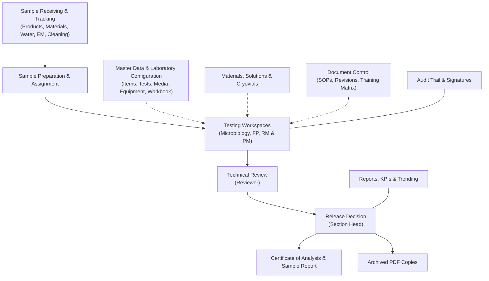

## 3. System Overview

### 3.1 How the System Fits Together
MicroLIMS connects bench-level laboratory work with supervisory review, quality metrics, and document governance:

### 3.2 Main Areas of the Application

#### 1. Sample Receiving and Tracking
- **Receive Sample**: records the receipt of finished product, raw material, packaging material, water, environmental monitoring, and after-cleaning samples. The system creates the tests configured for the item automatically.
- **Tracking Board**: shows every sample and the stage it has reached in each laboratory. It needs the *Cross-Lab Sample Tracking* permission (by default: System Administrator, Section Head).

#### 2. Testing Workspaces and Result Entry
- **Laboratory workspaces**: separate workspaces for Microbiology, FP, and RM & PM, where analysts see their assigned work and open result entry.
- **Microbiology testing**: quantitative plate counts with two-stage incubation and dilution factors, qualitative observations, environmental monitoring and water location grids, and pathogen testing sessions with confirmation steps.
- **Physicochemical testing**: HPLC, GC, and ICP workspaces, titration, dissolution, disintegration, weight variation, and other measurement tests.

#### 3. Review, Approval, and Release
- **Technical review**: the reviewer checks results and calculations. A count test can be returned to the analyst with a reason.
- **Release decision**: the Section Head records one of four decisions: *Approve*, *Not Conform*, *New Sample Required*, or *Retest Retained Sample*, under electronic signature.
- **Reports and archiving**: the sample report and Certificate of Analysis are available after the final decision. At each final decision the system also stores a PDF copy of the record together with a check value, and shows a warning when a downloaded copy no longer matches.

#### 4. Consumables, Reference Strains, and Equipment
- **Media**: preparation, evaluation (including growth promotion testing), release, and storage of media lots.
- **Reference cryovials**: batches, approval, thawing, storage moves, and destruction.
- **Materials, equipment, and columns**: stock of reagents and materials, equipment status and calibration due dates, and chromatography columns.
- **Solutions and working standards**: solution preparation, titrant standardization, and working standard qualification.

#### 5. Master Data and Laboratory Configuration
- **Items and specifications**: product catalogue, preparation settings, and limits.
- **Test Master**: test definitions, calculation settings, workflow steps, and stage requirements.
- **Master Data Workbook**: loads and verifies master data from a spreadsheet. A second person must verify what the first person loaded.

#### 6. Document Control
Controlled documents such as SOPs: drafting, technical review, approval signature, revision numbering, periodic review, and reading and training records.

#### 7. Reporting, Audit, and Administration
- **Reports**: overview, record search, media and growth promotion results, reference strain results, trending, and the KPI / Performance tab.
- **Out of Specification (OOS) Tracking**: investigation groups, retest orders, and investigation documents.
- **Audit Trail**: search of change events with field-level differences and a traceability chain.
- **Error Monitoring**: a log of technical errors for administrators. It is not a quality incident or deviation record.
- **Users, Roles, and laboratory memberships**: managed by administrators.

### 3.3 Security Basics
- **Access in a browser**: MicroLIMS is used in a web browser. Pages and menu items depend on the user's permissions and laboratory assignment.
- **Sign-in and sessions**: a user stays signed in while active. The browser signs the user out after a period of inactivity (see Section 5).
- **Electronic signatures**: for signed actions, such as sample review, release decisions, sample correction or voiding, media release, and physicochemical result recording, the user types their login password in an *Electronic Signature* dialog. The system records the user, role, time, and meaning with the action.
- **Segregation of duties**: the system refuses some combinations, for example reviewing a sample you tested or approving a sample you reviewed. System Administrators are not exempt. The checks cover the actions listed in Section 4, not every workflow.

> **Note for reviewers:** Microbiology plate-count entry and pathogen test steps carry no electronic signature. (GAP-010)

<!-- Review log (Sonnet): 10 corrections; invented items removed: module ids, "immutable" wording, token and technology details, "strict separation across all workflows" claim, "result recording" signature for microbiology, "automatic numbering" claim; callouts added: GAP-010 -->
