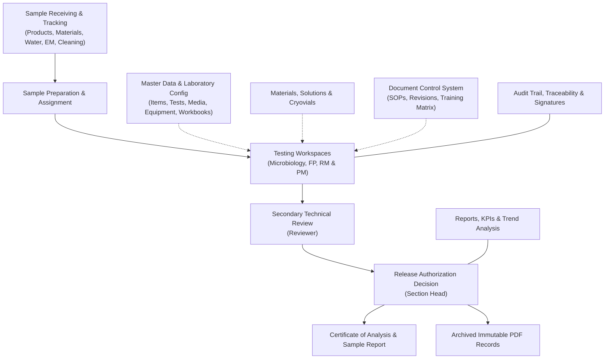

## 3. System Overview

### 3.1 Functional Architecture
MicroLIMS is structured into functional clusters that connect routine bench-level laboratory execution with supervisory review, quality metrics, and document governance:

### 3.2 Core Laboratory Modules

#### 1. Sample Receiving and Tracking
- **Receive Sample (`MOD-SAMPLE-001`)**: Captures sample receipt across Finished Product, Raw Material, Packaging Material, Water, Environmental Monitoring, and After Cleaning categories. Based on item master setup, the system automatically generates all configured test orders upon registration.
- **Tracking Board (`MOD-TRACK-001`)**: Provides an organization-wide view of every sample, tracking multi-laboratory progress across Microbiology and Physicochemical departments simultaneously.

#### 2. Testing Workspaces and Result Entry
- **Laboratory Workspaces (`MOD-TESTING-001`)**: Specialized execution workspaces for Microbiology, Finished Product (`FP`), and Raw & Packaging Material (`RM & PM`). Analysts view assigned workloads, track incubation windows, and launch result entry dialogs.
- **Microbiology Testing (`MOD-COUNT-001`, `MOD-OBS-001`, `MOD-PATH-001`)**: Manages quantitative plate count testing (with two-stage incubation, dilution factor handling, and plate colony calculations), qualitative observation tests, environmental and water monitoring grids, and multi-day pathogen test sessions with confirmation steps.
- **Physicochemical Testing (`MOD-PHYSRESULT-001`, `MOD-HPLC-001`, `MOD-GC-001`, `MOD-ICP-001`, `MOD-TITR-001`)**: Dedicated workspaces and panels for chromatography runs (HPLC and GC), ICP-OES spectroscopy, volumetric titrations, dissolution testing, disintegration, and physical uniformity measurements.

#### 3. Review, Approval, and Release
- **Technical Review (`MOD-REVIEW-001`)**: Reviewers perform secondary scientific data verification of raw plate counts, instrument runs, and test calculations. If data is incomplete or suspect, count tests can be returned to analysts with instructions.
- **Approval Decision (`MOD-APPROVAL-001`)**: Section Heads execute sample release decisions (Approve, Reject, Retest Retained Sample, or New Sample Required) under electronic signature.
- **Reporting and Archival (`MOD-COA-001`, `MOD-ARCHIVE-001`)**: Approved or rejected samples generate Certificates of Analysis (CoA) and consolidated sample reports. Upon final decision, the system creates immutable, frozen PDF records with cryptographic checksums.

#### 4. Consumables, Reference Strains, and Equipment
- **Media Preparation and Evaluation (`MOD-MEDIA-001`, `MOD-MEDIACFG-001`)**: Tracks prepared media batches, autoclave parameters, growth promotion testing (GPT), and release sign-offs.
- **Reference Cryovials (`MOD-CRYO-001`)**: Governs reference microorganism cryovials, thaw cycles, storage relocations, and destruction records.
- **Materials and Equipment Inventory (`MOD-MATERIAL-001`, `MOD-EQUIP-001`, `MOD-COLUMN-001`)**: Tracks chemical reagents, primary packaging lots, chromatography columns, equipment operational status, calibration due dates, and certificates.
- **Solutions and Working Standards (`MOD-SOLN-001`, `MOD-WS-001`)**: Governs volumetric titrant standardizations, reagent preparation recipes, and working standard qualification assays.

#### 5. Master Data and Laboratory Configuration
- **Item Master and Specifications (`MOD-ITEM-001`, `MOD-SPEC-001`)**: Defines product catalogs, preparation parameters, storage specifications, and alert/action/specification limits.
- **Test Master (`MOD-TESTMASTER-001`, `MOD-EQTYPE-001`)**: Configures test parameters, calculation formulas, workflow steps, and stage requirements.
- **Master Data Workbook (`MOD-WORKBOOK-001`)**: Enables bulk loading and verification of laboratory master data from standardized spreadsheets with two-person segregation controls.

#### 6. Document Control System (`MOD-DC-001` through `MOD-DC-004`)
- Centralized governance for Standard Operating Procedures (SOPs), test methods, and quality documents. Manages draft authoring, technical reviews, approval signatures, automated revision numbering, periodic review schedules, user reading curricula, and training compliance matrices.

#### 7. Quality Reporting, Compliance, and Administration
- **Reports and Trend Analysis (`MOD-REPORTS-001`)**: Generates consolidated quality overviews, record searches across laboratory disciplines, media summaries, and statistical trending charts.
- **Key Performance Indicators (`MOD-KPI-001`)**: Evaluates turnaround times, right-first-time rates, retest ratios, out-of-specification rates, and analyst workload distribution.
- **Out of Specification Tracking (`MOD-OOS-001`)**: Manages OOS investigation groups, records retest orders, and tracks laboratory investigation reports.
- **Audit Trail (`MOD-AUDIT-001`)**: Provides an immutable log of change events across all laboratory records, featuring field-level difference comparisons and visual traceability chains.
- **Error Monitoring (`MOD-ERR-001`)**: Records technical system exceptions and API failures for operational diagnostics.

### 3.3 Technology Stack and Security Foundation
- **Web Application Architecture**: MicroLIMS operates as a modern Single-Page Application (SPA) built using React, TypeScript, and Material UI, communicating with an ASP.NET Core backend backed by a PostgreSQL database.
- **Authentication and Session Security**: MicroLIMS employs JSON Web Tokens (JWT). The access token has a default validity of 15 minutes (configurable from 1 to 480 minutes), and the refresh token has a 7-day validity with automatic rotation on each refresh.
- **Electronic Signatures**: Whenever a user executes a sensitive operational action (such as sample approval, correction, voiding, media release, or result recording), MicroLIMS presents a dedicated electronic signature dialog requiring the user to re-enter their login password. The system captures the user identity, role, timestamp, IP address, and meaning statement directly in the audit trail.
- **Segregation of Duties**: The system enforces strict separation of duties across all testing, reviewing, and approval workflows. Analysts cannot review or approve their own testing, and technical reviewers cannot approve samples they reviewed. System Administrators possess no administrative exemption from these segregation rules.
