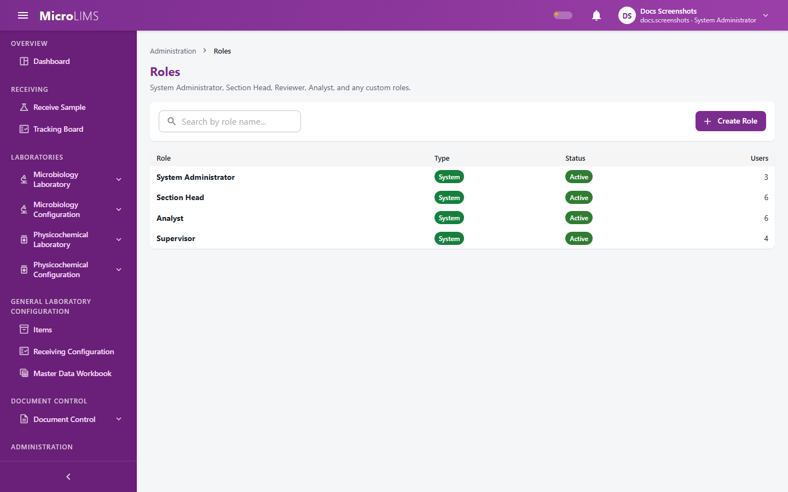
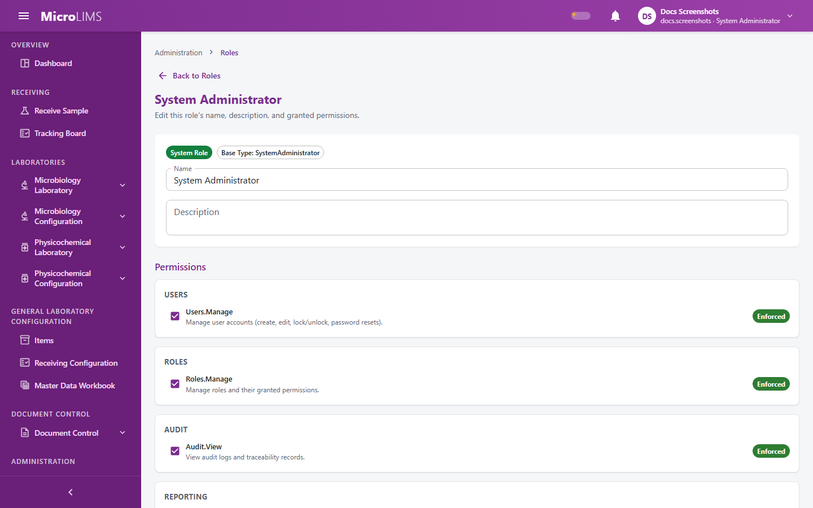

## 4. User Roles and Permissions

### 4.1 How Access Is Controlled
MicroLIMS controls access in three ways:
1. **Roles**: a role is a named set of permissions assigned to a user account. Every role is built on one of four base role types: System Administrator, Section Head, Reviewer, or Analyst. The base type also decides which dashboard a user sees and a few rules that permissions do not change.
2. **Permissions**: each permission allows a specific kind of action, such as *Sample Technical Review*. The system defines 50 permissions. This section shows each permission with its internal code, because the code appears on the Roles screen.
3. **Laboratory assignment**: an administrator assigns each user to laboratory sections. Laboratory data is limited to those sections.

> **Administrative role editability:** The permissions described for the four system roles are **defaults**, not fixed assignments. An administrator who holds the *Role & Permission Management* permission (`Roles.Manage`) can create custom roles, rename roles, and change the permissions of any role, including the four system roles. System roles cannot be deleted. The permissions actually granted in a laboratory may differ from the defaults in this guide.

> **Note for reviewers:** The role permissions actually in use on the live system have not been checked against the defaults described here. (GAP-015)

#### Laboratory Assignment
- **Microbiology Laboratory**: gives access to the Microbiology workspace, media preparation, reference cryovials, and microbiology configuration.
- **Physicochemical Laboratory**: a user can be limited to one area, **FP** (the FP Workspace) or **RM & PM** (the RM & PM Workspace). The assignment dialog offers **FP**, **RM & PM**, or **Both**.
- **No assignment**: a user with no laboratory assignment sees no laboratory data. The system shows: "Your account is not assigned to any laboratory section. Ask an administrator to assign one."
- **System Administrators**: users whose base type is System Administrator are not limited by laboratory assignment and can see both laboratories and all areas.

#### When Changes Take Effect
- **Permission changes**: a change to a role's permissions reaches signed-in users when their access renews, which is normally within 15 minutes.
- **Base role type, disabled account, locked account, password change**: these are checked on every request, so an old session stops working at the next action. A role change within the same base type does not end existing sessions.
- **Own account**: users cannot change their own role, disable their own account, or delete their own account.

---

### 4.2 Default System Roles

#### System Administrator
- **Base type**: System Administrator.
- **Default permissions**: all 50.
- **Typical responsibilities**: user accounts, laboratory assignments, roles and permissions, the audit trail, error monitoring, Document Control configuration, and global laboratory configuration.
- **Limits**: System Administrators have **no exemption** from segregation-of-duties rules. They cannot review or approve work they performed or prepared. They cannot change a media product code (only the Section Head base type can), and they cannot void a Document Master.

#### Section Head
- **Base type**: Section Head.
- **Default permissions**: 43.
- **Typical responsibilities**: assigns tests to analysts, supervises testing (including incubation time overrides and pathogen session resets), performs technical reviews, records release decisions on samples, releases media lots and cryovial batches, tracks OOS investigations, manages laboratory configuration, and acts as Document Controller in Document Control.
- **Only the Section Head base type can**: change a media product code under electronic signature, void a Document Master, and override the proposed revision number of a document.
- **Limits**: by default does not manage user accounts, roles, or Document Control configuration, and does not see Error Monitoring. Cannot approve a sample they reviewed or tested.

#### Reviewer
- **Base type**: Reviewer.
- **Default permissions**: 15.
- **Typical responsibilities**: technical review of results, returning count and physicochemical result-entry tests to analysts, and acting as the assigned technical reviewer of document revisions.
- **Limits**: cannot record release decisions, release media lots, or approve cryovial batches. Cannot review a test or sample they performed or prepared.

#### Analyst
- **Base type**: Analyst.
- **Default permissions**: 15.
- **Typical responsibilities**: receiving samples for their own laboratory sections, sample preparation, count and observation entry, pathogen tests, HPLC, GC, and ICP work, solution preparation, working standards, and inventory updates.
- **Limits**: no review or release permissions. In the testing workspaces, an analyst sees the tests assigned to them by default. Cannot review or approve their own work.

The system has no separate Reception or QA role. Product, Raw Material and Packaging Material samples are received by users who hold a receiving permission. Environmental Monitoring, Water and After Cleaning samples can be received by any signed-in user (see §23–§25).

> **Note for reviewers:** Which custom roles the laboratory uses for Reception and QA staff has not been confirmed. (GAP-050)

---

### 4.3 Permission Catalogue

Of the 50 permissions, 40 are **Enforced**: the system checks them. The other 10 are marked **Legacy-only**: ticking or unticking them on the Roles screen has no effect on access.

Default roles in the table: SA = System Administrator, SH = Section Head, REV = Reviewer, ANA = Analyst.

| # | Permission code | Plain-language name | Default roles | Status | What it allows |
|---|---|---|:---:|:---:|---|
| 1 | `Users.Manage` | User Account Management | SA | Enforced | Create, edit, lock/unlock, disable, force password change, recover passwords, delete users, and manage laboratory assignments. |
| 2 | `Roles.Manage` | Role & Permission Management | SA | Enforced | Create custom roles, rename roles, edit permissions, delete unassigned custom roles. |
| 3 | `Audit.View` | Audit Trail Viewing | SA, SH | Enforced | View audit events, change differences, record history, and traceability chains. |
| 4 | `Reporting.Admin` | Administrative Reporting | SA | Enforced | Run administrative reporting maintenance (no screen is provided for it). |
| 5 | `Samples.Review` | Sample Technical Review | SA, SH, REV | Enforced | Submit technical reviews on sample sections, return count and physicochemical result-entry tests to analysts, and review working standards. |
| 6 | `Samples.Approve` | Sample Release Approval | SA, SH | Enforced | Record release decisions (Approve, Not Conform, New Sample Required, Retest Retained Sample), close testing, and approve working standards. |
| 7 | `Samples.Receive` | Global Sample Receiving | SA, SH | Enforced | Receive samples for any laboratory and add a laboratory to an existing sample. Applies to Product, Raw Material and Packaging Material samples only, where receipt also requires *Own-lab sample receiving*; this permission widens it to every laboratory. |
| 8 | `Samples.TrackAll` | Cross-Lab Sample Tracking | SA, SH | Enforced | View the Tracking Board across all laboratory sections. |
| 9 | `Signatures.Manage` | Signature Trail Viewing | SA, SH | Enforced | View the electronic signature history of a record (no separate screen is provided for it). |
| 10 | `TestWorkflow.Execute` | Test Workflow Execution | SA, SH, REV, ANA | Enforced | Enter microbiology counts, observations, pathogen test steps, and test results, and media evaluation (growth promotion, indication and inhibition) steps. |
| 11 | `TestWorkflow.BiochemicalDecision` | Biochemical Decision Recording | SA, SH, REV | Enforced | Record biochemical confirmation decisions in pathogen testing (no screen is provided for it). |
| 12 | `Cryovials.Manage` | Cryovial Management | SA, SH, REV, ANA | Enforced | Prepare batches, thaw, move storage, and destroy reference cryovials. |
| 13 | `Cryovials.Approve` | Cryovial Batch Approval | SA, SH | Enforced | Approve or reject prepared cryovial batches. |
| 14 | `Materials.Manage` | Material Stock Management | SA, SH, ANA | Enforced | Receive material lots, update details, consume stock, and upload documents. |
| 15 | `Materials.DocumentControl` | Material Document Control | SA, SH | Enforced | Supersede or void material documents. |
| 16 | `Equipment.Manage` | Equipment Inventory Management | SA, SH, ANA | Enforced | Register equipment, update inventory details, and upload documents. |
| 17 | `Equipment.DocumentControl` | Equipment Document Control | SA, SH | Enforced | Supersede or void equipment documents. |
| 18 | `Items.Manage` | Items Master Management | SA, SH | Enforced | Manage items, specifications, and item preparation configurations. |
| 19 | `Items.DocumentUpload` | Item Document Upload | SA, SH | Enforced | Upload controlled documents to an item. |
| 20 | `MasterData.Manage` | Master Data Management | SA, SH | Enforced | Manage laboratory configuration: environmental monitoring, water, after cleaning, organisms, media, equipment, test definitions, receiving configuration, and the Master Data Workbook. |
| 21 | `Discussions.View` | Discussions Viewing | SA, SH, REV, ANA | Legacy-only | No effect: Discussions are open to all signed-in users. |
| 22 | `Discussions.Create` | Discussions Creation | SA, SH, REV, ANA | Legacy-only | No effect: all signed-in users can post. |
| 23 | `Discussions.EditAny` | Discussions Moderation | SA, SH | Enforced | Edit or delete any post or comment, and mark posts important. |
| 24 | `Messages.Use` | Messaging Use | SA, SH, REV, ANA | Legacy-only | No effect: Messages are open to all signed-in users. |
| 25 | `System.ViewErrorLog` | Error Log Monitoring | SA | Enforced | View and manage the technical error log. |
| 26 | `System.ViewSecurityAudit` | Security Audit Viewing | SA | Legacy-only | No effect: security events are recorded but cannot be viewed. |
| 27 | `Documents.Register` | Document Master Registration | SA, SH, ANA | Enforced | Register a new controlled Document Master. |
| 28 | `Documents.DraftEdit` | Document Draft Editing | SA, SH, ANA | Legacy-only | No effect: Document Control decides by fixed rules (role type and document assignment). |
| 29 | `Documents.RevisionCreate` | Document Revision Creation | SA, SH, ANA | Legacy-only | No effect: fixed Document Control rules apply. |
| 30 | `Documents.Review` | Document Technical Review | SA, REV | Legacy-only | No effect: the assigned technical reviewer is decided in Document Control. |
| 31 | `Documents.Approve` | Document Revision Approval | SA, SH, REV | Legacy-only | No effect: the assigned approver is decided in Document Control. |
| 32 | `Documents.PeriodicReview` | Document Periodic Review | SA, SH, REV | Legacy-only | No effect: the assigned periodic reviewer is decided in Document Control. |
| 33 | `Documents.TrainingAssign` | Document Training Assignment | SA, SH | Enforced | Assign reading and training, and view the full training matrix. |
| 34 | `Documents.TrainingViewMatrix` | Training Matrix Viewing | SA, SH, REV | Legacy-only | No effect: the training matrix follows *Document Training Assignment*. |
| 35 | `Documents.ConfigManage` | Document Control Configuration | SA | Enforced | Manage document types, departments, sections, numbering, and settings. The user must also have the System Administrator base type. |
| 36 | `Dashboards.LabOverview` | Lab Overview Dashboard | SA, SH | Enforced | View the Section Head dashboard. |
| 37 | `Dashboards.Review` | Reviewer Dashboard | SA, SH, REV | Enforced | View the Reviewer dashboard. |
| 38 | `Kpi.View` | KPI Dashboard Viewing | SA, SH | Enforced | View the KPI / Performance tab of Reports. |
| 39 | `Kpi.ViewTeam` | Team KPI & Workload Viewing | SA, SH | Enforced | View KPI and workload figures of other analysts; without it, only your own figures. |
| 40 | `Kpi.ConfigureProfiles` | KPI Profile Configuration | SA, SH | Enforced | Create and sign workflow profile versions. |
| 41 | `Media.Prepare` | Media Lot Preparation | SA, SH, REV, ANA | Enforced | Prepare media lots, record storage moves, and mark lots out of stock. |
| 42 | `Media.Release` | Media Lot Release | SA, SH | Enforced | Release or reject media lots under electronic signature. |
| 43 | `Oos.Manage` | OOS Tracking Management | SA, SH | Enforced | Manage OOS groups and investigation documents. |
| 44 | `TestWorkflow.Supervise` | Test Workflow Supervision | SA, SH | Enforced | Override minimum incubation times and reset pathogen sessions. |
| 45 | `Samples.ReceiveOwnLab` | Own-Lab Sample Receiving | SA, SH, REV, ANA | Enforced | Receive samples for the laboratory sections you are assigned to. Applies to Product, Raw Material and Packaging Material samples only. |
| 46 | `Samples.Correct` | Sample Correction & Voiding | SA, SH, REV | Enforced | Correct sample details and void samples under electronic signature. |
| 47 | `Samples.AssignAnalyst` | Sample Analyst Assignment | SA, SH | Enforced | Assign analysts to sample tests. |
| 48 | `Solutions.Prepare` | Solution Preparation | SA, SH, ANA | Enforced | Prepare solutions and mobile phases, and standardize titrants. |
| 49 | `Hplc.Operate` | HPLC/GC/ICP Operation | SA, SH, ANA | Enforced | Start instrument runs, confirm system suitability, enter replicates, and submit runs. |
| 50 | `WorkingStandards.Qualify` | Working Standard Qualification | SA, SH, ANA | Enforced | Prepare working standards, attach documents, and enter qualification replicates. |

> **Note for reviewers:** Ten permissions marked "Legacy-only" have no effect in the application; do not rely on them to restrict access. (GAP-015)

A custom role behaves like its base type for the rules that depend on the role type (for example the dashboard shown and media product code changes), whatever permissions are ticked.

---

### 4.4 Segregation of Duties
The system compares the people who did the work, not their roles. **System Administrators and Section Heads are not exempt.** A user is treated as having performed a test if they were the assigned analyst, prepared the sample, or entered or submitted results or observations for it. For environmental monitoring, water, and after-cleaning samples, the user who confirms preparation counts as having performed the tests.

| Action | Rule | Message shown |
|---|---|---|
| Sample technical review | You cannot review a sample section in which you performed or prepared a test. | "You cannot review a sample you tested." |
| Sample release decision | You cannot approve a sample you reviewed. | "You cannot approve a sample you reviewed." |
| Sample release decision | You cannot approve a sample you performed or prepared a test on. | "You cannot approve a sample you tested." |
| Pathogen biochemical decision (no screen; reachable only through the system interface) | You cannot decide on a result you performed. | "A reviewer cannot decide on a result they performed." |
| Media lot release | You cannot release a lot you prepared or evaluated. | "You cannot approve a media lot you prepared or evaluated." |
| Cryovial batch approval | You cannot approve a batch you prepared. | "You cannot approve a cryovial batch you prepared." |
| Working standard sign-off | The analyst who submitted a qualification cannot review or approve it, and the reviewer cannot also approve it. | "The analyst who submitted the qualification cannot review it." / "The analyst who submitted the qualification cannot approve it." / "The reviewer cannot also approve the qualification." |
| Master Data Workbook | The person who loaded a workbook cannot verify it. | "The person who loaded the workbook cannot verify it. Ask a second person." |
| Document Control | The author of a revision cannot review it technically, create reviewer findings, or approve it. A technical reviewer of the revision cannot approve it. | Messages start with "Segregation of Duties Violation:". |

> **Note for reviewers:** No segregation-of-duties check was found between the people who set up, confirm system suitability for, and submit an HPLC or ICP run. Whether this is required by laboratory procedures has not been confirmed. (GAP-026)

---

### 4.5 Role Management Procedures

<!-- WF-ROLES-001 -->
### 4.5.1 Create a Custom Role
#### Purpose
Define a new role with its own set of permissions, based on one of the four base role types.

#### Who can use it
Requires the *Role & Permission Management* permission (by default: System Administrator).

#### Before you start
Decide which base role type (System Administrator, Section Head, Reviewer, or Analyst) fits the role. The base type cannot be changed later and it decides the dashboard and the role-type rules described in 4.3.

#### What you see
- **ADMINISTRATION** > **Roles**: a list with columns **Role**, **Type**, **Status**, and **Users**, a search field "Search by role name...", and the button **Create Role**.
- The Create Role wizard with four steps: **Name**, **Base Type**, **Permissions**, and **Review**.

#### How to use it
1. In the sidebar, open **ADMINISTRATION** > **Roles**.
2. Click **Create Role**.
3. On the **Name** step, enter the **Role Name** (required) and an optional **Description**. Click **Next**.
4. On the **Base Type** step, choose one of the options **SystemAdministrator**, **SectionHead**, **Reviewer**, or **Analyst** (default: Analyst). Click **Next**.
5. On the **Permissions** step, tick the permissions to grant. To start from an existing role, choose it in **Or clone permissions from any existing role:**. Each permission shows an **Enforced** or **Legacy-only** label. Click **Next**.
6. On the **Review** step, check the name, description, base type, and the chosen permissions, then click **Create Role**.

#### System behavior
The system creates the role and saves the ticked permissions. The new role appears in the Roles list as a **Custom** role with status **Active**.

#### Validation
- A blank name stops the wizard at the first step. The message is: "Role name is required."

#### Errors
- If the role cannot be created, the system shows: "Could not create this role."
- If the permission step fails after the role was created, the role may keep the default permissions of its base type instead of the ticked ones. Open the role and check its permissions.

> **Note for reviewers:** Creating a role is done in two separate saves, so an interruption can leave the base-type defaults in place. (GAP-107)

> **Note for reviewers:** Role and permission changes are recorded in the audit trail but are not electronically signed, need no reason, and need no second person. Nothing prevents removing the *Role & Permission Management* permission from the System Administrator or Section Head role. (GAP-009)

---

<!-- WF-ROLES-001 -->
### 4.5.2 Edit or Delete a Role
#### Purpose
Change the name, description, or permissions of a role, or delete a custom role.

#### Who can use it
Requires the *Role & Permission Management* permission (by default: System Administrator).

#### What you see
- The role page, with the role name, a **System Role** label for system roles, a **Base Type: ...** label, and the fields **Name** and **Description**.
- A **Permissions** matrix with a tick box for each permission and the labels **Enforced** or **Legacy-only**. Hover over a label to read what it means.
- A list of the users who hold the role, each marked **Active** or **Disabled**.
- The buttons **Save Changes** and, for custom roles only, **Delete Role**.

#### How to use it
1. In the **Roles** list, click the role.
2. Change **Name** or **Description** if needed.
3. In **Permissions**, tick or untick permissions.
4. Click **Save Changes**.

To delete a custom role: click **Delete Role** and confirm the question `Delete role "{name}"? This cannot be undone.`

#### System behavior
The system saves the changes and records in the audit trail which permissions were granted and revoked. Users who hold the role receive the new permissions when their access next renews, normally within 15 minutes. Changing the permissions does not change the role's base type.

#### Validation
- "Role name is required."

#### Errors
- System roles cannot be deleted. The **Delete Role** button is not shown for them, and the system would answer "System roles cannot be deleted."
- A role that is assigned to users cannot be deleted: "Role '{name}' is currently assigned to {n} user(s) and cannot be deleted."

#### What happens next
Assign the role to users on the Users screen (see Section 39).

<!-- Review log (Sonnet): 24 corrections; invented items removed: role ids (ROLE-...), screen addresses, "server middleware / token claim / database" wording, "audit code ROLE_PERMISSIONS_UPDATED", unsupported "invalid code" validation as normal user path, misplaced role-change audit note (GAP-112 belongs to user role change, Section 39), "Clicking delete on a system role is prevented" (button is hidden); callouts added: GAP-015 (live grants), GAP-026, GAP-050, GAP-107, GAP-009 retained -->
<!-- Phase 13 (agy): applied F-A01, F-A03, F-A10, R-NEW-02 -->
<!-- Phase 13 review (Sonnet): checked against RECONCILIATION section 2 and frontend strings; no invented items -->

<!-- Phase 13 review (Sonnet): F-B08 section 4 part applied (4.2 Reviewer, 4.3 row 5). -->
