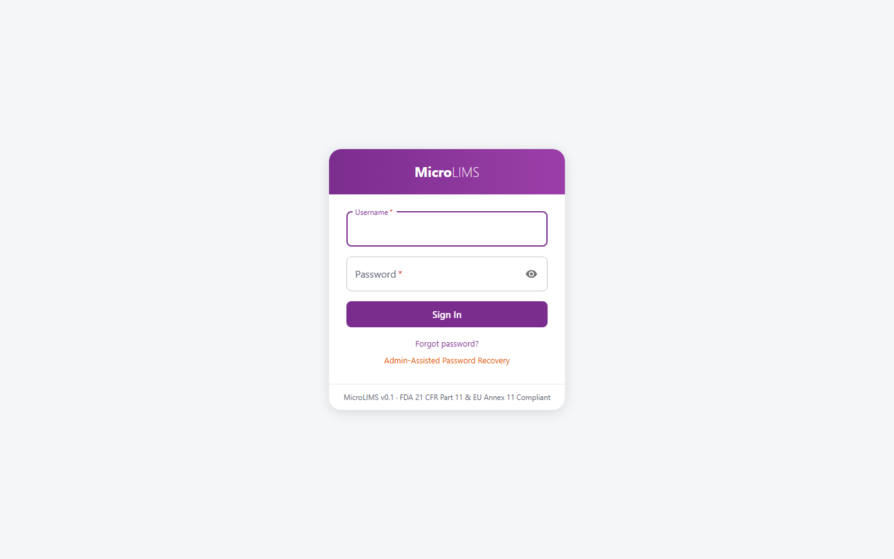
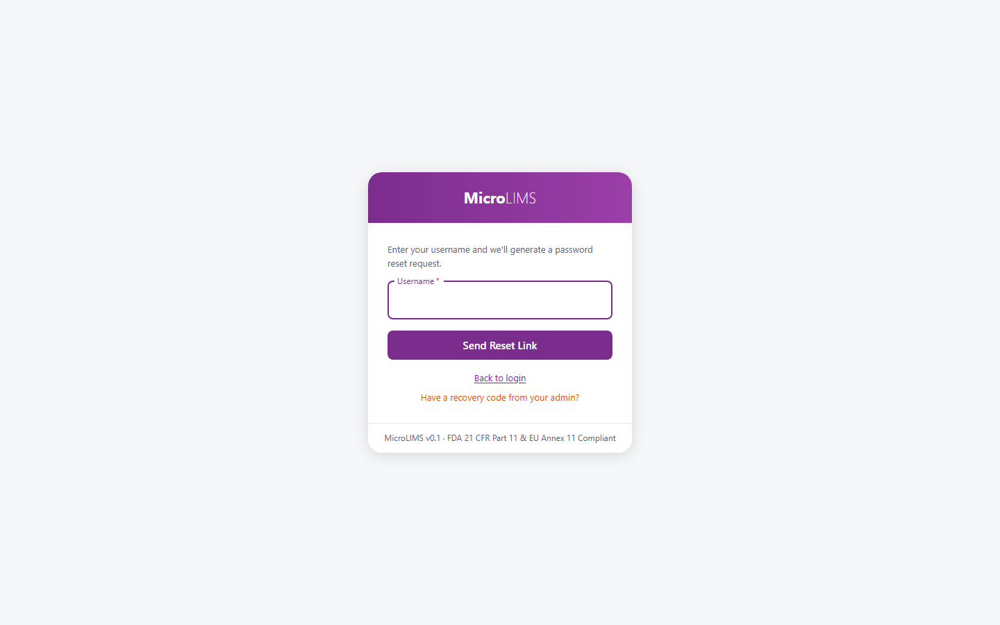
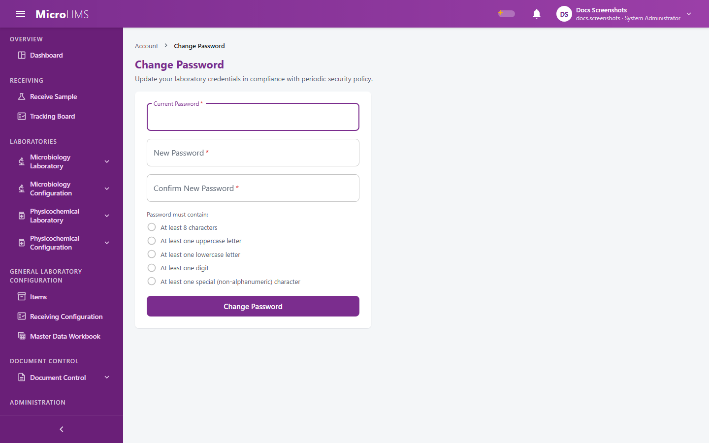

## 5. Login, Session and Password

<!-- WF-AUTH-001 -->
### 5.1 Sign In
#### Purpose
Sign in with your username and password and open your dashboard.

#### Who can use it
Any user with an active account created by a system administrator. Laboratory assignment is not needed to sign in.

#### Before you start
You need the username and password given to you by your system administrator.

#### What you see
- The page title "Sign in · MicroLIMS" and the heading **MicroLIMS**.
- The fields **Username** (required) and **Password** (required), with a button to show or hide the password (**Show password** / **Hide password**).
- The button **Sign In**, which reads **Signing in…** while the request is processed.
- The link **Forgot password?** and the button **Admin-Assisted Password Recovery**.
- A footer line with the version number and a statement about regulatory compliance. This guide makes no compliance claim (see the note below).

#### How to use it
1. Open the MicroLIMS address in your browser.
2. Enter your username in **Username**.
3. Enter your password in **Password**.
4. Click **Sign In** (or press Enter).
5. Your dashboard opens. If your account is marked to require a password change, the **Change Password** screen opens instead (see 5.4).

#### System behavior
- Every sign-in attempt (success, wrong password, unknown user, locked account, disabled account) is recorded in a login history together with the IP address. The application has no screen to view this history.
- After five failed attempts, the system locks the account for 15 minutes and ends its active sessions. An administrator can unlock the account earlier (see Section 39).
- The number of sign-in attempts from one address is limited (20 per 60 seconds). What the screen shows when the limit is exceeded is not documented.
- A successful sign-in clears the failed-attempt count, and records the time shown as **Last Login** on your profile.

> **Note for reviewers:** The sign-in page footer contains a regulatory compliance statement. It is text on the screen only; the repository holds no validation evidence for it, and this guide does not repeat it as a fact. (GAP-023)

> **Note for reviewers:** After 5 wrong passwords the account locks for 15 minutes. The failed-attempt count is not reset when the lock ends, so one further wrong password locks the account again. (GAP-012)

#### Validation
- **Username** and **Password** are both required.

#### Errors
- Wrong username or password, a disabled account, or a locked account: "Invalid username or password." (the same message in every case).
- A system problem: "Laboratory authentication service error. Please try again later."
- No connection: "Unable to reach the laboratory server. Check network connection."
- Any other failure: "Login failed. Please check credentials."

---

<!-- WF-AUTH-002 -->
### 5.2 Forgot Password
#### Purpose
Send a password reset request for your username.

#### Who can use it
Anyone with an account.

#### Before you start
You need to know your username. The request can only be delivered if your account has an e-mail address and the system is set up to send e-mail.

#### What you see
After you click **Forgot password?** on the sign-in card:
- The text "Enter your username and we'll generate a password reset request."
- The field **Username**.
- The button **Send Reset Link** (**Submitting...** while processing), and the links **Back to login** and **Have a recovery code from your admin?**.

#### How to use it
1. On the sign-in screen, click **Forgot password?**.
2. Enter your **Username**.
3. Click **Send Reset Link**.
4. The screen shows: "If that account exists, a reset link has been generated."

#### System behavior
- The screen shows the same text whether or not the username exists or has an e-mail address, so it does not reveal which usernames exist.
- If the account has an e-mail address, a message is sent that contains a one-time reset code valid for one hour. The message does not contain a link.
- If there is no e-mail address, or e-mail is not set up, nothing is delivered and the screen does not tell you.

#### Important rules
The application has no screen on which the reset code from the e-mail can be used. If you cannot sign in, ask a system administrator for an administrator-assisted recovery code and follow 5.3.

> **Note for reviewers:** The e-mail password reset cannot be completed in the application. The screen text mentions a reset link, but none is sent. (GAP-100)

---

<!-- WF-AUTH-003 -->
### 5.3 Administrator-Assisted Password Recovery
#### Purpose
Regain access to your account with a one-time recovery code generated by a system administrator.

#### Who can use it
Any user who has received a recovery code from an administrator. The administrator needs the *User Account Management* permission (`Users.Manage`) to generate the code (see Section 39).

#### Before you start
Ask a system administrator for a recovery code. The code has 12 characters, is shown to the administrator once, and is valid for 15 minutes. An administrator cannot create a recovery code for their own account or for a disabled account. Hand-over of the code to you follows your laboratory's own procedure; the application does not define it.

#### What you see
The **Password Recovery** screen, with the subtitle "Administrator-Assisted Account Access Recovery" and:
- **Username**.
- **One-Time Recovery Code** (format `XXXX-XXXX-XXXX`, helper text "Format: 12 alphanumeric characters provided by your admin").
- **New Password** (helper text "Min 8 chars (upper, lower, digit, symbol)").
- **Confirm New Password**.
- The button **Submit Password Recovery** (**Resetting Password...** while processing) and the link **Return to Login**.

#### How to use it
1. On the sign-in screen, click **Admin-Assisted Password Recovery**.
2. Enter your **Username**.
3. Type or paste the code in **One-Time Recovery Code**. Dashes, spaces, and upper or lower case do not matter.
4. Enter a **New Password** that meets the password rules (see 5.4), and repeat it in **Confirm New Password**.
5. Click **Submit Password Recovery**.
6. The screen shows: "Your password has been successfully reset! You can now log in using your new password."
7. Click **Go to Login Page** and sign in with the new password.

#### System behavior
- Generating a new code makes any earlier unused code for that account expire.
- After a successful recovery, the system clears any lock and the failed-attempt count, ends all sessions of the account, marks the code as used, and removes the requirement to change the password at next sign-in.
- Five wrong code entries make the code unusable.

#### Validation
- "All fields are required."
- "New password and confirm password do not match."
- "New password must not match any of your last 5 passwords."

#### Errors
- Unknown username, disabled account, or no unused code: "Invalid or expired recovery code."
- Code older than 15 minutes: "Recovery code has expired. Please request a new recovery code."
- Wrong code (attempts 1 to 4): "Invalid recovery code."
- Fifth wrong attempt: "Maximum failed recovery attempts exceeded. Recovery code invalidated."
- Any other failure: "Could not perform password recovery. Please verify your recovery code."

---

<!-- WF-AUTH-004 -->
### 5.4 Change Password and Forced Password Change
#### Purpose
Change your password, either by choice or because you are required to.

#### Who can use it
Any signed-in user. No permission is needed.

#### Before you start
Know your current password.

#### What you see
- The heading **Change Password**, with the subtitle "Update your laboratory credentials in compliance with periodic security policy."
- The fields **Current Password**, **New Password**, and **Confirm New Password** (the helper text "Passwords do not match." appears when they differ).
- The checklist **Password must contain:** with five live rules: at least 8 characters, an uppercase letter, a lowercase letter, a number, and a special character.
- The button **Change Password** (**Updating Credentials...** while processing).

#### How to use it
1. Open the account menu in the header and select **Change Password**. (If a change is required, this screen opens by itself.)
2. Enter your **Current Password**.
3. Enter the **New Password**. The checklist shows which rules are met.
4. Repeat it in **Confirm New Password**.
5. Click **Change Password**.
6. The screen shows "Password changed successfully. Returning to your profile..." and opens your profile after about 1.5 seconds.

#### System behavior
- New accounts, and accounts for which an administrator chose **Force Password Change at Next Login**, must change the password first. Every page opens this screen, and the system refuses all other actions with "Your password must be changed before you can use MicroLIMS."
- A successful change ends the sign-ins saved for the account and updates **Password Last Changed** on your profile.
- A new password cannot be one of your last 5 passwords.
- The number of password changes is limited (5 per 15 minutes).

#### Validation
- "New password does not meet the policy requirements below."
- "New password and confirmation do not match."
- "Password must be at least 8 characters long."
- "Password must contain at least one uppercase letter."
- "Password must contain at least one lowercase letter."
- "Password must contain at least one digit."
- "Password must contain at least one special (non-alphanumeric) character."
- "New password must not match any of your last 5 passwords."

#### Errors
- Wrong current password: "Current password is incorrect."
- Any other failure: "Could not change password."

> **Note for reviewers:** Passwords do not expire. The subtitle of the Change Password screen mentions a periodic security policy, but no periodic expiry exists.

> **Note for reviewers:** Whether you must sign in again after a successful password change has not been confirmed. (GAP-113)

---

### 5.5 My Profile
#### Purpose
Show your own account details.

#### Who can use it
Any signed-in user.

#### What you see
Open the account menu in the header and select **My Profile**. The screen shows, read-only: **Full Name**, **User ID** (your username), **Role**, **Last Login**, and **Password Last Changed** (each shows "Never" if there is no value). The text "Name and role changes are made by an administrator in the Users module." explains that these details cannot be edited here. If the profile cannot be shown, the system displays "Could not load profile."

---

<!-- WF-AUTH-005 -->
### 5.6 Session Timeout and Sign Out
#### Purpose
End your session after a period of inactivity, or when you choose to sign out.

#### Who can use it
All signed-in users.

#### What you see
- A **Session Timeout Warning** dialog appears over the page when you have been inactive. It shows "You will be signed out due to inactivity in {n} second(s)." with a 60-second countdown and the button **Stay signed in**. It cannot be closed with Escape or by clicking outside it.

[SCREENSHOT SS-054]

#### How to use it
- When the warning appears, click **Stay signed in**, or move the mouse or press a key. The warning closes and the inactivity timer starts again.
- If nothing happens before the countdown ends, MicroLIMS signs you out and opens the sign-in screen.
- To sign out yourself, open the account menu in the header and select **Sign Out**. There is no confirmation question.

#### System behavior
- The warning appears after 20 minutes without mouse movement, key presses, clicks, or scrolling. The inactivity check works in your browser only.
- While you work, your session is renewed in the background.
- On sign-out, the system ends your session. If that request fails, nothing is shown and you are still signed out in the browser.
- Data typed on a page and not yet saved can be lost when you are signed out.

> **Note for reviewers:** Idle sign-out happens in the browser only. The server does not time out inactive sessions. (GAP-053)

<!-- Review log (Sonnet): 26 corrections; invented items removed: page routes, "encrypted token", field/endpoint wording (LockedUntil, HTTP 403, refresh token), sign-in footer compliance quote presented as fact (now referenced via note), admin-code hand-over note with wrong gap id (GAP-012), wrong gap id on password-expiry note (GAP-023), password reset presented as a working procedure; added My Profile and exact password-policy messages; callouts added: GAP-023 (corrected wording), GAP-012, GAP-100, GAP-113, GAP-053, password-expiry note -->
