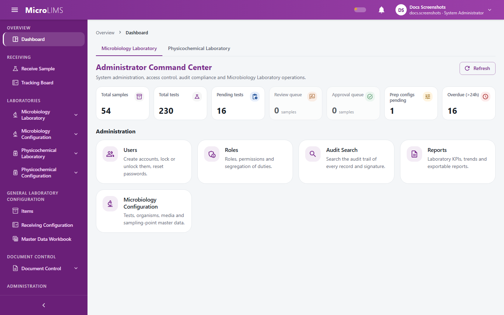

## 6. User Interface

### 6.1 Application Header and Account Menu
After you sign in, every page shows the same frame: a header at the top, a navigation sidebar on the left, a trail of breadcrumbs above the page, and the page itself.

The header contains:
- **Skip to main content**: a link, intended for keyboard and screen-reader users, that jumps past the menus.
- **Toggle navigation menu**: the menu button. On a desktop it switches the sidebar between its full and compact forms. On a small screen it opens or closes the menu drawer.
- **Theme switch** (**Switch to dark mode** / **Switch to light mode**): changes between the light and dark appearance.
- **Notifications** bell (shown as **Notifications, {n} unread** when there are unread items): opens the list of your notifications (see Section 9).
- **Account menu** (**Account menu for {name}**), which contains:
  - **My Profile**: your account details (see 5.5).
  - **Messages** (or **Messages ({n} unread)**): direct and group messages (see Section 9).
  - **Discussions**: the discussion board (see Section 9).
  - **Change Password**: see 5.4.
  - **Sign Out**: ends your session and opens the sign-in screen, with no confirmation question.

---

### 6.2 Sidebar and Appearance
- **Sidebar**: the navigation menu on the left. The button **Collapse sidebar** / **Expand sidebar** narrows it to a slim rail of group icons or widens it again. MicroLIMS remembers your choice in your browser.
- **Light and dark appearance**: use the theme switch in the header. MicroLIMS remembers your choice in your browser. If you have not chosen, it follows the dark-mode setting of your operating system.
- Because these choices are stored in the browser, they apply to that browser and computer only.

---

### 6.3 Breadcrumbs, Section Pages, and Errors
- **Breadcrumbs** above each page show where you are in the menu.
- **Section pages**: opening a group in the sidebar shows a page of cards, one for each page in that group that you are allowed to open.
  - The subtitle reads "{n} page(s) you can open here".
  - If a section has no page you may open, the screen shows "You have no pages in this section." If the section cannot be found, the title reads "Section not available".
- **Page not found**: if you follow an outdated or wrong address, the screen shows the heading **Page not found**, the text "There is no page at this address", and the explanation: `"{address}" does not match any MicroLIMS page. The link may be outdated, or the page may have moved. Use the navigation menu or return to your dashboard.` The button **Go to Dashboard** returns you to your dashboard.
- **Pages you are not allowed to open**: if you open an address for a page you have no permission for, the system takes you to your dashboard without showing a message.
- **Page problems**: each page is protected separately, so a problem on one page is contained to that page and the header and sidebar keep working.

---

<!-- SCR-SIG-001 -->
### 6.4 Electronic Signature Dialog
#### Purpose
Confirm sensitive actions by typing your login password again. The same dialog is used by the 26 actions in the application that are signed, such as sample review, release decisions, sample correction or voiding, media release, and physicochemical result recording.

#### Who can use it
Any signed-in user who carries out a signed action. The permission needed is the one of the action itself, not of the dialog.

#### What you see
The dialog titled **Electronic Signature**. It always appears in a light appearance, even when the dark appearance is on. It contains:
- Your full name (or username) and your role, read-only.
- A message, in a highlighted box, that states what your signature means, for example "I confirm the preparation steps shown above are the steps performed for this sample." Each action has its own wording.
- **Comment (optional)**: a text box that appears only for actions that allow a comment.
- **Password**: required.
- The buttons **Cancel** and **Sign** (**Signing...** while checking). **Sign** stays disabled until you type a password.

[SCREENSHOT SS-062]

#### How to use it
1. Start a signed action, for example by clicking **Sign & Save**, **Sign & Void**, **Submit Technical Review**, or **Submit Release Decision**.
2. Read your name, your role, and the meaning statement in the **Electronic Signature** dialog.
3. If the dialog offers it, enter a note in **Comment (optional)**.
4. Type your login password in **Password**.
5. Click **Sign** (or press Enter).

#### System behavior
- The signature and the action are saved together. If the password check fails, the action is not carried out.
- The system records with the signature your name, username, role, the meaning statement, the record signed, the time, your comment if any, and your IP address.
- If you enter wrong signature passwords five times within 15 minutes, further signature attempts are refused for a time. This limit applies to signatures only and does not lock your login account. Failed attempts are recorded without the password.
- Not all actions are signed. For example, microbiology plate-count entry, pathogen test steps, returning a test to the analyst, and user and role administration are not.

> **Note for reviewers:** Whether a comment or reason is required differs between signed actions, and the wording of the meaning statements differs between screens. Which of these differences are intended has not been confirmed. (GAP-027)

> **Note for reviewers:** Microbiology plate-count entry and pathogen test steps carry no electronic signature. (GAP-010)

#### Errors
- A wrong password, or a locked or disabled account: the dialog shows the message from the system (if none, "Signature failed."), clears the password, and stays open so that you can try again.

#### What happens next
After a successful signature the dialog closes and the action is completed on the page behind it.

<!-- Review log (Sonnet): 14 corrections; invented items removed: page addresses and browser storage key names, component and screen ids, example breadcrumb path, "recent attention alerts / sample review requests" list for the bell, "hover restores labels", "recovery prompt" text for page errors, "legal meaning", "tamper-evident", "immutable" log wording, "atomic transaction" wording; callouts added: GAP-027, GAP-010 -->
