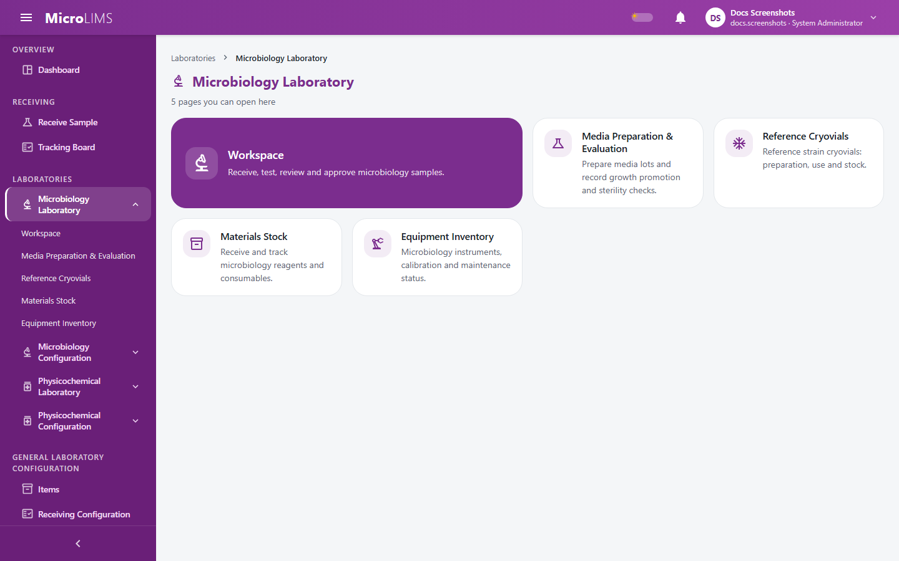

## 7. Navigation

### 7.1 Sidebar Menu
The sidebar groups the application into headings. You only see the items you are allowed to use. What you see depends on your permissions, your laboratory assignment, and (for the Physicochemical Laboratory) your assigned area. Permission names are explained in Section 4.

| Heading | Menu item | What you need to see it |
|---|---|---|
| **OVERVIEW** | Dashboard | Any signed-in user |
| **RECEIVING** | Receive Sample | *Global Sample Receiving* or *Own-Lab Sample Receiving* |
| | Tracking Board | *Cross-Lab Sample Tracking* |
| **LABORATORIES** | **Microbiology Laboratory** (group) | Assignment to the Microbiology Laboratory |
| | – Workspace | Assignment to the Microbiology Laboratory |
| | – Media Preparation & Evaluation | *Media Lot Preparation* |
| | – Reference Cryovials | *Cryovial Management* |
| | – Materials Stock | *Material Stock Management* |
| | – Equipment Inventory | *Equipment Inventory Management* |
| **LABORATORIES** | **Microbiology Configuration** (group) | Assignment to the Microbiology Laboratory and *Master Data Management* |
| | – Test Master, Organisms, Media Configurations, Water, Environmental Monitoring, After Cleaning, Equipment | Same as the group |
| **LABORATORIES** | **Physicochemical Laboratory** (group) | Assignment to the Physicochemical Laboratory |
| | – FP Workspace | Area **FP** (or no area restriction) |
| | – RM & PM Workspace | Area **RM & PM** (or no area restriction) |
| | – Solution Preparation | *Solution Preparation* |
| | – Working Standards, HPLC Workspace, GC Workspace, ICP Workspace | Assignment to the Physicochemical Laboratory |
| | – Materials Stock | *Material Stock Management* |
| | – Equipment Inventory | *Equipment Inventory Management* |
| **LABORATORIES** | **Physicochemical Configuration** (group) | Assignment to the Physicochemical Laboratory and *Master Data Management* |
| | – FP Test Master, RM & PM Test Master, Equation Types, Physicochemical Instruments, Chromatography Columns, Reagents & Standards, Solutions, HPLC Methods, ICP Methods | Same as the group |
| **GENERAL LABORATORY CONFIGURATION** | Items | *Items Master Management* |
| | Receiving Configuration | *Master Data Management* |
| | Master Data Workbook | *Master Data Management* |
| **DOCUMENT CONTROL** | Dashboard, My Reading List, Training Matrix, Compliance Dashboard, Document Library | Any signed-in user |
| | Audit Trail | Base role type Reviewer, Section Head, or System Administrator |
| | Configuration | *Document Control Configuration* |
| **ADMINISTRATION** | Users | *User Account Management* |
| | Roles | *Role & Permission Management* |
| **REPORTS** | Reports | Any signed-in user (the KPI / Performance tab needs *KPI Dashboard Viewing*) |
| **AUDIT & COMPLIANCE** | Audit Search | *Audit Trail Viewing* |
| | OOS Tracking | *OOS Tracking Management* |
| **SYSTEM** | Error Monitoring | *Error Log Monitoring* |

> **Note for reviewers:** Whether the Training Matrix and Compliance Dashboard pages should be restricted is not established; they are offered to every signed-in user in the menu. (GAP-025)

> **Note for reviewers:** Two pages exist but have no menu link: a stand-alone Specifications page and a Media Evaluation page. Media evaluations are reached from the media lot screen. (GAP-034)

---

### 7.2 What Decides What You See
- The system hides every menu item whose permission you lack, and hides a group when none of its items is left.
- **Laboratory assignment**: Microbiology items need assignment to the Microbiology Laboratory, and Physicochemical items need assignment to the Physicochemical Laboratory. Users assigned to area **FP** see the **FP Workspace**, users assigned to area **RM & PM** see the **RM & PM Workspace**, and users with no area restriction see both.
- **System Administrators** are treated as assigned to both laboratories and both areas, so they see every group they have a permission for.
- **Hidden items are also protected**: if you open the address of a page you may not use, for example from a bookmark, the system takes you to your dashboard without showing a message. The system also checks your permission each time you save or open data.
- Some pages, for example Messages, Discussions, and the Document Control dashboard, have no permission check when you open them. The data they show is still checked by the system.

---

### 7.3 Pages Without a Menu Item
Some pages are reached from other places:
- **My Profile**, **Change Password**, **Messages**, and **Discussions**: from the account menu in the header.
- **Section pages**: by clicking a group heading in the sidebar (see Section 6).
- **Sample report and Certificate of Analysis**: from the sample summary dialog.
- **Media lot report and cryovial report**: from links in the media and cryovial lists.
- **Create Role and role pages**: from the Roles screen.
- **Solution preparation pages**: from the Solution Preparation list.
- **Document pages**: from the Document Library and the Document Control dashboard.

---

### 7.4 Older Links
Old bookmarks still work:
- The home address opens your dashboard.
- The old combined receiving-and-testing page opens the first laboratory workspace available to you (Microbiology first, then the Physicochemical areas).
- The old Cause of Testing page opens **Receiving Configuration**.
- The old approved media and approved cryovial links open the media and cryovial screens on their **approved** tab.
- Older "group" page links open the matching section page.

<!-- Review log (Sonnet): 12 corrections; invented items removed: route/path column, laboratory codes (MICRO/FP), permission codes outside Section 4, "token claims" wording; callouts added: GAP-025, GAP-034 -->
