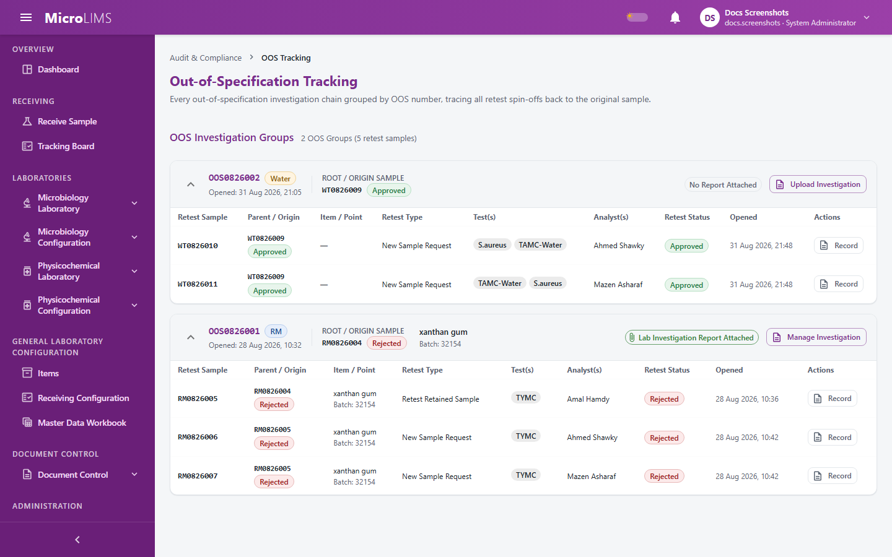
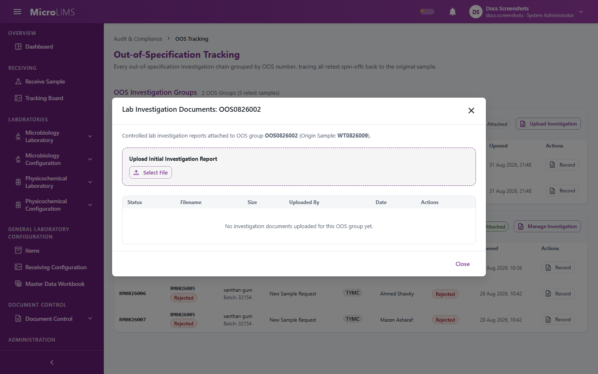

## 20. OOS Tracking

MicroLIMS groups the retest samples of an out-of-specification chain under one OOS group number, links each retest sample back to its original sample, and lets authorized users keep laboratory investigation documents for the group.

### 20.1 Out-of-Specification Tracking
<!-- WF-OOS-001 -->
#### Purpose
See every out-of-specification chain grouped by OOS number and trace each retest sample back to the original sample.

#### Who can use it
Requires the *OOS Tracking Management* permission (by default: Section Head, System Administrator). Users limited to certain laboratory sections see the groups that have a retest sample with tests in their sections.

#### Before you start
An OOS group must exist. A group is created only when a Section Head signs the decision **Retest Retained Sample: Return to testing** or **New Sample Required: Close and request new sample** (see §18). An out-of-specification result alone does not create a group.

> **Note for reviewers:** An out-of-specification result by itself does not create an OOS record; only a signed retest decision does. (GAP-305)

> **Note for reviewers:** The Investigation and OOS Investigation decisions described in the specification are not available. (GAP-017, GAP-018)

#### What you see
- In the sidebar group **AUDIT & COMPLIANCE**, the entry **OOS Tracking**.
- Title **Out-of-Specification Tracking** and the subtitle "Every out-of-specification investigation chain grouped by OOS number, tracing all retest spin-offs back to the original sample."
- Section **OOS Investigation Groups**, with a count: "1 OOS Group" or "{n} OOS Groups ({m} retest samples)". When there are none: "No active OOS investigation chains found."
- For each group:
  - A chip: **Lab Investigation Report Attached** or **No Report Attached**.
  - A button: **Manage Investigation** (when a document exists) or **Upload Investigation**.
  - A table of retest samples with the columns **Retest Sample**, **Parent / Origin**, **Item / Point**, **Retest Type** (**Retest Retained Sample** or **New Sample Request**), **Test(s)**, **Analyst(s)** (shows "User #{id}" if the name is not found), **Retest Status**, **Opened** and **Actions**. The action icon has the tooltip "Open the retest sample's printable report".
  - When the group has no retest samples yet: "No retest samples have been spun off yet for this OOS chain."

#### How to use it
1. Open **OOS Tracking** under **AUDIT & COMPLIANCE** in the sidebar.
2. Find the OOS group.
3. Read the retest table to trace each retest sample to its original sample and to see its tests, analysts and status.
4. To see a retest sample in detail, click the action icon in **Actions**; its printable report opens.
5. To view or attach investigation documents, click **Upload Investigation** or **Manage Investigation** (see §20.2).

#### System behavior
- A retest sample copies the identity details of the original sample (item, category, batch, control number, dates, quantity, sampling point, machine, department, production stage) and keeps a link to it.
- Retest samples share the OOS group number of the original sample.
- When a retest sample is finally approved or rejected, its outcome is copied to the original sample's section (see §18.2) without a new signature (see §18.3).

#### Status
- **Retest Status** shows the sample status of the retest sample.
- **Retest Type** is **Retest Retained Sample** or **New Sample Request**.

#### Important rules
- An out-of-specification result alone does not open an OOS group; a Section Head's signed retest decision does.

#### Errors
- "Failed to load OOS tracking items."

#### What happens next
Analysts test the retest samples in the testing workspace. Authorized users attach the laboratory investigation report (§20.2).

---

### 20.2 Laboratory Investigation Documents
<!-- WF-OOS-001 -->
#### Purpose
Upload, replace (supersede) and download the laboratory investigation report of an OOS group.

#### Who can use it
Requires the *OOS Tracking Management* permission (by default: Section Head, System Administrator).

#### Before you start
- Open the group in **Out-of-Specification Tracking**.
- The file must be a PDF, JPG, JPEG, PNG, WEBP or TIFF file of at most 25 MB (the shipped setting).
- To replace a document you need a replacement file and a reason.

> **Note for reviewers:** OOS investigation documents are not electronically signed, have no review step, and cannot be voided from the screen. (GAP-313)

#### What you see
- Dialog **Lab Investigation Documents: {oosGroupCode}**.
- When there is no **Current** document: the heading **Upload Initial Investigation Report** with the buttons **Select File** and **Upload**.
- A table with the columns **Status**, **Filename**, **Size**, **Uploaded By**, **Date** and **Actions**. Status chips: **Current**, **Superseded**, **Voided** (shown with "Voided: {void reason}"). Empty text: "No investigation documents uploaded for this OOS group yet."
- Row icons with the tooltips "Download file" and "Supersede with replacement report" (the supersede icon appears only on the **Current** row, and only while no supersede panel is open).
- The supersede panel: "The current document will be marked Superseded. A new active version will take its place.", the field **Reason for Supersession \***, and the buttons **Choose Replacement File** and **Supersede** (disabled until a replacement file and a reason are given).

#### How to use it
To upload the initial report:
1. In the group, click **Upload Investigation** (or **Manage Investigation**).
2. Under **Upload Initial Investigation Report**, click **Select File** and choose the file.
3. Click **Upload**. The document appears with status **Current**.

To replace the current report:
1. In the **Lab Investigation Documents: {oosGroupCode}** dialog, find the **Current** document.
2. Click the supersede icon ("Supersede with replacement report").
3. Type the reason in **Reason for Supersession \***.
4. Click **Choose Replacement File** and choose the new file.
5. Click **Supersede**. The old document becomes **Superseded** and the new one becomes **Current**.

To download a document:
1. Find the document in the table.
2. Click the icon "Download file".

#### System behavior
- The system checks the file in this order: size, empty file, file type, declared content type against the type, minimum length, and file content. No virus scanner is part of these checks.
- The system stores a hash of each file and checks it again on download.
- When you supersede a document, the old one records the reason, who superseded it and when; the replacement becomes **Current**.
- Upload and supersede do not ask for a password and record no electronic signature.

#### Validation
- "No file was provided."
- "A replacement file is required."
- "A reason for supersession is required."
- "A supersession reason is required."
- "The uploaded file is empty."
- "File exceeds the maximum allowed size of {n} MB."
- "File type '{ext}' is not supported. Allowed types: PDF, JPG, JPEG, PNG, WEBP, TIFF."
- "The declared content type '{type}' does not match the file extension '{ext}'."
- "The file content could not be validated because it is too short."
- "The file does not appear to be a valid WEBP image."
- "The file content does not match the expected format for '{ext}'. The file may be corrupted or misnamed."
- "A voided document cannot be superseded. Upload a new document instead."

#### Status
- **Current**: the active investigation report of the group.
- **Superseded**: replaced by a later report.
- **Voided**: shown if a document was voided; the screen has no control to void a document.

#### Important rules
- The upload option is offered only when the group has no **Current** document (including when all documents are voided).
- **Supersede** stays disabled until both a replacement file and a non-blank reason are given.

#### Errors
- "Failed to load investigation documents."
- "Failed to upload document."
- "Failed to download document content."
- "Failed to supersede document."
- "OOS group \"{code}\" not found."
- "Document {id} not found for OOS group {code}."
- "Document storage failed. The upload was not completed."
- "Replacement file storage failed. The supersession was not completed."
- "The document file could not be retrieved."
- "Document integrity check failed. The file may have been altered. Please contact your System Administrator."

#### What happens next
Nothing further happens in the system for the document: no review or approval step exists for investigation reports. The retest samples of the group are followed through their own review and approval.

<!-- Review log (Sonnet): 17 corrections; invented items removed: permission code and route, "storage details" copied, "immutable"/"permanent link", void-only messages (not reachable from screen), "administrative service endpoints", "review by Section Heads" claim, group-code header claim; callouts added: GAP-017/018 (Investigation decisions not available) -->
<!-- Phase 13 (agy): applied F-B02 -->

<!-- Phase 13 review (Sonnet): F-B02 verified. -->
