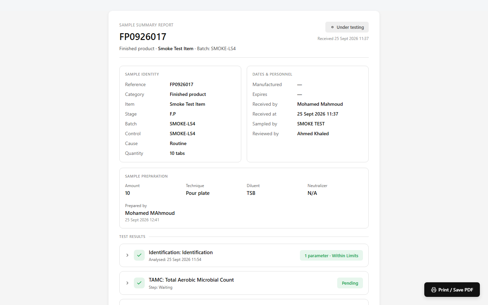
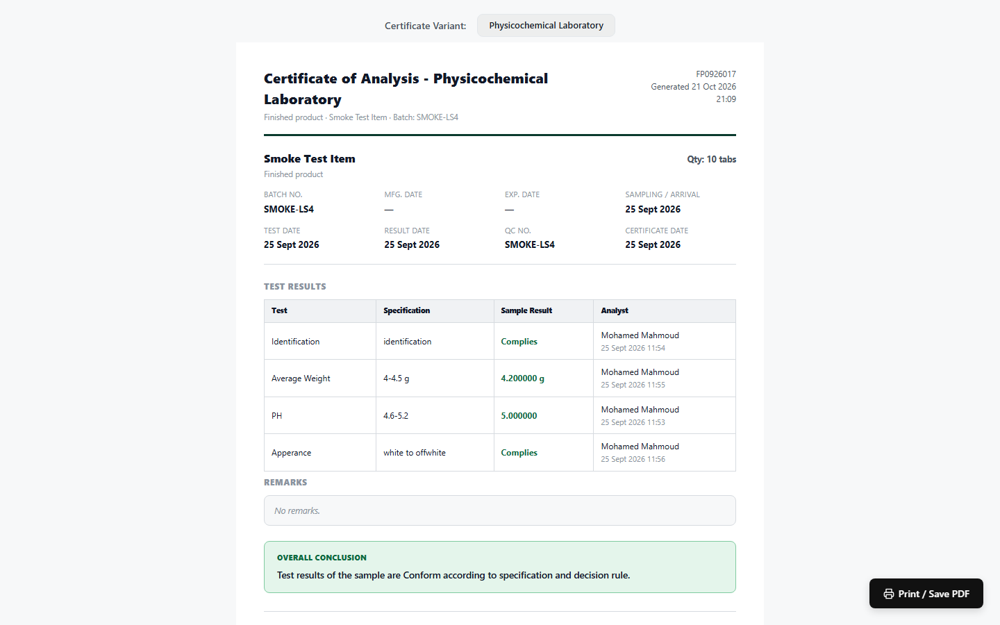

## 21. Sample Report, Certificate of Analysis and Archived Records

MicroLIMS does not have a separate Final Release step. The Section Head's approval or rejection (see §19) is the last decision; the printable sample report and the Certificate of Analysis present the result, and a frozen PDF copy is saved when the sample becomes final.

### 21.1 Sample Summary Report
<!-- WF-COA-001 -->
#### Purpose
Show the record of a sample on one printable page: identity, dates and personnel, preparation, test results, timeline, electronic signatures and archived copies.

#### Who can use it
Any signed-in user who can reach the sample. The report page has no permission check of its own; for a sample that is not yet final, the data shown is limited to the user's laboratory sections.

#### Before you start
Open the **Sample Summary** dialog of the sample and click **Printable Report** (or **Open Printable Report**).

> **Note for reviewers:** There is no separate Final Release step; Approved is the final sample status, reached through the Section Head's release decision. (GAP-017, GAP-018)

> **Note for reviewers:** Two PDFs exist (the copy archived at the final decision and the on-demand **Export PDF**); which one is the controlled record is not defined. (GAP-311)

> **Note for reviewers:** Approval, rejection and close-testing signature statements are worded differently on the certificate, the report and the approval card. (GAP-315)

> **Note for reviewers:** The Word export of the summary has no screen. (GAP-310)

#### What you see
- Browser tab title "Sample Summary - {reference}"; heading **sample summary report**.
- A status badge (**Received**, **Under testing**, **Under review**, **Under approval**, **Approved** or **Rejected**) and "Received {date time}".
- Blocks:
  - **sample identity**: Reference, Category, Item, Prev. Product and Prev. Batch (After Cleaning only), Stage, Batch (not shown for After Cleaning), Control, Cause, Quantity, Sampling point, Storage.
  - **dates & personnel**: Manufactured, Expires, Received by, Received at, Sampled by, and Reviewed by and Approved by (shown only when set).
  - **sample preparation** (only when a preparation exists): Amount, Technique (with Filtration and Washing volumes for filtration), Diluent, Neutralizer, Prepared by.
  - **test results**: a summary matrix and one card per test. When there are none: "No tests recorded."
  - **workflow timeline**: Received, In testing (earliest incubation start), Under review (when the section was submitted for review), Under approval (when the review was completed), and the final step Approved or Rejected (or Voided).
  - **electronic signatures** (only when signatures exist): for each signature the printed name, @username, role, time, "Meaning: {text}" and any comment in quotation marks. The meaning texts on this page are "I have reviewed the test data and confirm it is complete and accurate.", "I approve the release of this sample for its intended use.", "I reject this sample; the results do not conform to specification." and "I am ordering a retest of the retained sample."; a closing signature shows its meaning name instead of a sentence.
  - **archived copies** (see §21.3).
- Button **Print / Save PDF** (opens the browser's print dialog) and the footer "This is a controlled document generated by MicroLIMS. Any printed copy is uncontrolled."

#### How to use it
1. In the **Sample Summary** dialog, click **Printable Report** (or **Open Printable Report**).
2. Read the identity, preparation, test results and timeline.
3. Check that the review and release signatures appear in the **electronic signatures** block.
4. To print or save a PDF, click **Print / Save PDF** and choose a printer or "Save as PDF" in the browser dialog.
5. To get a PDF built by the system instead, click **Export PDF** in the **Sample Summary** dialog (the button shows "Exporting…" while working).

#### System behavior
- The page always uses the light colour theme, whatever theme the application is set to.
- The page shows the current record of the sample, not a frozen copy.
- Printed copies are marked uncontrolled in the footer.

#### Errors
- "Loading report…" is shown while the page loads.
- "Failed to load the sample report."
- "The archived copies of this record could not be loaded. Reload the page to try again."
- "Export failed." (when **Export PDF** fails)

#### What happens next
When the sample is approved or rejected, the Certificate of Analysis can be opened (§21.2).

---

### 21.2 Certificate of Analysis
<!-- WF-COA-001 -->
#### Purpose
Show and print the Certificate of Analysis of an approved or rejected sample: results against specification, remarks, the overall conclusion and the reviewer and approver blocks.

#### Who can use it
Any signed-in user who can reach the sample. The certificate page has no permission check of its own.

#### Before you start
- For a sample tested by one laboratory, the sample must be **Approved** or **Rejected**.
- Results must have been recorded.
- Open the certificate from the **Sample Summary** dialog with **View COA** (or **View Certificate of Analysis**). These buttons appear only when certificate results exist and a certificate is available.

> **Note for reviewers:** The certificate page is available only for approved or rejected samples; the underlying system function does not enforce this. (GAP-306)

> **Note for reviewers:** Certificates for samples tested by more than one laboratory print stored names and times rather than signature records. (GAP-307)

> **Note for reviewers:** Approval of out-of-specification results is allowed after a warning, so a certificate can certify them as conforming. (GAP-304)

> **Note for reviewers:** Approval, rejection and close-testing signature statements are worded differently on the certificate, the report and the approval card. (GAP-315)

#### What you see
- Title **Certificate of Analysis** (or **Certificate of Analysis - {section}**), with category, item name and "Batch: {batch}" below, and the sample reference and "Generated {date time}" on the right.
- For a sample tested by more than one laboratory, **Certificate Variant:** with the buttons **Combined** and one button per section you can see whose status is Approved. The bar is hidden when printing. The default is **Combined** if available, otherwise the first available section.
- Results, in one of two layouts:
  - Water, environmental monitoring and After Cleaning samples: an identity strip (Reference, Category, **Batch / Control**, Received), the heading **Test Results by Location**, and a matrix with **Location** and, per test, **Alert**, **Action**, **Spec** and **Result** (qualitative tests share one "Spec: Absent / 10 mL" cell), with a footnote about units and absence.
  - Other categories: an item strip with **Qty** and a dates grid (**Batch No.**, **Mfg. Date**, **Exp. Date**, **Sampling / Arrival**, **Test Date**, **Result Date**, **QC No.**, **Certificate Date**), the heading **Test Results**, and a table with **Test**, **Specification**, **Sample Result** and **Analyst** (name and time; "via retest {reference}" for tests carried from a retest).
- Combined variant: headings "{section} Test Results", "No recorded results for this section.", and for cancelled tests "{test}: Not completed, testing closed ({step}, stage {n})."
- **Remarks** (combined variant: **Remarks ({section})**): the certificate remarks typed at approval, or "No remarks."
- **Overall Conclusion**: text built by the system, shown in red when the certificate shows non-conformance.
- Signature blocks:
  - One laboratory: **Reviewer** block and **Approver** block. They use the last matching signature when there is one (Reviewer: "I have reviewed the test data and confirm it is complete and accurate."; Approver: "I approve the release of this sample for its intended use." or "I reject the release of this sample; it does not conform to specification."). For a sample whose decision was a retest or new sample, the stored name and time are printed instead.
  - Combined variant: one block per section ("Approver: {section}", "Rejected by {section}" or "Testing closed by {section}", with "Reason: {reason}") from stored names and times.
  - Section variant: **Reviewer** (if a reviewer name exists) and **Approver** from stored names and times.
- Button **Print / Save PDF** (hidden when printing) and the footer "This Certificate of Analysis is a controlled document generated by MicroLIMS. Any printed copy is uncontrolled." with a line that points to the Sample Summary Report by Document ID.

[SCREENSHOT SS-213]

#### How to use it
1. In the **Sample Summary** dialog, click **View COA** (or **View Certificate of Analysis**).
2. For a sample tested by more than one laboratory, choose **Combined** or a section button under **Certificate Variant:**.
3. Check the results against the specification.
4. Check **Remarks** and **Overall Conclusion**.
5. Check the reviewer and approver blocks.
6. Click **Print / Save PDF**.

#### System behavior
- The page always uses the light colour theme.
- Printing is set for A4 portrait; the variant bar and buttons are not printed.
- Remarks print exactly as typed at approval. The internal comment is never printed.

#### Validation
- Sample tested by one laboratory, not final: "A Certificate of Analysis is only available once this sample has been approved or rejected. Current status: {status}."
- Final sample without results: "A Certificate of Analysis is not available for this sample - none of its tests have recorded results yet."
- More than one laboratory, no certificate available: the alert **Certificate of Analysis Not Available** with "A Certificate of Analysis is not available yet. The following laboratories are not final yet:" and lines "{section}: {status}".
- No approved section visible to you: "No approved laboratory sections are currently accessible."
- Section without results: "A Certificate of Analysis is not available for this section - none of its tests have recorded results yet."

#### Status
- **Combined** needs the sample to be **Approved** or **Rejected** and every section to be visible to you.
- A section certificate needs that section to be **Approved**. A **Rejected** or **Closed** section has no section-only certificate.

#### Errors
- "Loading certificate…" is shown while the page loads.
- "Failed to load the certificate of analysis."

#### What happens next
Nothing further happens in the system. Printed copies are marked uncontrolled.

---

### 21.3 Archived Records
<!-- WF-COA-001 -->
#### Purpose
Download the PDF copies saved when a sample became final.

#### Who can use it
Any signed-in user who opens the sample report. Downloading an archived copy needs only sign-in.

#### Before you start
The sample must have reached a final decision, so that an archived copy exists, and you must open its printable sample report (§21.1).

> **Note for reviewers:** Archived-record download has no laboratory scope check; a failed integrity check shows a warning message. (GAP-108, GAP-314)

#### What you see
On the sample summary report, the block **archived copies** with the text "Immutable PDFs frozen at each final decision - what this record looked like when it was issued, not this live view." Each row shows the reason (for example "Sample Approve", "Sample Reject", "Laboratory testing closed" or "Sample {outcome} (OOS resolved)") and a download control.

> **Note for reviewers:** The label names the decision that closed the sample, not its final status. For a sample tested by more than one laboratory, a copy labelled 'Sample Approve' can belong to a sample whose final status is **Rejected**, because another laboratory rejected it earlier. Check the status on the record. (GAP-902)

[SCREENSHOT SS-214]

#### How to use it
1. Open the sample's printable report (§21.1).
2. Go to the **archived copies** block.
3. Find the row for the decision you need.
4. Click the download control.
5. If a warning appears, read it (see below).

#### System behavior
- A copy is saved when the sample becomes Approved or Rejected, when closing a laboratory's testing makes the sample final, and when a retest outcome resolves the original sample (see §18).
- Each copy is saved with a hash, which is checked again on download.
- If the check fails, the screen shows: "Warning: this archived copy failed its integrity check - the stored file no longer matches the hash recorded when it was signed. Do not treat it as authoritative; report this to a System Administrator."

#### Errors
- "The archived copies of this record could not be loaded. Reload the page to try again."
- The integrity warning above.

#### What happens next
Nothing further happens in the system.

<!-- Review log (Sonnet): 30 corrections; invented items removed: route/auth/filename/header/theme-class names, "sample tracking board", "new tab", "Header button", Investigation signature line, "title" in signature blocks, product-category list for standard layout, result-status-source claim, "generated by" archive column, "immutable"/"cryptographic" claims, archive-failure-keeps-decision claim (unconfirmed), CoA "archived/distributed" next step; callouts added: GAP-304 (OOS approval certified), GAP-017/018 kept -->
<!-- Phase 13 (agy): applied F-B04 -->

<!-- Phase 13 review (Sonnet): F-B04, GAP-902 verified (exists). -->
