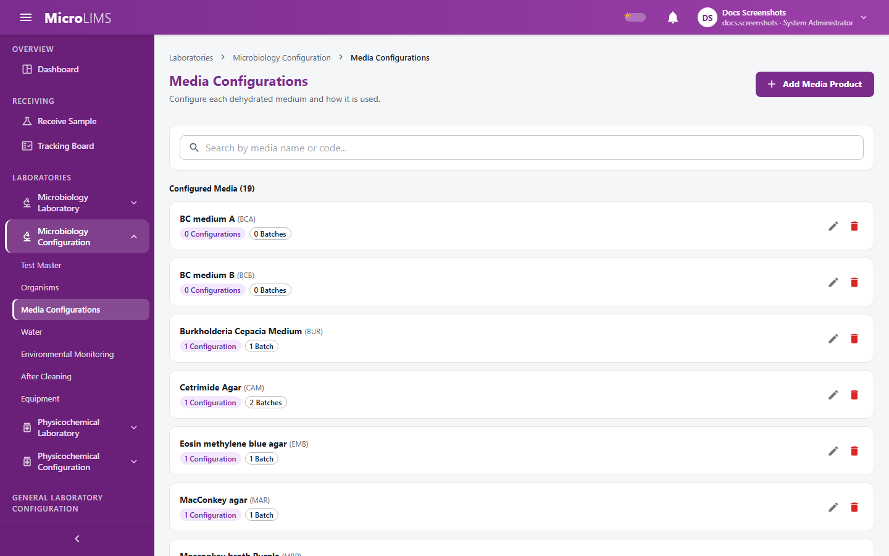
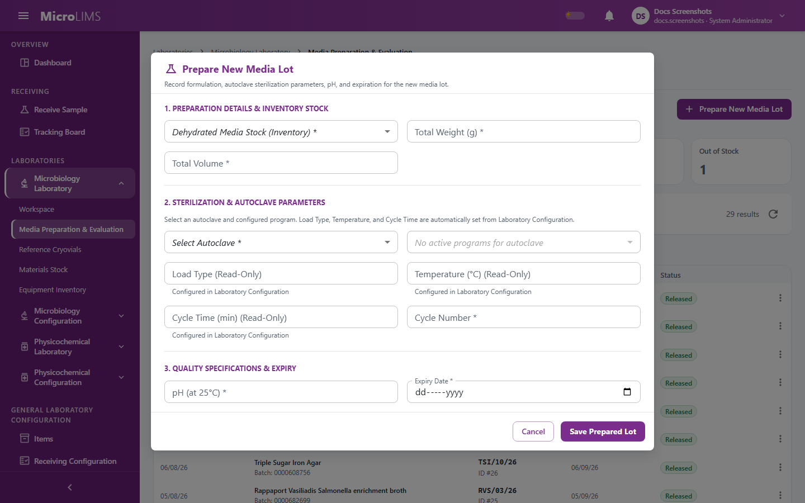
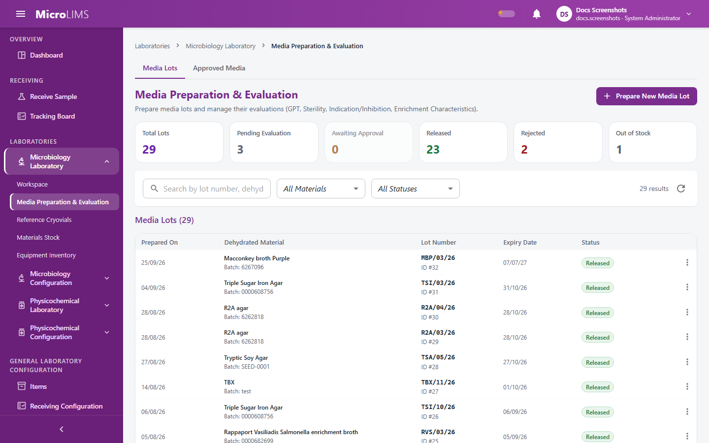

## 22. Growth Promotion Testing and Media

MicroLIMS manages the life of culture media lots: the media product set-up (incubation conditions and the challenges used to evaluate a lot), lot preparation, evaluation (Growth Promotion, Indication, Inhibition and Enrichment), a signed release decision, and storage tracking.

MicroLIMS does not have a separate sterility test step or record, although the word "sterility" appears in some screen text.

> **Note for reviewers:** The screen subtitle and the menu description of Media Preparation & Evaluation mention sterility checks, but no sterility record exists in the application. (GAP-022)

---

### 22.1 Media Configurations
<!-- WF-MEDIACFG-001 -->
#### Purpose
Set up each dehydrated medium as a media product: its name and unique product code (the code is the first part of every lot number), the time and temperature pairs it can be incubated at, and its evaluation configuration (Growth Promotion or Indication / Inhibition, recovery limits and challenge organisms).

#### Who can use it
Requires the *Master Data Management* permission (by default: Section Head, System Administrator). Changing a media product code is different: it is limited to users whose role type is Section Head. A System Administrator cannot change a code, even though that role holds every permission by default.

#### Before you start
- Make sure the challenge organisms you need exist in the Organisms list (§32).
- Decide the product code: 2 to 10 letters, digits, dots or hyphens.

> **Note for reviewers:** Only the Section Head role type can change a media product code (signed); a System Administrator cannot. Other media product changes (create, rename, delete, conditions, configurations) are unsigned and carry no reason. (GAP-013, GAP-406)

> **Note for reviewers:** The evaluation type Enrichment Characteristics exists in the system but cannot be set up on this screen. (GAP-407)

> **Note for reviewers:** The expected colony description for an Indication challenge is required by the dialog only; it is not checked again when the record is saved. (GAP-405)

> **Note for reviewers:** For Growth Promotion, entering only a minimum recovery causes every challenge to evaluate as NonConform and the lot to be rejected; leaving the minimum empty causes every challenge to evaluate as Conform. (GAP-505, GAP-903)

#### What you see
- In the menu, open **LABORATORIES**, then **Microbiology Configuration**, then **Media Configurations**. The page title is **Media Configurations**.
- Left panel: **Configured Media ({n})**, a search box with a reset control, and the button **Add Media Product**.
- Product workspace (after you select a product):
  - **Overview** tab: tiles **Media code** (with the button **Change code**, shown to Section Heads only), **Lot number format** (for example 01 and 02 after the code, then the year), **Configurations** and **Stock batches**.
  - **Incubation Conditions ({n})** tab: a table with **Incubation**, **Temperature**, **Used by** and **Actions**. A condition not used anywhere shows the chip **Not used**. A condition in use has disabled edit and delete icons with the hint "In use - add a new condition instead".
  - **Configurations ({n})** tab: the evaluation configuration with expandable challenge organisms, and the button **Add Configuration** (shown only while the product has none).

#### How to use it
To add a media product:
1. In the left panel, click **Add Media Product**.
2. Enter the **Product Name** and **Product Code**.
3. Click the save button. The system shows `Media product "{name}" created successfully.` and opens the **Incubation Conditions** tab.

To add an incubation condition:
1. Open the **Incubation Conditions** tab and click **Add Condition**.
2. Enter **Incubation Min (h)**, **Incubation Max (h)**, **Temp Min (°C)** and **Temp Max (°C)**. All four are required.
3. Save. The system shows "Incubation condition added."

To add the evaluation configuration:
1. Open the **Configurations** tab and click **Add Configuration**. If the product has no incubation condition yet, the dialog says "{product} has no incubation conditions yet. Add one in the Incubation Conditions tab first."
2. Select the **Evaluation Type**: **Growth Promotion** or **Indication / Inhibition**.
3. Select the **Incubation Condition**.
4. For Growth Promotion, enter both **Recovery Min (%)** and **Recovery Max (%)**. If you enter only a minimum, every challenge is judged **NonConform** and the lot is rejected. If you leave the minimum empty, every challenge is judged **Conform** whatever the recovery.
5. Under **Challenge Organisms (Optional)**: choose the organism; for Indication / Inhibition choose the **Challenge Role** (**Inhibition** or **Indication**); for an Indication role enter the **Expected Colony Description \***; optionally enter the **Initial Inoculum (CFU)**; then click **Add Organism**.
6. Click **Save Configuration**.

To rename a product, use the rename icon in the list (the code is read-only there). To delete a product, a condition or a configuration, use the delete icon and confirm.

To change a media product code (Section Head only):
1. Open the **Overview** tab and click **Change code** in the **Media code** tile.
2. Enter the **New Code** and a **Reason**.
3. Click **Continue to sign**.
4. In the **Electronic Signature** dialog, read the statement: `I am changing the code of media product "{name}" from {old} to {new}. Lots prepared from now on will be numbered {new}/01/{yy} onwards. Reason: {reason}`
5. Enter your password and click **Sign**.

#### System behavior
- The product code starts every lot number. A code change applies to lots prepared afterwards, which start again at 01. Lots already prepared or received keep the code they had.
- The system records the code change as an electronic signature together with your reason, and the old and new code in the audit trail. If the password is wrong, nothing is changed.
- Each product can have only one evaluation configuration.
- An incubation condition that an evaluation configuration or a Test Master step medium uses cannot be changed or deleted. Add a new condition instead.
- A product cannot be deleted while it has configurations or stock batches, or while one of its conditions is used by a Test Master step medium.
- Deleting a configuration has no check for use.
- Renaming a product updates its name on its configurations; names already copied onto received stock batches are not changed.

#### Validation
- "Both product name and code are required."
- "Product name is required."
- "Enter the incubation hours and temperature range."
- "Incubation min hours must be greater than zero."
- "Incubation max hours cannot be less than min hours."
- "Temperature min must be below temperature max."
- `'{product}' already has an incubation condition of {min}–{max} h at {tmin}–{tmax} °C.`
- `This incubation condition is used by {n} evaluation configuration(s) and {m} Test Master step medium/media, so it can't be changed or deleted. Add a new condition instead.`
- `'{product}' already has an evaluation configuration. Edit it instead.`
- "Choose an incubation condition."
- "Recovery % min cannot exceed max."
- "This organism and role combination is already staged for this configuration."
- "Duplicate challenge organism and role combination in request."

#### Status
Media products, conditions and configurations have no status; they stay in place until deleted.

#### Important rules
- Product names and codes must each be unique (upper and lower case are treated as the same).
- Changing a product code needs a reason and your password.
- Creating and renaming a product, and all other configuration changes, need no password and no reason.

#### Errors
- "Failed to create media product."
- "Failed to rename media product."
- "Failed to save the incubation condition."
- "Could not delete this incubation condition."
- "Could not delete this media product."
- "Failed to load media configuration data."

#### What happens next
- The product can be linked to a received dehydrated-media lot in Materials Stock (§29).
- Analysts can prepare lots of the product (§22.2).

---

### 22.2 Media Preparation
<!-- WF-MEDIA-001 -->
#### Purpose
Prepare a media lot from dehydrated media stock, record the sterilisation (autoclave) details, deduct the used weight from stock, and create the lot's evaluation automatically.

#### Who can use it
Requires the *Media Lot Preparation* permission (by default: Section Head, Reviewer, Analyst, System Administrator). The stock and equipment lists in the dialog also need *Material Stock Management* (by default: Section Head, Analyst, System Administrator).

#### Before you start
- A dehydrated-media stock lot must exist in Materials Stock, in stock (not depleted or expired), linked to a media product, with a current Certificate of Analysis (COA) and enough quantity.
- The product must have exactly one evaluation configuration (§22.1).
- An autoclave must be configured in Laboratory Configuration > Equipment with at least one autoclave program.

> **Note for reviewers:** A Reviewer may be unable to load the stock and equipment lists in the preparation dialog, because by default the Reviewer role does not hold the stock and equipment inventory permissions. (GAP-514)

> **Note for reviewers:** The expiry date, pH, weight, volume and autoclave values are typed by the user. The system checks that they are filled in but does not check ranges or a shelf life. (GAP-509, GAP-515)

#### What you see
- In the menu, open **LABORATORIES**, then **Microbiology Laboratory**, then **Media Preparation & Evaluation**. The page has the tabs **Media Lots** and **Approved Media**, and the button **Prepare New Media Lot**.
- The dialog **Prepare New Media Lot** has:
  - **Dehydrated Media Stock (Inventory) \*** (only in-stock dehydrated media; items not linked to a media product are disabled);
  - **Total Weight (g) \*** and **Total Volume \***;
  - **Autoclave \*** and **Autoclave Program / Load \***;
  - read-only **Load Type (Read-Only)**, **Temperature (°C) (Read-Only)** and **Cycle Time (min) (Read-Only)**, filled in from the chosen program;
  - **Cycle Number \***, **pH (at 25°C) \*** and **Expiry Date \***;
  - the buttons **Cancel** and **Save Prepared Lot**.

#### How to use it
1. Click **Prepare New Media Lot**.
2. Select the dehydrated media stock lot.
3. Enter **Total Weight (g)** and **Total Volume**.
4. Select the **Autoclave** and the **Autoclave Program / Load**, and check the read-only values.
5. Enter **Cycle Number**, **pH (at 25°C)** and **Expiry Date**.
6. Click **Save Prepared Lot**. The system shows `Media lot {lot} successfully prepared.` and selects the new lot.

#### System behavior
- The lot number is the product code, a two-digit sequence and the two-digit year, for example `ABC/01/26`. The sequence continues from the highest number already issued for that code and year.
- The used weight is deducted from the stock lot in the same save.
- The manufacturer name and manufacturer lot are copied from the stock lot.
- The system creates one evaluation for the lot, with one challenge for each organism in the product's evaluation configuration.
- The system records who prepared the lot. That person can never release or reject it (§22.4).
- If two people take the same lot number at the same moment, the system retries once, then asks you to submit again.
- The autoclave is checked only to be an autoclave. Its operational status and calibration are not checked.

#### Validation
- "Please select a Dehydrated Media Stock item from inventory."
- "The selected dehydrated media is not linked to a media product. Edit it in Inventory > Materials Stock before preparing."
- "Please enter the total weight."
- "Please enter the total volume."
- "Please select an Autoclave."
- "Please select an Autoclave Program / Load."
- "Please select an Autoclave Program with valid Load Type."
- "Autoclave temperature is required."
- "Autoclave cycle time is required."
- "Please specify the cycle number."
- "Please specify the pH."
- "Please specify the Expiry Date."
- "Selected equipment is not a valid autoclave."
- "Material {name} (batch {batch}) is expired and cannot be used."
- "A current Certificate of Analysis (COA) is required before {name} (batch {batch}) can be used. Please upload a valid COA in the Inventory module first."
- "Insufficient stock: {name} (batch {batch}) has {remaining} {unit} remaining, {requested} requested."
- "Batch {batch} of {material} isn't linked to a configured media product - edit it in Inventory > Materials Stock and choose the product before preparing."
- "No Media Configuration exists yet for \"{product}\" - configure it in Laboratory Configuration before preparing a lot."
- "Lot number {lot} was taken by another preparation at the same moment. Nothing was saved - submit the preparation again."

#### Status
A new lot shows as **Pending Evaluation**. Its approval is pending and it is not released for use.

#### Important rules
- A prepared lot cannot be used in testing until its evaluation is complete and it has been released with a signature (§22.4).
- The stock weight is deducted at once, when you save.
- The media lot itself is not checked for an expiry date in the past when it is saved.

#### Errors
- "Could not prepare media lot. Please verify all inputs."

#### What happens next
Analysts carry out the evaluation challenges (§22.3).

---

### 22.3 Media Evaluation
<!-- WF-MEDIA-002 -->
#### Purpose
Evaluate a prepared lot. Each challenge organism is given a working source (a reference cryovial batch or a lyophilized disk), incubated, read and judged. The evaluation types are Growth Promotion (recovery compared with a reference lot), Indication, Inhibition and Enrichment.

#### Who can use it
Requires the *Test Workflow Execution* permission (by default: Section Head, Reviewer, Analyst, System Administrator), within your laboratory sections. Choosing the working source also loads cryovial and stock lists, which need the *Cryovial Management* and *Material Stock Management* permissions.

#### Before you start
- The lot must have its evaluation (created automatically at preparation).
- For each challenge, an approved, not destroyed, unexpired cryovial batch of the same organism, or a lyophilized-microorganism disk of the same organism with quantity left and not expired, must be available in the same laboratory section.
- For Growth Promotion, a reference lot: a prior released lot, or a manually typed description.
- An incubator.

> **Note for reviewers:** A growth promotion challenge with no configured minimum recovery is always evaluated as Conform. (GAP-505)

> **Note for reviewers:** The disk for a media evaluation is taken from Materials Stock as soon as it is selected and is not returned if it is not used. (GAP-511)

> **Note for reviewers:** Evaluation results can be entered again after the evaluation is completed, and a lot that was made Rejected by a NonConform result is not set back automatically. The correction procedure is unconfirmed. (GAP-504)

> **Note for reviewers:** The incubator chosen in the evaluation is not checked (type, set point, calibration or status), and the dialog does not force Step 1 before Step 2. (GAP-518, GAP-501)

#### What you see
- In **Media Preparation & Evaluation**, select a lot in the **Media Lots** register, open its **Evaluations (N)** tab and click to open the evaluation (the dialog **Media Evaluation Workflow**).
- Each challenge card shows the organism, ATCC number, role and recovery criteria, then:
  - for Growth Promotion, **REFERENCE LOT (FOR RECOVERY% COMPARISON)**: a prior released lot of the same material, or **Reference Lot (manual entry)**;
  - **STEP 1: SELECT WORKING CRYOVIAL OR LYOPHILIZED DISK**: the list **Select Cryovial or Disk** and the button **Assign**;
  - **STEP 2: RECORD INCUBATION**: the list **Select Incubator** and the button **Record Incubation**. After recording, the card shows temperature, hours and **Earliest reading: {date}**, later **Ready to read**;
  - **STEP 3: RECORD OBSERVATION / RESULT** and the button **Record Result**.

[SCREENSHOT SS-223]

#### How to use it
For each challenge:
1. In Step 1 select a cryovial batch or disk and click **Assign**. The system shows "Organism source selected." Choosing a disk takes one unit from stock at once; choosing a cryovial batch does not reduce its vial count.
2. In Step 2 select an incubator and click **Record Incubation**. The temperature and hours come from the product's incubation condition; you do not type them. The system shows "Incubation recorded."
3. Wait until the card shows **Ready to read**. Before that, the dialog says "Incubation still in progress; result entry opens at {time}."
4. In Step 3 enter the result for the challenge type:
   - **Growth Promotion**: choose the reference lot (or type its description), then enter **Old Media Count** and **New Media Count**. A live recovery percentage is shown.
   - **Inhibition**: answer **Growth Observed?** with **Yes** or **No**.
   - **Indication**: enter **Observed Description** and choose the **Judgment** (**Conform** or **NonConform**).
   - **Enrichment**: answer **Turbid or Clear?** with **Turbid** or **Clear**.
5. Click **Record Result**. The system shows "Result recorded successfully." After the result is saved the dialog shows "EVALUATION RESULT RECORDED" and no further inputs.

#### System behavior
- Recovery % = (New Media Count ÷ Old Media Count) × 100, rounded to one decimal. The challenge is **Conform** when the recovery is inside the configured minimum and maximum (limits included). If you enter only a minimum, every challenge is judged **NonConform** and the lot is rejected. If you leave the minimum empty, every challenge is judged **Conform** whatever the recovery.
- Inhibition is Conform when no growth is observed. Enrichment is Conform when the broth is turbid. Indication is Conform or NonConform exactly as you judge it; the system does not compare your text with the expected colony description.
- The system records who read each challenge and when.
- When every challenge has a result the evaluation is completed. It is Conform only if every challenge is Conform.
- If the evaluation is NonConform, the lot is set aside at once and shows **Rejected** in the register. A Conform evaluation does not release the lot; it only moves it to **Awaiting Approval**.
- A lot prepared with no challenge organisms has an evaluation that can never complete.

#### Validation
- "Organism source selected."
- "Incubation recorded."
- "Result recorded successfully."
- "No approved, unexpired cryovial batches or lyophilized disks available for {organism}."
- "Media Configuration for lot \"{lot}\" is missing an incubation condition."
- "Incubation must be recorded before a result can be entered."
- "Incubation is still in progress - earliest reading time is {yyyy-MM-dd HH:mm} UTC."
- "Old and new media counts are required."
- "Old media count cannot be zero - recovery% cannot be calculated."
- "A reference lot is required - either a linked prior lot or a free-text description, not both or neither."
- "Reference media lot {id} belongs to another laboratory section."
- "Growth observed is required."
- "Observed description and a Conform/NonConform judgment are required."
- "Turbid/clear is required."
- "Cryovial batch {code} belongs to another laboratory section and cannot challenge this media lot."
- "Cryovial batch {code} is {organism}, not {challenge organism}."
- "Cryovial batch {code} is not approved for use."
- "Cryovial batch {code} is expired and cannot be used."
- "Material {name} is not a lyophilized microorganism disk."
- "Material {name} is {organism}, not {challenge organism}."
- "Material {name} (batch {batch}) has no quantity remaining."
- "Material {name} belongs to another laboratory section and cannot challenge this media lot."

#### Status
- Evaluation: Assigned (at preparation), then In Progress (when an incubation is recorded), then Completed (when all challenges have a result). The outcome is Conform or NonConform.
- Lot: stays **Pending Evaluation** until the evaluation completes. A Conform evaluation moves it to **Awaiting Approval**. A NonConform evaluation makes it **Rejected**.

#### Important rules
- A result cannot be entered before the earliest reading time.
- One non-conforming challenge fails the whole lot.
- The lot's own expiry date is not checked during evaluation.

#### Errors
- "Could not select organism source."
- "Could not record incubation."
- "Could not record result."

#### What happens next
- Conform: a user holding the release permission decides the lot (§22.4).
- NonConform: the lot cannot be used. The application has no re-test or re-prepare action.

---

### 22.4 Media Lot Release and Rejection
<!-- WF-MEDIA-003 -->
#### Purpose
Release a conforming lot for routine testing with a signed decision, or reject it.

#### Who can use it
Requires the *Media Lot Release* permission (by default: Section Head, System Administrator). The buttons are hidden from users without it.

#### Before you start
- The lot must show **Awaiting Approval** (evaluation completed and Conform).
- You must not be the person who prepared the lot, and you must not have read any challenge of its evaluation.

> **Note for reviewers:** A Conform evaluation does not release a lot. A Section Head (or other user holding the release permission) must sign, and cannot be the preparer or an evaluator. Whether QA as well as a Section Head must approve is unconfirmed. (GAP-513)

> **Note for reviewers:** Release does not check the lot's expiry date. (GAP-506)

> **Note for reviewers:** Whether an expired or unreleased lot can start a test depends on the screen path used; the lot lists on screen show only released, unexpired lots. (GAP-500, GAP-516)

#### What you see
- In **Media Preparation & Evaluation**, select a lot that shows **Awaiting Approval**. The lot header has the buttons **View Lot Record**, **Audit History**, and, if you hold the release permission, **Release Lot** and **Reject Lot**.
- A signature dialog titled **Electronic Signature** asks for your password and shows the statement.

#### How to use it
To release a lot:
1. Click **Release Lot**.
2. Read the statement: `I am releasing media lot {lot} for use in routine testing.`
3. Enter your password and click **Sign**. The system shows `Media lot {lot} released for use.`

To reject a lot:
1. Click **Reject Lot**.
2. Read the statement: `I am rejecting media lot {lot}.`
3. Enter your password and click **Sign**. The system shows `Media lot {lot} rejected.`

#### System behavior
- The system checks, in this order: the lot has not already been decided; it has an evaluation; for a release, the evaluation is completed and Conform; you are not the preparer or an evaluator; your password.
- On success the system records the electronic signature (approved or rejected) with the decision, and saves a PDF copy of the lot record as an archived record. All of this is saved together with the change of the lot.
- Repeated wrong passwords are limited and logged.
- The decision is final. A released or rejected lot cannot be changed back.

#### Validation
- "Media lot {lot} has already been decided ({status})."
- "Media lot {lot} has no evaluation record."
- "Media lot {lot}'s evaluation is not complete yet."
- "Media lot {lot}'s evaluation did not conform - it cannot be released."
- "You cannot approve a media lot you prepared or evaluated."

#### Status
- After release: the lot shows **Released**.
- After rejection: the lot shows **Rejected**.
- A lot made **Rejected** by a NonConform evaluation shows no release buttons, because only lots in **Awaiting Approval** offer them.

#### Important rules
- The preparer and everyone who read a challenge cannot sign the decision.
- A lot's expiry is not an inventory status. The lot status never changes to expired by itself; check the expiry date shown for the lot.
- Where a lot can be used in a test depends on the entry point:

| Entry point | Lot not released, out of stock or rejected | Lot past its expiry date |
|---|---|---|
| Lot lists offered on screen | Not offered | Not offered |
| Selecting media for a single test step | Refused: "Media lot \"{lot}\" is not released for use, out of stock, or rejected." | Not checked |
| Grouped media selection for several tests | Refused with the same message | Refused: "Media lot \"{lot}\" is expired (expired on yyyy-MM-dd)." |
| Starting the shared TSB | Not checked | Refused: "Media lot #{lot} expired on yyyy-MM-dd." |
| Media for pathogen confirmation | Refused | Not checked |
| Identity confirmation when preparing a cryovial batch | Refused | Not checked by the system (the dialog offers only unexpired lots) |

Because the screens offer only released, unexpired lots, these differences are normally reached only when a lot expires after it was listed or when a request bypasses the screen. This has not been tested in the running application.

#### Errors
- "Release decision failed."

#### What happens next
A released lot can be stored (§22.5) and chosen in test screens (§14, §15).

---

### 22.5 Media Storage and Inventory Management
<!-- WF-MEDIA-004 -->
#### Purpose
Record where released media is stored, move stock between places, and mark a lot out of stock.

#### Who can use it
Requires the *Media Lot Preparation* permission (by default: Section Head, Reviewer, Analyst, System Administrator).

#### Before you start
- The lot must show **Released** and still be active.
- A storage place must be in-service cold-storage equipment of the Microbiology section from the equipment inventory, or free text.

> **Note for reviewers:** The lot status never shows Expired; check the expiry date. Out of Stock cannot be undone and is not signed. (GAP-502, GAP-512)

> **Note for reviewers:** The remaining quantity of a lot is not tracked on the lot itself, only per storage entry. (GAP-510)

#### What you see
- In the lot workspace, the **Storage** tab appears only for released lots. Without a released, active lot the panel says "Storage can be recorded once the lot is released and in stock."
- The panel has the button **Add Storage** and a list of storage entries, each with a **Move** button.
- The lot header has **Mark Out of Stock** while the lot shows **Released**.
- Dialog **Add Storage**: **Stored as \*** (Plates, Agar bottles, Broth bottles, Tubes), **Quantity \***, and **Storage equipment \*** or **Storage area \***. Button **Add**.
- Dialog **Move Storage**: **Quantity to move \***, the new place, **Reason for move \*** (at least 5 characters). Button **Move**.
- Dialog **Mark Media Lot Out of Stock**: the warning "Warning: This media lot will no longer be available for laboratory testing.", the box **Reason / Comment (Optional)**, and the buttons **Cancel** and **Confirm Out of Stock**.

#### How to use it
To add a storage entry:
1. Open the **Storage** tab and click **Add Storage**.
2. Choose **Stored as**, enter the **Quantity**, and choose the **Storage equipment** or type the **Storage area**.
3. Click **Add**.

To move stock:
1. Click **Move** on the entry.
2. Enter the **Quantity to move**, the new place and the **Reason for move**.
3. Click **Move**.

To mark a lot out of stock:
1. Click **Mark Out of Stock** in the lot header.
2. Read the warning and, if you wish, enter a reason.
3. Click **Confirm Out of Stock**.

#### System behavior
- An entry with the same lot, form and place is merged by adding the quantity.
- A move checks the quantity against the entry and that the new place differs from the old one. The system saves the movement with your reason in the lot's history.
- Marking out of stock sets the lot to **Out of Stock** and removes it from test lists. The system saves your comment (or the text "Media lot manually marked Out of Stock.").
- None of these actions needs a password or signature. The record-change log keeps who changed what and when.
- The system shows the "Media Expiry" notice on the dashboard for active lots that expire within 7 days or have expired.

#### Validation
- "Quantity must be greater than zero."
- "Exactly one of EquipmentId or LocationText must be provided."
- "Media lot {lot} is not currently released for use and active."
- "Equipment {code} is not currently in service."
- "A reason is required to move media storage."
- The **Move** button stays disabled until the reason has at least 5 characters.
- "Cannot move {n} units; only {m} available in entry {id}."
- "Destination storage location must be different from the source storage location."
- "Media storage entry {id} not found for media lot {lot}."
- "Media lot {lot} is not currently released for use and cannot be marked Out of Stock."

#### Status
- **Released**: the lot is in stock.
- **Out of Stock**: set by **Mark Out of Stock**; it cannot be reversed.

#### Important rules
- Storage can only be added for released, active lots.
- Out of Stock is permanent.

#### Errors
- "Failed to mark media lot out of stock."

#### What happens next
The lot stays in the register and in the **Approved Media** tab until it is out of stock or expired.

---

### 22.6 Media Lot Record
#### Purpose
Review or print the history of one lot: identity, preparation, evaluation, signatures and archived copies.

#### Who can use it
Requires the *Media Lot Preparation* permission (by default: Section Head, Reviewer, Analyst, System Administrator) to load the data.

#### What you see
- Open the lot in **Media Preparation & Evaluation** and click **View Lot Record**. The record opens in a new tab.
- The record shows: lot identity (lot number, media class, source material, manufacturer, manufacturer lot, expiry), release status (inventory status, approval, released yes or no, prepared by, decided by and when), the preparation record (weight, volume, autoclave, program, cycle, pH), the media evaluation with each challenge, an event timeline, the signatures, the archived copies, and a **Print** button.

#### How to use it
1. Click **View Lot Record** for the lot.
2. Use **Print** (or the browser's print function) to print or save the page as a PDF.

<!-- Review log (Sonnet): 34 corrections; invented items removed: route paths and permission/enum/status codes, numeric status codes, "dual-person" wording, "legal signing statement", "Word export via URL", unsupported report field list, signature-throttle text as an on-screen error, rejection "regardless of state" as a screen action; callouts added: GAP-022, GAP-518/GAP-501 (evaluation incubator), GAP-500/GAP-516 (release/expiry path table), GAP-510 -->
<!-- Phase 13 (agy): applied F-B06, F-B07 -->

<!-- Phase 13 review (Sonnet): F-B06, F-B07 verified; GAP-505/903 exist. -->
