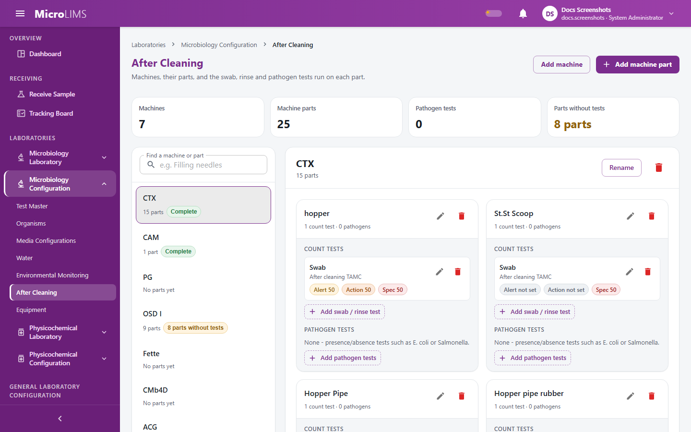
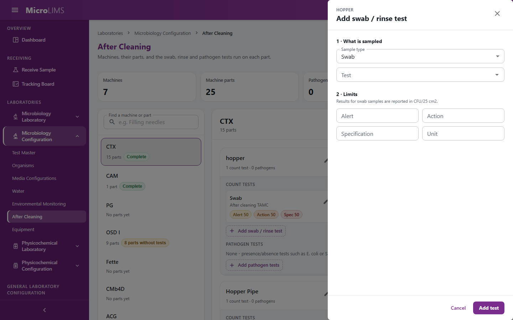

## 25. After Cleaning Monitoring

MicroLIMS supports after-cleaning (cleaning verification) samples. An administrator sets up machines, machine parts, the swab and rinse count tests (with limits) and the pathogen tests run on each part. Analysts then receive a sample that records the cleaned machine and the previous product and batch, choose the parts that were sampled, incubate, enter the results for all parts in one grid, and send the sample to review. The system compares each part's result with its limits.

MicroLIMS does not have a collective pathogen sample or a separate TAMC test for each part. For the selected parts it creates one test for each distinct test code.

> **Note for reviewers:** The collective pathogen / per-part TAMC design for After Cleaning is described in the design document but is not implemented. (GAP-225)

---

### 25.1 After Cleaning Configuration
<!-- WF-AC-001 -->
#### Purpose
Define machines and their parts, the swab and rinse count tests with limits and unit, and the pathogen presence/absence tests of each part.

#### Who can use it
Requires the *Master Data Management* permission (by default: Section Head, System Administrator).

#### Before you start
- Make sure the swab, rinse and pathogen test codes exist in the Test Master (§31).
- Know the machines and the parts that must be sampled.

> **Note for reviewers:** Environmental Monitoring, Water and After Cleaning configuration changes are recorded in the audit trail but need no reason and no electronic signature. (GAP-404)

> **Note for reviewers:** Limits are free text. A mistyped limit is accepted and, if the system cannot read it, it is treated as no limit. (GAP-400)

> **Note for reviewers:** If you change a limit after a sample is prepared but before its results are entered, the changed limit applies to that sample. (GAP-402)

> **Note for reviewers:** A unit typed on a swab or rinse test replaces the standard unit for the results of that test. (GAP-403)

> **Note for reviewers:** Some deletes fail with the message "An unexpected error occurred." when the record is in use. (GAP-420)

> **Note for reviewers:** A test added through **+ Add "{code}" to Test Master** in the test picker is created at once as an Observation test with no workflow steps. (GAP-416)

#### What you see
- In the menu, open **LABORATORIES**, then **Microbiology Configuration**, then **After Cleaning**.
- Title **After Cleaning**; subtitle "Machines, their parts, and the swab, rinse and pathogen tests run on each part."; buttons **Add machine** and **Add machine part** (the second is disabled until a machine exists).
- Left: a search box and the list of machines. Right: for the selected machine, **Rename**, a delete icon, a card for each part, and a dashed button **Add part to {machine}**.
- Each part card has **Count tests** (button **Add swab / rinse test**; icons **Edit test** and **Remove test**) and **Pathogen tests** (chips; button **Add pathogen tests** or **Edit pathogen tests**). A part with no tests shows **No tests configured**.

#### How to use it
To add a machine:
1. Click **Add machine**.
2. Enter the **Machine name \*** (for example "Filling line 2").
3. Click **Add machine**. The system shows `"{name}" added.`

To add a part:
1. Click **Add machine part**, or **Add part to {machine}**.
2. Enter the **Part name \*** and choose the **Machine \***.
3. Click **Add part**. The system shows `Part "{name}" added.`

To add a swab or rinse test to a part:
1. On the part card, under **Count tests**, click **Add swab / rinse test**.
2. In **1 · What is sampled**, choose the **Sample type** (**Swab**, unit hint CFU/25 cm2, or **Rinse**, unit hint CFU/mL) and the **Test**.
3. In **2 · Limits**, enter **Alert**, **Action** and **Specification** limits (leave a limit blank if it does not apply) and the **Unit**.
4. Click **Add test**. The system shows `Test added to {part}.`

To set the pathogen tests of a part:
1. On the part card, under **Pathogen tests**, click **Add pathogen tests** or **Edit pathogen tests**.
2. Tick the pathogen tests that apply. The list offers Observation tests from the Test Master. Each is a presence/absence test with no numeric limit.
3. Click **Save pathogen tests**. The system shows "Pathogen tests updated for {part}." The system adds each newly ticked test and removes each unticked one. If some changes fail, it reports "Some changes were not saved. {code}: {message}".

To rename or delete a machine, a part or a test, use the icons and confirm the question (for example `Remove the {Swab|Rinse} / {code} test from {part}?`).

#### System behavior
- If the unit is blank, the system uses "CFU/25 cm2" for a swab and "CFU/mL" for a rinse at result entry. A typed unit is used instead.
- Limit text that the system understands: a plain number or "NMT x" is an upper limit; "NLT x" is a lower limit; "a-b" is a range; "target ± tolerance" is a range around a target. A result equal to a limit is not over it.
- While you type, the dialog warns (without blocking the save) when numbers are out of order.
- The same test type and test code cannot be set twice on one part.
- Changes are recorded in the audit trail with previous and new values.

#### Validation
- "Name is required."
- "Part name and machine are required."
- "Choose the test to run."
- `{testCode} ({testType}) is already configured for this part.`
- `Cannot delete '{name}' - it still has {n} part(s). Delete those first.`
- `Cannot delete '{name}' - it has been used to receive {n} sample(s).`
- `Cannot delete '{name}' - it still has {n} test configuration(s). Delete those first.`
- `{testCode} has already been tested on this part ({n} sample location(s)), so it cannot be removed.`
- "This record was changed by someone else while you were working on it. Nothing was saved - reload it and make your change again."

#### Status
Machines, parts and tests have no status.

#### Important rules
- A machine cannot be deleted while it has parts or after it has been used to receive samples.
- A part cannot be deleted while it has tests.
- A test that has already been used on a part cannot be removed.
- Changes need no password or signature.

#### Errors
- "Could not load the after-cleaning configuration."
- "Could not save this test."
- "Could not delete this record."
- "An unexpected error occurred." when a delete is refused because the record is in use.

#### What happens next
Machines and parts can be chosen when an After Cleaning sample is received and prepared (§25.2, §25.3).

---

### 25.2 Receiving After Cleaning Samples
<!-- WF-SAMPLE-008 -->
#### Purpose
Register an incoming after-cleaning sample with the cleaned machine and the previous product and batch.

#### Who can use it
Any signed-in user. The **+ New Sample** button in the Microbiology workspace is shown to every member of the laboratory, and the server checks neither a receiving permission nor the laboratory. On the **Receive Sample** page, the **Receive** button is shown to users who hold a receiving permission. (GAP-227)

#### Before you start
- The machine must exist in the After Cleaning configuration (§25.1).
- Know the previous product name and batch number.

> **Note for reviewers:** The server does not check a permission or laboratory section when an After Cleaning sample is received or prepared. (GAP-227)

#### What you see
- Open **RECEIVING**, then **Receive Sample**, and click **Receive**. Or click **+ New Sample** in the Microbiology workspace.
- The dialog **New Sample** shows category tiles; choose **After Cleaning**, then **Next**.
- The entry grid has **Machine \***, **Previous Product \***, **Previous Batch No. \***, **Cause of Testing \***, **Sampled By \*** and **Control No.** There is no quantity for After Cleaning.

#### How to use it
1. Click the **After Cleaning** tile and **Next**.
2. Choose the **Machine**, enter the **Previous Product** and **Previous Batch No.**, choose the **Cause of Testing**, and enter **Sampled By** (and **Control No.** if you have one).
3. Click **Save All Samples**.
4. The system shows "Successfully received 1 sample(s). Test orders generated automatically." For an After Cleaning sample the tests are in fact created at preparation (§25.3), not at receiving.

#### System behavior
- The system creates the sample as **Received** and waiting for preparation, and copies the previous product batch number to the sample's batch number. It creates no tests and no part records yet.

#### Validation
- "Machine is required"
- "Previous Product is required"
- "Previous Product Batch No. is required"
- "Cause of Testing is required"
- "Sampled By is required"
- "Previous Product is required for After Cleaning receiving."
- "Previous Product Batch Number is required for After Cleaning receiving."
- "Machine {id} not found."

#### Status
The sample is **Received** and shows the banner **Sample Needs Preparation**.

#### What happens next
Prepare the sample (§25.3).

---

### 25.3 After Cleaning Sample Preparation
<!-- WF-SAMPLE-008 -->
#### Purpose
Choose the machine parts that were swabbed or rinsed. The system then creates the tests and one location per part test.

#### Who can use it
Any signed-in user (the system does not check the laboratory). Preparation of an After Cleaning sample needs no password or signature.

#### Before you start
- The sample must be **Received** and need preparation.
- The sampled parts must have at least one test (§25.1).

#### What you see
- In the Microbiology workspace, select the sample and click **Prepare Sample** (or **Start Preparation** in the banner).
- The dialog **Preparation** shows the machine name and the subtitle "Machine Part", and the parts as cards with their test chips and a checkbox. Parts with no tests are disabled. Buttons: **Select All** and **Start Testing**.

[SCREENSHOT SS-253]

#### How to use it
1. Tick every part that was sampled (or click **Select All**).
2. Click **Start Testing**.

#### System behavior
- The system creates one test for each distinct test code across the chosen parts. If two parts have the same pathogen test, they share one test. Each test starts as Pending, waiting for incubation, with the preparer as assigned analyst. For review and approval, that person counts as having performed the tests.
- It creates one location for each part test and links it to that part test, so the limits are read from it at result entry.
- Preparation is marked complete.

#### Validation
- "At least one machine part must be selected."
- "Machine part configuration(s) not found: {ids}."
- "Part(s) {names} do not belong to this sample's machine."
- "This sample has already been prepared."

#### Errors
- "Could not prepare sample."

#### What happens next
Analysts start incubation for each test (§25.4).

---

### 25.4 After Cleaning Testing and Incubation
<!-- WF-SAMPLE-008 -->
#### Purpose
Choose the media lot and incubator and start the incubation of each swab, rinse or pathogen test.

#### Who can use it
Requires the *Test Workflow Execution* permission (by default: Section Head, Reviewer, Analyst, System Administrator). **Skip Wait** needs the supervisor permission (by default: Section Head, System Administrator).

#### Before you start
- The sample must be prepared. **Open Workflow** is disabled until preparation is complete.
- A released media lot and an incubator whose set point is inside the medium's temperature range must exist.

> **Note for reviewers:** The incubator check reads the Laboratory Configuration equipment record (set point and calibration due date), not the Equipment Inventory status or date. An incubator refused because its calibration date has passed shows the message "The selected incubator's set point is outside this medium's temperature range." (GAP-501, GAP-517)

> **Note for reviewers:** Whether a media lot can be used when it is unreleased or expired depends on the screen path; see the table in §22.4. (GAP-500, GAP-516)

#### What you see
- In the Microbiology workspace, select the sample and click **Open Workflow** on the test. The dialog is titled "{testCode} Workflow".
- The lists **Media batch** (options "{lotNumber}, expires {date}") and **Stage 1 Incubator** (options "{name} ({code}), {setPoint}°C"), the required temperature and period, and the button **Start Incubation**.

#### How to use it
1. Choose the **Media batch**.
2. Choose the **Stage 1 Incubator**.
3. Click **Start Incubation**.
4. Wait for the required time. If the test has more than one incubation window, click **Advance to Next Incubation Window** after the minimum time and choose media again. A user with the supervisor permission can click **Skip Wait**, which asks for no reason or password.

#### System behavior
- The test changes from Pending to **Incubating** and the sample changes from **Received** to **Under Testing** at the first incubation start.
- Results cannot be entered before the minimum incubation time has passed, unless **Skip Wait** was used.

#### Validation
- "Test Preparation must be completed and confirmed for sample {ref} before incubation can be started for step \"{step}\"."
- "Preparation not complete - no locations assigned to this test."
- "Media lot \"{lot}\" is not released for use, out of stock, or rejected."
- "The selected incubator's set point is outside this medium's temperature range."
- "This incubation window needs at least {h} hours - not ready until {utc} UTC."

#### Status
Test: Pending, then **Incubating**. Sample: **Received**, then **Under Testing**.

#### What happens next
After incubation, enter the counts or growth observations (§25.5).

---

### 25.5 After Cleaning Result Entry and Limit Evaluation
<!-- WF-SAMPLE-008, WF-COUNT-002 -->
#### Purpose
Enter the swab and rinse counts (or growth observations for a pathogen test) for all parts in one grid, see the status of each part, and send the test to review.

#### Who can use it
Requires the *Test Workflow Execution* permission (by default: Section Head, Reviewer, Analyst, System Administrator).

#### Before you start
The final incubation window must be open and its minimum time elapsed (or skipped by a supervisor).

> **Note for reviewers:** After Cleaning preparation is not signed, and the preparer counts as having performed the tests. (GAP-212)

#### What you see
- In the test card, click **Record Results**.
- Count tests: the dialog "{testCode} Results: {displayName}" has the columns **Location** (part and sample type), **Limits (Alert / Action / Spec)**, **Plate Readings** (with **Add Plate**), **Calculated Result** and **Status**, a summary "{conform}/{total} locations within spec; worst status: {badge}", and **Submit Results**.
- Pathogen tests: the dialog has **Location**, **Growth Observed?** (**Yes** / **No**) and **Status** (**Detected** / **Absent**), the summary "{detected}/{total} locations detected; overall: {Detected|Absent}", and **Submit Results**.
- Until the window is ready the dialog warns "Results cannot be submitted before {datetime}."

[SCREENSHOT SS-254]

#### How to use it
Count tests:
1. Enter the colony count for each part in **Plate Readings**. Click **Add Plate** if more than one plate was used.
2. Check the calculated result, unit and status of each part.
3. Make sure every part has at least one reading.
4. Click **Submit Results**.

Pathogen tests:
1. For each part choose **Yes** or **No** under **Growth Observed?**.
2. Click **Submit Results**.

#### System behavior
- The result of a part is the average of its readings. If the average is below 1 it is reported as "<1"; otherwise it is rounded to a whole number (a half rounds up).
- The status uses the average (not the rounded value), in this order: if the specification is exceeded, **Out of Specification**; else if the action limit is exceeded, **Action Limit Exceeded**; else if the alert limit is exceeded, **Alert Limit Exceeded**; if none of the three limits can be read, **Limits Not Configured**; otherwise **Within Limits**. A value equal to a limit is not exceeded.
- The limits and unit come from the part test linked to the location at the time you submit.
- The test result reads "{n} locations: {x} conform, {y} alert/action/spec (worst: {status})". Only **Within Limits** counts as conform.
- For pathogen tests the overall result is **Detected** if any part shows growth, otherwise **Absent**.
- The incubation is closed and the test becomes ready for review. When all tests of the laboratory are ready, the sample moves to **Pending Review**.
- No password or signature is asked.

#### Validation
- "No locations are assigned to this test order."
- "Results are missing for: {names}."
- "At least one plate reading is required for: {names}."
- "\"{step}\" is not the final incubation window yet - close it and start the next window first."
- "This incubation window needs at least {h} hours - not ready until {utc} UTC."
- "Media must be selected for this test before batch results can be recorded."
- "A growth observation is required for every location."

#### Status
- Part: **Within Limits**, **Alert Limit Exceeded**, **Action Limit Exceeded**, **Out of Specification**, **Limits Not Configured** (count); **Detected** or **Absent** (pathogen).
- Sample: **Pending Review** when all tests are ready.

#### Important rules
All parts are submitted together. The grid is accepted or refused as a whole.

#### Errors
- "Could not record batch results."
- "Could not record batch pathogen results."

#### What happens next
A reviewer checks the results (§17). Return, retest and approval follow the normal sample path (§18, §19).

<!-- Review log (Sonnet): 26 corrections; invented items removed: route paths, permission/enum/status names and numeric codes, "calibrated/in-service incubator" claims, class and field names, dilution-factor wording, section-assignment claim at receipt, OOS retest/investigation claim, BR id in a reviewer note, unsupported "active test configurations" wording; callouts added: GAP-227, GAP-212, GAP-501/GAP-517, GAP-500/GAP-516 -->
<!-- Phase 13 (agy): applied F-A09, R-NEW-01 -->

<!-- Phase 13 review (Sonnet): F-A09, R-NEW-01 verified; GAP-227 exists. -->
