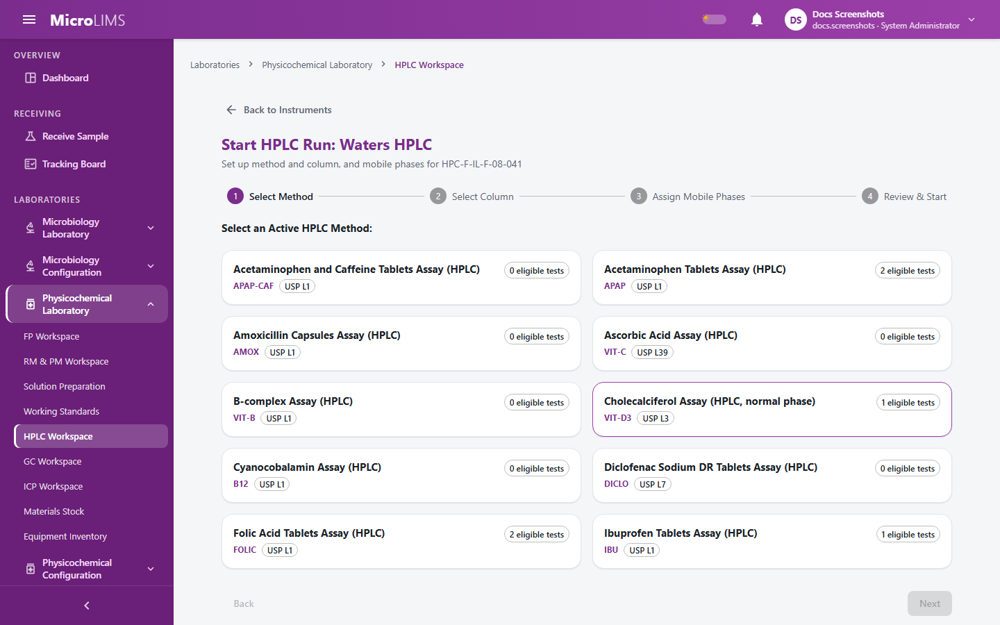
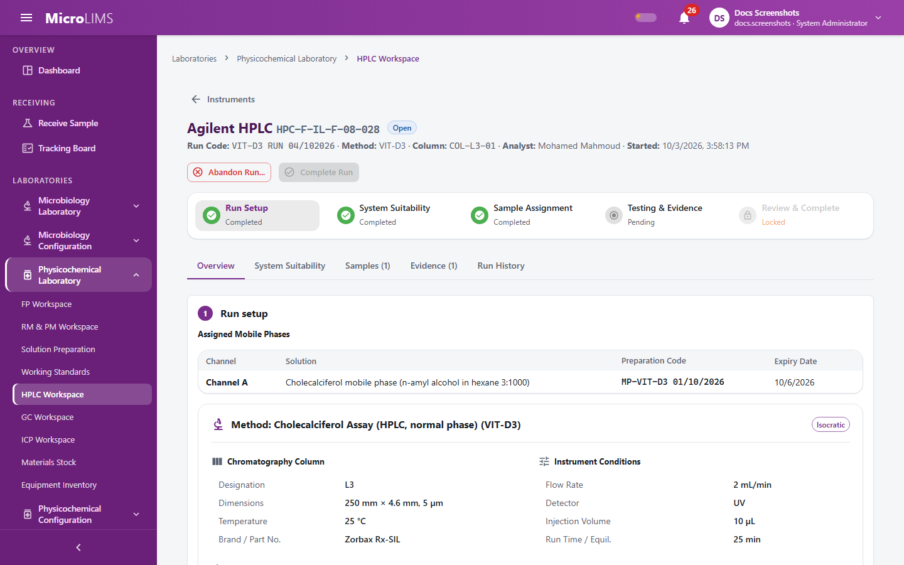
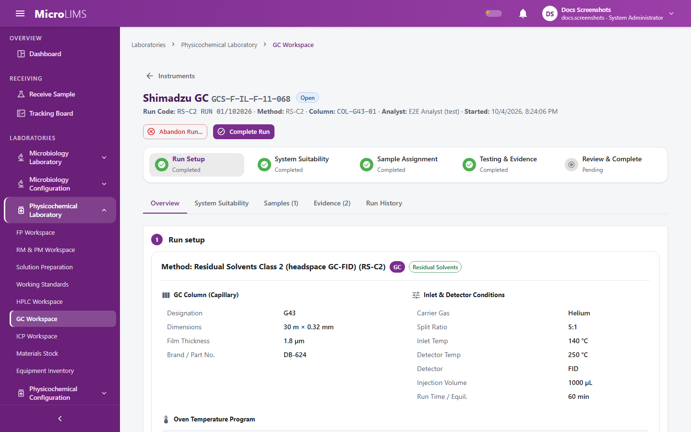
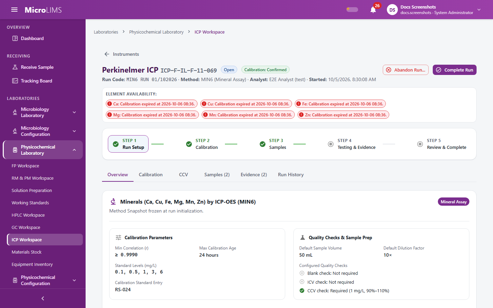

## 27. Physicochemical Testing

Physicochemical testing is done from the **Physicochemical Laboratory** group of the **Laboratories** menu. Depending on the physicochemical areas assigned to your account, you see **FP Workspace** (finished products), **RM & PM Workspace** (raw and packaging materials), or both. Results of bench tests are recorded in the test dialog opened from these workspaces. Chromatography and spectroscopy assays are recorded in the instrument workspaces: **HPLC Workspace**, **GC Workspace** and **ICP Workspace** (the ICP page itself is titled **ICP-OES Workspace**).

> **Important notice:** MicroLIMS does not import instrument reports. Measured values (peak areas, concentrations and similar) are typed in by the analyst, and the instrument report is uploaded as a PDF, PNG or JPEG evidence file. (GAP-613)

> **Note for reviewers:** Which titration types, ICP modes and GC assay mode are used at the site is a configuration matter and cannot be confirmed from the system. (GAP-609)

---

### 27.1 Physicochemical Testing Workspaces (FP and RM & PM)
#### Purpose
Find the physicochemical test orders assigned to you and open the test dialog in which the result is recorded and signed.

#### Who can use it
Recording results requires the *Execute test workflows* permission (by default: Analyst, Reviewer, Section Head, System Administrator). What you can open depends on your laboratory section and on the physicochemical areas assigned to you.

#### Before you start
- The sample has been received in the Physicochemical laboratory.
- The item has specifications for the test and for the sample's stage.
- The test is configured in the Test Master (see the master data sections of this guide).

#### What you see
- Test cards for the samples in your workspace. Each card has an **Open Workflow** link that opens the test dialog.
- In the dialog, the panel that matches the test's workflow type in the Test Master: Measurement, Gravimetric, Qualitative, Titration, Dissolution, Disintegration or Weight Variation. HPLC and ICP assays are not recorded in this dialog; they are recorded in their own workspaces (sections 27.5 to 27.7).

#### How to use it
1. Open **Laboratories** > **Physicochemical Laboratory** and choose **FP Workspace** or **RM & PM Workspace**.
2. Find the sample and click **Open Workflow** on the test card.
3. Complete the panel for that test (sections 27.2 to 27.4) and sign the result.

#### System behavior
- The system checks that you have access to the section and loads the specifications for the test.
- When a result is signed, the test is marked ready for review.
- When every test of a sample section is ready, the section moves to **Under Review** automatically ("All tests completed - automatically submitted for review"). Review and approval are described in the review and approval sections of this guide.

#### Status
The sample section moves to **Under Review** when all of its tests have a signed result.

---

### 27.2 Measurement, Gravimetric, and Qualitative Test Results
<!-- WF-PHYSRESULT-001 -->
#### Purpose
Record and sign results for direct measurements, gravimetric determinations (**Loss on Drying** or **Ash / Residue**) and qualitative observations.

#### Who can use it
Requires the *Execute test workflows* permission (by default: Analyst, Reviewer, Section Head, System Administrator).

#### Before you start
- The test order is not superseded and is not already at the ready, reviewed or approved step ("Test order N is already at X - its workflow can no longer be submitted against.").
- There is no active result entry for the test order ("An active ... entry already exists for this test order.").
- The sample is linked to an item with specifications ("Test order sample must be linked to an item with specifications.") and the item has specifications for this test and the sample's stage ("No specifications configured for this test and item.").
- The Test Master defines the test: a measurement test needs a replicate count (1 to 30) and an evaluation basis; a gravimetric test needs the loss or residue equation type, a replicate count (1 to 30) and the tare setting; a qualitative test needs specifications of the qualitative or presence/absence type.
- If you choose equipment, it must be in service and in the Finished Product (FP) section.

#### What you see
- **Analysis configuration** section with chips: for Measurement, **Basis: ...** and **Replicates: N**; for Gravimetric, **Loss on Drying** or **Ash / Residue**, **Replicates: N** and **Uses Tare**. The basis, replicate count and tare setting come from the Test Master; you do not choose them.
- **Analysis time** and **Equipment (Physicochemical)** (the option **None (no instrument linked)** is available).
- Entry grid:
  - Measurement: rows **Rep 1** to **Rep N** for each specification parameter.
  - Gravimetric: rows **Rep 1** to **Rep N** with **Initial (g)**, **Final (g)** and, only when the test uses a tare, **Container (g)**. The calculated **Loss (%)** or **Residue (%)** is previewed.
  - Qualitative: a choice between **Complies** and **Does not comply** for each parameter, and an observation field (**Observation (required) \*** when not complying, otherwise **Observation (optional)**).
- **Comment (optional)**.
- The alert "Returned for revision: {reason}" when a reviewer returned the test.
- The button **Sign and record result**, enabled only when all required entries are valid. If no specification exists the panel shows "No specifications configured for test {code}."

[SCREENSHOT SS-271]
[SCREENSHOT SS-272]

#### How to use it
1. Enter the **Analysis time**. It cannot be more than 5 minutes in the future.
2. Optionally select the **Equipment (Physicochemical)** (balance or apparatus).
3. Enter the readings:
   - Measurement: exactly N numeric readings for each parameter.
   - Gravimetric: for each replicate, the initial and final weights, and the container weight if the test uses a tare.
   - Qualitative: select **Complies** or **Does not comply** for each parameter. For **Does not comply**, enter the observation (up to 500 characters).
4. Fill in any condition fields that the Test Master defines for the test; when it defines them, all are required.
5. Click **Sign and record result**.
6. In the **Electronic Signature** dialog, check the statement:
   - Measurement: "I entered these measurement readings and am recording this test result."
   - Gravimetric: "I entered these gravimetric measurements and am recording this test result."
   - Qualitative: "I entered these qualitative observations and am recording this test result."
7. Enter your password (and an optional comment) and click **Sign**. With a wrong password the signing is refused and nothing else is saved.

#### System behavior
The result is calculated by the system, not by the screen. The system uses:
- **Gravimetric:** W1 = initial weight minus container weight (container taken as 0 when there is none); W2 = final weight minus container weight. Loss % = (W1 - W2) x 100 / W1. Residue % = W2 x 100 / W1. The reported value is the mean of the replicates, shown with at least 2 decimals (or more when the specification values are written with more).
- **Measurement:** for each parameter the mean, minimum, maximum, standard deviation (n-1, for 2 or more readings) and RSD. The value judged depends on the basis set in the Test Master: **Mean** (the mean is judged), **Min** (the smallest reading), **Max** (the largest reading) or **EachValue** (the mean is reported, but every reading is judged and any reading out of specification makes the parameter out of specification). The number of decimals shown is the largest of the readings' decimals and the decimals written on the specification, rounded half away from zero, with the specification unit.
- **Qualitative:** **Complies** gives a result within limits; **Does not comply** gives out of specification. There is no calculation.
- The signed result is stored with its calculation and the order moves to the ready step. The completion view shows a verdict banner (within limits, out of specification or requires review) and the recorded result.

#### Validation
- "Analysis time cannot be in the future."
- "Test order N is already at X - its workflow can no longer be submitted against."
- "An active ... entry already exists for this test order."
- "Test order sample must be linked to an item with specifications."
- "No specifications configured for this test and item."
- "Every specification for this test must be supplied exactly once."
- "Each parameter must have exactly N readings."
- "Initial sample weight (W1) must be greater than zero."
- "Final weight (W2) cannot be negative."
- "Final weight (W2) cannot be greater than initial weight (W1)."
- "Container weight is required when tare is used."
- "Container weight must be null when tare is not used."
- "An observation is required when result does not conform."
- "Observation cannot exceed 500 characters."
- "Equipment \"X\" is not active."
- "Equipment \"X\" is not in the Finished Product (FP) section."
- "Condition field \"label\" is required."
- "Test definition does not have a valid replicate count (1-30)."
- "Test definition does not have an evaluation basis configured."
- "Password is required to sign the result."

#### Status
The test order moves to the ready step when the result is signed. The result is judged as within limits, out of specification or requires review.

#### What happens next
The result cannot be edited. When all tests of the sample section are ready, the section moves to **Under Review**. The person who entered the result cannot review or approve the sample. If a reviewer returns the test (see §18.1; the test goes back to **Running**), the panel shows "Returned for revision: {reason}" and the result can be entered again.

---

### 27.3 Titration Testing
<!-- WF-PHYSRESULT-002 -->
#### Purpose
Record titration tests (direct or residual, including Karl Fischer) using a standardized titrant, calculate the result, acknowledge a due titrant when allowed, and sign the result.

#### Who can use it
Requires the *Execute test workflows* permission (by default: Analyst, Reviewer, Section Head, System Administrator). Standardizing the titrant needs a different permission (section 28.2).

#### Before you start
- All the order-level conditions listed in section 27.2 apply.
- The test is fully configured as a titration test in the Test Master ("Test \"X\" is not fully configured as a titration test in Test Master."). The Test Master offers these types: Acid-base, Redox, Complexometric, Precipitation and Karl Fischer (volumetric); direct or residual mode; USP factor or relative calculation; visual or potentiometric endpoint. Karl Fischer tests use the USP factor calculation in direct mode only.
- A **Prepared**, unexpired preparation of the configured titrant exists and has a passed standardization (sections 28.1 and 28.2).
- For a residual titration, a Prepared preparation of the excess titrant also exists.
- For the relative calculation, a reference standard lot or an approved working standard lot with purity recorded and stock available exists.

#### What you see
- Sections **Method**, **Analysis set-up**, **Blank (one per series)** (only if the test uses a blank), **Reference standard titrations (1-3, same lot)** (relative calculation only) and **Sample titrations (N replicates)**.
- Fields: **Analysis time**, **Equipment (titrator)**, **Titrant preparation**, **Excess titrant preparation** (residual only), **Titration temperature (°C)** (only when temperature correction is on), **Loss on drying / water (%)** (dried or anhydrous result basis only), **Average unit weight (mg)** (label claim or mg per unit basis only), **Blank volume (mL)**.
- Standard titrations: **Standard lot**, **Standard weight (mg)**, **Titre (mL)**, and the button **Add standard titration** (up to 3).
- Sample titrations: rows **Rep 1** to **Rep N** with **Sample weight (mg)** and **Titrant volume (mL)**. The panel shows a preview marked "display only - the server calculates the recorded result".
- When a titrant warning applies: the checkbox "I acknowledge this titrant is due for standardization" and the field "Justification for using due titrant" (10 to 500 characters).
- **Comment (optional)** and the button **Sign and record result**.

[SCREENSHOT SS-273]

#### How to use it
1. Select the **Titrant preparation**. Titrants that cannot be used are not selectable; the reason is shown (see System behavior).
2. Enter the **Analysis time** and, optionally, the **Equipment (titrator)**.
3. For a residual titration, select the **Excess titrant preparation**.
4. If the test uses a blank, enter the single **Blank volume (mL)** for the series.
5. If temperature correction is on, enter the **Titration temperature (°C)**.
6. If the result basis is dried or anhydrous, enter **Loss on drying / water (%)** (0 to below 100). If it is label claim or mg per unit, enter **Average unit weight (mg)**.
7. For the relative calculation, select the **Standard lot** and enter one to three standard titrations (weight and titre), all on the same lot.
8. Enter the sample weight and titrant volume for each replicate; the number of replicates is set by the Test Master.
9. If a titrant warning is shown, tick the acknowledgement and type the justification.
10. Click **Sign and record result** and check the statement in the **Electronic Signature** dialog: "I entered these titration measurements and am recording this test result." or, with a due titrant, "Your signature records the result and your acknowledgement of the due titrant."
11. Enter your password and click **Sign**.

#### System behavior
- **Titrant factor gating.**
  - A titrant never standardized cannot be used: "This titrant preparation has not been standardized."
  - USP factor calculation: a titrant whose standardization is due cannot be used ("Titrant standardization is due - restandardize before use."); a titrant marked "restandardize before each use" must have been standardized on the current laboratory day ("This titrant must be restandardized before each use - it was not standardized today.").
  - Relative calculation: a due titrant (or one that is restandardized before each use and was not standardized today) is allowed with a warning ("Titrant standardization is due - factor not used in the relative calculation." / "This titrant is restandardized before each use and was not standardized today - factor not used in the relative calculation."). You must acknowledge it and give a justification of 10 to 500 characters.
  - With temperature correction on, a titrant standardized without a recorded temperature cannot be used ("Restandardize this titrant and record the temperature - temperature correction needs it").
- **Calculations** (done by the system):
  - Direct, USP factor: mg = (V - B) x N x f x F, where V is the titrant volume, B the blank, N the nominal strength, f the titrant factor and F the equivalency factor. For Karl Fischer, N is mg of water per mL and F = 1.
  - Residual with a blank: mg = (B - V) x N(back) x f(back) x F.
  - Residual without a blank: mg = (V(excess) x N(excess) x f(excess) - V x N x f) x F; the result must be positive.
  - Relative (direct mode only): for each standard titration K(s) = W(std) x P/100 x (100 - MC)/100 / net standard titre, where P is the purity and MC the moisture of the standard lot (0 if blank); K is the mean of the K(s); mg = net titre x K.
  - Temperature correction (non-aqueous acid-base only): V' = V x (1 + (T(std) - T) x k), with k = 0.0011 by default.
  - Result basis: as-is % = mg / W x 100; dried or anhydrous basis = as-is % x 100 / (100 - LOD); % of label claim = mg / W x average unit weight / label claim x 100; mg per unit = mg / W x average unit weight.
- **Reported value and RSD.** The reported value is the mean of the replicates, rounded half away from zero to the larger of 2 decimals and the decimals written on the specification, and the specification is judged on the rounded value. The RSD uses the sample standard deviation (n-1). If the RSD is above the maximum set for the test, a result that would be within limits becomes **Requires Review** with the warning "RSD exceeds the configured maximum of X % - requires review." A result out of specification stays out of specification.
- **Signatures.** The result signature is recorded; when a due titrant was acknowledged, a separate acknowledgement signature (with the justification as its comment) is recorded before it.
- **Stock.** For the relative calculation, the standard weights are deducted from the standard lot in the same save as the result.
- The result is stored with the titrant code, factor, standardization used, excess titrant, standard lots and warnings.

#### Validation
- "Test \"X\" is not fully configured as a titration test in Test Master."
- "This titrant preparation has not been standardized."
- "Titrant standardization is due - restandardize before use."
- "This titrant must be restandardized before each use - it was not standardized today."
- "Restandardize this titrant and record the temperature - temperature correction needs it"
- "The titrant has no current factor."
- "The titrant is due for standardization - acknowledge it and give a justification to continue."
- "The justification must be 10 to 500 characters."
- "No titrant warning to acknowledge."
- "Exactly N replicate(s) are required."
- "Replicate N: sample weight must be greater than zero."
- "Replicate N: titrant volume must be greater than zero."
- "A blank volume is required for this test."
- "This test does not use a blank."
- "The titrant volume must be greater than the blank volume."
- "The blank volume must be greater than the sample titrant volume."
- "The back-titrated amount exceeds the excess titrant added."
- "The titration temperature is required for temperature correction."
- "The excess titrant preparation is required for residual titration."
- "An excess titrant is only used in residual titration."
- "Loss on drying / water (0 to below 100) is required for a dried or anhydrous basis."
- "The average unit weight (mg) is required for a label claim or mg per unit basis."
- "The selected equipment is not a titrator."
- "One to three standard titrations are required for the relative calculation."
- "All standard titrations must use the same standard lot."
- "The standard lot must be a reference standard or an approved working standard."
- "Standard lot X has no purity recorded."

#### Status
The test order moves to the ready step when the result is signed. The result is within limits, out of specification, or requires review (RSD above the maximum).

#### What happens next
Review and approval of the sample follow as in section 27.2. The person who recorded the result cannot review or approve the sample.

---

### 27.4 Staged Testing: Dissolution, Disintegration, and Weight Variation
<!-- WF-PHYSRESULT-003 -->
#### Purpose
Record tests that are evaluated in stages. When the first stage does not give a final answer, the same test continues with more units in a second (and for dissolution a third) stage. Each stage is signed separately.

#### Who can use it
Requires the *Execute test workflows* permission (by default: Analyst, Reviewer, Section Head, System Administrator).

#### Before you start
- All the order-level conditions listed in section 27.2 apply.
- The item has exactly one specification of the right kind for the test (dissolution Q, disintegration time or weight variation).
- **Dissolution:** the test order is assigned to an HPLC run whose system suitability has passed (section 27.5), and the run's method has exactly one analyte with a standard dilution. Otherwise the panel refuses with "Assign this sample to an HPLC run with a passed system suitability." or "System suitability {code} has not passed." The specification must have Q and a label claim.
- **Disintegration:** the time limit (minutes) is set on the specification.
- **Weight variation:** the specification has the dosage form ("Specification dosage form is not configured.").

#### What you see
All three panels have **Analysis Time (Local)**, the apparatus or balance field (**Dissolution Apparatus**, **Disintegration Apparatus** or **Analytical Balance**), **Comment (optional)**, and the buttons **Sign & Record Stage 1 Result** and, later, **Sign & Record Stage {n} Result**. After a signed stage the panel shows "Result Recorded, Pending Review" when the test is final.
- **Dissolution:** sections **Analysis parameters & conditions**, **HPLC run standard** (values read from the system suitability of the assigned HPLC run; you do not type them), **Stage 1 vessel peak areas (6 units)**, **Previously recorded stages**, **Raw replicate readings** and **Analysis summary**; fields **Medium Volume (mL)** and **Sample Dilution Factor** (default 1).
- **Disintegration:** one time in minutes per unit, or the checkbox **Not disintegrated**; **Previously recorded Stage 1 units**; for stage 2, **Stage 2 unit entry (N additional units, Units a-b)**.
- **Weight variation:** for tablets, one weight per unit; for capsules, the gross and shell weight of each unit; for capsules, the notice "Stage 2 required" and **Stage 2 unit entry (N additional units, ...)**.
- After a stage that needs another stage the panel shows "Stage 2 needed" or "Stage 3 needed" (dissolution), or the notice "Stage 2 required: Results from Stage 1 did not meet acceptance criteria. Staged testing continues to Stage 2." (disintegration).
- Fields defined by the Test Master as test conditions are also shown and are required.

[SCREENSHOT SS-274]
[SCREENSHOT SS-275]

#### How to use it
##### Dissolution
1. Open the test order and check the **HPLC run standard** section.
2. Enter **Medium Volume (mL)**, **Sample Dilution Factor** and the 6 vessel peak areas.
3. Click **Sign & Record Stage 1 Result** and sign (statement: "I entered these stage 1 dissolution vessel results and am recording this test result.").
4. If the stage 1 result is final, the test is ready for review. If the panel shows "Stage 2 needed", enter the 6 additional vessel peak areas and click **Sign & Record Stage 2 Result** (statement: "I entered these stage 2 dissolution vessel results and am recording them.").
5. If it shows "Stage 3 needed", enter the 12 additional vessel peak areas and click **Sign & Record Stage 3 Result**.

##### Disintegration
1. Enter the time in minutes for each of the 6 units, or tick **Not disintegrated**.
2. Click **Sign & Record Stage 1 Result** and sign.
3. If 1 or 2 units failed, the panel announces Stage 2. Enter the times of the 12 additional units in **Stage 2 unit entry** and click **Sign & Record Stage 2 Result**.

##### Weight variation
1. Tablets: enter the weight of each unit (20 by default; the number is set in the Test Master). Tablets have no Stage 2.
2. Capsules: enter the gross and shell weight of each of the 20 Stage 1 units.
3. Click **Sign & Record Stage 1 Result** and sign.
4. For capsules, if Stage 2 is required, enter the 40 additional units in **Stage 2 unit entry** and click **Sign & Record Stage 2 Result**.

#### System behavior
The values below are the system defaults. The stage offsets, the unit counts and the weight-variation bands can be set per product in the Test Master, so the figures that apply to a product can differ.
- **Dissolution.** The standard concentration is calculated from the HPLC run's system suitability: Cs = W x P/100 x (100 - MC)/100 / standard dilution (W standard weight, P purity, MC moisture). Each vessel: % dissolved = Au x Cs x V x DF x 100 / (As x LC), where Au is the vessel area, As the mean standard area, V the medium volume, DF the dilution factor and LC the label claim.
  - Stage 1 (6 units): every unit at or above Q + 5 complies; otherwise the next stage is required.
  - Stage 2 (12 units in total): complies when the mean is at least Q and no unit is below Q - 15; otherwise the next stage is required.
  - Stage 3 (24 units in total): complies when the mean is at least Q, no more than 2 units are below Q - 15 and none is below Q - 25; otherwise the result is out of specification.
  - The reported value is the mean of all units, shown with no decimals. Q must be above 0 and not more than 100.
  - The HPLC run counts the dissolution sample as submitted once stage 1 is signed, even when the test continues to the next stage.
- **Disintegration.** A unit passes when its time is at or below the limit (exactly the limit passes); "Not disintegrated" counts as a failure. Stage 1 (6 units): no failure complies; 1 or 2 failures require Stage 2 ("N unit(s) failed to disintegrate within L min. Proceed to Stage 2."); more than 2 failures is out of specification. Stage 2 (18 units in total): complies when at least 16 units passed; otherwise out of specification ("N of M units disintegrated within L min, below the required 16 units.").
- **Weight variation, tablets.** The mean weight W of the units sets the band: at or below 130 mg the band is 10 %, up to 324 mg it is 7.5 %, above that it is 5 %. Deviation of a unit = |weight - mean| x 100 / mean. The test complies when no more than 2 units are outside the band and no unit is beyond twice the band; otherwise it is out of specification.
- **Weight variation, capsules.** Net content = gross - shell. For hard capsules, Step A is applied first: if every gross weight is within 10 % of the mean gross weight, the test complies. Otherwise the net contents are evaluated. Stage 1 (20 units): any unit beyond 25 % is out of specification; no more than 2 units beyond 10 % complies; 3 to 6 units beyond 10 % require Stage 2; more than 6 is out of specification. Stage 2 (60 units in total, mean recalculated): any unit beyond 25 % is out of specification; no more than 6 units beyond 10 % complies; otherwise out of specification.
- Each stage is signed separately; the test moves to the ready step only on a final outcome (complies or out of specification). A next-stage result keeps the test open and the stage is added to the same entry.

#### Validation
- Dissolution:
  - "Assign this sample to an HPLC run with a passed system suitability."
  - "System suitability {code} has not passed."
  - "Dissolution needs an HPLC method with exactly one analyte."
  - "Method X has no standard dilution for {analyte}."
  - "{analyte}: the system suitability standard values are incomplete."
  - "Medium volume must be greater than zero."
  - "Dilution factor must be greater than zero."
  - "Stage 1 dissolution requires exactly 6 vessel areas."
  - "Stage 2 dissolution requires exactly 6 vessel areas."
  - "Stage 3 dissolution requires exactly 12 vessel areas."
  - "Vessel area must be greater than zero."
  - "Active dissolution analysis does not require a next stage."
  - "Q must be greater than 0 and less than or equal to 100."
- Disintegration:
  - "Unit minutes are required."
  - "Disintegration time must be greater than zero."
  - "Stage 1 disintegration requires exactly N units."
  - "Stage 2 disintegration requires exactly M units."
  - "Disintegration time limit must be greater than zero."
- Weight variation:
  - "Units are required."
  - "Specification dosage form is not configured."
  - "Stage 1 weight variation requires exactly N units."
  - "Stage 2 weight variation requires exactly M units."
  - "Tablets do not support Stage 2 evaluation."
  - "Shell weight must be greater than zero."
  - "Unit N: Shell weight must be less than gross weight."

> **Note for reviewers:** The stage limits (for example Q + 5, Q - 15, Q - 25), the disintegration unit counts and the weight-variation bands shown here are system defaults. The values that apply to a product are set per test in the Test Master and are not confirmed in this guide. (GAP-610, GAP-611)

#### Status
A stage that needs the next stage leaves the test open. A final outcome (complies or out of specification) moves the test to the ready step.

#### What happens next
As in section 27.2: review and approval follow once all tests of the sample section are ready, and the person who entered the results cannot review or approve the sample.

---

### 27.5 Operating the HPLC Workspace
<!-- WF-HPLC-001 -->
#### Purpose
Start an HPLC run on an instrument, enter and confirm system suitability (SST), assign sample tests, enter replicate weights and peak responses, upload evidence, send each sample for review with a signature, and complete or abandon the run.

#### Who can use it
Every action that changes data requires the *Operate HPLC, GC and ICP workstations* permission (by default: Analyst, Section Head, System Administrator). The pages can be opened by any signed-in user. Instruments and methods are limited to your laboratory section.

#### Before you start
- The instrument is an HPLC instrument with no open run ("\"X\" already has an open run."), its calibration is not overdue ("Calibration overdue since yyyy-MM-dd.") and its inventory status is not Out of Service or Retired ("Equipment is X.").
- An active HPLC method of the same laboratory exists in the Chromatography Methods Master.
- An active, compatible column exists whose USP designation equals the method's column designation.
- For every mobile-phase channel the method uses, a mobile phase made for this method is currently **Prepared** and not expired (section 28.1).
- For each analyte of the method, a stock lot of the reference standard exists that is in date, has stock left and has purity and moisture recorded (section 29).

#### What you see
- **HPLC Workspace** (title "{label} Workspace", subtitle "Instrument operations, system suitability, and sample testing workflow"): tiles **Instruments**, **Available**, **In use**, tabs **All (N)**, **In use (N)**, **Available (N)**, **Unavailable (N)**, and instrument cards with **Start New Run**. The empty state reads "No instruments found".
- Run page: step rail **Run Setup**, **System Suitability**, **Sample Assignment**, **Testing & Evidence**, **Review & Complete**; tabs **Overview**, **System Suitability**, **Samples (N)**, **Evidence (N)**, **Run History**; buttons **Back to Instruments**, **Abandon Run**, **Confirm System Suitability...**, **Assign Samples...**, **Complete Run**.
- Start wizard "Start HPLC Run: {instrument}" with steps **Select Method**, **Select Column**, **Assign Mobile Phases**, **Review & Start** and buttons **Back**, **Next**, **Start HPLC Run**.
- Sample entry page: **Replicate**, **Actual Weight (mg)**, **Peak Response**, **Save Replicates**, **Send for Review**.

#### How to use it
##### 1. Start a run
1. In **HPLC Workspace**, click **Start New Run** on an available instrument.
2. In the wizard choose the method, the column and, for each channel, the prepared mobile phase, then click **Start HPLC Run**.
3. The run is created as **Open** and its system suitability as **Pending**. The method is copied into the run, so later changes to the method master do not change this run.

##### 2. Enter and confirm system suitability
1. Open the **System Suitability** tab.
2. For each analyte, select the standard lot, enter **Actual Std Weight (mg)**, one response for each standard injection (the number is set in the method) and the values transcribed from the chromatography data system that the method sets (for example **Resolution**, **Tailing Factor**, **Theoretical Plates**, **Retention Factor (k')**, **Signal-to-Noise (S/N)**, **Peak-to-Valley (P/V)**). Click **Save System Suitability**.
3. In **System Suitability Report Evidence**, upload the standard report (PDF, PNG or JPEG, up to 25 MB).
4. Click **Confirm System Suitability...**. The screen is saved first, then the **Electronic Signature** dialog opens with the statement "I confirm that the system suitability results meet the method acceptance criteria and the standard integration report has been verified."
5. Enter your password (and an optional comment) and click **Sign**.

The button stays disabled, with the reason as a tooltip, until the standard report is uploaded and the entries are complete.

> **Note for reviewers:** A failed system suitability cannot be repeated. The run stays open and locked; the analyst must abandon it with a reason and start a new run. The standard weight has already been deducted from the lot. (GAP-600)

##### 3. Assign samples
1. Open the **Samples** tab and click **Assign Samples...**.
2. Select the eligible tests (assay or dissolution tests of the method in your laboratory that are not finalized and not on another open run) and click **Assign Selected (N)**.
3. To remove a sample, give a reason in the **Remove Sample** dialog. This is not possible once a result was sent for review.

Working standard qualifications are assigned from the same tab with a separate button (section 28.3).

##### 4. Enter replicates and send for review
1. Open an assigned sample.
2. For each replicate enter the actual sample weight (mg) and one peak response for each method analyte. The number of replicates must match the stage configuration. Click **Save Replicates**.
3. The calculation shown is labelled "Preview, not the official result". The theoretical weights and the standard come from the method and the SST and are not typed.
4. In **Report & Chromatogram Evidence**, upload the sample report.
5. Click **Send for Review**. In the **Send Sample for Review** dialog, check the checklist (System Suitability, Replicate Count, Evidence Reports, Submission Gate) and click **Proceed to Sign**.
6. In the **Electronic Signature** dialog confirm "I confirm that chromatographic replicate data and evidence for sample {no} ({test}) are complete, accurate, and ready for review." and click **Sign** with your password.
7. The replicates are frozen, the entry shows **Submitted for Review**, the result is labelled "Official, Recorded for Review" and the test is ready for review. Dissolution samples are not entered here; they are recorded in the test dialog (section 27.4).

##### 5. Complete or abandon the run
1. When every assigned sample is sent for review or removed, click **Complete Run**.
2. To abandon the run, click **Abandon Run**, enter the reason in **Reason for Abandoning** (up to 500 characters; no password is asked) and confirm. Abandoned runs release their test orders so that they can be assigned to another run.

#### System behavior
- **System suitability evaluation (per analyte).** The number of injections must equal the number set in the method ("N injections required, M entered."), each response must be above zero, and the RSD, calculated from the injections you entered (sample standard deviation, n-1) and compared without rounding, must not exceed the method maximum ("RSD X% exceeds Y%."). The RSD transcribed from the chromatography system is stored but not used for the decision. Resolution, plates, retention factor, S/N and peak-to-valley must be at least the method minimum, and tailing not more than the method maximum; a value required by the method but missing fails. The run passes only if every analyte passes. The pass and fail limits come from the method; the system has no default limits.
- **Order of checks at confirmation:** the run is open, the SST is not already confirmed, all required entries are present, a standard report is uploaded, and every mobile phase is still Prepared. Then the evaluation is made, the stock deduction is planned and the signature is taken. Both Passed and Failed results are stored.
- **Stock deduction.** On confirmation, whether the SST passes or fails, the standard weight is deducted from the standard lot (mg / 1000 for gram lots, mg / 1,000,000 for kilogram lots). Working standard lots are deducted in the same way. Lots in other units are refused.
- **Assay calculation (done by the system).** For each replicate: Assay % = (R(test) / R(std mean)) x (W(std) / ThWt(std)) x (ThWt(test) / W(test)) x ((100 - MC) / 100) x P, where R is the response, W the weight, ThWt the theoretical weight (a method constant), MC the standard's moisture content and P its purity. All weights, purity and responses must be above zero and MC from 0 to below 100.
- **Reported value.** The mean of the replicate assays, shown with 1 decimal. For the Bulk stage role each replicate is judged individually; for other roles the mean is judged. For the Finished role, when the specification has a label claim, the amount per unit = assay % x label claim / 100 is judged and shown with 2 decimals.
- **Run limits.** One open run per instrument. A failed SST cannot return to Pending. Evidence is PDF, PNG or JPEG, up to 25 MB, cannot be deleted, and a replacement needs a reason while the old file stays visible.
- **Signatures.** Confirming the SST and sending a sample for review are signed. Starting, assigning, removing, saving, uploading and abandoning are not signed; they are recorded in the audit trail.
- **Returned samples.** If a reviewer returns a sample, the sample entry page becomes editable again, even on a completed run, until it is sent for review again.
- **Segregation of duties.** The person who sent a sample for review cannot later review or approve that sample.

> **Note for reviewers:** One person can start the run, confirm system suitability and send samples for review. The system only stops that person from reviewing or approving the same sample; there is no separation between these run steps. (GAP-602)

> **Note for reviewers:** The weighed standard is deducted from the lot when system suitability is confirmed, including working standard lots. The working standard specification says working standards should not be deducted at this point. (GAP-617)

#### Validation
- Run setup:
  - "\"X\" already has an open run."
  - "Calibration overdue since yyyy-MM-dd."
  - "Equipment is X."
  - "\"X\" is not a HPLC instrument; method Z needs one."
  - "HPLC method \"X\" is inactive."
  - "The HPLC method belongs to another laboratory."
  - "Column \"X\" is inactive."
  - "Column \"X\" is not compatible with \"Y\"."
  - "Column X has no USP designation; set it in the column master."
  - "Column X is USP Y; method Z requires W."
  - "Select a prepared mobile phase for every channel this method uses."
  - "Channel X: the selected preparation is not currently prepared."
- System suitability:
  - "X: standard weight must be greater than zero."
  - "Lot X has no purity recorded."
  - "Lot X has no moisture content recorded."
  - "Only N UNIT left."
  - "The run is closed."
  - "System suitability has already been confirmed."
  - "Complete these entries and save before confirming. ..."
  - "Upload the standard report before confirming system suitability."
  - "Channel X: the mobile phase preparation has expired since it was selected."
  - "X: N injections required, M entered."
  - "X: RSD X% exceeds Y%."
- Samples:
  - "Sample assignment is locked until system suitability passes."
  - "Select at least one test."
  - "Test order N is already assigned to run X."
  - "Test order N is not eligible for this run."
  - "Dissolution needs an HPLC method with exactly one analyte."
  - "Method X needs a standard dilution before dissolution samples can be assigned."
  - "A result has already been sent for review for this sample."
  - "System suitability has not passed."
  - "Replicate N: the sample weight must be greater than zero."
  - "Expected exactly N replicates for stage role R, but M entered."
  - "Upload the sample report before sending for review."
  - "Password is required to sign the result."
- Closing the run:
  - "N assigned sample(s) have not been sent for review. Submit or remove them first."
  - "A reason is required."
  - "Reason cannot exceed 500 characters."

#### Status
- Run: **Open**, then **Completed** or **Abandoned**.
- System suitability: **Pending**, then **Passed** or **Failed** (a failed result is final).
- Sample in the run: **Assigned** or **Removed**; after sending, **Submitted for Review**.

#### What happens next
The reviewer and approver work on the sample in the testing workspace, where the run evidence is shown.

---

### 27.6 Operating the GC Workspace and Residual Solvents Testing
<!-- WF-GC-001 -->
#### Purpose
Run gas chromatography on a GC instrument. The GC Workspace uses the same screens and steps as the HPLC Workspace (section 27.5); this section lists only the differences. Residual solvents are reported in ppm per solvent.

#### Who can use it
Requires the *Operate HPLC, GC and ICP workstations* permission (by default: Analyst, Section Head, System Administrator).

#### Before you start
- The instrument is a GC instrument with no open run, calibration not overdue and not Out of Service or Retired ("\"X\" is not a GC instrument; method Z needs one.").
- An active GC method of the same laboratory exists in the Chromatography Methods Master. GC methods have GC conditions and an oven program instead of mobile phases.
- An active column is compatible with the GC instrument and its USP designation equals the method's G-designation ("Column X is USP Y; method Z requires W.").
- For residual solvents, the method gives the standard concentration (µg/mL) for each solvent and the sample solution volume.

#### What you see
- **GC Workspace** with the same overview, tabs and run page as the HPLC Workspace (title "GC Workspace").
- Start wizard with three steps: **Select Method**, **Select Column**, **Review & Start**, and the button **Start GC Run**. There is no mobile-phase step.
- Sample entry page with replicate rows of sample weight and one response for each solvent, and the calculation view for residual solvents.

#### How to use it
1. Open **Laboratories** > **Physicochemical Laboratory** > **GC Workspace** and click **Start New Run** on an available GC instrument.
2. Choose the method and the column, review, and click **Start GC Run**.
3. In the **System Suitability** tab, enter the standard responses for each solvent. For residual solvents no standard weight, purity or moisture is needed.
4. Upload the standard report and click **Confirm System Suitability...** to sign.
5. Assign the residual-solvent tests in the **Samples** tab.
6. On the sample entry page enter the sample weight and the response of each solvent for each replicate. A response of zero is accepted.
7. Upload the sample report, click **Send for Review**, and sign as in section 27.5.

#### System behavior
- **Residual solvents calculation.** ppm = (C(std) [µg/mL] x V [mL] / W [g]) x (r(u) / r(std mean)), where r(u) is the sample response and the standard mean response comes from the run's system suitability. The reported value is the mean ppm of the replicates, shown with 1 decimal and " ppm", and is judged for each solvent against its ppm specification. When every replicate response of a solvent is zero the result is shown as "Not detected".
- The other rules (system suitability, stock deduction, sending for review, completion) are as in section 27.5.

> **Note for reviewers:** Whether GC methods in assay mode are used at the site cannot be confirmed from the system. (GAP-609)

#### Validation
- "\"X\" is not a GC instrument; method Z needs one."
- "Column X is USP Y; method Z requires W."
- "Replicate N: the response for X must be zero or more."
- "Sample solution volume is required for residual solvents."
- "The standard concentration must be greater than zero."
- The messages of section 27.5 also apply.

#### Status
Run: **Open**, then **Completed** or **Abandoned**. System suitability: **Pending**, then **Passed** or **Failed**.

---

### 27.7 Operating the ICP-OES Workspace
<!-- WF-ICP-001 -->
#### Purpose
Run ICP-OES determinations: record the calibration for each element, confirm it with a signature, record continuing calibration verification (CCV) where the method requires it, assign sample tests, enter replicate concentrations, and send each sample for review with a signature.

#### Who can use it
Every action that changes data requires the *Operate HPLC, GC and ICP workstations* permission (by default: Analyst, Section Head, System Administrator). The pages can be opened by any signed-in user.

#### Before you start
- The instrument is an ICP-OES instrument with no open run ("\"X\" is not an ICP-OES instrument." / "\"X\" already has an open run."), calibration not overdue and not Out of Service or Retired.
- An active ICP method of the same laboratory exists in the ICP Methods Master, with elements, wavelengths and calibration levels ("ICP method \"X\" is inactive." / "The ICP method belongs to another laboratory.").
- Usable stock lots of the method's calibration standard exist, and of the ICV standard when the method requires ICV. Both must be reference standards (not working or primary standards), of your laboratory, in date and with stock left.

#### What you see
- **ICP-OES Workspace** (subtitle "Overview of inductively coupled plasma optical emission spectrometers, active analytical runs, and calibrations."): tiles **Instruments**, **Available**, **In use**, **Cal. pending**, **Unavailable**; tabs **All (N)**, **In use (N)**, **Available (N)**, **Unavailable (N)**; a search box; instrument cards with **Start Run**. The empty state reads "No ICP instruments found". The dialog **Start ICP Run** asks for the method.
- Run page: step rail **Run Setup**, **Calibration**, **Samples**, **Testing & Evidence**, **Review & Complete**; tabs **Overview**, **Calibration**, **CCV** (only when the method requires CCV), **Samples (N)**, **Evidence (N)**, **Run History**; the header button **Complete Run**.
- **Calibration** tab: pickers **Select Reference Standard Lot** and **Select ICV Standard Lot**, an element table (**Symbol**, **Wavelength (nm)**, **Status**, **Failure Reasons**) with chips **Pass**, **Fail** and **Pending**, per-element entries for the correlation coefficient r, the blank and the ICV result, the button **Confirm Calibration**, and **Calibration Report Document**.
- **CCV** tab: **Select Analyte / Element**, **Measured Concentration (mg/L)**, and a table (**Time**, **Element**, **Measured (mg/L)**, **Status**, **Entered By**).
- Sample entry page: **Amount Unit**, **Replicate Measurements**, **Evidence: Sample Reports**, **Sample Report Upload**, **Save Replicates**, **Send for Review**, and a result preview with the columns **Parameter**, **Quantity**, **Result**, **Unit**, **Spec Limit**, **Status**, **Problem / Warning**.

#### How to use it
##### 1. Start the run
1. Click **Start Run** on an available instrument card, choose the method in **Start ICP Run** and click **Start Run**.
2. The run is **Open** and the calibration is **Pending**. The method is copied into the run.

##### 2. Enter and confirm the calibration
1. In the **Calibration** tab choose the calibration standard lot and, if the method requires ICV, the ICV standard lot.
2. For each element enter the correlation coefficient r (from 0 to 1, typed from the Syngistix display), the blank (mg/L) if the method requires a blank, and the ICV result (mg/L) if the method requires ICV. Click **Save Calibration Readings**.
3. Upload the Syngistix calibration report under **Calibration Report Document**.
4. Click **Confirm Calibration** (disabled, with the reason as a tooltip, until the requirements are met). In the **Electronic Signature** dialog the statement reads "I confirm this ICP calibration is accurate and complies with laboratory standards." Enter your password and click **Sign**.

> **Note for reviewers:** The calibration cannot be re-entered after it is confirmed. If no element is valid, sample assignment stays blocked and the system does not define the recovery; the only exit in the system is to abandon the run. (GAP-601)

##### 3. Record CCV (only if the method requires it)
1. Open the **CCV** tab. Confirm a valid calibration first.
2. Choose the element in **Select Analyte / Element**, enter **Measured Concentration (mg/L)** and click **Record Reading**.
3. The system calculates the recovery and stores the reading as pass or fail. A reading cannot be edited or deleted, and CCV is not signed.

> **Note for reviewers:** A failed CCV reading blocks that element for the rest of the run, even if a later reading passes. Samples already sent for review are not pulled back. (GAP-603)

##### 4. Assign and enter samples
1. In the **Samples** tab click **Assign Samples...**, select the ICP tests of this method and confirm. To remove a sample give a reason in the **Remove Sample** dialog ("Reason for Removal *").
2. Open the sample. Select the **Amount Unit** (elemental impurities must be reported per gram, so enter the sample amount in g). Where the specification is in mg per unit or % of label claim, enter the unit amount (average unit weight or dose).
3. For each replicate enter the sample amount, the volume, the dilution factor (at least 1) and, for each element the test needs, the solution concentration in mg/L. Click **Save Replicates** to see the server preview.
4. Upload the sample result report under **Sample Report Upload**.
5. Click **Send for Review**. The dialog checks **Instrument Calibration**, **Element Availability**, **Replicate Measurements**, **Instrument Report Evidence**, **Server Calculation Preview** and **Submission Gate**. Click **Proceed to Sign**, confirm "I confirm that ICP replicate data, element concentrations, and evidence for sample {no} ({test}) are complete, accurate, and ready for review." and sign with your password.

##### 5. Complete or abandon the run
1. When every assigned sample is sent for review or removed, click **Complete Run**.
2. To abandon the run, open **Abandon ICP Run**, enter **Reason for Abandoning \*** and click **Abandon Run**. No password is asked.

#### System behavior
- **Calibration check, per element.** r must be at least the minimum correlation set in the method (the system has no default; the specification example is 0.999). If the method requires a blank, the blank must not exceed its limit. If the method requires ICV, the recovery = measured / nominal x 100 must be within the low and high limits, ends included. Each element passes or fails on its own. Failing elements do not stop the confirmation; they cannot be used for samples ("Failed calibration: {reasons}").
- **Calibration validity.** A confirmed calibration is valid for the maximum age set in the method (1 to 168 hours; 24 by default), counted from the confirmation. After that, sending for review is refused ("Calibration expired at yyyy-MM-dd HH:mm.").
- **Order of checks at confirmation:** the run is open, the calibration is not already confirmed, the calibration lot is chosen, the ICV lot is chosen when required, and the report is uploaded; the lots are checked again at the moment of signing.
- **CCV check.** Recovery = measured / nominal x 100 must be within the low and high limits, ends included. If any CCV reading of an element failed, the element shows "CCV failed (X%)." for the rest of the run; with no passing reading it shows "Needs a passing CCV."
- **Sample assignment** needs a confirmed calibration and at least one valid element.
- **Calculations.** Content (µg/g) = C x V x DF / W, with C the solution concentration (mg/L), V the volume (mL), DF the dilution factor and W the sample amount. mg per unit = mean content x unit amount / 1000 x conversion factor. % of label claim = mg per unit / label claim x 100 (the specification must have a label claim above 0). The mean excludes replicates below the quantitation limit. Results are shown rounded half away from zero: content 2 decimals (default basis), mg per unit 3 decimals, % of label claim 1 decimal.
- **Range limits.** A concentration equal to the lowest or highest calibration level is in range. A replicate above the highest level blocks the element ("X: replicate N is above the top standard - dilute and re-measure."). A replicate below the lowest level is left out of the mean; when all replicates are below it the result is "<LOQ", which is within limits for a "not more than" limit and otherwise requires review. When only some are below, "(some replicates <LOQ)" is added and the result requires review.
- **Signatures.** Calibration confirmation and sending a sample for review are signed. CCV, removal and abandoning are not signed.
- **Segregation of duties.** The person who sent a sample for review cannot later review or approve that sample.

> **Note for reviewers:** One person can start the run, confirm the calibration, enter CCV and send samples for review. The system only stops that person from reviewing or approving the same sample. (GAP-602)

#### Validation
- "The run is closed."
- "Choose the calibration standard lot."
- "Choose the ICV standard lot."
- "The ICV standard lot is only used when the method requires ICV."
- "The calibration standard lot must be a usable lot of X." / "The ICV standard lot must be a usable lot of X."
- "Upload the Syngistix calibration report before confirming."
- "The calibration has already been confirmed."
- "r must be between 0 and 1."
- "r is required." / "r X is below the minimum Y."
- "Blank is required." / "Blank X mg/L is above the limit Y mg/L."
- "ICV result is required." / "ICV recovery X% is outside low-high%."
- "Confirm the calibration before assigning samples."
- "No element is valid on this run."
- "Confirm a valid calibration before entering CCV."
- "This method does not use CCV."
- "The measured value cannot be negative."
- "Calibration is not confirmed." / "Calibration expired at yyyy-MM-dd HH:mm."
- "X is not valid on this run: reason"
- "No specification is configured for this test on this item."
- "Elemental impurities are reported per gram; enter the sample amount in g."
- "Enter the unit amount (average unit weight or dose)."
- "Replicate N: the sample amount and volume must be greater than zero."
- "Replicate N: the dilution factor must be at least 1."
- "Replicate N: exactly one concentration for X is required."
- "X: the specification has no label claim."
- "X: replicate N is above the top standard - dilute and re-measure."
- "Upload the sample result report before sending for review."
- "N assigned sample(s) have not been sent for review. Submit or remove them first."

#### Status
- Run: **Open**, then **Completed** or **Abandoned**.
- Calibration: **Pending**, then **Confirmed**.
- Element: **Pass**, **Fail** or **Pending**; during the run also "CCV failed (X%)." or "Needs a passing CCV."

#### What happens next
Review and approval of the sample follow in the testing workspace. A returned sample becomes editable again on an open or completed run.

---

### 27.8 Instrument Report Documents and Evidence Upload
#### Purpose
Attach the instrument reports and chromatograms that support a run or a sample result, and replace a file when a corrected one is needed.

#### Who can use it
Requires the *Operate HPLC, GC and ICP workstations* permission (by default: Analyst, Section Head, System Administrator).

#### Before you start
- The file is a PDF, PNG or JPEG, not empty, and not larger than 25 MB.

#### What you see
- In the **Evidence (N)** tab of a run: filter tabs **All Files**, **SST**, **Sample** and **Run**, and a table with **File Name**, **Context**, **Kind**, **Uploaded By**, **Uploaded At**, **Status** (**Current** or **Superseded**) and **Actions**.
- The button **Upload General Run Evidence**, and on the sample entry page the section for the sample report.
- To replace a file, the **Supersede Evidence** dialog with the field **Supersede Reason** and the button **Confirm Replacement**.

#### How to use it
1. Open the **Evidence (N)** tab of the run, or the evidence section of the sample entry page.
2. Choose the file and click **Upload**.
3. To replace a file, use the replace action on its row, choose the replacement file, type the reason in **Supersede Reason** and click **Confirm Replacement**.

#### System behavior
- Files cannot be deleted. When a file is superseded, the old file stays visible in the list marked **Superseded**, with the reason.
- Upload, replacement and removal actions are recorded in the audit trail.

#### Validation
- "The uploaded file is empty."
- "File exceeds the maximum allowed size of 25 MB."
- "A file name is required."
- "File type \"X\" is not supported. Allowed types: PDF, PNG, JPEG."
- "This evidence has already been superseded."
- "A reason is required."
- "Reason cannot exceed 500 characters."

---

### 27.9 Equation Types Reference
<!-- MOD-EQTYPE-001 -->
#### Purpose
Show the list of predefined equation types and their formulas. The list is read-only.

#### Who can use it
Requires the *Manage master data* permission (by default: Section Head, System Administrator). The page is under **Physicochemical Configuration** in the **Laboratories** menu.

#### What you see
- Title **Equation Types** with the subtitle "Predefined mathematical formulas and required calculation parameters for analytical test methods and system suitability."
- A table of six entries, each with its formula text and required inputs: **None**, **System Suitability**, **Numeric Measurement**, **Gravimetric % Loss**, **Gravimetric % Residue** and **Qualitative / Identification**.
- There are no buttons to add, edit or delete an entry.

> **Note for reviewers:** The page lists only six entries. Dissolution, Disintegration, Weight Variation, Titration and the HPLC and ICP method assays are not listed, although the system performs those calculations. The page must not be read as the full list. (GAP-606)

---

### 27.10 Chromatography and ICP Methods Masters
<!-- MOD-HPLCM-001 -->
<!-- MOD-ICPM-001 -->
#### Purpose
Manage analytical method masters:
- Chromatography (HPLC and GC) methods: name, abbreviation, technique, column, elution and detection, mobile phases, analytes, SST criteria, GC conditions and oven program, residual-solvent mode.
- ICP-OES methods: mode, elements and wavelengths, calibration levels, optional blank, ICV and CCV checks, sample-prep defaults.

#### Who can use it
Requires the *Master Data Management* permission (by default: Section Head, System Administrator) to create, edit or activate methods. Other signed-in users can view the methods inside the workspaces.

#### Before you start
Open **Laboratories** > **Physicochemical Configuration** > **HPLC Methods** or **ICP Methods** (see §7.1).

#### What you see
> **Note for reviewers:** REQUIRES CONFIRMATION: field labels to be taken from the screen during the screenshot phase. (GAP-043)

#### How to use it
> **Note for reviewers:** REQUIRES CONFIRMATION: procedure steps to be taken from the screen during the screenshot phase. (GAP-043)

#### System behavior
- A reason is required for changes. Changes are recorded in the audit trail and are not electronically signed.
- An inactive method cannot be used to start a run ("ICP method \"X\" is inactive.").

> **Note for reviewers:** Method master changes require a reason and are audited, but are not electronically signed. (GAP-615)

#### Validation
- "A reason is required."
- "ICP method \"{name}\" is inactive."

<!-- Review log (Sonnet): 14 corrections (section rewritten sub-section by sub-section against C6); invented items removed: route paths and area codes, tab names of the sample queue, dialog title "{testCode} Workflow", raw status/enum names (InService, WithinLimits, ResultRecorded, TitrantDueAcknowledged), run-code format, component and code names (ChromatogramEvidencePanel, ResidualSolventCalculationView, IcpMethodAssay, MinCorrelation, WeightMg, GrossMg), unsupported field labels (Initial weight (g), Sample Weight (mg) etc.), "Upload Report"/"Upload Report Document" buttons, SHA-256 and secure storage claims, GC capillary/packed wording, LaTeX formulas, two internal-field validation messages; callouts added: GAP-609 (types in use), GAP-601, GAP-602 (HPLC and ICP), GAP-603, GAP-600, GAP-617, GAP-610/611, GAP-613, GAP-606 -->
<!-- Phase 13 (agy): applied F-B08, F-B10 -->

<!-- Phase 13 review (Sonnet): F-B08, F-B10 verified: section 27.10 facts match C6 and code (menu labels, A reason is required., ICP method inactive message at IcpRunService); GAP-043/615 exist; nothing invented. -->
