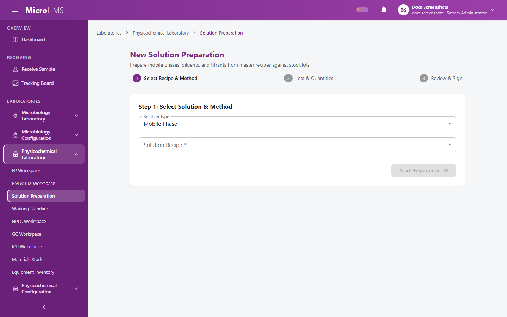
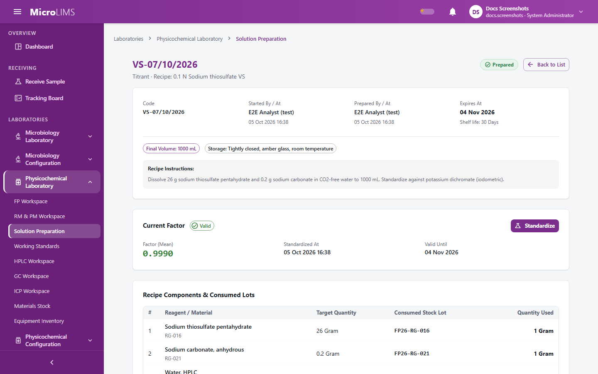
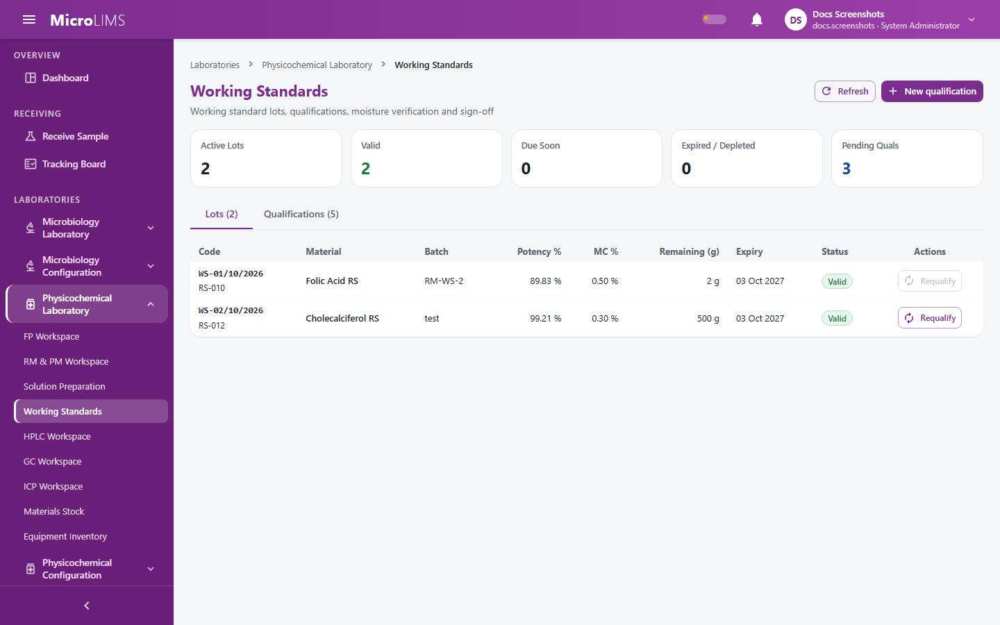

## 28. Solution and Standard Preparation

MicroLIMS has workflows for preparing mobile phases, diluents and volumetric titrants from master recipes, for standardizing titrants, and for qualifying in-house working standards. The system deducts the stock used, calculates expiry, and takes an electronic signature at the key points.

---

### 28.1 Solution Preparation: Mobile Phases, Diluents, and Titrants
<!-- WF-SOLN-001 -->
#### Purpose
Prepare a mobile phase (code prefix MP), a diluent (DL) or a volumetric titrant (VS) from a master recipe against stock lots. The stock is deducted when the preparation is signed, and the solution expires automatically at the end of its shelf life.

#### Who can use it
Requires the *Prepare solutions* permission (by default: Analyst, Section Head, System Administrator). The page is hidden from users without it.

#### Before you start
- An active recipe exists in the Solutions Master (section 28.4).
- For a mobile phase, an active HPLC method of the same laboratory that uses this mobile phase exists.
- For each recipe component, at least one stock lot of your laboratory is linked to the component's reagent entry (section 29). A lot can be used only if it is in date, has stock left and has enough quantity.

#### What you see
- **Solution Preparation** list (subtitle "Manage and execute preparations for mobile phases, diluents, and volumetric titrants") with a search box ("Search code, recipe, method, preparer..."), a status filter (**All Statuses**, **In Progress**, **Prepared**, **Expired**, **Discarded**, **Cancelled**) and a type filter (**All Types**, **Mobile Phase**, **Diluent**, **Titrant**). Columns: **Code**, **Type**, **Solution Recipe**, **HPLC Method**, **Status**, **Prepared At**, **Expires At**, **Prepared By**. Each row has **Resume Preparation** (In Progress) or **View Record**. When the list is empty the page shows "No solution preparations found" and the button **Start Preparation**.
- The preparation wizard, with steps **Select Recipe & Method**, **Lots & Quantities** and **Review & Sign**.
  - Step 1: **Solution Type** (**Mobile Phase**, **Diluent**, **Titrant**), **Solution Recipe \*** and, for a mobile phase, **HPLC Method \***.
  - Step 2: for each component **Select Lot \*** (blocked lots are listed with the reason) and **Quantity Used** (in the lot's unit); **Final Volume \*** with the helper "Recipe target: N mL"; **Measured pH \*** when the recipe has a target pH, otherwise **Measured pH (Optional)** with the helper "Recipe does not specify a target pH".
  - Step 3: a table with **Reagent / Material**, **Recipe Target**, **Chosen Stock Lot** and **Quantity Used**, and the button **Sign & Complete Preparation**.
- The preparation record page (opened from **View Record**): **Code**, **Started By / At**, **Prepared By / At**, **Expires At**, a components table (**Reagent / Material**, **Target Quantity**, **Consumed Stock Lot**, **Quantity Used**) and a history table (**Transition**, **Changed By**, **Changed At**, **Reason / Note**).

#### How to use it
1. Open **Laboratories** > **Physicochemical Laboratory** > **Solution Preparation**.
2. Click **Start Preparation**.
3. In **Select Recipe & Method** choose the type, the recipe and (for a mobile phase) the HPLC method, then click **Start Preparation**. The preparation is created as **In Progress**. It has no code yet.
4. In **Lots & Quantities**, select a lot and enter the **Quantity Used** for each component, then enter **Final Volume \*** (mL) and the **Measured pH**. Click **Save Draft** to stop and resume later, or **Continue to Review**.
5. In **Review & Sign**, check the table. Use **Back to Edit** to change anything.
6. Click **Sign & Complete Preparation**. In the **Electronic Signature** dialog check the statement "I confirm that this solution was prepared according to the approved recipe and that all listed lot quantities were consumed.", enter your password (and an optional comment) and click **Sign**.
7. The record page opens and a message shows the new code.

To cancel or discard, open the record page. **Cancel Preparation** (only while **In Progress**) closes the preparation permanently and no stock is consumed. **Discard Solution** (only while **Prepared**) marks the solution as discarded; stock consumed at preparation is not restored. Both open a dialog with the mandatory field **Reason \*** (up to 500 characters). Neither is signed.

#### System behavior
- **Checks at save.** The quantity of each component must be above zero, the final volume above zero and the pH between 0 and 14. Each lot is checked: it must be linked to the reagent, in date (a lot is expired only when its expiry date is before today), with stock left and enough quantity.
- **Checks at signing.** In this order: the preparation is not closed, every component has a lot and quantity, the final volume is entered, the pH is entered when the recipe has a target, the pH is within the target ± tolerance, and every lot is checked again.
- **Code.** The code is given at signing: mobile phase MP-{method abbreviation} nn/MM/yyyy, diluent DL-nn/MM/yyyy, titrant VS-nn/MM/yyyy, where nn is the next number in the year for that series and MM the month. If two people complete at the same moment: "Another preparation took that code at the same moment - sign again." and nothing is saved.
- **Stock.** On signing, each component quantity is deducted from its lot in the same save.
- **Expiry.** Expiry = preparation time + shelf life of the recipe (hours or days). A background check every 5 minutes, and every read of the record, change **Prepared** solutions past their expiry to **Expired** ("Expired automatically"). Expired solutions cannot be selected, and a mobile phase that expired after being chosen for an HPLC run blocks the confirmation of system suitability.
- **Review.** A preparation has no review or approval step.

> **Note for reviewers:** Expiry is calculated on the server clock (UTC); the design specification says laboratory local time. The two differ only for shelf lives in days across a daylight-saving change. (GAP-605)

#### Validation
- "Solution \"X\" is inactive."
- "An HPLC method is required to start a mobile phase preparation."
- "That method does not use this mobile phase."
- "An HPLC method only applies to mobile phase preparations."
- "The HPLC method belongs to another laboratory."
- "This preparation is closed."
- "Quantity used for \"X\" must be greater than zero."
- "Final volume must be greater than zero."
- "Measured pH must be between 0 and 14."
- "Every component needs a lot and a quantity before completion."
- "Final volume is required before completion."
- "Measured pH is required before completion."
- "Measured pH X is outside T ± tol."
- "Lot is not linked to this reagent."
- "Expired on yyyy-MM-dd."
- "No stock left."
- "Only N UNIT left."
- "Another preparation took that code at the same moment - sign again."
- "A reason is required." / "Reason is required." (blank reason in the dialog)
- "Reason cannot exceed 500 characters."

#### Status
- **In Progress**, then **Prepared** (signed completion) or **Cancelled** (with reason).
- **Prepared**, then **Expired** (automatic) or **Discarded** (with reason).
- **Expired**, **Discarded** and **Cancelled** are final.

---

### 28.2 Standardization of Volumetric Titrants
<!-- WF-SOLN-002 -->
#### Purpose
Standardize a prepared volumetric titrant against a primary standard or against another titrant, calculate its factor, and record whether it passed.

#### Who can use it
Requires the *Prepare solutions* permission (by default: Analyst, Section Head, System Administrator). Reading the history needs only a login.

#### Before you start
- The titrant preparation (code VS-...) is **Prepared** and not expired or discarded ("This preparation is expired or discarded and cannot be standardized.").
- The titrant's recipe in the Solutions Master has the standardization rules: nominal strength and unit, standardization mode, replicate count, factor range, maximum RSD, and (as set) blank and validity days ("This titrant is not configured for standardization.").
- Primary standard mode: a stock lot of a **Primary Standard** linked to the titrant's primary standard entry, in date, with purity recorded and stock left.
- Against-titrant mode: a **Prepared**, unexpired preparation of the configured reference titrant of your laboratory whose standardization is **Valid** (or "restandardize before each use" and standardized today).

#### What you see
- On the record page of the titrant, the **Current Factor** card with the state **Valid**, **Due for Restandardization**, **Restandardize Before Each Use** or **Not Standardized**, and the button **Standardize** (shown only for a **Prepared** titrant and a user who can prepare solutions).
- A standardization history table: **Standard Lot**, **Weight (mg)**, **Reference Solution**, **Ref Volume (mL)**, **Ref Factor**, **Titrant Vol (mL)**, **Blank (mL)**, **Calculated Factor**, **Date & Time**, **Analyst**, **Mode**, **Mean Factor**, **Status**, **Valid Until**.
- The dialog **Standardize Titrant: {code or name}** with **Temperature (°C)** (helper "Optional. Needed later for non-aqueous temperature volume correction."), one block for each required replicate (**Standard Lot** and **Weight (mg)**, or **Reference Solution** and **Ref Vol (mL)**; then **Titrant Vol (mL)** and, if the titrant uses a blank, **Blank (mL)**), and the buttons **Cancel** and **Sign & Submit**.

[SCREENSHOT SS-283]

#### How to use it
1. Open the prepared titrant from **Solution Preparation** and click **Standardize** on the **Current Factor** card.
2. Optionally enter the **Temperature (°C)** (-20 to 60).
3. For each replicate, enter the standard lot and weighed amount (or the reference solution and its volume), the **Titrant Vol (mL)** and, if required, the **Blank (mL)**.
4. Click **Sign & Submit**. In the **Electronic Signature** dialog check "I confirm that this titrant was standardized according to SOP and that the titration values entered are accurate.", enter your password and click **Sign**.
5. The dialog shows the calculated factors. Click **Close**.

#### System behavior
- **Factor, primary standard mode:** f = (W x P/100) / ((V - B) x E), where W is the weighed standard in mg, P its purity in %, V the titrant volume, B the blank, and E the equivalence of the titrant (mg per mL) set in the recipe. **Against-titrant mode:** f = (V(ref) x f(ref) x N(ref)) / ((V - B) x N), where ref is the reference titrant. The net volume (V - B) must be positive.
- **Pass or fail.** The factor is the mean of the replicates. It passes only when every replicate factor is inside the factor range of the recipe ("Replicate N: factor x.xxxx outside min-max.") and, for two or more replicates, the RSD (sample standard deviation, not rounded) is not above the maximum ("RSD x.xx% exceeds y.yy%.").
- **Record.** A signed record is saved whether it passed or failed. A failed record never becomes the current factor; an earlier passed record, if any, stays current.
- **Validity.** For a passed record, valid until = standardization time + validity days. With validity 0 the state is **Restandardize Before Each Use**. After the valid-until time the state is **Due for Restandardization**. With no passed record the state is **Not Standardized**.
- **Stock.** In primary standard mode the weighed standard (summed per lot) is deducted from the lot in the same save, whether the standardization passes or fails. Only lots in grams or kilograms can be deducted ("Standard lot X: reason" when the stock is short).
- The titrant state decides whether titration tests can use the titrant (section 27.3).

#### Validation
- "Only titrant preparations can be standardized."
- "This preparation is expired or discarded and cannot be standardized."
- "This titrant is not configured for standardization."
- "Exactly N replicate(s) are required."
- "Replicate N: titrant volume must be greater than zero."
- "Replicate N: Titrant volume must be greater than the blank."
- "Replicate N: a blank is required."
- "Replicate N: this titrant does not use a blank."
- "Replicate N: a standard lot and weight are required."
- "This titrant has no primary standard configured."
- "Replicate N: standard lot (batch X): reason"
- "Replicate N: standard lot (batch X) is not a primary standard."
- "Replicate N: standard lot (batch X) has no purity - enter it in Materials Stock before standardizing."
- "Standard lot X: reason"
- "Replicate N: a reference preparation and volume are required."
- "Replicate N: reference preparation is expired or discarded."
- "Replicate N: reference preparation's standardization is expired, failed or missing."
- "Temperature must be between -20 and 60 C."

#### Status
The standardization record is **Passed** or **Failed**. The titrant state is **Valid**, **Due for Restandardization**, **Restandardize Before Each Use** or **Not Standardized**.

---

### 28.3 Working Standard Qualification
<!-- WF-WS-001 -->
#### Purpose
Qualify an in-house working standard against a primary reference standard by HPLC assay, have the result reviewed and approved by two other people, and create (or renew) the working standard lot in stock. An approved working standard lot is valid for 12 months.

#### Who can use it
The **Working Standards** page can be opened by any signed-in user. Actions need:
- Creating or editing a draft, and uploading documents: *Qualify working standards* (by default: Analyst, Section Head, System Administrator).
- Assigning to an HPLC run, entering replicates and submitting: *Qualify working standards* and *Operate HPLC, GC and ICP workstations* (by default: Analyst, Section Head, System Administrator).
- Review, return, or reject at review: *Review samples* (by default: Reviewer, Section Head, System Administrator).
- Approval, or reject at approval: *Approve samples* (by default: Section Head, System Administrator).

#### Before you start
- An active reference standard entry exists in Reagents & Standards (section 28.5).
- For an initial qualification: either a received raw-material sample that has an approved assay result, or a typed material name and batch (not both); the quantity in grams; and the storage location.
- For a requalification: an existing working standard lot with no open qualification.
- An open HPLC run whose system suitability passed on a primary reference standard. A run whose system suitability used a working standard cannot qualify working standards.

#### What you see
- **Working Standards** (subtitle "Working standard lots, qualifications, moisture verification and sign-off"): tiles **Active Lots**, **Valid**, **Due Soon**, **Expired / Depleted**, **Pending Quals**; tabs **Lots (N)** and **Qualifications (N)**; buttons **Refresh** and **New qualification** (disabled, with a tooltip, without the permission); **Requalify** on each lot.
- The dialog **New Working Standard Qualification** (or **Requalify Working Standard**): source **Manual** or **Received sample**, **Source Sample**, **Name**, **Batch**, **Master Entry**, **Quantity (g)**, **Location**, **Moisture %** (required for a requalification, optional for an initial one), and the buttons **Cancel** and **Save**.
- The detail drawer of a qualification with the sections **SOURCE & SPECIFICATIONS** (including **Moisture Content**, read-only), **HPLC RUN & ASSAY RESULTS**, **DOCUMENTS & EVIDENCE** (kinds **Source Report** and **Moisture Report**, button **Upload**) and **WORKFLOW & SIGN-OFF** (**Prepared by:**, **Reviewed by:**, **Approved by:**, **Rejected by:**).
- For a qualification that is **Assayed**, a user who can review sees **Review Actions** with **Review**, **Return to Draft** and **Reject**. For one that is **Reviewed**, a user who can approve sees **Approval Actions** with **Approve** and **Reject**.

#### How to use it
##### 1. Create the qualification
1. Open **Laboratories** > **Physicochemical Laboratory** > **Working Standards** and click **New qualification** (or **Requalify** on a lot).
2. Enter the source, **Master Entry**, **Quantity (g)**, **Location** and **Moisture %**, and click **Save**. The record is created as **Draft** with a code of the form WSQ-nn/MM/yyyy.
3. In the drawer upload the **Source Report** (needed for a typed source) and, optionally, the **Moisture Report** (PDF, PNG or JPEG). A new file of the same kind replaces the previous one.

> **Note for reviewers:** The server accepts changes to a draft, but no control to correct the moisture value was found in the drawer, and moisture is required before the qualification can be assigned to a run. How a wrong or missing moisture value is corrected is not confirmed. (GAP-619)

##### 2. Assign to an HPLC run and enter replicates
1. Open the HPLC run (section 27.5). In the **Samples** tab click **Assign Working Standard...**, select the qualification and click **Assign Selected (N)**.
2. Open the qualification entry page and enter exactly 6 replicates: the weight and one response of the qualified analyte. Click **Save Replicates**. The preview shows the mean, RSD, potency and pass or fail.
3. Upload the sample report, click **Send for Review** (dialog **Submit Qualification for Review**), click **Proceed to Sign** and sign: "I confirm that chromatographic replicate data and evidence for working standard {code} ({material}) are complete, accurate, and ready for review."
4. The status becomes **Assayed** and the person who submitted is recorded as "prepared by".

##### 3. Review
1. A second person who is not the submitter opens the drawer and clicks **Review**. The dialog **Review Qualification {code}** shows "I confirm that I have reviewed this working standard qualification record and verified the analytical results." Enter your password and click **Sign & Review**. The status becomes **Reviewed**.
2. Alternatives: **Return to Draft** (dialog **Return Qualification {code}**, reason required, no password; it clears the results and the submitter so that the replicates can be entered again, even on a completed run), or **Reject** (reason and password; statement "I am rejecting this working standard qualification. A detailed justification is required."; the status becomes **Rejected**).

##### 4. Approval
1. A third person, who is neither the submitter nor the reviewer, opens the drawer and clicks **Approve**. The dialog **Approve Qualification {code}** shows "I approve this working standard qualification and release the standard for analytical testing use." Enter your password and click **Sign & Approve**. The status becomes **Approved**.
2. Initial qualification: the system creates a working standard lot with a code of the form WS-nn/MM/yyyy, manufacturer "In-house", unit gram, the quantity of the qualification, purity equal to the potency, the moisture, the location of the qualification, and expiry 12 months after the approval date.
3. Requalification: the same lot gets the new purity, moisture and expiry; no new code is created.
4. **Reject** is also available at this step (reason and password).

#### System behavior
- **Fixed rules (not configurable):** exactly 6 replicates, RSD at most 2.0 %, validity 12 months, "due soon" 30 days.
- **Calculation.** For each replicate the assay % (as is) is calculated with the HPLC assay formula of section 27.5, using the system suitability standard of the qualified analyte and the theoretical weights of the method. The mean of the 6 is taken. RSD = standard deviation (n-1) / mean x 100. Potency (dried basis) = mean x 100 / (100 - MC), rounded half away from zero to 3 decimals. The qualification passes when there are exactly 6 replicates and the RSD, rounded to 2 decimals, is not above 2.0 (so 2.004 passes). A failed qualification can only be rejected.
- **Signatures.** Submission, review, approval and rejection are signed. Return to Draft is not signed.
- **Segregation of duties.** The submitter, the reviewer and the approver must be three different people. A System Administrator has no exemption.
- **Stock.** Working standard lots cannot be created or changed by receiving stock; they change only through qualifications. A working standard lot is deducted by the weight used when it serves as the standard in a confirmed system suitability (section 27.5).
- **Use.** An approved lot shows **Valid**, **Due Soon** (expires within 30 days), **Expired** or **Depleted**, and can be chosen where a reference standard lot of that entry is accepted (HPLC system suitability, relative titration). An expired lot is blocked.

> **Note for reviewers:** Three different people must submit, review and approve. The 6 replicates, the RSD limit of 2.0 % and the 12-month validity are fixed in the system. (GAP-614)

> **Note for reviewers:** The RSD limit is compared after rounding to 2 decimals and the potency is stored with 3 decimals. Whether this matches the site procedure is not confirmed. (GAP-608)

> **Note for reviewers:** The stock of a working standard decreases when it is used for system suitability; the working standard specification says it should not. (GAP-617)

#### Validation
- "Choose the reference standard master entry."
- "Master entry \"X\" is not a reference standard."
- "That sample has no approved assay result."
- "Enter the quantity in grams."
- "Enter the storage location."
- "Lot X already has an open qualification (CODE)."
- "Moisture must be at least 0 and below 100 %."
- "Only a draft qualification can be edited."
- "Enter the moisture content first."
- "Attach the raw material's first test report first."
- "A working standard can only be qualified against a primary reference standard - this run's system suitability used a working standard."
- "Qualification X is already assigned to run Y." / "Qualification X is not eligible for this run."
- "Exactly 6 replicates are required (N entered)."
- "RSD X.XX % is above 2.0 %."
- "Upload the sample report before submitting."
- "X: the system suitability standard values are incomplete."
- "Only an assayed qualification can be reviewed."
- "A failed qualification can only be rejected."
- "Only a reviewed qualification can be approved."
- "The analyst who submitted the qualification cannot review it."
- "The analyst who submitted the qualification cannot approve it."
- "The reviewer cannot also approve the qualification."
- "The reviewer cannot also reject the qualification at approval."
- "The analyst who submitted the qualification cannot reject it at review."
- "The analyst who submitted the qualification cannot reject it at approval."
- "Enter a reason." / "The reason must be 500 characters or fewer."
- "The run that carried this assay was abandoned - reject the qualification."
- "Another approval took that working standard code at the same moment - sign again."
- "Working standards change only through their qualifications."

#### Status
- Qualification: **Draft**, then **Assayed** (submitted), **Reviewed**, and **Approved** or **Rejected**. **Return to Draft** takes an **Assayed** qualification back to **Draft**.
- Lot: **Valid**, **Due Soon**, **Expired**, **Depleted**.

---

### 28.4 Solutions Master Recipes
<!-- MOD-SOLNM-001 -->
#### Purpose
Define the master recipes of mobile phases, diluents and titrants: components, shelf life, pH target and tolerance, and the titrant strength and standardization rules.

#### Who can use it
Requires the *Manage master data* permission (by default: Section Head, System Administrator).

#### What you see
- The page **Solutions Master** under **Physicochemical Configuration** > **Solutions** (subtitle "Manage master recipes for mobile phases, diluents, and volumetric titrants including component stoichiometry, shelf life, pH specifications, and standardization criteria."), with the button **Add Solution**.
- The recipe dialog with the sections:
  - **General:** **Solution Name**, **Solution Type**, **Laboratory Section**, **Shelf Life Value** and **Unit** (**Hours** or **Days**), **Final Volume (mL)**, **Storage Condition**, **Preparation Instructions**.
  - **pH:** **pH Target**, **pH Tolerance (±)**, **pH Adjusting Reagent**.
  - **Titrant:** **Nominal Strength**, **Strength Unit** (**Normal (N)**, **Molar (M)** or **mg H2O/mL (Karl Fischer)**), the mode **Primary Standard (Direct Weighing)** or **Against Volumetric Solution (Secondary Titrant)** with **Primary Standard** and **Equivalence (mg/mL)** or **Reference Titrant**, **Blank Titration Required**, **Replicate Count**, **Max RSD %**, **Factor Min**, **Factor Max**, **Standardization Validity (Days)**.
  - **Components:** **Material Master Entry**, **Quantity**, **Unit**, with the actions Move Up, Move Down and Remove Component.

#### How to use it
1. Open **Laboratories** > **Physicochemical Configuration** > **Solutions**.
2. Click **Add Solution** (**Create Solution** to save), or open an existing recipe (**Save Changes** to save).
3. Fill in the sections and save. When you change an existing recipe, the dialog **Reason for Modification** asks for the field **Reason for Modification \*** and the button **Confirm & Save**.

#### System behavior
- Edits are made in place. The system records an audit event with the reason and the before and after values. No electronic signature or password is requested.
- A recipe can be deactivated and activated again; an inactive recipe cannot be used to start a preparation.

> **Note for reviewers:** Changes to recipes, methods and ICP methods require a reason and are audited, but are not electronically signed. Whether a signature is required at the site is not defined by the system. (GAP-615)

---

### 28.5 Reagents and Reference Standards Master Catalog
<!-- MOD-REAGENT-001 -->
#### Purpose
Maintain the master definitions of chemicals, indicators, reference standards and primary standards. Stock lots (section 29) are received against these entries.

#### Who can use it
Requires the *Manage master data* permission (by default: Section Head, System Administrator).

#### What you see
- The page **Reagents & Reference Standards** under **Physicochemical Configuration** > **Reagents & Standards** (subtitle "Manage master definitions for chemical reagents, indicators, and reference standards across laboratory sections."), with the button **Add Entry**.
- Fields **Code**, **Name** and **Category** (**Chemical**, **Indicator**, **Reference Standard**, **Primary Standard**). For an indicator: **Transition Range (From)** and **Transition Range (To)**.

#### How to use it
1. Click **Add Entry**, or open an entry to edit it.
2. Enter a unique **Code** and **Name** and choose the **Category**. For an indicator enter the transition range.
3. Click **Create Entry** (new) or **Save Changes** (existing).

#### System behavior
- "Material master entry code \"X\" already exists." appears when the code is taken.
- "This entry has linked stock lots; its category can't change." appears when you change the category of an entry that has stock lots.
- Indicator fields are allowed for indicators only, and the transition range "from" must not be above "to".
- Purity is required for lots of reference standards and primary standards, and moisture content is allowed for reference standards only (section 29).

#### Validation
- "Code is required." / "Name is required."
- "Material master entry code \"X\" already exists."
- "This entry has linked stock lots; its category can't change."
- "Indicator fields are only allowed for indicators."
- "Transition range 'from' must not be above 'to'."

<!-- Review log (Sonnet): 22 corrections (all five sub-sections checked against C6 and the screens); invented items removed: route paths, raw status and enum names (InStock, PrimaryStandard, AgainstVolumetricSolution, MgWaterPerMl, DueSoon, status numbers), permission codes in prose, ResultRecorded/TitrantStandardized meanings, StandardizationHistoryTable name, "milliequivalent weight" definition of E (equivalence in mg per mL), invented pH helper example, menu names "Add Recipe", "Confirm", "Save Changes" for recipe creation, "Source Information"/"Analytical Replicates & Potency" drawer names, invented columns of the master registers, LaTeX formulas, wrong validation message wording ("Titrant volume must be greater than the blank."); callouts added or separated: GAP-605, GAP-619, GAP-614, GAP-608, GAP-617, GAP-615 (callout 9 cites GAP-705 in R6, which does not exist, so not used) -->
