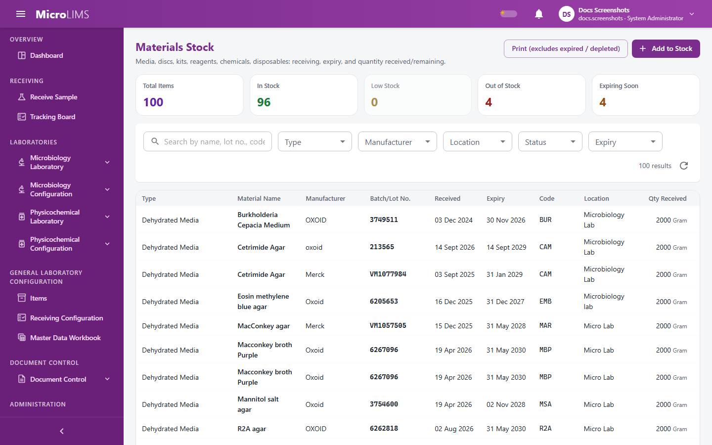
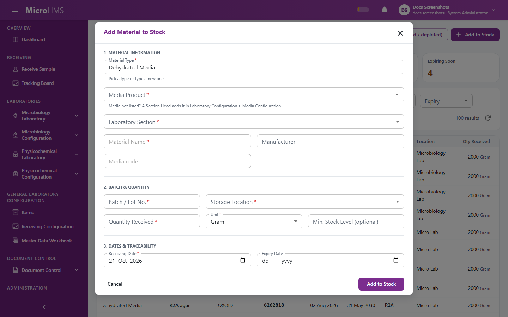
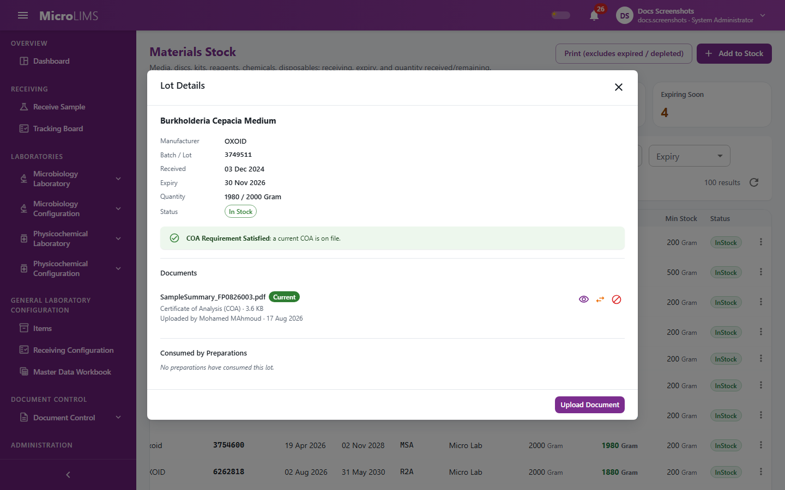

## 29. Material Stock

**Materials Stock** records the lots of reagents, culture media, reference standards, strains, supplies and other consumables that each laboratory section holds. It shows the stock left and the expiry dates, deducts stock when a lot is used in a preparation or test, requires a Certificate of Analysis (COA) for some material types, and keeps the documents of each lot. Each laboratory section sees its own stock: open it from **Laboratories** > **Microbiology Laboratory** > **Materials Stock** or **Laboratories** > **Physicochemical Laboratory** > **Materials Stock**.

> **Important notice:** MicroLIMS has no separate release or quarantine step for a received lot and no second-person check at receipt. A lot is available as soon as it is added to stock, subject to the expiry, COA and quantity checks described in section 29.4.

---

### 29.1 Materials Stock Inventory Overview
#### Purpose
See the stock of your laboratory section: quantities left, expiry dates and storage locations.

#### Who can use it
Requires the *Manage materials* permission (by default: Analyst, Section Head, System Administrator). Only the lots of your own laboratory section are listed.

#### Before you start
You are assigned to the laboratory section whose stock you want to see.

#### What you see
- The title **Materials in Stock: Physicochemical Lab** or **Materials in Stock: Microbiology Lab**.
- Summary cards: **Total Items**, **In Stock**, **Low Stock**, **Out of Stock**, **Expiring Soon**. Selecting a card filters the table.
- A search box ("Search by name, lot no., code...") and filters **Type**, **Manufacturer**, **Location**, **Status** (**All Statuses**, **In Stock**, **Low Stock**, **Depleted**, **Expired**) and **Expiry**.
- A table with the columns **Type**, **Material Name**, **Manufacturer**, **Batch/Lot No.**, **Received**, **Expiry**, **Code**, **Location**, **Qty Received** and **Qty Remaining**. A chip **Not linked to a media product** marks dehydrated media without a media product.
- Row actions **Details and documents** and **Edit material**, and the button **Add to Stock**.
- When the section has no stock: "No materials in stock — Receive the first material lot."

#### How to use it
1. Open **Materials Stock** from the menu of your laboratory.
2. Use the search box, the filters or the summary cards to find a lot.
3. Check the quantity left, the location and the expiry date.

#### System behavior
The status of a lot is calculated each time, not stored:
- **Expired:** the expiry date is before today's laboratory date.
- **Depleted:** the quantity remaining is zero or less.
- **In Stock:** otherwise. **Low Stock** is an In Stock lot whose quantity remaining is at or below the **Min. Stock Level** set at receipt.

> **Note for reviewers:** A lot added without an expiry date is never treated as expired by the system. (GAP-508)

---

### 29.2 Receiving Material Lots into Stock
<!-- WF-MATERIAL-001 -->
#### Purpose
Add a newly received lot to the stock of your laboratory section.

#### Who can use it
Requires the *Manage materials* permission (by default: Analyst, Section Head, System Administrator).

#### Before you start
- For chemicals, indicators, primary standards and reference standards, the entry exists in the Reagents & Reference Standards master (section 28.5). It must be active, of your laboratory, and of the matching category.
- For dehydrated media, the media product is configured in Laboratory Configuration > Media Configuration (a Section Head adds it there).
- In-house working standards cannot be received here: they are created when a qualification is approved (section 28.3).

#### What you see
The dialog **Add Material to Stock** with the buttons **Cancel** and **Add to Stock**.
- **Material Type** (helper "Pick a type or type a new one"). A new name is saved under the type **Other**.
- Depending on the type:
  - Dehydrated media: a media product picker (helper "Media not listed? A Section Head adds it in Laboratory Configuration > Media Configuration.") and **Media code**.
  - Chemical, indicator, primary standard, reference standard: a **... Master Entry** picker (helper "Required. Master entry sets the name, code, and base unit.").
  - Primary standard: **Purity (%)** (helper "Purity percentage (0 < p ≤ 100)").
  - Reference standard: **Purity (%)** and **Moisture Content (%)** (helper "Moisture percentage (0 ≤ m < 100, optional)").
  - Lyophilized microorganism: an organism picker and **ATCC No.**
- **Laboratory Section** (when you have more than one section), **Material Name \***, **Manufacturer**, **Code / Catalog No.**, **Batch / Lot No. \***, **Storage Location \***, **Quantity Received \***, **Unit**, **Min. Stock Level (optional)**, **Receiving Date \*** and **Expiry Date** (not marked as required).

#### How to use it
1. On the Materials Stock page, click **Add to Stock**.
2. Choose the **Material Type** and the pickers or values that the type asks for. For a primary standard enter the purity; for a reference standard enter the purity and, if known, the moisture content.
3. Enter the material name, manufacturer and code, then the batch or lot number and the storage location.
4. Enter the quantity received, the unit and the receiving date.
5. Enter the **Expiry Date** shown on the label.
6. Click **Add to Stock**.

#### System behavior
- The quantity remaining starts equal to the quantity received.
- The status is calculated (section 29.1).
- The receipt is recorded in the audit trail with the user and time. No signature or password is asked.
- Purity and moisture are used in later calculations: a reference or primary standard needs a purity to be used for system suitability or titrant standardization, and a reference standard used for system suitability also needs a moisture content ("Lot X has no moisture content recorded."). Weighed standards are deducted in grams or kilograms only, so stock such standards in those units (section 29.4).

#### Validation
- Checks on the screen:
  - "Material name, batch/lot number, receiving date, storage location, and quantity received are required."
  - "Quantity received must be greater than zero."
  - "Laboratory section is required."
  - "Choose the configured media product for this dehydrated media."
  - "Choose the material master entry for this lot."
  - "Purity percentage is required for primary standards."
  - "Purity percentage is required for reference standards."
  - "Moisture content must be at least 0 and below 100."
- Checks by the system:
  - "Purity is required for primary standards."
  - "Purity is required for reference standards."
  - "Purity must be greater than 0 and less than or equal to 100."
  - "Purity is only allowed for reference and primary standards."
  - "Moisture content is only allowed for reference standards."
  - "Moisture content must be at least 0 and below 100."
  - "Choose the material master entry for this lot."
  - "That master entry belongs to another laboratory."
  - "Master entry \"X\" is inactive."
  - "Master entry \"X\" is a Y, not a Z."
  - "Working standards are created by approving a qualification, not received here."
  - "A custom material type can only be saved with the type Other."
  - "'X' is the name of a built-in material type - pick it from the list or use a different name."

#### Status
The lot is **In Stock** (or **Expired** if it was received past its expiry date).

#### What happens next
The lot appears in the register. For dehydrated media, lyophilized microorganisms and supplements, upload the COA before the lot is used (section 29.3).

---

### 29.3 Managing Lot Documents: COA, Specifications, and Certificates
#### Purpose
Attach, replace and void the documents of a lot: Certificate of Analysis, supplier certificate, specification, safety data sheet and others.

#### Who can use it
- Viewing and uploading documents: *Manage materials* permission (by default: Analyst, Section Head, System Administrator).
- Replacing (superseding) and voiding documents: *Control material documents* permission (by default: Section Head, System Administrator).

#### Before you start
- The file is a PDF, JPG, JPEG, PNG, WEBP or TIFF file, not empty, within the maximum size (25 MB by default), and its content matches its extension.

#### What you see
- The **Lot Details** window (opened with **Details and documents** on a row) with the lot details and a **Documents** list: type (**COA**, **Supplier Certificate**, **Specification**, **SDS**, **Other**), file name, status (**Current**, **Superseded**, **Voided**), and actions to view or download, supersede and void. A lot that needs a COA shows that it cannot be used until a current COA is available. The window also lists the preparations that consumed the lot.
- The button **Upload Document** opens the dialog **Upload Document** (field **Document Type \***, file, buttons **Cancel** and **Upload**).
- The dialog **Supersede Document** (field **Reason for Supersession \***, replacement file, button **Supersede**).
- The dialog **Void Document** (field **Reason for Voiding \***, button **Void Document**).

[SCREENSHOT SS-294]

#### How to use it
##### Upload a document
1. Click **Details and documents** on the lot, then **Upload Document**.
2. Choose the **Document Type \***, select the file and click **Upload**. The document is **Current**.

##### Supersede a document
1. On a **Current** document, click the supersede action.
2. Select the replacement file and enter **Reason for Supersession \***.
3. Click **Supersede**. The old document becomes **Superseded** and stays visible with the reason; the new one is **Current**.

##### Void a document
1. On a document that is not voided, click the void action.
2. Enter **Reason for Voiding \*** and click **Void Document**. The document becomes **Voided**. A voided document cannot be superseded.

#### System behavior
- Each file is checked when it is uploaded, and its integrity is checked every time it is opened. If the file has changed, access is refused: "Document integrity check failed. The file may have been altered. Please contact your System Administrator."
- Upload, supersede and void are recorded with the user, the time and the reason, and each view or download is logged. No password or signature is asked for these actions.
- For dehydrated media, lyophilized microorganisms and supplements, a **Current** COA must exist before the lot can be consumed (section 29.4).

#### Validation
- "Please select a file."
- "File exceeds the maximum allowed size of N MB."
- "The uploaded file is empty."
- "File type 'X' is not supported. Allowed types: PDF, JPG, JPEG, PNG, WEBP, TIFF."
- "The declared content type 'X' does not match the file extension 'Y'."
- "The file content could not be validated because it is too short."
- "The file does not appear to be a valid WEBP image."
- "The file content does not match the expected format for 'X'. The file may be corrupted or misnamed."
- "A supersession reason is required."
- "A replacement file is required for supersession."
- "A voided document cannot be superseded. Upload a new document instead."
- "A void reason is required."
- "This document is already voided."
- "Document integrity check failed. The file may have been altered. Please contact your System Administrator."

#### Status
A document is **Current**, **Superseded** or **Voided**. Upload gives **Current**; superseding turns the old document **Superseded**; voiding gives **Voided**.

---

### 29.4 Stock Deduction and Inventory Consumption Rules
#### Purpose
Explain when and how stock is deducted, and which checks can refuse the use of a lot.

#### Who can use it
Deduction happens automatically when a user with the right permission completes a preparation, standardization, system suitability or test result that uses the lot.

#### System behavior
When a workflow consumes stock, the system checks, in this order:
1. **Type:** the lot is of the type the workflow needs ("Material X is not a Y item.").
2. **Expiry:** if the lot has an expiry date and it is before today, use is refused: "Material X (batch Y) is expired and cannot be used." A lot that expires today can still be used. A lot without an expiry date is never refused for expiry.
3. **COA:** for dehydrated media, lyophilized microorganisms and supplements, a **Current** COA must be attached: "A current Certificate of Analysis (COA) is required before X (batch Y) can be used. Please upload a valid COA in the Inventory module first."
4. **Quantity:** "Insufficient stock: X (batch Y) has N UNIT remaining, M requested."
5. **Deduction:** the quantity is deducted and the user and time of the change are recorded.

The physicochemical workflows that use lots (solution preparation, system suitability, titrant standardization and titration) also check that the lot is linked to the right reagent entry, in date, and has enough quantity, with the reasons shown in sections 27 and 28.

Stock is deducted by:
- **Solution preparation:** each component quantity when the preparation is signed. A discarded solution does not return the stock.
- **Titrant standardization:** the weighed primary standard, when the record is signed, whether the standardization passes or fails.
- **Titration with the relative calculation:** the standard weights, when the result is signed.
- **HPLC system suitability:** the weighed standard, when system suitability is confirmed, whether it passes or fails. The weight in mg is converted for lots in grams or kilograms; lots in other units are refused.
- **Media preparation:** the dehydrated media weight.
- **Cryovial preparation:** the lyophilized discs used.
- **Media evaluation:** one lyophilized disc when it is selected as the challenge source.

> **Note for reviewers:** The disc for a media evaluation is taken from stock when it is selected and is not returned if the challenge is changed or cancelled. (GAP-511)

> **Note for reviewers:** Users without the *Manage materials* permission, for example the default Reviewer role, may be unable to load the stock list used in the media and cryovial preparation dialogs. (GAP-514)

---

### 29.5 Editing Material Lot Records
#### Purpose
Correct the details of a lot: material type, name, manufacturer, code, batch number, receiving and expiry dates, storage location, organism and ATCC number, quantity received, unit, minimum stock level, and purity and moisture for standards.

#### Who can use it
Requires the *Manage materials* permission (by default: Analyst, Section Head, System Administrator).

#### What you see
The dialog **Edit Material** with the fields of the lot and the buttons **Cancel** and **Save Changes**. A note explains that changing **Quantity Received** adjusts **Qty Remaining** by the difference.

#### How to use it
1. Click **Edit material** on the row of the lot.
2. Change the fields that need correcting. If the quantity received was wrong, enter the corrected value in **Quantity Received**.
3. Click **Save Changes**.

#### System behavior
- No reason, password or signature is asked; the change is recorded in the audit trail.
- Changing **Unit** does not convert the quantities.
- Changing **Quantity Received** changes **Qty Remaining** by the same amount, which can take it below zero.
- Working standards cannot be edited here; the media product of dehydrated media cannot be changed once lots were prepared from it.

> **Note for reviewers:** Purity, moisture and expiry of a lot can be changed after the lot was used in a calculation, without a reason or signature. (GAP-904)

<!-- Review log (Sonnet): 19 corrections; invented items removed: route and query strings, permission codes in prose, raw status names (InStock), numeric status values, field name QuantityRemaining, LaTeX formula, dialog and field names not in the screens ("Supersession Reason *", "Void Reason *", "Confirm Supersession", "Confirm Void", drawer instead of Lot Details window), claim of a receipt quarantine step, invented status badges in the table (replaced by the real cards and filters); callouts added: GAP-508 kept, GAP-511 kept, GAP-514 added; receipt without second-person check stated as fact (no gap id exists for it) -->
<!-- Phase 13 (agy): applied F-B09 -->

<!-- Phase 13 review (Sonnet): F-B09, GAP-904 verified against MaterialService; no invented items. -->
