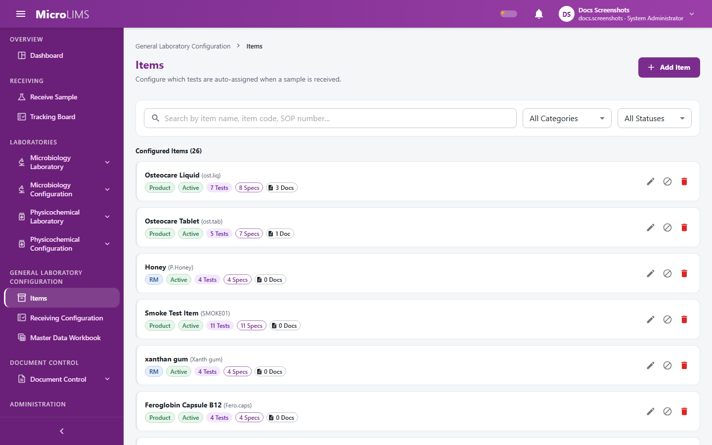
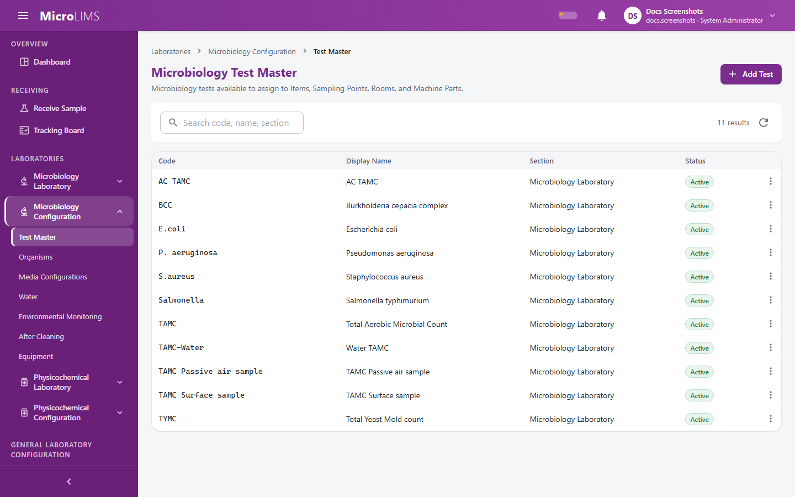
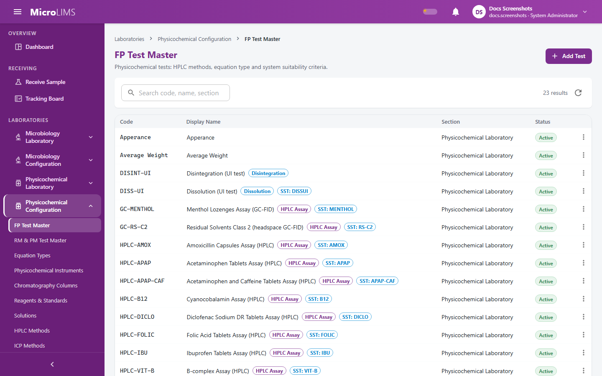

## 31. Item Master, Test Master and Specifications

MicroLIMS keeps three linked catalogs. The **Item Master** lists the products, raw materials and packaging materials the laboratories receive, with the tests assigned to each item, controlled documents and a microbiology sample preparation protocol. The **Test Master** defines the individual tests (microbiology tests with their steps, and physicochemical tests with their calculation settings). **Specifications** hold the acceptance limits that results are compared against.

Specifications are not maintained on a stand-alone page. If you open the old specifications address, MicroLIMS sends you to the **Items** page. Specifications are edited inside an item, on its **Specifications** tab.

---

### 31.1 Item Master and Assigned Tests
<!-- WF-ITEM-001 -->
#### Purpose
Create, edit, freeze and delete items (Product, Raw Material, Packaging Material) and choose the tests that are ordered automatically when a sample of the item is received.

#### Who can use it
Requires the *Manage items* permission (by default: Section Head, System Administrator). Items are shared by all laboratories and are not limited to one laboratory section. Any signed-in user can read the item list.

#### Before you start
- The tests to assign must already exist in the Test Master (sections 31.4 and 31.5).
- The item code must not already exist.

#### What you see
- Page title **Items**, subtitle "Configure which tests are auto-assigned when a sample is received."
- Button **Add Item**.
- Filters: a search box ("Search by item name, item code, SOP number..."), **Category** (**All Categories**, **Product**, **Raw Material**, **Packaging Material**), **Status** (**All Statuses**, **Active**, **Frozen**) and a **Reset** button that appears when a filter is in use.
- Item cards showing the item name with its code in brackets, a category badge, a status badge (**Active** / **Frozen**) and chips such as **{N} Tests**, **{N} Specs**, **{N} Docs**. Row actions: **Edit item**, **Freeze item** / **Unfreeze item**, **Delete item**.
- Selecting an item opens its workspace beside the list, with the tabs **Overview**, **Assigned Tests ({N})**, **Specifications ({N})**, **Documents & Attachments ({N})**, **Preparation Configuration** and **Audit History** (button **Open Audit History Log**).
- The **Add New Item** / **Edit Item: {name}** dialog: **Item Name**, **Item Code**, **SOP Number** (optional), **Category** and **Assigned Tests**; buttons **Cancel** and **Save Item** / **Save Changes**.

#### How to use it
##### Creating an item
1. Open **General Laboratory Configuration** > **Items**.
2. Click **Add Item**.
3. Enter the **Item Name** and the **Item Code**.
4. Optionally enter the **SOP Number**.
5. Select the **Category** (**Product**, **Raw Material** or **Packaging Material**).
6. In **Assigned Tests**, choose every test the item needs.
7. Click **Save Item**. The item is created as **Active** and its workspace opens.

##### Editing an item
1. On the item card, click **Edit item**.
2. Change the details or the **Assigned Tests** list. Saving replaces the whole list of assigned tests.
3. Click **Save Changes**. The change applies to samples received afterwards; samples and test orders already created are not changed.

##### Freezing and deleting an item
1. To stop new samples being received for an item while keeping its history, click **Freeze item**. It becomes **Frozen** at once, with no confirmation. Click **Unfreeze item** to allow receipt again.
2. To delete an item, click **Delete item** and confirm: "Delete item \"{name}\" ({code})? This cannot be undone. If it has already been used to receive samples, deletion will be blocked - freeze it instead."

#### System behavior
- When a sample is received, one test order is created for each assigned test, placed in the laboratory section that owns the test.
- Item codes must be unique; the comparison is case-sensitive.
- An item that has already received a sample cannot be deleted.
- A **Frozen** item cannot receive new samples: "Item '{name}' is frozen and cannot be used to receive new samples."
- An item with no assigned tests cannot receive samples: "Item '{name}' has no assigned tests. Configuration must be completed by the Section Head before samples can be received."
- Creating, editing, freezing and deleting an item need no reason and no electronic signature. Changes are recorded in the audit trail.

> **Note for reviewers:** Items, specifications, receiving lists and most Test Master edits are saved without a reason or electronic signature; changes are recorded in the audit trail only. The draft workbook SOP says every change asks for a reason and a signature. (GAP-705)

> **Note for reviewers:** The dialog requires at least one assigned test, but the server and the Master Data Workbook accept an item with none; such an item cannot receive samples. (GAP-710)

> **Note for reviewers:** The test picker offers + Add "{text}" to Test Master for an unknown code. A test created this way becomes an Observation test with no steps, and saving an item does not check its test codes against the Test Master (the check happens at sample receipt). Create tests in the Test Master first. (GAP-416, GAP-714)

#### Validation
- Shown by the dialog:
  - "Item Name, Item Code, and at least one assigned test are required."
  - "Failed to save item." (fallback)
- Returned by the system:
  - "An item with code '{code}' already exists."
  - "Items can only be configured for Product, Raw Material, or Packaging Material categories. Water, Environmental Monitoring, After Cleaning, and GPT are managed via their dedicated configuration pages."
  - "Item {id} not found."
  - "Cannot delete '{name}' - it has been used to receive {n} sample(s). Freeze it instead to stop new samples without losing history."
  - "This record was changed by someone else while you were working on it. Nothing was saved - reload it and make your change again."

#### Status
- Item: **Active** (the Overview tab shows "Active (Sample receipt enabled)") or **Frozen** ("Frozen (Sample receipt disabled)"). Changed with **Freeze item** / **Unfreeze item**. An item created by the Master Data Workbook stays inactive until the load is verified (section 32.4).

---

### 31.2 Item Preparation Configuration and Controlled Documents
<!-- WF-ITEM-003 -->
#### Purpose
Keep the item's SOP and Verification Report with their versions, and keep the standard microbiology sample preparation protocol for the item.

#### Who can use it
- **Opening the Items page and configuring or approving the preparation protocol**: requires the *Manage items* permission (by default: Section Head, System Administrator).
- **Uploading SOPs and Verification Reports**: requires the *Upload item documents* permission (by default: Section Head, System Administrator).
- **Viewing and downloading documents**: any signed-in user who can open the item.

#### Before you start
- Document files must be PDF, Word, Excel or image files (.pdf, .doc, .docx, .xls, .xlsx, .png, .jpg, .jpeg) of up to 25 MB.
- For the preparation protocol, know the sample amount, technique, diluent, neutralizer and, for filtration, the filtration and washing volumes.

#### What you see
- Tab **Documents & Attachments ({N})**:
  - **SOP (Standard Operating Procedure)** with a current-document card (file name, version such as "Rev 01", effective date, size, uploader), the list **Historical SOP Versions ({N})** and the button **+ Upload SOP**. Without a document it shows "No current SOP uploaded for this item."
  - **Verification Report** with the same layout, **Historical Verification Reports ({N})** and **+ Upload Verification Report**.
  - Each document has View and Download actions.
- Tab **Preparation Configuration**:
  - Not set: "No preparation configuration set for {item}. One will be created automatically from the first analyst confirmation, or you can configure it now."
  - Set: a chip **Approved** or **Pending Approval**, a caption ("Approved by {name} on {date}" or "Created by {name} on {date}"), a summary, and the buttons **Approve** (only while pending), **Edit** or **Configure Preparation**.
  - While pending, a warning reads: "This configuration is in effect and is already being used for testing. Approving it records your review; editing it first replaces the protocol for future samples."

#### How to use it
##### Uploading a controlled document
1. Open the item and the **Documents & Attachments** tab.
2. Click **+ Upload SOP** or **+ Upload Verification Report**. The dialog is titled "Upload Controlled SOP" or "Upload Controlled Verification Report".
3. Check **Document Type**, enter the **Version** (starts as "Rev 01") and the **Effective Date** (starts as today).
4. Choose the file and click **Upload**.
5. The new file becomes the current document and the earlier current document of that type moves to the historical list.

##### Configuring and approving the preparation protocol
1. Open the **Preparation Configuration** tab and click **Configure Preparation** (or **Edit**).
2. Enter the **Sample Amount**.
3. Select the **Technique**: **Pour Plate** or **Filtration**.
4. For **Filtration**, enter **Filtration Volume (ml)** and **Washing Volume (ml)**.
5. Enter the **Diluent** and **Neutralizer**. **Save Configuration** stays disabled until both are filled.
6. Click **Save Configuration**. The protocol is saved as **Pending Approval**.
7. To approve it, click **Approve**. The status becomes **Approved**.

#### System behavior
- Each upload is stored with a check value; every view and download is logged.
- Uploading a new document of the same type marks the earlier current one as superseded, with the reason "Superseded by new version '{version}'".
- Item documents cannot be voided in MicroLIMS.
- If an item has no preparation protocol, the analyst's first confirmed preparation entry creates one as **Pending Approval**.
- A protocol that is **Pending Approval** is already used for testing. Each sample keeps a copy of the values it confirmed.
- Saving an approved protocol again sets it back to **Pending Approval** and clears the approver.
- **Approve** is a button click. It needs no password and no second person; the person who saved the protocol can approve it.

> **Note for reviewers:** Approval of the preparation configuration is an unsigned click, can be done by the person who saved it, and the protocol is used for testing before approval. The status Rejected is never used. (GAP-704, GAP-707)

> **Note for reviewers:** Item documents cannot be voided; a new upload supersedes the old one. The upload limit is 25 MB in the service but 30 MB at the request level, and the upload buttons are not hidden from users without the upload permission (the system then refuses the upload). (GAP-701, GAP-711, GAP-713)

#### Validation
- "Please select a document file to upload."
- "Failed to upload document." and "Failed to load documents." (fallbacks)
- "File size must be between 1 byte and 25 MB."
- "No file provided."
- "Diluent is required."
- "Neutralizer is required."
- "Filtration technique requires both Filtration Volume and Washing Volume."
- "Item {itemId} has no preparation configuration to approve."
- "This preparation configuration is already approved."

#### Status
- Document: **Current**, **Superseded** (shown under the historical lists).
- Preparation configuration: **Pending Approval** (after every save) and **Approved** (after **Approve**).

---

### 31.3 Item Specifications and Limit Evaluation
<!-- WF-ITEM-002 -->
#### Purpose
Define, edit and delete the acceptance limits for the tests assigned to an item. Results are compared against these limits.

#### Who can use it
- **Opening the Items page**: requires the *Manage items* permission.
- **Adding, editing and deleting specifications**: requires the *Manage master data* permission (by default: Section Head, System Administrator) and membership of the laboratory section that owns the test. System Administrators are not restricted by section.
- Specifications of a test that belongs to another laboratory are shown read-only with a section chip (the section name or "Other lab").

#### Before you start
- The test must already be assigned to the item.
- For HPLC, GC, ICP, dissolution, disintegration, weight variation and titration tests, the test and its method must already exist.
- Stage-specific rows are possible only on Finished Product items.

#### What you see
- Tab **Specifications ({N})** with the button **Add Specification Parameter**. Rows are grouped by assigned test and show chips such as "Stage: ...", "Analyte: ...", "Element: ...", "Basis: ...", the limit text, the unit, and edit and delete icons. Each test group has a link **+ Add parameter to {test}**. With no rows: "No specifications defined yet. Click \"Add Specification Parameter\" above to add limits."
- The **Add Specification Parameter** / **Edit Specification Parameter** dialog:
  - Common fields: **Assigned Test \*** (locked when editing), **Parameter Name \***, **Production Stage** (Finished Product items only; blank means all stages), **Limit Type \***, **Unit**, **Reference Standard**, **Dilution Factor** (Count-Tiered only).
  - Fields that depend on the **Limit Type**:

| Limit Type | Fields |
|---|---|
| Range (NLT - NMT) | Lower Limit (NLT), Upper Limit (NMT), checkboxes Lower inclusive (>=) and Upper inclusive (<=) |
| NMT (Not More Than) | Upper Limit (NMT) |
| NLT (Not Less Than) | Lower Limit (NLT) |
| Target +/- Tolerance | Target, Tolerance, Mode (Absolute / Percent) |
| Count-Tiered (Alert / Action / Spec) | Alert Limit, Action Limit, Specification Limit |
| Qualitative (descriptive text) | Expected Result Text |
| Presence / Absence | Expected State, Sample Quantity, Quantity Unit |
| Multi-Stage Criteria | for each stage: Stage Label and Acceptance Criteria Text |
| Dissolution Q | Q (% dissolved), Label Claim; unit is fixed |
| Disintegration Time | Time limit (min); unit is fixed |
| Weight Variation (USP <2091>) | Dosage Form (Tablet / Capsule); unit is fixed (mg) |

  - For HPLC method assay tests the dialog also asks for **Analyte**, **Basis** and, for amount per unit, **Label Claim** and its unit. Residual solvents (GC) have a fixed limit type.
  - Buttons: **Cancel**, **Add Parameter** / **Save Changes**.

[SCREENSHOT SS-312]

#### How to use it
1. Open the item, then the **Specifications ({N})** tab.
2. Click **Add Specification Parameter** (or **+ Add parameter to {test}**).
3. Select the **Assigned Test**. The **Limit Type** is pre-selected from the test type: Count Test gives Count-Tiered, Observation gives Presence / Absence, Dissolution gives Dissolution Q, Disintegration gives Disintegration Time, Weight Variation gives Weight Variation, and other tests give Range. You can change it.
4. Enter the **Parameter Name**.
5. For a Finished Product item, optionally choose a **Production Stage**.
6. Fill in the fields of the chosen limit type.
7. Click **Add Parameter** (or **Save Changes** when editing).
8. To remove a parameter, use the delete icon and confirm: "Delete specification parameter \"{parameter}\" for \"{item}\"? This cannot be undone."

#### System behavior
**How results are compared with the limit**

| Limit type | A result passes when |
|---|---|
| Range | It is not below the lower limit and not above the upper limit. With the inclusive box ticked, a value equal to the limit passes; with it cleared, a value equal to the limit fails. A single missing bound is not checked. |
| NMT | The result is not above the upper limit (equal passes unless the limit is set as exclusive). |
| NLT | The result is not below the lower limit (equal passes unless the limit is set as exclusive). |
| Target +/- Tolerance | It lies within the target plus or minus the tolerance. In Percent mode the tolerance is that percentage of the target. The edges pass. |
| Count-Tiered | The Specification limit is checked first (exceeded: out of specification), then the Action limit (action limit exceeded), then the Alert limit (alert limit exceeded). A count equal to a limit passes. |
| Qualitative, Presence / Absence, Multi-Stage, Dissolution Q, Disintegration Time, Weight Variation | Judged by their own rules in the test, not by a numeric comparison. |

- The system compares the exact value; the specification itself does not round it. A result is shown as within limits, out of specification, alert limit exceeded, action limit exceeded, or limits not configured (when the specification has no limit to compare with).
- When a specification is saved, the system writes the limit text itself for every type except Count-Tiered (for example "90.0-110.0", "NMT 10", "Q = 75 %", "NMT 15 min"). A typed limit text is overwritten.
- If a sample's production stage matches stage-specific rows for that test, only those rows apply. Otherwise the rows for all stages apply. They are never combined.
- Changing or deleting a specification does not change results already recorded: each result keeps the limit values copied when it was calculated.
- Specifications need no reason and no electronic signature. Changes are recorded in the audit trail only.

> **Note for reviewers:** Specifications are edited only inside an item; the stand-alone page redirects. A change does not alter results already recorded. (GAP-702)

> **Note for reviewers:** Creating, editing and deleting a specification takes no reason, signature or review. (GAP-705)

> **Note for reviewers:** Ownership is decided by the laboratory section of the test, and the physicochemical area (FP / RM & PM) of the user is not checked when editing tests or specifications. (GAP-708)

> **Note for reviewers:** Deleting a production stage unlinks it from existing samples and can change which stage-specific rows apply. (GAP-709)

> **Note for reviewers:** Whether a value is rounded before it is compared differs between test types; titration judges the rounded mean, measurement passes the unrounded value. (GAP-712)

#### Validation
- Shown by the dialog:
  - "Assigned Test is required."
  - "Please select an analyte from the HPLC method." / "Please select a solvent from the GC method." / "Please select an element from the ICP method."
  - "Basis must be ppm for residual solvents."
  - "Please select a basis (Assay % or Amount per unit)."
  - "Label claim must be greater than 0 for Amount per unit."
  - "Label claim unit is required for Amount per unit."
  - "Lower limit Q (%) must be between 0 and 100 (exclusive of 0, inclusive of 100)."
  - "Label claim must be greater than zero for Dissolution Q specifications."
  - "Time limit (min) must be greater than zero for Disintegration Time specifications."
  - "Dosage form is required for Weight Variation specifications."
  - "Failed to save specification." (fallback)
- Returned by the system:
  - "This specification belongs to {labName} - only its Section Head can change it."
  - "Test code '{testCode}' is not in the Test Master."
  - "Test '{testCode}' is not assigned to item {id}."
  - "Parameter name is required."
  - "Dilution factor is only allowed for Count-Tiered specifications."
  - "Lower limit and upper limit are required for Range specifications."
  - "Lower limit cannot be greater than upper limit."
  - "Upper limit is required for Not More Than specifications."
  - "Lower limit is required for Not Less Than specifications."
  - "Target and tolerance are required for Target With Tolerance specifications."
  - "Tolerance must be greater than zero."
  - "Expected result text is required for Qualitative specifications."
  - "Expected state is required for Presence/Absence specifications."
  - "At least one stage is required for Multi-Stage specifications."
  - "Stage-specific specifications are only available for Finished Product items."
  - "Choose Bulk, In-Process, Finished or Stability, or leave the stage as all stages."
  - "A specification for parameter '{name}' already exists for test '{code}' at {stage} on this item."
  - "A specification for this analyte and basis already exists." / "A specification for this element and basis already exists."
  - "Only one specification is allowed for Dissolution test '{code}' on this item." (similar messages exist for Disintegration and Weight Variation tests)
  - "That analyte does not belong to the method of test '{code}'." / "That element does not belong to the method of test '{code}'."
  - "Test {code} is not used for finished products - it belongs to RM & PM." / "Test {code} is not used for raw and packaging materials - it belongs to FP."

---

### 31.4 Microbiology Test Master and Workflow Steps
<!-- WF-TESTMASTER-001 (micro) -->
#### Purpose
Define microbiology tests (Count Test or Observation), their ordered workflow steps, the growth media each step uses and the incubation transfer rules.

#### Who can use it
Requires the *Manage master data* permission (by default: Section Head, System Administrator) and membership of the test's laboratory section for editing.

#### Before you start
- The media used by a step must exist as stock materials of type dehydrated media that are linked to a media product, and the product must have at least one incubation condition (Media Configurations).
- For selective or confirmatory plating steps, the target organism must exist in the Organisms list (section 32.1).

#### What you see
- Page title **Microbiology Test Master**, subtitle "Microbiology tests available to assign to Items, Sampling Points, Rooms, and Machine Parts."
- Button **Add Test**; a search box ("Search code, name, section").
- Table columns **Code**, **Display Name**, **Section**, **Status** (**Active** / **Frozen**). Row menu: **Details & Workflow Steps**, **Edit**, **Freeze** / **Unfreeze**.
- The **Details & Workflow Steps** dialog:
  - A **Workflow type** selector (Count Test / Observation) and the steps table with the icon buttons **Move up**, **Move down**, **Edit step**, **Delete step**, and the chips **2-Stage**, **Transfer** and **Needs configuration**.
  - The step form: **Step Name**, **Step type**, **Target Organism (required)**, phenotypic test types (biochemical steps), **Final Step**, **Requires incubation transfer** and the **Stage 2** temperature and hours fields.
  - The **Step Media** section: per row a **Material** and an **Incubation condition**, a **Required** checkbox, **Remove medium**, and the button **Add Medium**. A note says "Saving replaces this step's entire medium list with what's shown below."

#### How to use it
##### Creating a microbiology test
1. Open **Laboratories** > **Microbiology Configuration** > **Test Master**.
2. Click **Add Test**.
3. Enter the **Code** and **Display Name**.
4. Select the **Section** and the **Workflow Type** (**Count Test** or **Observation**).
5. Click **Add Test**. The message "Test \"{code}\" added to the Test Master." appears and the test is **Active**.

##### Configuring workflow steps
1. In the row menu, choose **Details & Workflow Steps**.
2. Enter the **Step Name** and choose the **Step type**: PlateCount, BrothEnrichment, SelectiveBroth, SelectivePlating, ConfirmatoryPlating or BiochemicalTest (as listed on the screen).
3. Complete what the step type needs:
   - Selective plating and confirmatory plating: select the **Target Organism**.
   - Biochemical test: add at least one phenotypic test type.
   - Plate count with a second incubation stage: tick **Requires incubation transfer** and enter the **Stage 2** temperature and hours.
4. In **Step Media**, click **Add Medium**, choose the **Material** and then one of its **Incubation condition** entries (shown as hours at a temperature range), and tick **Required** where needed (not shown for confirmatory plating).
5. Tick **Final Step** if this step ends the chain. Only one step per test can be the final step.
6. Click **Add Step** (or **Save Changes** when editing).
7. Use **Move up** and **Move down** to reorder. To remove a step, use **Delete step**; a step already used by a test order cannot be deleted. A step marked **Needs configuration** must be edited before it can run.

##### Freezing a test
1. In the row menu, choose **Freeze**. The message "Test \"{code}\" frozen." appears. A frozen test is no longer offered when choosing tests for new assignments. Choose **Unfreeze** to reverse it.

#### System behavior
- When a step is saved, the system checks all structure rules together and reports every problem in one message, each starting "Rule {n} ({step name}):".
- Each step medium takes its temperature range and incubation hours from the chosen incubation condition when the step is saved. The step's own hours and temperatures are not typed here.
- Saving a step replaces its entire medium list.
- Step numbers stay in sequence from 1; deleting a step renumbers the later steps.
- Changes are recorded in the audit trail; no reason or electronic signature is required.

> **Note for reviewers:** Freezing a test has no check against open work, and its effect on open test orders is unconfirmed. Freezing, changing the workflow type and step changes are also not limited to the test's section. (GAP-411, GAP-419)

> **Note for reviewers:** Test Master changes (tests, steps, media) carry no reason and are not electronically signed. (GAP-412)

> **Note for reviewers:** The page cannot set the confirmatory media count; the system stores 1. (GAP-424)

> **Note for reviewers:** Step media are chosen by stock material in the current system. Whether they should be chosen by media product instead is unconfirmed. (GAP-413)

#### Validation
- Shown by the page:
  - "Both Code and Display Name are required."
  - "Laboratory section is required."
  - "Step Name is required."
  - "Could not update the workflow type."
- Returned by the system:
  - "Test code \"{code}\" already exists in the Test Master."
  - "This test belongs to a laboratory section you are not assigned to."
  - "{type} tests have no workflow steps."
  - "Cannot delete step \"{name}\" - it has already been used by a test order."
  - "This step is already at that end of the sequence."
  - "Only one step per test can be marked as the final step."
  - "The workflow type of this test is set by its test type; change it in the test settings."
- Structure rules:
  - Rule 1: "A broth step must have exactly one assigned medium, marked as required."; "A broth step must not target an organism."
  - Rule 2: "A selective plating step must have exactly one assigned medium, marked as required."; "A selective plating step must target an organism."
  - Rule 3: "Confirmatory media count must be at least 1."; "A confirmatory plating step must target an organism."
  - Rule 4: "A biochemical test step must have no assigned media."; "A biochemical test step must not target an organism."; "A biochemical test step must specify at least one phenotypic test type."
  - Rule 5: "Medium {materialId}: the minimum temperature must be below the maximum."
  - Rule 6: "Medium {materialId} is assigned to this step more than once."
  - Rule 7: "A step requiring incubation transfer must define stage 2's temperature and incubation-hours range."; "Only a PlateCount step with incubation transfer enabled may define a second incubation stage."
  - Rule 8: "At least one medium is required for this step type."; "Only a biochemical test step may specify a phenotypic test type."
  - Rule 9: "Medium {materialId}: the incubation-hours range must have a positive minimum and a maximum no less than the minimum - set it on the media configuration."

#### Status
- Test: **Active**, **Frozen**.

---

### 31.5 Physicochemical Test Master (FP and RM & PM)
<!-- WF-TESTMASTER-001 (physchem) -->
#### Purpose
Define physicochemical tests for the Finished Product (FP) and Raw Material and Packaging Material (RM & PM) areas: the test type, its calculation settings, the linked HPLC or ICP method, and the number of replicates for each production stage.

#### Who can use it
Requires the *Manage master data* permission (by default: Section Head, System Administrator) and membership of the Physicochemical laboratory section for adding and editing. System Administrators are not restricted by section.

#### Before you start
- HPLC and ICP methods must exist before you link them to an assay test.
- For titration tests, the titrants, indicators and reference standards must exist.
- Production stages (section 32.2) must exist before you set replicates per stage.

#### What you see
- Page title **FP Test Master** or **RM & PM Test Master**, subtitle "Physicochemical tests: HPLC methods, equation type and system suitability criteria."
- Table columns **Code**, **Display Name** (with chips such as HPLC Assay, ICP Assay, Dissolution, Disintegration, Weight Variation and SST), **Section**, **Status** (**Active** / **Frozen**). Row menu: **Details & Workflow Steps**, **Edit**, **Freeze** / **Unfreeze**. Button **Add Test**.
- Physicochemical tests have no workflow steps or media; the details dialog says so for each test type.
- The **Add Test** / **Edit Test** dialog:
  - **Code**, **Display Name**, **Section**, **Workflow Type** (HPLC method assay, ICP method assay, Measurement, Gravimetric, Qualitative, Dissolution, Disintegration, Weight Variation, Titration (assay)) and **Equation Type**. Choosing the workflow type pre-selects the matching equation type.
  - The area checkbox **Also used for RM & PM** (on the FP page) or **Also used for FP** (on the RM & PM page).
  - A settings box that depends on the type: HPLC method assay (**HPLC Method**, read-only **Method Abbreviation**); ICP method assay (**ICP Method**); Measurement (**Replicate Count**, **Evaluation Basis**); Gravimetric (**Replicate Count**, **Uses tare (container weight)**, condition fields); Dissolution (HPLC method and the S1, S2, S3 offsets); Disintegration (stage units and failure limits); Weight Variation (unit count and tablet and capsule bands); Titration (**Titration Settings (USP <541>)**).
  - **Reason for Change**, shown only when titration settings of an existing test are changed (5 to 500 characters).
  - The **Replicates per stage** box (not for titration tests).

#### How to use it
1. Open **Laboratories** > **Physicochemical Configuration** > **FP Test Master** (or **RM & PM Test Master**).
2. Click **Add Test**.
3. Enter the **Code** and **Display Name** and choose the **Section**.
4. Choose the **Workflow Type** and check the **Equation Type**.
5. Tick the area checkbox if the test is used in both areas.
6. Complete the settings box for the test type.
7. Click **Add Test**. The message "Test \"{code}\" added to the Test Master." appears.
8. To set replicates for a production stage, reopen the test with **Edit**, go to **Replicates per stage**, click **Add Stage Replicate**, choose the **Stage Role**, enter **Sample Replicates** (a whole number of at least 1) and save. The box shows "Save this test first to configure replicates per stage." while you are still adding a new test.
9. When you change the settings of an existing titration test, enter the **Reason for Change** (5 to 500 characters) before saving.

#### System behavior
- The workflow type and equation type must match (for example a Measurement test needs the Measurement equation).
- HPLC method assay and dissolution tests must require system suitability. ICP method assay tests use the run calibration instead, and disintegration and weight variation tests must not require system suitability.
- A physicochemical test must have an area: FP, RM & PM or Both. An area cannot be narrowed while items still have specifications on the test for the area being removed.
- A production stage without a replicate row is "not configured for this test (not zero)".
- A titration change is written to the audit trail with the settings before and after and the reason. No electronic signature is needed.
- Freezing a test hides it from new selections. Anyone with the *Manage master data* permission can freeze or unfreeze it; no reason or confirmation is asked.
- The stage offsets and weight variation bands that the dialog fills in are defaults only; the values for a product are site configuration.

> **Note for reviewers:** Freezing a test is not limited to the test's own section. (GAP-706)

> **Note for reviewers:** The physicochemical area (FP / RM & PM) of a user is not enforced when editing tests or specifications. (GAP-708)

> **Note for reviewers:** Stage offsets and weight variation bands pre-filled in the dialog are system defaults; the product-specific values are not in the repository and must be confirmed by the site. (GAP-610, GAP-611)

> **Note for reviewers:** Stage deletion and the replicate count by stage: deleting a production stage can change which replicate counts apply to existing samples, and only HPLC sample entry was found to use the stage replicates. (GAP-709)

#### Validation
- "Both Code and Display Name are required."
- "Laboratory section is required."
- "Test code \"{code}\" already exists in the Test Master."
- "This test belongs to a laboratory section you are not assigned to."
- "Workflow type must be Measurement when equation type is Measurement."
- "Replicate count must be between 1 and 30 when equation type is Measurement."
- "Evaluation basis is required when equation type is Measurement."
- "Replicate count must be between 1 and 30 when equation type is {EquationType}."
- "HPLC method is required for HPLC method assay tests."
- "The HPLC method belongs to another laboratory."
- "The HPLC method is inactive."
- "HPLC method assay tests must require system suitability."
- "ICP method is required for ICP method assay tests."
- "ICP method assay tests use the run calibration, not system suitability."
- "Dissolution tests must require system suitability: the standard comes from the HPLC run the sample is assigned to."
- "Dissolution stage offsets are required for Dissolution tests."
- "Disintegration tests must not require system suitability."
- "Weight variation tests must not require system suitability."
- "Method abbreviation must be 1-20 uppercase alphanumeric characters or hyphens."
- "A reason for change is required when titration settings change."
- "Choose the area of this test (FP, RM & PM or Both)."
- "Items {items} still have specifications on this test for {lostArea} - remove them first."
- "Sample replicates must be at least 1."
- "Stage replicate configuration for role {role} already exists for this test definition."

#### Status
- Test: **Active**, **Frozen**.

---

### 31.6 Equation Types
#### Purpose
Look up the predefined calculation types shown for test definitions.

#### Who can use it
Requires the *Manage master data* permission (by default: Section Head, System Administrator).

#### What you see
- Page title **Equation Types**, subtitle "Predefined mathematical formulas and required calculation parameters for analytical test methods and system suitability."
- A read-only list of six entries:
  1. **None**
  2. **System Suitability**: relative standard deviation, resolution, tailing and plate count checked against limits.
  3. **Numeric Measurement**: mean, minimum, maximum, standard deviation and relative standard deviation over the replicate readings, evaluated against the specification.
  4. **Gravimetric % Loss**: (W1 - W2) / W1 x 100.
  5. **Gravimetric % Residue**: W2 / W1 x 100.
  6. **Qualitative / Identification**: Conforms or Does Not Conform against the expected text.

#### System behavior
- The list is fixed and cannot be changed; there is nothing to add, edit or delete.

> **Note for reviewers:** The page lists only six equation types. Dissolution, Disintegration, Weight Variation, Titration, HPLC method assay and ICP method assay are not shown; they are set through the workflow type of the Test Master. The page must not be read as the full list. (GAP-606)

<!-- Review log (Sonnet): 38 corrections; invented items removed: ItemFilterBar/class and route names, enum names (FinishedProduct etc., PendingReview), SpecificationEvaluator, Latex arrows, TestDefinition.TitrationChanged, ~22 invented validation messages (unsupported stage/one-only/range/Q/target/tolerance wording), "Document file is empty"/"File size exceeds 25 MB" wording, "Audit comment"-type claims, "existing orders are not affected" for micro freeze; callouts added: GAP-419, GAP-413, GAP-713, GAP-705 in 31.3, GAP-708, GAP-709, how-results-are-compared table -->
