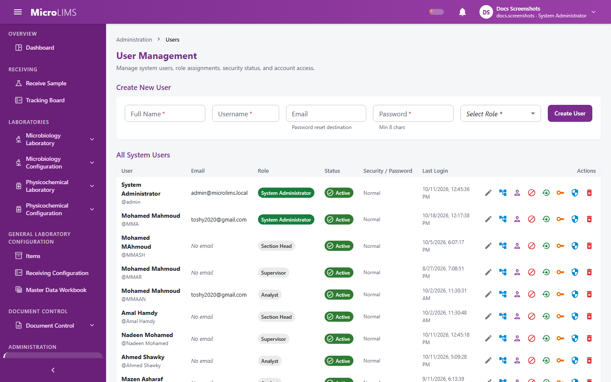

## 33. Laboratories, Departments and Data Segregation

### 33.1 Laboratory Scoping and Department Organization

#### Purpose
MicroLIMS limits the laboratory records a user can see and work on to the laboratories the user is assigned to.

#### Organization
Laboratory work is organized into departments and laboratory sections. The two laboratory sections are:
- **Microbiology Laboratory** (shown as "Microbiology Laboratory (MICRO)" in the assignment dialog): microbiological testing, media, reference cryovials, organisms, and environmental and water monitoring.
- **Physicochemical Laboratory** (shown as "Physicochemical Laboratory (FP)"): chemical testing, chromatography (HPLC, GC), ICP, solutions and titrations.

These laboratories are the same sections that Document Control uses.

#### Scoping rules
1. **Department assignment** gives access to all active laboratory sections in that department.
2. **Section assignment** gives access to that section only.
3. **No assignment**: the user sees no laboratory data. For example, creating equipment shows "Your account is not assigned to any laboratory section. Ask an administrator to assign one."
4. **System Administrator**: accounts of the System Administrator role type are not limited by laboratory and see both laboratories and all physicochemical areas.
5. Section limits apply to many screens, including review and approval, dashboards, the testing workspaces, equipment, materials, specifications and Test Master edits.
6. A user can open the dashboard of a laboratory only if assigned to it: "You are not a member of this laboratory."

#### Physicochemical areas
Inside the Physicochemical Laboratory an assignment can carry an area: **FP** (Finished Product workspace), **RM & PM** (Raw Material and Packaging Material workspace) or **Both** (no area restriction).

#### Sample receiving and tracking
- Requires the *Receive samples* permission (by default: Section Head, System Administrator) to receive samples for any laboratory.
- Requires the *Receive samples for own laboratory* permission (by default: Analyst, Reviewer, Section Head, System Administrator) to receive only for assigned laboratories. For another laboratory: "You can receive samples only for your own laboratory."
- Requires the *Track all samples* permission (by default: Section Head, System Administrator) to see the tracking board across laboratories.

> **Note for reviewers:** The physicochemical area (FP / RM & PM) is applied in the testing workspaces but not when editing tests or specifications; only section assignment is checked there. (GAP-708)

> **Note for reviewers:** Archived-record download has no laboratory scope check. (GAP-108)

---

### 33.2 Assigning Laboratory Sections and Memberships
<!-- WF-USERS-002 -->
#### Purpose
Assign laboratory sections and, for the Physicochemical Laboratory, an area to a user.

#### Who can use it
Requires the *Manage users* permission (by default: System Administrator).

#### Before you start
- The user account exists and the departments and sections are active.

#### What you see

The **Laboratory Sections: {Full Name}** dialog shows:
- A checkbox per department: "{department} ({code}): All sections (entire department)".
- A checkbox per section: "{section} ({code})". Section boxes are ticked and disabled while the whole department is ticked.
- For the Physicochemical section, a select **Area** with **FP**, **RM & PM** and **Both**.
- Buttons **Cancel** and **Save Memberships** ("Saving..." while busy).
- With no sections defined: "No laboratory sections are configured in the system."

#### How to use it
1. Open **Administration** > **Users**.
2. On the user's row, choose the action **Laboratory Sections**.
3. Tick the department, or the individual sections.
4. For the Physicochemical section choose the **Area**.
5. Click **Save Memberships**. The message "Laboratory sections updated for \"{username}\"." appears.

#### System behavior
- Saving replaces all of the user's existing assignments with the ticked ones.
- The change is recorded in the audit trail under the administrator. No electronic signature or reason is asked.
- The user's dashboards, menu groups, queues and notifications follow the new sections. Whether a change reaches a user who is already signed in at once has not been confirmed.
- A user can belong to both laboratories; the dashboard then shows the tabs **Microbiology Laboratory** and **Physicochemical Laboratory**.
- **Both** is stored as no area restriction.

#### Validation
- "One or more departments were not found or are inactive."
- "Laboratory section {id} was not found or is inactive."
- "Laboratory section {id} does not belong to department {id}."
- "An area can only be set on a Physicochemical Laboratory membership."

#### Errors
- "Could not load laboratory sections or user memberships."
- "Could not update user memberships."

#### What happens next
The user's access follows the new assignment.

> **Note for reviewers:** Saving an empty list is allowed and leaves the user with no laboratory data. Whether this is intended is unconfirmed.

<!-- Review log (Sonnet): 14 corrections; invented items removed: permission codes, lab/area codes in prose, "immutable", database commit claim, immediate-access claim, wrong GAP-014 citation (Final Release gap), claim system blocks dashboards with the zero-membership message; callouts added: GAP-708 -->
