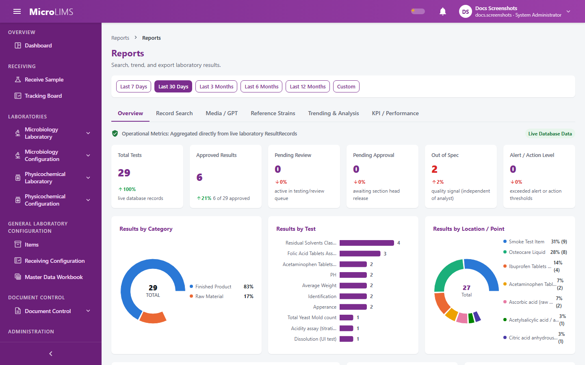
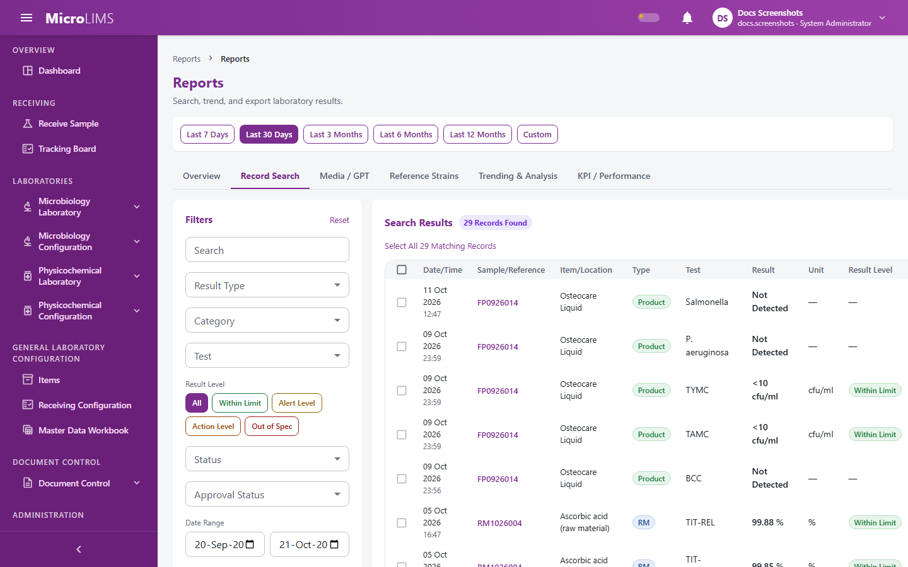
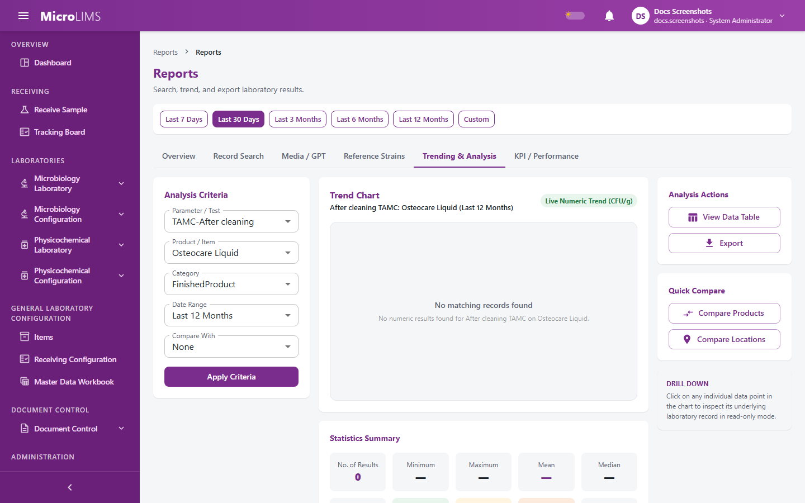
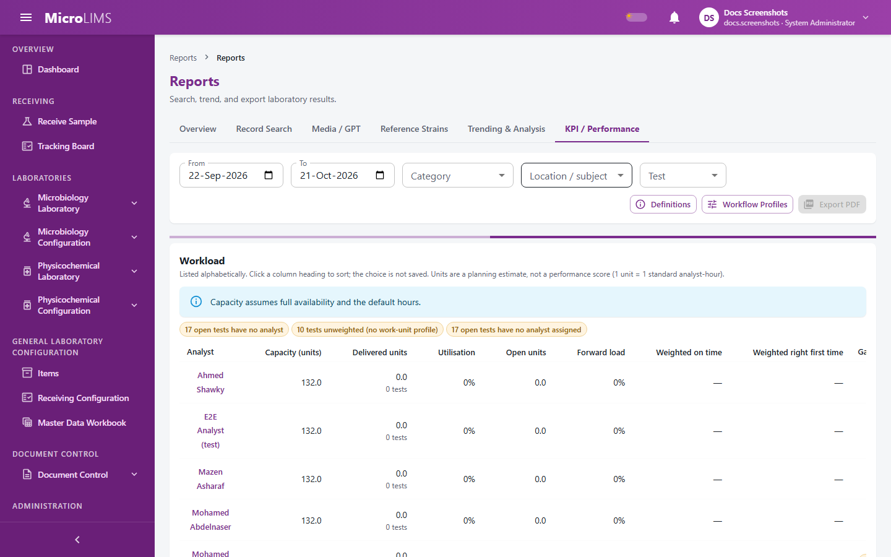

## 34. Reports, KPIs and Trend Analysis

### 34.1 Reports Overview

#### Purpose
Provide a consolidated operational summary of laboratory testing volume, release progress, and quality signals across all laboratory sections to which the user has access.

#### Who can use it
Open to all signed-in users. Data visibility is automatically restricted to the user's assigned laboratory sections; users whose base role type is System Administrator have unrestricted access across all laboratory sections. Users without an assigned laboratory section see no data.

#### What you see

The **Overview** tab of the **Reports** page presents:
- Header title **Reports** with subtitle "Search, trend, and export laboratory results."
- Quick period selector bar above the tabs (shown on every tab except **KPI / Performance**): options **30d** (default), **90d**, **1y**, and **custom** (with **From date** and **To date** inputs).
- Live data indicator text: "Operational Metrics: Aggregated directly from live laboratory ResultRecords" accompanied by a static chip labeled **Live Database Data**.
- Six top summary cards:
  - **Total Tests**: displays total tests formatted, with comparison label "live database records".
  - **Approved Results**: displays approved result count, with comparison label showing approved count of total count approved.
  - **Pending Review**: displays active count in testing and review queue.
  - **Pending Approval**: displays count awaiting section head release.
  - **Out of Spec**: displays count of out-of-specification results, with comparison label "quality signal (independent of analyst)", error styling when greater than zero, and tooltip "Laboratory Quality Metric: Evaluated independently of analyst performance".
  - **Alert / Action Level**: displays count of results exceeding alert or action thresholds, with warning styling when greater than zero.
- Middle visualizations:
  - **Results by Category**: donut chart displaying test distribution across categories, showing total test count and "TOTAL" in the center, and a category legend with percentages. If no records match, displays "No matching records found".
  - **Results by Test**: horizontal bar chart displaying the top 10 tests by volume with test count labels.
  - **Results by Location / Point**: donut chart displaying the top 7 sampling locations by volume.
- Bottom panels:
  - **Recent Results** table: lists recently recorded results with columns **Subject / Ref**, **Test**, **Date Entered**, **Entered By**, and **Status** (chips: **Approved**, **Rejected**, or warning for pending states). Includes a **View in Search** button.
  - **Quality Signals** card: displays summary counts for **Out of Spec**, **Alert / Action Level**, **Pending Review**, and **Pending Approval**.
  - **Quick Actions** card: provides navigation buttons **Search Records**, **Trending & Analysis**, and **KPI / Performance** (visible only to users holding the *View KPIs* permission).

> **Note for reviewers:** The "Live Database Data" label is fixed text and does not confirm that the figures are current. The arrows and percentages (change figures) on the six summary cards are not comparisons with a previous period. Do not rely on the label or on the change figures; read only the counts. (GAP-801)

> **Note for reviewers:** If data loading fails, the summary cards display zero with "no data" rather than displaying an error message; a zero value can represent a failed server query. (GAP-817)

> **Note for reviewers:** The Recent Results table displays "Analyst" and "Other" when a user name or location is missing from the record. (GAP-817)

---

### 34.2 Searching and Exporting Test Records

<!-- WF-REPORTS-001 -->
#### Purpose
Search, filter, inspect, and export laboratory test results across microbiology and physicochemical testing records.

#### Who can use it
Open to all signed-in users. Record visibility is scoped to the user's assigned laboratory sections; System Administrators have global visibility.

#### Before you start
- Ensure you have relevant search criteria (such as a Sample ID, Batch Number, Test Code, or Date Range) if searching for specific testing events.

#### What you see

The **Record Search** tab is structured in a two-column layout:
- Left filter panel (**Filters**):
  - **Search** text box (placeholder "Search Sample ID, Batch No., Item, Test, Location...")
  - **Result Type** dropdown (**All**, **Quantitative**, **Qualitative**)
  - **Category** dropdown (**All** and available product categories)
  - **Test** dropdown (**All** and available tests formatted as `{testCode} - {testDisplayName}`)
  - **Result Level** segmented buttons (**All**, **Within Limit**, **Alert Level**, **Action Level**, **Out of Spec**)
  - **Status** dropdown (**All**, **Received**, **InTesting**, **UnderReview**, **UnderApproval**, **Approved**, **Rejected**, **RetestRequested**)
  - **Approval Status** dropdown (**All**, **Approved**, **Pending**, **Rejected**)
  - **Date Range** date inputs (**From date** and **To date**)
  - **Location / Point** dropdown (**All** and distinct subject locations)
  - Buttons: **Reset** and **Search Records**
- Left **Quick Reports** tiles:
  - Eight tiles. **Product**, **Raw Material**, **Water**, **Environmental Monitoring** and **After Cleaning** set the category filter; **Media/GPT** and **Reference Strains** open their own tabs; **Custom Report** clears the filters.
- Right results table (**Search Results**):
  - Results count chip: `"{totalCount} Records Found"`
  - Table action buttons: **Columns** (column toggle menu), **Export PDF**, and **Export CSV**
  - Table columns (11):
    1. **Date/Time**: date and time of record entry
    2. **Sample/Reference**: reference link opening record details
    3. **Item/Location**: item or location name and detail
    4. **Type**: category badge
    5. **Test**: test code
    6. **Result**: reported value
    7. **Unit**: measurement unit
    8. **Result Level**: within limit, alert, action, or out of spec
    9. **Status**: derived approval status
    10. **Approved By**: approving user name
    11. **Approval Date**: date of approval
  - Row action menu (three dots): **View Record Details**, **Analyze Trend**, and **Copy Reference Number**
  - Selection action bar (appears when records are selected):
    - Link **Select All {totalCount} Matching Records**
    - Selection counter (`"{selectionCount} selected"` or `"All {totalCount} selected"`) and **Clear** link
    - Buttons: **Export Selected PDF**, **Export Selected CSV**, and **Analyze Selected**

#### How to use it
1. Navigate to **Reports** and select the **Record Search** tab.
2. Enter your criteria in the **Filters** panel or click one of the **Quick Reports** tiles.
3. Click **Search Records**. The matching rows appear in the **Search Results** table.
4. To view the complete testing and approval details of a record, click the reference link in the **Sample/Reference** column or choose **View Record Details** from the row action menu. The system displays a read-only record dialog.
5. To export all matching records as a CSV spreadsheet:
   a. Click **Export CSV**.
   b. Review the confirmation dialog: "This will export {totalCount} row(s) matching your current filters as a CSV file. This export will be logged."
   c. Click **Confirm**. The browser downloads the generated file (`microlims-results-{yyyyMMdd-HHmmss}.csv`).
6. To export the current visible table page as a printable document, click **Export PDF**.
7. To export or analyze specific approved results:
   a. Select the checkboxes on the desired rows, or click **Select All {totalCount} Matching Records**. Ticking rows allows only **Approved** records. **Select All {totalCount} Matching Records** is different: it exports every record that matches the filters, whatever its approval status, although its tooltip says 'Approved'. Set **Approval Status** to **Approved** first if you need approved results only. **Export Selected PDF** after **Select All** contains at most the first 200 matching records and gives no warning.
   b. Click **Export Selected CSV**, **Export Selected PDF**, or **Analyze Selected** (to transfer the test code and item to the trending workspace).

#### System behavior
- Approval status is derived directly from the underlying sample status:
  - Approved samples display as **Approved**.
  - Rejected samples display as **Rejected**.
  - Voided samples display as **Voided**.
  - Cancelled samples display as **Cancelled**.
  - Samples still in progress (Received, InTesting, UnderReview, UnderApproval, RetestRequested) display as **Pending**.
- The system writes an audit trail entry when a CSV file built by the server is exported from this tab.

#### Validation
- If the filter options cannot be retrieved from the server, the screen displays: "The filter options could not be loaded, so the filter lists are empty. Reload the page to try again."
- If no records match the filter criteria, the table displays: "No results found" with subtitle "Try widening the date range or clearing some filters." and a **Clear Filters** button.
- If a CSV export query matches more than 10,000 rows, the server refuses the export with the message: "This filter matches {n} rows, which exceeds the 10,000-row export limit. Narrow your filters (e.g. a shorter date range) and try again."
- If an export request encounters a network or server error, the system reports: "Export failed."

> **Note for reviewers:** The CSV export stops if matches exceed 10,000 rows without advance warning in the confirmation dialog. PDF and trend exports are produced in the browser and, as far as the code shows, are not recorded in the audit trail. (GAP-804)

> **Note for reviewers:** **Select All Matching Records** exports records of any approval status despite its tooltip claiming Approved only, and the selected-PDF export is capped at 200 rows without warning. (GAP-906)

> **Note for reviewers:** Reports read from a derived results table, and the administrative rebuild of that table has no screen. (GAP-803)

---

### 34.3 Media Preparation and Growth Promotion Reports

#### Purpose
Review, track, and export preparation histories, release decisions, and Growth Promotion Testing (GPT) challenge outcomes for culture media lots.

#### Who can use it
Open to all signed-in users. Scoped to the user's accessible laboratory sections.

#### What you see
The **Media / GPT** tab presents:
- Filter panel: text search, **Media Type** dropdown, **Evaluation Type** dropdown (defaults to "GrowthPromotion"), **Evaluation Outcome** dropdown (**Conform**, **NonConform**), **Approval Status** dropdown, and **Date Range** inputs, with **Reset** and **Search** buttons.
- Summary card: displays **Total Media Lots**, **Growth Promotion Passed**, **GPT Failed**, **Pending Evaluation**, and **Overall Pass Rate (%)**.
- Results table (**Media Preparation & GPT Records**):
  - Header displays record count: `Showing {from}–{to} of {totalCount} lots`
  - Action buttons: **Export CSV (Flattened)** and **Print / PDF View**
  - Columns:
    1. **Lot Number**: media lot identifier
    2. **Media Type**: media formulation name
    3. **Prep Date**: preparation date
    4. **Expiry Date**: expiration date
    5. **Evaluation**: chip indicating evaluation type (such as **GPT**)
    6. **Outcome**: chip (**Conform** or **NonConform**) with challenge count caption (`{conformed}/{total} Challenges`)
    7. **Approval Status**: chip (**Approved** or **Rejected**) with **Released** text when released for use
    8. **Prepared By**: preparing analyst name
    9. **Approved By**: approving user name and approval timestamp
    10. **Actions**: icon button with tooltip **View Traceability Details**

#### How to use it
1. Navigate to **Reports** and select the **Media / GPT** tab.
2. Select your filter criteria and click **Search**.
3. To inspect autoclave sterilization cycles, load type, temperature, pH, challenge organisms, ATCC references, recovery percentages, and incubation readings, click **View Traceability Details** on any row.
4. To export all challenge rows matching your criteria, click **Export CSV (Flattened)**.
5. To generate a printable summary, click **Print / PDF View**.

#### System behavior
- The system writes an audit trail entry when the CSV export is built by the server.

#### Validation
- If the export matches more than 10,000 challenge rows, the server refuses the request with: "This filter matches {n} challenge rows, which exceeds the 10,000-row export limit. Narrow your filters (e.g. a shorter date range) and try again."
- If an individual lot record cannot be found, the server returns: "Media lot {id} not found."

---

### 34.4 Reference Strains and Working Cultures Reports

#### Purpose
Track inventory, preparation, expiration, storage conditions, and qualification usage for reference microorganism cryovials and working cultures.

#### Who can use it
Open to all signed-in users. Scoped to the user's accessible laboratory sections.

#### What you see
The **Reference Strains** tab presents:
- Filter panel: text search, **Organism** dropdown, **Approval Status** dropdown, active or destroyed status selector, receipt date range, and usage date range, with **Reset** and **Search** buttons.
- Results table (**Reference Strains & Working Culture Batches**):
  - Header displays record count: `Showing {from}–{to} of {totalCount} batches`
  - Action buttons: **Export CSV** and **Print / PDF View**
  - Columns:
    1. **Strain / ATCC**: organism name and ATCC reference number
    2. **Cryovial Code**: batch code
    3. **Manufacturer**: source supplier and manufacturer lot number
    4. **Receipt Date**: date received
    5. **Prep Date**: batch preparation date
    6. **Expiry Date**: expiration date
    7. **Vials Remaining**: chip showing remaining versus prepared vials (`{vialsRemaining} / {numberOfVialsPrepared}`)
    8. **Storage**: storage condition
    9. **Approval Status**: chip (**Approved** or **Rejected**), with **Destroyed** indicator if discarded
    10. **Prepared By**: preparing analyst name
    11. **Approved By**: approving user name and approval timestamp
    12. **GPT Usage**: chip showing count of direct growth promotion tests (`{directUsageCount} GPT`)
    13. **Actions**: icon button with tooltip **View Batch Traceability**

#### How to use it
1. Navigate to **Reports** and select the **Reference Strains** tab.
2. Filter by organism, approval status, or date range, and click **Search**.
3. To inspect thaw records, purity checks, growth promotion challenges, and test order links, click **View Batch Traceability** on any row.
4. To export batch data, click **Export CSV** or **Print / PDF View**.

#### System behavior
- The system writes an audit trail entry when the CSV export is built by the server.

#### Validation
- If the export matches more than 10,000 rows, the server refuses the export with: "This filter matches {n} rows, which exceeds the 10,000-row export limit. Narrow your filters and try again."
- If a cryovial batch record cannot be found, the server returns: "Cryovial batch {id} not found."

---

### 34.5 Analytical Trending and Comparison

<!-- WF-REPORTS-001 -->
#### Purpose
Perform statistical process control and graphical trend analysis across quantitative test results, evaluate limits and specifications, and compare performance across products or sampling locations.

#### Who can use it
Open to all signed-in users. Data is scoped to the user's accessible laboratory sections.

#### What you see

The **Trending & Analysis** tab is structured in a three-column layout:
- Left column (**Analysis Criteria**):
  - **Parameter / Test** dropdown
  - **Product / Item** dropdown (or location cascade selector for Water, Environmental Monitoring, or After Cleaning)
  - **Category** dropdown: the categories returned by the server; if the lists cannot be loaded, four default categories are shown (Finished Product, Raw Material, Water, Environmental Monitoring). (GAP-002, GAP-800)
  - **Date Range** dropdown (**Last 30 Days**, **Last 3 Months**, **Last 6 Months**, **Last 12 Months** [default])
  - **Compare With** dropdown (**None** [default], **Previous Period**, **Product Comparison**, **Location Comparison**). **Previous Period** can be selected but does not change the chart. (GAP-908)
  - Button: **Apply Criteria**
- Center column (**Trend Chart & Statistics**):
  - Chart card header showing test name, subject name, selected period, and chip (**Live Numeric Trend ({unit})** or **Qualitative Detection Event Log**)
  - For quantitative count tests:
    - Composed trend chart with chronological data points: normal results (blue/green dots), Alert Level (amber dots), Action Level (orange dots), and Out of Spec (red dots).
    - Threshold lines: Upper Limit / USL (red dashed line), Action Level (orange dashed line), Alert Level (amber dashed line), and Mean (purple dashed line).
    - Ten statistics cards: **No. of Results**, **Minimum**, **Maximum**, **Mean**, **Median**, **Std. Deviation**, **% Within Spec**, **% Alert Level**, **% Action Level**, and **Out of Spec**.
  - For qualitative tests:
    - Pathogen Detection Event table listing **Reference**, **Item/Location**, **Pathogen**, **Result**, **Date Entered**, **Entered By**, and **Status**.
    - If no detections exist, displays: "No Pathogen Detection Events — Zero detections recorded... All samples conformed (Absent / Negative)".
    - Four summary cards: **Detection Events**, **Pathogen Parameter**, **Surveillance Result** (**Conformant / Negative** or **Action Required**), and **Period Range**.
- Right column (**Analysis Actions & Compare**):
  - **Analysis Actions**: buttons **View Data Table** and **Export** (menu options: **CSV (Data Table)**, **PDF (Data Table)**, and **PDF (Data Table + Chart)**).
  - **Quick Compare**: buttons **Compare Products** and **Compare Locations**.
  - **Drill Down** guidance card: "Click on any individual data point in the chart to inspect its underlying laboratory record in read-only mode."

#### How to use it
1. Navigate to **Reports** and select the **Trending & Analysis** tab.
2. Select the **Category**, **Parameter / Test**, and **Product / Item** (or sampling location).
3. Select the desired **Date Range** and click **Apply Criteria**.
4. Inspect the trend line and control limits:
   - Click any individual data point on the chart to open its read-only record details dialog.
5. To compare the selected test across multiple products or sampling points:
   a. Click **Compare Products** or **Compare Locations** (or select **Product Comparison** / **Location Comparison** under **Compare With**).
   b. In the **Multi-Series Trend Comparison** dialog, review the evaluated counts, mean results, alert/action counts, out-of-spec counts, and percentage within specification.
6. To export the trend data:
   a. Click **Export** in the right column.
   b. Select **CSV (Data Table)**, **PDF (Data Table)**, or **PDF (Data Table + Chart)**.

#### System behavior
- **Analytical Trending Numeric Restriction**: Statistical trending charts and limit comparisons are available only for quantitative count tests.
- **Below Detection Limit Imputation**: Results reported as below the detection limit (such as "<10") are counted at half the detection limit (for example 5) in the mean, standard deviation and chart. The original calculated value and reported text remain unchanged on the record.
- **Sample Standard Deviation**: Standard deviation is calculated as sample standard deviation: the square root of the sum of squared differences from the mean divided by (number of results minus 1). When fewer than two results are evaluated, the standard deviation is reported as 0.
- **Qualitative Compliance Calculation**: When comparing qualitative results, the percentage not detected is calculated as the number of not-detected results divided by the number of tests evaluated, multiplied by 100 and rounded to 1 decimal place. Alert, action, and out-of-spec counts are reported as zero.

#### Validation
- If a user requests trend analysis for a non-numeric test, the server refuses with: "Trending is only available for numeric results. {testCode} produces qualitative results."
- If the test code is unconfigured, the server returns: "Test code \"{testCode}\" is not configured in Test Master."
- If required parameters are missing from the request, the server returns: "testCode is required." or "subjectName is required."
- If chart capture fails during PDF export, the browser displays: "No chart is currently rendered to capture." or "Could not capture the chart image for export."

> **Note for reviewers:** If backend filter lists fail or return empty, the interface displays hardcoded example test codes ("TAMC", "TYMC", "WATER_TAMC", "PATHOGEN_ECOLI") and sample product names, selecting a built-in default. Do not rely on these fallback options: before reading a chart, confirm that the selected **Parameter / Test** and **Product / Item** are really yours and exist in your laboratory master data. (GAP-800)

> **Note for reviewers:** If an individual data point's underlying record cannot be retrieved from the server during drill-down, the system builds a record dialog from the chart point itself and shows no error. Open the sample from Record Search to confirm it. (GAP-817)

---

### 34.6 Laboratory KPIs and Analyst Workload

<!-- WF-KPI-001 -->
#### Purpose
Monitor operational throughput, turnaround times, quality metrics, and capacity utilization across laboratory sections, and inspect the specific testing records contributing to each performance indicator.

#### Who can use it
Requires the *View KPIs* permission (by default: Section Head, System Administrator). The tab and the **KPI / Performance** quick action on the Overview are hidden from users lacking this permission. Seeing the workload figures of other analysts requires the *View team KPIs and workload* permission (by default: Section Head, System Administrator); users without it see only their own workload row. The headline tiles show laboratory-level figures for everyone who can open the tab.

#### What you see

The **KPI / Performance** tab presents:
- Filter bar:
  - **From** and **To** date inputs
  - **Category** dropdown (defaults to "All categories")
  - **Location / subject** dropdown (defaults to "All locations")
  - **Test** dropdown (defaults to "All tests")
  - Action buttons: **Definitions** (opens drawer explaining formulas), **Workflow Profiles** (visible only to users holding the *Configure KPI profiles* permission), and **Export PDF**
- Information caption: `Calculated {timestamp} for your laboratory sections. Click any figure to see the records behind it.`
- Eight headline KPI tiles:
  1. **Sample turnaround time**: median calendar days from receipt to approval for samples approved in the period, with the 90th percentile and a comparison to the prior period. Retests created from an earlier sample are not counted.
  2. **On time, all stages**: percentage of approved samples in which every stage met its limit: the analyst stage within the longest target of the sample's tests (7 days where a test has none), then review within 24 hours and approval within 24 hours, warning chips for excluded or defaulted samples (no assignment time, incomplete timeline, default target), and monthly sparkline.
  3. **Right first time**: percentage of approved work units (weighted by work units) that were never returned for rework, warning chips for tests left out (tests without work units, observation tests), and monthly sparkline.
  4. **Retest rate**: percentage of decided samples with a retest-retained-sample decision (retests created from an earlier sample are not counted), and monthly sparkline.
  5. **OOS rate**: percentage of decided samples that carry an out-of-specification group. This is a sample-level field, so a viewer of one laboratory also sees an out-of-specification that arose in another laboratory. The retest rate is a subset of this rate. Monthly sparkline.
  6. **WIP backlog**: current snapshot count of open tests (pending or in progress) broken down by current step. The date filter does not apply and no prior period is shown; tests waiting for review or approval appear in backlog aging instead.
  7. **Incubation reads on time**: percentage of completed incubation windows read no later than 4 hours after the expected read time (earlier reads count as on time; media-challenge incubations are not counted), a warning chip for windows left out because no expected read time exists, and monthly sparkline.
  8. **EM excursion rate**: percentage of environmental monitoring readings at alert or action levels, with separate alert and action rates, and an adverse-trend indicator if there are at least 5 results and the alert rate exceeds 2.5% or the action rate exceeds 0.15%. Results without levels (for example detected/absent) and retests created from an earlier sample are not counted.
- Category breakdown charts:
  - **Flow**: time spent in each testing stage (**Testing**, **Incubation**, **Review**, **Approval**), and backlog aging grouped into buckets (up to 50%, 50–100%, and over 100% of target; the target for review and approval is 24 hours).
  - **Quality**: charts for right first time, retest rate, out-of-spec rate, and returns by test (grouped alphabetically by test code, never by person).
  - **Micro**: environmental monitoring excursion rate and incubation reads on time.
- **Workload** table:
  - Header subtitle: "Listed alphabetically. Click a column heading to sort; the choice is not saved. Units are a planning estimate, not a performance score (1 unit = 1 standard analyst-hour)."
  - Warning banners:
    - If restricted to own figures: "Showing your own numbers only."
    - If section settings use baseline defaults: "Capacity assumes full availability and the default hours."
    - Warning chips for unassigned open tests and configuration gaps.
  - Columns:
    1. **Analyst**: analyst name (click to open tests drawer)
    2. **Capacity (units)**: total available work units
    3. **Delivered units**: completed work units and test count
    4. **Utilisation**: delivered units divided by capacity (displays chip **check profile** if over 100%)
    5. **Open units**: units currently assigned and in progress
    6. **Forward load**: ratio of open work to capacity (displays chip **Over capacity** if over 100%)
    7. **Weighted on time**: on-time delivery rate (suppressed if fewer than 5 tests)
    8. **Weighted right first time**: first-pass delivery rate (suppressed if fewer than 5 tests)
    9. **Gaps**: warning chips for unweighted tests or default targets

#### How to use it
1. Navigate to **Reports** and select the **KPI / Performance** tab.
2. Adjust the **From** and **To** dates, or filter by category, location, or test.
3. Review the headline tiles and breakdown charts.
4. To inspect the individual laboratory records contributing to any tile or chart:
   a. Click the tile or chart series.
   b. The **Records** drawer opens, displaying paginated rows marked as **Numerator**, **Denominator**, or **Excluded**, with explanatory notes.
5. In the **Workload** table, click an analyst's name to open a drawer listing all test orders assigned to that analyst.
6. To print or archive the metrics, click **Export PDF** to generate an A4 landscape report.

#### System behavior
- **Planning Estimate Standard**: Exactly 1 work unit represents 1 standard analyst-hour of hands-on work. Work units represent capacity planning metrics, not performance appraisals.
- **Individual Rate Suppression**: On the workload table, weighted on-time and weighted right-first-time percentages are left blank if an analyst has fewer than 5 evaluated tests, to avoid distorted individual figures.
- **Filtered Capacity Suppression**: When category, location, or test filters are applied, analyst utilisation and forward load are left blank with a warning, because capacity reflects overall analyst availability.
- **Own-Figures Restriction**: If a user without the *View team KPIs and workload* permission asks for another analyst's figures or tests, the system refuses the request.

#### Validation
- If dates are missing or reversed, the browser displays: "Choose both dates." or "The start date must not be after the end date."
- The server validates date ranges with: "A start date and an end date are required." and "The start date must not be after the end date." (or "The end date must not be before the start date." for the workload table).
- If a user without team permissions attempts to view other personnel: "You can only view your own analyst figures." or "You may only view your own workload figures."
- If an individual tile fails to calculate, it displays: "This figure could not be calculated. The error has been logged." The remaining tiles continue to display normally.
- If the filter lists fail to load: "The category, location and test lists could not be loaded. Reload the page to try again."

> **Note for reviewers:** The "On time, all stages" KPI excludes samples lacking a preparation record (finished-product physicochemical, environmental monitoring, retest clones) and "Right first time" excludes pathogen observation tests; tests lacking a configured target default to a 7-day constant. The design of these KPIs is not formally approved; the definitions above describe what the system calculates. (GAP-805, GAP-806, GAP-045)

> **Note for reviewers:** Workload capacity assumes a fixed default of 6 hours per day, Monday through Friday, with a 5-day forward horizon. Laboratory section capacity parameters and individual analyst leave adjustments cannot be configured in the user interface. (GAP-802)

---

### 34.7 Configuring Workflow Profiles and Stage Targets

<!-- WF-KPI-002 -->
#### Purpose
Configure work unit weights and stage completion targets for testing workflow types and specific test methods, ensuring accurate capacity planning and turnaround tracking.

#### Who can use it
Requires the *Configure KPI profiles* permission and the *View KPIs* permission (by default both: Section Head, System Administrator).

#### Before you start
- Ensure the test code exists in Test Master.
- Know the hands-on analyst hours (work units) and stage completion deadline (target days) determined by laboratory method studies.
- Have your account password ready to apply the required electronic signature.

#### What you see
Clicking **Workflow Profiles** on the KPI tab opens the **Workflow Profiles** dialog:
- Explanatory banner: "Work units: 1 unit = 1 standard analyst-hour of hands-on work. Target: analyst-stage days. A version takes effect on its effective date and is never edited; correct a mistake by adding a new version. Tests without a profile stay unweighted - they are never counted as 1.0."
- Gap alert: displays counts of workflow types and tests requiring configuration, with a **Needs configuration only** filter switch.
- Workflow types table:
  - Columns: Expand chevron, **Workflow type** ("Count Test", "Observation", "Measurement", "Gravimetric", "Qualitative", "Dissolution", "Disintegration", "Weight Variation", "Hplc Method Assay", "Titration", "Icp Method Assay"), **Work units**, **Target (days)**, **Last change**, **Status** (chips: **Configured**, **Partial**, **Needs configuration**, and draft count), and action buttons **History** and **Add version**.
- Expanded test table (under each workflow type):
  - Lists individual tests with columns **Test**, **Name**, **Work units**, **Target (days)**, **Status** (chip **Override** if test-specific version exists), and action buttons **History** and **Add version** / **Add override**.

#### How to use it
1. Click **Workflow Profiles** on the KPI filter bar.
2. Locate the target workflow type, or expand the type to locate a specific test.
3. Click **Add version** on the workflow type (to configure the default for all tests of that type) or **Add override** on an individual test.
4. In the dialog (**Add version: {scope}**):
   - Enter **Work units** (number of hands-on analyst-hours, greater than 0, up to 2 decimal places).
   - Enter **Target analyst days** (completion deadline in days, greater than 0, up to 2 decimal places).
   - Enter **Effective from** (date on which the version takes effect; cannot be in the past unless configuring the very first baseline version).
   - Enter **Reason for change** (mandatory explanation, up to 500 characters, such as "e.g. SOP time study 2026").
5. Click **Continue to sign**.
6. Review the electronic signature statement:
   `"I am adding a workflow profile version for {scope}: {u} work units (1 unit = 1 standard analyst-hour), {t} target analyst days, effective {effectiveFrom}. Reason: {reason}"`
   The system attaches an electronic signature (meaning: master data changed).
7. Enter your login password and click confirm.
8. The version is saved and becomes active on its effective date.

#### System behavior
- **Append-Only Immutability**: Workflow profile versions cannot be edited or deleted once Effective; the system refuses any change or deletion. Corrections are made by creating a new version with a future effective date.
- **Separate Field Resolution**: Work units and target days are resolved separately per test on each sample's approval date:
  1. The system checks for the newest effective test-specific override;
  2. If not defined, it checks for the newest effective workflow type default;
  3. If work units remain unset, the test is treated as unweighted (it is never assigned a default 1.0); if target days remain unset, the system applies a default 7-day target with a warning gap.
- **Baseline Back-Dating Exception**: The very first version of a workflow type or test may have an effective date in the past to establish historical baselines. All subsequent versions must be dated today or in the future.
- **Electronic Signature Security**: Applying the signature requires password authentication. If 5 failed attempts occur within 15 minutes, further signature attempts are locked for 15 minutes.

#### Validation
- If the reason is omitted: "A reason for the change is required."
- If the reason exceeds limits: "The reason must be 500 characters or fewer."
- If neither work units nor target days are entered: "Enter work units, a target, or both."
- If values are zero or negative: "{label} must be greater than 0."
- If values exceed upper bounds: "{label} must not exceed {max}." (Work units max 999999.99; Target analyst days max 9999.99).
- If decimal precision is exceeded: "{label} allows at most 2 decimal places."
- If a subsequent version is back-dated: "The effective date cannot be in the past ({effectiveFrom:yyyy-MM-dd}). Only the first version of a profile may be back-dated; add this version with an effective date of {today:yyyy-MM-dd} or later."
- If attempting to re-sign an active version: "This version is already Effective and cannot be signed again."
- If password verification fails: "Password verification failed. The signature was not applied."
- If throttled: "Too many failed signature attempts. Wait 15 minutes, then try again. The signature was not applied."
- If the test does not exist: "Test '{code}' does not exist in the test master."
- If the workflow type is retired: "Workflow type {type} is retired and cannot carry a profile."

> **Note for reviewers:** Workflow profile versions do not enforce segregation of duties; the same user who creates a version applies the electronic signature, with no secondary verification or approval required. (GAP-820)

---

### 34.8 Administrative Reporting and Capacity Features Not in UI

Two administrative functions behind Reports have no screen in the application:
- **Reporting Backfill**: MicroLIMS does not provide a screen for rebuilding the summary table that the Reports tabs read from. (GAP-803)
- **Analyst Availability and Section Settings**: MicroLIMS does not provide a user interface screen for configuring laboratory section capacity parameters (standard daily hours, working weekdays, forward load horizon) or individual analyst availability adjustments (such as leave or training). (GAP-802)

<!-- Review log (Sonnet): 46 corrections; invented items removed: route paths, permission codes, gap/flag codes, SCR id, endpoint path, database-trigger and enum/class names; callouts added: none missing (GAP-800/801/802/803/804/805/806/045/817/820 present, strengthened GAP-800/801/804) -->
<!-- Phase 13 (agy): applied F-C05, F-C07, F-C08, F-C09, F-C10, F-C17 -->

<!-- Phase 13 review (Sonnet): agy corrections verified against RECONCILIATION and code; GAP ids exist; nothing invented; no change needed. -->
