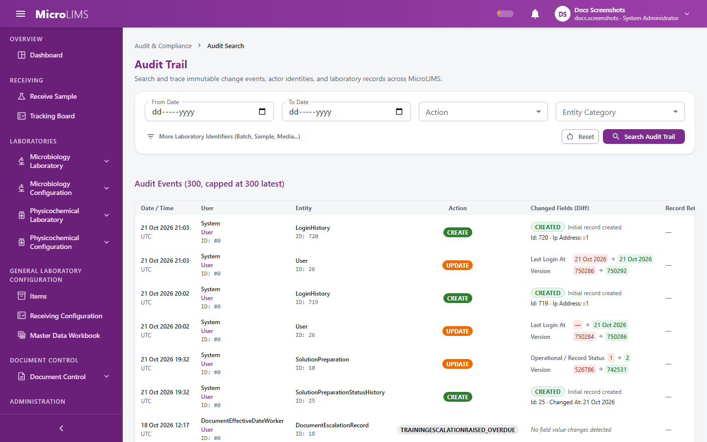
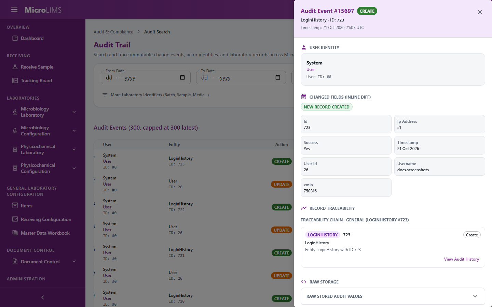

## 35. Audit Trail

### 35.1 What the Audit Trail Records

#### Purpose
The audit trail keeps a record of changes made to laboratory data, master data, testing records and administrative settings, so that a change can be traced back to who made it and when.

#### What is recorded automatically
Whenever a tracked record is saved, the system writes an audit entry containing:
- **Action**: **Create**, **Update** or **Delete**.
- **Previous and new values** of the record (previous values are kept for updates and deletes).
- **User and time**: the user who made the change and the time of the change (UTC).
- **Laboratory identifiers** such as sample reference, batch number, control number, media lot number or cryovial code, when the record has them.

Some administrative actions write an entry under their own action name instead, for example when a user's role is changed, a user is disabled, a role's permissions are updated or an administrator-assisted password recovery code is used. A failed or refused electronic signature attempt is also recorded (without the password), and a successful signature appears as a **Create** entry.

#### Records that are not audited
Nine kinds of technical records are not written to the audit trail: the audit records themselves, document access logs for material and equipment documents, technical incidents and error log entries, sign-in refresh tokens, notification state, and security events. Resolving, reopening or changing the severity of an incident (see §40) also writes no audit entry.

> **Note for reviewers:** Some records are not audited (incidents, error log entries, refresh tokens, notification state). (GAP-111)

#### Protection of audit records
The Audit Trail screen is read-only. The system is also set up to refuse changes to and deletion of audit entries and electronic signature records at database level; whether this protection is present in the live database has not been checked.

#### Recorded but not visible on any screen
- **Login history**: every sign-in attempt (success, unknown user, locked account, wrong password, inactive account) is recorded with the IP address.
- **Security events**: sign-in, session, password and account events are recorded.
- The Audit Trail screen has no export or print function.

> **Note for reviewers:** Audit Trail shows 300 events at most, has no export, cannot filter on user/role actions, and does not show login history or security events. (GAP-030, GAP-101)

---

### 35.2 Searching the Audit Trail

<!-- WF-AUDIT-001 -->
#### Purpose
Search and review historical audit records using date ranges, action, entity category, or laboratory identifiers.

#### Who can use it
Requires the *View audit trail* permission (by default: Section Head, System Administrator).

#### Before you start
- Have the relevant record identifiers (such as a Sample Reference or Batch Number) ready if you are searching for a specific laboratory event.

#### What you see

The **Audit Trail** screen presents:
- Heading: **Audit Trail**
- Subtitle: "Search and trace immutable change events, actor identities, and laboratory records across MicroLIMS."
- Filter bar:
  - **From Date** and **To Date**
  - **Action** dropdown with options: **All Actions**, **Create**, **Update**, **Delete**
  - **Entity Category** dropdown listing the tracked record types
  - Collapsible toggle: **More Laboratory Identifiers (Batch, Sample, Media...)** / **Hide Laboratory Identifiers** containing:
    - **Sample Reference**
    - **Batch Number**
    - **Control Number**
    - **Media Lot Number**
    - **Cryovial / RS Code**
    - **User ID**
  - Buttons: **Reset** and **Search Audit Trail**
- Results table:
  - Header: **Audit Events (N)** (shows ", capped at 300 latest" when 300 or more records match)
  - Columns: **Date / Time**, **User**, **Entity**, **Action**, **Changed Fields (Diff)**, **Record Ref**, and **Details**
  - Row button: **Inspect Event & Traceability Chain**

#### How to use it
1. Open the **AUDIT & COMPLIANCE** menu group and select **Audit Search**.
2. Select the search filters:
   - Enter **From Date** and **To Date** to set a time window.
   - Choose an **Action** or **Entity Category** to narrow by type of change.
   - Click **More Laboratory Identifiers (Batch, Sample, Media...)** to enter a **Sample Reference** (e.g. "SMP-0001") or **Batch Number** (e.g. "Lot L-0001").
3. Click **Search Audit Trail** (or press Enter).
4. Review the matching records in the results table.
5. Click **Reset** to clear all filters.

#### System behavior
- Matching audit events are listed with the newest first.
- Searches return up to 300 results. If 300 or more events match, the results header adds ", capped at 300 latest".

#### Status
- The audit search screen is read-only.

#### Important rules
- The **Action** filter offers only **Create**, **Update** and **Delete**. Platform actions written by the system (such as a user role change, a user being disabled, a role permission update, or use of an administrator-assisted password recovery code) cannot be selected in the **Action** filter.

#### Errors
- If retrieving audit events fails: "Failed to fetch audit records from the server."
- If no records match: "No audit events found"

#### What happens next
Inspect any event to see the modified fields or the linked records.

---

### 35.3 Inspecting Event Details and Entity History

#### Purpose
Examine field-level before-and-after differences, view the raw before and after data, and open the complete history of a record without the search cap.

#### Who can use it
Requires the *View audit trail* permission (by default: Section Head, System Administrator).

#### Before you start
- Run an audit search as described in §35.2 and find the event row.

#### What you see

Clicking **Inspect Event & Traceability Chain** opens a details drawer containing:
- The action (**CREATE**, **UPDATE** or **DELETE**)
- A difference viewer showing changed field names, previous values and new values
- A raw viewer with the complete before and after data
- The traceability chain for the record (see §36)
- Button: **View Complete History for {entityName} #{entityId}**

#### How to use it
1. In the results table, click **Inspect Event & Traceability Chain** on the row.
2. Review the difference viewer to see which fields changed.
3. To see every audit entry of the record without the 300-row cap, click **View Complete History for {entityName} #{entityId}**.
4. Close the drawer with the close button.

#### System behavior
- The drawer shows the changed fields and the raw before and after data for the selected event.
- **View Complete History** lists every audit entry for that record, newest first, without the 300-row limit.

#### Important rules
- Audit entries cannot be deleted or changed from the user interface.

> **Note for reviewers:** The role-change audit entry shows the new role id as the previous value. (GAP-112)

> **Note for reviewers:** Role and user changes are audited but not signed and need no second person. (GAP-009)

<!-- Review log (Sonnet): 14 corrections; invented items removed: entity/table class names, route, JSON/endpoint/server wording, date-validation line, "immutable record" framing in prose; callouts added: GAP-009 (GAP-111/030/101/112 kept, moved) -->
