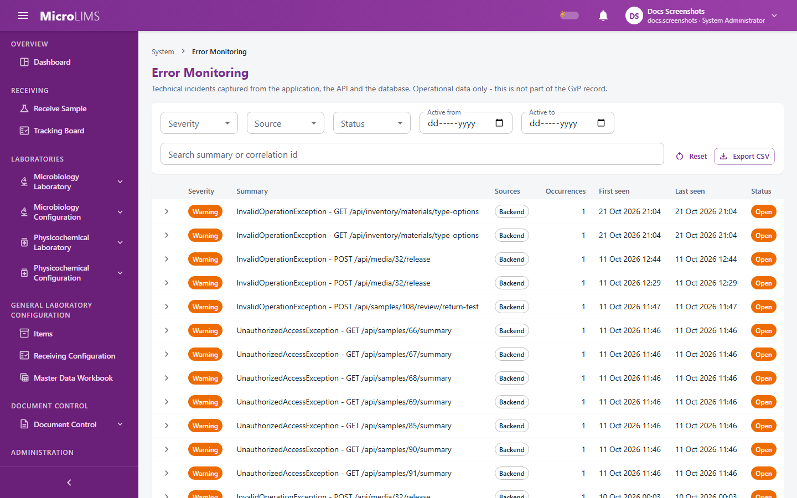

## 40. Error Monitoring (Incidents and Error Log)

### 40.1 What Error Monitoring Records

#### Purpose
Error Monitoring lists technical problems captured from the application, for system administrators and IT support.

#### Technical log, not a quality record
- The screen states: "Technical incidents captured from the application, the API and the database. Operational data only - this is not part of the GxP record."
- Error Monitoring is not a deviation, non-conformance, investigation or CAPA module; MicroLIMS has no such module. Out-of-specification investigations are handled in OOS Tracking (see §20).
- Incidents and error entries are not written to the audit trail. Resolving, reopening or changing the severity of an incident writes no audit entry; the person who resolved it and the time are kept on the incident itself.

#### What is captured
Errors that reach the system's error handling are grouped into **incidents** by a shared correlation id. Each entry keeps its source, severity, error type and message, full error text, request path, method, response code, user (if known) and time.
- **Unexpected errors**: the user sees "An unexpected error occurred." The entry is recorded with severity **Critical**.
- **Business-rule refusals** (a message shown to the user because a rule was not met) and **permission refusals**: recorded with severity **Warning**.
- **Record changed by someone else**: the user sees "This record was changed by someone else while you were working on it. Nothing was saved - reload it and make your change again." Recorded with severity **Warning**.
- **Database failures**: recorded with source **Database**.
- **Browser errors**: reported automatically and recorded with source **Frontend** (**Critical** for a screen that fails to display, **Error** otherwise).

> **Note for reviewers:** Business-rule refusals and permission refusals are recorded as incidents, so the list may contain routine refusals. (GAP-110)

---

### 40.2 Reviewing and Resolving Incidents

<!-- WF-ERR-001 -->
#### Purpose
Look at captured errors, correct a severity, record resolution notes and export the list.

#### Who can use it
Requires the *View error log* permission (`System.ViewErrorLog`, by default: System Administrator).

#### Before you start
- Have the time range or correlation id of the reported problem ready.

#### What you see

The **Error Monitoring** screen presents:
- Heading: **Error Monitoring** and the subtitle quoted above
- Filters:
  - **Severity** (All, Info, Warning, Error, Critical)
  - **Source** (All, Backend, Frontend, Database)
  - **Status** (All, Open, Resolved)
  - **Active from** and **Active to** (applied to the Last seen time)
  - A search box: "Search summary or correlation id"
  - Buttons **Reset** and **Export CSV** (shows **Exporting...** while preparing)
- Incident table (newest activity first, 25 per page) with columns **Severity**, **Summary**, **Sources**, **Occurrences**, **First seen**, **Last seen**, **Status**. Status chips: **Open** and **Resolved**.
- Opening a row shows each captured entry (type, message, stack, path, method, status code, user, time) and:
  - **Override** severity selection, with **Auto ({severity})** to return to the automatic value
  - A chip "overridden from {severity}" when an override is set
  - **Resolution notes**
  - Buttons **Mark resolved** and **Reopen**
  - After resolution: "Resolved {time} by {user} - {notes}"

#### How to use it
1. Open **Error Monitoring** in the **SYSTEM** menu group.
2. Set filters, for example **Severity** = Critical, or search for a correlation id.
3. Click an incident row to open its details.
4. Read the captured entries to understand the problem.
5. If the automatic severity of an entry is wrong, choose another level under **Override**; the incident severity is recalculated.
6. When the problem has been dealt with, optionally type **Resolution notes** and click **Mark resolved**.
7. To reopen an incident, click **Reopen**; the earlier resolver and notes are kept.
8. To download the list for the current filters (up to 5,000 incidents), click **Export CSV**.

#### System behavior
- The incident severity is the highest severity among its entries, including overrides.
- If a new error with the same correlation id arrives for a resolved incident, the incident returns to **Open** automatically.

#### Status
- **Open** and **Resolved**.

#### Errors
- "Could not load incidents."
- "The export could not be generated."
- "Incident not found."

#### What happens next
The table shows the new status. The page does not say who should review incidents or how often.

> **Note for reviewers:** Error Monitoring is a technical log, not a deviation or investigation record; resolving an incident is not audited. (GAP-110)

> **Note for reviewers:** Who triages incidents and how often is not defined, and whether critical errors send an alert e-mail has not been confirmed. (GAP-047)

<!-- Review log (Sonnet): 14 corrections; invented items removed: route, HTTP code numbers, "immutable audit trail" wording, "Navigate to System > ..." path, claim that error entries stay visible after resolving, Correlation ID capitalised as UI label; callouts added: GAP-047 (triage/alert e-mail); GAP-110 kept -->
