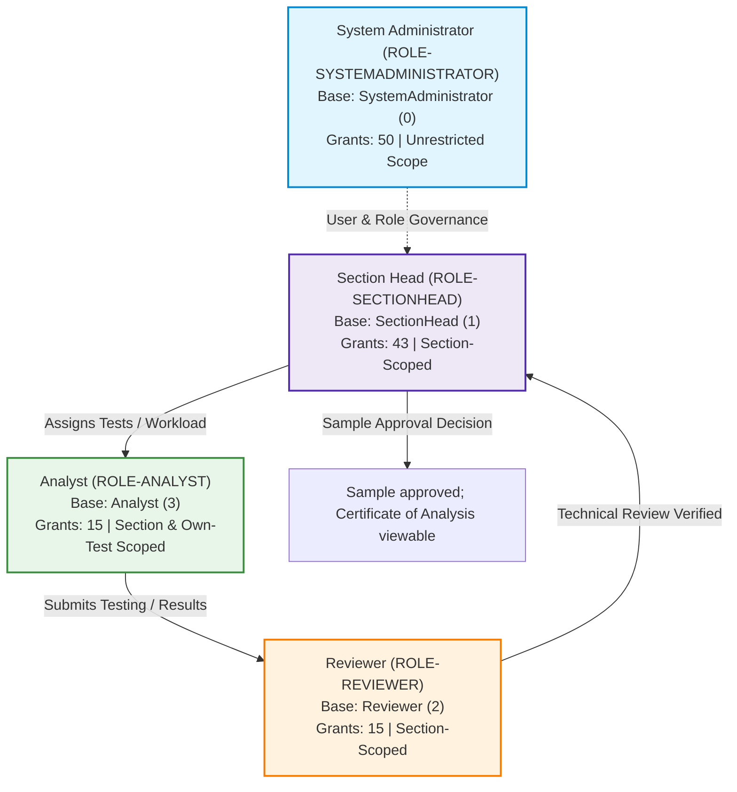

# Role Guide: Roles, Permissions, Authorizations, and Governance

This document establishes the verified role, permission, scoping, and governance architecture for MicroLIMS (Phase 7 Role-Based Documentation). It serves as the authoritative technical reference for the MicroLIMS User Guide knowledge base [src: documentation/knowledge/_raw/verified-roles-permissions.md; documentation/01_APPLICATION_MAP.md §3, §5; documentation/knowledge/roles.md].

---

## 1. System Authorization Architecture: Roles, Permissions, and Scoping (verified)

### 1.1 Roles vs. Permission Codes
In MicroLIMS, system security and user capabilities are structured into two distinct layers:
1. **Roles**: Named security profiles assigned to user accounts. Each role is built upon one of four underlying base role types defined in the system enumeration `RoleType`: `SystemAdministrator` (0), `SectionHead` (1), `Reviewer` (2), or `Analyst` (3) [src: backend/MicroLIMS.Domain/Enums/RoleType.cs; documentation/01_APPLICATION_MAP.md §5.1].
2. **Permission Codes**: Granular functional privileges represented as alphanumeric string identifiers (e.g., `Samples.Review`, `MasterData.Manage`, `Hplc.Operate`). Exactly 50 permission codes are declared in `PermissionConstants.All` [src: backend/MicroLIMS.Shared/Constants/PermissionConstants.cs:L109-L128; documentation/knowledge/_raw/verified-roles-permissions.md:L18].

### 1.2 Administrative Role Editability (Defaults vs. Fixed Grants)
The four seeded system roles are **defaults**, not immutable assignments [src: documentation/knowledge/_raw/verified-roles-permissions.md:L94-L101; documentation/01_APPLICATION_MAP.md §5.1]:
- An administrator holding `Roles.Manage` can create custom roles with any name and choose an underlying `BaseType` (`SystemAdministrator`, `SectionHead`, `Reviewer`, or `Analyst`). A newly created custom role inherits the default permission catalogue of its base role type as a starting point [src: backend/MicroLIMS.Application/Services/RoleService.cs:L63-L89; backend/MicroLIMS.API/Controllers/RoleController.cs:L41-L46].
- An administrator can rename any role (including system roles), edit its description, and completely replace its assigned permission set. No system guard prevents modifying the permission sets of `System Administrator` or `Section Head` [src: backend/MicroLIMS.Application/Services/RoleService.cs:L91-L106, L126-L171]. Every replacement of a role's permission set writes a `ROLE_PERMISSIONS_UPDATED` entry into the audit trail recording granted and revoked permissions [src: backend/MicroLIMS.Application/Services/RoleService.cs:L160-L167].
- System roles cannot be deleted (`IsSystemRole = true`), and custom roles currently assigned to one or more users cannot be deleted [src: backend/MicroLIMS.Application/Services/RoleService.cs:L108-L124; frontend/src/modules/roles/RoleDetailPage.tsx:L116].
- **Production Baseline Caveat**: The grants documented in this guide represent the pristine code and seed defaults (50 for System Administrator, 43 for Section Head, 15 for Reviewer, 15 for Analyst). Actual effective grants on a live database are determined by database rows (`RolePermissions` table) and may have been altered by administrative action (REQUIRES CONFIRMATION on live deployments via read-only SQL query) [src: documentation/knowledge/_raw/verified-roles-permissions.md:L79, L226; documentation/01_APPLICATION_MAP.md §5.1].

### 1.3 Permission Propagation and Token Timing
- **Permission Changes**: User permissions are embedded as claims (`claim: "permission"`) in the JSON Web Token (JWT) issued upon authentication [src: backend/MicroLIMS.Infrastructure/Authentication/JwtTokenService.cs:L36-L43]. Consequently, any permission change made via the Roles screen takes effect only when the user acquires their **next access token** (default access token lifetime is 15 minutes, configurable from 1 to 480 minutes) [src: backend/MicroLIMS.API/Extensions/JwtConfiguration.cs:L30-L37; documentation/knowledge/_raw/verified-roles-permissions.md:L103-L104, L207].
- **Immediate Revalidation**: In contrast to permission grants, changes to a user's base `RoleType`, account deactivation, account lockout, or password updates are evaluated per request via the `AccessTokenRevalidator` pipeline middleware and take effect **immediately on the next request** [src: backend/MicroLIMS.API/Authorization/AccessTokenRevalidator.cs:L55-L72; documentation/knowledge/_raw/verified-roles-permissions.md:L104, L217].
- **Self-Modification Restrictions**: A user cannot modify their own role, cannot disable their own account, and cannot delete their own account [src: backend/MicroLIMS.Application/Services/UserService.cs:L163-L172, L208; backend/MicroLIMS.Application/Services/UserDeletionService.cs:L63; documentation/knowledge/_raw/verified-roles-permissions.md:L103, L136].

### 1.4 Laboratory Membership and Scope Enforcement
Application visibility and data access are governed by multi-tier organizational scoping [src: documentation/knowledge/_raw/verified-roles-permissions.md:L181-L193; documentation/01_APPLICATION_MAP.md §3.2, §5.5]:
1. **Laboratory Section Membership**: MicroLIMS defines two primary laboratory section codes:
   - `MICRO` (Microbiology Laboratory)
   - `FP` (Physicochemical Laboratory)
   [src: backend/MicroLIMS.Shared/Constants/LaboratoryCodes.cs:L7-L8].
   A user's laboratory access is established by their `UserOrgMembership` records (configured by administrators with `Users.Manage` via `LaboratoryOrganizationController`) [src: backend/MicroLIMS.Application/Services/LaboratoryOrganizationService.cs:L61-L98]. A department-level membership grants access to all active sections in that department; a section-level membership grants access only to that specific section [src: backend/MicroLIMS.Application/Services/UserSectionScopeService.cs:L42-L77].
2. **Zero Membership**: A user without any assigned organizational membership has an empty scope and cannot see or process laboratory test data ("Your account is not assigned to any laboratory section. Ask an administrator to assign one.") [src: backend/MicroLIMS.Application/Services/UserSectionScopeService.cs:L37-L40, L125; documentation/knowledge/_raw/verified-roles-permissions.md:L185].
3. **System Administrator Scope Bypass**: A user whose base role type is `SystemAdministrator` is unrestricted by default (`GetAccessibleSectionIdsAsync` returns `null`), possessing global visibility across all sections, departments, and physical test records [src: backend/MicroLIMS.Application/Services/UserSectionScopeService.cs:L26-L29; documentation/knowledge/_raw/verified-roles-permissions.md:L186]. In the UI, `useMyLabs` automatically forces `MICRO`, `FP`, and both physchem areas to active for System Administrators [src: frontend/src/hooks/useMyLabs.ts:L11-L66].
4. **Physicochemical Areas (`fp` vs. `rmpm`)**: For users assigned to the Physicochemical section (`FP`), an organizational area flag determines workspace visibility:
   - Area `fp`: Finished Product Workspace (`/physicochemical/workspace`).
   - Area `rmpm`: Raw Material & Packaging Material Workspace (`/physicochemical/rm-pm-workspace`).
   If no specific area is restricted on the membership, both workspaces are displayed [src: frontend/src/routes/menuConfig.ts:L161-L168, L258; documentation/01_APPLICATION_MAP.md §3.2; documentation/knowledge/_raw/verified-roles-permissions.md:L187].
5. **Sample Receiving Scope**: Holding `Samples.Receive` permits receiving samples for **any** laboratory section globally. In contrast, holding `Samples.ReceiveOwnLab` restricts sample receiving exclusively to the laboratory sections where the user holds active membership ("You can receive samples only for your own laboratory.") [src: backend/MicroLIMS.Application/Services/ReceiptLabGuard.cs:L25-L30; backend/MicroLIMS.API/Controllers/SampleController.cs:L82-L102; documentation/knowledge/_raw/verified-roles-permissions.md:L189].
6. **Cross-Lab Tracking**: Viewing the global sample tracking board across all laboratories requires `Samples.TrackAll` (granted by default to Section Head and System Administrator) [src: backend/MicroLIMS.API/Controllers/SampleTrackingController.cs:L16; documentation/01_APPLICATION_MAP.md §3.3].

---

## 2. Seeded Roles: Profiles and Operating Boundaries

MicroLIMS provides four seeded system roles in baseline configuration. Custom roles inherit the operational behavior of their assigned base `RoleType` for all hardcoded role-type checks [src: documentation/knowledge/_raw/verified-roles-permissions.md:L105; documentation/01_APPLICATION_MAP.md §5.1].

---

### 2.1 System Administrator (`ROLE-SYSTEMADMINISTRATOR`) (verified)

#### Purpose
The System Administrator oversees system security, infrastructure health, user access provisioning, organizational structure, global audit trails, technical error monitoring, and administrative reporting backfills. The role acts as a global system authority across both laboratory sections, while remaining strictly constrained by segregation-of-duties rules and specific role-type operational boundaries [src: documentation/01_APPLICATION_MAP.md §5.1; documentation/knowledge/_raw/verified-roles-permissions.md:L85, L118].

#### Accessible Modules (Sidebar Items Visible by Default)
Because the System Administrator holds all 50 permission codes and bypasses laboratory section restrictions [src: frontend/src/hooks/useMyLabs.ts:L11-L66; frontend/src/routes/menuConfig.ts:L76-L266; documentation/01_APPLICATION_MAP.md §3.3], all sidebar navigation groups and items are visible:
- **OVERVIEW**: Dashboard (`/dashboard`).
- **RECEIVING**: Receive Sample (`/receiving`), Tracking Board (`/receiving/tracking`).
- **LABORATORIES — Microbiology Laboratory**: Workspace (`/microbiology/workspace`), Media Preparation & Evaluation (`/laboratory-configuration/media`), Reference Cryovials (`/laboratory-configuration/cryovials`), Materials Stock (`/inventory/materials?lab=MICRO`), Equipment Inventory (`/inventory/equipment?lab=MICRO`).
- **LABORATORIES — Microbiology Configuration**: Test Master (`/laboratory-configuration/test-master`), Organisms (`/laboratory-configuration/organisms`), Media Configurations (`/laboratory-configuration/media-configurations`), Water (`/laboratory-configuration/water`), Environmental Monitoring (`/laboratory-configuration/environmental-monitoring`), After Cleaning (`/laboratory-configuration/after-cleaning`), Equipment (`/laboratory-configuration/equipment`).
- **LABORATORIES — Physicochemical Laboratory**: FP Workspace (`/physicochemical/workspace`), RM & PM Workspace (`/physicochemical/rm-pm-workspace`), Solution Preparation (`/preparation`), Working Standards (`/working-standards`), HPLC Workspace (`/hplc-workspace`), GC Workspace (`/gc-workspace`), ICP Workspace (`/icp-workspace`), Materials Stock (`/inventory/materials?lab=FP`), Equipment Inventory (`/inventory/equipment?lab=FP`).
- **LABORATORIES — Physicochemical Configuration**: FP Test Master (`/laboratory-configuration/fp-test-master`), RM & PM Test Master (`/laboratory-configuration/rm-pm-test-master`), Equation Types (`/laboratory-configuration/equation-types`), Physicochemical Instruments (`/laboratory-configuration/fp-instruments`), Chromatography Columns (`/laboratory-configuration/columns`), Reagents & Standards (`/laboratory-configuration/material-master`), Solutions (`/laboratory-configuration/solution-master`), HPLC Methods (`/laboratory-configuration/hplc-methods`), ICP Methods (`/laboratory-configuration/icp-methods`).
- **GENERAL LABORATORY CONFIGURATION**: Items (`/laboratory-configuration/items`), Receiving Configuration (`/laboratory-configuration/receiving-configuration`), Master Data Workbook (`/laboratory-configuration/master-data-workbook`).
- **DOCUMENT CONTROL**: Dashboard (`/document-control`), My Reading List (`/document-control/my-reading-list`), Training Matrix (`/document-control/training-matrix`), Compliance Dashboard (`/document-control/compliance-dashboard`), Document Library (`/document-control/library`), Audit Trail (`/document-control/audit`), Configuration (`/document-control/configuration`).
- **ADMINISTRATION**: Users (`/users`), Roles (`/roles`).
- **REPORTS**: Reports (`/reports` — including the KPI/Performance tab).
- **AUDIT & COMPLIANCE**: Audit Search (`/audit-search`), OOS Tracking (`/oos-tracking`).
- **SYSTEM**: Error Monitoring (`/error-monitoring`).

#### Allowed Actions
- Full lifecycle user management: create, edit, activate/deactivate, lock/unlock accounts, initiate admin-assisted password recoveries, force password changes, permanently delete user accounts (with the guards below), and manage user organization memberships [src: backend/MicroLIMS.API/Controllers/UserController.cs:L22-L140; backend/MicroLIMS.API/Controllers/LaboratoryOrganizationController.cs:L9].
- Full role and permission management (`Roles.Manage`): create custom roles, rename roles, delete unassigned custom roles, assign or revoke permission codes [src: backend/MicroLIMS.API/Controllers/RoleController.cs:L20-L70].
- View technical system error logs and exception telemetry (`System.ViewErrorLog`) [src: backend/MicroLIMS.API/Controllers/ErrorMonitoringController.cs:L20-L21].
- Execute administrative reporting backfills (`Reporting.Admin`) [src: backend/MicroLIMS.API/Controllers/ReportingAdminController.cs:L15-L25].
- Configure Document Control module settings (types, numbering rules, departments, settings via `Documents.ConfigManage` and role type `SystemAdministrator`) [src: backend/MicroLIMS.Application/Services/DocumentControl/DocumentConfigurationService.cs:L33-L36].
- Execute global audit searches, traceability queries, and login history audits (`Audit.View`) [src: backend/MicroLIMS.API/Controllers/AuditController.cs:L11-L51].
- Inspect electronic signature audit trails across all entities (`Signatures.Manage`) [src: backend/MicroLIMS.API/Controllers/SignaturesController.cs:L15-L25].
- Global sample receiving across all laboratories (`Samples.Receive`) and global tracking (`Samples.TrackAll`) [src: backend/MicroLIMS.API/Controllers/SampleController.cs:L88-L89; SampleTrackingController.cs:L16].
- Assign responsible analysts to sample test orders (`Samples.AssignAnalyst`) [src: backend/MicroLIMS.API/Controllers/SampleController.cs:L127].
- Exercise supervisor overrides on running incubations and reset pathogen testing sessions (`TestWorkflow.Supervise`) [src: backend/MicroLIMS.API/Controllers/TestWorkflowController.cs:L543-L544; PathogenSessionController.cs:L171-L172].
- View team-wide KPIs, configure workflow profiles, and manage analyst availability (`Kpi.View`, `Kpi.ViewTeam`, `Kpi.ConfigureProfiles`) [src: backend/MicroLIMS.API/Controllers/KpiDashboardController.cs:L14, L22; WorkflowProfilesController.cs:L42, L47].
- Manage laboratory configurations, items, specifications, equipment, and master data workbooks [src: documentation/knowledge/_raw/verified-roles-permissions.md:L85].
- Execute sample technical review and sample approval decisions when segregation-of-duties criteria are satisfied [src: backend/MicroLIMS.API/Controllers/SampleReviewController.cs:L19; SampleApprovalController.cs:L34].

#### Restricted Actions
- **Self-Account Operations**: Cannot modify own role ("System Administrators cannot modify their own role."), cannot disable own account ("System Administrators cannot disable their own account."), cannot delete own account ("You cannot permanently delete your own account."), and cannot initiate administrative password recovery on own account [src: backend/MicroLIMS.Application/Services/UserService.cs:L165, L208; UserDeletionService.cs:L63; AdminPasswordRecoveryService.cs:L51].
- **System Stability Guards**: Cannot delete system roles (role deletion is a `Roles.Manage` action), and cannot permanently delete the last remaining active System Administrator user account ("Cannot delete the last active System Administrator account. Promote another user to System Administrator first.") [src: backend/MicroLIMS.Application/Services/RoleService.cs:L108-L124; UserDeletionService.cs:L65-L68].
- **Media Product Code Modification**: Refused by endpoint `PUT api/masterdata/media-products/{id}/code`, which enforces `[Authorize(Roles = RoleConstants.SectionHead)]`. System Administrator is refused because this action is exclusively reserved for the Section Head role type [src: backend/MicroLIMS.API/Controllers/MediaMasterDataController.cs:L52-L56; documentation/knowledge/_raw/verified-roles-permissions.md:L13, L108].
- **Document Master Voiding**: Strictly reserved for the Section Head role type (Document Controller); System Administrator is refused [src: backend/MicroLIMS.Application/Services/DocumentControl/DocumentAuthorizationService.cs:L147-L154; docs/ML-DC-FRS-1A-001.md:L91].
- **Document Technical Review Completion**: A System Administrator can add reviewer findings, but cannot complete or return a technical review ("Only the assigned technical reviewer or document controller may complete this technical review.") [src: backend/MicroLIMS.Application/Services/DocumentControl/DocumentReviewService.cs:L292-L293, L561-L563; documentation/knowledge/roles.md:L400].
- **Analyst Dashboard Endpoints**: Calling `/api/dashboard/my-tasks` or `/api/dashboard/analyst-metrics` results in HTTP 403 Forbid unless the user's role type is `Analyst` [src: backend/MicroLIMS.API/Controllers/DashboardController.cs:L86, L110; documentation/knowledge/_raw/verified-roles-permissions.md:L109].
- **Workbook Verification Segregation**: Cannot verify a master data workbook import that they loaded ("The person who loaded the workbook cannot verify it. Ask a second person.") [src: backend/MicroLIMS.Application/Services/MasterDataWorkbook/MasterDataWorkbookService.cs:L199-L200].
- **Segregation of Duties**: System Administrator possesses **no administrative exemption** from laboratory segregation-of-duties rules. Cannot review or approve any sample, test, media lot, cryovial batch, or working standard where they performed, prepared, or evaluated testing [src: backend/MicroLIMS.Application/Services/SegregationOfDutiesGuard.cs:L6-L10; documentation/knowledge/_raw/verified-roles-permissions.md:L118-L137].

#### Approval and Review Responsibilities
May technically review and release/approve samples, cryovial batches, media lots, working standards, and document control revisions, provided they did not perform the test or author the record [src: documentation/knowledge/_raw/verified-roles-permissions.md:L85, L118-L138].

#### Signatures They Give
Eligible to execute any of the 26 electronic signature-required actions in MicroLIMS where authorized (including Sample Review, Sample Approval, Section Closure, Add Laboratory, Sample Correction/Void, Sample Preparation, Cryovial Approval, Media Release, Solution Preparation, Titrant Standardization, HPLC SST, ICP Calibration, Working Standard Sign-Off, Master Data Workbook Load/Verify, KPI Profiles, Document Approval, and Physicochemical Results), EXCEPT actions restricted by role type (media product code change) or blocked by segregation of duties [src: documentation/knowledge/_raw/verified-roles-permissions.md:L140-L179].

#### Typical Workflows
`WF-AUTH-001`, `WF-AUTH-003`, `WF-AUTH-004`, `WF-AUTH-005`, `WF-USERS-001`, `WF-USERS-002`, `WF-ROLES-001`, `WF-AUDIT-001`, `WF-ERR-001`, `WF-MSG-001`, `WF-DISC-001`, `WF-NOTIF-001`, `WF-SAMPLE-001`, `WF-SAMPLE-002`, `WF-SAMPLE-003`, `WF-SAMPLE-004`, `WF-SAMPLE-005`, `WF-TESTING-002`, `WF-PATH-003`, `WF-REVIEW-001`, `WF-APPROVAL-001`, `WF-APPROVAL-002`, `WF-APPROVAL-003`, `WF-COA-001`, `WF-OOS-001`, `WF-WORKBOOK-001`, `WF-WORKBOOK-002`, `WF-REPORTS-001`, `WF-KPI-001`, `WF-KPI-002`, `WF-DC-001`, `WF-DC-002`, `WF-DC-003`, `WF-DC-005`, `WF-DC-006`, `WF-DC-007` [src: documentation/knowledge/workflows.md].

#### Department / Lab Scoping
Unrestricted scope (`null`). Automatically granted full access across `MICRO`, `FP`, finished products (`fp`), and raw/packaging materials (`rmpm`) [src: backend/MicroLIMS.Application/Services/UserSectionScopeService.cs:L26-L29; documentation/knowledge/_raw/verified-roles-permissions.md:L186].

---

### 2.2 Section Head (`ROLE-SECTIONHEAD`) (verified)

#### Purpose
The Section Head serves as the operational and technical leader of an assigned laboratory section (Microbiology or Physicochemical / Finished Product). They manage workload distribution, assign analysts, supervise testing workflows, execute supervisor overrides, conduct technical reviews, approve sample release decisions, release media lots and cryovial batches, track OOS investigations, configure laboratory master data, and execute Document Controller responsibilities within Document Control [src: documentation/01_APPLICATION_MAP.md §5.1; backend/MicroLIMS.Application/Services/DocumentControl/DocumentAuthorizationService.cs:L152; documentation/knowledge/_raw/verified-roles-permissions.md:L86].

#### Accessible Modules (Sidebar Items Visible by Default)
Visible items depend on the Section Head's assigned laboratory membership (`MICRO` or `FP`) [src: documentation/01_APPLICATION_MAP.md §3.3; frontend/src/routes/menuConfig.ts:L76-L266]:
- **OVERVIEW**: Dashboard (`/dashboard`).
- **RECEIVING**: Receive Sample (`/receiving`), Tracking Board (`/receiving/tracking` via `Samples.TrackAll`).
- **If Member of `MICRO` (Microbiology Laboratory)**:
  - Microbiology Laboratory: Workspace (`/microbiology/workspace`), Media Preparation & Evaluation (`/laboratory-configuration/media` via `Media.Prepare`), Reference Cryovials (`/laboratory-configuration/cryovials` via `Cryovials.Manage`), Materials Stock (`/inventory/materials?lab=MICRO` via `Materials.Manage`), Equipment Inventory (`/inventory/equipment?lab=MICRO` via `Equipment.Manage`).
  - Microbiology Configuration (via `MasterData.Manage`): Test Master (`/laboratory-configuration/test-master`), Organisms (`/laboratory-configuration/organisms`), Media Configurations (`/laboratory-configuration/media-configurations`), Water (`/laboratory-configuration/water`), Environmental Monitoring (`/laboratory-configuration/environmental-monitoring`), After Cleaning (`/laboratory-configuration/after-cleaning`), Equipment (`/laboratory-configuration/equipment`).
- **If Member of `FP` (Physicochemical Laboratory)**:
  - Physicochemical Laboratory: FP Workspace (`/physicochemical/workspace` if assigned area `fp`), RM & PM Workspace (`/physicochemical/rm-pm-workspace` if assigned area `rmpm`), Solution Preparation (`/preparation` via `Solutions.Prepare`), Working Standards (`/working-standards`), HPLC Workspace (`/hplc-workspace`), GC Workspace (`/gc-workspace`), ICP Workspace (`/icp-workspace`), Materials Stock (`/inventory/materials?lab=FP` via `Materials.Manage`), Equipment Inventory (`/inventory/equipment?lab=FP` via `Equipment.Manage`).
  - Physicochemical Configuration (via `MasterData.Manage`): FP Test Master (`/laboratory-configuration/fp-test-master`), RM & PM Test Master (`/laboratory-configuration/rm-pm-test-master`), Equation Types (`/laboratory-configuration/equation-types`), Physicochemical Instruments (`/laboratory-configuration/fp-instruments`), Chromatography Columns (`/laboratory-configuration/columns`), Reagents & Standards (`/laboratory-configuration/material-master`), Solutions (`/laboratory-configuration/solution-master`), HPLC Methods (`/laboratory-configuration/hplc-methods`), ICP Methods (`/laboratory-configuration/icp-methods`).
- **GENERAL LABORATORY CONFIGURATION**: Items (`/laboratory-configuration/items` via `Items.Manage`), Receiving Configuration (`/laboratory-configuration/receiving-configuration` via `MasterData.Manage`), Master Data Workbook (`/laboratory-configuration/master-data-workbook` via `MasterData.Manage`).
- **DOCUMENT CONTROL**: Dashboard (`/document-control`), My Reading List (`/document-control/my-reading-list`), Training Matrix (`/document-control/training-matrix`), Compliance Dashboard (`/document-control/compliance-dashboard`), Document Library (`/document-control/library`), Audit Trail (`/document-control/audit` — accessible to SectionHead role type).
  *(Note: Document Control Configuration `/document-control/configuration` is hidden because Section Head lacks `Documents.ConfigManage`).*
- **REPORTS**: Reports (`/reports` — including the KPI/Performance tab via `Kpi.View`).
- **AUDIT & COMPLIANCE**: Audit Search (`/audit-search` via `Audit.View`), OOS Tracking (`/oos-tracking` via `Oos.Manage`).
- **ADMINISTRATION**: Hidden (lacks `Users.Manage` and `Roles.Manage`).
- **SYSTEM**: Hidden (lacks `System.ViewErrorLog`).

#### Allowed Actions
- Full sample lifecycle management: receive samples across all labs (`Samples.Receive`), track cross-lab samples (`Samples.TrackAll`), assign analysts (`Samples.AssignAnalyst`), correct sample details and void samples (`Samples.Correct`) [src: backend/MicroLIMS.API/Controllers/SampleController.cs:L88, L107, L127, L136; SampleTrackingController.cs:L16].
- Final sample release and authorization: approve samples, reject samples, order retests, request new samples, and close testing on rejected multi-lab samples (`Samples.Approve`) [src: backend/MicroLIMS.API/Controllers/SampleApprovalController.cs:L34, L48, L58].
- Technical review of samples (`Samples.Review`) and returning tests to analysts [src: backend/MicroLIMS.API/Controllers/SampleReviewController.cs:L19, L48].
- Supervisor test workflow interventions: override minimum incubation time gates and reset pathogen testing sessions (`TestWorkflow.Supervise`) [src: backend/MicroLIMS.API/Controllers/TestWorkflowController.cs:L543-L544; PathogenSessionController.cs:L171-L172].
- Record biochemical confirmation decisions on pathogen tests (`TestWorkflow.BiochemicalDecision`) [src: backend/MicroLIMS.API/Controllers/TestWorkflowController.cs:L527-L528].
- Media and strain releases: release prepared media lots (`Media.Release`) and approve cryovial batches (`Cryovials.Approve`) [src: backend/MicroLIMS.API/Controllers/MediaController.cs:L73-L74; CryovialController.cs:L49-L50].
- Document lifecycle control on physical inventory: supersede or void material documents (`Materials.DocumentControl`) and equipment documents (`Equipment.DocumentControl`) [src: backend/MicroLIMS.API/Controllers/MaterialDocumentController.cs:L118; EquipmentDocumentController.cs:L75].
- Item and specification governance: create/edit/freeze items (`Items.Manage`), upload item documents (`Items.DocumentUpload`), configure and approve item preparation configurations [src: backend/MicroLIMS.API/Controllers/ItemController.cs:L24-L61; ItemDocumentController.cs:L48; ItemPreparationConfigurationController.cs:L34-L67].
- Manage laboratory configuration and master data (`MasterData.Manage`) across EM, Water, After Cleaning, Organisms, Media, Equipment, Test Masters, and Reference Lists [src: documentation/knowledge/_raw/verified-roles-permissions.md:L86].
- **Exclusive Authority — Media Product Code Change**: Execute signed code changes via `PUT api/masterdata/media-products/{id}/code` (`[Authorize(Roles = RoleConstants.SectionHead)]`) [src: backend/MicroLIMS.API/Controllers/MediaMasterDataController.cs:L52-L56; documentation/knowledge/_raw/verified-roles-permissions.md:L108].
- **Exclusive Authority — Document Master Voiding**: Exclusively permitted to void a controlled Document Master in Document Control [src: backend/MicroLIMS.Application/Services/DocumentControl/DocumentAuthorizationService.cs:L147-L154].
- Override proposed document revision numbers in Document Control ("Only Document Controllers are authorized to override the proposed revision number.") [src: backend/MicroLIMS.Application/Services/DocumentControl/DocumentRevisionService.cs:L109-L112].
- Assign document reading and training curricula (`Documents.TrainingAssign`) [src: backend/MicroLIMS.API/Controllers/DocumentControl/DocumentTrainingAssignmentController.cs:L31-L45].
- View team KPIs and configure workflow profile versions (`Kpi.View`, `Kpi.ViewTeam`, `Kpi.ConfigureProfiles`) [src: backend/MicroLIMS.API/Controllers/KpiDashboardController.cs:L14, L22; WorkflowProfilesController.cs:L42, L47].
- Manage OOS tracking groups and investigation documents (`Oos.Manage`) [src: backend/MicroLIMS.API/Controllers/OosTrackingController.cs:L15-L16].
- Moderate discussions by editing or deleting any post or comment (`Discussions.EditAny`) [src: backend/MicroLIMS.API/Controllers/DiscussionController.cs:L24].
- View audit trails (`Audit.View`) and signature history (`Signatures.Manage`) [src: backend/MicroLIMS.API/Controllers/AuditController.cs:L11; SignaturesController.cs:L15].

#### Restricted Actions
- Cannot manage user accounts (`Users.Manage` not granted by default) [src: documentation/knowledge/_raw/verified-roles-permissions.md:L86].
- Cannot manage system roles and permissions (`Roles.Manage` not granted by default) [src: documentation/knowledge/_raw/verified-roles-permissions.md:L86].
- Cannot view technical error logs (`System.ViewErrorLog` not granted by default) [src: documentation/knowledge/_raw/verified-roles-permissions.md:L86].
- Cannot manage Document Control module configuration (`Documents.ConfigManage` not granted; backend check additionally demands `SystemAdministrator` role type) [src: backend/MicroLIMS.Application/Services/DocumentControl/DocumentConfigurationService.cs:L33-L36].
- Cannot execute reporting administrative backfill operations (`Reporting.Admin` not granted) [src: documentation/knowledge/_raw/verified-roles-permissions.md:L86].
- Cannot access Analyst dashboard endpoints `/api/dashboard/my-tasks` or `/analyst-metrics` (Forbid unless role type is `Analyst`) [src: backend/MicroLIMS.API/Controllers/DashboardController.cs:L86, L110].
- Cannot approve any sample they reviewed ("You cannot approve a sample you reviewed.") or tested ("You cannot approve a sample you tested.") [src: backend/MicroLIMS.Application/Services/SampleApprovalService.cs:L162-L170].
- Cannot review any sample they tested ("You cannot review a sample you tested.") [src: backend/MicroLIMS.Application/Services/SampleReviewService.cs:L109-L112].
- Cannot approve a media lot they prepared or evaluated ("You cannot approve a media lot you prepared or evaluated.") [src: backend/MicroLIMS.Application/Services/MediaReleaseService.cs:L81-L82].
- Cannot approve a cryovial batch they prepared ("You cannot approve a cryovial batch you prepared.") [src: backend/MicroLIMS.Application/Services/CryovialService.cs:L151-L152].
- Cannot verify a master data workbook import they loaded ("The person who loaded the workbook cannot verify it. Ask a second person.") [src: backend/MicroLIMS.Application/Services/MasterDataWorkbook/MasterDataWorkbookService.cs:L199-L200].
- Cannot approve or review own document revisions (author cannot review or approve own revision) [src: backend/MicroLIMS.Application/Services/DocumentControl/DocumentApprovalService.cs:L646-L687; DocumentReviewService.cs:L104-L110].

#### Approval and Review Responsibilities
Primary release and approval authority for samples, media lots, cryovial batches, working standards, and controlled documents within their laboratory scope [src: documentation/knowledge/_raw/verified-roles-permissions.md:L86, L124-L135].

#### Signatures They Give
Active signer across key operational and release milestones: Sample Approval (Approved, Rejected, RetestRequested), Section Closure (TestingClosed), Sample Review (Reviewed), Add Laboratory (LaboratoryAdded), Sample Correction/Void (SampleCorrected, SampleVoided), Sample Preparation (PreparationConfirmed), Cryovial Batch Approval/Rejection (Approved, Rejected), Media Lot Release/Rejection (Approved, Rejected), Media Product Code Change (MasterDataChanged), Solution Preparation (PreparationConfirmed), Titrant Standardization (TitrantStandardized), Titrant Due Acknowledgement (TitrantDueAcknowledged), HPLC SST (SuitabilityRunPerformed), ICP Calibration (SuitabilityRunPerformed), Working Standard Sign-Off (Reviewed, Approved, Rejected), Master Data Workbook Load (MasterDataChanged) and Verify (Reviewed), KPI Profile Versions (MasterDataChanged), Document Revision Approval (Approved), and Physicochemical Test Results (ResultRecorded) [src: documentation/knowledge/_raw/verified-roles-permissions.md:L150-L178].

#### Typical Workflows
`WF-AUTH-001`, `WF-AUTH-004`, `WF-AUTH-005`, `WF-MSG-001`, `WF-DISC-001`, `WF-NOTIF-001`, `WF-SAMPLE-001`, `WF-SAMPLE-002`, `WF-SAMPLE-003`, `WF-SAMPLE-004`, `WF-SAMPLE-005`, `WF-SAMPLE-006`, `WF-SAMPLE-007`, `WF-SAMPLE-008`, `WF-PREP-001`, `WF-PREP-002`, `WF-TESTING-001`, `WF-TESTING-002`, `WF-PATH-002`, `WF-PATH-003`, `WF-REVIEW-001`, `WF-REVIEW-002`, `WF-APPROVAL-001`, `WF-APPROVAL-002`, `WF-APPROVAL-003`, `WF-COA-001`, `WF-OOS-001`, `WF-MEDIACFG-001`, `WF-MEDIACFG-002`, `WF-EQUIP-002`, `WF-TESTMASTER-001` (micro & physchem), `WF-EM-001`, `WF-WATER-001`, `WF-AC-001`, `WF-ORG-001`, `WF-MEDIA-001`, `WF-MEDIA-002`, `WF-MEDIA-003`, `WF-MEDIA-004`, `WF-CRYO-001`, `WF-CRYO-002`, `WF-CRYO-003`, `WF-MATERIAL-001`, `WF-EQUIP-001`, `WF-HPLC-001`, `WF-GC-001`, `WF-ICP-001`, `WF-SOLN-001`, `WF-SOLN-002`, `WF-WS-001`, `WF-ITEM-001`, `WF-ITEM-002`, `WF-ITEM-003`, `WF-RECVCFG-001`, `WF-WORKBOOK-001`, `WF-WORKBOOK-002`, `WF-REPORTS-001`, `WF-KPI-001`, `WF-KPI-002`, `WF-DC-001`, `WF-DC-002`, `WF-DC-003`, `WF-DC-004`, `WF-DC-005`, `WF-DC-007` [src: documentation/knowledge/workflows.md].

#### Department / Lab Scoping
Scoped strictly to assigned laboratory sections (`MICRO` and/or `FP`) and physchem areas (`fp`, `rmpm`). While receiving allows targeting any laboratory via `Samples.Receive` and tracking spans all sections via `Samples.TrackAll`, testing, reviews, approvals, and section-scoped master data (specifications, equipment) are strictly bounded by organizational membership [src: documentation/knowledge/_raw/verified-roles-permissions.md:L183-L192; documentation/knowledge/roles.md:L186, L218, L324-L326].

---

### 2.3 Reviewer (`ROLE-REVIEWER`) (verified)

#### Purpose
The Reviewer is an independent senior analyst or designated technical checker responsible for conducting secondary technical verification of test results, raw readings, observations, pathogen confirmation matrices, and media evaluations before final authorization by the Section Head. In Document Control, Reviewers serve as assigned technical reviewers for controlled document revisions [src: documentation/01_APPLICATION_MAP.md §5.1; documentation/knowledge/_raw/verified-roles-permissions.md:L87].

#### Accessible Modules (Sidebar Items Visible by Default)
Visible items depend on laboratory section membership (`MICRO` or `FP`) [src: documentation/01_APPLICATION_MAP.md §3.3; frontend/src/routes/menuConfig.ts:L76-L266]:
- **OVERVIEW**: Dashboard (`/dashboard`).
- **RECEIVING**: Receive Sample (`/receiving` via `Samples.ReceiveOwnLab`). Tracking Board is hidden (lacks `Samples.TrackAll`).
- **If Member of `MICRO` (Microbiology Laboratory)**:
  - Microbiology Laboratory: Workspace (`/microbiology/workspace`), Media Preparation & Evaluation (`/laboratory-configuration/media` via `Media.Prepare`), Reference Cryovials (`/laboratory-configuration/cryovials` via `Cryovials.Manage`). Materials Stock and Equipment Inventory are hidden (lacks `Materials.Manage`, `Equipment.Manage`).
  - Microbiology Configuration: Entirely hidden (lacks `MasterData.Manage`).
- **If Member of `FP` (Physicochemical Laboratory)**:
  - Physicochemical Laboratory: FP Workspace (`/physicochemical/workspace` if assigned area `fp`), RM & PM Workspace (`/physicochemical/rm-pm-workspace` if assigned area `rmpm`), Working Standards (`/working-standards`), HPLC Workspace (`/hplc-workspace`), GC Workspace (`/gc-workspace`), ICP Workspace (`/icp-workspace`). Solution Preparation, Materials Stock, and Equipment Inventory are hidden (lacks `Solutions.Prepare`, `Materials.Manage`, `Equipment.Manage`).
  - Physicochemical Configuration: Entirely hidden (lacks `MasterData.Manage`).
- **GENERAL LABORATORY CONFIGURATION**: Entirely hidden (lacks `Items.Manage`, `MasterData.Manage`).
- **DOCUMENT CONTROL**: Dashboard (`/document-control`), My Reading List (`/document-control/my-reading-list`), Training Matrix (`/document-control/training-matrix`), Compliance Dashboard (`/document-control/compliance-dashboard`), Document Library (`/document-control/library`), Audit Trail (`/document-control/audit` — accessible to Reviewer role type). Configuration is hidden (lacks `Documents.ConfigManage`).
- **REPORTS**: Reports (`/reports` — Overview, Search, Media/GPT, Reference Strains and Trending tabs; the KPI/Performance tab is hidden because Reviewer lacks `Kpi.View`).
- **AUDIT & COMPLIANCE**: Entirely hidden (lacks `Audit.View` and `Oos.Manage`).
- **ADMINISTRATION**: Hidden.
- **SYSTEM**: Hidden.

#### Allowed Actions
- Execute sample technical review decisions (`Samples.Review`) on test orders within assigned sections [src: backend/MicroLIMS.API/Controllers/SampleReviewController.cs:L19].
- Return count tests to analysts with specific revision instructions (`Samples.Review`) [src: backend/MicroLIMS.API/Controllers/SampleReviewController.cs:L48].
- Receive samples for own laboratory sections only (`Samples.ReceiveOwnLab`) [src: backend/MicroLIMS.API/Controllers/SampleController.cs:L82].
- Correct sample metadata or void samples (`Samples.Correct`) [src: backend/MicroLIMS.API/Controllers/SampleController.cs:L107, L136].
- Execute pathogen test workflows and media evaluations (`TestWorkflow.Execute`) [src: backend/MicroLIMS.API/Controllers/TestWorkflowController.cs:L23; MediaEvaluationController.cs:L28].
- Record biochemical confirmation decisions on pathogen test steps (`TestWorkflow.BiochemicalDecision`) [src: backend/MicroLIMS.API/Controllers/TestWorkflowController.cs:L527-L528].
- Access the Reviewer Dashboard (`Dashboards.Review`) [src: backend/MicroLIMS.API/Controllers/DashboardController.cs:L102-L103].
- Prepare media lots (`Media.Prepare`) [src: backend/MicroLIMS.API/Controllers/MediaController.cs:L24].
- Manage cryovials (`Cryovials.Manage`: thaw, destroy, move storage, view summaries) [src: backend/MicroLIMS.API/Controllers/CryovialController.cs:L23].
- Review working standard qualification packages (`Samples.Review`) [src: backend/MicroLIMS.API/Controllers/WorkingStandardsController.cs:L82-L93].
- Act as assigned technical reviewer for controlled document revisions in Document Control, add review findings, and access the Document Control global audit trail [src: backend/MicroLIMS.Application/Services/DocumentControl/DocumentReviewService.cs:L292-L293; DocumentAuthorizationService.cs:L235-L242].
- Open the controlled PDF of a document in any status in Document Control (any active user may open it when the revision is Effective; the Reviewer role type may also open it in every other status) [src: backend/MicroLIMS.Application/Services/DocumentControl/DocumentAuthorizationService.cs:L206-L227].

#### Restricted Actions
- Cannot submit sample release or approval decisions (`Samples.Approve` not granted) [src: documentation/knowledge/_raw/verified-roles-permissions.md:L87, L90].
- Cannot release media lots (`Media.Release` not granted) [src: documentation/knowledge/_raw/verified-roles-permissions.md:L87].
- Cannot approve cryovial batches (`Cryovials.Approve` not granted) [src: documentation/knowledge/_raw/verified-roles-permissions.md:L87].
- Cannot approve working standards (`Samples.Approve` not granted) [src: backend/MicroLIMS.API/Controllers/WorkingStandardsController.cs:L97-L103].
- Cannot receive samples for external laboratory sections (restricted to own lab via `Samples.ReceiveOwnLab`) [src: backend/MicroLIMS.Application/Services/ReceiptLabGuard.cs:L25-L30].
- Cannot view global cross-laboratory tracking board (lacks `Samples.TrackAll`) [src: backend/MicroLIMS.API/Controllers/SampleTrackingController.cs:L16].
- Cannot assign analysts (lacks `Samples.AssignAnalyst`) [src: backend/MicroLIMS.API/Controllers/SampleController.cs:L127].
- Cannot manage configuration or master data (lacks `MasterData.Manage`, `Items.Manage`, `Equipment.Manage`, `Materials.Manage`) [src: documentation/knowledge/_raw/verified-roles-permissions.md:L87].
- Cannot view Audit Search or OOS Tracking (lacks `Audit.View`, `Oos.Manage`) [src: documentation/knowledge/_raw/verified-roles-permissions.md:L87].
- Cannot view KPI dashboard or workload analytics (lacks `Kpi.View`, `Kpi.ViewTeam`) [src: documentation/knowledge/_raw/verified-roles-permissions.md:L87].
- **UI Dialog Picker Limitation**: In the Media Preparation and Cryovials dialogs, dehydrated stock and equipment pickers call `GET /api/inventory/materials` and `GET /api/inventory/equipment`, which require `Materials.Manage` and `Equipment.Manage`. Because Reviewer lacks these codes, the pickers fail to populate in the UI (GAP-514) [src: documentation/knowledge/roles.md:L239, L254].
- Cannot review any sample they tested ("You cannot review a sample you tested.") [src: backend/MicroLIMS.Application/Services/SampleReviewService.cs:L109-L112].
- Cannot decide on a biochemical result they performed ("A reviewer cannot decide on a result they performed.") [src: backend/MicroLIMS.Application/Workflows/TestWorkflow/PathogenConfirmationRecorder.cs:L780-L782].
- Cannot review a working standard qualification they submitted [src: backend/MicroLIMS.Application/Services/WorkingStandardService.SignOff.cs:L22-L23].
- Cannot perform technical review on own document revisions [src: backend/MicroLIMS.Application/Services/DocumentControl/DocumentReviewService.cs:L555].

#### Approval and Review Responsibilities
Primary responsibility for secondary technical data verification and sample review. Holds no sample release approval authority [src: documentation/knowledge/_raw/verified-roles-permissions.md:L87, L90].

#### Signatures They Give
Sample Technical Review (Reviewed), Sample Correction (SampleCorrected), Sample Void (SampleVoided), Sample Preparation (PreparationConfirmed), Working Standard Review (Reviewed), and Physicochemical Test Results if entering test readings (ResultRecorded) [src: documentation/knowledge/_raw/verified-roles-permissions.md:L152, L156-L158, L168, L174].

#### Typical Workflows
`WF-AUTH-001`, `WF-AUTH-004`, `WF-AUTH-005`, `WF-MSG-001`, `WF-DISC-001`, `WF-NOTIF-001`, `WF-SAMPLE-001` (own lab only), `WF-SAMPLE-004`, `WF-SAMPLE-005`, `WF-PREP-001`, `WF-COUNT-001`, `WF-COUNT-002`, `WF-OBS-001`, `WF-PATH-001`, `WF-PATH-002`, `WF-REVIEW-001`, `WF-REVIEW-002`, `WF-COA-001`, `WF-MEDIA-001`, `WF-MEDIA-002`, `WF-MEDIA-004`, `WF-CRYO-001`, `WF-CRYO-003`, `WF-WS-001` (review step), `WF-REPORTS-001`, `WF-DC-002` (technical review step), `WF-DC-004` [src: documentation/knowledge/workflows.md].

#### Department / Lab Scoping
Strictly scoped to assigned laboratory section (`MICRO` or `FP`) and physchem area (`fp`, `rmpm`). Cannot review or process records outside assigned sections [src: documentation/knowledge/_raw/verified-roles-permissions.md:L183-L192].

---

### 2.4 Analyst (`ROLE-ANALYST`) (verified)

#### Purpose
The Analyst is the primary laboratory testing role responsible for hands-on execution across microbiology and physicochemical laboratories: receiving samples for own sections, sample preparation, plate count testing, reading observations, pathogen testing, operating chromatography/spectroscopy workstations (HPLC, GC, ICP-OES), volumetric titrations, solution preparations, working standard qualifications, and routine maintenance of inventory stocks and equipment logs [src: documentation/01_APPLICATION_MAP.md §5.1; documentation/knowledge/_raw/verified-roles-permissions.md:L88].

#### Accessible Modules (Sidebar Items Visible by Default)
Visible items depend on assigned laboratory section membership (`MICRO` or `FP`) [src: documentation/01_APPLICATION_MAP.md §3.3; frontend/src/routes/menuConfig.ts:L76-L266]:
- **OVERVIEW**: Dashboard (`/dashboard` — displays Analyst-specific metrics via `/api/dashboard/my-tasks` and `/api/dashboard/analyst-metrics`) [src: backend/MicroLIMS.API/Controllers/DashboardController.cs:L86, L110].
- **RECEIVING**: Receive Sample (`/receiving` via `Samples.ReceiveOwnLab`). Tracking Board is hidden (lacks `Samples.TrackAll`).
- **If Member of `MICRO` (Microbiology Laboratory)**:
  - Microbiology Laboratory: Workspace (`/microbiology/workspace`), Media Preparation & Evaluation (`/laboratory-configuration/media` via `Media.Prepare`), Reference Cryovials (`/laboratory-configuration/cryovials` via `Cryovials.Manage`), Materials Stock (`/inventory/materials?lab=MICRO` via `Materials.Manage`), Equipment Inventory (`/inventory/equipment?lab=MICRO` via `Equipment.Manage`).
  - Microbiology Configuration: Entirely hidden (lacks `MasterData.Manage`).
- **If Member of `FP` (Physicochemical Laboratory)**:
  - Physicochemical Laboratory: FP Workspace (`/physicochemical/workspace` if assigned area `fp`), RM & PM Workspace (`/physicochemical/rm-pm-workspace` if assigned area `rmpm`), Solution Preparation (`/preparation` via `Solutions.Prepare`), Working Standards (`/working-standards`), HPLC Workspace (`/hplc-workspace`), GC Workspace (`/gc-workspace`), ICP Workspace (`/icp-workspace`), Materials Stock (`/inventory/materials?lab=FP` via `Materials.Manage`), Equipment Inventory (`/inventory/equipment?lab=FP` via `Equipment.Manage`).
  - Physicochemical Configuration: Entirely hidden (lacks `MasterData.Manage`).
- **GENERAL LABORATORY CONFIGURATION**: Entirely hidden (lacks `Items.Manage`, `MasterData.Manage`).
- **DOCUMENT CONTROL**: Dashboard (`/document-control`), My Reading List (`/document-control/my-reading-list`), Training Matrix (`/document-control/training-matrix`), Compliance Dashboard (`/document-control/compliance-dashboard`), Document Library (`/document-control/library`). Audit Trail is hidden (reserved for Reviewer, Section Head, SysAdmin). Configuration is hidden (lacks `Documents.ConfigManage`).
- **REPORTS**: Reports (`/reports` — Overview, Search, Media/GPT, Reference Strains and Trending tabs; KPI/Performance tab is hidden because Analyst lacks `Kpi.View`).
- **AUDIT & COMPLIANCE**: Entirely hidden (lacks `Audit.View` and `Oos.Manage`).
- **ADMINISTRATION**: Hidden.
- **SYSTEM**: Hidden.

#### Allowed Actions
- Receive samples for own laboratory sections (`Samples.ReceiveOwnLab`) [src: backend/MicroLIMS.API/Controllers/SampleController.cs:L82].
- Confirm sample preparation (manual and batch) for assigned samples [src: backend/MicroLIMS.Application/Services/SamplePreparationService.cs:L157-L185].
- Execute test workflows: microbiology count tests, qualitative observations, pathogen test sessions, and media evaluations (`TestWorkflow.Execute`) [src: backend/MicroLIMS.API/Controllers/TestWorkflowController.cs:L23; MediaEvaluationController.cs:L28].
- Operate HPLC, GC, and ICP workstations: start runs, confirm system suitability tests (SST), assign samples, enter replicates, and submit runs for technical review (`Hplc.Operate`) [src: backend/MicroLIMS.API/Controllers/HplcWorkspaceController.cs:L74-L165; IcpWorkspaceController.cs:L70-L139].
- Solution preparations: initiate, edit, complete, cancel, and discard solutions, and standardize volumetric titrants (`Solutions.Prepare`) [src: backend/MicroLIMS.API/Controllers/SolutionPreparationController.cs:L52-L93].
- Working standards: initiate qualifications, attach documents, enter and submit qualification replicates (`WorkingStandards.Qualify`) [src: backend/MicroLIMS.API/Controllers/WorkingStandardsController.cs:L48-L61].
- Prepare media lots and record storage movements (`Media.Prepare`) [src: backend/MicroLIMS.API/Controllers/MediaController.cs:L24].
- Cryovials: prepare batches, thaw, move, and destroy cryovials (`Cryovials.Manage`) [src: backend/MicroLIMS.API/Controllers/CryovialController.cs:L23].
- Materials inventory: receive material lots, update details, consume stock, and upload material documents (`Materials.Manage`) [src: backend/MicroLIMS.API/Controllers/MaterialController.cs:L22; MaterialDocumentController.cs:L22].
- Equipment inventory: register equipment, update details, and upload calibration/maintenance certificates (`Equipment.Manage`) [src: backend/MicroLIMS.API/Controllers/EquipmentInventoryController.cs:L26; EquipmentDocumentController.cs:L41].
- Register new controlled Document Masters in Document Control (`Documents.Register`) and draft new revisions as assigned Author [src: backend/MicroLIMS.Application/Services/DocumentControl/DocumentAuthorizationService.cs:L84-L87, L106-L115].
- Acknowledge assigned document reading curricula in My Reading List [src: backend/MicroLIMS.Application/Services/DocumentControl/DocumentAcknowledgementService.cs:L154-L168].

#### Restricted Actions
- **Assigned-Test Scoping**: In the testing workspace, an Analyst-type user sees only test orders assigned to them unless scope is set to "all" [src: backend/MicroLIMS.Application/Services/GroupedTestActionService.cs:L78, L477; documentation/knowledge/_raw/verified-roles-permissions.md:L110]. Batch incubation start skips tests assigned to another analyst ("Test order is assigned to another analyst.") [src: GroupedTestActionService.cs:L480].
- **Sample Preparation Ownership**: If an analyst is already assigned to the sample's test orders, only that assigned analyst may perform sample preparation unless an authorized Section Head reassigns it [src: backend/MicroLIMS.Application/Services/SamplePreparationService.cs:L157-L169].
- Cannot review samples (`Samples.Review` not granted) [src: documentation/knowledge/_raw/verified-roles-permissions.md:L88, L90].
- Cannot approve samples (`Samples.Approve` not granted) [src: documentation/knowledge/_raw/verified-roles-permissions.md:L88, L90].
- Cannot correct or void samples (`Samples.Correct` not granted) [src: documentation/knowledge/_raw/verified-roles-permissions.md:L88, L90].
- Cannot assign analysts (`Samples.AssignAnalyst` not granted) [src: documentation/knowledge/_raw/verified-roles-permissions.md:L88, L90].
- Cannot release media lots (`Media.Release` not granted) [src: documentation/knowledge/_raw/verified-roles-permissions.md:L88].
- Cannot approve cryovial batches (`Cryovials.Approve` not granted) [src: documentation/knowledge/_raw/verified-roles-permissions.md:L88].
- Cannot supervise incubation duration overrides or reset pathogen sessions (`TestWorkflow.Supervise` not granted) [src: documentation/knowledge/_raw/verified-roles-permissions.md:L88].
- Cannot record biochemical decisions in pathogen testing (`TestWorkflow.BiochemicalDecision` not granted) [src: documentation/knowledge/_raw/verified-roles-permissions.md:L88].
- Cannot supersede or void material or equipment documents (`Materials.DocumentControl`, `Equipment.DocumentControl` not granted) [src: documentation/knowledge/_raw/verified-roles-permissions.md:L88].
- Cannot manage master data or items (`MasterData.Manage`, `Items.Manage` not granted) [src: documentation/knowledge/_raw/verified-roles-permissions.md:L88].
- Cannot view Audit Search or OOS Tracking (`Audit.View`, `Oos.Manage` not granted) [src: documentation/knowledge/_raw/verified-roles-permissions.md:L88].
- Cannot view KPI dashboard or workload analytics (`Kpi.View`, `Kpi.ViewTeam` not granted) [src: documentation/knowledge/_raw/verified-roles-permissions.md:L88].
- Cannot access Document Control global audit trail [src: backend/MicroLIMS.Application/Services/DocumentControl/DocumentAuthorizationService.cs:L235-L242].
- Cannot review or approve own tests or working standard qualifications [src: backend/MicroLIMS.Application/Services/SegregationOfDutiesGuard.cs:L6-L54; WorkingStandardService.SignOff.cs:L22-L23].

#### Approval and Review Responsibilities
None. The Analyst role is strictly operational; it holds no technical review or release approval authority [src: documentation/knowledge/_raw/verified-roles-permissions.md:L88, L90].

#### Signatures They Give
Sample Preparation Confirmation (PreparationConfirmed), Solution Preparation Completion (PreparationConfirmed), Titrant Standardization (TitrantStandardized), Titrant Due Acknowledgement (TitrantDueAcknowledged), HPLC SST Confirmation (SuitabilityRunPerformed), ICP Calibration (SuitabilityRunPerformed), Working Standard Replicate Submission (ResultRecorded), and Physicochemical Test Result Recording across HPLC, ICP, titration, measurement, gravimetric, dissolution, disintegration, and weight variation (ResultRecorded) [src: documentation/knowledge/_raw/verified-roles-permissions.md:L158, L162-L167, L174-L177].
*(Note: Microbiology plate counts and pathogen test steps do not require electronic signatures [src: documentation/knowledge/_raw/verified-roles-permissions.md:L179]).*

#### Typical Workflows
`WF-AUTH-001`, `WF-AUTH-004`, `WF-AUTH-005`, `WF-MSG-001`, `WF-DISC-001`, `WF-NOTIF-001`, `WF-SAMPLE-001` (own lab only), `WF-SAMPLE-006`, `WF-SAMPLE-007`, `WF-SAMPLE-008`, `WF-PREP-001`, `WF-TESTING-001`, `WF-COUNT-001`, `WF-COUNT-002`, `WF-OBS-001`, `WF-PATH-001`, `WF-PATH-002`, `WF-COA-001`, `WF-MEDIA-001`, `WF-MEDIA-002`, `WF-MEDIA-004`, `WF-CRYO-001`, `WF-CRYO-003`, `WF-MATERIAL-001`, `WF-EQUIP-001`, `WF-PHYSRESULT-001`, `WF-PHYSRESULT-002`, `WF-PHYSRESULT-003`, `WF-HPLC-001`, `WF-GC-001`, `WF-ICP-001`, `WF-SOLN-001`, `WF-SOLN-002`, `WF-WS-001` (preparation and assay steps), `WF-REPORTS-001`, `WF-DC-001`, `WF-DC-002` (authoring drafts/revisions), `WF-DC-004` [src: documentation/knowledge/workflows.md].

#### Department / Lab Scoping
Strictly scoped to assigned laboratory section (`MICRO` or `FP`) and physchem area (`fp`, `rmpm`). Within the testing workspace, test lists default to test orders specifically assigned to that user (`AssignedAnalystId == userId`) [src: documentation/knowledge/_raw/verified-roles-permissions.md:L110, L183-L188; backend/MicroLIMS.Application/Services/GroupedTestActionService.cs:L78, L477].

---

## 3. Complete Permission Code Catalogue (50 Codes) (verified)

The table below catalogs all 50 permission codes declared in `PermissionConstants.All` [src: backend/MicroLIMS.Shared/Constants/PermissionConstants.cs:L109-L143; documentation/knowledge/_raw/verified-roles-permissions.md:L18-L88; documentation/01_APPLICATION_MAP.md §5.2].

- **Enforcement Status**:
  - `ENFORCED` (40 codes): Explicitly checked by backend controller policies (`[Authorize(Policy)]`), service-level claims checks, or database checks, and marked `IsEnforced = true` [src: documentation/knowledge/_raw/verified-roles-permissions.md:L18-L23, L43-L46].
  - `NOT-ENFORCED` (10 codes): Declared in code for the Roles matrix UI, but never evaluated by any controller, service, or frontend guard. Granting or revoking these 10 codes has no functional effect [src: documentation/knowledge/_raw/verified-roles-permissions.md:L25-L40; documentation/01_APPLICATION_MAP.md §5.3].
- **Default Role Grants**: Default grants configured in `DbSeeder.cs` and baseline database migrations:
  - `SA`: System Administrator (50 codes)
  - `SH`: Section Head (43 codes)
  - `REV`: Reviewer (15 codes)
  - `ANA`: Analyst (15 codes)
  - `Y` = Granted by default; `-` = Not granted by default.

| # | Permission Code | Plain-Language Name | Functional Scope / What It Allows | Default Roles | Enforcement | Evidence / Source Citation |
|---|---|---|---|:---:|:---:|:---:|
| 1 | `Users.Manage` | User Account Management | Manage user accounts (create, edit, lock/unlock, password resets, deactivate, force password change, initiate admin recovery, permanently delete users) and manage user laboratory organization memberships. | SA: Y SH: - REV: - ANA: - | **ENFORCED** | [src: backend/MicroLIMS.API/Controllers/UserController.cs:L22-L140; backend/MicroLIMS.Persistence/Seed/DbSeeder.cs:L523] |
| 2 | `Roles.Manage` | Role & Permission Management | Manage roles and their assigned permission codes (create custom roles, rename, edit descriptions, update permission sets). | SA: Y SH: - REV: - ANA: - | **ENFORCED** | [src: backend/MicroLIMS.API/Controllers/RoleController.cs:L20-L70; backend/MicroLIMS.Persistence/Seed/DbSeeder.cs:L523] |
| 3 | `Audit.View` | Audit Trail & Traceability Viewing | View audit logs, record change history, full traceability chains, and user login history. | SA: Y SH: Y REV: - ANA: - | **ENFORCED** | [src: backend/MicroLIMS.API/Controllers/AuditController.cs:L11-L51; backend/MicroLIMS.Persistence/Seed/DbSeeder.cs:L524] |
| 4 | `Reporting.Admin` | Administrative Reporting Operations | Execute administrative reporting operations (e.g., ResultRecord historical backfill). | SA: Y SH: - REV: - ANA: - | **ENFORCED** | [src: backend/MicroLIMS.API/Controllers/ReportingAdminController.cs:L15, L25; backend/MicroLIMS.Persistence/Seed/DbSeeder.cs:L523] |
| 5 | `Samples.Review` | Sample Technical Review | Submit technical review decisions on sample sections, return count tests to analysts, and review working standards. | SA: Y SH: Y REV: Y ANA: - | **ENFORCED** | [src: backend/MicroLIMS.API/Controllers/SampleReviewController.cs:L19; WorkingStandardsController.cs:L82; DbSeeder.cs:L524, L547] |
| 6 | `Samples.Approve` | Sample Release Approval | Submit release/approval decisions on samples (Approve, Reject, Retest, New Sample), close testing, and approve working standards. | SA: Y SH: Y REV: - ANA: - | **ENFORCED** | [src: backend/MicroLIMS.API/Controllers/SampleApprovalController.cs:L34; WorkingStandardsController.cs:L97; DbSeeder.cs:L524] |
| 7 | `Samples.Receive` | Global Sample Receiving | Receive samples for any laboratory globally on the main Receiving page and add a laboratory to an existing sample. | SA: Y SH: Y REV: - ANA: - | **ENFORCED** | [src: backend/MicroLIMS.API/Controllers/SampleController.cs:L88-L89, L148; ReceiptLabGuard.cs:L25-L30; DbSeeder.cs:L525] |
| 8 | `Samples.TrackAll` | Cross-Lab Sample Tracking | View the sample tracking board across every laboratory section. | SA: Y SH: Y REV: - ANA: - | **ENFORCED** | [src: backend/MicroLIMS.API/Controllers/SampleTrackingController.cs:L16; DbSeeder.cs:L525] |
| 9 | `Signatures.Manage` | Signature Trail Viewing | View the electronic signature history trail for any entity record. | SA: Y SH: Y REV: - ANA: - | **ENFORCED** | [src: backend/MicroLIMS.API/Controllers/SignaturesController.cs:L15, L25; DbSeeder.cs:L525] |
| 10 | `TestWorkflow.Execute` | Test Workflow Execution | Execute microbiology count test steps, qualitative observations, pathogen sessions, and physchem test results. | SA: Y SH: Y REV: Y ANA: Y | **ENFORCED** | [src: backend/MicroLIMS.API/Controllers/TestWorkflowController.cs:L23; PathogenSessionController.cs:L15; DbSeeder.cs:L526, L548, L560] |
| 11 | `TestWorkflow.BiochemicalDecision` | Biochemical Decision Recording | Record a biochemical confirmation decision in pathogen testing. | SA: Y SH: Y REV: Y ANA: - | **ENFORCED** | [src: backend/MicroLIMS.API/Controllers/TestWorkflowController.cs:L527-L528; DbSeeder.cs:L526, L548] |
| 12 | `Cryovials.Manage` | Cryovial Management | General reference cryovial operations (prepare batch, destroy, thaw, move storage, view summaries). | SA: Y SH: Y REV: Y ANA: Y | **ENFORCED** | [src: backend/MicroLIMS.API/Controllers/CryovialController.cs:L23; DbSeeder.cs:L527, L549, L561] |
| 13 | `Cryovials.Approve` | Cryovial Batch Approval | Approve (release) or reject a prepared cryovial batch. | SA: Y SH: Y REV: - ANA: - | **ENFORCED** | [src: backend/MicroLIMS.API/Controllers/CryovialController.cs:L49-L50; DbSeeder.cs:L527] |
| 14 | `Materials.Manage` | Material Stock Management | Manage inventory materials (receive lots, update details, consume stock, upload documents). | SA: Y SH: Y REV: - ANA: Y | **ENFORCED** | [src: backend/MicroLIMS.API/Controllers/MaterialController.cs:L22; MaterialDocumentController.cs:L22; DbSeeder.cs:L528, L562] |
| 15 | `Materials.DocumentControl` | Material Document Control | Supersede or void a material document. | SA: Y SH: Y REV: - ANA: - | **ENFORCED** | [src: backend/MicroLIMS.API/Controllers/MaterialDocumentController.cs:L118, L143; DbSeeder.cs:L528] |
| 16 | `Equipment.Manage` | Equipment Inventory Management | Manage inventory equipment (register, update, link to master, upload documents, chromatography column API). | SA: Y SH: Y REV: - ANA: Y | **ENFORCED** | [src: backend/MicroLIMS.API/Controllers/EquipmentInventoryController.cs:L26; EquipmentMasterDataController.cs:L137; DbSeeder.cs:L529, L563] |
| 17 | `Equipment.DocumentControl` | Equipment Document Control | Supersede or void an equipment document. | SA: Y SH: Y REV: - ANA: - | **ENFORCED** | [src: backend/MicroLIMS.API/Controllers/EquipmentDocumentController.cs:L75, L102; DbSeeder.cs:L529] |
| 18 | `Items.Manage` | Items Master Management | Manage Items master data (create, update, freeze/unfreeze, delete) and configure/approve item preparation configurations. | SA: Y SH: Y REV: - ANA: - | **ENFORCED** | [src: backend/MicroLIMS.API/Controllers/ItemController.cs:L24-L61; ItemPreparationConfigurationController.cs:L34; DbSeeder.cs:L530] |
| 19 | `Items.DocumentUpload` | Item Document Upload | Upload a controlled document (SOP, verification report) to an Item. | SA: Y SH: Y REV: - ANA: - | **ENFORCED** | [src: backend/MicroLIMS.API/Controllers/ItemDocumentController.cs:L48-L50; DbSeeder.cs:L530] |
| 20 | `MasterData.Manage` | Master Data Management | Manage laboratory configuration master data (water, EM, after-cleaning, specifications, equipment configuration, organisms, media products/conditions, test definitions, receiving configuration, master data workbook). | SA: Y SH: Y REV: - ANA: - | **ENFORCED** | [src: backend/MicroLIMS.API/Controllers/EnvironmentalMonitoringMasterDataController.cs:L36; WaterMasterDataController.cs:L36; DbSeeder.cs:L531] |
| 21 | `Discussions.View` | Discussions Viewing | View discussion boards and posts (declared for Roles UI; open to all signed-in users in code). | SA: Y SH: Y REV: Y ANA: Y | **NOT-ENFORCED** | [src: backend/MicroLIMS.API/Controllers/DiscussionController.cs:L13; verified §1; DbSeeder.cs:L532, L550, L564] |
| 22 | `Discussions.Create` | Discussions Creation | Create discussion posts and add comments (declared for Roles UI; open to all signed-in users in code). | SA: Y SH: Y REV: Y ANA: Y | **NOT-ENFORCED** | [src: backend/MicroLIMS.API/Controllers/DiscussionController.cs:L13; verified §1; DbSeeder.cs:L532, L550, L564] |
| 23 | `Discussions.EditAny` | Discussions Moderation | Edit or delete any discussion post or comment, or mark posts important. | SA: Y SH: Y REV: - ANA: - | **ENFORCED** | [src: backend/MicroLIMS.API/Controllers/DiscussionController.cs:L24; DiscussionService.cs:L372; DbSeeder.cs:L533] |
| 24 | `Messages.Use` | Messaging Use | Send and receive direct and group messages (declared for Roles UI; open to all signed-in users in code). | SA: Y SH: Y REV: Y ANA: Y | **NOT-ENFORCED** | [src: backend/MicroLIMS.API/Controllers/MessageController.cs:L11-L12; verified §1; DbSeeder.cs:L533, L551, L565] |
| 25 | `System.ViewErrorLog` | Error Log Monitoring | View the technical error log and system health monitoring dashboard. | SA: Y SH: - REV: - ANA: - | **ENFORCED** | [src: backend/MicroLIMS.API/Controllers/ErrorMonitoringController.cs:L20-L21; DbSeeder.cs:L523] |
| 26 | `System.ViewSecurityAudit` | Security Audit Viewing | View the security audit trail of authentication and session events (declared for Roles UI; no endpoint checks it). | SA: Y SH: - REV: - ANA: - | **NOT-ENFORCED** | [src: backend/MicroLIMS.Persistence/Migrations/20260909204150_AddSecurityAuditEvents.cs:L86-L90; verified §1; DbSeeder.cs:L523] |
| 27 | `Documents.Register` | Document Master Registration | Register a new controlled Document Master in Document Control. | SA: Y SH: Y REV: - ANA: Y | **ENFORCED** | [src: backend/MicroLIMS.Application/Services/DocumentControl/DocumentAuthorizationService.cs:L84-L87; DbSeeder.cs:L534, L566] |
| 28 | `Documents.DraftEdit` | Document Draft Editing | Edit draft metadata and files, and cancel draft revisions (declared for Roles UI; service checks role type/author). | SA: Y SH: Y REV: - ANA: Y | **NOT-ENFORCED** | [src: backend/MicroLIMS.Application/Services/DocumentControl/DocumentAuthorizationService.cs:L106-L145; verified §1; DbSeeder.cs:L534, L566] |
| 29 | `Documents.RevisionCreate` | Document Revision Creation | Create a new revision from an effective document (declared for Roles UI; service checks role type/author). | SA: Y SH: Y REV: - ANA: Y | **NOT-ENFORCED** | [src: backend/MicroLIMS.Application/Services/DocumentControl/DocumentAuthorizationService.cs:L106-L115; verified §1; DbSeeder.cs:L535, L567] |
| 30 | `Documents.Review` | Document Technical Review | Perform technical review of a document revision (declared for Roles UI; service checks assignment/role type). | SA: Y SH: - REV: Y ANA: - | **NOT-ENFORCED** | [src: backend/MicroLIMS.Application/Services/DocumentControl/DocumentReviewService.cs:L292; verified §1; DbSeeder.cs:L523, L552] |
| 31 | `Documents.Approve` | Document Revision Approval | Execute an approval decision on a document revision (declared for Roles UI; service checks assignment/SoD). | SA: Y SH: Y REV: Y ANA: - | **NOT-ENFORCED** | [src: backend/MicroLIMS.Application/Services/DocumentControl/DocumentApprovalService.cs:L413; verified §1; DbSeeder.cs:L535, L553] |
| 32 | `Documents.PeriodicReview` | Document Periodic Review | Perform a periodic review of an effective document (declared for Roles UI; service checks assignment/role type). | SA: Y SH: Y REV: Y ANA: - | **NOT-ENFORCED** | [src: backend/MicroLIMS.Application/Services/DocumentControl/PeriodicReviewService.cs:L552; verified §1; DbSeeder.cs:L536, L554] |
| 33 | `Documents.TrainingAssign` | Document Training Assignment | Assign document reading and training curricula to personnel; view full training matrix and escalations. | SA: Y SH: Y REV: - ANA: - | **ENFORCED** | [src: backend/MicroLIMS.API/Controllers/DocumentControl/DocumentTrainingAssignmentController.cs:L31; DbSeeder.cs:L536] |
| 34 | `Documents.TrainingViewMatrix` | Training Matrix Viewing | View and export document training matrix (declared for Roles UI; controller checks `Documents.TrainingAssign`). | SA: Y SH: Y REV: Y ANA: - | **NOT-ENFORCED** | [src: backend/MicroLIMS.API/Controllers/DocumentControl/DocumentTrainingMatrixController.cs:L29; verified §1; DbSeeder.cs:L537, L555] |
| 35 | `Documents.ConfigManage` | Document Control Configuration | Manage Document Control configuration (document types, departments, sections, numbering rules, settings). | SA: Y SH: - REV: - ANA: - | **ENFORCED** | [src: backend/MicroLIMS.API/Controllers/DocumentControl/DocumentConfigurationController.cs:L37; DocumentConfigurationService.cs:L33; DbSeeder.cs:L523] |
| 36 | `Dashboards.LabOverview` | Lab Overview Dashboard | View the Section Head laboratory overview dashboard (section workload, approvals, overdue testing). | SA: Y SH: Y REV: - ANA: - | **ENFORCED** | [src: backend/MicroLIMS.API/Controllers/DashboardController.cs:L97-L98; DbSeeder.cs:L537] |
| 37 | `Dashboards.Review` | Reviewer Dashboard | View the Reviewer dashboard. | SA: Y SH: Y REV: Y ANA: - | **ENFORCED** | [src: backend/MicroLIMS.API/Controllers/DashboardController.cs:L102-L103; DbSeeder.cs:L538, L556] |
| 38 | `Kpi.View` | KPI Dashboard Viewing | View laboratory KPIs and the KPI/Performance reporting tab. | SA: Y SH: Y REV: - ANA: - | **ENFORCED** | [src: backend/MicroLIMS.API/Controllers/KpiDashboardController.cs:L14; DbSeeder.cs:L538] |
| 39 | `Kpi.ViewTeam` | Team KPI & Workload Viewing | View KPI metrics and workload figures of other analysts across the section (without it, restricted to own figures). | SA: Y SH: Y REV: - ANA: - | **ENFORCED** | [src: backend/MicroLIMS.API/Controllers/KpiDashboardController.cs:L22; AnalystWorkloadService.cs:L305; DbSeeder.cs:L539] |
| 40 | `Kpi.ConfigureProfiles` | KPI Profile Configuration | Create and sign workflow profile versions (work units, stage targets) and configure section availability settings. | SA: Y SH: Y REV: - ANA: - | **ENFORCED** | [src: backend/MicroLIMS.API/Controllers/WorkflowProfilesController.cs:L42, L47; KpiWorkloadController.cs:L56; DbSeeder.cs:L539] |
| 41 | `Media.Prepare` | Media Lot Preparation | Prepare media lots, record storage moves, and mark lots out of stock. | SA: Y SH: Y REV: Y ANA: Y | **ENFORCED** | [src: backend/MicroLIMS.API/Controllers/MediaController.cs:L24, L83; DbSeeder.cs:L540, L557, L568] |
| 42 | `Media.Release` | Media Lot Release | Release or reject a prepared and evaluated media lot for laboratory use. | SA: Y SH: Y REV: - ANA: - | **ENFORCED** | [src: backend/MicroLIMS.API/Controllers/MediaController.cs:L73-L74; DbSeeder.cs:L540] |
| 43 | `Oos.Manage` | OOS Tracking Management | Track out-of-specification groups and upload/manage laboratory investigation documents. | SA: Y SH: Y REV: - ANA: - | **ENFORCED** | [src: backend/MicroLIMS.API/Controllers/OosTrackingController.cs:L15-L16; DbSeeder.cs:L541] |
| 44 | `TestWorkflow.Supervise` | Test Workflow Supervision | Supervisor interventions in running tests (override minimum incubation duration, reset a pathogen session). | SA: Y SH: Y REV: - ANA: - | **ENFORCED** | [src: backend/MicroLIMS.API/Controllers/TestWorkflowController.cs:L543-L544; PathogenSessionController.cs:L171; DbSeeder.cs:L541] |
| 45 | `Samples.ReceiveOwnLab` | Own-Lab Sample Receiving | Receive samples for the laboratory sections where the user holds active organizational membership. | SA: Y SH: Y REV: Y ANA: Y | **ENFORCED** | [src: backend/MicroLIMS.API/Controllers/SampleController.cs:L82; ReceiptLabGuard.cs:L25-L30; DbSeeder.cs:L542, L558, L569] |
| 46 | `Samples.Correct` | Sample Correction & Voiding | Correct sample metadata or void a sample record. | SA: Y SH: Y REV: Y ANA: - | **ENFORCED** | [src: backend/MicroLIMS.API/Controllers/SampleController.cs:L107, L136; DbSeeder.cs:L542, L558] |
| 47 | `Samples.AssignAnalyst` | Sample Analyst Assignment | Assign a responsible analyst to a sample test order. | SA: Y SH: Y REV: - ANA: - | **ENFORCED** | [src: backend/MicroLIMS.API/Controllers/SampleController.cs:L127; DbSeeder.cs:L543] |
| 48 | `Solutions.Prepare` | Solution Preparation | Start, edit, complete, cancel, or discard solution preparations (mobile phases, diluents, titrants), and standardize titrants. | SA: Y SH: Y REV: - ANA: Y | **ENFORCED** | [src: backend/MicroLIMS.API/Controllers/SolutionPreparationController.cs:L52-L93; DbSeeder.cs:L544, L571] |
| 49 | `Hplc.Operate` | HPLC/GC/ICP Operation | Operate chromatography/spectroscopy workstations: start runs, confirm SST, assign samples, enter replicates, and submit runs. | SA: Y SH: Y REV: - ANA: Y | **ENFORCED** | [src: backend/MicroLIMS.API/Controllers/HplcWorkspaceController.cs:L74-L165; IcpWorkspaceController.cs:L70; DbSeeder.cs:L545, L573] |
| 50 | `WorkingStandards.Qualify` | Working Standard Qualification | Create and prepare working standard qualifications, attach qualification documents, and submit qualification replicates. | SA: Y SH: Y REV: - ANA: Y | **ENFORCED** | [src: backend/MicroLIMS.API/Controllers/WorkingStandardsController.cs:L48-L61; DbSeeder.cs:L546, L575] |

---

## 4. Document Control Fixed Role-Type Governance (verified)

Unlike other laboratory modules that rely on `[Authorize(Policy = PermissionConstants.Code)]` controller attributes, Document Control controllers carry a baseline `[Authorize]` attribute (open to any authenticated user), and enforce security via hardcoded service-level checks on the user's base `RoleType` combined with per-document assignment ownership [src: backend/MicroLIMS.Application/Services/DocumentControl/DocumentAuthorizationService.cs:L84-L260; documentation/01_APPLICATION_MAP.md §5.4; documentation/knowledge/roles.md:L389-L426].

As established in Section 3, six Document Control permissions (`Documents.DraftEdit`, `Documents.RevisionCreate`, `Documents.Review`, `Documents.Approve`, `Documents.PeriodicReview`, `Documents.TrainingViewMatrix`) are NOT-ENFORCED in code; for the first five, the fixed rules below apply instead:

| Action / Capability | Authorized Roles & Conditions | Enforcement Logic & Source Reference |
|---|---|---|
| **Register Document Master** | Default: System Administrator, Section Head, Analyst. | Enforced by `DocumentAuthorizationService.CanRegisterDocumentMasterAsync` querying role database grants for `Documents.Register`. (Note: refusal message reads *"Only the Document Controller or a System Administrator can register a Document Master."*) [src: backend/MicroLIMS.Application/Services/DocumentControl/DocumentAuthorizationService.cs:L84-L87]. |
| **View Voided Document** | Role type `SystemAdministrator` or `SectionHead` only. | Refused for Reviewer and Analyst types [src: backend/MicroLIMS.Application/Services/DocumentControl/DocumentAuthorizationService.cs:L89-L104]. |
| **Edit Draft Metadata, Upload/Replace Draft File, Cancel Draft** | Role type `SystemAdministrator` or `SectionHead`, OR the document owner / assigned Author. | Uploading/replacing a draft file and cancelling a draft require the revision to be in Draft status; editing master metadata has no status check in this method [src: backend/MicroLIMS.Application/Services/DocumentControl/DocumentAuthorizationService.cs:L106-L145]. |
| **Void Document Master** | **Role type `SectionHead` ONLY.** | **System Administrator is REFUSED.** System design explicitly reserves voiding authority to the Document Controller (Section Head) [src: backend/MicroLIMS.Application/Services/DocumentControl/DocumentAuthorizationService.cs:L147-L154; docs/ML-DC-FRS-1A-001.md:L91]. |
| **Override Proposed Revision Number** | **Role type `SectionHead` ONLY.** | Error message: *"Only Document Controllers are authorized to override the proposed revision number."* [src: backend/MicroLIMS.Application/Services/DocumentControl/DocumentRevisionService.cs:L109-L112]. |
| **Open Source (Editable Word) File** | Role type `SystemAdministrator`, `SectionHead`, document owner, assigned Author, active assigned technical reviewer (while review is Pending/InProgress), or active assigned approver (while approval is Pending). | Refused for general users to prevent uncontrolled draft tampering [src: backend/MicroLIMS.Application/Services/DocumentControl/DocumentAuthorizationService.cs:L156-L204]. |
| **Open Controlled PDF** | Any active user if status is `Effective`. If status is Draft, InReview, AwaitingApproval, FutureEffective, Superseded, Obsolete, or Cancelled: role type `SystemAdministrator`, `SectionHead`, `Reviewer`, or document owner/assigned Author. | Refused for general analysts when document is not currently effective [src: backend/MicroLIMS.Application/Services/DocumentControl/DocumentAuthorizationService.cs:L206-L227]. |
| **Controlled-Copy Download** | When setting `DocumentControl.ControlledCopy.DownloadPermitted` is `"false"`, downloads of the controlled PDF are permitted **only for role types `SystemAdministrator` and `SectionHead`**. | General users are blocked from downloading local copies when restricted [src: backend/MicroLIMS.Application/Services/DocumentControl/DocumentFileService.cs:L316-L333]. |
| **Technical Review Findings** | Assigned technical reviewer, role type `SectionHead`, or role type `SystemAdministrator`. | Error message: *"Only the assigned technical reviewer or document controller may add review findings."* [src: backend/MicroLIMS.Application/Services/DocumentControl/DocumentReviewService.cs:L292-L293]. |
| **Complete / Return Technical Review** | Assigned technical reviewer or role type `SectionHead` ONLY. | **System Administrator is REFUSED.** Error message: *"Only the assigned technical reviewer or document controller may complete this technical review."* [src: backend/MicroLIMS.Application/Services/DocumentControl/DocumentReviewService.cs:L561-L563]. Technical review decisions are not e-signed. |
| **Execute Approval Decision** | Designated approver, role type `SectionHead`, or role type `SystemAdministrator`. | Error message: *"Only the assigned approver or Document Controller may execute an approval decision."* Requires password re-authentication (electronic signature meaning `Approved`); the quoted text is the system's own message, and this guide makes no compliance or validation claim: *"Password re-authentication is required to apply an electronic signature for approval (21 CFR Part 11)."* [src: backend/MicroLIMS.Application/Services/DocumentControl/DocumentApprovalService.cs:L413-L415, L530, L557-L560]. Segregation of duties applies strictly. |
| **Periodic Review Completion** | Assigned periodic reviewer, role type `SectionHead`, or role type `SystemAdministrator`; the revision author is always refused. | Error message: *"Only the assigned reviewer or Document Controller can complete this review."* [src: backend/MicroLIMS.Application/Services/DocumentControl/PeriodicReviewService.cs:L556-L561]. |
| **Global Audit Trail & Export** | Role types `SystemAdministrator`, `SectionHead`, or `Reviewer`. | Single-document audit trail also permits document owner and assigned Author [src: backend/MicroLIMS.Application/Services/DocumentControl/DocumentAuthorizationService.cs:L235-L253]. |
| **Manage Module Configuration** | Backend endpoint checks policy `Documents.ConfigManage`, and service explicitly verifies that caller has role type `SystemAdministrator`. | Error message: *"Only System Administrators can manage module configuration."* A custom role holding `Documents.ConfigManage` but built on another base type is refused [src: backend/MicroLIMS.API/Controllers/DocumentControl/DocumentConfigurationController.cs:L37; backend/MicroLIMS.Application/Services/DocumentControl/DocumentConfigurationService.cs:L33-L36]. |

---

## 5. Segregation of Duties (SoD) Rules and Exact System Error Messages (verified)

MicroLIMS implements strict segregation-of-duties enforcement to safeguard data integrity and prevent self-approval. The central guard service `SegregationOfDutiesGuard` compares user IDs directly; **it is role-agnostic and provides no exemption for System Administrators or Section Heads** [src: backend/MicroLIMS.Application/Services/SegregationOfDutiesGuard.cs:L6-L10; documentation/knowledge/_raw/verified-roles-permissions.md:L116-L137].

### Definition of "Performed a Test"
Under `DidUserPerformTestAsync`, the system treats a user as having performed testing on a sample test order if they satisfy any of the following criteria [src: backend/MicroLIMS.Application/Services/SegregationOfDutiesGuard.cs:L25-L54]:
1. Is recorded as the `AssignedAnalystId` of the test order.
2. Prepared the sample (`SamplePreparation`).
3. Entered or submitted any `Result`, `CountTestReading`, or `TestAnalysis` (physicochemical reading).
4. Recorded a `PathogenObservation`.
5. Submitted a `WorkflowStepResult`.
6. Recorded a `ConfirmatoryPlateObservation` on that test order.

For batch tests (Environmental Monitoring, Water, After Cleaning), the user who confirms preparation becomes the assigned analyst on all resulting test orders and is therefore classified as having performed the test [src: backend/MicroLIMS.Application/Workflows/EMWorkflowEngine.cs:L97; backend/MicroLIMS.Application/Services/SegregationOfDutiesGuard.cs:L33; documentation/knowledge/roles.md:L123].

### Exact System Error Messages

| Operational Domain | Segregation Rule Description | Verbatim Error Message Thrown by System | Source Code Reference |
|---|---|---|---|
| **Sample Technical Review** | A reviewer cannot review a sample section if they performed or prepared any test in that section. | `"You cannot review a sample you tested."` | [src: backend/MicroLIMS.Application/Services/SampleReviewService.cs:L109-L112] |
| **Sample Approval (Reviewer)** | An approver cannot approve a sample if they acted as the technical reviewer for that section. | `"You cannot approve a sample you reviewed."` | [src: backend/MicroLIMS.Application/Services/SampleApprovalService.cs:L162-L163] |
| **Sample Approval (Analyst)** | An approver cannot approve a sample if they performed or prepared any test in that section. | `"You cannot approve a sample you tested."` | [src: backend/MicroLIMS.Application/Services/SampleApprovalService.cs:L167-L170] |
| **Pathogen Confirmation** | A reviewer cannot record a biochemical confirmation decision on a pathogen test they performed. | `"A reviewer cannot decide on a result they performed."` *(Error Code: `SEGREGATION_OF_DUTIES_VIOLATION`)* | [src: backend/MicroLIMS.Application/Workflows/TestWorkflow/PathogenConfirmationRecorder.cs:L780-L782] |
| **Media Lot Release** | An approver cannot release a media lot they prepared or evaluated. | `"You cannot approve a media lot you prepared or evaluated."` | [src: backend/MicroLIMS.Application/Services/MediaReleaseService.cs:L81-L82] |
| **Cryovial Batch Approval** | An approver cannot approve a cryovial batch they prepared. | `"You cannot approve a cryovial batch you prepared."` | [src: backend/MicroLIMS.Application/Services/CryovialService.cs:L151-L152] |
| **Working Standard (Review)** | The analyst who submitted the qualification cannot review it. | `"The analyst who submitted the qualification cannot review it."` | [src: backend/MicroLIMS.Application/Services/WorkingStandardService.SignOff.cs:L22-L23] |
| **Working Standard (Approve)** | The analyst who submitted the qualification cannot approve it. | `"The analyst who submitted the qualification cannot approve it."` | [src: backend/MicroLIMS.Application/Services/WorkingStandardService.SignOff.cs:L85-L86] |
| **Working Standard (Dual Role)** | The reviewer cannot also approve the qualification. | `"The reviewer cannot also approve the qualification."` | [src: backend/MicroLIMS.Application/Services/WorkingStandardService.SignOff.cs:L87-L88] |
| **Working Standard (Reject)** | The reviewer cannot also reject the qualification at approval. | `"The reviewer cannot also reject the qualification at approval."` | [src: backend/MicroLIMS.Application/Services/WorkingStandardService.SignOff.cs:L76] |
| **Master Data Workbook** | The person who loaded the workbook import cannot verify it (second-person check). | `"The person who loaded the workbook cannot verify it. Ask a second person."` | [src: backend/MicroLIMS.Application/Services/MasterDataWorkbook/MasterDataWorkbookService.cs:L199-L200] |
| **Document Revision (Assign Approver)** | The author of a document revision cannot be assigned as its approver. | `"Segregation of Duties Violation: The author of a document revision cannot be assigned as its approver."` | [src: backend/MicroLIMS.Application/Services/DocumentControl/DocumentApprovalService.cs:L646-L651] |
| **Document Revision (Reviewer as Approver)** | A technical reviewer for a revision cannot be assigned as its approver. | `"Segregation of Duties Violation: A technical reviewer for this revision cannot be assigned as its approver."` | [src: backend/MicroLIMS.Application/Services/DocumentControl/DocumentApprovalService.cs:L660-L665] |
| **Document Revision (Self-Approval)** | The author cannot approve or decide upon their own revision. | `"Segregation of Duties Violation: The author of a document revision cannot approve or decide upon their own revision."` | [src: backend/MicroLIMS.Application/Services/DocumentControl/DocumentApprovalService.cs:L667-L672] |
| **Document Revision (Reviewer Approval)** | A technical reviewer cannot approve or decide upon the revision. | `"Segregation of Duties Violation: A technical reviewer for this revision cannot approve or decide upon this revision."` | [src: backend/MicroLIMS.Application/Services/DocumentControl/DocumentApprovalService.cs:L679-L684] |
| **Document Approval Readiness** | Pre-approval validation checklist checks author and reviewer identity. | Checklist items: *"Segregation of Duties Violation: You are the author of this revision and cannot approve it."* / *"Segregation of Duties Violation: You participated in technical review and cannot approve this revision."* | [src: backend/MicroLIMS.Application/Services/DocumentControl/DocumentApprovalService.cs:L743, L755] |
| **Document Review (Assignment)** | The author cannot be assigned as technical reviewer, and cannot assign themselves. | `"Segregation of Duties Violation: The author of a document revision cannot be assigned as its technical reviewer."` / `"Segregation of Duties Violation: The author cannot assign themselves as technical reviewer."` | [src: backend/MicroLIMS.Application/Services/DocumentControl/DocumentReviewService.cs:L107, L110] |
| **Document Review (Execution)** | The author cannot perform technical review of their own revision. | `"Segregation of Duties Violation: The author cannot perform technical review of their own revision."` | [src: backend/MicroLIMS.Application/Services/DocumentControl/DocumentReviewService.cs:L553-L555] |
| **Document Review Findings** | The author cannot create reviewer findings, verify findings, or resolve reviewer-mandated findings without verification. | `"Segregation of Duties Violation: The author cannot create reviewer findings."` / `"Segregation of Duties Violation: The author cannot verify reviewer findings."` / `"Segregation of Duties Violation: The author cannot close or resolve a reviewer-mandated finding without reviewer verification."` | [src: backend/MicroLIMS.Application/Services/DocumentControl/DocumentReviewService.cs:L285, L420, L480] |
| **Periodic Review** | The author of a document revision cannot perform or be assigned to its periodic review. | `"Segregation of Duties Violation: The author cannot perform or complete the periodic review."` / `"Segregation of Duties Violation: The author of the revision under review cannot add review notes or perform the review."` / `"Segregation of Duties Violation: The author of the document revision cannot be assigned as its periodic reviewer."` | [src: backend/MicroLIMS.Application/Services/DocumentControl/PeriodicReviewService.cs:L388, L501, L552-L554] |
| **User Administration Self-Actions** | Users cannot modify own role, disable own account, or delete own account. | `"System Administrators cannot modify their own role."` / `"System Administrators cannot disable their own account."` / `"You cannot permanently delete your own account."` / `"Cannot delete the last active System Administrator account. Promote another user to System Administrator first."` | [src: backend/MicroLIMS.Application/Services/UserService.cs:L165, L208; UserDeletionService.cs:L63, L68] |

---

## 6. Candidate Roles Not Found in System Seeds

Phase 7 candidate role discovery identified specific operational job titles commonly present in pharmaceutical laboratories that are **NOT FOUND** as seeded system roles in the MicroLIMS codebase or database seed scripts (`DbSeeder.cs`, `RoleType.cs`) [src: documentation/01_APPLICATION_MAP.md §5.1; documentation/knowledge/_raw/verified-roles-permissions.md:L8]:

1. **Reception (Sample Receiving Role)**:
   - **Status**: **NOT FOUND** as a seeded role.
   - **Operational Reality**: Sample receiving is governed by permission codes `Samples.Receive` (global receiving) and `Samples.ReceiveOwnLab` (own laboratory receiving). Laboratory receptionists or receiving technicians must be provisioned either as Analysts holding `Samples.ReceiveOwnLab`, or assigned a custom role based on `Analyst` or `SectionHead` granted `Samples.Receive` [src: documentation/01_APPLICATION_MAP.md §5.1; backend/MicroLIMS.API/Controllers/SampleController.cs:L82-L102].
2. **Quality Assurance (QA)**:
   - **Status**: **NOT FOUND** as a seeded role.
   - **Operational Reality**: Dedicated QA release or audit oversight roles do not exist in the seeded role table. QA personnel must be accommodated via custom roles (e.g., custom role based on `SectionHead` with narrowed operational testing rights, or custom role granted `Audit.View`, `Signatures.Manage`, and `Oos.Manage`) (REQUIRES CONFIRMATION on production) [src: documentation/01_APPLICATION_MAP.md §5.1].
3. **Document Control Roles (Dedicated "Document Controller" / "Archivist")**:
   - **Status**: **NOT FOUND** as separate seeded roles.
   - **Operational Reality**: The system does not define a dedicated "Document Controller" role entity. In Document Control, document management authority is tied directly to the `SectionHead` role type (which application comments and specifications designate as the Document Controller), while administrative configuration is restricted to `SystemAdministrator` [src: backend/MicroLIMS.Application/Services/DocumentControl/DocumentAuthorizationService.cs:L147-L154; docs/ML-DC-FRS-1A-001.md:L91; documentation/01_APPLICATION_MAP.md §5.1, §5.4].

---

## 7. Open Items and Areas Requiring Confirmation

The following governance aspects cannot be conclusively settled from static code analysis alone and are tracked for human verification [src: documentation/knowledge/_raw/verified-roles-permissions.md §10]:

1. **Target Production Grants (GAP-015)**: The grants documented herein reflect pristine code defaults. Because administrators can edit roles and permission sets in the Roles matrix, a read-only query of the live `Roles` and `RolePermissions` database tables must be performed on production to confirm active role configurations (REQUIRES CONFIRMATION) [src: documentation/knowledge/_raw/verified-roles-permissions.md:L79, L226].
2. **Production `IsEnforced` Flags**: Confirm that all 40 enforced permission rows have `IsEnforced = true` on existing databases where legacy migrations may not have backfilled newly added permissions (REQUIRES CONFIRMATION) [src: documentation/knowledge/_raw/verified-roles-permissions.md:L23, L228].
3. **Pre-Migration Baseline Grants**: Baseline grants for legacy codes (`Users.Manage`, `Samples.Approve`, `Items.Manage`, `Equipment.Manage`, `Discussions.*`, `Messages.Use`, `TestWorkflow.Execute`) originated in the initial seed and were not traced to an idempotent migration `INSERT` (REQUIRES CONFIRMATION) [src: documentation/knowledge/_raw/verified-roles-permissions.md:L79, L227].
4. **Run-Level Segregation of Duties (GAP-602)**: No segregation-of-duties check was found between the user who sets up an HPLC/ICP run, confirms system suitability / calibration, enters CCV, and submits samples in that run. Confirm whether run-level author/reviewer segregation is required by laboratory SOPs (REQUIRES CONFIRMATION) [src: documentation/knowledge/roles.md:L300; documentation/knowledge/_raw/verified-roles-permissions.md:L138, L229].
5. **Electronic Signature Reason Enforcement**: While specific endpoints strictly require a non-empty signature reason string (e.g., sample corrections, sample voids, media product code changes), whether every one of the 26 signature-required actions enforces a mandatory non-empty comment is not uniform in code (REQUIRES CONFIRMATION) [src: documentation/knowledge/_raw/verified-roles-permissions.md:L146, L230].
6. **Microbiology Test Entry Signatures (GAP-009, GAP-010)**: Microbiology plate count entry and pathogen test step submissions contain no electronic signature calls (`SignAsync`), unlike physicochemical result recorders. Confirm whether laboratory SOPs intend un-signed micro result entry (REQUIRES CONFIRMATION) [src: documentation/knowledge/_raw/verified-roles-permissions.md:L179].

---

## Review log

Reviewed against DbSeeder.cs, PermissionConstants.cs, menuConfig.ts, Reports.tsx, the controllers and Document Control services, and verified-roles-permissions.md. The per-code grant lists (SystemAdministrator 50, SectionHead 43, Reviewer 15, Analyst 15), the 10 NOT-ENFORCED codes, the sidebar items per role, the quoted messages (each found with `git grep -F`) and all WF ids (all exist as headings in workflows.md) were checked and are correct. No invented items found. Changes made:

1. Mermaid diagram: removed "Final Release" (no such step exists); the node now reads "Sample approved; Certificate of Analysis viewable".
2. System Administrator allowed actions and permission row 1: "delete custom roles" was attributed to `Users.Manage`; role deletion is `Roles.Manage` (RoleController). User deletion is `Users.Manage`.
3. Section 1.2: `ROLE_PERMISSIONS_UPDATED` is written when a permission set is replaced, not on every modification (rename).
4. System Administrator restricted actions: the last-active-admin guard applies to permanently deleting a user, not to roles.
5. Section Head purpose: removed "approve certificates of analysis" (approval is a sample decision).
6. Reviewer and Analyst Reports: tabs without `Kpi.View` are Overview, Search, Media/GPT, Reference Strains and Trending (were listed as Overview and Search only).
7. Reviewer controlled PDF: the Reviewer role type may open it in every non-Effective status, not only "in-review".
8. Analyst sample preparation ownership: removed the unsupported "Product, Raw Material, Packaging" qualifier; the rule applies to any sample with an assigned analyst.
9. Section 3 table: separator row had 8 columns for a 7-column table; fixed.
10. Section 4: "five permissions" now covers six NOT-ENFORCED Document Control codes; draft-status rule corrected (file upload and cancel need Draft status; metadata edit has no status check); controlled-copy download rule limited to the controlled PDF; periodic review row notes the author is always refused.
11. Section 5: "legally considered" reworded to "the system treats"; the 21 CFR Part 11 text is marked as the system's own message, not a claim by this guide.
12. Added "(verified)" to checked sections.

REQUIRES CONFIRMATION (unchanged): live production grants and `IsEnforced` flags (Section 7 items 1-3); run-level segregation of duties (GAP-602); per-action signature reason rules; unsigned microbiology entry (GAP-009, GAP-010).
